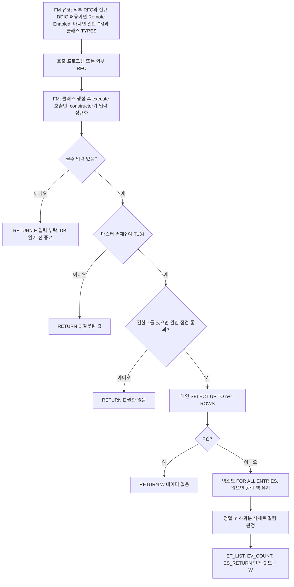

# RFC 조회 함수 모듈 설계 패턴

"~ 조회되는 펀션 만들어줘"처럼 화면 없이 목록을 돌려주는 함수 모듈(FM)을 새로 만들 때 이 팀이 정한 구조와 판단 이유입니다. 다른 SAP 프로그램이나 외부 시스템(RFC)이 부를 수 있는 조회 FM을 기준으로 합니다. 관련: [[자재마스터 조회 리포트 설계 패턴]], [[ECC 7.40 시스템 ABAP 개발 제약]], [[테스트계 반영 전 점검 항목]], [[SAP 시스템 미확인 상태에서 작업하는 방법]]

## 한눈에 보기

## 구조: FM은 얇은 래퍼, 로직은 전역 클래스

- FM 본문은 `CREATE OBJECT` → `execute( )` 호출만 두고, 입력 검증·DB 조회·결과 조립은 전역 클래스(예: `ZCL_MM_MTART_MATLIST`)에 둡니다. 이유: ① FM 안의 로직은 ABAP Unit 대상으로 만들기 어렵고 ② 당시 웹앱 개발계 반영은 클래스만 올릴 수 있었으며 ③ 함수 그룹을 옮겨도 클래스는 바뀌지 않습니다. [[req:20261119-f26e72|자재 리스트 조회 펀션 신규 개발]]
  - 정정(설계 재작업): ②는 틀린 서술이었습니다. 웹앱은 메시지 클래스(`*.msag.json`) → 함수 그룹(`*.fugr.json`) → 클래스·프로그램 → 함수 모듈(`*.fm.abap` + `*.fm.json`) 순서로 모두 자동 반영합니다. FM 소스를 `manual/`에 두고 SE37 수작업으로 돌린 1차 설계는 철회했습니다. 래퍼 구조를 유지하는 이유는 ① ABAP Unit 대상화와 ④ **결과 타입을 클래스에 정의**하는 것입니다 → [[신규 DDIC 없이 개발하는 방법]]. 설계 전에 반영 도구 동작을 추측하지 말고 src/board.ts·src/adt.ts를 읽어 확인합니다. [[req:20261119-f26e72|자재 리스트 조회 펀션 신규 개발]]
- `NEW zcl( )->execute( )`처럼 생성식에 메서드를 바로 잇지 않고 참조 변수에 받은 뒤 호출합니다(7.40 호환) → [[ECC 7.40 시스템 ABAP 개발 제약]]. [[req:20261119-f26e72|자재 리스트 조회 펀션 신규 개발]]
- DB가 필요 없는 로직(입력 정규화, 삭제 표시 range 조립, UP TO 건수 계산, 결과 조립 `build_list`, 반환 메시지 결정·조립)은 **공개 정적 메서드**로 빼서 MARA·MAKT 행을 메모리로 넣어 테스트합니다. 이 방식으로 단위테스트 17건을 만들었습니다. [[req:20261119-f26e72|자재 리스트 조회 펀션 신규 개발]]
- 한계(리뷰 I-04): 클래스가 FINAL이고 DB 접근이 private 메서드라 `check_mtart`·`read_mara`·`read_makt`·`check_authority`와 `execute` 정상 경로는 테스트 더블로 바꿀 수 없어 SE37 통합 테스트로만 확인합니다. DAO 인터페이스 주입은 반영 도구가 전역 인터페이스·로컬 타입 인클루드를 못 올려 채택하지 않았고, 이후 확장(범위 입력·대체 언어) 때 다시 검토합니다. [[req:20261119-f26e72|자재 리스트 조회 펀션 신규 개발]]
- 입력 정규화(대문자, 언어 공란 → SY-LANGU, 음수 최대건수 → 0)는 FM 기본값과 별개로 **클래스 constructor에도** 둡니다. FM 밖에서 클래스를 바로 불러도 결과가 같습니다(리포트 패턴과 같은 원칙 → [[자재마스터 조회 리포트 설계 패턴]]). [[req:20261119-f26e72|자재 리스트 조회 펀션 신규 개발]]

## FM 인터페이스 규칙

- 처리 유형 **Remote-Enabled Module**, 파라미터는 **전부 값 전달(Pass Value)** 입니다. 하나라도 빠지면 Remote-Enabled 활성화 오류가 납니다. TABLES·CHANGING·EXCEPTIONS는 쓰지 않습니다. [[req:20261119-f26e72|자재 리스트 조회 펀션 신규 개발]]
- 결과 목록은 EXPORTING 테이블 타입(신규 DDIC 구조 + 테이블 타입)으로 돌려줍니다. 호출측이 구형 RFC 라이브러리라 TABLES가 꼭 필요하면 그때 TABLES 파라미터를 추가합니다(호출 주체 현업 확인 필요). [[req:20261119-f26e72|자재 리스트 조회 펀션 신규 개발]]
- **요청별 차이 — 최종 확정안(설계 재작업)**: 위 두 항목(Remote-Enabled, 신규 DDIC 결과 타입)은 1차 설계안입니다. SE11 없이 반영했다가 `ZTTMM3600` 미존재로 활성화가 실패했고, 팀장 지시("테이블이나 구조체 만들지 않고")로 결과 타입을 클래스 `ZCL_MM_MTART_MATLIST`의 PUBLIC `TY_LIST`/`TT_LIST`로 옮겼습니다. 클래스 타입은 RFC FM 파라미터에 쓸 수 없어 FM은 **일반 함수 모듈(processingType normal)** 이 되었고, RFC(요청 원문에 없던 [추가] 항목)는 1차 개발에서 뺐습니다. 값 전달(Pass Value)은 나중에 RFC로 바꿀 때 시그니처 변경을 줄이려고 그대로 유지했습니다. 호출 주체(외부 RFC 여부)가 확정되지 않은 조회 FM은 이 일반 FM 형태를 기본으로 봅니다 → [[신규 DDIC 없이 개발하는 방법]]. [[req:20261119-f26e72|자재 리스트 조회 펀션 신규 개발]]
- 선택 입력은 FM 인터페이스에 기본값(`SY-LANGU`, `SPACE`, `0`)을 둡니다. SE37 테스트와 호출측에서 기본 동작이 바로 보이고, 현업 답에 따라 기본값만 바꾸면 되게 합니다(예: 삭제 자재 포함 여부 → `IV_WITH_DELETED` 기본값만 변경). 선택 파라미터를 뒤에 추가하는 것은 기존 호출측과 호환됩니다. [[req:20261119-f26e72|자재 리스트 조회 펀션 신규 개발]]
- 처리 결과는 클래식 EXCEPTIONS 대신 `ES_RETURN`(BAPIRET2 **단건**)으로 줍니다: E 입력 누락 / E 잘못된 값 / E 권한 없음 / W 데이터 없음 / S n건 조회 / W 최대 건수 잘림. 잘림(W)과 성공(S)이 겹치면 잘림만 주고 건수는 `EV_COUNT`로 알립니다. 오류이면 목록은 비웁니다(`execute` 첫 줄 `CLEAR`). RFC 통신 오류는 호출측 `SYSTEM_FAILURE`·`COMMUNICATION_FAILURE`로 처리합니다. [[req:20261119-f26e72|자재 리스트 조회 펀션 신규 개발]]
- RFC 실행 권한(S_RFC)은 **함수 그룹 단위**로 주므로, 외부에 열 FM은 기존 공통 그룹(예: ZFGMM41 "MM Common Function")에 넣지 않고 전용 그룹(`ZFGMM71`)을 새로 만들었습니다. 공통 그룹에 넣으면 RFC 계정에 그룹 안 다른 FM까지 열립니다. 팀도 I/F 용도별로 그룹을 나눠 왔습니다(ZFGMM01 Maximo, 03 MES, 17 업체소싱 RFC 등). [[req:20261119-f26e72|자재 리스트 조회 펀션 신규 개발]]
  - 보충(재작업, 비RFC가 된 뒤에도 전용 그룹 유지): 웹앱 반영은 활성화 대상에 **함수 그룹 전체**를 넣으므로, 전역 데이터·소속 FM을 읽을 수 없는 공용 그룹(ZFGMM41)에 넣으면 다른 FM의 비활성 변경분까지 함께 활성화될 위험이 있습니다. 이것이 주 근거가 되었고 S_RFC는 보조 근거로 낮췄습니다. 팀 표준상 공용 그룹을 써야 하면 `.fm.json`의 group만 바꿉니다. [[req:20261119-f26e72|자재 리스트 조회 펀션 신규 개발]]

## 조회 로직 판단

- **입력 누락이면 DB를 읽기 전에 끝냅니다.** 공란으로 부르면 전체 자재가 조회되는 것을 막고, 이 가드는 단위테스트로 고정합니다. [[req:20261119-f26e72|자재 리스트 조회 펀션 신규 개발]]
- 입력 코드값은 마스터 테이블로 먼저 검사합니다. 자재유형은 [[table:T134|T134]] 기본키 단건 SELECT로 존재를 보고, "없는 자재유형"과 "자재 0건"을 다른 메시지(E/W)로 구분합니다. [[req:20261119-f26e72|자재 리스트 조회 펀션 신규 개발]]
- 최대 건수는 `UP TO n+1 ROWS`로 읽고 정렬 후 n건을 넘는 부분을 지워 잘림을 판정합니다. 조건에 맞는 데이터가 정확히 n건이면 경고가 뜨지 않습니다. 0 이하는 `cl_abap_math=>max_int4`(무제한)로 바꾸며, 정적 메서드를 직접 부르는 경우도 있어 음수도 막습니다. `DELETE itab FROM` 위치는 산술식 대신 변수에 받아 넘겼습니다. [[req:20261119-f26e72|자재 리스트 조회 펀션 신규 개발]]
- 텍스트(MAKT)는 LEFT OUTER JOIN 대신 FOR ALL ENTRIES로 읽고, 드라이버가 비었는지 먼저 확인합니다. 결과 텍스트 테이블은 `HASHED ... UNIQUE KEY matnr`인데 SPRAS를 한 값으로 고정해 읽으므로 키 중복 덤프가 없습니다. 대체 언어를 도입하면 키를 MATNR+SPRAS로 바꿔야 합니다. [[req:20261119-f26e72|자재 리스트 조회 펀션 신규 개발]]
- 기본값이 무제한이면 자재가 많은 유형을 RFC로 부를 때 전체 스캔·대용량 전송 위험이 있습니다(리뷰 R-05). [[table:MARA|MARA]]의 MTART 보조 인덱스는 확인하지 못했으므로(시스템 미확인) ST05로 접근 경로·응답시간을 기록하고, 느리면 FM 기본 최대 건수를 현업과 정합니다. [[req:20261119-f26e72|자재 리스트 조회 펀션 신규 개발]]
- 코드값은 내부 형식으로 돌려줍니다(MATNR 앞 0 포함 18자리, MEINS 내부 단위값 예: ST). 외부 호출측이 화면값(PC/EA, 앞 0 없음)을 기대할 수 있으므로 출력 형식을 현업에 묻고, 필요하면 `CONVERSION_EXIT_MATN1_OUTPUT`·`CONVERSION_EXIT_CUNIT_OUTPUT`을 조립 단계에 넣습니다(리뷰 I-03). [[req:20261119-f26e72|자재 리스트 조회 펀션 신규 개발]]

## 메시지 처리

- 반환 메시지는 `MESSAGE ID c_msgid TYPE iv_type NUMBER iv_number WITH ... INTO l_msg` 후 SY-MSG*로 BAPIRET2를 채웁니다. 화면에 뜨거나 처리를 멈추지 않습니다. [[req:20261119-f26e72|자재 리스트 조회 펀션 신규 개발]]
- 메시지 클래스가 SE91에 아직 없으면 TYPE·ID·NUMBER·V1은 채워지지만 MESSAGE 텍스트가 정상 문구가 아닙니다(리뷰 R-02). 그래서 단위테스트는 텍스트를 비교하지 않고 TYPE/ID/NUMBER/V1·V2만 비교했고, 텍스트는 메시지 등록 후 통합 테스트에서 봅니다. [[req:20261119-f26e72|자재 리스트 조회 펀션 신규 개발]]
- 메시지 번호를 변수로 넘기면 SE91 사용처 조회에 걸리지 않습니다(리뷰 I-01). 필요하면 `IF 1 = 2. MESSAGE e001(zmmm3). ENDIF.` 같은 사용처 표시 블록을 둡니다. [[req:20261119-f26e72|자재 리스트 조회 펀션 신규 개발]]
- 기존 메시지 클래스(ZMMM, ZMMM2)의 빈 번호를 도구로 확인할 수 없어 신규 `ZMMM3`를 만들었습니다. 메시지 ID·번호는 클래스 상수로만 쓰므로 기존 클래스를 쓰기로 하면 상수만 바꿉니다. [[req:20261119-f26e72|자재 리스트 조회 펀션 신규 개발]]
  - 반영 결과: `ZMMM3` 자동 생성은 HTTP 400으로 실패했고(도구 문제) 클래스·FM은 활성화·ABAP Unit 18건 통과로 반영됐습니다. 메시지 클래스가 없는 동안 FM은 정상 동작하지만 ES_RETURN-MESSAGE 문구만 비정상이므로, SE91에서 001~006을 등록하기 전에는 호출측에 FM을 넘기지 않습니다 → [[테스트계 반영 전 점검 항목]]. [[req:20261119-f26e72|자재 리스트 조회 펀션 신규 개발]]
  - **최종(팀장 개발 수정 지시)**: "zmmm3 쓰지 말고 ZMM 메시지클래스를 이용해서 해줘"에 따라 신규 ZMMM3를 버리고 기존 공용 `ZMM`의 빈 번호 **338~343**을 썼습니다. 상수만 바꿔 로직·시그니처 변경이 없었습니다. 위 "신규 ZMMM3" 판단은 철회하고, 조회 FM의 메시지는 모듈 공용 클래스 재사용을 기본안으로 봅니다 → [[메시지 클래스 선택과 번호 배정 기준]]. [[req:20261119-f26e72|자재 리스트 조회 펀션 신규 개발]]

## 이름 규칙 (이 시스템에서 확인한 것)

- 구조는 핸드북 `ZSMM` + 4자리(`ZSMM3600`, ZSMM36* 비어 있음 확인), 함수 그룹은 `ZFGMM` + 2자리(ZFGMM70 다음 빈 번호 71), 메시지 클래스는 `ZMMM` + 1자리입니다. 테이블 타입은 핸드북 규칙이 없어 `ZTTMM3600`으로 했습니다. 팀 사례 `ZTMM2200` 형태는 DB 테이블 규칙(`ZTMM####`)과 이름 공간이 겹쳐 피했습니다. [[req:20261119-f26e72|자재 리스트 조회 펀션 신규 개발]]
  - 재작업 후: `ZSMM3600`·`ZTTMM3600`은 설계에서 삭제되어 시스템에 만들어지지 않았습니다(SearchObject `Z*3600` 0건). 이름 규칙 자체는 다음에 DDIC가 승인될 때 참고합니다. 클래스 이름은 핸드북 규칙이 없어 SAP 관례 `ZCL_<모듈>_<서술>`을 썼습니다. [[req:20261119-f26e72|자재 리스트 조회 펀션 신규 개발]]
- 신규 이름은 분석·설계·개발·테스트 단계마다 SearchObject로 0건인지 다시 확인했습니다. [[req:20261119-f26e72|자재 리스트 조회 펀션 신규 개발]]

## 요청 해석과 범위 (리뷰에서 나온 경향)

- "펀션"은 화면 없는 함수 모듈로 해석하고 가정으로 적습니다. 화면(리포트·ALV)은 범위 밖입니다. [[req:20261119-f26e72|자재 리스트 조회 펀션 신규 개발]]
- 요청 원문은 두 문장이었는데 분석이 요청에 없는 기능 6개(범위 입력, 삭제 자재 제외, 최대 건수, 권한 점검, RFC, 언어 선택)를 가정으로 붙였습니다. AI 검증은 특히 "삭제 표시 자재 기본 제외"가 결과 건수를 바꾼다며 현업 확인을 권했습니다. 그 뒤 설계는 요청 밖 기능에 **[추가]** 표시를 달고, 현업 답에 따라 바뀌는 곳(FM 기본값, 인수 기준 기대 건수)을 표로 남겨 승인받았습니다. 요청 밖 기능은 처음부터 구분해 표시하고, 결과에 영향을 주는 것은 "확인 대기"로 둡니다. 범위 입력처럼 꼭 필요하지 않은 것은 1차 개발에서 뺐습니다. [[req:20261119-f26e72|자재 리스트 조회 펀션 신규 개발]]
- 분석서 근거 칸에 기록에 없는 "팀장 지시"를 적었다가 AI 검증에 걸렸습니다. 근거는 request.md, 첨부, ticket의 지시 기록, "가정" 중 실제로 있는 것만 씁니다. [[req:20261119-f26e72|자재 리스트 조회 펀션 신규 개발]]
- 기존 Z FM 재사용 후보(`Z_MM_MP_SELECT_MATNR_DATA` 통합구매 그룹 ZFGMM25, `Z_MD_MIGMAT_LIST_GET` ZFGMD98)는 인터페이스를 읽지 못해 신규 개발로 정했습니다. 다른 용도 FM에 의존하면 그쪽 변경이 번지기 때문입니다. 표준 `BAPI_MATERIAL_GETLIST`는 반환에 기본단위가 없는 것으로 알려져 있습니다(시스템 미확인). [[req:20261119-f26e72|자재 리스트 조회 펀션 신규 개발]]
- 정정: 아래 문장은 1차 승인 시점 기록입니다. 그 뒤 개발계 반영이 `ZTTMM3600` 미존재로 실패해 팀장이 설계 단계로 수정 지시("테이블이나 구조체 만들지 않고 할수 있는 방법으로 변경해줘")를 내렸고, 설계·개발·테스트가 2차로 다시 승인됐습니다. [[req:20261119-f26e72|자재 리스트 조회 펀션 신규 개발]]
- 이 요청은 팀장 수정 지시 없이 네 단계가 1차로 승인됐고, 현업 확인 질문(Q1~Q11)은 답 없이 기본 가정으로 진행했습니다. 가정이 결과에 영향을 주는 Q3(삭제 자재)·Q5(출력 형식)·Q6(기본 건수)은 통합 테스트 결과와 함께 현업에 다시 확인해야 합니다. [[req:20261119-f26e72|자재 리스트 조회 펀션 신규 개발]]
