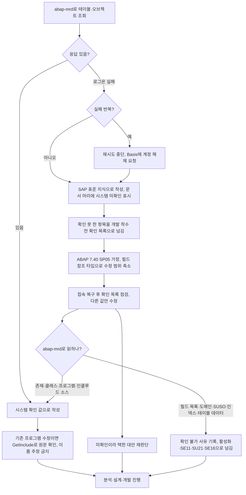

# SAP 시스템 미확인 상태에서 작업하는 방법

SAP 메타데이터 조회 도구(abap-mrd MCP)에 접속하지 못한 상태로 분석·설계를 진행할 때 팀이 쓰는 방식과, 접속이 복구된 뒤 확인·재작업하는 방식입니다.

## 한눈에 보기

작업 흐름입니다.

## 발생한 상황

- 분석 단계에서 abap-mrd로 MARA/MARC/MBEW/MAKT 구조를 조회하려 했으나 로그온 실패("Anmeldung fehlgeschlagen")로 응답을 받지 못했습니다. 이후 재작업 세션과 설계 세션에서는 abap-mrd 도구 자체를 쓸 수 없었습니다. [[req:20261006-33d4fc|자재마스터 조회 리포트]]
- 로그온 실패가 반복되면 계정이 잠길 수 있습니다. 잠긴 뒤에는 Basis 담당이 해제하기 전까지 접속을 재시도하지 않습니다. [[req:20261006-33d4fc|자재마스터 조회 리포트]]

## 진행 방식

- 표준 테이블·필드(MARA, MARC, MAKT, MBEW, T001W, T001K, T001 등)는 SAP 표준(ECC/S/4HANA 공통) 지식으로 작성하되, 문서 머리에 "시스템 미확인"을 명시하고 확인하지 못한 항목을 목록으로 남깁니다. 표준 필드라면 분석·설계 진행과 승인에는 지장이 없었습니다. [[req:20261006-33d4fc|자재마스터 조회 리포트]]
- 확인 못 한 항목은 **개발 착수 전 확인 목록**으로 넘깁니다. 이 요청에서 남긴 항목: [[req:20261006-33d4fc|자재마스터 조회 리포트]]
  - Z 오브젝트명(프로그램·클래스·T-code) 충돌 여부, 유사한 기존 Z 리포트 존재 여부 (SE80/SE93)
  - 필드명·Data Element·길이, MATNR 길이(S/4는 40자리) (SE11)
  - MARA-ERSDA, MARA-ERNAM 인덱스
  - 릴리스(ECC/S4, ABAP 7.40 SP05 이상 여부), `UP TO 0 ROWS` 동작, Material Ledger 활성 여부
  - 배치 레벨 설정(OMCT/TCUCH) → [[배치관리 자재 판정 기준]]
- ABAP 버전을 모르면 7.40 SP05 이상(New Open SQL, `@` 호스트 변수, 인라인 선언)을 가정하고 그 사실을 적어 둡니다. 릴리스에 따라 제약이 다른 구문(LEFT OUTER JOIN ON 조건의 리터럴 비교 등)은 피합니다. [[req:20261006-33d4fc|자재마스터 조회 리포트]]
- 출력 타입은 Data Element 대신 `TYPE marc-xchpf` 같은 테이블 필드 참조로 바꿀 수 있게 설계해 두면, 확인 후 이름이 달라도 수정 범위가 작습니다. [[req:20261006-33d4fc|자재마스터 조회 리포트]]

## 조회는 되는데 "미확인"으로 남는 경우 (요청별 차이)

- 앞 요청은 접속 자체가 안 됐지만, 이 요청은 접속은 되는데 **에이전트가 읽을 수 있는 것을 시도하지 않거나 이름으로 추정**해서 오류가 났습니다. [[req:20261019-bce84c|스크랩(SCRAP) 기본단가 관리 공문 메일발송 기능 개발]]
  - 분석 1차: 에이전트 설정의 MCP 서버 이름(abap-mrd)과 실제 서버 이름(mrd-abap)이 달라 도구가 붙지 않았습니다. 보드에서 고른 시스템은 헤드리스 세션에 `sap` 이름으로 붙으므로 에이전트 도구는 `mcp__sap__*`로 맞춥니다.
  - 분석 2차: 프로그램 번호만 보고 단가 테이블을 ZTMM0020으로 추정했으나 실제 GET_DATA는 ZTMM0015·ZTMM0014를 읽었습니다 → [[스크랩 고철등급 단가 데이터와 단가 표시 기준]].
  - 설계: GetInclude를 시도하지 않고 "인클루드 조회 불가"로 미결 처리해 객체 이름(이벤트 클래스·ALV 객체)과 툴바 핸들러 주석 처리 사실을 놓쳤습니다 → [[기존 모듈풀 ALV 화면에 기능 추가하는 방법]].
- 예방: 기존 프로그램을 고치는 요청은 **분석 단계에서 GetProgram → GetInclude로 현행 소스 전체를 읽고** 데이터 원천(SELECT 대상 테이블)·출력 구조·이벤트 등록 여부를 "확인됨"으로 적습니다. "조회 불가"라고 쓰기 전에 어떤 도구로 시도했고 어떤 오류였는지 남깁니다. 팀장이 요청한 AI 검증이 두 번 모두 이 유형을 잡았습니다. [[req:20261019-bce84c|스크랩(SCRAP) 기본단가 관리 공문 메일발송 기능 개발]]
- 참고 소스를 다음 담당에게 넘길 때는 **요약본이 아니라 원문 전체**를 넘깁니다. 요약본을 받은 개발 담당이 인클루드를 부분 소스로 제출한 사례가 있습니다. [[req:20261019-bce84c|스크랩(SCRAP) 기본단가 관리 공문 메일발송 기능 개발]]
- 첨부 엑셀 안의 캡처 이미지는 서버 텍스트 추출본(`attachments/.text/*.txt`)에 들어가지 않습니다. 셀 텍스트에 제목만 있고 내용이 비어 있으면 이미지 영역으로 보고, PNG/PDF 별도 첨부를 요청합니다. 그 전까지는 문구를 지어내지 않고 빈 슬롯으로 둡니다. [[req:20261019-bce84c|스크랩(SCRAP) 기본단가 관리 공문 메일발송 기능 개발]]

## 접속이 복구된 뒤 다시 진행하는 방법

- 팀장 지시 경향: 접속이 되자 "SAP 접속 성공이 되었으니 맞게 다시 진행해줘"라고 진행 중인 단계(개발)를 되돌렸습니다. 이런 지시가 오면 ① 앞 단계에서 넘긴 **확인 목록을 항목별로 시스템에서 확인**하고 ② 결과를 "확인됨 / 다름→조치 / 확인 불가(사유)" 세 가지로 표에 남기고 ③ "시스템 미확인이라 택했던 대안"을 하나씩 다시 판단해 원안 복귀 또는 유지 이유를 적는 방식이 승인을 받았습니다. 로직은 바꾸지 않고 확인 결과로 달라진 곳만 고칩니다. [[req:20261006-33d4fc|자재마스터 조회 리포트]]
- 재판단 예: `P_VARI`를 대안 타입(`disvariant-variant`)으로 두었다가 `SLIS_VARI`가 DDIC Data Element로 있고 `CL_SALV_LAYOUT->SET_INITIAL_LAYOUT` 파라미터 타입도 `SLIS_VARI`임을 확인해 원안으로 되돌렸습니다. 반대로 필드 참조 타입(`marc-lvorm` 등)은 필드→Data Element 연결을 읽을 수 없어 이점이 없으므로 유지했습니다. [[req:20261006-33d4fc|자재마스터 조회 리포트]]
- 접속 전 작성된 소스 주석에 "현업 확정"이라 적힌 내용이 승인된 설계서와 다를 수 있습니다(이 요청: 자재명 KO 고정·건수 제한 없음 vs 설계서는 미결·옵션). **승인된 설계서를 따르고** 차이를 팀장 확인 요청으로 보고합니다. [[req:20261006-33d4fc|자재마스터 조회 리포트]]

## abap-mrd(ADT)로 확인되는 것과 안 되는 것

이 시스템(ECC, SAP_BASIS 7.40 SP09 이상·7.50 미만 추정) 기준입니다. [[req:20261006-33d4fc|자재마스터 조회 리포트]]

| 확인 대상 | 도구 | 결과 | 대체 확인 |
|---|---|---|---|
| Z 오브젝트명 충돌 | SearchObject 패턴 검색 | 확인됨 | 의미 없는 이름(ZMMR0xxx 등)의 유사 리포트는 패턴에 안 걸리므로 현업·MM 담당에게 한 번 더 확인 |
| 테이블·Data Element·권한 객체·파라미터 ID·T-code **존재** | SearchObject | 확인됨 | — |
| 클래스 메서드 시그니처·예외 상속·상수 | GetClass(소스) | 확인됨 | — |
| 프로그램·인클루드 소스(모듈풀 TOP/F01/ALV 등) | GetProgram, GetInclude | 확인됨(srd-abap) — 분석·설계 담당이 "조회 불가"로 미결 처리했으나 실제로 읽힘 [[req:20261019-bce84c|스크랩(SCRAP) 기본단가 관리 공문 메일발송 기능 개발]] | — |
| 화면 흐름 논리, GUI 상태 FCODE | — | 확인 불가 [[req:20261019-bce84c|스크랩(SCRAP) 기본단가 관리 공문 메일발송 기능 개발]] | SE80, SE41 |
| 테이블 필드 목록, 필드별 Data Element, 도메인 값 | GetTable/GetStructure/GetTypeInfo | **확인 불가** — ADT에 `/sap/bc/adt/ddic/tables/.../source/main`, `/ddic/dataelements/...` 리소스가 없음(`ExceptionResourceNotFound`, 7.50 미만 ADT) | 필드 참조로 작성해 활성화 때 검증, SE11 |
| 권한 객체 필드 정의(SUSO) | — | 확인 불가 | SU21 |
| 인덱스 정의 | — | 확인 불가 | SE11 > 인덱스, ST05 |
| Customizing·테이블 데이터(예: TCUCH 배치 레벨) | — | 확인 불가(리포지토리 오브젝트만 읽음) | SE16, OMCT |
| SAP_BASIS 정확한 SP | — | 직접 조회 불가 → 아래 방법으로 추정 | 시스템 > 상태 |

- **릴리스 추정법**: 버전별로 처음 생긴 오브젝트의 존재로 범위를 좁힙니다. `IF_AMDP_MARKER_HDB`(7.40 SP05~), `CL_ABAP_TESTDOUBLE`(7.40 SP09~), `CL_ABAP_CORRESPONDING`(7.50~), `CL_OSQL_TEST_ENVIRONMENT`(7.51~). ECC/S4 구분은 도메인 MATNR 내역("C18"이면 18자리), MBEW가 투명 테이블인지, MATDOC·ACDOCA 존재 여부로 봅니다. 자세한 제약은 [[ECC 7.40 시스템 ABAP 개발 제약]]. [[req:20261006-33d4fc|자재마스터 조회 리포트]]
- 같은 유형의 실패라도 시스템마다 다릅니다. srd-abap에서도 GetTable/GetStructure/GetTypeInfo가 Z 테이블(ZTMM0015, ZSMM0015)과 표준 Data Element(AD_SMTPADR)에서 `/ddic/.../source/main does not exist`로 실패했습니다. 이때는 운영 중인 활성 소스의 SELECT 필드 목록으로 필드 존재를 간접 확인하고, 타입은 `ztmm0015-danga` 같은 필드 참조로 선언합니다. [[req:20261019-bce84c|스크랩(SCRAP) 기본단가 관리 공문 메일발송 기능 개발]]
- 접속 후에도 이 단계들은 **읽기 조회만** 합니다. 오브젝트 생성·활성화·이송은 하지 않으므로 활성화(구문 검사)는 테스트계 반영 때 처음 확인됩니다 → [[테스트계 반영 전 점검 항목]]. [[req:20261006-33d4fc|자재마스터 조회 리포트]]
