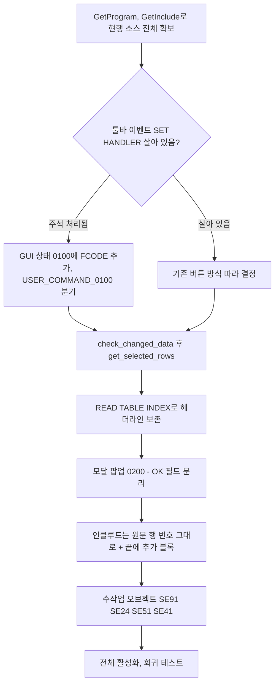

# 기존 모듈풀 ALV 화면에 기능 추가하는 방법

운영 중인 모듈풀(CL_GUI_ALV_GRID, 화면 100) 프로그램에 버튼·팝업 기능을 덧붙일 때의 판단 기준과 주의점입니다. 첫 사례는 고철등급별 단가관리(ZEMM2222)에 "공문발송"을 붙인 작업입니다. 관련: [[SAP 메일 발송(BCS) 구현 패턴]], [[스크랩 고철등급 단가 데이터와 단가 표시 기준]], [[테스트계 반영 전 점검 항목]], [[SAP 시스템 미확인 상태에서 작업하는 방법]]

## 한눈에 보기

## 대상 프로그램 확정

- 팀장 지시로 대상이 ZEMM0020에서 **ZEMM2222**로 바뀌었습니다("ZEMM0020에서 ZEMM2222 tcode 프로그램으로 변경해서 요구사항 분석부터 다시"). ZEMM2222(SAPMZMM2222, MZMM2222TOP/ALV/F01/F02/I01/O01)는 ZEMM0020을 복사한 `$TMP` 오브젝트였고, 인클루드 헤더 주석도 'MZMM0020'으로 남아 있었습니다. 원본은 손대지 않고 사본에서 먼저 검증하려는 의도로 보이며, "현업 사용 화면인지 검증용 사본인지", "정식 패키지(ZMMD) 이관 여부"를 팀장 결정 항목으로 올렸습니다. [[req:20261019-bce84c|스크랩(SCRAP) 기본단가 관리 공문 메일발송 기능 개발]]
- 대상이 바뀌면 **이전 대상용 소스를 src/에서 빼야 합니다.** ZEMM0020용 소스 6개가 src/에 남아 있으면 개발계 반영 때 함께 올라가 원본을 덮어쓸 위험이 있어 PL이 별도 폴더로 옮겼습니다. [[req:20261019-bce84c|스크랩(SCRAP) 기본단가 관리 공문 메일발송 기능 개발]]

## 현행 구조 파악

- 이 시스템에서 모듈풀 소스는 `GetProgram`(메인), `GetInclude`(TOP/ALV/F01/F02/I01/O01)로 **읽힙니다.** 설계 담당이 "인클루드 조회 불가"로 미결을 남겼다가 AI 검증이 직접 읽어 이름 오류(LCL_EVENT_HANDLER → 실제 `LCL_EVENT_RECEIVER`, go_grid → `GRID`, 출력 테이블 `GT_PR`)를 찾았습니다. 화면 흐름 논리·GUI 상태 내용은 여전히 못 읽으므로 SE80/SE41에서 확인합니다(시스템 미확인). [[req:20261019-bce84c|스크랩(SCRAP) 기본단가 관리 공문 메일발송 기능 개발]]
- PAI 순서: 화면 100은 `USER_COMMAND_XXXX`가 `SAVE_OK = OK_CODE`로 옮긴 뒤 `USER_COMMAND_0100`의 `CASE SAVE_OK`가 처리합니다(SAPMZMM0020 계열 추정). [[req:20261019-bce84c|스크랩(SCRAP) 기본단가 관리 공문 메일발송 기능 개발]]

## 설계 판단

- **버튼 방식**: MZMM2222F02 CREATE_EVENT_RECEIVER에서 `HANDLE_TOOLBAR`의 SET HANDLER와 `SET_TOOLBAR_INTERACTIVE`가 주석 처리되어 있어, HANDLE_TOOLBAR에 버튼만 추가하면 화면에 나타나지 않습니다. 기존 버튼(TOGG/CREA/COPY/DEL/SAVE/GRAD)과 같게 **GUI 상태 0100에 FCODE(ZMAIL) 추가 + USER_COMMAND_0100 `WHEN` 분기**로 정했습니다. 툴바 이벤트 메서드가 "있다"는 것과 "등록되어 있다"는 것을 구분해 확인합니다. [[req:20261019-bce84c|스크랩(SCRAP) 기본단가 관리 공문 메일발송 기능 개발]]
- **선택 행 수집**: 편집형 ALV에서는 기존 COPY/DEL처럼 `grid->check_changed_data` → `grid->get_selected_rows` 순서로 부릅니다. 설계 초안에 check_changed_data가 빠져 검증에서 지적됐습니다. 리뷰(R-06)는 한발 더 나아가 `e_valid`가 공란(입력 오류 셀)이면 중단하라고 권고했습니다. 대외로 나가는 기능일수록 중요합니다. [[req:20261019-bce84c|스크랩(SCRAP) 기본단가 관리 공문 메일발송 기능 개발]]
- 헤더라인 테이블(`GT_PR`)은 `READ TABLE gt_pr INTO ls_pr INDEX` 로 읽어 헤더라인을 바꾸지 않습니다. 선택 결과의 ROWTYPE 있는 행(소계 등)은 제외하고 INDEX 오름차순으로 처리합니다. [[req:20261019-bce84c|스크랩(SCRAP) 기본단가 관리 공문 메일발송 기능 개발]]
- **팝업**: 모달 화면 0200 + GUI 상태 0200(발송 SEND=Enter, 취소 CANC=기능유형 E·F12) + 제목 0200. OK 필드는 `G_OK_0200`으로 화면 100의 OK_CODE/SAVE_OK와 분리하고, 취소는 `AT EXIT-COMMAND` 모듈에서 처리합니다. 입력 오류면 메시지 후 팝업을 유지합니다. 모달 팝업에는 상태줄이 없어 `TYPE 'S' DISPLAY LIKE 'E'` 메시지가 잘 안 보일 수 있으니 통합 테스트에서 확인합니다(R-12). [[req:20261019-bce84c|스크랩(SCRAP) 기본단가 관리 공문 메일발송 기능 개발]]
- MODULE 안에 DATA를 선언하면 프로그램 전역 변수가 되어 핸드북의 L_ 지역 변수 규칙에 어긋납니다. 모듈은 FCODE 분기만 하고 로직은 FORM으로 뺍니다. [[req:20261019-bce84c|스크랩(SCRAP) 기본단가 관리 공문 메일발송 기능 개발]]
- 신규 메시지는 기존 `MESSAGE-ID ZMMM`을 건드리지 않고 별도 메시지 클래스(ZMMM3, 핸드북 `ZM<모듈><번호>`)에 두고 `MESSAGE ID zcl_...=>c_msgid`로 띄웠습니다. 이름 충돌은 SearchObject로 미존재를 확인합니다. [[req:20261019-bce84c|스크랩(SCRAP) 기본단가 관리 공문 메일발송 기능 개발]]

## 소스 제출 규칙 (결함 사례)

- **인클루드는 원문 전체 + 추가 블록으로 제출합니다.** 1차 개발에서 MZMM0020F01이 "추가할 부분"만으로 제출돼, 그대로 반영하면 기존 저장·복사·삭제 FORM이 지워질 뻔했습니다. 원인은 PL이 개발 담당에게 준 참고 소스(ref/)가 **요약본**이었기 때문입니다. 참고 소스는 GetInclude 원문을 그대로 저장하고, 원문과 줄 단위 대조(기존 FORM 줄 수 차이 = 추가한 헤더 줄 수뿐인지)를 PL 검토 항목으로 둡니다. [[req:20261019-bce84c|스크랩(SCRAP) 기본단가 관리 공문 메일발송 기능 개발]]
- 기존 로직·대소문자·주석은 그대로 두고 변경 이력 주석과 `*-- U4 START` ~ `*-- U4 END` 블록만 추가합니다. 변경이 없는 인클루드(ALV, F02, 메인)는 파일을 만들지 않습니다. 줄바꿈이 압축된 참고본으로 F02를 덮어쓰면 원문 서식이 바뀌므로, 나중에 고칠 때는 원문을 다시 조회합니다. [[req:20261019-bce84c|스크랩(SCRAP) 기본단가 관리 공문 메일발송 기능 개발]]
- 반영 직전에 대상 인클루드가 참고본 이후 바뀌지 않았는지 SE38 버전으로 확인합니다. [[req:20261019-bce84c|스크랩(SCRAP) 기본단가 관리 공문 메일발송 기능 개발]]
- **원문 행 번호를 바꾸지 않는 배치(개발 3차, 승인됨)**: 개발계 반영 실패 후 팀장이 "기존 있는 거에 밑에 추가나 수정으로 반영해줘"라고 지시해, 2차까지 원문 헤더 아래에 넣었던 변경 이력 주석 3줄과 TOP 중간 3곳에 나눠 넣었던 선언을 모두 **파일 끝 U4 블록 하나로** 옮겼습니다. 그 결과 TOP·O01·F01은 원문 전 줄이 같은 행 번호로 남고 끝에만 추가분이 붙었습니다. 원문 중간 삽입은 PAI의 `CASE` 안 `WHEN c_fc_mail` 분기 4줄(I01)처럼 피할 수 없는 곳만 둡니다. 이점: ① SE38 버전 비교 차이가 끝 블록뿐이라 회귀 검토가 쉽고 ② 반영 도구가 안 될 때 "끝에 붙여넣기"만으로 수작업 반영할 수 있으며 ③ 리뷰가 ENDFORM 행 번호로 원문 일치를 기계적으로 대조할 수 있습니다. [[req:20261019-bce84c|스크랩(SCRAP) 기본단가 관리 공문 메일발송 기능 개발]]
- TOP의 DATA·CONSTANTS 선언은 원문 마지막 문장(`SELECT-OPTIONS ... OBLIGATORY.`) 뒤에 두어도 됩니다. TOP은 다른 인클루드보다 먼저 INCLUDE되므로 선언 위치만 다르고 동작·활성화는 같습니다(테스트 2차 확인). 새 이름은 ref/ 전체에서 Grep으로 기존 이름과 겹치지 않는지 확인합니다. [[req:20261019-bce84c|스크랩(SCRAP) 기본단가 관리 공문 메일발송 기능 개발]]
- 개발 문서에는 인클루드별로 **원문 범위 / 추가 범위(행 번호)** 와 붙여넣을 위치(예: F01은 DEL_ROWS `ENDFORM.` 다음에 695~845행, I01은 `CALL TRANSACTION 'ZTMM0014'.` 다음에 49~52행)를 표로 적어, 웹앱 반영이 안 될 때 SE38에서 그대로 따라 할 수 있게 합니다. 웹앱 반영 실패 원인은 → [[테스트계 반영 전 점검 항목]]. [[req:20261019-bce84c|스크랩(SCRAP) 기본단가 관리 공문 메일발송 기능 개발]]

## 소스 파일로 올라가지 않는 오브젝트

- 메시지(SE91), 클래스 텍스트 심볼(SE24), 화면 0200 레이아웃(SE51), GUI 상태·제목(SE41)은 ADT 소스 업로드로 반영되지 않아 개발 문서에 수작업 절차로 적었습니다. 권장 순서: SE91 메시지 클래스 → SE24 클래스·텍스트 심볼 → 인클루드 TOP→O01→I01→F01 → SE51 화면 → SE41 GUI 상태 → 프로그램 전체 활성화. 클래스가 먼저 있어야 TOP(클래스 타입 참조)이 활성화됩니다. 화면 0200이 없으면 버튼 클릭 시 DYNPRO_NOT_FOUND 덤프가 납니다(R-08). [[req:20261019-bce84c|스크랩(SCRAP) 기본단가 관리 공문 메일발송 기능 개발]]

## 팀장 요구 경향: 첨부 설계 시트 기준

- 팀장은 설계서가 현업 첨부 설계 시트(구글시트)와 1:1로 맞는지를 집중적으로 봤습니다. 지시 순서: "구글시트에 설계내용을 보고 설계한 거 맞니?" → "메일주소를 입력받는 부분이 없네" → "메일 양식처럼 만들어졌는지 궁금하니 이 화면도 설계에 추가해줘". [[req:20261019-bce84c|스크랩(SCRAP) 기본단가 관리 공문 메일발송 기능 개발]]
- 승인받은 방식: ① 설계서 맨 앞에 **시트 셀 위치(B21, C56~C111) ↔ 설계 반영 위치 대응표** ② 시트에 없는 기능(CC, 미리보기, 발송 이력, 확인 팝업 등)은 빼고, 개발에 꼭 필요한 시트 외 항목(취소 버튼, 주소 오류 메시지, 제목 가안, 발신자)만 "시트 외 - 팀장 확인 필요"로 따로 표시 ③ 시트 샘플 값 표기까지 맞춤(470이 아니라 470.0) ④ 사용자가 보게 될 화면(입력 팝업은 입력칸까지)과 **발송 결과물(메일 모습) 목업**을 설계서에 그림. [[req:20261019-bce84c|스크랩(SCRAP) 기본단가 관리 공문 메일발송 기능 개발]]
- 시트 안의 캡처 이미지(메신저 대화, 메일 양식, 팝업 모양)는 텍스트 추출본에 없어 반영하지 못했습니다. 이미지 영역이 있는 첨부는 분석 단계에서 PNG/PDF로 따로 받아야 합니다. [[req:20261019-bce84c|스크랩(SCRAP) 기본단가 관리 공문 메일발송 기능 개발]]
