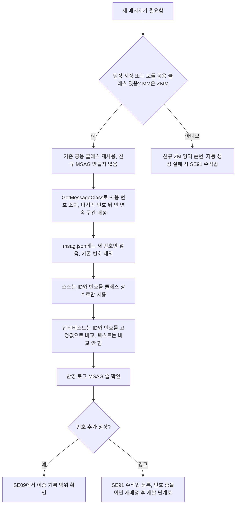

# 메시지 클래스 선택과 번호 배정 기준

조회 FM·클래스가 BAPIRET2 등으로 돌려줄 메시지를 어느 메시지 클래스(SE91)에 둘지, 번호를 어떻게 잡을지, 웹앱 개발계 반영에서 무엇을 확인할지 정리합니다. 관련: [[RFC 조회 함수 모듈 설계 패턴]], [[신규 DDIC 없이 개발하는 방법]], [[테스트계 반영 전 점검 항목]], [[SAP 시스템 미확인 상태에서 작업하는 방법]]

## 한눈에 보기

## 팀장 지시와 요구 경향

- 1차 개발은 기존 메시지 클래스의 빈 번호를 도구로 확인할 수 없다는 이유로 신규 `ZMMM3`(001~006)을 만들었습니다. 개발계 반영에서 MSAG 자동 생성이 HTTP 400으로 실패하자, 팀장은 개발 단계로 "zmmm3 쓰지 말고 ZMM 메시지클래스를 이용해서 해줘"라고 수정 지시했습니다. [[req:20261119-f26e72|자재 리스트 조회 펀션 신규 개발]]
- 경향: 팀장은 **신규 오브젝트를 늘리지 않는 쪽**을 선호합니다. 신규 DDIC를 없앤 지시("테이블이나 구조체 만들지 않고")와 같은 방향입니다 → [[신규 DDIC 없이 개발하는 방법]]. MM 메시지는 기존 공용 클래스 `ZMM`(내역 "MM Message Class", 패키지 ZMMD)을 기본안으로 둡니다. [[req:20261119-f26e72|자재 리스트 조회 펀션 신규 개발]]
- 핸드북 메시지 클래스 이름 규칙(`Z` + `M` + 영역 2자리 + 순번 1자리, 예 `ZMMM3`)에 `ZMM`은 맞지 않지만, 신규 생성이 아니라 기존 공용 오브젝트이고 팀장 지정이므로 테스트 리뷰에서 **예외로 수용**했습니다(I-06). [[req:20261119-f26e72|자재 리스트 조회 펀션 신규 개발]]

## 번호 배정

- 개발 재작업 때 MCP `GetMessageClass ZMM`으로 사용 번호를 조회했습니다: 000~064, 077, 078, 101, 104, 116~127, 200~237, 240~276, 301~337. 중간의 빈 번호(065~076 등)가 아니라 **마지막 사용 번호 다음의 빈 연속 구간(338~343)** 에 6건을 묶어 배정했습니다. 한 기능의 메시지를 한 구간에 두면 사용처 파악이 쉽습니다. [[req:20261119-f26e72|자재 리스트 조회 펀션 신규 개발]]
  - 개발 담당 세션에는 메시지 번호 조회 도구가 없어 이 목록은 PL 조회 결과 기준입니다. 반영 직전 SE91에서 338~343이 비어 있는지 다시 확인합니다(공용 클래스라 그 사이 다른 개발자가 쓸 수 있음). [[req:20261119-f26e72|자재 리스트 조회 펀션 신규 개발]]
- 기존 `ZMM` 메시지 중 뜻이 비슷한 것(예: 002 "데이터가 존재하지 않습니다.")은 자리표시자(&1/&2) 구성과 의미가 달라 재사용하지 않았습니다. 기존 번호를 재사용하려면 &n 개수·순서까지 맞아야 합니다. [[req:20261119-f26e72|자재 리스트 조회 펀션 신규 개발]]
- 메시지 클래스·번호는 소스에서 **클래스 상수**(`C_MSGID`, `C_MSG_NO_INPUT`~`C_MSG_TRUNC`)로만 써 두었기 때문에, 클래스를 바꿀 때 상수 7개와 `*.msag.json`만 바꾸고 로직·시그니처는 그대로였습니다. 이 구조를 유지합니다. [[req:20261119-f26e72|자재 리스트 조회 펀션 신규 개발]]
- 호출측이 `ES_RETURN-ID`/`NUMBER`로 분기할 수 있으므로, 번호가 바뀌면 설계서 메시지 표도 같이 고쳐야 합니다. 이 요청은 개발 단계만 재작업해 설계서 7장에 옛 `ZMMM3` 001~006이 남았고 테스트 리뷰가 산출물 불일치(W-08)로 지적했습니다. [[req:20261119-f26e72|자재 리스트 조회 펀션 신규 개발]]

## 공용 메시지 클래스를 쓸 때의 위험

- **사용처 조회에 안 걸림**: `MESSAGE ID c_msgid TYPE ... NUMBER iv_number`처럼 동적으로 쓰면 SE91 사용처 조회에 338~343이 보이지 않습니다. 공용 클래스에서는 다른 개발자가 "미사용"으로 보고 같은 번호를 고칠 위험이 커지므로 `IF 1 = 2. MESSAGE e338(zmm). ... ENDIF.` 사용처 표시 블록을 권장합니다(리뷰 I-01, 이번에는 선택 사항으로 남김). [[req:20261119-f26e72|자재 리스트 조회 펀션 신규 개발]]
- **번호 충돌 시 조용히 넘어감**: 웹앱 `addMessages`(src/adt.ts)는 없는 번호만 추가하고, 이미 있는 번호는 텍스트가 달라도 그대로 두고 경고만 남깁니다(src/board.ts). 기존 메시지를 덮어쓰지 않는 장점이 있지만, 충돌하면 ES_RETURN-MESSAGE가 엉뚱한 문구가 됩니다. 반영 로그가 정확히 "메시지 338 ~ 343 추가"인지, "SAP 텍스트와 달라 그대로 두었습니다" 경고가 없는지 확인합니다. [[req:20261119-f26e72|자재 리스트 조회 펀션 신규 개발]]
- **잠금·이송 범위**: 웹앱은 메시지 클래스 전체 XML을 잠금 후 PUT합니다. ① 다른 개발자의 미반출 이송요청에 ZMM이 잠겨 있으면 실패(경고)하고 ② 이송요청에 메시지 6건(`LIMU MESS`)이 아니라 `R3TR MSAG ZMM` 전체가 기록되면 QAS·PRD 이관 때 다른 사람의 미이관 ZMM 변경까지 넘어갈 수 있습니다. 반영 후 SE09/SE10에서 오브젝트 목록을 보고, 전체로 잡혔으면 이관 전에 팀장 판단을 받습니다(리뷰 W-07, 시스템 미확인). [[req:20261119-f26e72|자재 리스트 조회 펀션 신규 개발]]
- 기존 메시지 클래스에 번호를 추가하는 경로(갱신)가 신규 생성과 같은 HTTP 400으로 실패하는지는 이 위키 작성 시점에 반영이 진행 중이라 확인하지 못했습니다(시스템 미확인). 실패하면 `src/ZMM.msag.json`의 번호·문구를 SE91에서 같은 이송요청으로 등록합니다 → [[테스트계 반영 전 점검 항목]]. [[req:20261119-f26e72|자재 리스트 조회 펀션 신규 개발]]

## 테스트 방법

- 단위테스트는 메시지 **텍스트를 비교하지 않고** TYPE/ID/NUMBER/V1·V2만 비교합니다. 메시지 클래스 등록이 실패해도 활성화·ABAP Unit은 통과하고 텍스트만 비정상이 되기 때문입니다 → [[RFC 조회 함수 모듈 설계 패턴]]. [[req:20261119-f26e72|자재 리스트 조회 펀션 신규 개발]]
- 기대값은 클래스 상수가 아니라 **테스트 쪽 고정값**(`C_EXP_MSGID 'ZMM'`, `C_EXP_NO_338`~`343`)으로 둡니다. 상수를 기대값으로 쓰면 상수가 잘못 바뀌어도 테스트가 통과합니다. 메시지 계약 테스트(`ut19_msg_contract_zmm`: 상수 7개 값 + 6개 번호별 `make_return` 결과)를 추가해 ABAP Unit이 19건이 됐습니다. [[req:20261119-f26e72|자재 리스트 조회 펀션 신규 개발]]
- 메시지 클래스를 바꾸면 테스트 소스의 주석·assert 메시지 문자열(`'UT-13 ID ZMMM3'` 등)에 남은 옛 이름도 Grep으로 찾아 고칩니다. 판정에는 영향이 없었지만 혼동을 줍니다(F-01). [[req:20261119-f26e72|자재 리스트 조회 펀션 신규 개발]]

## 쓰지 않게 된 정의 파일 처리

- 웹앱은 `src/*.msag.json`이 있으면 그 메시지 클래스를 만들려고 하므로, `ZMMM3.msag.json`이 남아 있으면 쓰지 않는 ZMMM3가 다시 생성 시도됩니다. 파일 삭제는 팀장 확인 대상이라 확장자를 `ZMMM3.msag.json.unused`로 바꿔 반영 필터(`.msag.json`)에서 빠지게 했고, 테스트가 board.ts 필터로 반영 제외를 확인했습니다. 되돌릴 수 있는 방법이라 삭제 승인 없이 쓸 수 있습니다. [[req:20261119-f26e72|자재 리스트 조회 펀션 신규 개발]]
- 이렇게 남긴 파일은 개발 문서에 "삭제 대상"으로 적힌 서술과 실제 상태(`.unused`)가 어긋나기 쉬우니 문서도 함께 고칩니다(리뷰 I-07). [[req:20261119-f26e72|자재 리스트 조회 펀션 신규 개발]]
