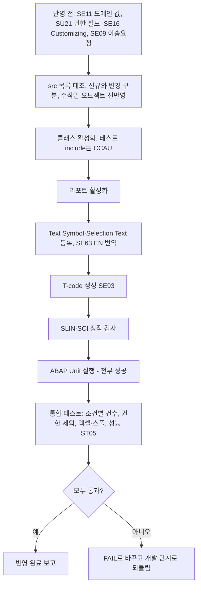

# 테스트계 반영 전 점검 항목

개발·테스트 단계는 시스템에 쓰지 않으므로 활성화와 ABAP Unit 실행은 테스트계(QAS) 반영 때 처음 일어납니다. 그때 순서대로 확인할 항목과, 하나라도 실패하면 개발 단계로 되돌리는 기준을 정리합니다. 관련: [[SAP 시스템 미확인 상태에서 작업하는 방법]], [[ECC 7.40 시스템 ABAP 개발 제약]]

## 한눈에 보기

## 반영 전 확인 (도구로 못 읽은 것)

- abap-mrd(ADT)로 읽지 못한 항목은 반영 전에 SAP GUI로 확인합니다: SE11 필드·도메인 값(예: MARC-XCHPF가 'X'/공란뿐인지), SU21 권한 객체 필드(예: `M_MATE_WRK` = ACTVT, WERKS), SE11 인덱스, SE16 Customizing(예: TCUCH 배치 레벨), 시스템 > 상태의 SAP_BASIS SP. (시스템 미확인) [[req:20261006-33d4fc|자재마스터 조회 리포트]]
- 개발 패키지는 시스템에 실제로 있는 이름을 씁니다. MM은 `ZMMD`("MM Development Package")이고, 설계에서 가정한 "ZMM"은 패키지가 아니라 메시지 클래스 이름입니다. 이송요청은 SE09에서 따로 만듭니다. [[req:20261006-33d4fc|자재마스터 조회 리포트]]

## 개발계 반영(웹앱 ADT) 이슈

- **기존 오브젝트를 "생성"하려다 실패**: 기존 모듈풀 인클루드를 고친 요청에서 개발계 반영이 `MZMM2222F01 생성 실패 (HTTP 500): 이름 MZMM2222F01으(로) 이미 프로그램이나 include가 있습니다`로 멈췄습니다. 반영 도구가 src/ 파일을 모두 신규 생성으로 처리했기 때문입니다. 기존 프로그램 변경 요청은 반영 전에 오브젝트별로 신규/변경을 구분하고(개발 문서 오브젝트 목록의 "신규/변경" 열), 변경 대상은 기존 소스 갱신(잠금 → 소스 쓰기 → 활성화) 방식으로 올려야 합니다. 이 요청은 반영 실패 상태로 남아 있습니다. [[req:20261019-bce84c|스크랩(SCRAP) 기본단가 관리 공문 메일발송 기능 개발]]
- 반영 순서에 의존성이 있으면 업로드 순서도 지켜야 합니다. 예: 신규 클래스(타입 참조)·메시지 클래스가 먼저 있어야 인클루드 TOP·F01이 활성화됩니다. 화면(SE51)·GUI 상태(SE41)·메시지(SE91)·텍스트 심볼은 소스 파일로 올라가지 않으므로 수작업 체크리스트로 처리합니다 → [[기존 모듈풀 ALV 화면에 기능 추가하는 방법]]. [[req:20261019-bce84c|스크랩(SCRAP) 기본단가 관리 공문 메일발송 기능 개발]]
- src/에 이전 대상(예: ZEMM0020용) 소스가 남아 있으면 함께 올라가 다른 프로그램을 덮어씁니다. 반영 전에 src/ 파일 목록이 개발 문서의 오브젝트 목록과 같은지 확인합니다. [[req:20261019-bce84c|스크랩(SCRAP) 기본단가 관리 공문 메일발송 기능 개발]]
- 대상이 `$TMP`(로컬 오브젝트)면 이송요청에 담을 수 없어 품질·운영 반영 경로가 없습니다. 개발계 검증만 하는 것인지, 정식 패키지(MM은 ZMMD)로 재지정할지 반영 전에 팀장 결정을 받습니다. [[req:20261019-bce84c|스크랩(SCRAP) 기본단가 관리 공문 메일발송 기능 개발]]
- 메일 발송 기능은 반영 후 SCOT 외부 발송 설정, 발신 사용자 SU01 메일 등록을 Basis에 확인하고 사내 주소로만 테스트합니다(시스템 미확인) → [[SAP 메일 발송(BCS) 구현 패턴]]. [[req:20261019-bce84c|스크랩(SCRAP) 기본단가 관리 공문 메일발송 기능 개발]]

## 활성화 순서와 주의

- 순서: 전역 클래스 → 리포트 → Text Symbol/Selection Text → T-code. 이후 SLIN, SCI 결과를 확인합니다. [[req:20261006-33d4fc|자재마스터 조회 리포트]]
- 필드 참조 타입(`TYPE marc-xchpf`)으로 쓴 소스는 **활성화가 통과하면 필드 존재가 확인된 것**으로 봅니다. 필드 목록을 못 읽은 시스템에서 이 방식이 확인 수단이 됩니다. [[req:20261006-33d4fc|자재마스터 조회 리포트]]
- 테스트 클래스 파일(`*.testclasses.abap`)은 클래스의 Local Test Classes include(CCAU)에 넣습니다. [[req:20261006-33d4fc|자재마스터 조회 리포트]]
- **텍스트 요소는 소스 파일에 들어 있지 않습니다.** Text Symbol(블록 제목·컬럼명·메시지)과 Selection Text는 개발 문서 표로만 있으므로, 반영 도구(웹앱 ADT)가 함께 올리지 않으면 활성화는 되지만 블록 제목이 빈칸, 선택화면 라벨이 기술명(S_WERKS 등)으로 나옵니다. 반영 후 화면을 열어 보고, 빠졌으면 SE38 텍스트 요소 등록과 SE63 EN 번역을 체크리스트로 처리합니다(리뷰 W3). Text Symbol 정의 길이는 소스 리터럴 길이 이상으로 잡습니다. [[req:20261006-33d4fc|자재마스터 조회 리포트]]
- 프로그램 권한그룹(S_PROGRAM)을 지정하지 않으면 SA38/SE38 직접 실행 시 T-code의 S_TCODE 체크를 거치지 않습니다. 팀 표준 권한그룹을 지정합니다(리뷰 I7). [[req:20261006-33d4fc|자재마스터 조회 리포트]]

## 조건부 합격(PASS) 유지 조건

- 테스트 단계가 시스템 없이 정적 리뷰만 했으면 판정은 "조건부 합격"이고, 반영 때 아래 중 하나라도 실패하면 FAIL로 바꾸고 개발 단계로 되돌립니다. [[req:20261006-33d4fc|자재마스터 조회 리포트]]
  - 활성화 성공 + ABAP Unit 전부 성공
  - 선택조건 라디오별 건수가 맞음(예: 전체 = 배치관리만 + 비배치관리만, 삭제 제외/삭제만/전체)
  - 권한 없는 플랜트가 결과에서 빠지고 경고가 나옴
- 함께 볼 것: 엑셀(XLSX) 내보내기에서 체크박스 컬럼이 X/빈칸인지(SAP GUI 버전 기록), 백그라운드 스풀 출력, 넓은 조건의 응답시간(ST05로 인덱스 사용 기록). [[req:20261006-33d4fc|자재마스터 조회 리포트]]
