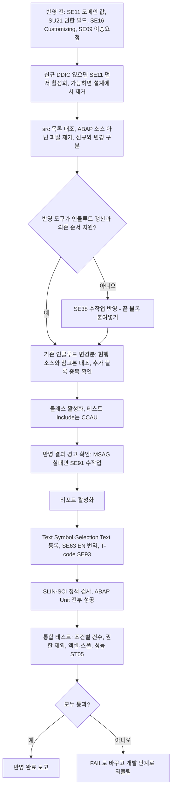

# 테스트계 반영 전 점검 항목

개발·테스트 단계는 시스템에 쓰지 않으므로 활성화와 ABAP Unit 실행은 테스트계(QAS) 반영 때 처음 일어납니다. 그때 순서대로 확인할 항목과, 하나라도 실패하면 개발 단계로 되돌리는 기준을 정리합니다. 관련: [[SAP 시스템 미확인 상태에서 작업하는 방법]], [[ECC 7.40 시스템 ABAP 개발 제약]]

## 한눈에 보기

## 반영 전 확인 (도구로 못 읽은 것)

- abap-mrd(ADT)로 읽지 못한 항목은 반영 전에 SAP GUI로 확인합니다: SE11 필드·도메인 값(예: MARC-XCHPF가 'X'/공란뿐인지), SU21 권한 객체 필드(예: `M_MATE_WRK` = ACTVT, WERKS), SE11 인덱스, SE16 Customizing(예: TCUCH 배치 레벨), 시스템 > 상태의 SAP_BASIS SP. (시스템 미확인) [[req:20261006-33d4fc|자재마스터 조회 리포트]]
- 개발 패키지는 시스템에 실제로 있는 이름을 씁니다. MM은 `ZMMD`("MM Development Package")이고, 설계에서 가정한 "ZMM"은 패키지가 아니라 메시지 클래스 이름입니다. 이송요청은 SE09에서 따로 만듭니다. [[req:20261006-33d4fc|자재마스터 조회 리포트]]

## 개발계 반영(웹앱 ADT) 이슈

- **기존 오브젝트를 "생성"하려다 실패**: 기존 모듈풀 인클루드를 고친 요청에서 개발계 반영이 `MZMM2222F01 생성 실패 (HTTP 500): 이름 MZMM2222F01으(로) 이미 프로그램이나 include가 있습니다`로 멈췄습니다. 반영 도구가 src/ 파일을 모두 신규 생성으로 처리했기 때문입니다. 기존 프로그램 변경 요청은 반영 전에 오브젝트별로 신규/변경을 구분하고(개발 문서 오브젝트 목록의 "신규/변경" 열), 변경 대상은 기존 소스 갱신(잠금 → 소스 쓰기 → 활성화) 방식으로 올려야 합니다. 이 요청은 반영 실패 상태로 남아 있습니다. [[req:20261019-bce84c|스크랩(SCRAP) 기본단가 관리 공문 메일발송 기능 개발]]
  - **원인 상세(PL 분석)**: 반영 도구가 존재 여부를 `/sap/bc/adt/programs/programs/<이름>`(PROG/P 경로)로만 확인했습니다. 인클루드는 PROG/I라 `/sap/bc/adt/programs/includes/<이름>`에 있으므로 "없음(404)"으로 판단되어 신규 생성을 시도했습니다. 소스 내용 문제가 아니라 **오브젝트 유형(PROG/P·PROG/I) 판별 문제**이므로 개발 소스를 고쳐서는 해결되지 않습니다. 같은 프로그램의 다른 인클루드(TOP·O01·I01)도 같은 방식으로 실패할 수 있습니다. 반영 전에 SearchObject 결과의 유형·URI(`/programs/includes/`)로 인클루드 여부를 확인합니다. [[req:20261019-bce84c|스크랩(SCRAP) 기본단가 관리 공문 메일발송 기능 개발]]
  - **팀장 지시와 조치**: 팀장은 반영 오류를 개발 단계 수정 지시로 돌려보냈습니다("기존 있는 거에 밑에 추가나 수정으로 반영해줘"). 개발 3차는 인클루드를 "현행 원문 그대로 + 끝에 추가 블록" 형태로 정리하고, 개발 문서에 **SE38 수작업 대안**(기존 인클루드를 열어 끝에 추가 블록만 붙여넣기 → 저장 → 전체 활성화)을 행 범위까지 적었습니다 → [[기존 모듈풀 ALV 화면에 기능 추가하는 방법]]. 도구가 고쳐지기 전에는 웹앱으로 다시 반영해도 같은 HTTP 500이 날 수 있어 테스트 리뷰가 주의(R-17)로 남겼습니다. [[req:20261019-bce84c|스크랩(SCRAP) 기본단가 관리 공문 메일발송 기능 개발]]
  - **부분 반영 확인**: 여러 파일을 순서대로 올리다 중간(F01)에서 멈추면 앞 파일(TOP·O01·I01)은 이미 바뀌었을 수 있습니다. 다시 반영하기 전에 각 인클루드에 `*-- U4` 블록이 이미 있는지 보고, 있으면 중복으로 붙이지 않습니다. [[req:20261019-bce84c|스크랩(SCRAP) 기본단가 관리 공문 메일발송 기능 개발]]
    - 보충(테스트 3차 확인): 현재 웹앱은 src/ 파일을 **파일명 순서**로 처리하므로 MZMM2222F01이 맨 먼저 시도되어 실패했고, 그 뒤 I01·O01·TOP·ZCL_ 클래스는 시도되지 않았습니다. 반영 실패 후 SearchObject로 `ZCL_MM_SCRAP*`·`SAPMZMM2222*`를 조회해 새로 생긴 오브젝트가 없음을 확인했습니다. 다른 파일 구성에서는 앞 파일이 이미 반영됐을 수 있으므로 위 확인은 그대로 합니다. [[req:20261019-bce84c|스크랩(SCRAP) 기본단가 관리 공문 메일발송 기능 개발]]
  - **파일명 순서 = 의존 순서가 아님**: 신규 클래스(`ZCL_...`)는 인클루드 TOP이 타입으로 참조하므로 먼저 있어야 하는데, 파일명 순서로는 `MZMM*` 인클루드가 클래스보다 앞에 옵니다. 도구가 인클루드 문제를 고쳐도 일괄 활성화 전에 클래스가 없으면 실패할 수 있으니, 신규 클래스와 기존 프로그램 변경이 섞인 요청은 클래스 먼저 반영하는 순서를 개발 문서에 적고 도구 동작과 대조합니다(시스템 미확인 — 웹앱 일괄 활성화 시 순서 영향은 실제 반영으로 확인 필요). [[req:20261019-bce84c|스크랩(SCRAP) 기본단가 관리 공문 메일발송 기능 개발]]
  - **반복 실패와 팀장 지시 경향**: 같은 HTTP 500으로 개발계 반영이 세 번 실패했습니다. 팀장은 두 번째에 "아까 말했는데 이렇게 에러가 나오면 이미 있던 소스에 추가해서 반영해달라고 했잖아"라며 같은 지시를 다시 내렸지만, 소스는 이미 그 형태였고 원인은 반영 도구라 개발 4차·테스트 재승인 뒤에도 같은 오류가 났습니다. 반영 오류가 **도구 문제**로 판명되면 개발 단계 재작업으로는 풀리지 않으므로, 보고 첫 줄에 "다시 반영해도 같은 오류 — ① 도구 수정 ② SE38 수작업 반영 중 선택 필요"를 분명히 적어 같은 실패가 반복되지 않게 합니다. [[req:20261019-bce84c|스크랩(SCRAP) 기본단가 관리 공문 메일발송 기능 개발]]
  - **반영 직전 현행 소스 대조(IT-00)**: src의 원문 부분은 PL이 조회한 날의 스냅숏(ref/)입니다. 반영 직전 SE38 버전 관리나 ADT로 현행 = 참고본인지 대조하고, 다르면 통째로 덮어쓰지 말고 멈춰서 PL에 보고합니다(그 사이 다른 사람의 변경을 지울 수 있음). 테스트 판정 "조건부 PASS"의 유지 조건 맨 앞에 IT-00(현행 대조) → IT-01(수작업 오브젝트·활성화) → IT-02(ABAP Unit)를 두었습니다. [[req:20261019-bce84c|스크랩(SCRAP) 기본단가 관리 공문 메일발송 기능 개발]]
- **SE11 선행 작업 없이 반영 → 활성화 실패**: 신규 DDIC(구조 `ZSMM3600`·테이블 타입 `ZTTMM3600`)를 SE11에서 먼저 만들어야 하는 설계였는데 그대로 반영 승인되어 `CLAS ZCL_MM_MTART_MATLIST 신규 생성 완료` 뒤 `활성화 실패 [E] ... (line 61): Type "ZTTMM3600" is unknown`이 났습니다. 개발·테스트 보고에 "SE11 먼저"가 적혀 있었지만 보고 문장 속에 묻혀 지켜지지 않았습니다. 팀장은 수작업 선행 대신 설계를 바꾸게 했습니다 → [[신규 DDIC 없이 개발하는 방법]]. 수작업 선행이 남는 설계는 반영 전 점검 첫 줄에 두고, 가능하면 설계에서 없앱니다. [[req:20261119-f26e72|자재 리스트 조회 펀션 신규 개발]]
  - **생성은 되고 활성화만 실패한 오브젝트가 남음**: 실패 후 시스템에는 클래스가 패키지 ZMMD에 생성되어 있었고, 활성 버전은 빈 껍데기(14줄), 비활성 버전에 옛 소스가 저장된 상태였습니다. 재반영 때 웹앱은 존재 여부를 보고 "소스 갱신"으로 덮어씁니다. 반영 결과에서 클래스 본문과 테스트 클래스(CCAU)가 **둘 다** 갱신으로 나오는지 확인합니다. 클래스는 첫 반영의 이송요청에 이미 잡혀 있으므로 재반영 때 같은 이송요청을 쓰는지도 봅니다. [[req:20261119-f26e72|자재 리스트 조회 펀션 신규 개발]]
  - 재설계 뒤 테스트 클래스가 삭제된 DDIC 이름을 계속 참조하고 있던 결함(F-00)은 테스트 재작업에서 잡았습니다. 설계가 바뀌면 반영 전에 `src/` 전체를 옛 오브젝트 이름으로 검색해 0건인지 확인합니다. [[req:20261119-f26e72|자재 리스트 조회 펀션 신규 개발]]
- **이송요청 자동 생성 HTTP 400**: 첫 반영 승인 때 `이송요청 생성 실패 (HTTP 400): Error during deserialization`이 났고, 약 3분 뒤 다시 승인하자 이송요청 `[devsap 20261119-f26e72] 자재 리스트 조회 펀션 신규 개발`이 자동 생성됐습니다. 같은 날 웹앱에 "이송요청 자동 생성: 한글 설명을 ASCII 문자 참조로 변환" 수정이 들어갔으므로 한글 설명 처리 문제였던 것으로 봅니다(원인은 커밋 기록 기준 추정). 같은 오류가 다시 나면 개발 소스가 아니라 도구 문제로 보고, SE09에서 이송요청을 만들어 반영 설정에 번호를 넣는 우회가 있습니다. [[req:20261119-f26e72|자재 리스트 조회 펀션 신규 개발]]
- **웹앱 반영 순서(src/board.ts 확인)**: 이송요청 → 메시지 클래스(`*.msag.json`, 없으면 생성·있으면 없는 번호만 추가, 실패해도 경고만 남기고 진행) → 함수 그룹(`*.fugr.json`) → 프로그램·인클루드·클래스(`*.abap`, `.testclasses.abap`는 CCAU) → 함수 모듈(`*.fm.abap` + `*.fm.json`, 클래스 다음) → 일괄 활성화 → ABAP Unit. FM이 클래스 타입을 참조하는 구조는 이 순서와 맞습니다. 메시지 클래스 경고가 반영 결과에 있으면 SE91에서 수작업 등록합니다. processingType `normal` FM은 SE37 속성 탭에서 "일반 함수 모듈"인지 눈으로 확인합니다. [[req:20261119-f26e72|자재 리스트 조회 펀션 신규 개발]]
- **재반영 결과(3차 반영, 성공)**: 같은 이송요청 `MRDK913275`(패키지 ZMMD)로 다시 반영해 `FUGR ZFGMM71 신규 생성` → `CLAS ZCL_MM_MTART_MATLIST 소스 갱신 완료 (테스트 클래스 포함)` → `FUNC Z_MM_GET_MATERIAL_LIST (그룹 ZFGMM71) 신규 생성` → 활성화 성공 → ABAP Unit 18개 전부 통과로 끝났습니다. 활성화 실패로 비활성 버전이 남아 있던 클래스도 웹앱의 "소스 갱신"으로 정상 덮어써졌으므로, 같은 상황에서는 오브젝트를 지우지 말고 고친 소스로 재반영하면 됩니다. [[req:20261119-f26e72|자재 리스트 조회 펀션 신규 개발]]
- **메시지 클래스 자동 생성 실패 (HTTP 400)**: 같은 반영에서 `MSAG ZMMM3 반영 실패 — 메시지 클래스 ZMMM3 저장 실패 (HTTP 400): System expected the element '{http://www.sap.com/adt/MessageClass}messageClass'`가 났습니다. 웹앱(src/adt.ts)은 `mc:messageClass` 루트로 POST하고 있어 요소 이름은 맞으므로, 이 개발계(ECC 7.40) ADT가 기대하는 Content-Type·XML 형식과 맞지 않는 것으로 봅니다(원인 시스템 미확인 — 도구 문제이며 개발 소스 문제가 아님). 웹앱은 MSAG 실패를 경고로만 남기고 나머지를 계속 반영하므로 **결과 전체가 ok여도 경고 줄을 반드시 읽습니다.** [[req:20261119-f26e72|자재 리스트 조회 펀션 신규 개발]]
  - 영향: 메시지를 `MESSAGE ID c_msgid ... INTO` 동적 형태로 쓰면 메시지 클래스가 없어도 활성화·ABAP Unit은 통과합니다(이 요청에서 실제로 통과). 그래서 반영 결과만 보면 문제를 놓치고, 실행 시 ES_RETURN-MESSAGE 문구만 비정상으로 나옵니다. 단위테스트가 메시지 텍스트를 비교하지 않도록 한 설계가 여기서 도움이 됐습니다 → [[RFC 조회 함수 모듈 설계 패턴]]. [[req:20261119-f26e72|자재 리스트 조회 펀션 신규 개발]]
  - 조치: `src/<MSAG>.msag.json`의 번호·문구(이 요청은 ZMMM3 001~006)를 SE91에서 같은 이송요청으로 수작업 등록한 뒤 SE37 통합 테스트에서 메시지 문구를 확인합니다. 도구가 고쳐지기 전까지 신규 메시지 클래스가 필요한 설계는 "SE91 수작업 1건"을 반영 전 점검 첫 줄에 둡니다. 기존 메시지 클래스에 번호 추가(갱신 경로)도 같은 오류가 나는지는 아직 모릅니다(시스템 미확인). [[req:20261119-f26e72|자재 리스트 조회 펀션 신규 개발]]
  - 후속: 팀장 지시로 기존 `ZMM` 338~343 추가로 바꿔 4차 반영 중입니다. 기존 공용 메시지 클래스에 번호를 추가할 때는 ① 반영 직전 SE91에서 번호가 비어 있는지 ② 로그가 "메시지 338~343 추가"이고 "SAP 텍스트와 달라 그대로 두었습니다" 경고가 없는지 ③ SE09에서 이송요청에 `R3TR MSAG ZMM` 전체가 아니라 메시지 단위로 잡혔는지 ④ 기존 번호(예 000·337) 텍스트가 바뀌지 않았는지를 봅니다 → [[메시지 클래스 선택과 번호 배정 기준]]. [[req:20261119-f26e72|자재 리스트 조회 펀션 신규 개발]]
  - 쓰지 않게 된 `ZMMM3.msag.json`은 남겨 두면 다시 생성이 시도되므로 `.unused`로 이름을 바꿔 반영 대상에서 뺐습니다. src/의 `*.msag.json`·`*.fugr.json`도 `*.abap`처럼 전부 반영 대상이니 반영 전 목록을 대조합니다. [[req:20261119-f26e72|자재 리스트 조회 펀션 신규 개발]]
- 웹앱은 `work/<ID>/src/`만 읽습니다. 1차 설계 때 만든 `manual/Z_MM_GET_MATERIAL_LIST.fm.abap`(옛 RFC·DDIC 버전)은 반영에 영향이 없지만 유효 소스로 혼동될 수 있어, 삭제 여부를 팀장 판단으로 남겼습니다. [[req:20261119-f26e72|자재 리스트 조회 펀션 신규 개발]]
- 반영 순서에 의존성이 있으면 업로드 순서도 지켜야 합니다. 예: 신규 클래스(타입 참조)·메시지 클래스가 먼저 있어야 인클루드 TOP·F01이 활성화됩니다. 화면(SE51)·GUI 상태(SE41)·메시지(SE91)·텍스트 심볼은 소스 파일로 올라가지 않으므로 수작업 체크리스트로 처리합니다 → [[기존 모듈풀 ALV 화면에 기능 추가하는 방법]]. [[req:20261019-bce84c|스크랩(SCRAP) 기본단가 관리 공문 메일발송 기능 개발]]
- src/에 이전 대상(예: ZEMM0020용) 소스가 남아 있으면 함께 올라가 다른 프로그램을 덮어씁니다. 반영 전에 src/ 파일 목록이 개발 문서의 오브젝트 목록과 같은지 확인합니다. [[req:20261019-bce84c|스크랩(SCRAP) 기본단가 관리 공문 메일발송 기능 개발]]
- **src/에는 ABAP 소스 오브젝트만 둡니다.** 웹앱은 `src/*.abap` 중 `.testclasses.abap`이 아닌 파일을 모두 반영 대상으로 보고, `CLASS ... DEFINITION`이 없으면 PROG로 판단해 파일명 그대로 실행 프로그램을 만듭니다. 화면 0200 흐름 로직(`PROCESS BEFORE OUTPUT.`)을 `src/SAPMZMM2222_0200_flow.abap`으로 두었더니 `SAPMZMM2222_0200_FLOW`(PROG/P)가 생성 대상이 되어 구문 오류 → 일괄 활성화 실패가 예상돼 테스트가 치명(R-18)으로 FAIL 판정했습니다. 흐름 로직·GUI 상태·텍스트처럼 SE51/SE41/SE91에서 붙여넣을 자료는 `screen/` 등 src/ 밖에 둡니다. [[req:20261019-bce84c|스크랩(SCRAP) 기본단가 관리 공문 메일발송 기능 개발]]
- 개발 담당 에이전트에는 파일 삭제 도구가 없어 "삭제 대상"이라고 문서에만 적고 원본을 남겼습니다(screen/으로 복사만 됨). **문서에 적힌 정리 작업은 실제 파일 목록(Glob)으로 확인**하고, 삭제는 팀장 승인 후 PL이 처리합니다. 처음부터 src/에 비소스 파일을 만들지 않는 것이 가장 확실합니다. [[req:20261019-bce84c|스크랩(SCRAP) 기본단가 관리 공문 메일발송 기능 개발]]
- 대상이 `$TMP`(로컬 오브젝트)면 이송요청에 담을 수 없어 품질·운영 반영 경로가 없습니다. 개발계 검증만 하는 것인지, 정식 패키지(MM은 ZMMD)로 재지정할지 반영 전에 팀장 결정을 받습니다. [[req:20261019-bce84c|스크랩(SCRAP) 기본단가 관리 공문 메일발송 기능 개발]]
- 메일 발송 기능은 반영 후 SCOT 외부 발송 설정, 발신 사용자 SU01 메일 등록을 Basis에 확인하고 사내 주소로만 테스트합니다(시스템 미확인) → [[SAP 메일 발송(BCS) 구현 패턴]]. [[req:20261019-bce84c|스크랩(SCRAP) 기본단가 관리 공문 메일발송 기능 개발]]

## 활성화 순서와 주의

- 순서: 전역 클래스 → 리포트 → Text Symbol/Selection Text → T-code. 이후 SLIN, SCI 결과를 확인합니다. [[req:20261006-33d4fc|자재마스터 조회 리포트]]
- 필드 참조 타입(`TYPE marc-xchpf`)으로 쓴 소스는 **활성화가 통과하면 필드 존재가 확인된 것**으로 봅니다. 필드 목록을 못 읽은 시스템에서 이 방식이 확인 수단이 됩니다. [[req:20261006-33d4fc|자재마스터 조회 리포트]]
- 테스트 클래스 파일(`*.testclasses.abap`)은 클래스의 Local Test Classes include(CCAU)에 넣습니다. [[req:20261006-33d4fc|자재마스터 조회 리포트]]
- **텍스트 요소는 소스 파일에 들어 있지 않습니다.** Text Symbol(블록 제목·컬럼명·메시지)과 Selection Text는 개발 문서 표로만 있으므로, 반영 도구(웹앱 ADT)가 함께 올리지 않으면 활성화는 되지만 블록 제목이 빈칸, 선택화면 라벨이 기술명(S_WERKS 등)으로 나옵니다. 반영 후 화면을 열어 보고, 빠졌으면 SE38 텍스트 요소 등록과 SE63 EN 번역을 체크리스트로 처리합니다(리뷰 W3). Text Symbol 정의 길이는 소스 리터럴 길이 이상으로 잡습니다. [[req:20261006-33d4fc|자재마스터 조회 리포트]]
- 프로그램 권한그룹(S_PROGRAM)을 지정하지 않으면 SA38/SE38 직접 실행 시 T-code의 S_TCODE 체크를 거치지 않습니다. 팀 표준 권한그룹을 지정합니다(리뷰 I7). [[req:20261006-33d4fc|자재마스터 조회 리포트]]

## 조건부 합격(PASS) 유지 조건

- 테스트 단계가 시스템 없이 정적 리뷰만 했으면 판정은 "조건부 합격"이고, 반영 때 아래 중 하나라도 실패하면 FAIL로 바꾸고 개발 단계로 되돌립니다. [[req:20261006-33d4fc|자재마스터 조회 리포트]]
  - 활성화 성공 + ABAP Unit 전부 성공
  - 선택조건 라디오별 건수가 맞음(예: 전체 = 배치관리만 + 비배치관리만, 삭제 제외/삭제만/전체)
  - 권한 없는 플랜트가 결과에서 빠지고 경고가 나옴
- 함께 볼 것: 엑셀(XLSX) 내보내기에서 체크박스 컬럼이 X/빈칸인지(SAP GUI 버전 기록), 백그라운드 스풀 출력, 넓은 조건의 응답시간(ST05로 인덱스 사용 기록). [[req:20261006-33d4fc|자재마스터 조회 리포트]]
