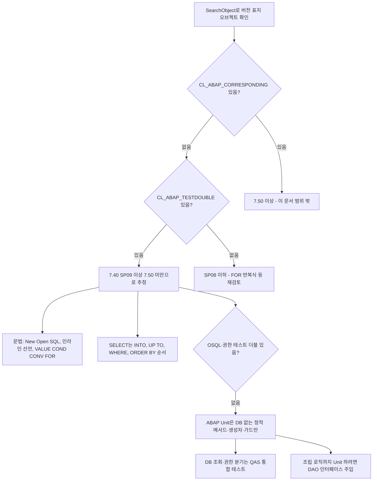

# ECC 7.40 시스템 ABAP 개발 제약

대상 시스템이 ECC, SAP_BASIS 7.40 SP09 이상·7.50 미만(추정)일 때 소스 문법과 ABAP Unit 작성에서 주의할 점입니다. 정확한 SP는 시스템 > 상태로 확인해야 합니다 (시스템 미확인). 관련: [[SAP 시스템 미확인 상태에서 작업하는 방법]], [[자재마스터 조회 리포트 설계 패턴]]

## 한눈에 보기

릴리스를 추정하고 그에 맞춰 문법과 테스트 범위를 정하는 흐름입니다.

## 릴리스 판정

- ECC 판정 근거: 도메인 MATNR 내역 "C18"(18자리), [[table:MBEW|MBEW]]가 투명 테이블, MATDOC·ACDOCA 없음. ECC면 MATNR 40자리·MBEW 호환뷰 이슈는 해당 없고 테스트 데이터 자재번호도 18자리(ALPHA 변환) 기준입니다. [[req:20261006-33d4fc|자재마스터 조회 리포트]]
- SAP_BASIS 추정: `IF_AMDP_MARKER_HDB`(7.40 SP05~) 있음, `CL_ABAP_TESTDOUBLE`(7.40 SP09~) 있음, `CL_ABAP_CORRESPONDING`(7.50~)·`CL_OSQL_TEST_ENVIRONMENT`(7.51~)·`CL_AUNIT_AUTHORITY_CHECK`(7.52 전후~) 없음. [[req:20261006-33d4fc|자재마스터 조회 리포트]]

## 문법 주의

- **문법 기준은 "7.40 SP05"가 아니라 실제로 쓴 구문의 최소 SP로 적습니다.** `VALUE #( FOR ... IN ... )` 반복식은 7.40 SP08부터라, 개발 문서에 "SP05 기준"이라 쓴 것을 테스트 리뷰가 바로잡았습니다(I6). [[req:20261006-33d4fc|자재마스터 조회 리포트]]
- SELECT 절 순서는 `INTO ... UP TO ... WHERE ... ORDER BY`로 씁니다. INTO를 끝에 두는 형태는 SP08 이상입니다. [[req:20261006-33d4fc|자재마스터 조회 리포트]]
- 무제한 건수는 `UP TO 0 ROWS`에 기대지 말고 `cl_abap_math=>max_int4`(2,147,483,647, 시스템에서 상수 확인)를 넣으면 SELECT 분기 없이 처리됩니다. [[req:20261006-33d4fc|자재마스터 조회 리포트]]
- `SET HANDLER ... FOR mo_salv->get_event( )`처럼 함수형 메서드 호출을 직접 쓰지 않고 `DATA(lo_events) = mo_salv->get_event( )`로 받은 참조 변수를 넘깁니다. 7.40에서 허용이 보장되지 않아 활성화 오류 위험이 있습니다. [[req:20261006-33d4fc|자재마스터 조회 리포트]]
- Text Symbol 리터럴(`'...'(c01)`)을 받는 파라미터는 `scrtext_l` 같은 고정 길이 타입 대신 `csequence`로 둡니다. [[req:20261006-33d4fc|자재마스터 조회 리포트]]
- 해시/정렬 테이블에 `SELECT INTO TABLE`하면 키 중복 시 덤프가 납니다. 내부 테이블 키를 DB 기본키와 같게 두고(예: MAKT = MATNR+SPRAS, MBEW = MATNR+BWKEY+BWTAR 공란) 조건으로 1건을 보장합니다. [[req:20261006-33d4fc|자재마스터 조회 리포트]]

## SALV 예외 처리

- 시스템에서 확인한 상속: `CX_SALV_MSG` → `CX_SALV_ERROR`, `CX_SALV_DATA_ERROR` → `CX_SALV_STATIC_CHECK` → `CX_SALV_ERROR`, `CX_SALV_NOT_FOUND`·`CX_SALV_EXISTING` → `CX_SALV_ACCESS_ERROR` → `CX_SALV_STATIC_CHECK` → `CX_SALV_ERROR`. [[req:20261006-33d4fc|자재마스터 조회 리포트]]
- 그래서 `CATCH cx_salv_error INTO lx_salv` 하나로 받고 `get_text( )`를 씁니다. `cx_root`로 받던 미확인 시절 코드는 바꿨습니다. TRY 안에서 생기지 않는 예외(예: `cx_salv_existing`)를 CATCH에 나열하면 SLIN/SCI 경고가 날 수 있습니다(리뷰 I2). [[req:20261006-33d4fc|자재마스터 조회 리포트]]
- `set_cell_type`, `set_key`는 `CL_SALV_COLUMN_TABLE`이 아니라 상위 `CL_SALV_COLUMN_LIST`에 있습니다. `set_currency_column`은 `CX_SALV_NOT_FOUND`, `CX_SALV_DATA_ERROR`를 냅니다. [[req:20261006-33d4fc|자재마스터 조회 리포트]]

## ABAP Unit

- 사용 가능: `CL_ABAP_UNIT_ASSERT`, `CL_ABAP_TESTDOUBLE`. 없음: `CL_OSQL_TEST_ENVIRONMENT`(Open SQL 더블), `CL_AUNIT_AUTHORITY_CHECK`(권한 더블). 따라서 DB를 읽는 `read_*`와 AUTHORITY-CHECK 분기는 단위테스트할 수 없고 QAS 통합 테스트로 확인합니다. [[req:20261006-33d4fc|자재마스터 조회 리포트]]
- 단위테스트 대상: DB 없는 PUBLIC STATIC 메서드(range 조립, 텍스트 선택), 생성자 정규화(언어 공란 → SY-LANGU, 대체 언어 = 1순위 → 공란, 음수 건수 → 기본값), DB 접근 전에 RETURN하는 가드(플랜트 미입력 → 빈 결과, 빈 range로 전체 조회되지 않는지). 이 요청에서 22건, RISK LEVEL HARMLESS·DURATION SHORT. [[req:20261006-33d4fc|자재마스터 조회 리포트]]
- range 메서드는 행 내용(SIGN/OPTION/LOW)만이 아니라 `'X' IN lr`, `' ' IN lr`로 **의미**까지 검증합니다. [[req:20261006-33d4fc|자재마스터 조회 리포트]]
- private 멤버를 읽어야 하면 본 소스를 고치지 않고 **테스트 include 안에** `CLASS ltcl_x DEFINITION DEFERRED.` + `CLASS zcl_x DEFINITION LOCAL FRIENDS ltcl_x.`를 둡니다. 이 파일은 클래스의 Local Test Classes include(CCAU)에 넣어야 하며 CCIMP 등에 넣으면 FOR TESTING 클래스가 인식되지 않습니다. 대상 클래스가 FINAL이어도 상속하지 않으므로 문제없습니다. [[req:20261006-33d4fc|자재마스터 조회 리포트]]
- 예방책(리뷰 I4): 조립 로직(MBEW 없을 때 0, 통화·텍스트 매핑)까지 단위테스트하려면 설계 단계에서 데이터 접근을 인터페이스(예: `lif_material_dao`)로 빼고 constructor 주입을 허용합니다. 그러면 `CL_ABAP_TESTDOUBLE`이나 로컬 더블로 테스트할 수 있습니다. [[req:20261006-33d4fc|자재마스터 조회 리포트]]
