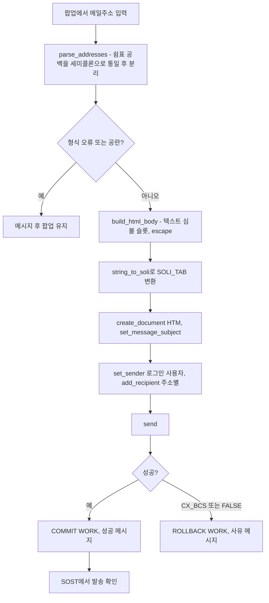

# SAP 메일 발송(BCS) 구현 패턴

ABAP에서 외부 메일(HTML 본문)을 보내는 기능을 만들 때 쓴 클래스 구성, 표준 클래스 사용법, 결함 위험과 테스트 방법입니다. 관련: [[기존 모듈풀 ALV 화면에 기능 추가하는 방법]], [[스크랩 고철등급 단가 데이터와 단가 표시 기준]], [[ECC 7.40 시스템 ABAP 개발 제약]]

## 한눈에 보기

## 클래스 구성

- 화면 프로그램(FORM)과 메일 로직을 분리해 전역 클래스(예: `ZCL_MM_SCRAP_PRICE_MAIL`)에 두었습니다. 메서드: `check_selection`(선택 검증, 메시지 번호 반환), `parse_addresses`, `format_price`, `format_date`, `build_html_body`, `send`. 클래스는 **메시지 번호만 돌려주고** 화면 프로그램이 `MESSAGE ID ... TYPE 'S' DISPLAY LIKE 'E'`로 띄워 화면·팝업이 유지되게 했습니다. [[req:20261019-bce84c|스크랩(SCRAP) 기본단가 관리 공문 메일발송 기능 개발]]
- 대상 클래스가 DB를 읽지 않게 만들면(ALV 내부 테이블 값을 넘겨받음) 검증·포맷·HTML 조립을 ABAP Unit으로 모두 시험할 수 있습니다. 이 요청에서 30개 단위테스트를 작성했습니다(SAP에서 실행 전). [[req:20261019-bce84c|스크랩(SCRAP) 기본단가 관리 공문 메일발송 기능 개발]]

## 표준 클래스 사용법 (srd-abap GetClass로 시그니처 확인)

- `cl_bcs=>create_persistent( )` → `set_document`, `set_message_subject`, `set_sender`, `add_recipient`, `set_send_immediately`, `send( i_with_error_screen = space )`(반환 abap_bool). [[req:20261019-bce84c|스크랩(SCRAP) 기본단가 관리 공문 메일발송 기능 개발]]
- `cl_document_bcs=>create_document( i_type = 'HTM' i_text = soli_tab i_subject = so_obj_des )`. SO_OBJ_DES는 50자라 긴 제목은 잘리므로 `set_message_subject( string )`를 따로 호출합니다. [[req:20261019-bce84c|스크랩(SCRAP) 기본단가 관리 공문 메일발송 기능 개발]]
- `cl_bcs_convert=>string_to_soli( )`(RETURNING ET_SOLI), `cl_cam_address_bcs=>create_internet_address( )`(RAISING CX_ADDRESS_BCS), 발신자 `cl_sapuser_bcs=>create( sy-uname )` — SU01 메일(USR21→ADR6)이 없는 사용자는 발송 실패하므로 실패 시나리오로 테스트합니다. [[req:20261019-bce84c|스크랩(SCRAP) 기본단가 관리 공문 메일발송 기능 개발]]
- 예외는 상위 `CX_BCS` 하나로 받습니다(하위 CX_SEND_REQ_BCS, CX_DOCUMENT_BCS, CX_ADDRESS_BCS 포함). `send( )`가 예외 없이 FALSE를 돌려주는 경우에도 사유 문구(텍스트 심볼)를 채워 오류 메시지가 비지 않게 합니다. [[req:20261019-bce84c|스크랩(SCRAP) 기본단가 관리 공문 메일발송 기능 개발]]
- HTML 이스케이프는 `escape( val = ... format = cl_abap_format=>e_html_text )`. 등급명 같은 마스터 값도 반드시 이스케이프합니다(`<A&B>` 단위테스트). [[req:20261019-bce84c|스크랩(SCRAP) 기본단가 관리 공문 메일발송 기능 개발]]

## LUW

- 성공 시 클래스 안에서 COMMIT WORK 1회, 실패 시 ROLLBACK WORK로 BCS 영속 객체를 버려 이후 화면의 SAVE_DATA(COMMIT WORK AND WAIT)에 섞이지 않게 했습니다. 메일 기능은 업무 테이블을 바꾸지 않아야 합니다. [[req:20261019-bce84c|스크랩(SCRAP) 기본단가 관리 공문 메일발송 기능 개발]]
- 리뷰 개선 권고(R-09): 재사용 클래스가 호출측 LUW를 확정하고 CL_BCS를 직접 생성하면 발송 경로를 단위테스트할 수 없습니다. 발송부를 인터페이스로 빼서 생성자 주입하고 COMMIT은 호출 FORM으로 옮기는 설계를 다음에는 처음부터 고려합니다. [[req:20261019-bce84c|스크랩(SCRAP) 기본단가 관리 공문 메일발송 기능 개발]]

## 결함 위험과 예방

- **HTML 255자 분할(R-05)**: `string_to_soli`는 255자씩 자르는데 `create_document`에 `i_length` 없이 넘기면 줄 끝 공백이 빠져 `border="1" cellspacing`처럼 속성이 붙거나 글꼴명이 깨질 수 있습니다. `i_length = strlen( html )`을 지정하거나 `string_to_solix( iv_codepage = '4110' )` + `i_hex`로 UTF-8 바이너리를 넘깁니다. `<meta charset="utf-8">`과 SCOT 코드페이지가 다르면 한글이 깨지므로 20행 이상 본문을 Outlook·웹메일에서 확인합니다. [[req:20261019-bce84c|스크랩(SCRAP) 기본단가 관리 공문 메일발송 기능 개발]]
- 주소 입력: `,`·공백을 `;`로 TRANSLATE 후 SPLIT, 정규식 검증, 최대 241자(AD_SMTPADR), 중복 제거. 중복 비교는 대소문자를 무시해야 합니다(`A@X.com`/`a@x.com` 2건 문제, R-10). 형식 오류를 공란보다 먼저 알립니다. 255자 입력창은 주소 5~10개에서 잘리므로 다건이 확정되면 입력 방식을 바꿉니다(R-11). [[req:20261019-bce84c|스크랩(SCRAP) 기본단가 관리 공문 메일발송 기능 개발]]
- 화면 입력 필드에 **Lower case 속성**을 켜지 않으면 주소가 대문자로 바뀝니다. [[req:20261019-bce84c|스크랩(SCRAP) 기본단가 관리 공문 메일발송 기능 개발]]
- `FIND REGEX`(POSIX)는 7.55 이상에서 구식 문법 경고 대상입니다. 릴리스 확인 후 `FIND PCRE` 전환을 검토합니다(R-13). [[req:20261019-bce84c|스크랩(SCRAP) 기본단가 관리 공문 메일발송 기능 개발]]
- 발송 이력 테이블을 만들지 않으면 추적은 SOST뿐이고 보관 기간은 Basis 설정에 달립니다. 대외 발송 기능이면 이력 필요 여부를 분석 단계에서 묻습니다(R-16). [[req:20261019-bce84c|스크랩(SCRAP) 기본단가 관리 공문 메일발송 기능 개발]]
- 통합 테스트 수신자는 **사내 주소만** 쓰고, 개발계에서 외부 발송이 막혀 있는지 SCOT 설정을 Basis에 확인합니다(시스템 미확인). [[req:20261019-bce84c|스크랩(SCRAP) 기본단가 관리 공문 메일발송 기능 개발]]

## 메일 문구 미확정 시 처리

- 현업 메일 양식이 첨부 엑셀 안에 **이미지로만** 있어 인사말·1항 제목·3항·맺음말을 읽지 못했습니다. 문구를 지어내지 않고 **텍스트 심볼 슬롯**(A01~A05, B01, B03, Z01~Z03)으로 두고, 공란이면 줄을 생략하게 했습니다. 문구가 정해지면 SE24 텍스트 요소만 등록하면 되고 코드는 고치지 않습니다. 미정의 심볼 참조는 SLIN/ATC 경고만 나고 활성화에는 영향이 없습니다(R-14). [[req:20261019-bce84c|스크랩(SCRAP) 기본단가 관리 공문 메일발송 기능 개발]]
- 단, 슬롯이 빈 채로는 대외 공문 형식이 부족하므로 **운영 사용 전 현업 양식 확정이 필수 조건**입니다. 메일 양식 캡처는 PNG/PDF로 따로 받아야 에이전트가 읽을 수 있습니다. [[req:20261019-bce84c|스크랩(SCRAP) 기본단가 관리 공문 메일발송 기능 개발]]
