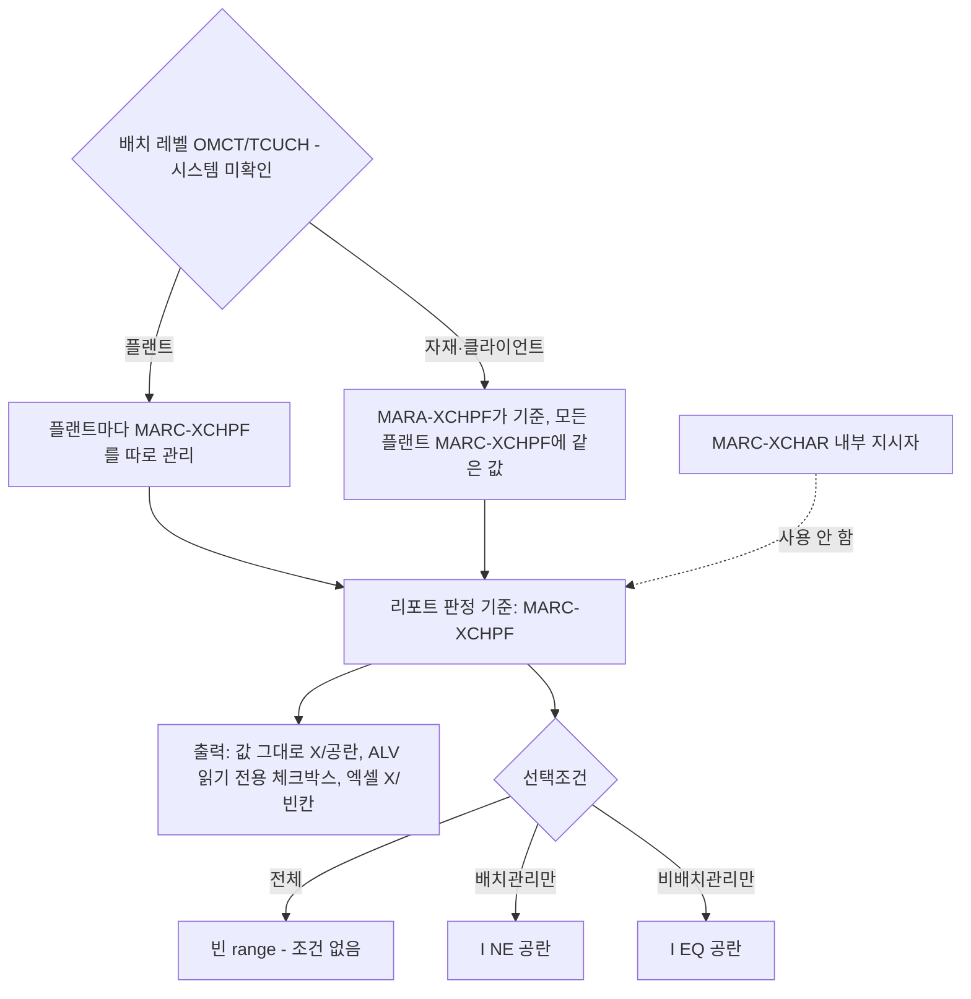

# 배치관리 자재 판정 기준

자재가 배치관리 대상인지 리포트에서 판정·표시할 때 어떤 필드를 기준으로 쓰는지 정리합니다.

## 한눈에 보기

판정 기준과 조건 처리입니다.

## 판정 필드

| 필드 | 레벨 | 사용 여부 | 비고 |
|---|---|---|---|
| MARC-XCHPF | 플랜트 | **판정 기준(제안안)** | Data Element XCHPF, CHAR 1, 'X'/공란 (시스템 미확인) |
| MARA-XCHPF | 클라이언트 | 참고용 | 배치 레벨이 자재/클라이언트면 MARC-XCHPF와 같은 값이어야 함 |
| MARC-XCHAR | 플랜트(내부) | 사용 안 함 | 시스템이 설정하는 내부 지시자. MM03 화면의 "배치관리" 체크와 의미가 다를 수 있음 |

- 출처: [[req:20261006-33d4fc|자재마스터 조회 리포트]]
- 테이블: [[table:MARC|MARC]], [[table:MARA|MARA]]

## 왜 MARC-XCHPF인가

- 배치관리 지시자는 MARA와 MARC 두 곳에 있고, 어느 쪽이 기준인지는 Customizing의 배치 레벨(T-code OMCT, 테이블 TCUCH)에 따라 다릅니다 (시스템 미확인). [[req:20261006-33d4fc|자재마스터 조회 리포트]]
  - 배치 레벨 = 플랜트: 플랜트마다 MARC-XCHPF를 따로 관리합니다. 같은 자재라도 플랜트에 따라 값이 다를 수 있습니다.
  - 배치 레벨 = 자재/클라이언트: MARA-XCHPF가 기준이고 모든 플랜트의 MARC-XCHPF에 같은 값이 들어갑니다.
- 결과가 자재×플랜트 1행인 리포트라면 배치 레벨과 관계없이 MARC-XCHPF가 행마다 정확한 값을 줍니다. 그래서 판정·조건 모두 MARC-XCHPF로 했습니다. [[req:20261006-33d4fc|자재마스터 조회 리포트]]
- MARC를 이미 조인하는 리포트라면 MARC-XCHPF 한 필드만 더 읽으면 되므로 테이블 접근이 늘지 않습니다. [[req:20261006-33d4fc|자재마스터 조회 리포트]]

## 표시·조건 처리

- 출력은 MARC-XCHPF 값을 변환 없이 그대로 옮기고, ALV에서 읽기 전용 체크박스(`if_salv_c_cell_type=>checkbox`)로 보여 줍니다. 엑셀로 내려받으면 'X'/빈칸으로 나옵니다. 아이콘(ICON_CHECKED)이나 Y/N 텍스트는 엑셀·필터에서 불리해 기본안으로 하지 않았습니다. [[req:20261006-33d4fc|자재마스터 조회 리포트]]
- 선택조건 '전체 / 배치관리만 / 비배치관리만'은 range로 만들어 WHERE에 붙입니다(전체 = 빈 range, 배치관리만 = `I NE ' '`, 비배치관리만 = `I EQ ' '`). 자세한 패턴은 [[자재마스터 조회 리포트 설계 패턴]]. [[req:20261006-33d4fc|자재마스터 조회 리포트]]
- "배치관리만"을 `EQ 'X'` 대신 `NE ' '`로 둔 것은 삭제여부 조건과 같은 규칙(공란이 아니면 해당)으로 맞추기 위해서입니다. 값 도메인이 'X'/공란뿐이면 결과는 같습니다 (시스템 미확인). [[req:20261006-33d4fc|자재마스터 조회 리포트]]

## 시스템 확인 결과 (2026-10-11, 개발 단계)

- Data Element `XCHPF`("배치 관리 소요량 지시자", 패키지 MG)는 시스템에 있습니다. 그러나 이 시스템의 ADT는 테이블 필드 목록·도메인 값을 읽지 못해 **MARC-XCHPF 필드 정의와 값이 'X'/공란뿐인지는 확인하지 못했습니다** (시스템 미확인). 소스는 `TYPE marc-xchpf` 필드 참조라 필드가 없으면 활성화 때 드러납니다. [[req:20261006-33d4fc|자재마스터 조회 리포트]]
- "배치관리만" = `NE ' '`이므로 도메인에 'X' 외 값이 있으면 그 값도 배치관리로 잡힙니다. 반영 전 SE11/SE16 샘플로 도메인 값을 확인하고, 다른 값이 있으면 조건 의미를 다시 검토합니다. [[req:20261006-33d4fc|자재마스터 조회 리포트]]
- 배치 레벨(TCUCH)은 테이블 데이터라 abap-mrd로 읽을 수 없습니다. SE16 TCUCH 또는 OMCT로 확인합니다. [[req:20261006-33d4fc|자재마스터 조회 리포트]]
- ALV 체크박스(`if_salv_c_cell_type=>checkbox`)는 GRID 전용 제한이 없어 백그라운드 스풀(리스트)에서도 쓸 수 있고, 스풀에는 'X'/공란 문자로 나옵니다. [[req:20261006-33d4fc|자재마스터 조회 리포트]]

## 현업 확인이 필요한 항목 (이 요청 기준 미결)

- 판정 기준을 MARC-XCHPF로 해도 되는지, MARA-XCHPF 참고 컬럼을 함께 보여 줄지, 표시 형식(체크박스/아이콘/Y/N). [[req:20261006-33d4fc|자재마스터 조회 리포트]]
- 선택화면에 배치관리 조건을 넣을지(넣지 않으면 ALV 필터로만 거름). [[req:20261006-33d4fc|자재마스터 조회 리포트]]

## 테스트 시 점검할 것

- 배치관리 자재와 비배치관리 자재가 섞인 플랜트에서 "전체 = 배치관리만 + 비배치관리만" 건수가 맞는지, 체크 값이 MM03(일반 플랜트 데이터/구매 뷰 "배치관리")과 같은지 확인합니다. [[req:20261006-33d4fc|자재마스터 조회 리포트]]
- 배치 레벨이 자재/클라이언트인 시스템에서는 SE16으로 MARA-XCHPF와 MARC-XCHPF가 다른 자재가 있는지 샘플 점검합니다. 불일치가 있으면 참고 컬럼 추가를 검토합니다. [[req:20261006-33d4fc|자재마스터 조회 리포트]]
- 배치 레벨 설정(OMCT/TCUCH)은 개발 착수 전에 확인합니다 (시스템 미확인). [[req:20261006-33d4fc|자재마스터 조회 리포트]]
