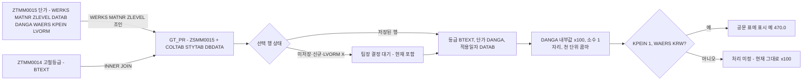

# 스크랩 고철등급 단가 데이터와 단가 표시 기준

고철등급별 단가관리 화면(ZEMM0020, 그 사본 ZEMM2222)이 읽는 테이블·ALV 구조와, 단가를 공문 등 외부 문서에 옮길 때의 표시 규칙(×100, 천 단위 콤마)과 미결 쟁점입니다. 관련: [[기존 모듈풀 ALV 화면에 기능 추가하는 방법]], [[SAP 메일 발송(BCS) 구현 패턴]], [[자재 단가 기준(이동평균가)]]

## 한눈에 보기

## 테이블과 ALV 구조

- **단가 원천은 [[table:ZTMM0015|ZTMM0015]](단가) INNER JOIN [[table:ZTMM0014|ZTMM0014]](등급명)** 입니다. 조인키는 ZTMM0015-WERKS/MATNR/ZLEVEL = ZTMM0014-WERKS/MATNR/ZLEVEL. 프로그램 번호(0020)만 보고 분석서가 ZTMM0020/ZVMM0020/ZSMM0020으로 추정했다가 AI 검증이 MZMM2222F01 GET_DATA 소스를 열어 바로잡았습니다. 화면 번호와 테이블 번호는 일치하지 않으므로 반드시 GET_DATA의 SELECT로 확인합니다. 두 테이블과 ZSMM0015는 패키지 ZMMD에 있고, 같은 이름의 T-code ZTMM0015·ZTMM0014도 있습니다. [[req:20261019-bce84c|스크랩(SCRAP) 기본단가 관리 공문 메일발송 기능 개발]]
- ALV 출력 테이블은 `GT_PR`(OCCURS 0, 헤더라인) = `INCLUDE STRUCTURE ZSMM0015` + `COLTAB`(LVC_T_SCOL)·`STYTAB`(LVC_T_STYL)·`DBDATA`(C)입니다. 필드카탈로그는 `LVC_FIELDCATALOG_MERGE i_structure_name = 'ZSMM0015'`. [[req:20261019-bce84c|스크랩(SCRAP) 기본단가 관리 공문 메일발송 기능 개발]]
- ALV 컬럼(F02 SET_GRID_FIELDCAT 순서): 플랜트 WERKS / 자재 MATNR / 고철등급 ZLEVEL / 고철등급명 BTEXT / 유효시작일 DATAB / 유효만료일 DATAI / 단가 DANGA / 통화 WAERS / 가격단위 KPEIN / 품의상태 ZDRFST / 품의서번호 ZSCRDNO / 수정일자 LAEDA / 수정시간 LTIME / 수정인 AENAM. 삭제표시 LVORM은 col_pos 없이 뒤에 붙습니다. **비고 필드는 없습니다** — 현업 공문 양식의 "비고" 열은 항상 공란으로 둡니다. [[req:20261019-bce84c|스크랩(SCRAP) 기본단가 관리 공문 메일발송 기능 개발]]
- ZTMM0015의 단가 키는 WERKS+MATNR+ZLEVEL+DATAB로 추정합니다(SAVE_DATA 로직 기준, 시스템 미확인). 효력시작일(DATAB)만으로 행을 묶으면 플랜트가 다른 같은 등급이 한 표에 두 줄로 나갈 수 있습니다. [[req:20261019-bce84c|스크랩(SCRAP) 기본단가 관리 공문 메일발송 기능 개발]]
- `DBDATA` 공란 = CREA/COPY로 추가된 미저장 신규 행, ZTMM0015-LVORM = 'X' = 삭제표시 행입니다. 화면은 편집형(layout edit = 'X', TOGG로 수정 모드)이라 미저장 수정값도 GT_PR에 있습니다. [[req:20261019-bce84c|스크랩(SCRAP) 기본단가 관리 공문 메일발송 기능 개발]]
- DDIC 상세(ZSMM0015-DANGA가 WAERS를 참조하는 CURR인지, BTEXT 길이, LVORM이 ZSMM0015에 있는지)는 GetTable/GetStructure가 실패해 확인하지 못했습니다(시스템 미확인, SE11 확인 필요). 그래서 타입은 `ztmm0014-btext`, `ztmm0015-danga`, `ztmm0015-datab` 필드 참조로 선언했습니다. [[req:20261019-bce84c|스크랩(SCRAP) 기본단가 관리 공문 메일발송 기능 개발]]

## 단가 ×100 표시 규칙

- **현업 확정(첨부 설계 시트 C110~C111)**: 공문 단가는 "ALV 결과 화면의 단가 ×100", 숫자형식으로 천 단위마다 콤마. 시트 샘플은 생철AL·생철A·주물A(모터블럭) 470.0, 생철B 465.0으로 **소수 1자리**까지 보입니다. 적용일자는 `2026.09.28` 형식. [[req:20261019-bce84c|스크랩(SCRAP) 기본단가 관리 공문 메일발송 기능 개발]]
- **×100 근거**: SAVE_DATA의 주석 처리된 검증 로직에 "경량B 단가 300원/kg 이상" ↔ `lv_kb5_danga >= 3` 비교가 있습니다. DANGA 내부값이 원화의 1/100로 저장된다는 뜻이므로 "내부값 ×100 = 원/kg"으로 해석했습니다. 기존 소스의 주석 코드도 단위 근거가 됩니다. [[req:20261019-bce84c|스크랩(SCRAP) 기본단가 관리 공문 메일발송 기능 개발]]
- **주의 — 내부값과 화면값**: DANGA가 WAERS 참조 CURR 필드면 ALV는 통화 소수자리(KRW 0자리)로 환산해 이미 470처럼 보일 수 있습니다. 그 상태에서 "화면 단가 ×100"으로 하면 47,000이 됩니다. 요청서 B75의 "단가가 너무 크다.. kg이 아닌 톤당단가로 보낸 것 같다"는 현업 메모와 연결될 수 있어 미결(U-01)입니다. 구현은 **DANGA 내부값 ×100**이며, 통합 테스트에서 ALV 표시값·SE16 DANGA·메일 단가를 한 줄씩 대조해 현업 답변 자료로 씁니다. [[req:20261019-bce84c|스크랩(SCRAP) 기본단가 관리 공문 메일발송 기능 개발]]
- 가격단위 KPEIN이 1이 아닌 행, 통화 WAERS가 KRW가 아닌 행은 현재 구분 없이 ×100만 합니다(현업 확인 대기). 결정되면 계수·소수자리 상수(`C_PRICE_FACTOR`, `C_PRICE_DEC`)와 변환 메서드 한 곳만 고치도록 변환을 한 군데에 모았습니다. [[req:20261019-bce84c|스크랩(SCRAP) 기본단가 관리 공문 메일발송 기능 개발]]
- 표시 문자열은 문자열 템플릿 RAW 형식(`|{ l_val DECIMALS = 1 }|`)으로 만들고 콤마는 직접 넣습니다. WRITE 편집이나 사용자 숫자 형식(USR01-DCPFM)을 쓰면 사용자마다 `470,0`처럼 달라지므로 대외 문서에는 쓰지 않습니다(`SET COUNTRY 'DE'` 후에도 같은지 단위테스트). [[req:20261019-bce84c|스크랩(SCRAP) 기본단가 관리 공문 메일발송 기능 개발]]

## 공문에 넣을 행의 기준 (팀장 결정 대기)

- 시트 규칙: 최소 1행 선택, **효력시작일(DATAB)이 다른 행은 함께 발송 불가**(공문의 적용일자가 하나이기 때문). [[req:20261019-bce84c|스크랩(SCRAP) 기본단가 관리 공문 메일발송 기능 개발]]
- 시트에 없어 기본값으로 둔 것: 미저장 수정값·신규 행(DATAB 공란 가능)·삭제표시 행 모두 포함, 플랜트 혼합 허용. 테스트 리뷰는 "DATAB 공란 행끼리 고르면 유효시작일 검사에 걸리지 않고 적용일자가 빈 공문이 나간다", "삭제표시 행 단가가 외부로 나간다"를 주의로 올리고 LVORM = 'X'·DATAB 공란 행 차단, 미저장 변경은 저장 후 발송을 권고했습니다. 대외 문서 기능에서는 이 행 상태 기준을 설계 단계에서 먼저 묻는 것이 좋습니다. [[req:20261019-bce84c|스크랩(SCRAP) 기본단가 관리 공문 메일발송 기능 개발]]
- 버튼 노출 기준 후보: 기존 SET_PF_STATUS가 PA0001-ORGEH = '10005020'(스크럽구매팀) 또는 SY-UNAME(2) = 'DU' 사용자에게만 편집 버튼을 엽니다. 단가는 대외 영업 정보이므로 공문발송도 같은 기준을 적용할지 팀장 결정 사항으로 올렸습니다(현재 전원 노출). [[req:20261019-bce84c|스크랩(SCRAP) 기본단가 관리 공문 메일발송 기능 개발]]
