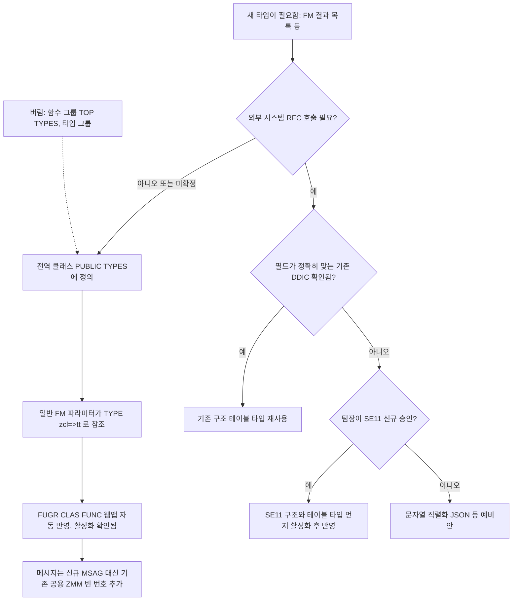

# 신규 DDIC 없이 개발하는 방법

개발계 반영은 웹앱이 ADT로 자동 수행하지만, 이 개발계 ADT는 DDIC(구조·테이블 타입·DB 테이블·타입 그룹)를 만들지 못해 SE11 수작업이 남습니다. 팀장은 이 수작업을 없애는 방향을 선호합니다. 결과·중간 데이터 타입을 신규 DDIC 없이 정의하는 방법과, 그 대가(RFC 불가 등)를 정리합니다. 관련: [[RFC 조회 함수 모듈 설계 패턴]], [[테스트계 반영 전 점검 항목]], [[ECC 7.40 시스템 ABAP 개발 제약]], [[SAP 시스템 미확인 상태에서 작업하는 방법]]

## 한눈에 보기

## 팀장 지시와 요구 경향

- 1차 설계는 FM 결과 타입으로 신규 구조 `ZSMM3600`·테이블 타입 `ZTTMM3600`(SE11 수작업)을 두었습니다. 개발계 반영 때 SE11 작업 없이 반영 버튼을 눌러 클래스 활성화가 `Type "ZTTMM3600" is unknown`으로 실패했습니다. 팀장은 바로 설계 단계로 "테이블이나 구조체 만들지 않고 할수 있는 방법으로 변경해줘"라고 수정 지시했습니다. [[req:20261119-f26e72|자재 리스트 조회 펀션 신규 개발]]
- 경향: 사람이 SE11에서 먼저 만들어야 하는 오브젝트는 반영 순서를 놓치기 쉽고 실패 원인이 됩니다. 설계 단계에서 **신규 DDIC를 기본안으로 두지 말고**, 꼭 필요하면 "SE11 수작업 N건, 반영 전 선행 필요"를 보고 첫머리에 적어 팀장 판단을 먼저 받습니다. [[req:20261119-f26e72|자재 리스트 조회 펀션 신규 개발]]
- 요청 원문에 없는 기능(이 요청은 RFC 가능)이 신규 DDIC를 요구하면, 그 기능을 1차 개발에서 빼는 것이 지시에 맞는 판단이었습니다. 빼면서 "나중에 외부 호출이 필요해지면 무엇을 바꾸는지"를 설계서에 남겨 승인받았습니다. [[req:20261119-f26e72|자재 리스트 조회 펀션 신규 개발]]

## 대안 비교 (설계 2.2절)

| 안 | 판단 | 이유 |
|---|---|---|
| 전역 클래스 PUBLIC TYPES (`zcl_mm_mtart_matlist=>tt_list`) | **채택** | 신규 DDIC 0건, 필드 정확히 일치, 표준 Data Element 참조라 길이는 시스템 정의를 따름. 클래스는 웹앱이 자동 반영 |
| 기존 표준·Z DDIC 구조 재사용 | 버림 | 필드 구성을 도구로 읽을 수 없음(GetStructure 404, SearchObject STRU 필터 미지원). 이름 후보 `MAKT_TAB`(MEINS 없음으로 추정), `MATERIAL_LIST_T`(ODATA_PP_MRP) 등은 다른 애플리케이션 패키지 타입이라 그쪽 변경에 인터페이스가 묶임 |
| 함수 그룹 TOP 인클루드 TYPES | 버림 | FM 인터페이스는 전역 타입만 참조 가능, TOP 로컬 타입은 안 됨(시스템 미확인, 표준 기준). 제네릭 파라미터가 되어 타입 안전성 상실 |
| 타입 그룹(TYPE-POOL) | 버림 | 결국 SE11 신규 DDIC라 지시에 어긋나고 웹앱 반영도 안 됨 |
| 문자열 직렬화(JSON/XML) 반환 | 예비안 | RFC는 가능하나 호출측이 매번 역직렬화. 7.40에서 JSON 클래스 존재 미확인. 외부 RFC가 필요하고 DDIC 신규가 계속 금지일 때만 |

[[req:20261119-f26e72|자재 리스트 조회 펀션 신규 개발]]

## 클래스 TYPES 방식의 규칙과 대가

- 타입은 **PUBLIC SECTION**에 둡니다. FM 인터페이스와 호출 프로그램이 `TYPE zcl_...=>tt_list`로 참조하므로 이름·필드 변경 금지, 필드 추가는 맨 뒤에만 합니다. 이 규칙을 클래스 헤더 주석과 개발 문서에 적습니다. [[req:20261119-f26e72|자재 리스트 조회 펀션 신규 개발]]
- 호출측은 `DATA lt_list TYPE zcl_mm_mtart_matlist=>tt_list.`로 받는 변수를 선언합니다. FM 헤더 주석에 이 예시를 넣었습니다. [[req:20261119-f26e72|자재 리스트 조회 펀션 신규 개발]]
- **대가: FM을 Remote-Enabled로 만들 수 없습니다.** RFC FM 파라미터는 DDIC 타입이어야 해서 `.fm.json`의 `processingType`을 `normal`로 두었습니다. 같은 SAP 안 ABAP 호출만 지원하고, S_RFC 설정과 RFC 목적지 테스트는 해당 없음이 됩니다. [[req:20261119-f26e72|자재 리스트 조회 펀션 신규 개발]]
- 나중에 외부 RFC가 필요하면: 클래스 `TY_LIST`와 같은 필드로 DDIC 구조·테이블 타입 1쌍을 만들고(팀장 재승인) FM 파라미터 타입과 processingType만 바꿉니다. 대입 한 줄만 추가되고 클래스 로직은 그대로입니다. 그래서 클래스 타입 필드명·순서를 1차 설계 DDIC와 같게 유지했습니다. [[req:20261119-f26e72|자재 리스트 조회 펀션 신규 개발]]
- 범위 입력이 나중에 필요해져도 신규 DDIC 대신 클래스에 `TYPES tt_mtart_range TYPE RANGE OF mtart`를 추가해 참조하는 방안을 적어 두었습니다. [[req:20261119-f26e72|자재 리스트 조회 펀션 신규 개발]]
- 일반 FM 시그니처의 클래스 타입 참조가 웹앱 ADT 변환(SE37 `*"` 주석 → ADT 시그니처) 후 그대로 생성·활성화되는지, SE37 테스트 화면에 클래스 타입 테이블 결과가 표시되는지는 아직 확인하지 못했습니다(시스템 미확인). 반영 결과로 확인하고, 실패하면 SE37에서 ET_LIST 타입을 직접 입력해 활성화합니다. [[req:20261119-f26e72|자재 리스트 조회 펀션 신규 개발]]
  - 반영 결과로 확인: 개발계(ECC 7.40)에서 `Z_MM_GET_MATERIAL_LIST`(ET_LIST `TYPE zcl_mm_mtart_matlist=>tt_list`)가 함수 그룹 ZFGMM71에 신규 생성되고 클래스와 함께 **활성화 성공**했습니다. 클래스 TYPES를 일반 FM 파라미터로 쓰는 방식은 이 시스템과 웹앱 반영 경로에서 동작합니다. 순서상 클래스가 FM보다 먼저 반영되기 때문에 가능한 것이므로, 클래스 타입을 참조하는 FM은 같은 요청에서 클래스와 함께 올립니다. SE37 테스트 화면의 결과 표시는 아직 확인하지 못했습니다(시스템 미확인). [[req:20261119-f26e72|자재 리스트 조회 펀션 신규 개발]]
- 신규 DDIC를 없앤 뒤에도 **메시지 클래스(SE91)** 는 수작업으로 남을 수 있습니다. 웹앱의 MSAG 자동 생성이 이 개발계에서 HTTP 400으로 실패했습니다 → [[테스트계 반영 전 점검 항목]]. "수작업 0건" 설계를 원하면 기존 메시지 클래스 재사용이나 메시지 없이 BAPIRET2 문구를 직접 채우는 방안도 설계에서 비교합니다(다음 요청부터 검토). [[req:20261119-f26e72|자재 리스트 조회 펀션 신규 개발]]
  - 결과: 팀장이 개발 단계로 "ZMMM3 대신 기존 ZMM 사용"을 지시해 신규 MSAG도 없앴습니다. 신규 오브젝트를 최소화하는 같은 경향이므로, 설계 단계부터 **신규 DDIC 0건 + 신규 MSAG 0건(기존 공용 클래스 빈 번호 추가)** 을 기본안으로 둡니다 → [[메시지 클래스 선택과 번호 배정 기준]]. 기존 클래스 번호 추가도 웹앱 경로에서 성공하는지는 아직 모릅니다(시스템 미확인). [[req:20261119-f26e72|자재 리스트 조회 펀션 신규 개발]]

## 설계 변경 후 파급 확인

- 타입 정의 위치를 바꾸면 **이미 승인된 뒤 단계 산출물까지 모두** 옛 이름을 지워야 합니다. 이 요청에서는 클래스·FM은 개발 재작업으로 고쳤지만 테스트 클래스(`*.testclasses.abap`)는 옛 `ZTTMM3600`/`ZSMM3600`을 10곳에서 참조하고 있었고, 그대로 반영했으면 CCAU 포함 활성화가 실패했습니다(테스트 리뷰 F-00, 테스트 재작업에서 해결). 개발 재작업 보고에서 "테스트 파일에 옛 이름이 남음"을 줄 번호로 넘긴 것이 효과가 있었습니다. 설계 변경 뒤에는 `src/` 전체를 옛 이름으로 Grep해 0건을 확인합니다. [[req:20261119-f26e72|자재 리스트 조회 펀션 신규 개발]]
- 결과 형식이 바뀌지 않았는지(필드 3개·순서) 확인하는 단위테스트를 1건 추가했습니다. 클래스 타입이 FM 인터페이스 역할을 하므로 회귀 방지 장치가 됩니다. [[req:20261119-f26e72|자재 리스트 조회 펀션 신규 개발]]
