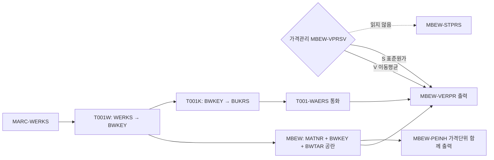

# 자재 단가 기준(이동평균가)

자재 리포트에서 "단가"를 보여 줄 때 어떤 필드를 쓰고 어떻게 읽는지 정리합니다.

## 한눈에 보기

단가와 통화를 읽는 경로입니다.

## 현업 확정 사항

- 단가는 가격관리 구분(MBEW-VPRSV)과 관계없이 **항상 이동평균가 MBEW-VERPR**을 출력합니다. 표준원가 자재(VPRSV = 'S')도 VERPR을 보여 주고, 표준원가 MBEW-STPRS는 읽지도 출력하지도 않으며 선택 옵션도 두지 않습니다. (현업 확정 2026-10-09) [[req:20261006-33d4fc|자재마스터 조회 리포트]]
- 주의: VPRSV = 'S' 자재는 실제 관리 단가가 STPRS입니다. 현업이 "이동평균가"라고 한 경우에도 표준원가 자재 처리 방법은 반드시 따로 확인합니다. 이 요청에서는 확인 결과 VERPR 고정이었습니다. [[req:20261006-33d4fc|자재마스터 조회 리포트]]

## 읽는 방법

- 키: [[table:MBEW|MBEW]] = MATNR + BWKEY + BWTAR. [[req:20261006-33d4fc|자재마스터 조회 리포트]]
- 플랜트 → 평가영역: [[table:T001W|T001W]] T001W-WERKS → T001W-BWKEY. 평가영역이 플랜트 레벨(BWKEY = WERKS)이라고 가정했습니다 (시스템 미확인). [[req:20261006-33d4fc|자재마스터 조회 리포트]]
- 분할평가 자재는 평가유형이 공란인 헤더 레코드(MBEW-BWTAR = ' ')의 VERPR만 씁니다. 평가유형별 단가는 범위 밖으로 두었습니다. [[req:20261006-33d4fc|자재마스터 조회 리포트]]
- 가격단위 MBEW-PEINH를 함께 출력합니다. 단가만 보여 주면 가격단위가 1이 아닌 자재에서 오해가 생깁니다. [[req:20261006-33d4fc|자재마스터 조회 리포트]]
- 통화: T001W-BWKEY → [[table:T001K|T001K]]-BUKRS → [[table:T001|T001]]-WAERS. BWKEY 고유 목록으로 T001K INNER JOIN T001을 한 번 읽어 HASHED TABLE에 둡니다. ALV에서는 `set_currency_column( 'WAERS' )`로 VERPR에 통화를 참조시킵니다. [[req:20261006-33d4fc|자재마스터 조회 리포트]]
- MBEW는 메인 SELECT에 LEFT OUTER JOIN하지 않고 (MATNR, BWKEY) 고유 목록으로 FOR ALL ENTRIES 조회합니다. 이유는 [[자재마스터 조회 리포트 설계 패턴]] 참고. 평가 뷰가 없으면 단가 0, 통화는 T001 값을 그대로 표시합니다. [[req:20261006-33d4fc|자재마스터 조회 리포트]]

## 시스템 확인 필요

- S/4HANA라면 MBEW 호환뷰(Compatibility View)로 읽어도 VERPR이 정상 조회된다고 가정했습니다. ECC/S4 구분과 Material Ledger 활성 여부는 이동평균가 출처에 영향을 주므로 개발 착수 전에 확인합니다 (시스템 미확인). [[req:20261006-33d4fc|자재마스터 조회 리포트]]

- 시스템 확인(2026-10-11): 대상 시스템은 **ECC**입니다(MBEW가 투명 테이블, MATDOC·ACDOCA 없음). 따라서 S/4 MBEW 호환뷰 이슈는 해당 없습니다. Material Ledger 활성 여부는 설정이라 도구로 확인하지 못했으나, VERPR을 그대로 쓰는 현업 확정에는 영향이 없습니다 (시스템 미확인). [[req:20261006-33d4fc|자재마스터 조회 리포트]]

## 단가 열람 권한

- 단가를 출력하는 리포트에서 플랜트 권한(`M_MATE_WRK`)만 체크하면, MM03에서 회계 뷰를 볼 권한이 없는 사용자도 단가를 볼 수 있습니다(테스트 리뷰 W1, 위험으로 남김). 단가 열람 정책과 자재 권한그룹(MARA-BEGRU, `M_MATE_MAT`) 운영 여부는 분석 단계에서 현업·보안에 확인하고, 필요하면 행 필터나 단가 마스킹을 넣습니다. → [[자재마스터 조회 리포트 설계 패턴]] [[req:20261006-33d4fc|자재마스터 조회 리포트]]

## 테스트 포인트

- 이동평균 자재(VPRSV = V)와 표준원가 자재(VPRSV = S) 모두 MBEW-VERPR이 나오는지, 분할평가 자재는 헤더 단가만 나오는지 확인합니다. [[req:20261006-33d4fc|자재마스터 조회 리포트]]
