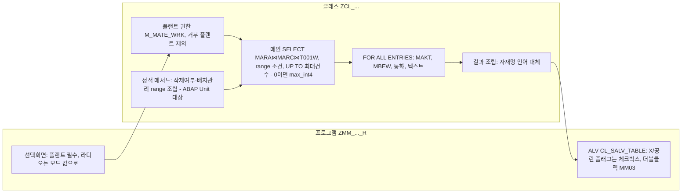

# 자재마스터 조회 리포트 설계 패턴

자재×플랜트 단위로 자재마스터를 조회하는 ALV 리포트를 만들 때 이 팀에서 정한 판단과 그 이유를 정리합니다. 관련: [[배치관리 자재 판정 기준]], [[자재 단가 기준(이동평균가)]], [[SAP 시스템 미확인 상태에서 작업하는 방법]]

## 한눈에 보기

리포트 구조와 주요 판단 위치입니다.

## 현업 확정 사항

- **플랜트는 선택화면 필수 입력(OBLIGATORY)** 입니다. 대량 조회를 막기 위함이며, 플랜트 뷰가 없는 자재(MARA만 있는 자재)는 출력하지 않습니다. 그래서 [[table:MARA|MARA]]–[[table:MARC|MARC]]는 INNER JOIN입니다. (현업 확정 2026-10-09) [[req:20261006-33d4fc|자재마스터 조회 리포트]]
- **삭제여부는 MARC-LVORM(플랜트 레벨)** 하나로 조회조건과 출력을 모두 처리합니다. MARA-LVORM은 읽지도 출력하지도 않습니다. 따라서 MARA에만 삭제 표시된 자재는 "삭제 제외" 조건에서도 출력되어야 하며, 테스트에서 이 경우를 꼭 확인합니다. (현업 확정 2026-10-09) [[req:20261006-33d4fc|자재마스터 조회 리포트]]
- 단가는 항상 MBEW-VERPR → [[자재 단가 기준(이동평균가)]]. [[req:20261006-33d4fc|자재마스터 조회 리포트]]

## 요청 해석 시 주의

- 생성일·생성인은 MARA-ERSDA, MARA-ERNAM을 씁니다. 표준 MARC에는 생성일·생성인 필드가 없습니다. [[req:20261006-33d4fc|자재마스터 조회 리포트]]
- "자재그룹 제품군"처럼 붙여 쓴 항목은 두 컬럼(MARA-MATKL, MARA-SPART)으로 해석하고 가정에 적어 둡니다. [[req:20261006-33d4fc|자재마스터 조회 리포트]]
- 플랜트가 조회조건과 출력에 모두 있으면 결과 단위는 자재×플랜트 1행으로 봅니다. [[req:20261006-33d4fc|자재마스터 조회 리포트]]

## 구조

- 프로그램(`ZMM_MATERIAL_LIST_R`)은 선택화면·메시지·ALV 출력만, 조건 조립·DB 조회·텍스트 판정은 클래스(`ZCL_MM_MATERIAL_LIST`)에 둡니다. DB가 필요 없는 정적 메서드(range 조립, 텍스트 선택)를 ABAP Unit 대상으로 삼습니다. [[req:20261006-33d4fc|자재마스터 조회 리포트]]
- 출력 타입은 표준 Data Element를 참조해 ALV 컬럼명을 자동으로 받습니다. Data Element명이 다르면 `TYPE marc-xchpf`처럼 테이블 필드 참조로 바꿔도 같은 효과입니다. [[req:20261006-33d4fc|자재마스터 조회 리포트]]

## 설계 판단과 이유

- **라디오 옵션 조건은 동적 WHERE가 아니라 range로 만든다.** 삭제여부(제외/삭제만/전체), 배치관리(전체/만/제외)를 각각 range로 만들어 `c~lvorm IN @lr_lvorm` 형태로 붙입니다. "전체"는 빈 range라 조건 없음으로 동작하므로, 동적 WHERE가 비었을 때 생기던 SELECT 분기가 사라지고 단위테스트도 쉬워집니다(`'X' IN lr`, `' ' IN lr`로 의미 검증). 처음 설계는 동적 WHERE(`build_deletion_where`)였다가 배치관리 조건 추가 때 range로 통일했습니다. [[req:20261006-33d4fc|자재마스터 조회 리포트]]
- **잘못된 모드 값은 빈 range(조건 없음)** 로 처리합니다. 라디오에서는 생길 수 없는 값이라 방어용입니다. [[req:20261006-33d4fc|자재마스터 조회 리포트]]
- **MAKT·MBEW는 LEFT OUTER JOIN 대신 FOR ALL ENTRIES.** 릴리스를 모를 때 ON 조건의 리터럴 비교(BWTAR = ' ', SPRAS = 파라미터) 제약을 피하고, 최대건수(UP TO n ROWS)가 메인 키(자재×플랜트) 기준으로 정확히 적용되게 하기 위해서입니다. FAE 전에 드라이버 테이블이 비었는지 반드시 확인합니다. [[req:20261006-33d4fc|자재마스터 조회 리포트]]
- **최대건수 파라미터(기본 50,000, 0 = 무제한)** 를 둡니다. `UP TO 0 ROWS`가 무제한으로 동작하지 않을 수 있으므로(릴리스 확인 필요) 0이면 UP TO 없는 SELECT로 분기하거나 큰 값을 넣습니다. 건수 = 최대건수면 잘림 경고를 띄웁니다. [[req:20261006-33d4fc|자재마스터 조회 리포트]]
  - 개발에서는 SELECT 분기 대신 0을 `cl_abap_math=>max_int4`로 바꿔 UP TO에 넣었습니다. [[req:20261006-33d4fc|자재마스터 조회 리포트]]
  - 알려진 한계: `lines( ) >= maxhit`으로 판정하면 조건에 맞는 데이터가 정확히 maxhit건일 때도 잘림 경고가 뜹니다. 정확히 하려면 `UP TO maxhit + 1 ROWS`로 읽고 초과분 1건을 지운 뒤 잘림 표시를 세웁니다(maxhit이 max_int4가 아닐 때만). (리뷰 I1) [[req:20261006-33d4fc|자재마스터 조회 리포트]]
- MARA-ERSDA, MARA-ERNAM에는 표준 인덱스가 없을 수 있어 생성일만으로 넓게 조회하면 느릴 수 있습니다. 플랜트 필수 + 최대건수로 막고, QAS에서 ST05로 인덱스 사용을 확인합니다 (시스템 미확인). [[req:20261006-33d4fc|자재마스터 조회 리포트]]
  - 주의(리뷰 W2): 메인 SELECT에 `ORDER BY`가 있으면 DB가 전체를 정렬한 뒤 `UP TO`를 적용하므로 **최대건수로 응답시간이 줄지 않습니다.** 느리면 ① ORDER BY를 빼고 ABAP SORT(이때 결과가 "앞 n건"이 아니게 되는 점 현업 합의) ② 생성일 기본값 도입 ③ 인덱스 검토 중에서 고릅니다. [[req:20261006-33d4fc|자재마스터 조회 리포트]]
- MARC-LVORM·MARC-XCHPF 조건은 MARC 기본키(MATNR, WERKS)로 좁힌 뒤 걸리는 잔여 조건이라 인덱스가 필요 없습니다. [[req:20261006-33d4fc|자재마스터 조회 리포트]]
- 자재명은 로그온 언어 우선, 없으면 대체 언어(기본 EN)로 찾습니다. MAKT를 `spras IN (1순위, 대체)`로 한 번에 읽고 정적 메서드로 고릅니다. [[req:20261006-33d4fc|자재마스터 조회 리포트]]
- 플랜트 권한은 `M_MATE_WRK`(ACTVT 03)로 플랜트별 체크하고, 거부된 플랜트는 제외 후 경고, 전부 거부면 종료합니다. 자재 권한그룹(MARA-BEGRU, `M_MATE_MAT`)은 운영 여부 확인 후 결정합니다 (시스템 미확인). [[req:20261006-33d4fc|자재마스터 조회 리포트]]
  - 주의(리뷰 W1): 플랜트 권한만 체크하면 MM03에서 회계 뷰를 볼 권한(`M_MATE_STA` 등)이 없는 사용자도 이 리포트로 단가(MBEW-VERPR)를 봅니다. 단가를 출력하는 리포트는 **분석 단계에서 단가 열람 정책과 BEGRU 운영 여부를 현업·보안에 묻고**, 필요하면 `M_MATE_MAT` 행 필터나 단가 마스킹을 넣습니다. → [[자재 단가 기준(이동평균가)]] [[req:20261006-33d4fc|자재마스터 조회 리포트]]
  - 개선(리뷰 I3): [[table:T001W|T001W]]에 없는 플랜트(오타)만 입력해도 허용 목록이 비어 "조회 권한이 있는 플랜트가 없습니다"가 나와 권한 문제로 오해됩니다. T001W 조회 0건이면 "입력한 플랜트가 없습니다"로 구분합니다. [[req:20261006-33d4fc|자재마스터 조회 리포트]]
  - 플랜트가 비어 있으면 T001W SELECT 전에 RETURN하고, 허용 플랜트가 없으면 `get_data`가 빈 결과를 돌려주게 합니다. **빈 플랜트 range를 그대로 `IN`에 넣으면 전체 플랜트가 조회되므로** 이 가드는 단위테스트로 고정합니다. [[req:20261006-33d4fc|자재마스터 조회 리포트]]

## ALV(CL_SALV_TABLE) 표시

- 'X'/공란 플래그(삭제여부, 배치관리)는 `if_salv_c_cell_type=>checkbox`로 표시합니다. SALV는 편집 기능이 없어 읽기 전용이 보장되고, `checkbox_hotspot`은 클릭 이벤트가 생겨 혼동되므로 쓰지 않습니다. [[req:20261006-33d4fc|자재마스터 조회 리포트]]
- 체크박스는 표시 방식일 뿐 내부 값은 'X'/공란이라 엑셀에는 X/빈칸으로 나옵니다. 다만 SAP GUI 버전·내보내기 형식에 따라 다를 수 있어 QAS에서 실제 파일로 확인하고, 'X'로 안 나오면 일반 텍스트 컬럼(가운데 정렬)으로 바꾸는 것을 대안으로 둡니다. 백그라운드 실행 스풀에서는 'X'/공란 문자로 나옵니다. [[req:20261006-33d4fc|자재마스터 조회 리포트]]
- 더블클릭 시 `SET PARAMETER ID 'MAT'`, `'WRK'` 후 `CALL TRANSACTION 'MM03' WITH AUTHORITY-CHECK AND SKIP FIRST SCREEN`. [[req:20261006-33d4fc|자재마스터 조회 리포트]]
  - `cx_sy_authorization_error`를 잡아 메시지로 바꿉니다. 정렬·필터 뒤에도 선택한 행의 자재로 가는지 통합 테스트에서 확인합니다. [[req:20261006-33d4fc|자재마스터 조회 리포트]]
- 체크박스 컬럼 폭을 고정(`set_output_length`)하려면 전체 최적화(`get_columns( )->set_optimize( )`)를 쓰지 않습니다. 전체 최적화가 고정 폭을 무시할 수 있어, 그 컬럼만 빼고 컬럼별 `set_optimized( abap_true )`를 적용했습니다. [[req:20261006-33d4fc|자재마스터 조회 리포트]]
- 기본 숨김 컬럼(설명성 컬럼·생성인 등), 키 컬럼(MATNR, WERKS), VERPR의 통화 컬럼(WAERS)을 지정하고, 레이아웃 키·저장·기본 레이아웃·P_VARI(`TYPE slis_vari`, F4는 `cl_salv_layout_service=>f4_layouts`)를 둡니다. [[req:20261006-33d4fc|자재마스터 조회 리포트]]

## 선택화면·메시지 처리 (개발에서 정한 것)

- 선택화면 기본값(대체 언어 'E', 최대건수 50,000)은 PARAMETERS DEFAULT가 아니라 **INITIALIZATION에서 클래스 상수**(`gc_default_spras2`, `gc_default_maxhit`)로 넣어 하드코딩을 한 곳에 모읍니다. 변형(Variant)은 INITIALIZATION 뒤에 적용되므로 변형 값이 우선합니다. [[req:20261006-33d4fc|자재마스터 조회 리포트]]
- 선택화면 검증과 같은 정규화(언어 공란 → SY-LANGU, 대체 언어 = 1순위 → 공란, 음수 최대건수 → 기본값)를 **클래스 constructor에도** 둡니다. 리포트 밖에서 호출(단위테스트 등)해도 같은 규칙이 적용됩니다. [[req:20261006-33d4fc|자재마스터 조회 리포트]]
- 경고가 동시에 생기면(권한 제외 + 잘림, 권한 제외 + 0건) 한 줄로 합쳐 보여 줍니다(예: "M04 / M02", "M03 (M02)"). [[req:20261006-33d4fc|자재마스터 조회 리포트]]
- 메시지는 Text Symbol로 두었습니다. 시스템에 MM 메시지 클래스 `ZMM`이 있지만 번호를 새로 만드는 것은 시스템 쓰기라 팀장 판단 사항으로 남겼습니다. [[req:20261006-33d4fc|자재마스터 조회 리포트]]
- 자재명(MAKT)만 대체 언어를 쓰고 자재유형명·자재그룹명·제품군명([[table:T134T|T134T]], [[table:T023T|T023T]], [[table:TSPAT|TSPAT]])은 1순위 언어만 읽어, 로그온 언어 텍스트가 없으면 공란입니다. 텍스트 컬럼에도 대체 언어를 적용할지 현업에 함께 묻습니다(리뷰 I5). [[req:20261006-33d4fc|자재마스터 조회 리포트]]

## 미결 사항을 다루는 방식

- 현업 답을 기다리는 항목 중 선택형으로 받을 수 있는 것(자재명 언어·대체 언어, 최대건수, 배치관리 조건)은 **선택화면 옵션이나 독립 블록으로 만들어** 답이 오면 기본값만 바꾸거나 블록만 지우면 되게 합니다. 블록을 지워도 클래스는 바꾸지 않도록 모드 값('A' 고정)으로 넘깁니다. [[req:20261006-33d4fc|자재마스터 조회 리포트]]

## 팀장 수정 지시 경향

- 분석 단계에서 "배치관리 자재인지도 추가해줘"처럼 출력 항목을 한 줄로 추가 지시했습니다. 이런 지시는 출력 컬럼만이 아니라 판정 기준 필드, 표시 형식(엑셀 결과 포함), 선택조건 여부, 현업 확인 항목까지 함께 정리해 보고하는 방식이 승인을 받았습니다. 자재 리포트에서는 자재 관리 속성(배치관리 등) 컬럼 추가 요구가 나올 수 있으니 분석 때 미리 물어볼 만합니다. [[req:20261006-33d4fc|자재마스터 조회 리포트]]
- 설계 변경이 생기면 이미 만들어진 소스에는 반영되지 않은 상태이므로, 설계서에 "개발 단계에서 반영 필요"를 명시합니다. [[req:20261006-33d4fc|자재마스터 조회 리포트]]
- 개발 단계에서 SAP 접속이 복구되자 "SAP 접속 성공이 되었으니 맞게 다시 진행해줘"로 되돌렸습니다. 팀장은 시스템 확인 없이 만든 소스를 그대로 넘기기보다 **확인할 수 있게 되면 바로 확인해 맞추는 것**을 원합니다. 진행 방식은 [[SAP 시스템 미확인 상태에서 작업하는 방법]]. [[req:20261006-33d4fc|자재마스터 조회 리포트]]
- 테스트 단계는 시스템에 쓸 수 없어 "조건부 합격"으로 승인됐고, 실제 확인은 반영 때로 넘어갔습니다 → [[테스트계 반영 전 점검 항목]]. [[req:20261006-33d4fc|자재마스터 조회 리포트]]
