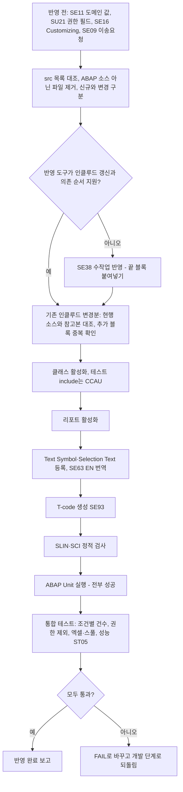

# 테스트계 반영 전 점검 항목

개발·테스트 단계는 시스템에 쓰지 않으므로 활성화와 ABAP Unit 실행은 테스트계(QAS) 반영 때 처음 일어납니다. 그때 순서대로 확인할 항목과, 하나라도 실패하면 개발 단계로 되돌리는 기준을 정리합니다. 관련: [[SAP 시스템 미확인 상태에서 작업하는 방법]], [[ECC 7.40 시스템 ABAP 개발 제약]]

## 한눈에 보기

## 반영 전 확인 (도구로 못 읽은 것)

- abap-mrd(ADT)로 읽지 못한 항목은 반영 전에 SAP GUI로 확인합니다: SE11 필드·도메인 값(예: MARC-XCHPF가 'X'/공란뿐인지), SU21 권한 객체 필드(예: `M_MATE_WRK` = ACTVT, WERKS), SE11 인덱스, SE16 Customizing(예: TCUCH 배치 레벨), 시스템 > 상태의 SAP_BASIS SP. (시스템 미확인) [[req:20261006-33d4fc|자재마스터 조회 리포트]]
- 개발 패키지는 시스템에 실제로 있는 이름을 씁니다. MM은 `ZMMD`("MM Development Package")이고, 설계에서 가정한 "ZMM"은 패키지가 아니라 메시지 클래스 이름입니다. 이송요청은 SE09에서 따로 만듭니다. [[req:20261006-33d4fc|자재마스터 조회 리포트]]

## 개발계 반영(웹앱 ADT) 이슈

- **기존 오브젝트를 "생성"하려다 실패**: 기존 모듈풀 인클루드를 고친 요청에서 개발계 반영이 `MZMM2222F01 생성 실패 (HTTP 500): 이름 MZMM2222F01으(로) 이미 프로그램이나 include가 있습니다`로 멈췄습니다. 반영 도구가 src/ 파일을 모두 신규 생성으로 처리했기 때문입니다. 기존 프로그램 변경 요청은 반영 전에 오브젝트별로 신규/변경을 구분하고(개발 문서 오브젝트 목록의 "신규/변경" 열), 변경 대상은 기존 소스 갱신(잠금 → 소스 쓰기 → 활성화) 방식으로 올려야 합니다. 이 요청은 반영 실패 상태로 남아 있습니다. [[req:20261019-bce84c|스크랩(SCRAP) 기본단가 관리 공문 메일발송 기능 개발]]
  - **원인 상세(PL 분석)**: 반영 도구가 존재 여부를 `/sap/bc/adt/programs/programs/<이름>`(PROG/P 경로)로만 확인했습니다. 인클루드는 PROG/I라 `/sap/bc/adt/programs/includes/<이름>`에 있으므로 "없음(404)"으로 판단되어 신규 생성을 시도했습니다. 소스 내용 문제가 아니라 **오브젝트 유형(PROG/P·PROG/I) 판별 문제**이므로 개발 소스를 고쳐서는 해결되지 않습니다. 같은 프로그램의 다른 인클루드(TOP·O01·I01)도 같은 방식으로 실패할 수 있습니다. 반영 전에 SearchObject 결과의 유형·URI(`/programs/includes/`)로 인클루드 여부를 확인합니다. [[req:20261019-bce84c|스크랩(SCRAP) 기본단가 관리 공문 메일발송 기능 개발]]
  - **팀장 지시와 조치**: 팀장은 반영 오류를 개발 단계 수정 지시로 돌려보냈습니다("기존 있는 거에 밑에 추가나 수정으로 반영해줘"). 개발 3차는 인클루드를 "현행 원문 그대로 + 끝에 추가 블록" 형태로 정리하고, 개발 문서에 **SE38 수작업 대안**(기존 인클루드를 열어 끝에 추가 블록만 붙여넣기 → 저장 → 전체 활성화)을 행 범위까지 적었습니다 → [[기존 모듈풀 ALV 화면에 기능 추가하는 방법]]. 도구가 고쳐지기 전에는 웹앱으로 다시 반영해도 같은 HTTP 500이 날 수 있어 테스트 리뷰가 주의(R-17)로 남겼습니다. [[req:20261019-bce84c|스크랩(SCRAP) 기본단가 관리 공문 메일발송 기능 개발]]
  - **부분 반영 확인**: 여러 파일을 순서대로 올리다 중간(F01)에서 멈추면 앞 파일(TOP·O01·I01)은 이미 바뀌었을 수 있습니다. 다시 반영하기 전에 각 인클루드에 `*-- U4` 블록이 이미 있는지 보고, 있으면 중복으로 붙이지 않습니다. [[req:20261019-bce84c|스크랩(SCRAP) 기본단가 관리 공문 메일발송 기능 개발]]
    - 보충(테스트 3차 확인): 현재 웹앱은 src/ 파일을 **파일명 순서**로 처리하므로 MZMM2222F01이 맨 먼저 시도되어 실패했고, 그 뒤 I01·O01·TOP·ZCL_ 클래스는 시도되지 않았습니다. 반영 실패 후 SearchObject로 `ZCL_MM_SCRAP*`·`SAPMZMM2222*`를 조회해 새로 생긴 오브젝트가 없음을 확인했습니다. 다른 파일 구성에서는 앞 파일이 이미 반영됐을 수 있으므로 위 확인은 그대로 합니다. [[req:20261019-bce84c|스크랩(SCRAP) 기본단가 관리 공문 메일발송 기능 개발]]
  - **파일명 순서 = 의존 순서가 아님**: 신규 클래스(`ZCL_...`)는 인클루드 TOP이 타입으로 참조하므로 먼저 있어야 하는데, 파일명 순서로는 `MZMM*` 인클루드가 클래스보다 앞에 옵니다. 도구가 인클루드 문제를 고쳐도 일괄 활성화 전에 클래스가 없으면 실패할 수 있으니, 신규 클래스와 기존 프로그램 변경이 섞인 요청은 클래스 먼저 반영하는 순서를 개발 문서에 적고 도구 동작과 대조합니다(시스템 미확인 — 웹앱 일괄 활성화 시 순서 영향은 실제 반영으로 확인 필요). [[req:20261019-bce84c|스크랩(SCRAP) 기본단가 관리 공문 메일발송 기능 개발]]
  - **반복 실패와 팀장 지시 경향**: 같은 HTTP 500으로 개발계 반영이 세 번 실패했습니다. 팀장은 두 번째에 "아까 말했는데 이렇게 에러가 나오면 이미 있던 소스에 추가해서 반영해달라고 했잖아"라며 같은 지시를 다시 내렸지만, 소스는 이미 그 형태였고 원인은 반영 도구라 개발 4차·테스트 재승인 뒤에도 같은 오류가 났습니다. 반영 오류가 **도구 문제**로 판명되면 개발 단계 재작업으로는 풀리지 않으므로, 보고 첫 줄에 "다시 반영해도 같은 오류 — ① 도구 수정 ② SE38 수작업 반영 중 선택 필요"를 분명히 적어 같은 실패가 반복되지 않게 합니다. [[req:20261019-bce84c|스크랩(SCRAP) 기본단가 관리 공문 메일발송 기능 개발]]
  - **반영 직전 현행 소스 대조(IT-00)**: src의 원문 부분은 PL이 조회한 날의 스냅숏(ref/)입니다. 반영 직전 SE38 버전 관리나 ADT로 현행 = 참고본인지 대조하고, 다르면 통째로 덮어쓰지 말고 멈춰서 PL에 보고합니다(그 사이 다른 사람의 변경을 지울 수 있음). 테스트 판정 "조건부 PASS"의 유지 조건 맨 앞에 IT-00(현행 대조) → IT-01(수작업 오브젝트·활성화) → IT-02(ABAP Unit)를 두었습니다. [[req:20261019-bce84c|스크랩(SCRAP) 기본단가 관리 공문 메일발송 기능 개발]]
- 반영 순서에 의존성이 있으면 업로드 순서도 지켜야 합니다. 예: 신규 클래스(타입 참조)·메시지 클래스가 먼저 있어야 인클루드 TOP·F01이 활성화됩니다. 화면(SE51)·GUI 상태(SE41)·메시지(SE91)·텍스트 심볼은 소스 파일로 올라가지 않으므로 수작업 체크리스트로 처리합니다 → [[기존 모듈풀 ALV 화면에 기능 추가하는 방법]]. [[req:20261019-bce84c|스크랩(SCRAP) 기본단가 관리 공문 메일발송 기능 개발]]
- src/에 이전 대상(예: ZEMM0020용) 소스가 남아 있으면 함께 올라가 다른 프로그램을 덮어씁니다. 반영 전에 src/ 파일 목록이 개발 문서의 오브젝트 목록과 같은지 확인합니다. [[req:20261019-bce84c|스크랩(SCRAP) 기본단가 관리 공문 메일발송 기능 개발]]
- **src/에는 ABAP 소스 오브젝트만 둡니다.** 웹앱은 `src/*.abap` 중 `.testclasses.abap`이 아닌 파일을 모두 반영 대상으로 보고, `CLASS ... DEFINITION`이 없으면 PROG로 판단해 파일명 그대로 실행 프로그램을 만듭니다. 화면 0200 흐름 로직(`PROCESS BEFORE OUTPUT.`)을 `src/SAPMZMM2222_0200_flow.abap`으로 두었더니 `SAPMZMM2222_0200_FLOW`(PROG/P)가 생성 대상이 되어 구문 오류 → 일괄 활성화 실패가 예상돼 테스트가 치명(R-18)으로 FAIL 판정했습니다. 흐름 로직·GUI 상태·텍스트처럼 SE51/SE41/SE91에서 붙여넣을 자료는 `screen/` 등 src/ 밖에 둡니다. [[req:20261019-bce84c|스크랩(SCRAP) 기본단가 관리 공문 메일발송 기능 개발]]
- 개발 담당 에이전트에는 파일 삭제 도구가 없어 "삭제 대상"이라고 문서에만 적고 원본을 남겼습니다(screen/으로 복사만 됨). **문서에 적힌 정리 작업은 실제 파일 목록(Glob)으로 확인**하고, 삭제는 팀장 승인 후 PL이 처리합니다. 처음부터 src/에 비소스 파일을 만들지 않는 것이 가장 확실합니다. [[req:20261019-bce84c|스크랩(SCRAP) 기본단가 관리 공문 메일발송 기능 개발]]
- 대상이 `$TMP`(로컬 오브젝트)면 이송요청에 담을 수 없어 품질·운영 반영 경로가 없습니다. 개발계 검증만 하는 것인지, 정식 패키지(MM은 ZMMD)로 재지정할지 반영 전에 팀장 결정을 받습니다. [[req:20261019-bce84c|스크랩(SCRAP) 기본단가 관리 공문 메일발송 기능 개발]]
- 메일 발송 기능은 반영 후 SCOT 외부 발송 설정, 발신 사용자 SU01 메일 등록을 Basis에 확인하고 사내 주소로만 테스트합니다(시스템 미확인) → [[SAP 메일 발송(BCS) 구현 패턴]]. [[req:20261019-bce84c|스크랩(SCRAP) 기본단가 관리 공문 메일발송 기능 개발]]

## 활성화 순서와 주의

- 순서: 전역 클래스 → 리포트 → Text Symbol/Selection Text → T-code. 이후 SLIN, SCI 결과를 확인합니다. [[req:20261006-33d4fc|자재마스터 조회 리포트]]
- 필드 참조 타입(`TYPE marc-xchpf`)으로 쓴 소스는 **활성화가 통과하면 필드 존재가 확인된 것**으로 봅니다. 필드 목록을 못 읽은 시스템에서 이 방식이 확인 수단이 됩니다. [[req:20261006-33d4fc|자재마스터 조회 리포트]]
- 테스트 클래스 파일(`*.testclasses.abap`)은 클래스의 Local Test Classes include(CCAU)에 넣습니다. [[req:20261006-33d4fc|자재마스터 조회 리포트]]
- **텍스트 요소는 소스 파일에 들어 있지 않습니다.** Text Symbol(블록 제목·컬럼명·메시지)과 Selection Text는 개발 문서 표로만 있으므로, 반영 도구(웹앱 ADT)가 함께 올리지 않으면 활성화는 되지만 블록 제목이 빈칸, 선택화면 라벨이 기술명(S_WERKS 등)으로 나옵니다. 반영 후 화면을 열어 보고, 빠졌으면 SE38 텍스트 요소 등록과 SE63 EN 번역을 체크리스트로 처리합니다(리뷰 W3). Text Symbol 정의 길이는 소스 리터럴 길이 이상으로 잡습니다. [[req:20261006-33d4fc|자재마스터 조회 리포트]]
- 프로그램 권한그룹(S_PROGRAM)을 지정하지 않으면 SA38/SE38 직접 실행 시 T-code의 S_TCODE 체크를 거치지 않습니다. 팀 표준 권한그룹을 지정합니다(리뷰 I7). [[req:20261006-33d4fc|자재마스터 조회 리포트]]

## 조건부 합격(PASS) 유지 조건

- 테스트 단계가 시스템 없이 정적 리뷰만 했으면 판정은 "조건부 합격"이고, 반영 때 아래 중 하나라도 실패하면 FAIL로 바꾸고 개발 단계로 되돌립니다. [[req:20261006-33d4fc|자재마스터 조회 리포트]]
  - 활성화 성공 + ABAP Unit 전부 성공
  - 선택조건 라디오별 건수가 맞음(예: 전체 = 배치관리만 + 비배치관리만, 삭제 제외/삭제만/전체)
  - 권한 없는 플랜트가 결과에서 빠지고 경고가 나옴
- 함께 볼 것: 엑셀(XLSX) 내보내기에서 체크박스 컬럼이 X/빈칸인지(SAP GUI 버전 기록), 백그라운드 스풀 출력, 넓은 조건의 응답시간(ST05로 인덱스 사용 기록). [[req:20261006-33d4fc|자재마스터 조회 리포트]]
