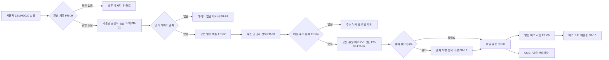
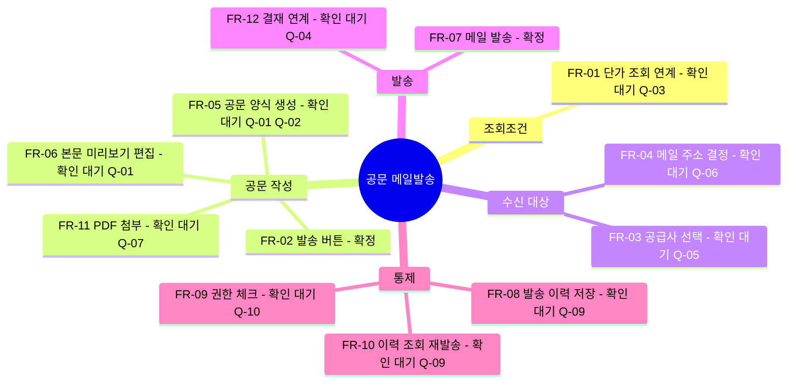
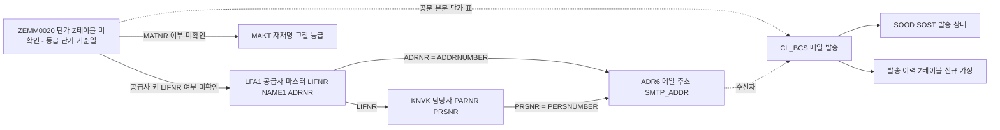

# 01. 요구사항 분석 - 스크랩(SCRAP) 기본단가 관리 공문 메일발송 기능 개발

- 요청 ID: 20261019-f20e07
- 대상 화면: SAP 고철등급별 단가관리 (ZEMM0020)
- 작성: 요구사항 분석 담당 (sap-analyst)
- 작성일: 2026-10-19

> **[중요] 구글시트 미확인**
> 요청서에 "자세한 내용은 구글시트에 있으니 참고해줘"라고 되어 있으나 이번 분석에서도 구글시트 내용을 확인하지 못했습니다.
> - 이유 1: request.md, attachments/ 어디에도 구글시트 URL이나 파일이 없습니다(attachments/ 폴더 자체가 없음).
> - 이유 2: 이 분석 세션에서 Google Drive/Sheets 조회 도구 사용 권한이 허용되지 않았습니다. 팀장님이 시트 공유 권한을 주셨더라도 세션 쪽 도구가 없으면 읽을 수 없습니다.
> - 추가: 이 세션에서는 abap-mrd MCP 조회 도구(GetTable, GetStructure, SearchObject 등)도 노출되지 않아 **SAP 개발계 조회를 하지 못했습니다.** ZEMM0020 프로그램·Z테이블 구조와 표준 테이블 필드는 모두 "시스템 미확인"(SAP 표준 지식 기반 추정)으로 표기합니다.
>
> 이 문서는 request.md(정보처리의뢰서 원문)만 근거로 작성한 **잠정 분석본**입니다. 구글시트 내용(URL 공유 또는 xlsx/PDF로 내보내 첨부 업로드)과 SAP 조회 결과를 받으면 FR/가정/확인 필요 사항을 다시 고쳐야 합니다.

## 표기 규칙

| 표기 | 의미 |
|---|---|
| [확인] | request.md 원문에 명시된 사실 |
| [가정] | 분석 담당이 합리적으로 추정한 내용, 현업/시스템 확인 필요 |
| [미확인-시스템] | SAP 시스템 조회로 확인해야 하는 객체/필드 (표준 지식 기반 추정) |
| [미확인-시트] | 구글시트에 내용이 있을 것으로 예상되는 항목 |

---

## 1. 요약

- [확인] 현재: 스크랩 공급사가 국내스크랩 기본단가 공문을 요청하면 담당자가 그룹웨어 Iris 결재작성의 "대외공문" 기능으로 공문을 수기 작성하고 결재받은 뒤 발송한다.
- [확인] 요청: ZEMM0020(고철등급별 단가관리) 화면의 단가 정보를 써서 스크랩 공급사 대상 공문을 메일로 작성·발송하는 기능을 새로 넣는다.
- [확인] 기대효과: 공문 작성·발송 시간 단축, 수기 입력 오류(휴먼에러) 예방.
- [가정] 구현 방향: ZEMM0020 화면에 "공문 메일발송" 버튼 추가 → 기준일/등급별 단가로 공문 미리보기 → 수신 공급사·메일 주소 선택 → SAP BCS(CL_BCS)로 메일 발송(PDF 첨부 여부는 확인 필요) → 발송 이력 저장.
- 가장 큰 미결 사항: Iris 결재를 SAP 발송에서도 거쳐야 하는지(결재 필요 여부), 공문 양식, 수신 메일 주소 출처. 셋 다 구글시트에서 확정해야 합니다.

## 분석 다이어그램

### 1) 업무 흐름도

### 2) 요구사항 구성도

### 3) 데이터 범위도 (전부 시스템 미확인)

---

## 2. 기능 요구사항

| ID | 설명 | 우선순위 | 상태 | 근거 |
|---|---|---|---|---|
| FR-01 | ZEMM0020에서 조회한 단가 데이터(고철 등급별 기본단가, 적용 기준일 등)를 공문 본문 데이터로 그대로 사용한다. 조회 결과가 없으면 공문 발송 버튼을 막고 메시지를 띄운다. | 필수 | [확인] 기능 자체 / [가정] 대상 필드 | request.md 1항 / Q-03 |
| FR-02 | ZEMM0020 화면(툴바/ALV 버튼)에 "공문 메일발송" 기능을 추가한다. | 필수 | [확인] 화면 내 적용 / [가정] 버튼 형태 | request.md 본문 "화면 내 공문 발송 기능" |
| FR-03 | 수신 대상 스크랩 공급사를 고른다(단건/다건). 공급사 범위(전체 스크랩 공급사, 요청한 공급사만, 사용자 직접 선택)는 확인 필요. | 필수 | [가정] | request.md 2-1) "공급사에서 요청할 경우" / Q-05 |
| FR-04 | 공급사별 수신 메일 주소를 정한다(공급사 마스터 대표 메일, 담당자 메일, 별도 Z관리 등). 주소가 없는 공급사는 경고 후 발송에서 뺀다. 수신자 추가/수정(참조 CC 포함)을 허용할지 확인 필요. | 필수 | [가정] | Q-06 |
| FR-05 | 정해진 공문 양식(문서번호, 시행일자, 수신, 참조, 제목, 본문, 단가표, 발신 명의/직인 등)으로 공문 내용을 자동 생성한다. | 필수 | [가정] 양식 항목 | request.md "공문을 메일 형식으로 작성" / Q-01, Q-02 |
| FR-06 | 발송 전 공문 미리보기를 보여 주고 제목·인사말·비고 등 자유 문구를 편집할 수 있게 한다. 단가 수치는 편집 불가(휴먼에러 방지 취지). | 권장 | [가정] | request.md 2-2) 휴먼에러 예방 / Q-01 |
| FR-07 | SAP 메일(BCS)로 공급사에 외부 메일(SMTP)을 발송한다. 발신 주소/명의는 확인 필요. | 필수 | [확인] 메일 발송 / [가정] BCS 사용 | request.md 1항 / Q-08 |
| FR-08 | 발송 이력(발송일시, 발송자, 공급사, 수신 주소, 공문번호, 기준일, 단가 스냅샷, 발송 결과)을 Z테이블에 저장한다. | 권장 | [가정] | Q-09 |
| FR-09 | 공문 발송 기능은 권한이 있는 사용자만 쓸 수 있게 한다(기존 ZEMM0020 권한 + 발송 권한 구분 여부 확인). | 필수 | [가정] | Q-10 |
| FR-10 | 발송 이력을 조회하고 필요하면 재발송한다. | 선택 | [가정] | Q-09 |
| FR-11 | 공문을 PDF(Smart Forms/Adobe Form)로 만들어 메일에 첨부한다. 본문(HTML)만 보낼지 PDF도 첨부할지 확인 필요. | 권장 | [가정] | Q-07 |
| FR-12 | 현행 Iris 결재를 SAP 발송에도 거쳐야 하면 결재 연계(사전 결재 후 발송, 또는 SAP 내부 승인 단계)를 구현한다. 필요 없으면 이 항목은 빼낸다. | 확인 후 결정 | [가정] | request.md 2-1) "작성.결재 후 발송" / Q-04 |

## 3. 비기능 요구사항

| ID | 내용 | 근거 |
|---|---|---|
| NFR-01 | 기존 ZEMM0020 조회/저장 로직에 영향이 없어야 한다(신규 기능은 버튼으로 분리). | [가정] |
| NFR-02 | 외부 메일 발송은 SCOT(SMTP 노드) 설정에 따른다. 개발계/품질계에서 실제 공급사에게 메일이 나가지 않도록 테스트 수신자를 바꿔 치기(시스템별 분기 또는 설정 테이블)할 수 있어야 한다. | [가정] 운영 리스크 방지 |
| NFR-03 | 다건 발송 시 공급사별로 메일을 따로 보낸다(다른 공급사 주소 노출 방지, BCC 금지 여부 확인). | [가정] 개인정보/영업정보 보호 |
| NFR-04 | 발송 실패(주소 오류 등)는 공급사별 결과로 보여 주고, 일부 실패가 전체 발송을 막지 않는다. | [가정] |
| NFR-05 | 단가 정보는 대외 영업 정보이므로 발송 이력·단가 스냅샷 조회 권한을 제한한다. | [가정] |
| NFR-06 | 메시지·화면 문구는 한국어로 하고, 메시지 클래스(Z계열)로 관리한다. | [가정] 개발 표준 확인 필요 |

## 4. 관련 모듈

- MM(구매): 스크랩(고철) 구매, 공급사 마스터, 단가 관리 — 주 모듈
- BC(Basis): SAP Office/BCS 메일 발송, SCOT/SOST, 출력 양식(Smart Forms/Adobe Forms)
- (외부) 그룹웨어 Iris: 현행 대외공문 결재 시스템. 연계가 필요한지는 Q-04

## 5. 관련 표준 테이블·필드

> 이번 세션에서 SAP 조회 도구를 쓸 수 없어 **모든 항목이 [미확인-시스템]** 입니다. 설계 단계 전에 abap-mrd로 꼭 확인해야 합니다.

| 객체 | 용도 | 예상 필드 | 상태 |
|---|---|---|---|
| ZEMM0020 (T-code) | 고철등급별 단가관리. 프로그램명, 화면 구조(ALV/Dynpro), 단가 Z테이블 확인 필요 | - | [미확인-시스템] |
| ZEMM0020 단가 Z테이블 | 등급별 기본단가 원천. 키(플랜트/등급/공급사/기준일 등)와 공급사 단위 단가인지, 공통 단가인지 확인 필요 | - | [미확인-시스템] |
| LFA1 | 공급사 일반 마스터 | LIFNR, NAME1, ADRNR, KTOKK, LOEVM, SPERR | [미확인-시스템] |
| ADRC | 주소 | ADDRNUMBER, NAME1, TEL_NUMBER | [미확인-시스템] |
| ADR6 | 이메일 주소 | ADDRNUMBER, PERSNUMBER, CONSNUMBER, SMTP_ADDR, FLGDEFAULT | [미확인-시스템] |
| KNVK | 공급사 담당자(연락 담당자) | PARNR, LIFNR, NAMEV, NAME1, PRSNR | [미확인-시스템] |
| LFM1 | 구매조직별 공급사 데이터(구매조직 기준 필터 시) | LIFNR, EKORG, SPERM | [미확인-시스템] |
| MARA/MAKT | 고철 등급이 자재로 관리되는 경우 자재명 | MATNR, MAKTX | [미확인-시스템] |
| SOOD / SOST | BCS 발송 문서·발송 상태 | - | [미확인-시스템] |
| CL_BCS, CL_DOCUMENT_BCS, CL_CAM_ADDRESS_BCS | 메일 발송 클래스 | - | [미확인-시스템] |
| 발송 이력 Z테이블 | 신규 생성 가정(FR-08) | - | [가정] 신규 |

S/4HANA 환경이면 공급사가 Business Partner(BUT000/BUT020, BP-공급사 연결 CVI_VEND_LINK)로 관리되므로 메일 주소 조회 경로가 달라질 수 있습니다. 시스템 버전(ECC/S/4) 확인 필요.

## 6. 가정

| ID | 가정 내용 |
|---|---|
| A-01 | ZEMM0020은 조회 결과를 ALV로 보여 주는 Z프로그램이며 툴바에 버튼을 추가할 수 있다. |
| A-02 | 단가 데이터는 "기준일(적용 시작일) × 고철 등급" 단위로 관리되고, 공문에는 특정 기준일의 등급별 단가표가 들어간다. |
| A-03 | 수신 대상 "스크랩 공급사"는 SAP 공급사 마스터(LFA1)에 등록되어 있고, 계정그룹·구매조직 또는 Z테이블로 스크랩 공급사를 구분할 수 있다. |
| A-04 | 메일 주소는 공급사 마스터 주소의 이메일(ADR6, 기본 주소 FLGDEFAULT)을 기본으로 쓴다. |
| A-05 | SAP 외부 메일(SCOT SMTP)이 이미 운영 중이다. |
| A-06 | Iris 결재 연계는 이번 범위에 넣지 않고, SAP에서 바로 발송한다(Q-04 답변에 따라 바뀜). |
| A-07 | 공문 문서번호는 SAP에서 자동 채번한다(Iris 문서번호 체계 승계 여부 Q-02). |

## 7. 현업 확인 필요 사항

### 7-1. 구글시트로 확정해야 할 항목

| Q | 항목 | 구체적인 확인 내용 | 영향 FR |
|---|---|---|---|
| Q-00 | 구글시트 전달 방법 | 시트 URL을 요청서에 적어 주시거나, 시트를 xlsx/PDF로 내보내 보드에 첨부로 올려 주세요(분석 세션에는 Google 도구 권한이 없으므로 첨부 업로드를 권장). | 전체 |
| Q-01 | 공문 양식/본문 | 현행 Iris 대외공문 샘플 1부. 제목, 인사말, 본문 문구, 단가표 열 구성, 비고, 맺음말. 고정 문구와 사용자가 고칠 수 있는 문구 구분. | FR-05, FR-06 |
| Q-02 | 공문 머리/꼬리 항목 | 문서번호 체계(Iris 번호 계속 사용 여부), 시행일자, 수신/참조 표기, 발신 명의(회사명·대표이사·부서장), 직인/로고 이미지 사용 여부. | FR-05 |
| Q-03 | 단가 항목 범위 | ZEMM0020 중 공문에 들어갈 필드(등급코드, 등급명, 단가, 통화, 단위, 적용 시작/종료일, 전기 대비 증감 등). 플랜트/공장별로 나눠 보내는지. 공급사별 단가가 다른지 전 공급사 공통인지. | FR-01, FR-05 |
| Q-04 | 결재 필요 여부 | SAP에서 보내는 공문도 Iris 결재(또는 팀장 승인)가 필요한지. 필요하면 Iris 연계(인터페이스) 방식인지, SAP 내부 승인 단계인지, 결재 문서 번호만 입력하는지. | FR-12 |
| Q-05 | 수신 대상 공급사 | 스크랩 공급사 판별 기준(계정그룹, 구매조직, Z관리 목록 등), 요청한 공급사에만 보내는지, 일괄 발송도 하는지. | FR-03 |
| Q-06 | 메일 주소 출처 | 공급사 마스터 이메일(대표/담당자) 중 무엇을 쓰는지, 별도 Z테이블로 관리할지, 수신자를 화면에서 추가·수정할 수 있는지, CC(사내 담당자/팀장) 필요 여부. | FR-04 |
| Q-07 | 첨부 형식 | 메일 본문(HTML)만 보내는지, PDF 공문 첨부가 필요한지, 엑셀 단가표 첨부도 필요한지, 파일명 규칙. | FR-11 |
| Q-08 | 발신자 | 발신 메일 주소(로그인 사용자 개인 메일 / 부서 공용 메일 / 시스템 메일), 회신 주소(Reply-To). | FR-07 |
| Q-09 | 발송 이력 관리 | 이력 보관 항목·기간, 이력 조회 화면 필요 여부, 재발송 허용 여부, 같은 기준일 중복 발송 제한 여부. | FR-08, FR-10 |
| Q-10 | 권한·사용자 | 공문 발송 사용자 범위(구매 담당자 전원/특정 팀), ZEMM0020 조회 권한과 발송 권한을 나눌지. | FR-09 |
| Q-11 | 발송 시점·빈도 | 공급사 요청 시 건별 발송만 하는지, 단가 변경 시 전 공급사 정기 발송도 하는지(배치 필요 여부). | FR-03, FR-07 |

### 7-2. 시스템(개발계)으로 확인해야 할 항목

| Q | 확인 내용 |
|---|---|
| Q-S1 | ZEMM0020 트랜잭션의 프로그램명, 화면 구조(ALV 클래스/FM, PF-STATUS), 수정 가능 여부 |
| Q-S2 | 단가 Z테이블 이름·키·필드, 공급사(LIFNR) 필드가 있는지 |
| Q-S3 | 시스템 버전(ECC/S/4HANA)과 공급사 마스터 관리 방식(LFA1 직접 / BP) |
| Q-S4 | SCOT SMTP 설정 여부, 기존 Z프로그램의 CL_BCS 메일 발송 사례(재사용 가능한 공통 모듈) |
| Q-S5 | 기존 Smart Forms/Adobe Form 공문 양식이나 회사 로고(SE78) 등록 여부 |

## 8. 변경 이력

| 일자 | 차수 | 내용 |
|---|---|---|
| 2026-10-19 | 1차 | 신규 작성. 팀장 수정 지시 "구글시트에 권한 부여했으니 다시 진행해줘" 반영: (1) 구글시트를 확인하지 못한 사실과 이유(URL 미제공, Google 도구 권한 미허용)를 문서 상단에 적음, (2) 구글시트로 확정할 항목을 Q-00~Q-11로 구체화, (3) 확인/가정/미확인 표기를 구분, (4) 이 세션에서 abap-mrd MCP 도구가 노출되지 않아 SAP 조회를 못 한 점을 함께 적고 시스템 확인 항목을 Q-S1~Q-S5로 분리. CR 없음. |
