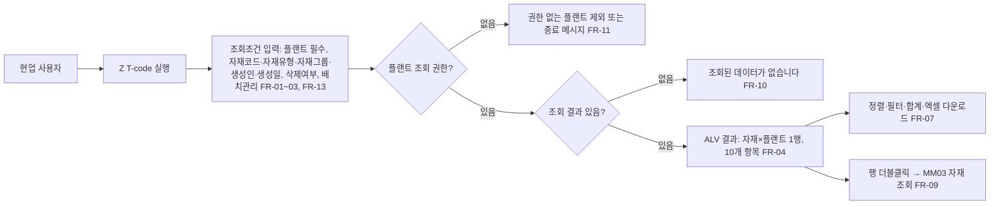
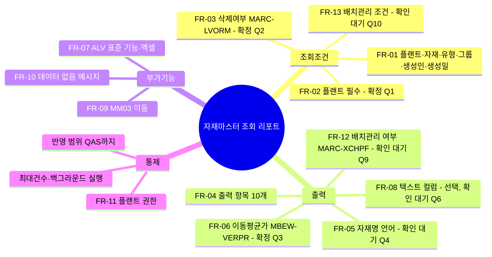
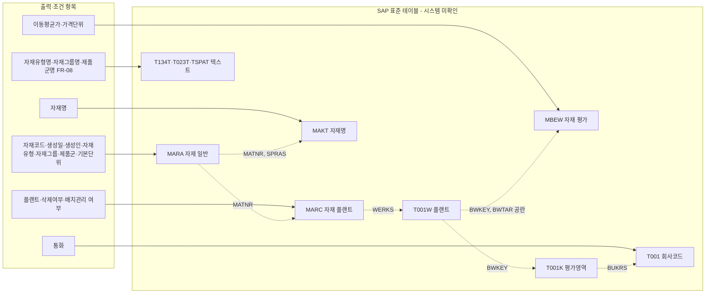

# 01. 요구사항 분석 - 자재마스터 조회 리포트

> 요청ID: 20261006-33d4fc / 작성일: 2026-10-09 / 최종 수정: 2026-10-11 / 단계: 분석(sap-analyst)
>
> **시스템 미확인**: abap-mrd MCP로 MARA/MARC/MBEW/MAKT 구조를 조회하려 했으나 로그온에 실패해서("Anmeldung fehlgeschlagen") 시스템 응답을 받지 못했습니다. 2026-10-10 수정 때도 분석 세션에서 abap-mrd MCP 도구를 쓸 수 없어서, 배치관리 관련 필드(MARA-XCHPF, MARC-XCHPF, MARC-XCHAR)를 시스템 메타데이터로 확인하지 못했습니다. 그래서 아래 테이블·필드는 SAP 표준(ECC/S/4HANA 공통) 지식으로 썼습니다. 설계 전에 SE11에서 다시 확인해야 합니다.

## 0. 변경 이력

| 일자 | 내용 | 근거 |
|---|---|---|
| 2026-10-09 | 최초 작성. Q1·Q2·Q3 확정 반영 | 현업 요청(request.md), 현업 회신 |
| 2026-10-10 | 출력 항목에 '배치관리 여부' 추가(FR-04 수정, FR-12·FR-13 신규). 관련 필드(MARA-XCHPF / MARC-XCHPF / MARC-XCHAR), 가정 8·9, 확인 필요 Q9·Q10, 시스템 확인 항목 추가 | 팀장 수정 지시 "배치관리 자재인지도 추가해줘" |
| 2026-10-11 | **분석 다이어그램 추가**(1장 뒤): 업무 흐름도, 요구사항 구성도, 데이터 범위도(Mermaid). 요구사항 변경 없음 | 팀장 요청 |

## 1. 요약

현업이 조회조건(플랜트, 자재코드, 자재유형, 자재그룹, 생성인, 생성일, 삭제여부 옵션)을 입력해 자재마스터를 조회하는 ALV 리포트를 요청했습니다. 출력 항목은 자재코드, 생성일, 플랜트, 기본단위, 자재명, 자재그룹, 제품군, 이동평균가, 삭제여부, **배치관리 여부**(2026-10-10 팀장 지시로 추가)입니다.
조회만 하는 프로그램이고 데이터를 변경하지 않습니다. 결과는 자재×플랜트 단위로 한 행씩 나옵니다.

## 분석 다이어그램

> 2026-10-11 추가. 본문(2·5·7장) 내용을 그림으로 옮긴 것이며 요구사항은 바뀌지 않았습니다. 세부 사항은 본문 표가 기준입니다.

**① 업무 흐름도** — 현업 사용자가 리포트를 쓰는 순서입니다.

**② 요구사항 구성도** — 기능 요구사항 묶음과 현업 확정·확인 대기 상태입니다.

**③ 데이터 범위도** — 출력·조건 항목의 출처 테이블과 연결 키입니다(5장, 표준 기준, 시스템 미확인).

## 2. 기능 요구사항

| ID | 설명 | 우선순위 |
|---|---|---|
| FR-01 | 선택화면 조회조건: 플랜트(MARC-WERKS), 자재코드(MARA-MATNR), 자재유형(MARA-MTART), 자재그룹(MARA-MATKL), 생성인(MARA-ERNAM), 생성일(MARA-ERSDA). 모두 SELECT-OPTIONS(범위·복수값)로 받음 | 필수 |
| FR-02 | 플랜트는 필수 입력으로 둠. 대량 조회를 막기 위함이며 확인 필요 사항 Q1 참고 | 권장 |
| FR-03 | 삭제여부 옵션: 라디오버튼 3개 [삭제 제외(기본값) / 삭제만 / 전체]. 판정 기준은 확인 필요 사항 Q2 참고 | 필수 |
| FR-04 | 출력 컬럼: 자재코드, 생성일, 플랜트, 기본단위, 자재명, 자재그룹, 제품군, 이동평균가, 삭제여부, 배치관리 여부 *(2026-10-10 배치관리 여부 추가)* | 필수 |
| FR-05 | 자재명은 로그온 언어(SY-LANGU)의 MAKT-MAKTX로 출력. 해당 언어 텍스트가 없으면 공란 또는 KO/EN 대체 출력(Q4) | 필수 |
| FR-06 | 이동평균가는 MBEW-VERPR(평가영역 = 플랜트, 평가유형 공란)로 출력. 통화와 가격단위(PEINH)를 함께 출력 | 필수 |
| FR-07 | 출력은 ALV Grid(CL_SALV_TABLE 또는 REUSE/CL_GUI_ALV_GRID)로 함. 정렬·필터·합계·엑셀 다운로드·레이아웃 저장 등 표준 기능 포함 | 필수 |
| FR-08 | 자재그룹명(T023T-WGBEZ), 제품군명(TSPAT-VTEXT), 자재유형명(T134T-MTBEZ) 텍스트 컬럼 추가 | 선택 |
| FR-09 | 더블클릭하면 자재마스터 조회(MM03)로 이동 | 권장 |
| FR-10 | 조회 결과가 없으면 메시지("조회된 데이터가 없습니다") 출력 | 필수 |
| FR-11 | 플랜트 권한 체크(M_MATE_WRK 등). 권한이 없는 플랜트는 제외하고 메시지 출력 | 권장 |
| FR-12 | **배치관리 여부 출력** *(2026-10-10 신규)*: 행 단위(자재×플랜트)로 배치관리 대상인지 표시. 판정 필드는 **MARC-XCHPF(플랜트 레벨 배치관리 필요 지시자)**, 표시 형식은 'X' = 배치관리 대상, 공란 = 비대상. ALV에서는 체크박스 표시(읽기 전용, 편집 불가)를 기본으로 하고 엑셀 다운로드 시 X/공란으로 나옴. 판정 기준·표시 형식은 Q9 참고 | 필수 |
| FR-13 | **배치관리 선택조건** *(2026-10-10 신규)*: 선택화면에 라디오버튼 3개 [전체(기본값) / 배치관리 자재만 / 비배치관리 자재만]. 판정 필드는 FR-12와 같음. 추가 여부는 Q10 참고 | 권장 |

## 3. 비기능 요구사항

- 성능: MARA–MARC를 JOIN하고 MAKT/MBEW는 FOR ALL ENTRIES 또는 LEFT OUTER JOIN으로 처리합니다. 생성일·플랜트 조건이 인덱스를 탈 수 있도록 설계해야 합니다. MARA-ERSDA는 표준 인덱스가 없을 수 있으므로 시스템에서 확인이 필요합니다. 목표 응답시간은 일반 조건에서 수 초 이내입니다(현업과 합의 필요). 배치관리 여부(MARC-XCHPF)는 이미 읽는 MARC에서 가져오므로 테이블 추가 접근이 없고, 선택조건(FR-13)은 WHERE 조건에 붙여 DB에서 거릅니다.
- 대량 조회: 조건 없이 전체를 조회할 경우를 대비해 최대건수 파라미터나 백그라운드 실행을 허용합니다.
- 권한: 조회 전용 T-code(Z 트랜잭션)를 생성하고 권한 객체로 접근을 통제합니다.
- 다국어: 선택화면과 ALV 컬럼명은 Text Symbol/Data Element 기반으로 만듭니다(KO/EN). 배치관리 여부 컬럼 헤더는 표준 Data Element(XCHPF) 텍스트를 쓰거나 "배치관리"로 별도 지정합니다.
- 반영 범위: 테스트계(QAS)까지만 이송합니다. 운영 반영은 별도 절차로 진행합니다.
- 변경 없음: 데이터를 읽기만 하며 DB UPDATE가 없습니다.

## 4. 관련 모듈

- MM(자재관리): 자재마스터 기본/플랜트 뷰, 배치관리 지시자(구매/일반 플랜트 데이터 뷰)
- FI/CO(평가): 이동평균가(MBEW), 회사코드 통화(T001-WAERS)
- SD(참조): 제품군(SPART) 텍스트
- (참조) 배치관리 Customizing: 배치 레벨 설정(T-code OMCT, 테이블 TCUCH, 시스템 확인 필요)

## 5. 관련 표준 테이블·필드 (시스템 미확인, 표준 기준)

| 출력/조건 항목 | 테이블-필드 | 비고 |
|---|---|---|
| 자재코드 | MARA-MATNR | 키. S/4는 40자리(MATNR 길이 확인 필요) |
| 생성일 | MARA-ERSDA | 자재 생성일(클라이언트 레벨) |
| 생성인 | MARA-ERNAM | |
| 자재유형 | MARA-MTART | 텍스트 T134T-MTBEZ |
| 자재그룹 | MARA-MATKL | 텍스트 T023T-WGBEZ |
| 제품군 | MARA-SPART | 텍스트 TSPAT-VTEXT |
| 기본단위 | MARA-MEINS | |
| 삭제여부(클라이언트) | MARA-LVORM | |
| 플랜트 | MARC-WERKS | 키 MATNR+WERKS |
| 삭제여부(플랜트) | MARC-LVORM | |
| 자재명 | MAKT-MAKTX | 키 MATNR+SPRAS |
| 이동평균가 | MBEW-VERPR | 키 MATNR+BWKEY+BWTAR. 평가영역 BWKEY는 T001W-BWKEY로 플랜트와 매핑 |
| 가격관리 / 가격단위 | MBEW-VPRSV / MBEW-PEINH | VPRSV='S'(표준원가) 자재는 STPRS가 관리 단가임 |
| 통화 | T001-WAERS | T001W-BWKEY → T001K-BUKRS → T001-WAERS |
| **배치관리 여부(플랜트)** *(신규)* | **MARC-XCHPF** | 배치관리 필요 지시자(Data Element XCHPF, CHAR 1, 'X'/공란). **출력·조건 판정 기준(안)** |
| 배치관리 여부(클라이언트) *(신규)* | MARA-XCHPF | 클라이언트 레벨 배치관리 필요 지시자(CHAR 1). 배치 레벨이 클라이언트/자재 레벨이면 MARC-XCHPF와 값이 같아야 함. 참고용 |
| 배치관리(내부) *(신규)* | MARC-XCHAR | 내부용 배치관리 지시자(CHAR 1). 시스템이 설정하는 값이며 화면에서 직접 관리하지 않음. 판정 기준으로 쓰지 않음(가정 9) |

조인 경로: MARA ⋈ MARC(MATNR) ⋈ T001W(WERKS→BWKEY) ⋈ MBEW(MATNR, BWKEY, BWTAR=' ') + MAKT(MATNR, SPRAS)
배치관리 여부는 이 경로 중 MARC에서 바로 읽습니다(추가 조인 없음).

### 5.1 배치관리 레벨과 판정 기준 정리 *(2026-10-10 신규)*

- 배치관리 지시자는 MARA(클라이언트)와 MARC(플랜트) 두 곳에 있습니다. 어느 쪽이 기준인지는 Customizing의 배치 레벨(OMCT / TCUCH)에 따라 다릅니다.
  - 배치 레벨 = 플랜트: 플랜트마다 MARC-XCHPF를 따로 관리합니다. 같은 자재라도 플랜트에 따라 배치관리 여부가 다를 수 있습니다.
  - 배치 레벨 = 자재 또는 클라이언트: MARA-XCHPF가 기준이고 모든 플랜트의 MARC-XCHPF에 같은 값이 들어갑니다.
- 이 리포트는 결과를 자재×플랜트 1행으로 출력하므로(가정 1), 배치 레벨과 관계없이 정확한 값을 주는 **MARC-XCHPF를 판정 기준**으로 하는 안을 제시합니다. MARA-XCHPF 컬럼을 같이 보여 불일치 점검용으로 쓸지는 Q9에서 확인합니다.
- 표시 형식: 'X' / 공란(ALV 체크박스 표시). 아이콘(예: ICON_CHECKED)도 가능하지만 엑셀 다운로드와 필터에서 불리하므로 기본안으로 하지 않습니다.

## 6. 가정

1. 결과 단위는 자재×플랜트 1행입니다. 플랜트를 조회조건과 출력에 모두 두었기 때문입니다.
2. "자재그룹 제품군"은 자재그룹(MATKL)과 제품군(SPART) 두 컬럼으로 해석했습니다.
3. 생성일과 생성인은 MARA-ERSDA, MARA-ERNAM을 씁니다. 표준 MARC에는 생성일·생성인 필드가 없습니다.
4. 평가영역은 플랜트 레벨(BWKEY = WERKS)로 설정되어 있다고 가정합니다.
5. 분할평가 자재는 평가유형이 공란인 헤더 레코드(BWTAR=' ')의 VERPR을 씁니다.
6. 이동평균가는 가격관리지시자와 관계없이 MBEW-VERPR 값을 그대로 출력합니다.
7. S/4HANA인 경우 MBEW 호환뷰(Compatibility View)로 읽어도 VERPR을 정상적으로 조회할 수 있다고 가정합니다.
8. *(2026-10-10)* 배치관리 여부는 MARC-XCHPF 기준입니다. 'X'이면 배치관리 대상, 공란이면 비대상으로 판정합니다. 배치 레벨이 클라이언트/자재 레벨이어도 MARC-XCHPF는 MARA-XCHPF와 같게 유지된다고 가정합니다.
9. *(2026-10-10)* MARC-XCHAR(내부 지시자)는 출력·판정에 쓰지 않습니다. 사용자가 관리하는 값이 아니고 MM03 화면의 "배치관리" 체크와 의미가 다를 수 있기 때문입니다.

## 7. 현업 확인 필요 사항

- Q1. 플랜트를 필수 입력으로 둬도 되는지 확인이 필요합니다. 필수가 아니면 플랜트 뷰가 없는 자재(MARA만 있는 자재)도 출력해야 하는지도 정해야 합니다.
  - **확정(2026-10-09)**: 플랜트(WERKS)는 선택화면 필수 입력(OBLIGATORY)입니다. 플랜트 뷰가 없는 자재는 출력하지 않습니다.
- Q2. 삭제여부를 어느 레벨로 판단할지 정해야 합니다. 클라이언트 레벨(MARA-LVORM), 플랜트 레벨(MARC-LVORM), 둘 중 하나라도 표시된 경우 중에서 골라야 하며, 출력 컬럼을 하나로 할지 둘로 나눌지도 함께 정합니다.
  - **확정(2026-10-09)**: MARC-LVORM(플랜트 레벨) 기준으로 조회조건과 출력을 모두 처리합니다. 출력 컬럼은 하나입니다.
- Q3. 표준원가(VPRSV='S') 자재도 이동평균가(VERPR)를 보여줄지, 아니면 현재 단가(STPRS)로 보여줄지 정해야 합니다. 가격단위와 통화 컬럼을 추가해도 되는지도 확인합니다.
  - **확정: 이동평균가(VERPR)** (2026-10-09). 가격관리 구분(VPRSV)과 관계없이 항상 MBEW-VERPR을 출력합니다. 표준원가(STPRS)는 출력하지 않고 선택 옵션도 두지 않습니다.
- Q4. 자재명 언어(로그온 언어 고정 또는 KO 고정)와 텍스트가 없을 때의 처리 방법을 정해야 합니다.
- Q5. 생성일 조건의 기본값(예: 최근 1개월)과 예상 조회 건수를 확인해야 합니다.
- Q6. 코드 외에 텍스트 컬럼(자재유형명, 자재그룹명, 제품군명)이 필요한지 확인합니다.
- Q7. 분할평가 자재가 있다면 평가유형별 가격까지 필요한지 확인합니다.
- Q8. T-code명, 메뉴 위치, 사용자 권한(롤) 대상을 정해야 합니다.
- Q9. *(2026-10-10 신규)* 배치관리 여부 판정과 표시 방식 확인:
  - (a) 판정 기준을 MARC-XCHPF(플랜트 레벨, 제안안)로 해도 되는지, MARA-XCHPF(클라이언트 레벨)로 해야 하는지 확인합니다.
  - (b) MARA-XCHPF를 별도 참고 컬럼으로 함께 보여줄지 확인합니다(기본안: 미출력).
  - (c) 표시 형식을 'X'/공란(체크박스 표시, 제안안)으로 할지, 아이콘 또는 "Y/N" 텍스트로 할지 확인합니다.
- Q10. *(2026-10-10 신규)* 배치관리 여부 선택조건(FR-13: 전체 / 배치관리만 / 비배치관리만)을 선택화면에 넣을지 확인합니다. 넣지 않으면 ALV 필터로만 거릅니다.

## 8. 시스템 확인 필요(개발 착수 전)

- abap-mrd MCP 로그온 실패를 해결한 다음 MARA/MARC/MAKT/MBEW/T001W 필드명·길이·인덱스(특히 MARA-ERSDA)를 다시 확인해야 합니다.
- ECC인지 S/4HANA인지 확인하고, Material Ledger 활성 여부도 확인해야 합니다. 이동평균가 출처에 영향을 줍니다.
- 기존에 유사한 Z 리포트가 있는지 확인합니다(중복 개발 방지).
- *(2026-10-10)* MARA-XCHPF, MARC-XCHPF, MARC-XCHAR의 존재 여부와 Data Element·길이를 SE11에서 확인해야 합니다. 이번 수정 때도 메타데이터로 확인하지 못했습니다.
- *(2026-10-10)* 배치 레벨 설정(OMCT / TCUCH)이 플랜트·자재·클라이언트 중 무엇인지 확인합니다. 판정 기준(Q9-a) 결정에 필요합니다.
- *(2026-10-10)* 테스트계에서 MARA-XCHPF와 MARC-XCHPF 값이 서로 다른 자재가 있는지 샘플로 점검합니다. 불일치가 있으면 Q9-b 결정에 반영합니다.
