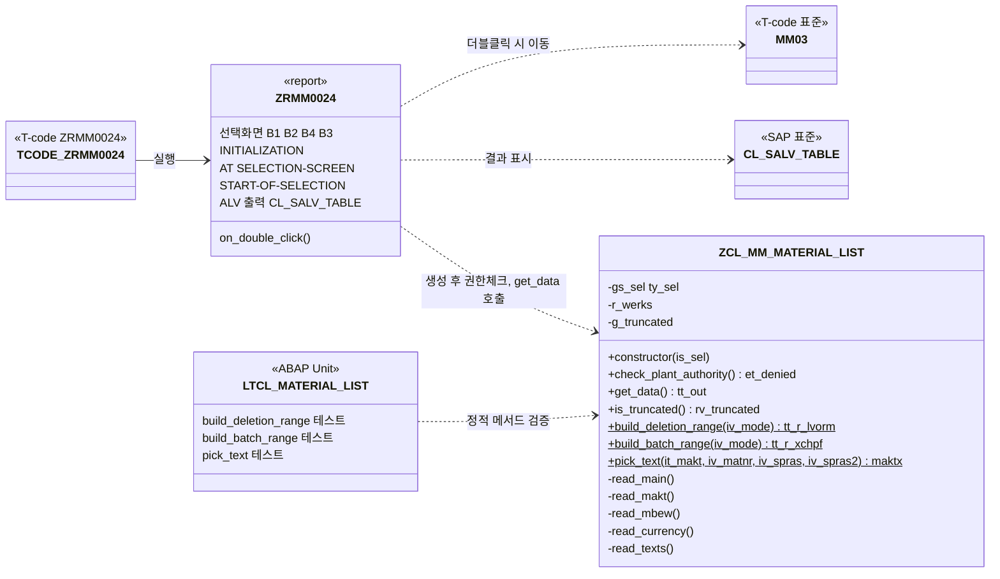
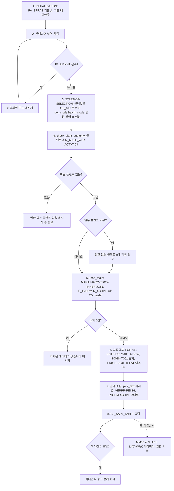
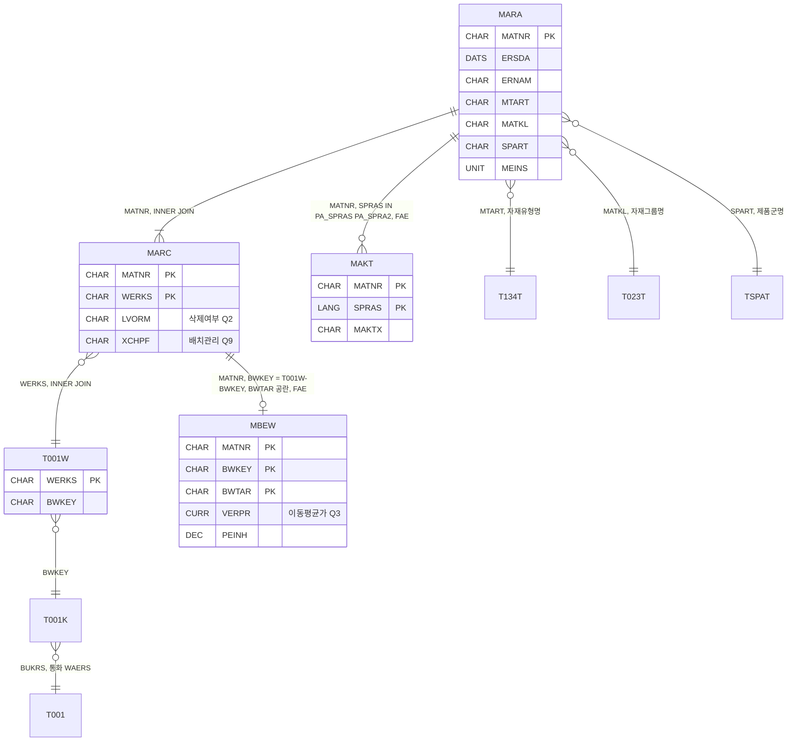

# 02. 설계 - 자재마스터 조회 리포트

> 요청ID: 20261006-33d4fc / 작성일: 2026-10-09 / 최종 수정: 2026-10-12(개발표준 적용) / 단계: 설계(sap-designer) / 입력: request.md, 01_analysis.md(2026-10-10 수정본), standards/handbook.md(UNION Steel ABAP 개발표준 Handbook)
>
> **시스템 확인 상태**: 2026-10-09 작성 때는 abap-mrd MCP `SearchObject`가 로그온 실패("Anmeldung fehlgeschlagen")로 응답하지 않았고, 2026-10-10 갱신 때는 설계 세션에서 abap-mrd MCP 도구를 쓸 수 없었습니다. **2026-10-12 개발표준 적용 때는 `SearchObject`가 정상 응답해서 오브젝트명·일련번호를 시스템에서 확인했습니다(4.1).** 아래 항목은 아직 확인하지 못했습니다.
> - **테이블·필드 실구조 미확인**: MARA/MARC/MAKT/MBEW/T001W/T001K/T001 필드명과 길이, MARA-ERSDA 인덱스, 릴리스(ECC/S4, ABAP 버전)는 이번에도 조회하지 않았습니다(이번 작업은 명명 표준 적용만 했습니다).
> - **배치관리 필드 미확인(2026-10-10)**: MARC-XCHPF(Data Element XCHPF, CHAR 1)는 표준 기준으로 설계했습니다. SE11 확인이 필요합니다.
>
> 반영 범위는 개발계(MRD, 클라이언트 350)까지입니다.

## 0. 변경 이력

| 일자 | 내용 | 근거 |
|---|---|---|
| 2026-10-09 | 최초 작성. 현업 확정 Q1·Q2·Q3 반영 | 01_analysis.md(2026-10-09) |
| 2026-10-10 | **배치관리 여부 반영**: 출력 필드 `XCHPF`(MARC-XCHPF) 추가(타입, 메인 SELECT, ALV 체크박스 컬럼, 엑셀 X/공란). 선택화면 블록 B4 '배치관리' 라디오(전체/배치관리만/비배치관리만) 추가. **권장안이며 현업 확인 대기(Q9, Q10)**. 정적 메서드 `build_batch_range` 신규, 단위테스트·통합테스트 시나리오 추가 | 01_analysis.md FR-04·FR-12·FR-13, 가정 8·9, Q9·Q10 |
| 2026-10-10 | **분석서와 맞추기 위한 정리**: (1) 삭제여부 필터를 동적 WHERE(`build_deletion_where`)에서 range(`build_deletion_range`)로 바꿨습니다. 배치 조건과 같은 방식으로 맞추고, 빈 동적 조건 때문에 생기던 SELECT 분기를 없앴습니다. (2) 7장 하위 절 번호를 6.x에서 7.x로 바로잡았습니다. (3) 3장에 Q9·Q10 처리 방식을 추가했습니다. (4) 13장 확인 항목에 배치 레벨(OMCT/TCUCH)과 XCHPF 필드 확인을 추가했습니다 | 설계 검토 |
| 2026-10-11 | **설계 다이어그램 추가**(1장 뒤): 프로그램 구조도, 처리 흐름도, 데이터 관계도(Mermaid). 설계 내용 변경 없음 | 팀장 요청 |
| 2026-10-12 | **예상 화면 추가**(설계 다이어그램 뒤): 선택화면, ALV 결과 화면, 메시지 화면(sapscreen). 5·9·10장 내용을 화면으로 옮긴 것이며 설계 내용 변경 없음 | 팀장 요청 |
| 2026-10-12 | **반영 대상 시스템 표기 정정: 테스트계(QAS) → 개발계(MRD)**. 머리말 반영 범위, 9장 엑셀 출력 확인, 12장 통합 테스트 시나리오(제목·시나리오 10), 13장 이송요청 항목. 설계 내용 변경 없음 | 팀장 수정 지시 |
| 2026-10-12 | **개발표준(standards/handbook.md) 적용**: (1) 오브젝트명: 리포트·T-code를 핸드북 1장 규칙(`ZR` + `MM` + 4자리)에 따라 `ZRMM0024`로, 패키지를 `ZMMD`로 바꿨습니다. abap-mrd `SearchObject`로 빈 번호를 확인했습니다(4.1). 클래스는 핸드북 규칙이 없어 SAP 관례(`ZCL_MM_...`)를 유지했습니다. 메시지 클래스는 이번 설계에서 쓰지 않습니다(필요하면 빈 번호 `ZMMM3`). (2) 프로그램 내부 이름: 선택화면 `SO_`/`PA_`(라디오버튼 포함), 레인지 `R_`, 상수 `C_`, 내부테이블 `GT_`/`LT_`, 변수 `G_`/`L_`, 워크에어리어 `GS_`/`LS_`를 5·7·8·9장의 타입·메서드·코드 예시 전체에 적용했습니다. 클래스 속성은 핸드북 3장대로 Global로 봤습니다. 메서드 파라미터·타입·로컬 클래스는 핸드북 규칙이 없어 SAP 관례를 적용했습니다(4.2). (3) 설계 다이어그램과 예상 화면을 새 이름으로 바꿨습니다. (4) 이전 이름과 새 이름 대응표는 0.1에 있습니다. **기능·로직 변경 없음** | 팀장 수정 지시(개발표준 Handbook) |

### 0.1 이전 이름 → 새 이름 대응표 (2026-10-12 개발표준 적용)

> 이 표에만 이전 이름을 남깁니다. 본문, 다이어그램, 예상 화면은 모두 새 이름을 씁니다.

| 구분 | 이전 이름 | 새 이름 | 근거(핸드북) | 시스템 확인(SearchObject, 2026-10-12) |
|---|---|---|---|---|
| 패키지 | `ZMM`(가정) | `ZMMD` | 1장 Development Class | `ZMMD` 있음(DEVC, "MM Development Package") |
| 프로그램(리포트) | `ZMM_MATERIAL_LIST_R` | `ZRMM0024` | 1장 Programs | 이전 이름은 시스템에 없음. `ZRMM0024*` 0건 |
| T-code | `ZMM_MATLIST` | `ZRMM0024` | 1장 Transaction Codes | 이전 이름은 시스템에 없음. `ZRMM0024*` 0건 |
| 클래스 | `ZCL_MM_MATERIAL_LIST` | `ZCL_MM_MATERIAL_LIST`(유지) | 규칙 없음 → SAP 관례 | 있음(패키지 `$TMP`, 설명에 이전 프로그램명 `ZMM_MATERIAL_LIST_R`). 4.1 참고 |
| 테스트 클래스(로컬) | `LTCL_MATERIAL_LIST` | `LTCL_MATERIAL_LIST`(유지) | 규칙 없음 → SAP 관례 | 로컬 클래스라 대상 아님 |
| 메시지 클래스 | 미사용(예시 `ZMM`) | 미사용. 필요하면 `ZMMM3` | 1장 Message Class | `ZMMM1`·`ZMMM2` 사용 중, `ZMMM3*` 0건 |
| SELECT-OPTIONS | `S_WERKS`, `S_MATNR`, `S_MTART`, `S_MATKL`, `S_ERNAM`, `S_ERSDA` | `SO_WERKS`, `SO_MATNR`, `SO_MTART`, `SO_MATKL`, `SO_ERNAM`, `SO_ERSDA` | 2장 Select-options | - |
| 라디오(삭제여부) | `P_DEL_EX` / `P_DEL_ON` / `P_DEL_AL` | `PA_DELEX` / `PA_DELON` / `PA_DELAL` | 2장 Parameter Fields(4-8자리 = 5문자, ABAP 8자 제한) | - |
| 라디오(배치관리) | `P_BAT_AL` / `P_BAT_ON` / `P_BAT_OF` | `PA_BATAL` / `PA_BATON` / `PA_BATOF` | 2장 Parameter Fields | - |
| PARAMETERS | `P_SPRAS`, `P_SPRAS2`, `P_MAXHIT`, `P_VARI` | `PA_SPRAS`, `PA_SPRA2`, `PA_MAXHT`, `PA_VARI` | 2장 Parameter Fields(8자 제한으로 축약) | - |
| 클래스 속성(조건 WA) | `ms_sel` | `gs_sel` | 2장 Structure(클래스 속성 = Global) | - |
| 클래스 속성(허용 플랜트 range) | `mt_werks_ok` | `r_werks` | 2장 Ranges | - |
| 클래스 속성(최대건수 도달) | `mv_truncated` | `g_truncated` | 2장 Variables | - |
| 클래스 상수 | `gc_batch_mode` | `c_batch_mode` | 2장 Constants | - |
| 로컬 range | `lr_lvorm`, `lr_xchpf` | `r_lvorm`, `r_xchpf` | 2장 Ranges | - |
| 로컬 변수 | `lv_maxhit`, `lv_werks` | `l_maxhit`, `l_werks` | 2장 Variables | - |
| 로컬 객체 참조 | `lo_col`, `lo_columns` | `l_col`, `l_columns` | 2장 Variables(4.2 참고) | - |
| 메서드 반환 파라미터 | `is_truncated`의 `rv` | `rv_truncated` | 규칙 없음 → SAP 관례(`RV_`) | - |

## 1. 개요

- 선택화면에서 조회조건을 받아 자재×플랜트 1행 단위로 자재마스터를 조회하는 **조회 전용 ALV 리포트**입니다. DB를 변경하지 않습니다.
- 출력 항목은 자재코드, 생성일, 플랜트, 기본단위, 자재명, 자재그룹, 제품군, 이동평균가, 삭제여부, **배치관리 여부**(2026-10-10 추가)이고 텍스트·보조 컬럼이 붙습니다.
- 오브젝트: 리포트 `ZRMM0024`, T-code `ZRMM0024`, 클래스 `ZCL_MM_MATERIAL_LIST`, 패키지 `ZMMD`(개발표준 Handbook 적용, 4장).
- 핵심 로직(조건 조립, DB 조회, 삭제여부·배치관리 조건, 자재명 판정)은 클래스 `ZCL_MM_MATERIAL_LIST`에 둡니다. 프로그램은 선택화면, 권한 결과 메시지, ALV 출력만 맡습니다.
- Q1(플랜트 필수), Q2(삭제여부 = MARC-LVORM), Q3(단가 = 항상 MBEW-VERPR)은 현업이 확정했고 2장에 기록했습니다. 나머지 미결 사항(Q4~Q10)은 01_analysis.md의 가정과 권장안을 기본값으로 따릅니다. 선택형으로 받을 수 있는 항목(Q4 자재명 언어·대체, Q5 최대건수, Q10 배치관리 조건)은 **선택화면 옵션으로 만들어** 현업 답변이 오면 기본값만 바꾸거나 블록만 빼면 되게 했습니다.
- ABAP 문법은 버전을 확인하지 못했으므로 7.40 SP05 이상(New Open SQL, `@` 호스트 변수, 인라인 선언)을 가정합니다. 7.40 미만이면 구문을 낮춰야 합니다.

## 설계 다이어그램

> 2026-10-11 추가, 2026-10-12 개발표준 이름으로 갱신. 본문(4·6·7·8장) 내용을 그림으로 옮긴 것이며 설계 내용은 바뀌지 않았습니다. 세부 사항은 본문 표가 기준입니다.

**① 프로그램 구조도** — 리포트는 화면·메시지·ALV만, 조회 로직은 클래스가 맡습니다(4장, 7.2).



**② 처리 흐름도** — 번호는 8장 '처리 로직 단계'와 같습니다.



**③ 데이터 관계도** — 6장 데이터 소스 기준(표준 기준, 시스템 미확인). 메인 SELECT는 MARA·MARC·T001W INNER JOIN이고 나머지는 FOR ALL ENTRIES로 따로 읽습니다.



## 예상 화면

> 2026-10-12 추가, 같은 날 개발표준 이름으로 갱신. 5장(선택화면), 9장(ALV 필드카탈로그), 10장(오류 처리)을 화면으로 옮긴 것이며 설계 내용은 바뀌지 않았습니다. 세부 사항은 본문 표가 기준입니다.

**① 선택화면** — T-code `ZRMM0024`, 블록 순서 B1 → B2 → B4 → B3(5장).

```sapscreen
{"type":"selection","title":"자재마스터 조회","tcode":"ZRMM0024","blocks":[
 {"title":"조회조건","fields":[
  {"label":"플랜트","kind":"select","required":true},
  {"label":"자재","kind":"select"},
  {"label":"자재유형","kind":"select"},
  {"label":"자재그룹","kind":"select"},
  {"label":"생성인","kind":"select"},
  {"label":"생성일","kind":"select"}]},
 {"title":"삭제여부(플랜트)","fields":[
  {"label":"삭제 제외","kind":"radio","checked":true},
  {"label":"삭제만","kind":"radio"},
  {"label":"전체","kind":"radio"}]},
 {"title":"배치관리(플랜트)","fields":[
  {"label":"전체","kind":"radio","checked":true},
  {"label":"배치관리 자재만","kind":"radio"},
  {"label":"비배치관리 자재만","kind":"radio"}]},
 {"title":"출력 옵션","fields":[
  {"label":"자재명 언어","kind":"param","value":"KO"},
  {"label":"대체 언어","kind":"param","value":"EN"},
  {"label":"최대건수","kind":"param","value":"50,000"},
  {"label":"레이아웃","kind":"param"}]}]}
```

- 대응: 5장 SO_WERKS(필수)·SO_MATNR·SO_MTART·SO_MATKL·SO_ERNAM·SO_ERSDA, PA_DELEX·PA_DELON·PA_DELAL, PA_BATAL·PA_BATON·PA_BATOF, PA_SPRAS·PA_SPRA2·PA_MAXHT·PA_VARI. 언어 기본값은 KO 로그온 기준 예시입니다.

**② ALV 결과 화면** — 9장 기본 표시 컬럼(O)만, 필드카탈로그 순서대로입니다. 숨김 컬럼(제품군명, 자재유형, 자재유형명, 생성인)은 레이아웃에서 켭니다.

```sapscreen
{"type":"alv","title":"자재마스터 조회","tcode":"ZRMM0024",
 "toolbar":["상세","정렬 ▲","정렬 ▼","필터","합계","소계","엑셀 다운로드","레이아웃 선택","레이아웃 저장"],
 "columns":[{"label":"자재코드","key":true},{"label":"생성일"},{"label":"플랜트","key":true},{"label":"기본단위"},{"label":"자재명"},{"label":"자재그룹"},{"label":"자재그룹명"},{"label":"제품군"},{"label":"이동평균가","align":"right"},{"label":"가격단위","align":"right"},{"label":"통화"},{"label":"삭제여부"},{"label":"배치관리"}],
 "rows":[
  ["MAT-0001","2026.01.05","P100","EA","예시 자재 A","GRP01","예시 그룹","01","1,250.00","1","KRW","",""],
  ["MAT-0002","2026.02.10","P100","KG","예시 자재 B","GRP02","예시 그룹","01","38.50","10","KRW","","✔"],
  ["MAT-0003","2026.03.21","P200","EA","예시 자재 C","GRP01","예시 그룹","02","0.00","1","USD","✔",""]],
 "status":{"type":"S","text":"3건이 조회되었습니다."}}
```

- 행 데이터는 화면 형식만 보여주는 가상 값입니다. 삭제여부·배치관리는 읽기 전용 체크박스(내부 값 X/공란), 이동평균가는 통화 컬럼 참조, 행 더블클릭 시 MM03으로 이동합니다(9장).

**③ 메시지** — 10장 오류 처리의 화면 표시입니다.

```sapscreen
{"type":"selection","title":"자재마스터 조회","tcode":"ZRMM0024","blocks":[],"status":{"type":"E","text":"조회 권한이 있는 플랜트가 없습니다."}}
```

```sapscreen
{"type":"alv","title":"자재마스터 조회","tcode":"ZRMM0024","toolbar":[],"columns":[{"label":"자재코드","key":true},{"label":"플랜트","key":true},{"label":"…"}],"rows":[],"status":{"type":"W","text":"최대건수 50,000건까지만 조회했습니다. 조건을 좁히거나 최대건수를 늘리세요."}}
```

| 상황 | 메시지 | 표시 유형 |
|---|---|---|
| 권한 있는 플랜트 없음 | 조회 권한이 있는 플랜트가 없습니다 | S (DISPLAY LIKE E), 종료 |
| 일부 플랜트 권한 없음 | 권한 없는 플랜트 n개를 제외했습니다 | S (DISPLAY LIKE W), 계속 |
| 조회 0건 | 조회된 데이터가 없습니다 | S (DISPLAY LIKE W) |
| 최대건수 도달 | 최대건수 n건까지만 조회했습니다. 조건을 좁히거나 최대건수를 늘리세요 | 경고, 결과 표시 |
| 최대건수 음수(PA_MAXHT) | 선택화면 오류 메시지 | E (선택화면) |

## 2. 현업 확정사항 (2026-10-09, 코디네이터 전달)

| Q | 확정 내용 | 설계 반영 |
|---|---|---|
| Q1 | 플랜트(WERKS)는 선택화면 **필수 입력(OBLIGATORY)** 입니다 | `SO_WERKS` OBLIGATORY. MARC INNER JOIN이므로 플랜트 뷰가 없는 자재는 출력하지 않습니다 |
| Q2 | 삭제여부는 **MARC-LVORM(플랜트 레벨)** 기준으로 조회조건과 출력 모두 처리합니다 | 삭제 라디오(제외/삭제만/전체)는 `marc~lvorm`에만 적용합니다. 출력 "삭제여부" 컬럼도 MARC-LVORM 하나만 둡니다. MARA-LVORM은 조회하지도 출력하지도 않습니다 |
| Q3 | 단가는 가격관리 구분(VPRSV)과 관계없이 **항상 이동평균가(MBEW-VERPR)** 를 출력합니다 | 단가 기준 선택 옵션을 두지 않습니다. MBEW에서는 VERPR, PEINH만 읽고 표준원가(STPRS)는 읽지도 출력하지도 않습니다 |

## 3. 현업 미결 사항 처리 방식 (확정 전까지 분석 가정·권장안을 따름)

| Q | 내용 | 설계 반영 | 기본값(분석 가정/권장안) |
|---|---|---|---|
| Q4 | 자재명 언어·대체 | `PA_SPRAS`(기본 SY-LANGU)와 **대체 언어 `PA_SPRA2`**(기본 'E', 공란이면 대체하지 않음)를 둡니다 | 로그온 언어, 없으면 EN |
| Q5 | 생성일 기본값·건수 | 생성일 기본값은 없습니다. **최대건수 `PA_MAXHT`**(기본 50,000, 0이면 무제한)를 두고 백그라운드 실행을 허용합니다 | 50,000 |
| Q6 | 텍스트 컬럼 | 자재유형명, 자재그룹명, 제품군명 컬럼을 포함하되 기본 표시는 자재그룹명만 합니다. 나머지는 레이아웃에서 켭니다 | 포함 |
| Q7 | 분할평가 | BWTAR = 공란인 헤더 레코드만 읽습니다. 평가유형별 단가는 범위 밖입니다 | 헤더만 |
| Q8 | T-code·롤 | T-code는 개발표준에 따라 `ZRMM0024`(4.1에서 빈 번호 확인)로 정했습니다. 메뉴 위치와 롤 배정은 Basis/보안 담당이 합니다 | 개발표준 번호 |
| Q9 *(신규)* | 배치관리 판정 기준·표시 | (a) 판정은 **MARC-XCHPF**(가정 8). MARC-XCHAR는 쓰지 않습니다(가정 9). (b) MARA-XCHPF 참고 컬럼은 **미출력**(읽지도 않음). 현업이 원하면 7.4의 "Q9-b 추가 시 변경점"대로 넣습니다. (c) 표시는 **'X'/공란 + ALV 체크박스**입니다 | MARC-XCHPF / 참고 컬럼 없음 / 체크박스 |
| Q10 *(신규)* | 배치관리 선택조건 | **권장안으로 선택화면 블록 B4(전체/배치관리만/비배치관리만)를 넣습니다. 현업 확인 대기 중입니다.** 현업이 빼라고 하면 프로그램에서 블록 B4만 지우고 `batch_mode = 'A'`(`c_batch_mode-all`) 고정으로 넘기면 됩니다. 클래스는 바꿀 필요가 없습니다 | 포함, 기본값 '전체' |

## 4. 오브젝트 목록

> 개발표준 Handbook 1장 규칙을 적용했습니다. 패키지는 `ZMMD`입니다(핸드북 3장 "MM 개발 패키지는 `ZMMD`"). 오브젝트 구성은 2026-10-09 설계와 같고, 배치관리 반영으로 새로 생기는 오브젝트는 없습니다.

| 유형 | 이름 | 목적 | 명명 근거 |
|---|---|---|---|
| DEVC (패키지) | `ZMMD` | MM 개발 패키지(기존 패키지 사용, 신규 생성 없음) | 핸드북 1장 Development Class |
| PROG (실행형 리포트) | `ZRMM0024` | 선택화면, 권한 메시지, CL_SALV_TABLE 출력, 더블클릭 시 MM03 이동 | 핸드북 1장 Programs: `Z` + `R`(Report) + `MM` + `0024` |
| CLAS | `ZCL_MM_MATERIAL_LIST` | 조회 조건 보관, 권한 필터, DB 조회, 삭제여부·배치관리 조건 range 조립, 자재명 판정. ABAP Unit 테스트 클래스(로컬 `LTCL_MATERIAL_LIST`) 포함 | 핸드북 규칙 없음 — SAP 관례 적용(`ZCL_` + 모듈 + 서술명) |
| TRAN | `ZRMM0024` | 리포트 트랜잭션(선택화면 1000) | 핸드북 1장 Transaction Codes: `Z` + `R`(Report) + `MM` + `0024`. 프로그램과 같은 번호 |
| 텍스트 | 프로그램 Text Symbol / Selection Text (KO, EN) | 선택화면 라벨, 메시지, 커스텀 컬럼명 | - |

- 별도 DDIC 구조, 테이블, 메시지 클래스는 만들지 않습니다(최소 구성). 출력 타입은 클래스 PUBLIC SECTION의 `TYPES`로 정의하고, 표준 데이터 엘리먼트를 참조해서 ALV 컬럼명을 자동으로 받아옵니다. (DDIC 구조를 만들게 되면 핸드북 1장 Structures 규칙 `ZSMM####`을 따릅니다.)
- 메시지는 Text Symbol을 쓰는 `MESSAGE ... TYPE 'S'` 형태로 처리합니다. 메시지 클래스를 쓰기로 바뀌면 핸드북 규칙(`ZM` + `MM` + 1자리)에 맞는 기존 `ZMMM1`/`ZMMM2`를 쓰거나, 새로 만들 때는 빈 번호 `ZMMM3`(4.1)을 씁니다.
- 참고: 작업 폴더 `src/`에 이전 이름 기준 소스가 있습니다. 개발표준 이름 변경, 배치관리, 삭제여부 range 전환은 개발 단계에서 소스에 반영해야 합니다. 설계 단계에서는 소스를 고치지 않았습니다.

### 4.1 오브젝트명·일련번호 확인 결과 (abap-mrd `SearchObject`, 2026-10-12)

| 검색어 | 결과 요약 | 판단 |
|---|---|---|
| `ZRMM*`, `ZRMM001*`, `ZRMM004*`, `ZRMM005*`, `ZRMM01*`, `ZRMM1*` | ZRMM 번호 대역이 촘촘하게 쓰이고 있습니다. 0001~0059 구간에서 PROG(메인)는 0005, 0010~0013, 0020~0023, 0025~0027, 0029, 0031~0040, 0047~0052, 0054~0056, 0059가 있습니다. TRAN은 0005, 0010~0013, 0015, 0020~0023, 0025~0027, 0029~0044, 0047~0056, 0059가 있습니다. 메인 프로그램이 없는 번호에도 인클루드(예: ZRMM0030xxx, ZRMM0041TOP~ZRMM0046xxx)가 남아 있는 경우가 있습니다 | 프로그램, T-code, 인클루드가 모두 비어 있는 번호를 골라야 합니다 |
| `ZRMM0024*` | **0건**(PROG·인클루드·TRAN 모두 없음) | **채택: 프로그램·T-code `ZRMM0024`** |
| `ZRMM0028*` | 0건 | 예비 후보 |
| `ZRMM001*` | 0014, 0016~0019는 PROG·TRAN 모두 없음 | 예비 후보 |
| `ZMMD*` | DEVC `ZMMD`("MM Development Package") 있음. 그 밖에 `ZMMD_DEL`, `ZMMD_MGT`, `ZMMD_T`, `ZMMD_UNUSED` | 패키지 `ZMMD` 사용 |
| `ZMMM*`, `ZMMM3*` | 메시지 클래스 `ZMMM`(구 형식), `ZMMM1`, `ZMMM2`(모두 ZMMD) 있음. `ZMMM3*` 0건 | 이번 설계는 메시지 클래스 미사용. 필요하면 `ZMMM3` |
| `ZCL_MM_MATERIAL*` | `ZCL_MM_MATERIAL_LIST`가 **패키지 `$TMP`(로컬, 이송 불가)** 에 있습니다. 설명문에 이전 프로그램명이 들어 있습니다(0.1 대응표) | 같은 요청에서 앞서 만든 오브젝트로 보입니다(확인 필요). 이름 충돌로 보지 않고 그대로 씁니다. 개발계 반영 때 **패키지를 `ZMMD`로 바꾸고(이송요청 지정) 설명문을 `ZRMM0024` 기준으로 고쳐야** 합니다 |
| `ZRMM0021` | PROG·TRAN `ZRMM0021` "자재마스터 조회"(ZMMD)가 이미 있습니다 | **기능 중복 가능성**이 있습니다. 13장 확인 항목에 넣었습니다 |

- 번호 선택 이유: 0021(자재마스터 조회), 0022(자재상세내역), 0023 같은 자재마스터 계열 리포트 번호 옆에 있는 빈 번호이고, 프로그램·T-code·인클루드가 모두 비어 있어서 같은 번호를 맞춰 쓸 수 있습니다.
- SearchObject 결과 일부는 설명(description) 값이 다른 오브젝트 것과 어긋나 보였습니다. 그래서 판단은 **이름과 유형**만 기준으로 했습니다. 실제 생성 직전에 SE80/SE93에서 `ZRMM0024`를 한 번 더 확인합니다(그 사이 다른 개발자가 번호를 쓸 수 있음).

### 4.2 프로그램 내부 명명 적용 기준

| 대상 | 규칙 | 적용 예 | 근거 |
|---|---|---|---|
| 선택화면 SELECT-OPTIONS | `SO_` + 5문자 이하 | `SO_WERKS`, `SO_ERSDA` | 핸드북 2장 Select-options |
| 선택화면 PARAMETERS(라디오버튼 포함) | `PA_` + 5문자 이하(ABAP 8자 제한) | `PA_DELEX`, `PA_BATON`, `PA_SPRA2`, `PA_MAXHT` | 핸드북 2장 Parameter Fields |
| 리포트 전역 데이터 | 내부테이블 `GT_`, 변수 `G_`, 워크에어리어 `GS_` | `GT_OUT`(결과), `GT_DENIED`(거부 플랜트), `GS_SEL`(선택값 → 클래스 전달), `G_LIST`(클래스 참조), `G_ALV`(CL_SALV_TABLE 참조) | 핸드북 2장 |
| 클래스 속성 | Global로 봄: `GS_`/`GT_`/`G_`, range는 `R_` | `gs_sel`, `r_werks`, `g_truncated` | 핸드북 2장, 3장 적용 메모 |
| 메서드·폼 안의 로컬 데이터 | `LT_`/`L_`/`LS_`, range는 `R_` | `lt_main`, `l_maxhit`, `l_werks`, `ls_out`, `r_lvorm`, `r_xchpf` | 핸드북 2장 |
| 상수 | `C_` | `c_batch_mode` | 핸드북 2장 Constants |
| 객체 참조 변수 | 핸드북에 별도 항목이 없어서 **Variables 규칙(G_/L_)** 으로 봅니다 | `g_alv`, `l_col`, `l_columns` | 핸드북 2장 Variables(참조도 변수로 봄) |
| 메서드 파라미터 | 핸드북 규칙 없음 — SAP 관례 적용 | `is_sel`, `iv_mode`, `it_makt`, `et_denied`, `rt_out`, `rv_truncated`, `rv_maktx` | 핸드북 3장 적용 메모 |
| 타입 | 핸드북 규칙 없음 — SAP 관례 적용 | `ty_sel`, `ty_out`, `tt_out`, `tt_r_lvorm`, `tt_r_xchpf` | 핸드북 3장 적용 메모 |
| 로컬 클래스 | 핸드북 규칙 없음 — SAP 관례 적용 | 테스트 `LTCL_MATERIAL_LIST`, 더블클릭 핸들러가 필요하면 `LCL_` 접두 | 핸드북 3장 적용 메모 |
| 선택화면 블록·라디오 그룹·Text Symbol | 핸드북 규칙 없음 — SAP 관례 유지 | 블록 `B1`~`B4`, 그룹 `DEL`/`BAT`, `TEXT-B04`, `TEXT-C05` | 핸드북 3장 적용 메모 |

## 5. 선택화면 (`ZRMM0024`)

블록 B1: 조회조건

| 이름 | 종류 | 참조 | 비고 |
|---|---|---|---|
| SO_WERKS | SELECT-OPTIONS | MARC-WERKS | OBLIGATORY (Q1) |
| SO_MATNR | SELECT-OPTIONS | MARA-MATNR | MATCHCODE 표준 |
| SO_MTART | SELECT-OPTIONS | MARA-MTART | |
| SO_MATKL | SELECT-OPTIONS | MARA-MATKL | |
| SO_ERNAM | SELECT-OPTIONS | MARA-ERNAM | |
| SO_ERSDA | SELECT-OPTIONS | MARA-ERSDA | 기본값 없음 (Q5) |

블록 B2: 삭제여부(플랜트)

| 이름 | 종류 | 값 | 기본 |
|---|---|---|---|
| PA_DELEX / PA_DELON / PA_DELAL | RADIOBUTTON GROUP DEL | 삭제 제외 / 삭제만 / 전체 | PA_DELEX |

- 판정 기준은 MARC-LVORM(플랜트 레벨) 하나로 고정입니다(현업 확정 Q2).

블록 B4: 배치관리 *(2026-10-10 신규, 권장안, 현업 확인 대기 Q10)*

| 이름 | 종류 | 값 | 기본 |
|---|---|---|---|
| PA_BATAL / PA_BATON / PA_BATOF | RADIOBUTTON GROUP BAT | 전체 / 배치관리 자재만 / 비배치관리 자재만 | PA_BATAL |

- 판정 기준은 MARC-XCHPF(플랜트 레벨)입니다(가정 8, Q9-a). 블록 제목은 "배치관리(플랜트)"입니다.
- 화면 배치는 B1 → B2 → B4 → B3 순서입니다(조건 블록끼리 붙이고 출력 옵션은 맨 아래). 블록 이름 B4는 기존 B3과 겹치지 않게 붙인 것입니다.
- 라디오 → 모드 변환: PA_BATAL = 'A', PA_BATON = 'B', PA_BATOF = 'N'(클래스 상수 `c_batch_mode-all/only/none`).

블록 B3: 출력 옵션

| 이름 | 종류 | 기본 | 비고 |
|---|---|---|---|
| PA_SPRAS | PARAMETERS TYPE SPRAS | SY-LANGU | 자재명 언어 (Q4) |
| PA_SPRA2 | PARAMETERS TYPE SPRAS | 'E' | 대체 언어. 공란이면 대체하지 않음 |
| PA_MAXHT | PARAMETERS TYPE I | 50000 | 최대건수. 0이면 무제한 (Q5) |
| PA_VARI | PARAMETERS TYPE SLIS_VARI | | ALV 레이아웃. F4는 `CL_SALV_LAYOUT_SERVICE=>F4_LAYOUTS` |

Selection Text(KO / EN) 추가분: `PA_BATAL` 전체 / All, `PA_BATON` 배치관리 자재만 / Batch-managed only, `PA_BATOF` 비배치관리 자재만 / Not batch-managed only, 블록 B4 제목 `TEXT-B04` 배치관리(플랜트) / Batch Management (Plant). 나머지 선택화면 항목도 새 이름으로 Selection Text를 등록합니다(이름이 바뀌었으므로 전부 다시 등록).

AT SELECTION-SCREEN 검증:
- PA_MAXHT < 0이면 오류.
- PA_SPRA2 = PA_SPRAS이면 PA_SPRA2를 공란으로 처리합니다(경고 없음).
- 라디오 그룹은 항상 하나가 선택되므로 별도 검증이 없습니다.

## 6. 데이터 소스 (표준 기준, 시스템 미확인)

| 테이블 | 용도 | 조인키 / 조건 | 읽는 방식 |
|---|---|---|---|
| MARA | 자재 일반: MATNR, ERSDA, ERNAM, MTART, MATKL, SPART, MEINS (LVORM·XCHPF는 읽지 않음, 확정 Q2 / Q9-b 기본안) | 기준 | 메인 SELECT |
| MARC | 플랜트: WERKS, LVORM(삭제여부 판정·출력 기준), **XCHPF(배치관리 여부 판정·출력 기준, 2026-10-10)** | MARC-MATNR = MARA-MATNR | 메인 SELECT INNER JOIN |
| T001W | 플랜트 → 평가영역 BWKEY | T001W-WERKS = MARC-WERKS | 메인 SELECT INNER JOIN |
| MAKT | 자재명 MAKTX | MATNR, SPRAS IN (PA_SPRAS, PA_SPRA2) | FOR ALL ENTRIES(MATNR 중복 제거) |
| MBEW | VERPR(이동평균가, 확정 Q3), PEINH | MATNR, BWKEY = T001W-BWKEY, BWTAR = ' ' | FOR ALL ENTRIES. S/4는 호환뷰 경유(가정 7) |
| T001K / T001 | 평가영역 → 회사코드 → 통화 WAERS | T001K-BWKEY → T001K-BUKRS → T001-BUKRS | BWKEY 단위로 1회 JOIN SELECT, HASHED TABLE에 보관 |
| T134T | 자재유형명 MTBEZ | MTART, SPRAS = PA_SPRAS | FAE → HASHED |
| T023T | 자재그룹명 WGBEZ | MATKL, SPRAS = PA_SPRAS | FAE → HASHED |
| TSPAT | 제품군명 VTEXT | SPART, SPRAS = PA_SPRAS | FAE → HASHED |

설계 판단:
- 배치관리 여부는 이미 INNER JOIN하는 MARC에서 `c~xchpf`만 더 읽습니다. 테이블 접근이 늘지 않습니다. 배치 조건(B4)은 WHERE에 range로 붙여 DB에서 거릅니다(분석서 3장).
- MARC-XCHAR(내부 지시자)는 읽지 않습니다(가정 9).
- MAKT와 MBEW는 메인 SELECT에 LEFT OUTER JOIN하지 않고 FOR ALL ENTRIES로 따로 읽습니다. 릴리스를 모르는 상태에서 ON 조건의 리터럴 비교(BWTAR = ' ', SPRAS = 파라미터) 제약을 피하고, 최대건수(UP TO n ROWS)가 메인 키 기준으로 정확히 적용되게 하기 위해서입니다.
- 성능: WHERE 조건은 MARC-WERKS와 MARA-MATNR 위주로 걸립니다. MARA-ERSDA, MARA-ERNAM에는 표준 인덱스가 없을 수 있습니다(시스템 확인 필요). 생성일만으로 넓게 조회하면 느릴 수 있으므로 PA_MAXHT로 제한합니다. MARC-LVORM·XCHPF 조건은 MARC 기본키(MATNR, WERKS)로 좁힌 뒤 걸리는 잔여 조건이라 인덱스가 필요 없습니다.

## 7. 클래스 설계 `ZCL_MM_MATERIAL_LIST`

PUBLIC, FINAL, CREATE PUBLIC으로 만듭니다. 클래스명은 핸드북 규칙 없음 — SAP 관례 적용. 속성은 핸드북 3장 적용 메모대로 Global 규칙(`GS_`/`G_`/`R_`)을 씁니다.

### 7.1 타입·상수 (PUBLIC SECTION)

타입명(`ty_`/`tt_`)은 핸드북 규칙 없음 — SAP 관례 적용.

```abap
TYPES: tt_r_lvorm TYPE RANGE OF lvowk,     " 삭제여부 조건 range (MARC-LVORM)
       tt_r_xchpf TYPE RANGE OF xchpf.     " 배치관리 조건 range (MARC-XCHPF), 2026-10-10

TYPES: BEGIN OF ty_sel,
         werks      TYPE RANGE OF werks_d,
         matnr      TYPE RANGE OF matnr,
         mtart      TYPE RANGE OF mtart,
         matkl      TYPE RANGE OF matkl,
         ernam      TYPE RANGE OF ernam,
         ersda      TYPE RANGE OF ersda,
         del_mode   TYPE c LENGTH 1,  " E=삭제 제외 O=삭제만 A=전체
         batch_mode TYPE c LENGTH 1,  " A=전체 B=배치관리만 N=비배치관리만 (2026-10-10)
         spras      TYPE spras,
         spras2     TYPE spras,
         maxhit     TYPE i,
       END OF ty_sel.

TYPES: BEGIN OF ty_out,
         matnr   TYPE matnr,
         ersda   TYPE ersda,
         werks   TYPE werks_d,
         meins   TYPE meins,
         maktx   TYPE maktx,
         matkl   TYPE matkl,
         wgbez   TYPE wgbez,
         spart   TYPE spart,
         spart_t TYPE vtext,      " 제품군명 (TSPAT-VTEXT)
         mtart   TYPE mtart,
         mtbez   TYPE mtbez,
         ernam   TYPE ernam,
         verpr   TYPE verpr,      " 이동평균가 (확정 Q3)
         peinh   TYPE peinh,
         waers   TYPE waers,
         lvorm   TYPE lvowk,      " 삭제여부 = MARC-LVORM (확정 Q2)
         xchpf   TYPE xchpf,      " 배치관리 여부 = MARC-XCHPF ('X'/공란), 2026-10-10
       END OF ty_out,
       tt_out TYPE STANDARD TABLE OF ty_out WITH EMPTY KEY.

CONSTANTS: BEGIN OF c_batch_mode,      " 핸드북 2장 Constants
             all   TYPE c LENGTH 1 VALUE 'A',
             only  TYPE c LENGTH 1 VALUE 'B',
             none  TYPE c LENGTH 1 VALUE 'N',
           END OF c_batch_mode.
```

PRIVATE SECTION 속성:

```abap
DATA: gs_sel      TYPE ty_sel,                 " 조회 조건 (Structure, Global)
      r_werks     TYPE RANGE OF werks_d,       " 권한 통과 플랜트 (Ranges)
      g_truncated TYPE abap_bool.              " 최대건수 도달 여부 (Variables, Global)
```

데이터 엘리먼트명(LVOWK/XCHPF/WGBEZ 등)은 표준 기준이며 시스템 미확인입니다. 다르면 `TYPE marc-lvorm`, `TYPE marc-xchpf` 같은 테이블 필드 참조로 바꿉니다. 필드 참조로 바꿔도 ALV 컬럼명은 해당 데이터 엘리먼트 텍스트를 받아옵니다.

### 7.2 메서드

메서드 파라미터명(`is_`/`iv_`/`it_`/`et_`/`rt_`/`rv_`)은 핸드북 규칙 없음 — SAP 관례 적용.

| 메서드 | 가시성 | 설명 |
|---|---|---|
| `constructor( is_sel TYPE ty_sel )` | PUBLIC | 조건을 `gs_sel`에 보관합니다 |
| `check_plant_authority( EXPORTING et_denied TYPE ... )` | PUBLIC | SO_WERKS 범위(`gs_sel-werks`)에 드는 플랜트를 T001W에서 읽고 플랜트별로 `AUTHORITY-CHECK OBJECT 'M_MATE_WRK' ID 'ACTVT' FIELD '03' ID 'WERKS' FIELD l_werks`를 수행합니다. 통과한 플랜트만 range 속성 `r_werks`(SIGN I/OPTION EQ)로 바꿔 보관하고, 거부된 플랜트 목록을 돌려줍니다 |
| `get_data( RETURNING VALUE(rt_out) TYPE tt_out )` | PUBLIC | 8장의 처리 로직 전체를 수행합니다 |
| `is_truncated( RETURNING VALUE(rv_truncated) TYPE abap_bool )` | PUBLIC | 최대건수에 도달했는지(`g_truncated`) 알려줍니다 |
| `build_deletion_range( iv_mode ) RETURNING VALUE(rt_range) TYPE tt_r_lvorm` | PUBLIC STATIC | 삭제여부 조건 range를 만듭니다(아래 표). *(2026-10-10: `build_deletion_where` 동적 WHERE에서 변경)* DB가 필요 없어 단위테스트 대상입니다 |
| `build_batch_range( iv_mode ) RETURNING VALUE(rt_range) TYPE tt_r_xchpf` | PUBLIC STATIC | *(2026-10-10 신규)* 배치관리 조건 range를 만듭니다(아래 표). 단위테스트 대상입니다 |
| `pick_text( it_makt iv_matnr iv_spras iv_spras2 ) RETURNING VALUE(rv_maktx)` | PUBLIC STATIC | 1순위 언어로 자재명을 찾고, 없으면 대체 언어로 찾습니다. 단위테스트 대상입니다 |
| `read_main / read_makt / read_mbew / read_currency / read_texts` | PRIVATE | DB 읽기 메서드들. 메서드 안의 로컬 데이터는 `LT_`/`L_`/`LS_`/`R_` 규칙을 씁니다 |

### 7.3 조건 range 규칙

삭제여부 (`build_deletion_range`, MARC-LVORM 기준 고정, 확정 Q2):

| del_mode | range 내용 | 의미 |
|---|---|---|
| E 삭제 제외 | `SIGN 'I' OPTION 'EQ' LOW ' '` 1행 | lvorm = 공란 |
| O 삭제만 | `SIGN 'I' OPTION 'NE' LOW ' '` 1행 | lvorm <> 공란 |
| A 전체 | 빈 range | 조건 없음 |

배치관리 (`build_batch_range`, MARC-XCHPF 기준, 2026-10-10):

| batch_mode | range 내용 | 의미 |
|---|---|---|
| A 전체 (`c_batch_mode-all`) | 빈 range | 조건 없음 |
| B 배치관리만 (`c_batch_mode-only`) | `SIGN 'I' OPTION 'NE' LOW ' '` 1행 | xchpf <> 공란 (보통 'X') |
| N 비배치관리만 (`c_batch_mode-none`) | `SIGN 'I' OPTION 'EQ' LOW ' '` 1행 | xchpf = 공란 |

- 그 밖의 모드 값(잘못된 값)은 A와 같이 빈 range를 돌려줍니다. 선택화면 라디오에서는 생길 수 없는 값이므로 방어용입니다.
- "배치관리만"을 `EQ 'X'`가 아니라 `NE ' '`로 둔 것은 삭제여부와 같은 규칙(공란이 아니면 해당)으로 맞추기 위해서입니다. XCHPF 값 도메인은 'X'/공란뿐이라 결과는 같습니다(시스템 확인 필요).
- 빈 range는 Open SQL `IN`에서 조건 없음으로 처리되므로, 이전 설계의 "동적 WHERE가 비면 별도 SELECT 분기" 처리가 필요 없어졌습니다.

### 7.4 배치관리 여부 값 처리

- 출력 `xchpf`는 MARC-XCHPF 값을 **변환 없이 그대로** 옮깁니다('X' 또는 공란). 별도 판정 메서드는 두지 않습니다.
- 표시 형식(Q9-c)이 'Y/N' 텍스트나 아이콘으로 바뀌면 그때 `ty_out`에 표시용 필드를 추가하고 변환 메서드를 둡니다. 지금은 넣지 않습니다(최소 구성).
- **Q9-b 추가 시 변경점**(현업이 MARA-XCHPF 참고 컬럼을 원할 경우): `ty_out`에 `xchpf_mara TYPE xchpf` 추가 → 메인 SELECT에 `a~xchpf AS xchpf_mara` 추가 → ALV에 컬럼명 "배치관리(클라이언트)" 체크박스, 기본 숨김으로 추가. 조건 판정은 계속 MARC-XCHPF로 합니다.

단가는 MBEW-VERPR을 그대로 옮깁니다(확정 Q3). MBEW가 없으면 0입니다.

## 8. 처리 로직 단계

1. **INITIALIZATION**: PA_SPRAS = SY-LANGU로 설정하고 기본 레이아웃(`CL_SALV_LAYOUT_SERVICE=>GET_DEFAULT_LAYOUT`)을 PA_VARI에 가져옵니다.
2. **AT SELECTION-SCREEN OUTPUT / AT SELECTION-SCREEN**: 5장의 입력 검증을 합니다.
3. **START-OF-SELECTION**: 선택화면 값을 리포트 전역 워크에어리어 `GS_SEL`(TYPE `zcl_mm_material_list=>ty_sel`)로 옮기고 클래스를 생성합니다(`G_LIST = NEW zcl_mm_material_list( GS_SEL )`).
   - `del_mode`: PA_DELEX → 'E', PA_DELON → 'O', PA_DELAL → 'A'
   - `batch_mode`: PA_BATAL → 'A', PA_BATON → 'B', PA_BATOF → 'N' *(2026-10-10)*. Q10에서 블록이 빠지면 'A'(`c_batch_mode-all`) 고정.
4. **권한 체크**: `check_plant_authority`를 호출하고 거부 목록을 `GT_DENIED`에 받습니다.
   - 통과한 플랜트가 하나도 없으면 "조회 권한이 있는 플랜트가 없습니다" 메시지(TYPE 'S' DISPLAY LIKE 'E')를 띄우고 종료합니다.
   - 일부만 거부되면 "권한 없는 플랜트 n개를 제외했습니다"(TYPE 'S' DISPLAY LIKE 'W')를 띄우고 계속 진행합니다.
5. **메인 조회** (`read_main`):
   ```abap
   DATA(r_lvorm) = build_deletion_range( gs_sel-del_mode ).
   DATA(r_xchpf) = build_batch_range( gs_sel-batch_mode ).
   DATA(l_maxhit) = gs_sel-maxhit.

   SELECT a~matnr, a~ersda, a~ernam, a~mtart, a~matkl, a~spart, a~meins,
          c~werks, c~lvorm, c~xchpf, w~bwkey
     FROM mara AS a
     INNER JOIN marc  AS c ON c~matnr = a~matnr
     INNER JOIN t001w AS w ON w~werks = c~werks
     WHERE c~werks IN @r_werks
       AND a~matnr IN @gs_sel-matnr
       AND a~mtart IN @gs_sel-mtart
       AND a~matkl IN @gs_sel-matkl
       AND a~ernam IN @gs_sel-ernam
       AND a~ersda IN @gs_sel-ersda
       AND c~lvorm IN @r_lvorm         " 삭제여부 (Q2)
       AND c~xchpf IN @r_xchpf         " 배치관리 (FR-13, 2026-10-10)
     ORDER BY a~matnr, c~werks
     INTO TABLE @DATA(lt_main)
     UP TO @l_maxhit ROWS.
   ```
   - `UP TO 0 ROWS`는 무제한으로 동작하지 않을 수 있으므로(릴리스 확인 필요), PA_MAXHT = 0이면 UP TO 절이 없는 SELECT로 분기하거나 `l_maxhit`에 충분히 큰 값을 넣는 방식 중 하나를 고릅니다. 분기 처리는 이 한 군데뿐입니다.
   - 건수 = maxhit(maxhit > 0)이면 `g_truncated`를 세웁니다.
   - 0건이면 빈 테이블을 돌려줍니다.
6. **보조 조회** (lt_main이 비어 있지 않을 때만, FOR ALL ENTRIES 전에 빈 테이블인지 반드시 확인):
   - MAKT: MATNR 고유 목록으로 FAE, `spras IN (gs_sel-spras, gs_sel-spras2)` 조건(spras2가 공란이면 spras만). 결과는 SORTED TABLE `lt_makt`(키 MATNR, SPRAS)에 담습니다.
   - MBEW: (MATNR, BWKEY) 고유 목록으로 FAE, `bwtar = ' '` 조건. 결과는 HASHED TABLE `lt_mbew`(키 MATNR, BWKEY)에 담습니다.
   - 통화: BWKEY 고유 목록으로 `T001K INNER JOIN T001` 조회 → HASHED `lt_curr`(BWKEY).
   - 텍스트: T134T, T023T, TSPAT를 MTART/MATKL/SPART 고유 목록과 `gs_sel-spras`로 FAE 조회 → HASHED `lt_t134t`/`lt_t023t`/`lt_tspat`.
   - 클래스 안에서 메서드 사이에 넘겨야 하면 private 속성(`gt_makt` 등, Global)으로 두거나 메서드 파라미터로 넘깁니다. 어느 쪽이든 핸드북 G/L 규칙을 따릅니다.
7. **결과 조립**: lt_main을 LOOP하며 `ls_out`(TYPE ty_out)을 채워 `rt_out`에 넣습니다. `pick_text`를 적용하고 MBEW-VERPR·PEINH를 옮기며, `lvorm`·`xchpf`는 MARC 값을 그대로 옮깁니다. READ TABLE은 해시/정렬 키로 읽습니다.
8. **출력**: 프로그램에서 결과(`GT_OUT`)가 0건이면 "조회된 데이터가 없습니다"(TYPE 'S' DISPLAY LIKE 'W')를 띄웁니다. 1건 이상이면 ALV를 표시하고, `is_truncated( )`가 참이면 "최대건수 n건까지만 조회했습니다. 조건을 좁히거나 최대건수를 늘리세요" 경고를 함께 띄웁니다.

## 9. 출력 (CL_SALV_TABLE 필드카탈로그)

ALV 객체는 리포트 전역 참조 `G_ALV`(TYPE REF TO cl_salv_table)에 둡니다.

| 순서 | 필드 | 컬럼명(KO) | 기본 표시 | 비고 |
|---|---|---|---|---|
| 1 | MATNR | 자재코드 | O | KEY 컬럼, 핫스팟 아님(더블클릭으로 이동) |
| 2 | ERSDA | 생성일 | O | |
| 3 | WERKS | 플랜트 | O | KEY 컬럼 |
| 4 | MEINS | 기본단위 | O | |
| 5 | MAKTX | 자재명 | O | |
| 6 | MATKL | 자재그룹 | O | |
| 7 | WGBEZ | 자재그룹명 | O | Q6 |
| 8 | SPART | 제품군 | O | |
| 9 | SPART_T | 제품군명 | X | 커스텀 컬럼명(Text Symbol) |
| 10 | VERPR | 이동평균가 | O | MBEW-VERPR(확정 Q3). CURRENCY 참조 = WAERS (`set_currency_column( 'WAERS' )`) |
| 11 | PEINH | 가격단위 | O | |
| 12 | WAERS | 통화 | O | |
| 13 | LVORM | 삭제여부 | O | MARC-LVORM(확정 Q2). 커스텀 컬럼명 "삭제여부". 체크박스 표시 |
| 14 | **XCHPF** | **배치관리** | **O** | *(2026-10-10 신규)* MARC-XCHPF. 커스텀 컬럼명 short/medium/long 모두 "배치관리"(EN "Batch Mgmt"). 체크박스 표시, 읽기 전용. 출력 길이 6 정도로 고정(`set_output_length`) |
| 15 | MTART | 자재유형 | X | |
| 16 | MTBEZ | 자재유형명 | X | |
| 17 | ERNAM | 생성인 | X | |

체크박스 컬럼(LVORM, XCHPF) 설정:

```abap
DATA(l_columns) = g_alv->get_columns( ).
DATA(l_col) = CAST cl_salv_column_table( l_columns->get_column( 'XCHPF' ) ).
l_col->set_cell_type( if_salv_c_cell_type=>checkbox ).
l_col->set_short_text( CONV #( TEXT-c05 ) ).    " 배치관리
l_col->set_medium_text( CONV #( TEXT-c05 ) ).
l_col->set_long_text( CONV #( TEXT-c05 ) ).
```

- CL_SALV_TABLE은 편집 기능이 없으므로 `checkbox`(편집 불가 체크박스)로 두면 읽기 전용이 보장됩니다. `checkbox_hotspot`은 쓰지 않습니다(클릭 이벤트가 생겨 혼동됨).
- 컬럼명 Text Symbol: `TEXT-C05` = 배치관리 / Batch Mgmt. 기존 삭제여부, 제품군명 Text Symbol 번호와 겹치지 않게 개발 시 조정합니다.
- **필터**: 체크박스 컬럼도 ALV 표준 필터로 'X'/공란 값을 고를 수 있습니다. 선택화면 B4를 쓰지 않을 때(Q10 미채택) 사용자는 이 필터로 거릅니다.

**엑셀 출력 표현** *(2026-10-10)*:
- ALV 툴바의 표준 엑셀 내보내기(스프레드시트/XLSX)를 씁니다. 별도 다운로드 로직은 만들지 않습니다.
- 체크박스는 화면 표시 방식일 뿐이고 내부 값은 'X'/공란이므로, 엑셀에는 **배치관리 대상 = `X`, 비대상 = 빈칸**으로 나옵니다(분석서 FR-12). 삭제여부 컬럼도 같습니다.
- SAP GUI 버전·내보내기 형식에 따라 체크박스 컬럼이 다르게 내보내질 가능성이 있으므로, 개발계(MRD)에서 실제 파일로 확인합니다(12장 시나리오 14). 만약 'X'가 아닌 형태로 나오면 체크박스 대신 일반 텍스트 컬럼(가운데 정렬)으로 바꾸는 것을 대안으로 둡니다.

ALV 설정:
- `get_functions( )->set_all( abap_true )`로 정렬, 필터, 합계, 엑셀 다운로드를 켭니다.
- `get_layout( )`에 KEY(REPORT = SY-REPID, 즉 `ZRMM0024`)를 주고 `set_save_restriction( if_salv_c_layout=>restrict_none )`, `set_default( abap_true )`, `set_initial_layout( pa_vari )`를 설정합니다.
- `get_columns( )->set_optimize( )`, `get_display_settings( )->set_striped_pattern( )`를 적용합니다.
- 서로 다른 통화의 단가를 합계하면 통화별 소계가 표준 동작으로 나옵니다.
- **더블클릭(`cl_salv_events_table->double_click`)**: 선택 행의 MATNR과 WERKS를 `SET PARAMETER ID 'MAT'`, `'WRK'`로 넘긴 뒤 `CALL TRANSACTION 'MM03' WITH AUTHORITY-CHECK AND SKIP FIRST SCREEN`을 실행합니다. 뷰 선택 팝업은 표준 동작대로 뜹니다. 핸들러를 로컬 클래스로 만들면 `LCL_` 접두를 씁니다(SAP 관례).
- 백그라운드 실행이면(`sy-batch = 'X'`) SALV가 스풀 리스트로 출력합니다(표준 동작). 스풀에서 체크박스 컬럼은 'X'/공란 문자로 나옵니다.

## 10. 오류 처리

| 상황 | 처리 |
|---|---|
| 권한 있는 플랜트 없음 | 메시지 후 종료 (TYPE 'S' DISPLAY LIKE 'E') |
| 일부 플랜트 권한 없음 | 경고 메시지 후 계속 진행 |
| 조회 0건 | "조회된 데이터가 없습니다" (TYPE 'S' DISPLAY LIKE 'W'). 배치관리 조건으로 0건이 된 경우도 같은 메시지 |
| 최대건수 도달 | 결과를 표시하고 경고 메시지 |
| MAKT 없음 | 자재명 공란 (대체 언어도 없을 때) |
| MBEW 없음(평가 뷰 없음) | 단가 0, 통화는 T001에서 그대로 표시 |
| batch_mode/del_mode 잘못된 값 | 빈 range(조건 없음)로 처리. 선택화면 라디오에서는 발생하지 않음 |
| SALV 생성/설정 오류 | `CATCH cx_salv_msg cx_salv_not_found cx_salv_data_error cx_salv_existing INTO DATA(l_error)`로 받아 `l_error->get_text( )`를 메시지로 출력 |
| MM03 호출 권한 없음 | `WITH AUTHORITY-CHECK`가 표준 메시지를 띄웁니다 |
| PA_MAXHT 음수 | 선택화면 오류 메시지 |

## 11. 권한 체크

- **T-code**: `ZRMM0024` 실행 시 권한 객체 S_TCODE가 체크됩니다(표준).
- **플랜트**: `M_MATE_WRK` (ACTVT = 03, WERKS) 플랜트별로 체크하고 미허용 플랜트는 제외합니다.
- 배치관리 여부는 MM03 플랜트 뷰에서 볼 수 있는 값이므로 추가 권한 체크를 두지 않습니다.
- **선택(시스템 확인 후 결정)**:
  - 자재 권한그룹(MARA-BEGRU)을 운영 중이면 `M_MATE_MAT` (ACTVT 03, BEGRU)로 행 단위 필터를 추가해야 합니다. 이번 설계에는 포함하지 않았습니다(확인 필요).
  - 단가 열람 제한 정책이 있으면 단가 컬럼 마스킹을 검토합니다(확인 필요).
- 프로그램 속성의 권한그룹(SE38 Authorization Group)은 팀 표준을 따릅니다.

## 12. 테스트 포인트

ABAP Unit 테스트 (`LTCL_MATERIAL_LIST`, RISK LEVEL HARMLESS, DURATION SHORT, DB 불필요). 테스트 메서드 안의 로컬 데이터도 `LT_`/`L_`/`LS_`/`R_` 규칙을 씁니다.
- `build_deletion_range`: mode E → 1행(I/EQ/공란), O → 1행(I/NE/공란), A → 빈 range
- `build_batch_range` *(2026-10-10)*: mode A → 빈 range, B → 1행(I/NE/공란), N → 1행(I/EQ/공란), 잘못된 값(예: 'Z') → 빈 range
- range 판정 확인 *(2026-10-10)*: 각 range(`r_xchpf`)로 `'X' IN r_xchpf`, `' ' IN r_xchpf`를 평가해 B는 X만 참, N은 공란만 참, A는 둘 다 참인지 확인(DB 없이 range 의미 검증)
- `pick_text`: 1순위 언어 있음 / 1순위 없고 대체 있음 / 둘 다 없음 / 대체 언어 공란

개발계(MRD) 통합 테스트 시나리오 (T-code `ZRMM0024`):
1. 플랜트(SO_WERKS)를 비우면 실행이 막히는지 확인(OBLIGATORY, 확정 Q1). 플랜트 1개, 자재 범위 지정 → MM03 값(자재명, 기본단위, 자재그룹, 제품군, 이동평균가, **배치관리**)과 대조
2. 삭제 라디오 3가지(제외/삭제만/전체): MARC만 삭제, MARA만 삭제, 정상인 테스트 자재로 검증. MARA만 삭제 표시된 자재는 "제외"에서도 **출력되어야 합니다**(MARC 기준 확정 Q2)
3. 단가: 이동평균 자재(VPRSV = V)와 표준원가 자재(VPRSV = S) 모두 MBEW-VERPR이 출력되는지 확인(확정 Q3)
4. 분할평가 자재: 헤더(BWTAR 공란) 단가만 나오는지 확인
5. 자재명: KO 텍스트가 없는 자재를 KO 로그온으로 조회 → EN 대체 / PA_SPRA2 공란이면 공란
6. 권한: M_MATE_WRK가 일부 플랜트만 있는 사용자 → 제외 메시지와 결과 확인. 전부 없으면 종료
7. 최대건수: PA_MAXHT = 10 → 10건 출력과 경고 확인. 0이면 무제한
8. 0건 조건 → 메시지 확인
9. 더블클릭 → MM03에 해당 자재/플랜트가 들어가는지 확인
10. 성능: 개발계(MRD)에서 생성일 1개월 / 플랜트 단위 조회 응답시간을 측정하고 ST05로 인덱스 사용 여부를 확인(개발계 데이터량이 운영 수준인지는 확인 필요)
11. 백그라운드(F9) 실행 → 스풀 출력 확인(배치관리 컬럼 X/공란 포함)
12. 레이아웃 저장/기본 레이아웃 적용 확인(레이아웃 KEY = `ZRMM0024`)
13. *(2026-10-10)* 배치관리 라디오 3가지(전체/배치관리만/비배치관리만): 배치관리 자재와 비배치관리 자재가 섞인 플랜트로 조회해 건수가 "전체 = 배치관리만 + 비배치관리만"인지, 각 결과의 XCHPF 체크가 MM03(일반 플랜트 데이터/구매 뷰 "배치관리")과 일치하는지 확인
14. *(2026-10-10)* 엑셀 다운로드: 배치관리·삭제여부 컬럼이 엑셀에서 `X`/빈칸으로 나오는지 확인(XLSX 내보내기, SAP GUI 버전 기록)
15. *(2026-10-10)* 배치 레벨이 플랜트인 경우, 같은 자재가 플랜트별로 배치관리 여부가 다른 데이터가 있으면 행마다 다르게 표시되는지 확인. 배치 레벨이 클라이언트/자재이면 MARA-XCHPF와 MARC-XCHPF 불일치 자재가 있는지 SE16으로 샘플 점검(Q9-b 판단 자료)
16. *(2026-10-10)* ALV 필터로 배치관리 컬럼 'X'/공란을 골라 선택화면 조건과 같은 결과가 나오는지 확인
17. *(2026-10-12)* 명명 표준 점검: 선택화면 Selection Text가 새 이름(SO_/PA_) 기준으로 모두 등록되어 기술명이 그대로 보이지 않는지 확인. 코드 인스펙터 또는 리뷰로 소스의 전역/로컬 이름이 4.2 기준을 따르는지 확인

## 13. 개발 착수 전 확인 필요 (시스템 미확인 항목)

- *(2026-10-12)* `ZRMM0024`(PROG·TRAN)는 4.1에서 빈 번호로 확인했습니다. 생성 직전에 SE80/SE93에서 한 번 더 확인합니다.
- *(2026-10-12)* **기존 `ZRMM0021` "자재마스터 조회"(ZMMD)와 기능이 겹치는지** 확인합니다. 겹치면 신규 개발 대신 기존 프로그램을 보완할지 팀장·현업이 정해야 합니다(이 설계는 신규 개발 기준).
- *(2026-10-12)* `ZCL_MM_MATERIAL_LIST`가 `$TMP`에 있습니다. 개발계 반영 때 패키지를 `ZMMD`로 바꾸고 이송요청에 넣어야 하며, 설명문도 `ZRMM0024` 기준으로 고칩니다. 반영 단계에서 처리할 일입니다(설계 단계는 시스템을 변경하지 않음).
- MARA/MARC/MAKT/MBEW/T001W/T001K/T001/T134T/T023T/TSPAT 필드명과 데이터 엘리먼트(7.1 타입), MATNR 길이(S/4는 40자리)를 확인합니다.
- *(2026-10-10)* MARC-XCHPF의 존재 여부, Data Element(XCHPF), 길이(CHAR 1), 값 도메인('X'/공란)을 SE11에서 확인합니다.
- *(2026-10-10)* 배치 레벨 설정(OMCT / TCUCH)이 플랜트·자재·클라이언트 중 무엇인지 확인합니다(Q9-a 판단 자료).
- MARA-ERSDA, MARA-ERNAM 인덱스가 있는지 확인합니다.
- 릴리스(ECC/S4, ABAP 7.40 SP05 이상 여부), `UP TO 0 ROWS` 동작, Material Ledger 활성 여부를 확인합니다.
- 현업 회신 대기: **Q9(배치관리 판정·표시), Q10(배치관리 선택조건 유지 여부)**, Q4~Q8. 회신 내용에 따라 3장 표의 반영 방법대로 수정합니다.
- 개발 패키지 `ZMMD`와 이송요청(반영 대상: 개발계(MRD))을 확인합니다.
