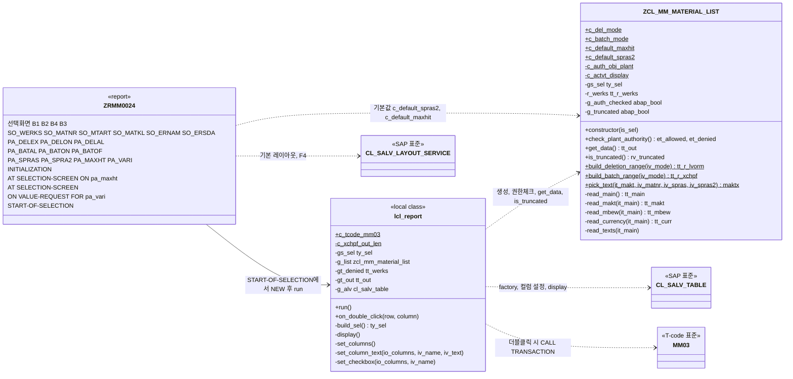
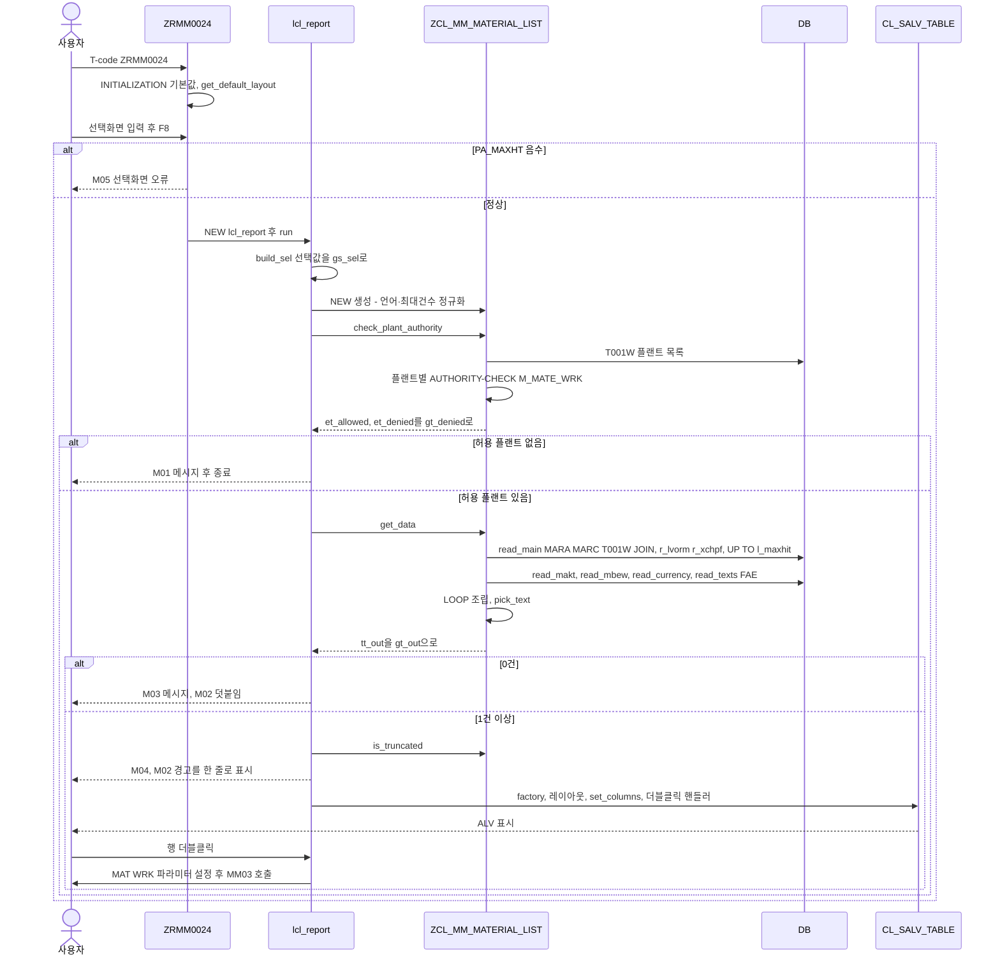
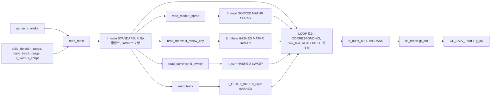

# 03. 개발 - 자재마스터 조회 리포트

> 요청ID: 20261006-33d4fc / 작성일: 2026-10-11 / 최종 수정: 2026-10-12(개발표준 적용, 개발계 표기 정정) / 단계: 개발(sap-developer) / 입력: request.md, 01_analysis.md, 02_design.md(2026-10-12 개발표준 적용 승인본), standards/handbook.md, wiki/ECC 7.40 시스템 ABAP 개발 제약.md, 04_test.md(2026-10-12, 참고)
>
> 반영 대상: **개발계(MRD, 클라이언트 350)**. 운영계 반영은 하지 않습니다.
>
> **이번 작업(2026-10-12)**: 승인된 설계 변경 두 가지를 소스와 문서에 반영했습니다. **기능·로직은 바꾸지 않았습니다.**
> - (a) 반영 대상 표기 정정: "테스트계/QAS" → "개발계(MRD)"
> - (b) 개발표준 Handbook 적용: 리포트·T-code `ZMM_MATERIAL_LIST_R`/`ZMM_MATLIST` → `ZRMM0024`, 패키지 `ZMMD`, 프로그램 내부 이름(SO_/PA_/R_/C_/GT_/LT_/G_/L_/GS_/LS_) 전체 적용
>
> 시스템은 abap-mrd `SearchObject`로 읽기만 했고, 오브젝트 생성·활성화·이송은 하지 않았습니다.

## 0. 변경 이력

| 일자 | 내용 |
|---|---|
| 2026-10-11 | 최초 개발(배치관리 XCHPF, 삭제여부 range 전환 반영). 같은 날 시스템 접속 후 재작업(SALV 예외 클래스, P_VARI 타입, SET HANDLER 수정) |
| 2026-10-12 | **개발표준 적용·개발계 표기 정정**: 리포트 `ZRMM0024` 신규 파일 작성, 클래스 상수·속성·로컬 이름을 핸드북 기준으로 변경, 클래스 설명문 `ZRMM0024` 기준으로 수정, "테스트계/QAS" → "개발계(MRD)". 로직 변경 없음 |

## 개발 다이어그램

> 2026-10-12 갱신. 작성한 소스(src/ZRMM0024.abap, src/ZCL_MM_MATERIAL_LIST.abap) 기준입니다. 이전 파일 src/ZMM_MATERIAL_LIST_R.abap은 그리지 않았습니다(1.2 참고).

**① 소스 구성도** — 리포트 이벤트 블록과 로컬 클래스 `lcl_report`가 전역 클래스를 호출합니다.

**② 실행 순서도** — T-code `ZRMM0024` 실행부터 ALV 표시까지의 실제 호출 순서와 분기입니다.

**③ 데이터 흐름도** — `get_data` 안에서 내부 테이블이 만들어지고 합쳐지는 과정입니다.

## 1. 오브젝트 목록

| 유형 | 오브젝트명 | 내역(60자 이내) | 패키지 | 소스 |
|---|---|---|---|---|
| PROG | ZRMM0024 | 자재마스터 조회 리포트 | ZMMD | src/ZRMM0024.abap |
| CLAS | ZCL_MM_MATERIAL_LIST | 자재마스터 조회 리포트 로직(ZRMM0024) | ZMMD(현재 시스템은 $TMP) | src/ZCL_MM_MATERIAL_LIST.abap |
| TRAN | ZRMM0024 | 자재마스터 조회 (리포트 트랜잭션, 화면 1000) | ZMMD | 소스 없음(SE93 생성) |
| 텍스트 | ZRMM0024 Text Symbol / Selection Text | 선택화면 라벨, 메시지, 커스텀 컬럼명 (KO/EN) | - | 5장 목록 |

- 명명 근거: 프로그램·T-code는 핸드북 1장(`Z` + `R` + `MM` + `0024`), 패키지는 핸드북 3장(`ZMMD`). 클래스·로컬 클래스·타입·메서드 파라미터는 핸드북 규칙 없음 — SAP 관례 적용(설계 4.2).
- 별도 DDIC 오브젝트나 메시지 클래스는 만들지 않았습니다(설계 4장). 메시지 클래스가 필요해지면 빈 번호 `ZMMM3`을 씁니다.
- ABAP Unit 로컬 테스트 클래스(`src/ZCL_MM_MATERIAL_LIST.testclasses.abap`)는 테스트 단계 산출물이라 손대지 않았습니다. 새 이름에 맞춰 고쳐야 할 곳은 8장에 정리했습니다.

### 1.1 이전 이름 → 새 이름 대응 (설계 0.1 기준, 소스 적용 결과)

| 구분 | 이전 이름 | 새 이름 | 위치 |
|---|---|---|---|
| 프로그램 | `ZMM_MATERIAL_LIST_R` | `ZRMM0024` | 새 파일 src/ZRMM0024.abap |
| T-code | `ZMM_MATLIST` | `ZRMM0024` | SE93 |
| 패키지 | `ZMMD`(제안) / 클래스는 `$TMP` | `ZMMD` | 반영 시 |
| 클래스 | `ZCL_MM_MATERIAL_LIST` | 유지. 설명문만 `…(ZRMM0024)` | 클래스 |
| SELECT-OPTIONS | `S_WERKS`, `S_MATNR`, `S_MTART`, `S_MATKL`, `S_ERNAM`, `S_ERSDA` | `SO_WERKS`, `SO_MATNR`, `SO_MTART`, `SO_MATKL`, `SO_ERNAM`, `SO_ERSDA` | 리포트 |
| 라디오(삭제) | `P_DEL_EX` / `P_DEL_ON` / `P_DEL_AL` | `PA_DELEX` / `PA_DELON` / `PA_DELAL` | 리포트 |
| 라디오(배치) | `P_BAT_AL` / `P_BAT_ON` / `P_BAT_OF` | `PA_BATAL` / `PA_BATON` / `PA_BATOF` | 리포트 |
| PARAMETERS | `P_SPRAS`, `P_SPRAS2`, `P_MAXHIT`, `P_VARI` | `PA_SPRAS`, `PA_SPRA2`, `PA_MAXHT`, `PA_VARI` | 리포트 |
| 선택화면 참조 변수 | `GV_WERKS` 등 6개 | `G_WERKS`, `G_MATNR`, `G_MTART`, `G_MATKL`, `G_ERNAM`, `G_ERSDA` | 리포트 |
| 레이아웃 정보 | 인라인 `GS_DEFAULT_LAYOUT`, `GS_F4_LAYOUT` | 전역 `GS_LAYOUT TYPE salv_s_layout_info` 하나로 통합 | 리포트 |
| lcl_report 속성 | `MT_OUT`, `MO_SALV` / run 로컬 `LS_SEL`, `LO_LIST`, `LT_DENIED` | `GT_OUT`, `G_ALV`, `GS_SEL`, `G_LIST`, `GT_DENIED` | 리포트 |
| lcl_report 상수 | `GC_TCODE_MM03`, `GC_XCHPF_OUT_LEN` | `C_TCODE_MM03`, `C_XCHPF_OUT_LEN` | 리포트 |
| lcl_report 로컬 | `LV_DENIED_MSG`, `LV_TRUNC_MSG`, `LV_MSG`, `LV_TEXT`, `LX_SALV`, `LX_AUTH`, `LO_LAYOUT`, `LO_EVENTS`, `LO_COLUMNS`, `LO_COLUMN`, `LT_ALLOWED` | `L_DENIED_MSG`, `L_TRUNC_MSG`, `L_MSG`, `L_TEXT`, `L_ERROR`, `L_AUTH_ERROR`, `L_LAYOUT`, `L_EVENTS`, `L_COLUMNS`, `L_COLUMN`, `LT_ALLOWED` | 리포트 |
| 클래스 공개 상수 | `GC_DEL_MODE`, `GC_BATCH_MODE`, `GC_DEFAULT_MAXHIT`, `GC_DEFAULT_SPRAS2` | `C_DEL_MODE`, `C_BATCH_MODE`, `C_DEFAULT_MAXHIT`, `C_DEFAULT_SPRAS2` | 클래스 |
| 클래스 비공개 상수 | `GC_AUTH_OBJ_PLANT`, `GC_ACTVT_DISPLAY` | `C_AUTH_OBJ_PLANT`, `C_ACTVT_DISPLAY` | 클래스 |
| 클래스 속성 | `MS_SEL`, `MT_WERKS_OK`, `MV_AUTH_CHECKED`, `MV_TRUNCATED` | `GS_SEL`, `R_WERKS`, `G_AUTH_CHECKED`, `G_TRUNCATED` | 클래스 |
| 클래스 로컬 | `LV_WERKS`(인라인), `LV_MAXHIT`, `LR_LVORM`, `LR_XCHPF`, `LR_SPRAS`, `LT_KEY` | `L_WERKS`(명시 선언), `L_MAXHIT`, `R_LVORM`, `R_XCHPF`, `R_SPRAS`, `LT_MBEW_KEY` | 클래스 |
| 유지(SAP 관례) | 타입 `TY_*`/`TT_*`, 메서드 파라미터 `IS_`/`IV_`/`IT_`/`ET_`/`RT_`/`RV_`, 로컬 클래스 `LCL_REPORT`, 필드 심볼 `<LS_*>`, 블록 `B1`~`B4`, 라디오 그룹 `DEL`/`BAT`, Text Symbol ID | 그대로 | 핸드북 규칙 없음 — SAP 관례 적용 |

### 1.2 이전 파일 src/ZMM_MATERIAL_LIST_R.abap (삭제하지 않음 — 팀장 확인 사항)

- 지시대로 **삭제하지 않고 남겨 두었습니다.** 삭제 여부는 팀장이 정합니다.
- **주의 1 — 이전 이름 프로그램도 반영됩니다**: 웹앱의 개발계 반영은 `src/*.abap` 전체를 오브젝트로 올리므로, 이 파일이 남아 있으면 개발계(MRD)에 `ZMM_MATERIAL_LIST_R` 프로그램이 함께 만들어집니다. 개발표준에 맞지 않는 이름이 시스템에 생깁니다.
- **주의 2 — 남겨 두면 활성화가 실패합니다**: 이전 파일은 클래스 상수 `gc_del_mode`, `gc_batch_mode`, `gc_default_spras2`, `gc_default_maxhit`를 참조합니다. 이번에 클래스 상수를 `c_` 이름으로 바꿨으므로 **이전 프로그램은 구문 오류가 납니다.** 이 파일을 반영 대상에서 빼거나 삭제한 뒤 반영해야 합니다.
- 권고: 반영 전에 팀장 확인을 받아 이 파일을 삭제하거나 작업 폴더 밖으로 옮깁니다. 이전 이름은 2026-10-12 SearchObject 기준 시스템에 없으므로(6장) 시스템 쪽 정리는 필요 없습니다.

## 2. 설계 대비 반영 내역

### 2.1 이번(2026-10-12) 반영

| 설계 | 반영 내용 |
|---|---|
| 0.1 대응표, 4.1 | 리포트 `REPORT zrmm0024.`를 새 파일로 작성. T-code·레이아웃 KEY(SY-REPID)가 `ZRMM0024`가 됨 |
| 4.2 선택화면 | SO_ 6개, PA_ 라디오 6개, PA_ 파라미터 4개. Selection Text는 새 이름으로 다시 등록해야 함(5.2) |
| 4.2 리포트 전역 데이터 | `GS_SEL`, `G_LIST`, `GT_DENIED`, `GT_OUT`, `G_ALV`를 씀. 위치는 `lcl_report`의 속성(3장 #11) |
| 4.2 클래스 속성 | `gs_sel`, `r_werks`, `g_truncated`(+ 설계 표에 없던 `g_auth_checked`) |
| 4.2 로컬·상수 | 로컬 `LT_`/`L_`/`LS_`/`R_`, 상수 `C_`(클래스 공개 상수 포함) |
| 4.1 클래스 설명문 | ABAP Doc shorttext `자재마스터 조회 리포트 로직(ZRMM0024)`로 수정 |
| 머리말·12·13장 | 소스 주석과 문서의 반영 대상 표기를 개발계(MRD)로 정정 |

### 2.2 이전 단계에서 반영해 둔 내용(변경 없음, 새 이름으로 표기)

| 설계 | 반영 내용 |
|---|---|
| 배치관리(MARC-XCHPF) | `ty_out-xchpf`, 메인 SELECT `c~xchpf`, `build_batch_range`(A 빈 / B `I NE ' '` / N `I EQ ' '` / 그 외 빈), WHERE `c~xchpf IN @r_xchpf`, 블록 B4 `PA_BATAL`/`PA_BATON`/`PA_BATOF`, ALV 체크박스 + 폭 6 |
| 삭제여부 range | `build_deletion_range`(E `I EQ ' '` / O `I NE ' '` / A·그 외 빈), WHERE `c~lvorm IN @r_lvorm` |
| Q4 자재명 언어 | `PA_SPRAS`(SY-LANGU), `PA_SPRA2`(기본 `c_default_spras2` = 'E'), MAKT `spras IN r_spras` FAE → SORTED(MATNR, SPRAS), `pick_text` |
| Q5 최대건수 | `PA_MAXHT`(기본 `c_default_maxhit` = 50,000). 0이면 `cl_abap_math=>max_int4`, 도달 시 `g_truncated` |
| 선택화면 검증 | `AT SELECTION-SCREEN ON pa_maxht` 음수 → M05. `PA_SPRAS` 공란 → SY-LANGU, `PA_SPRA2 = PA_SPRAS` → 공란 |
| 권한 | 플랜트별 `M_MATE_WRK`(ACTVT 03, WERKS). 통과 플랜트만 `r_werks`. 전부 거부 M01 종료, 일부 거부 M02. MM03 `WITH AUTHORITY-CHECK` + `cx_sy_authorization_error` |
| 보조 조회 | MAKT·MBEW(BWTAR 공란)·통화(T001K⋈T001)·텍스트(T134T/T023T/TSPAT) 모두 FAE, 빈 테이블 확인·키 중복 제거 |
| ALV | `set_all`, 줄무늬, 레이아웃 KEY/저장/기본/초기(PA_VARI), 기본 숨김(SPART_T, MTART, MTBEZ, ERNAM), VERPR 통화 WAERS, MATNR·WERKS 키, 더블클릭 → MM03 |

## 3. 설계와 달라진 점과 이유

| # | 설계 | 개발 | 이유 |
|---|---|---|---|
| 1 | 7.1 타입에 데이터 엘리먼트 직접 참조(`lvowk`, `xchpf`, `wgbez`, `vtext`, `mtbez`, `verpr`, `peinh`) | 테이블 필드 참조(`marc-lvorm`, `marc-xchpf`, `t023t-wgbez` 등) 유지 | 이 시스템 ADT로는 필드→데이터 엘리먼트 연결을 읽을 수 없어서, DB 필드와 타입이 항상 같은 필드 참조를 유지했습니다. 설계 7.1이 허용한 대안입니다 |
| 2 | 7.1 `ty_sel` 안에 `TYPE RANGE OF` 인라인 정의 | 이름 있는 range 타입(`tt_r_werks` 등) 유지. `r_werks`도 `TYPE tt_r_werks` | 동작은 같습니다. 리포트에서 `so_xxx[]`를 그대로 넘깁니다 |
| 3 | 7.2 `check_plant_authority( EXPORTING et_denied )` | `et_allowed`, `et_denied` 둘 다 반환(유지) | 리포트의 "허용 플랜트 없음" 판정에 허용 목록이 필요합니다. 설계 인터페이스를 포함하는 확장이고, 기존 테스트(UT-21)도 두 파라미터를 씁니다. `et_allowed`를 빼면 리포트에 다른 판정 수단을 새로 만들어야 해서 로직 변경이 되므로 유지했습니다 |
| 4 | 9장 `get_columns( )->set_optimize( )` | 컬럼별 `set_optimized( )`를 XCHPF만 빼고 적용 | 전체 최적화를 켜면 XCHPF 고정 폭(6)이 무시될 수 있습니다 |
| 5 | 9장 배치관리 컬럼명 `TEXT-C05` | `TEXT-C07` | C05는 "제품군명"으로 이미 씁니다. 설계 9장 "번호 겹치지 않게 조정" 지시에 따름 |
| 6 | 5장 PA_SPRA2 'E', PA_MAXHT 50000 기본값 | INITIALIZATION에서 클래스 상수 `c_default_spras2`, `c_default_maxhit`로 설정 | 하드코딩을 클래스 한 곳에 모읍니다. 변형 값이 우선합니다 |
| 7 | 8장 5 "건수 = maxhit이면 truncated" | `lines( ) >= maxhit` | 같은 뜻. 정확히 maxhit건이면 잘리지 않았어도 경고가 뜹니다(04_test I1, 선택 개선으로 남김) |
| 8 | 7.2 constructor는 조건 보관만 | 정규화: spras 공란 → SY-LANGU, spras2 = spras → 공란, maxhit 음수 → 50,000 | 리포트 외 호출(테스트 등)에도 같은 규칙이 적용되게 하는 방어 처리 |
| 9 | 7.1 공개 상수는 `c_batch_mode`만 기술 | `c_del_mode`, `c_default_maxhit`, `c_default_spras2`도 공개 상수로 두고 `C_` 이름 적용 | 핸드북 2장 Constants 규칙을 모든 상수에 똑같이 적용했습니다(설계 4.2 "상수 C_") |
| 10 | 7.1 PRIVATE 속성은 `gs_sel`, `r_werks`, `g_truncated` | `g_auth_checked` 추가(이전 `mv_auth_checked`) | `get_data`가 권한 체크를 먼저 안 했으면 내부에서 수행하는 가드용입니다(기존 로직). Variables 규칙 적용 |
| 11 | 4.2·8장 리포트 전역 데이터 `GT_OUT`, `GT_DENIED`, `GS_SEL`, `G_LIST`, `G_ALV` | 같은 이름을 **로컬 클래스 `lcl_report`의 속성**으로 둠 | 기존 구조(로컬 클래스에 처리 집중)를 유지했습니다. 핸드북 3장 "클래스 속성은 Global"에 따라 G 접두를 붙였습니다. 리포트 진짜 전역은 선택화면 참조 변수 `G_*`와 `GS_LAYOUT`뿐입니다 |
| 12 | 10장 `CATCH ... INTO DATA(l_error)` | `DATA l_error TYPE REF TO cx_salv_error.`를 먼저 선언하고 `INTO l_error` | 예외 4개를 나열할 때 인라인 선언 타입이 릴리스마다 다를 수 있어 공통 상위 클래스로 명시했습니다. 동작은 같습니다 |

## 4. 구현 메모

- **문법 기준: ABAP 7.40 SP08 이상**(04_test I6 반영해 표기 정정). `VALUE #( FOR ... IN ... )` 반복식이 SP08부터입니다. 시스템은 `CL_ABAP_TESTDOUBLE`이 있어 SP09 이상, `CL_ABAP_CORRESPONDING`이 없어 7.50 미만으로 추정합니다(정확한 SP는 시스템 > 상태 확인 필요). 그 밖에 New Open SQL `@`, 인라인 선언, `VALUE`/`COND`/`CONV`/`CAST`, 문자열 템플릿 `NUMBER = USER`를 씁니다. 7.50 이상에서만 되는 문법(Open SQL 식·`INTO` 절 맨 뒤 배치에 의존하는 형태, CDS 등)은 쓰지 않았습니다.
- SELECT 절 순서는 `INTO ... UP TO ... WHERE ... ORDER BY`(위키 "ECC 7.40 시스템 ABAP 개발 제약").
- 메인 SELECT는 `INTO CORRESPONDING FIELDS OF TABLE`로 SELECT 목록 순서 차이에 영향받지 않게 했습니다.
- 최대건수 0은 `cl_abap_math=>max_int4`로 바꿔 UP TO에 넣습니다(SELECT 분기 없음).
- 해시/정렬 테이블에 `SELECT INTO TABLE`할 때 키 중복 덤프가 나지 않도록 모두 DB 기본키 기준 1건이 되게 조건을 걸었습니다(MAKT: MATNR+SPRAS, MBEW: MATNR+BWKEY+BWTAR 공란, T001K: BWKEY, 텍스트: 키+SPRAS).
- SALV 예외는 공통 상위 `CX_SALV_ERROR` 참조로 받습니다. 더블클릭 핸들러는 `DATA(l_events) = g_alv->get_event( )`로 받은 참조 변수로 등록합니다(7.40 활성화 안전).
- `set_column_text`의 텍스트 파라미터는 `csequence`(Text Symbol 리터럴 호환).
- 체크박스 컬럼은 `if_salv_c_cell_type=>checkbox`(편집 불가)만 씁니다.
- 레이아웃 정보 변수는 `INITIALIZATION`과 `ON VALUE-REQUEST`에서 인라인 선언 2개(`gs_default_layout`, `gs_f4_layout`) 대신 명시 선언 `gs_layout TYPE salv_s_layout_info` 하나로 썼습니다(구조 존재 확인, 6장). F4에서 취소하면 `layout`이 공란이라 `pa_vari`는 바뀌지 않습니다(이전과 동일).
- 필드 심볼(`<ls_out>` 등)은 핸드북에 규칙이 없어 SAP 관례대로 `<ls_...>`를 유지했습니다.
- DB 변경 문장(INSERT/UPDATE/DELETE/MODIFY, COMMIT)은 없습니다.

## 5. Text Symbol / Selection Text (KO / EN)

### 5.1 Text Symbol (프로그램 ZRMM0024)

ID와 문구는 이전과 같습니다. 프로그램 이름이 바뀌었으므로 `ZRMM0024`에 새로 등록해야 합니다.

| ID | KO | EN | 용도 |
|---|---|---|---|
| B01 | 조회조건 | Selection Criteria | 블록 B1 제목 |
| B02 | 삭제여부(플랜트) | Deletion Flag (Plant) | 블록 B2 제목 |
| B03 | 출력 옵션 | Output Options | 블록 B3 제목 |
| B04 | 배치관리(플랜트) | Batch Management (Plant) | 블록 B4 제목 |
| C01 | 이동평균가 | Moving Avg Price | VERPR 컬럼명 |
| C02 | 삭제여부 | Deletion Flag | LVORM 컬럼명 |
| C03 | 자재명 | Material Description | MAKTX 컬럼명 |
| C04 | 자재그룹명 | Material Group Desc. | WGBEZ 컬럼명 |
| C05 | 제품군명 | Division Desc. | SPART_T 컬럼명 |
| C06 | 자재유형명 | Material Type Desc. | MTBEZ 컬럼명 |
| C07 | 배치관리 | Batch Mgmt | XCHPF 컬럼명 |
| M01 | 조회 권한이 있는 플랜트가 없습니다 | No authorization for any of the selected plants | 권한 전부 거부 |
| M02 | 권한 없는 플랜트 &1개를 제외했습니다 | &1 plant(s) excluded due to missing authorization | 권한 일부 거부 |
| M03 | 조회된 데이터가 없습니다 | No data found | 0건 |
| M04 | 최대건수 &1건까지만 조회했습니다. 조건을 좁히거나 최대건수를 늘리세요 | Only the first &1 records were read. Narrow the selection or raise the max. hits | 최대건수 도달 |
| M05 | 최대건수는 0 이상으로 입력하세요 (0 = 무제한) | Enter a max. number of hits of 0 or more (0 = no limit) | PA_MAXHT 음수 |

- Text Symbol 정의 길이는 소스 리터럴 길이 이상으로 잡습니다(SE38 > 텍스트 요소 > 비교). EN 번역은 SE63.
- 컬럼 short text는 10자(SCRTEXT_S)에서 잘립니다. medium/long text는 그대로 나옵니다.

### 5.2 Selection Text (새 이름으로 전부 재등록)

| 이름 | KO | EN | 비고 |
|---|---|---|---|
| SO_WERKS | 플랜트 | Plant | DDIC 참조 사용 가능 |
| SO_MATNR | 자재코드 | Material | DDIC 참조 사용 가능 |
| SO_MTART | 자재유형 | Material Type | DDIC 참조 사용 가능 |
| SO_MATKL | 자재그룹 | Material Group | DDIC 참조 사용 가능 |
| SO_ERNAM | 생성인 | Created By | DDIC 참조 사용 가능 |
| SO_ERSDA | 생성일 | Created On | DDIC 참조 사용 가능 |
| PA_DELEX | 삭제 제외 | Exclude deleted | |
| PA_DELON | 삭제만 | Deleted only | |
| PA_DELAL | 전체 | All | |
| PA_BATAL | 전체 | All | |
| PA_BATON | 배치관리 자재만 | Batch-managed only | |
| PA_BATOF | 비배치관리 자재만 | Not batch-managed only | |
| PA_SPRAS | 자재명 언어 | Description Language | |
| PA_SPRA2 | 대체 언어 | Fallback Language | |
| PA_MAXHT | 최대건수(0=무제한) | Max. Hits (0 = No Limit) | |
| PA_VARI | 레이아웃 | Layout | |

## 6. 시스템 확인 결과

### 6.1 2026-10-12 (abap-mrd SearchObject, 읽기 전용)

| 검색어 | 결과 | 판단 |
|---|---|---|
| `ZRMM0024*` | **0건**(PROG·인클루드·TRAN 없음) | 번호 여전히 비어 있음. 생성 직전 SE80/SE93에서 한 번 더 확인 |
| `ZCL_MM_MATERIAL*` | `ZCL_MM_MATERIAL_LIST`(CLAS/OC), 패키지 **`$TMP`**, 설명 "자재마스터 조회 리포트 로직(ZMM_MATERIAL_LIST_R)" | 반영 때 패키지 `ZMMD` 이동 + 설명문 수정 필요(7장) |
| `ZMM_MATERIAL_LIST*` | 0건 | 이전 이름 프로그램은 시스템에 없음 |
| `ZRMM0021*` | PROG `ZRMM0021`(ZMMD, 인클루드 `ZRMM0021TOP`/`F01`), TRAN `ZRMM0021` "자재마스터 조회", TRAN `ZRMM0021_A` "자재 단종지시자 설정" | 기능 중복 가능성. 팀장 결정 사항(7장) |
| `SALV_S_LAYOUT_INFO` | TABL/DS(패키지 SALV_OM_COMMON) 있음 | 리포트 `gs_layout` 타입으로 사용 |

### 6.2 2026-10-11 확인 결과 요약(변경 없음)

- 시스템은 **ECC**(MATNR 도메인 C18, MBEW 투명 테이블, MATDOC·ACDOCA 없음), SAP_BASIS **7.40 SP09 이상·7.50 미만 추정**.
- SALV·`CL_ABAP_MATH=>MAX_INT4`·`CL_SALV_LAYOUT_SERVICE` 시그니처, SALV 예외 상속(`CX_SALV_ERROR` 공통), 데이터 엘리먼트·테이블·권한 객체 `M_MATE_WRK`·파라미터 ID `MAT`/`WRK` 존재를 확인했습니다.
- **확인 불가(남은 항목)**: 이 시스템 ADT는 테이블 필드 목록·데이터 엘리먼트 상세를 주지 않아 MARC-XCHPF 필드/도메인 값, 사용 필드 목록을 읽지 못했습니다(활성화로 검증). `M_MATE_WRK` 필드 정의(SU21), MARA-ERSDA/ERNAM 인덱스, 배치 레벨(TCUCH), 정확한 SP도 미확인입니다.

## 7. 개발계(MRD) 반영 시 확인 사항

1. **이전 파일 처리(먼저)**: src/ZMM_MATERIAL_LIST_R.abap가 남아 있으면 개발계에 이전 이름 프로그램이 함께 만들어지고, 바뀐 클래스 상수를 참조해 **활성화가 실패**합니다(1.2). 반영 전에 팀장 확인 후 삭제하거나 반영 대상에서 뺍니다.
2. **번호 재확인**: `ZRMM0024`(PROG·TRAN)를 생성 직전 SE80/SE93에서 다시 확인합니다(6.1에서 0건).
3. **ZRMM0021 기능 중복 — 팀장 결정 사항**: 기존 `ZRMM0021` "자재마스터 조회"(ZMMD)와 기능이 겹치는지 확인하고, 신규 `ZRMM0024`로 갈지 기존 프로그램을 보완할지 팀장·현업이 정합니다. 이 개발은 신규 기준입니다.
4. **클래스 패키지 이동**: `ZCL_MM_MATERIAL_LIST`는 현재 `$TMP`(이송 불가)입니다. `ZMMD`로 패키지를 바꾸고(SE80 > 오브젝트 디렉터리 항목 변경) 이송요청에 넣습니다.
5. **클래스 설명문**: 시스템 설명이 "…(ZMM_MATERIAL_LIST_R)"입니다. 소스의 ABAP Doc shorttext는 "…(ZRMM0024)"로 고쳤지만, 7.40 ADT에서 shorttext가 클래스 설명에 자동 동기화되는지 확실하지 않습니다. 반영 후 SE24 설명을 확인하고 다르면 직접 고칩니다.
6. **활성화 순서**: `ZCL_MM_MATERIAL_LIST`(본문 + Local Test Classes include) → `ZRMM0024` → Text Symbol/Selection Text 등록 → T-code `ZRMM0024` 생성(SE93, 리포트 트랜잭션, 화면 1000).
7. **텍스트 요소 재등록**: 프로그램 이름이 바뀌었으므로 Text Symbol 16개(5.1)와 Selection Text 16개(5.2)를 `ZRMM0024`에 새로 등록하고 EN 번역(SE63)을 넣습니다. 웹앱 ADT 반영에 텍스트 요소가 포함되지 않으면 수동 등록이 필요합니다(04_test W3). 등록하지 않으면 블록 제목이 빈칸, 선택화면 라벨이 기술명(SO_WERKS 등)으로 나옵니다.
8. **테스트 include 맞춤**: 테스트 클래스가 이전 이름을 참조해 **클래스 활성화(테스트 include 포함)가 실패**합니다. 테스트 단계에서 8장대로 고친 뒤 함께 반영해야 합니다.
9. **ALV 레이아웃 KEY**가 `ZRMM0024`로 바뀝니다. 이전 이름으로 저장한 레이아웃은 없으므로(시스템에 없음) 영향 없습니다.
10. **프로그램 권한그룹**(04_test I7), SLIN/SCI 결과, 이송요청(SE09) 생성을 확인합니다.

## 8. 테스트 단계에서 맞춰야 할 점

src/ZCL_MM_MATERIAL_LIST.testclasses.abap는 직접 고치지 않았습니다. 아래 이름 변경으로 **현재 테스트 코드는 구문 오류가 납니다.**

### 8.1 테스트 코드가 깨지는 변경(반드시 수정)

| 이전 이름(테스트가 참조) | 새 이름 | 테스트 파일 사용 위치(현재 줄 번호) |
|---|---|---|
| `zcl_mm_material_list=>gc_del_mode-*` | `zcl_mm_material_list=>c_del_mode-*` | 121, 133, 145, 164, 166, 168, 387, 397 |
| `zcl_mm_material_list=>gc_batch_mode-*` | `zcl_mm_material_list=>c_batch_mode-*` | 201, 211, 223, 244, 246, 248, 388, 400 |
| `zcl_mm_material_list=>gc_default_maxhit` | `zcl_mm_material_list=>c_default_maxhit` | 377 |
| private `ms_sel` (LOCAL FRIENDS) | `gs_sel` | 350, 360, 367, 376, 390, 392, 394, 396, 399, 404 |
| private `mt_werks_ok` | `r_werks` | 424 |
| private `mv_auth_checked` | `g_auth_checked` | 426, 444 |

### 8.2 바뀌지 않은 것(테스트 그대로 사용 가능)

- 공개 메서드 이름·파라미터: `constructor( is_sel )`, `check_plant_authority( IMPORTING et_allowed et_denied )`, `get_data( )`, `is_truncated( )`, `build_deletion_range( iv_mode )`, `build_batch_range( iv_mode )`, `pick_text( it_makt iv_matnr iv_spras iv_spras2 )`
- 공개 타입: `ty_sel`, `ty_out`, `tt_out`, `tt_werks`, `tt_makt`, `tt_r_lvorm`, `tt_r_xchpf`, `ty_del_mode`, `ty_batch_mode`
- 상수 구조의 컴포넌트명: `del_exclude`/`del_only`/`del_all`, `all`/`only`/`none`

### 8.3 권고(핸드북 적용, 테스트 단계 판단)

- 테스트 클래스 내부 이름도 핸드북 2장을 따르도록 바꾸는 것을 권합니다: 상수 `gc_mat1`/`gc_ko` 등 → `c_mat1`/`c_ko`, 속성 `mt_makt` → `gt_makt`(클래스 속성 = Global), 로컬 `lo_cut`/`lo_cut2` → `l_cut`/`l_cut2`, `lv_act` → `l_act`. 로컬 테스트 클래스명 `LTCL_MATERIAL_LIST`와 메서드 파라미터(`iv_value`, `it_range`, `rv_hit`)는 SAP 관례로 유지합니다(설계 0.1, 4.2).
- 테스트 파일 머리 주석의 "QAS 통합 테스트" 표기를 "개발계(MRD) 통합 테스트"로 바꿉니다.
- 설계 12장 시나리오 17(명명 표준 점검: Selection Text 새 이름 등록, 전역/로컬 이름 4.2 준수)을 통합 테스트에 추가합니다.

## 9. 테스트 단계에 넘길 사항

1. **ABAP Unit `LTCL_MATERIAL_LIST`**: 8장 수정 후 UT-01~22를 다시 실행합니다. 로직이 바뀌지 않았으므로 기대 결과는 같습니다.
2. **개발계(MRD) 통합 테스트**: 설계 12장 시나리오 1~17(T-code `ZRMM0024`). 중점 확인:
   - 시나리오 13·16: 배치관리 라디오 3가지 건수(전체 = 배치관리만 + 비배치관리만), ALV 필터 결과와 일치
   - 시나리오 14: 엑셀(XLSX)에서 XCHPF·LVORM이 `X`/빈칸으로 나오는지
   - 시나리오 7: `PA_MAXHT` = 10 → 10건 + M04 / 0 → 무제한 / 음수 → M05
   - 시나리오 12: 레이아웃 KEY가 `ZRMM0024`로 저장·적용되는지
   - 시나리오 17: Selection Text가 SO_/PA_ 새 이름으로 등록되어 기술명이 보이지 않는지
3. **알려진 한계**: 정확히 `PA_MAXHT`건이면 잘리지 않았어도 M04가 뜹니다(3장 #7, 04_test I1).
4. **04_test.md 개선 제안(I1~I7)은 이번에 반영하지 않았습니다.** 이번 작업 범위가 "기능·로직 변경 없음"이기 때문입니다. I6(문법 기준 표기)만 문서에 반영했습니다(4장). 나머지는 팀장 지시가 있으면 반영합니다.
5. **현업 회신 대기**: Q4~Q10. 특히 Q10(블록 B4 유지 여부)이 "빼기"로 오면 블록 B4를 지우고 `batch_mode = zcl_mm_material_list=>c_batch_mode-all` 고정으로 바꿉니다.
6. 대상 시스템은 ECC(MATNR 18자리)이므로 테스트 데이터 자재번호는 18자리(ALPHA 변환) 기준입니다. `CL_OSQL_TEST_ENVIRONMENT`·`CL_AUNIT_AUTHORITY_CHECK`가 없어 DB·권한 분기는 개발계(MRD) 통합 테스트로 확인합니다.
