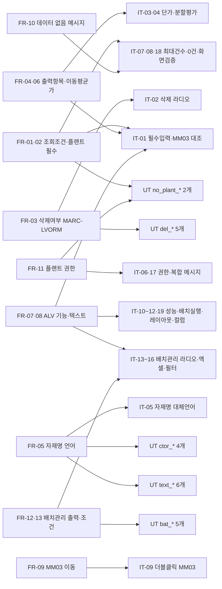
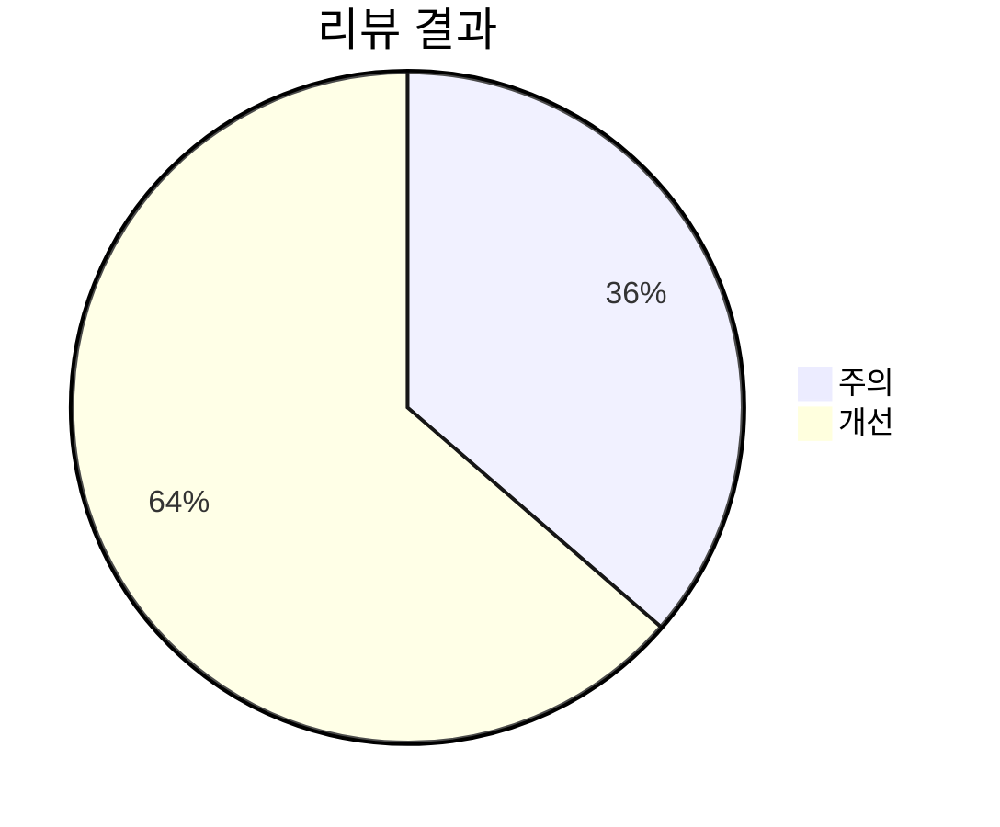
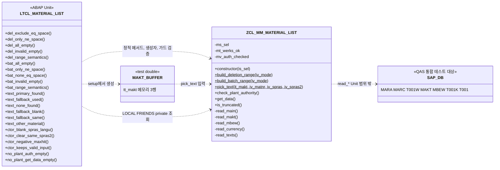

VERDICT: PASS

# 04. 테스트 - 자재마스터 조회 리포트

> 요청ID: 20261006-33d4fc / 작성일: 2026-10-12 / 단계: 테스트(sap-tester)
> 입력: request.md, 01_analysis.md(2026-10-11), 02_design.md(2026-10-12), 03_development.md(2026-10-11 재작업), src/ZCL_MM_MATERIAL_LIST.abap, src/ZMM_MATERIAL_LIST_R.abap
> 산출물: 이 문서, src/ZCL_MM_MATERIAL_LIST.testclasses.abap(로컬 테스트 클래스 `LTCL_MATERIAL_LIST`, 22개 테스트 메서드)
>
> **판정 범위**: 소스 정적 리뷰와 ABAP Unit 코드 작성까지 했습니다. 시스템 쓰기 금지라서 **활성화, ABAP Unit 실행, QAS 통합 테스트는 하지 않았습니다**. PASS는 "치명 결함 없음, 요구사항 FR-01~13 모두 반영·추적됨" 기준이고, 6장의 조건(활성화·Unit 실행·IT 수행)을 QAS 반영 때 확인해야 합니다.

## 테스트 다이어그램

**① 요구사항 커버리지도** — 01_analysis.md FR → 검증 시나리오입니다(노드 수 제한 때문에 FR과 시나리오를 묶었고, 세부 매핑은 2장 표에 있습니다). 시나리오가 없는 FR은 없습니다.



**② 리뷰 결과 분포** — 치명 0건, 주의 4건, 개선 7건(3장).



**③ 단위테스트 구성도** — `LTCL_MATERIAL_LIST`가 검증하는 대상과 테스트 더블입니다. DB(Open SQL)와 AUTHORITY-CHECK용 더블 프레임워크는 이 시스템에 없어서(4.1) 메모리 MAKT 버퍼만 더블로 씁니다.



## 1. 리뷰 방법과 시스템 확인

| 항목 | 방법 | 결과 |
|---|---|---|
| 소스 정적 리뷰 | 두 소스를 줄 단위로 읽고 설계 5~12장, 03 2~4장과 대조. 구문(7.40 문법), 예외, 성능, 권한, 요구사항 관점 | 3장 |
| 테스트 프레임워크 존재(2026-10-12 SearchObject) | `CL_ABAP_UNIT_ASSERT`, `CL_ABAP_TESTDOUBLE`, `CL_OSQL_TEST_ENVIRONMENT`, `CL_AUNIT_AUTHORITY_CHECK` | 앞의 두 개는 **있음**, 뒤의 두 개는 **없음**(7.51/7.52 이상에서 제공) |
| 테이블 필드(MARC) | GetTable `MARC` | `ExceptionResourceNotFound`(03 6.1 #3과 같음). **필드 목록은 확인하지 못했습니다**. MARC-XCHPF·LVORM, MBEW-VERPR·PEINH 등은 ECC 표준 필드이고 소스가 필드 참조(`marc-xchpf`)로 되어 있어서, 필드가 없으면 활성화 때 바로 드러납니다 |
| 문법 수준 | 03 6.1 #2-b + 이번 확인 | 소스는 `FOR` 반복식(7.40 SP08 이상)을 씁니다. `CL_ABAP_TESTDOUBLE`(SP09 이상)이 있으므로 사용 가능하다고 판단했습니다(개선 I6 참고). 정확한 SP는 시스템 > 상태에서 확인 필요 |

## 2. 테스트 시나리오와 요구사항 추적

### 2.1 ABAP Unit (src/ZCL_MM_MATERIAL_LIST.testclasses.abap, `LTCL_MATERIAL_LIST`)

| ID | 테스트 메서드 | 절차 | 기대 결과 | 추적 |
|---|---|---|---|---|
| UT-01 | del_exclude_eq_space | `build_deletion_range( 'E' )` | `I EQ 공란` 1행 | FR-03, 설계 7.3 |
| UT-02 | del_only_ne_space | `build_deletion_range( 'O' )` | `I NE 공란` 1행 | FR-03 |
| UT-03 | del_all_empty | `build_deletion_range( 'A' )` | 빈 range | FR-03 |
| UT-04 | del_invalid_empty | `build_deletion_range( 'Z' )` | 빈 range | 설계 10장 |
| UT-05 | del_range_semantics | E/O/A range에 공란·'X'를 `IN`으로 평가 | E는 공란만, O는 X만, A는 둘 다 참 | FR-03, 설계 12장 |
| UT-06 | bat_all_empty | `build_batch_range( 'A' )` | 빈 range | FR-13 |
| UT-07 | bat_only_ne_space | `build_batch_range( 'B' )` | `I NE 공란` 1행 | FR-13 |
| UT-08 | bat_none_eq_space | `build_batch_range( 'N' )` | `I EQ 공란` 1행 | FR-13 |
| UT-09 | bat_invalid_empty | `build_batch_range( 'Z' )` | 빈 range | 설계 7.3 |
| UT-10 | bat_range_semantics | A/B/N range에 'X'·공란 평가 | B는 X만, N은 공란만, A는 둘 다 참 | FR-12·13, 설계 12장 |
| UT-11 | text_primary_found | MAT1(KO·EN 있음), KO/EN | KO 텍스트 | FR-05 |
| UT-12 | text_fallback_used | MAT2(EN만), KO/EN | EN 텍스트 | FR-05, Q4 |
| UT-13 | text_none_found | MAT9(없음), KO/EN | 공란 | FR-05, 설계 10장 |
| UT-14 | text_fallback_blank | MAT2, KO/공란 | 공란(대체 안 함) | FR-05 |
| UT-15 | text_fallback_same | MAT2, DE/DE | 공란 | 03 7장 추가 항목 |
| UT-16 | text_other_material | MAT2, KO/DE | 공란(MAT1 KO를 집지 않음) | FR-05 키 판정 |
| UT-17 | ctor_blank_spras_langu | spras 공란으로 생성 | `ms_sel-spras = sy-langu` | Q4, 03 3장 #10 |
| UT-18 | ctor_clear_same_spras2 | spras=spras2=E / spras 공란, spras2=sy-langu | 두 경우 모두 spras2 공란 | 설계 5장 |
| UT-19 | ctor_negative_maxhit | maxhit = -1 | 50,000(`gc_default_maxhit`) | Q5 |
| UT-20 | ctor_keeps_valid_input | 정상 값(KO/EN/0/O/N), maxhit 10 | 값 그대로 유지(0 = 무제한 유지) | Q5 |
| UT-21 | no_plant_auth_empty | werks 공란으로 `check_plant_authority` | allowed·denied·`mt_werks_ok` 모두 비어 있음, `mv_auth_checked = X` | FR-02, FR-11 |
| UT-22 | no_plant_get_data_empty | werks 공란으로 `get_data`만 호출 | 빈 결과, `is_truncated` = false, 내부 권한 체크 수행됨(빈 range IN으로 전체 조회되지 않음) | FR-02, FR-11 |

- 모두 DB 없이 돕니다. UT-21·22는 `ms_sel-werks`가 비어 있으면 T001W SELECT 전에 RETURN하는 경로라서 DB 접근이 없습니다.
- 메서드 수가 22개인 것은 03 7장 #1 요청 항목(설계 12장 + 대체 언어 = 1순위)에 생성자 정규화(UT-17~20)와 가드(UT-21·22)를 더했기 때문입니다.

### 2.2 QAS 통합/수동 테스트

설계 12장 1~16번을 IT-01~IT-16으로 그대로 옮기고, 리뷰에서 나온 확인 항목을 IT-17~19로 추가했습니다. IT-00은 선행 조건입니다.

| ID | 제목 | 절차 | 기대 결과 | 추적 |
|---|---|---|---|---|
| IT-00 | 활성화·정적 검사·Unit 실행 | `ZCL_MM_MATERIAL_LIST`(테스트 include 포함) → `ZMM_MATERIAL_LIST_R` 활성화, SLIN·SCI 실행, SE24/SE80에서 ABAP Unit 실행 | 활성화 오류 없음, SLIN 오류 없음, UT-01~22 모두 성공 | 전체 |
| IT-01 | 플랜트 필수와 값 대조 | ① 플랜트를 비우고 F8 ② 플랜트 1개 + 자재 범위로 조회한 뒤 5개 행을 MM03과 대조 | ① 필수 입력 오류로 막힘 ② 자재명, 생성일, 기본단위, 자재그룹(명), 제품군, 이동평균가, 가격단위, 통화, 삭제여부, 배치관리가 MM03과 같음 | FR-01·02·04·06·08 |
| IT-02 | 삭제 라디오 3가지 | MARC만 삭제표시 / MARA만 삭제표시 / 정상 자재를 준비해 제외·삭제만·전체로 조회 | 제외: MARA만 삭제 자재와 정상 자재 / 삭제만: MARC 삭제 자재만 / 전체: 3건 모두. 삭제여부 체크는 MARC-LVORM과 일치 | FR-03, Q2 |
| IT-03 | 단가 기준 | VPRSV = V 자재와 S 자재 조회 | 두 자재 모두 MBEW-VERPR 출력(STPRS 아님) | FR-06, Q3 |
| IT-04 | 분할평가 | 분할평가 자재 조회 | BWTAR 공란 헤더의 VERPR만 1행 | 가정 5, Q7 |
| IT-05 | 자재명 대체 | KO 텍스트 없는 자재를 KO 로그온으로 조회(P_SPRAS2 = E) → P_SPRAS2 공란으로 재조회 | 처음에는 EN 텍스트, 두 번째는 공란 | FR-05 |
| IT-06 | 플랜트 권한 | M_MATE_WRK가 일부 플랜트만 있는 사용자 / 하나도 없는 사용자로 실행 | 일부: M02 "권한 없는 플랜트 n개 제외" 경고 + 허용 플랜트만 출력. 전부 없음: M01 후 종료 | FR-11 |
| IT-07 | 최대건수 | P_MAXHIT = 10 / 0 | 10: 10건 + M04 경고. 0: 전체 건수(무제한) | Q5 |
| IT-08 | 0건 | 존재하지 않는 자재 범위로 조회. 배치관리만 + 비배치 자재 범위로도 조회 | 두 경우 모두 M03 "조회된 데이터가 없습니다"(W 표시) | FR-10 |
| IT-09 | 더블클릭 | 행 더블클릭. 정렬·필터 적용 뒤에도 다시 더블클릭 | MM03에 해당 자재·플랜트가 들어감(조직레벨 팝업에 WRK). 정렬·필터 뒤에도 선택한 행의 자재로 이동 | FR-09 |
| IT-10 | 성능 | 운영 수준 데이터의 QAS에서 ① 플랜트 1개 + 생성일 1개월 ② 플랜트 1개 + 생성인만으로 조회, ST05 추적 | 수 초 이내(현업 합의 기준). ST05에서 MARC/MARA 인덱스 사용 여부 기록(주의 W2) | 비기능 성능 |
| IT-11 | 백그라운드 | F9 백그라운드 실행 | 스풀에 리스트 출력, 배치관리·삭제여부가 X/공란 문자로 나옴, 메시지는 잡 로그에 남음 | 비기능 |
| IT-12 | 레이아웃 | 레이아웃 저장 → 기본 지정 → 재실행, P_VARI F4 선택 | 기본 레이아웃이 자동 적용되고 F4로 고른 레이아웃이 적용됨 | FR-07 |
| IT-13 | 배치관리 라디오 | 배치·비배치 자재가 섞인 플랜트에서 전체/배치관리만/비배치만 조회 | 건수: 전체 = 배치관리만 + 비배치만. XCHPF 체크가 MM03 배치관리 표시와 일치 | FR-12·13 |
| IT-14 | 엑셀 다운로드 | XLSX 내보내기(SAP GUI 버전 기록) | 배치관리·삭제여부가 `X`/빈칸. 아니면 설계 9장 대안(텍스트 컬럼) 검토 | FR-07·12 |
| IT-15 | 배치 레벨 | TCUCH/OMCT 확인. 플랜트 레벨이면 플랜트별로 값이 다른 자재 조회. 클라이언트/자재 레벨이면 SE16에서 MARA-XCHPF와 MARC-XCHPF 불일치 샘플 점검 | 행마다 MARC 값대로 표시. 불일치 결과는 Q9-b 판단 자료로 현업에 전달 | FR-12, Q9 |
| IT-16 | ALV 필터 | 전체 조회 후 배치관리 컬럼 필터 X / 공란 | IT-13 라디오 결과와 건수 일치 | FR-07·13 |
| IT-17 | 복합 메시지 | 일부 플랜트 권한 없음 + P_MAXHIT = 10으로 조회 / 일부 권한 없음 + 0건 조건 | "M04 / M02"가 한 줄로 표시 / "M03 (M02)" 표시 | FR-10·11 (03 7장 #2) |
| IT-18 | 선택화면 검증 | P_MAXHIT = -1 / P_SPRAS 공란 / P_SPRAS2 = P_SPRAS | -1: M05 오류로 막힘 / 공란: 로그온 언어로 채워짐 / 같으면 P_SPRAS2 공란 | 설계 5장 |
| IT-19 | 컬럼 구성 | 기본 레이아웃으로 결과 확인 | 설계 9장 순서·컬럼명. SPART_T·MTART·MTBEZ·ERNAM 숨김, MATNR·WERKS 키, VERPR 통화 표시, XCHPF 폭 6 고정, 나머지 최적화 | FR-04·07·08 (03 3장 #4) |

## 3. 리뷰 결과

### 3.1 지적 사항

| No | 심각도 | 오브젝트 | 문제 | 수정 제안 |
|---|---|---|---|---|
| W1 | 주의 | ZCL_MM_MATERIAL_LIST `check_plant_authority` | 권한 체크가 `M_MATE_WRK`(플랜트)뿐입니다. MM03에서 회계 뷰(이동평균가)를 보려면 보통 뷰 단위 권한(`M_MATE_STA` 등)과 자재 권한그룹(`M_MATE_MAT`/BEGRU) 통제가 걸리는데, 이 리포트는 플랜트 조회 권한만 있으면 단가를 보여줍니다. 설계 11장이 "확인 후 결정"으로 범위에서 뺀 항목이라 요구사항 누락은 아닙니다 | 보안/현업에 단가 열람 정책과 BEGRU 운영 여부를 확인하고, 필요하면 `M_MATE_MAT`(BEGRU) 행 필터나 단가 마스킹을 추가합니다. 결과를 IT-06에 함께 기록합니다 |
| W2 | 주의 | ZCL_MM_MATERIAL_LIST `read_main` | MARA-ERSDA·ERNAM 인덱스를 확인하지 못했습니다(03 6.1 #10). 플랜트 범위가 넓고 생성일·생성인만 조건으로 주면 MARA 풀스캔 + JOIN 뒤 `ORDER BY`로 DB 정렬이 일어나고, `UP TO`는 정렬 뒤에 적용되므로 최대건수로도 응답시간이 줄지 않습니다 | IT-10에서 ST05로 실행계획을 확인합니다. 느리면 ① ORDER BY를 빼고 ABAP SORT로 처리(이때 UP TO 결과가 "앞 n건"이 아니게 되는 점 현업 합의) ② 생성일 기본값(Q5) 도입 ③ 인덱스 검토 중 하나를 고릅니다 |
| W3 | 주의 | ZMM_MATERIAL_LIST_R 텍스트 요소 | Text Symbol(B01~B04, C01~C07, M01~M05)과 Selection Text는 소스 파일에 없고 03 5장 목록으로만 있습니다. 텍스트 요소를 등록하지 않으면 블록 제목이 빈칸, 선택화면 라벨이 기술명(S_WERKS 등)으로 나옵니다. 메시지·컬럼명은 리터럴(KO)로 나오며 EN 번역이 없습니다. 활성화는 실패하지 않습니다 | QAS 반영(웹앱 ADT) 때 텍스트 요소가 함께 반영되는지 확인합니다. 안 되면 SE38 텍스트 요소 등록, SE63 EN 번역을 반영 체크리스트에 넣습니다 |
| W4 | 주의 | 두 오브젝트 전체 | 활성화와 ABAP Unit 실행을 하지 못했습니다(시스템 쓰기 금지, DDIC 상세 조회 미지원). 정적 리뷰에서는 구문 오류를 찾지 못했지만, 필드 존재(MARC-XCHPF 등)와 SP 수준(`FOR` 반복식은 SP08 이상)은 활성화로만 최종 확인됩니다 | IT-00을 QAS 반영의 첫 단계로 수행합니다. 오류가 나면 개발 단계로 되돌립니다 |
| I1 | 개선 | ZCL_MM_MATERIAL_LIST `read_main` | `lines( ) >= maxhit`이라서 조건에 맞는 데이터가 정확히 maxhit건이면 잘리지 않았는데도 M04 경고가 뜹니다(03 3장 #8, 알려진 한계) | `UP TO maxhit + 1 ROWS`로 읽고, 초과분이 있으면 1건을 지우고 truncated를 세웁니다(maxhit이 `max_int4`가 아닐 때만) |
| I2 | 개선 | ZMM_MATERIAL_LIST_R `display` | `CATCH cx_salv_msg cx_salv_not_found cx_salv_data_error cx_salv_existing`에서 `cx_salv_existing`은 TRY 안에서 발생하지 않습니다. 활성화 오류는 아니지만 SLIN/SCI 경고가 날 수 있습니다 | `CATCH cx_salv_error INTO lx_salv.` 하나로 바꿉니다 |
| I3 | 개선 | ZCL_MM_MATERIAL_LIST `check_plant_authority` / 리포트 `run` | T001W에 없는 플랜트(오타)만 입력하면 allowed가 비어서 M01 "조회 권한이 있는 플랜트가 없습니다"가 나옵니다. 사용자가 권한 문제로 오해할 수 있습니다 | T001W 조회 0건일 때 "입력한 플랜트가 없습니다" 메시지로 구분합니다 |
| I4 | 개선 | ZCL_MM_MATERIAL_LIST 구조 | DB 조회(`read_*`)와 AUTHORITY-CHECK가 클래스 안에 직접 있어서 이 릴리스(OSQL·권한 더블 없음)에서는 `get_data` 조립 로직(MBEW 없을 때 0, 통화·텍스트 매핑)을 단위 테스트할 수 없습니다 | 데이터 접근을 로컬/전역 인터페이스(예: `lif_material_dao`)로 빼고 constructor 주입을 허용하면 `CL_ABAP_TESTDOUBLE`(시스템에 있음) 또는 로컬 더블로 테스트할 수 있습니다. 이번 범위에서는 IT-01·03·04로 대신합니다 |
| I5 | 개선 | ZCL_MM_MATERIAL_LIST `read_texts` | 자재명(MAKT)은 대체 언어를 쓰지만 자재유형명·자재그룹명·제품군명(T134T/T023T/TSPAT)은 P_SPRAS만 읽어서, 로그온 언어 텍스트가 없으면 공란입니다. 설계 6장대로 했으며 결함은 아닙니다 | Q4·Q6 회신 때 텍스트 컬럼에도 대체 언어를 적용할지 현업에 확인합니다 |
| I6 | 개선 | 03_development.md 4장 | "7.40 SP05 기준 문법"이라고 썼지만 `VALUE #( FOR ... IN ... )` 반복식은 7.40 SP08부터 됩니다. 시스템에 `CL_ABAP_TESTDOUBLE`(SP09 이상)이 있어서 실제 문제는 없을 것으로 봅니다 | 문서의 문법 기준을 "7.40 SP08 이상"으로 바로잡고, 시스템 > 상태에서 SP를 확인해 기록합니다 |
| I7 | 개선 | ZMM_MATERIAL_LIST_R 속성 | 프로그램 권한그룹이 정해지지 않았습니다. SA38/SE38로 직접 실행하면 T-code의 S_TCODE 체크를 거치지 않습니다(M_MATE_WRK 체크는 그대로 적용) | 팀 표준 권한그룹(S_PROGRAM)을 지정합니다(설계 11장) |

### 3.2 중점 점검 항목별 결과

| 관점 | 결과 |
|---|---|
| 구문 오류 | 찾지 못했습니다. 7.40 문법(`@` 호스트 변수, INTO→UP TO→WHERE→ORDER BY 순서, 인라인 선언, `CAST`·`CONV`·`COND`·`VALUE`·`FOR`, `CALL TRANSACTION ... WITH AUTHORITY-CHECK`)이 맞게 쓰였고, SALV 시그니처는 03 6.1에서 시스템으로 확인되었습니다. 예외 변수 `cx_salv_error`가 네 예외의 공통 상위 클래스라 CATCH ... INTO도 맞습니다 |
| 존재하지 않는 필드·타입 | 데이터 엘리먼트·테이블 존재는 03에서 확인됐고, 필드 목록은 ADT 제약으로 확인하지 못했습니다(1장). 사용 필드는 모두 ECC 표준 필드입니다. 소스의 `s_xxx[]`(MARA/MARC 필드 참조)와 클래스 range 타입(데이터 엘리먼트 참조)은 같은 데이터 엘리먼트라 호환됩니다 |
| 성능 | SELECT in LOOP 없음(LOOP 안은 READ TABLE 해시/정렬 키뿐), SELECT * 없음, FAE 전에 빈 테이블 확인과 키 중복 제거 있음, 해시/정렬 테이블의 키가 DB 기본키와 같아서 중복 키 덤프 위험이 없습니다. 남은 위험은 W2입니다 |
| 권한 | M_MATE_WRK(ACTVT 03) 플랜트별 체크, 허용 플랜트가 없으면 조회 차단(UT-22로 확인), MM03은 `WITH AUTHORITY-CHECK` + `cx_sy_authorization_error` 처리. 보완 사항은 W1·I7입니다 |
| 예외 처리 | SALV 예외 처리, MM03 권한 예외 처리 있음. Open SQL은 catchable 예외가 생길 상황(동적 SQL 등)이 없습니다. 잘못된 모드 값은 빈 range로 방어합니다 |
| 요구사항 | FR-01~13이 모두 반영되었습니다(2장, 다이어그램 ①). 출력 항목 10개(request.md의 자재코드·생성일·플랜트·기본단위·자재명·자재그룹·제품군·이동평균가·삭제여부 + 배치관리)가 `ty_out`에 있고, 순서는 설계 9장과 같습니다. 누락은 없습니다 |
| DB 변경 | INSERT/UPDATE/DELETE/MODIFY/COMMIT 없음. 조회 전용입니다 |

## 4. ABAP Unit 커버 범위

### 4.1 사용 가능 프레임워크 (2026-10-12 SearchObject)

| 프레임워크 | 존재 | 사용 |
|---|---|---|
| `CL_ABAP_UNIT_ASSERT` | 있음 | 사용(assert_equals/initial/true/false) |
| `CL_ABAP_TESTDOUBLE` | 있음 | 미사용. 대상 클래스에 주입할 인터페이스가 없습니다(I4) |
| `CL_OSQL_TEST_ENVIRONMENT` | 없음 | 미사용(03 지시대로) |
| `CL_AUNIT_AUTHORITY_CHECK` | 없음 | 미사용. 권한 결과는 IT-06에서 확인 |

### 4.2 메서드별 커버

| 메서드 | Unit 커버 | 비고 |
|---|---|---|
| `build_deletion_range` | 전체 분기(E/O/A/그 외) + range 의미 | UT-01~05 |
| `build_batch_range` | 전체 분기(A/B/N/그 외) + range 의미 | UT-06~10 |
| `pick_text` | 전체 분기(1순위 있음, 대체 있음, 둘 다 없음, 대체 공란, 대체 = 1순위, 다른 자재) | UT-11~16 |
| `constructor` | 전체 분기(언어 공란, 대체 = 1순위, 음수 최대건수, 정상 값) | UT-17~20, LOCAL FRIENDS로 `ms_sel` 확인 |
| `check_plant_authority` | 플랜트 미입력 분기만 | UT-21. T001W 조회와 AUTHORITY-CHECK 분기는 IT-06 |
| `get_data` | 허용 플랜트 없음 가드, 내부 권한 체크 호출 | UT-22. 조회·조립 분기는 IT-01~05·13 |
| `is_truncated` | 미조회 시 false | UT-22. 도달 시 true는 IT-07 |
| `read_main/read_makt/read_mbew/read_currency/read_texts` | 없음(DB) | IT-01~05, 07, 10, 13 |
| 리포트 `lcl_report` 전체 | 없음(화면·SALV·CALL TRANSACTION) | IT-01, 06~09, 11, 12, 14, 16~19 |

### 4.3 LOCAL FRIENDS

- 대상 소스 `ZCL_MM_MATERIAL_LIST.abap`에는 LOCAL FRIENDS 선언이 **없습니다**.
- 테스트 클래스가 private 멤버 `ms_sel`, `mt_werks_ok`, `mv_auth_checked`를 읽기 때문에, **테스트 include 안에서** 아래처럼 선언했습니다. 본 소스는 고칠 필요가 없습니다.
  ```abap
  CLASS ltcl_material_list DEFINITION DEFERRED.
  CLASS zcl_mm_material_list DEFINITION LOCAL FRIENDS ltcl_material_list.
  ```
- 반영 시 이 파일은 클래스의 "Local Test Classes" include(CCAU)에 넣어야 합니다. 다른 include(CCIMP 등)에 넣으면 FOR TESTING 클래스가 인식되지 않습니다.
- 대상 클래스가 `FINAL`이지만 로컬 테스트 클래스는 상속하지 않으므로 상관없습니다.

## 5. 결함·위험 목록

| No | 구분 | 내용 | 영향 | 조치 주체 / 시점 |
|---|---|---|---|---|
| R1 | 위험(W4) | 활성화·Unit 실행 미수행 | 활성화 오류가 나면 반영이 막힘 | QAS 반영 시 IT-00 |
| R2 | 위험(W2) | MARA-ERSDA/ERNAM 인덱스 미확인, ORDER BY + UP TO | 넓은 조건에서 응답 지연 | IT-10 측정 후 개발 |
| R3 | 위험(W1) | 단가 열람 권한 통제가 플랜트 권한뿐 | 회계 뷰 권한이 없는 사용자도 단가 열람 | 보안/현업 확인 |
| R4 | 위험(W3) | 텍스트 요소·번역 반영 누락 가능 | 선택화면 라벨이 기술명으로 나옴 | 반영 체크리스트 |
| R5 | 결함(경미, I1) | 정확히 maxhit건일 때 잘림 경고 오표시 | 사용자 혼동(데이터 정확성 영향 없음) | 선택 개선 |
| R6 | 결함(경미, I3) | 없는 플랜트 입력 시 권한 메시지 | 사용자 혼동 | 선택 개선 |
| R7 | 미결 | 현업 회신 Q4~Q10(특히 Q9 판정 기준, Q10 블록 B4 유지) | 기본값·블록 조정 | 현업 → 개발 |
| R8 | 미확인 | MARC-XCHPF 도메인 값('X'/공란), M_MATE_WRK 필드(SU21), 배치 레벨(TCUCH) | B 모드 의미, 권한 시나리오 | IT-13·15·06 전에 SE11/SU21/SE16 |

## 6. 판정

**VERDICT: PASS** (조건부: QAS 반영 때 IT-00 → IT-01~19를 수행)

근거:
1. **치명 0건**: 정적 리뷰에서 구문 오류나 활성화 실패 근거를 찾지 못했고(3.2), 요구사항 FR-01~13이 모두 반영되고 시나리오로 추적됩니다(다이어그램 ①에 빨간 노드 없음).
2. 성능 규칙(SELECT in LOOP·SELECT * 없음, FAE 빈 테이블 확인)과 조회 전용 원칙을 지켰고, 권한 체크와 예외 처리가 설계대로 들어가 있습니다.
3. 주의 4건(W1~W4)은 시스템 확인·정책 결정·반영 절차와 관련된 항목이라 소스 재작업 없이 QAS 테스트 단계에서 확인할 수 있습니다.
4. ABAP Unit 22개는 이 릴리스에서 DB 없이 테스트할 수 있는 로직(정적 메서드 3개, 생성자, 권한 가드)을 분기 전체로 커버합니다.

PASS를 유지할 조건(하나라도 실패하면 FAIL로 바꾸고 개발 단계로 되돌림):
- IT-00 활성화 성공과 UT-01~22 전부 성공
- IT-02·IT-13 건수와 값이 기대 결과와 일치(삭제·배치관리 조건의 정확성)
- IT-06 권한 제외 동작 확인
