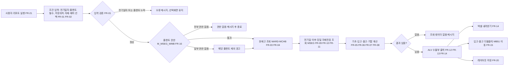
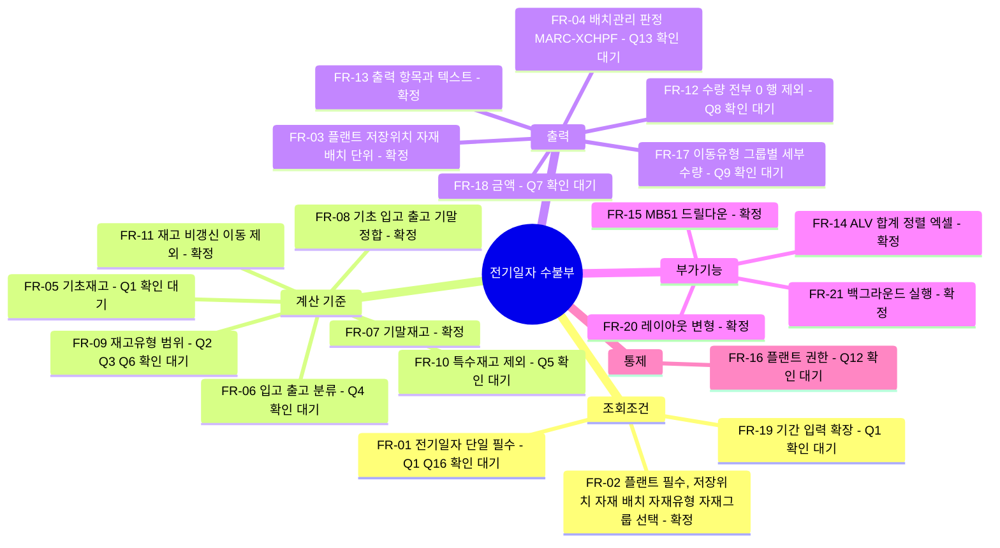
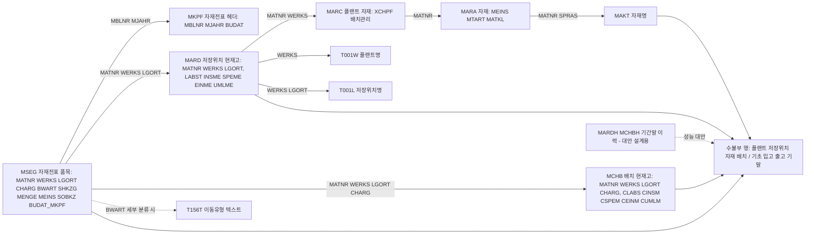

# 01. 요구사항 분석 - 전기일자 기준 플랜트 저장위치별 수불부

- 요청 ID: 20261012-79e733
- 작성: 요구사항 분석 담당 / 2026-10-12 (최초 분석, 팀장 수정 지시 없음)
- 대상 시스템: MRD (ECC 추정 - MATDOC 없음, MKPF/MSEG/MARDH/MCHBH 존재. 근거는 7절)
- 시스템 확인 범위: abap-mrd로 **오브젝트 존재**만 확인했습니다. 이 시스템의 ADT는 테이블 필드 목록·Data Element·도메인 값을 반환하지 않습니다(`ExceptionResourceNotFound`, wiki "SAP 시스템 미확인 상태에서 작업하는 방법" 참고). 아래 필드명은 SAP ECC 표준 기준이며 **필드 단위는 시스템 미확인**입니다. 개발 착수 전 SE11로 확인합니다.

## 1. 요약

현업 원문: "특정 전기일자를 넣으면 전기일 기초재고, 입고, 출고, 전기일 재고를 보고 싶다. 보여 주는 단위는 자재코드·배치 단위, 배치는 배치관리하는 자재만."

해석:
- 사용자가 **전기일자(BUDAT) 하나**와 플랜트를 입력하면, **플랜트 × 저장위치 × 자재 × 배치** 한 행마다 다음 네 수량을 기본단위로 보여 주는 ALV 리포트입니다.
  - 기초재고 = 전기일 **시작 시점** 재고(= 전기일 전날 마감 재고)
  - 입고 = 전기일 **당일** 전기된 재고 증가 수량
  - 출고 = 전기일 **당일** 전기된 재고 감소 수량
  - 전기일 재고(기말) = 전기일 **마감 시점** 재고 = 기초 + 입고 - 출고
- 배치관리 자재(MARC-XCHPF = 'X')는 배치별로, 비배치관리 자재는 배치 공란 한 행(저장위치 합계)으로 보여 줍니다.
- 계산 방식은 표준 MB5B(프로그램 RM07MLBD "전기일의 재고", 시스템에 존재 확인)와 같은 **현재고 역산 방식**을 기본안으로 합니다: 현재고(MARD/MCHB) - 전기일 이후 이동 = 전기일 기말. 검증 기준도 MB5B 결과와의 일치로 둡니다.
- "특정 전기일자"를 하루로 해석했습니다. 기간(From~To) 수불이 필요한지는 Q1로 확인합니다.
- 시스템에 이미 기초·기말재고 산출용 Z 함수(`Z_MM_PERIOD_STOCK_GET`, `Z_MM_PERIOD_STOCK_GET2`(Batch), `Z_MM_PERIOD_DETAIL_STOCK_GET`)와 클래스 `ZHCL_MM_BATCH_STOCK`이 있습니다. 재사용 여부는 설계 단계에서 소스를 확인해 결정합니다(Q11).

## 분석 다이어그램

### 1) 업무 흐름도

### 2) 요구사항 구성도

### 3) 데이터 범위도

필드 단위는 시스템 미확인(테이블 존재만 확인)입니다.

## 2. 기능 요구사항

| ID | 구분 | 설명 | 우선순위 | 상태 |
|---|---|---|---|---|
| FR-01 | 조회조건 | 전기일자 단일 입력(필수). 기본값은 오늘(SY-DATUM) 가정. 미래일자 입력 시 경고 후 진행(미래 전기 전표가 없으면 기말 = 현재고) | 필수 | Q1, Q16 |
| FR-02 | 조회조건 | 플랜트(필수, 복수 가능 SELECT-OPTIONS), 저장위치·자재·배치·자재유형·자재그룹(선택, SELECT-OPTIONS) | 필수 (자재유형·자재그룹은 권장) | 확정 |
| FR-03 | 출력 단위 | 한 행 = 플랜트 × 저장위치 × 자재 × 배치. 비배치관리 자재는 배치 공란(저장위치 단위 합계) | 필수 | 확정 |
| FR-04 | 출력 단위 | 배치관리 여부 판정은 MARC-XCHPF('X' = 배치관리). 배치관리 자재는 MCHB·MSEG-CHARG 기준 배치별, 비배치관리 자재는 MARD 기준 | 필수 | Q13 |
| FR-05 | 계산 | 기초재고 = 기말재고 - 당일 입고 + 당일 출고 (= 전기일 전날 마감 재고). 계산식은 4절 | 필수 | Q1 |
| FR-06 | 계산 | 입고·출고 분류: 기본안은 MSEG-SHKZG 'S'(차변) = 입고, 'H'(대변) = 출고. 취소 이동(102, 262 등)은 원래 방향의 반대쪽에 집계(MB5B와 동일). 이동유형 분류 기준은 5절 | 필수 | Q4 |
| FR-07 | 계산 | 기말재고 = 현재고(MARD/MCHB, 대상 재고유형 합) - 전기일 **다음날 이후** 전기된 이동의 순수량(입고 - 출고) | 필수 | 확정 |
| FR-08 | 계산 | 모든 행에서 기초 + 입고 - 출고 = 기말이 성립해야 함. 기말이 음수로 계산되는 행은 그대로 표시하고 확인용 표시(아이콘 등)를 고려 | 필수 | 확정 |
| FR-09 | 계산 | 집계 대상 재고유형: 기본안 = 비제한(LABST/CLABS) + 품질검사(INSME/CINSM) + 보류(SPEME/CSPEM) + 제한(EINME/CEINM, 배치). 이전중(UMLME/CUMLM) 포함 여부는 확인 필요. 동일 저장위치·배치 안의 재고유형 변경(321/322/343/344/349/350 등)은 총재고 기준이면 입고·출고 양쪽에 같은 수량이 잡히므로 처리 기준 확인 필요 | 필수 | Q2, Q3, Q6 |
| FR-10 | 계산 | 특수재고(MSEG-SOBKZ 공란이 아닌 이동: 판매오더 E, 위탁 K, 프로젝트 Q, 외주제공 O 등)는 제외. MARD/MCHB는 자사 일반재고만 담고 있으므로 이에 맞춤 | 필수 | Q5 |
| FR-11 | 계산 | 저장위치 재고를 바꾸지 않는 MSEG 품목은 제외: 저장위치 공란(소비 계정지정 입고 등), 103/124 등 입고보류재고 이동. 판정 기준(MSEG 필드 또는 T156M/T156S 수량 문자열)은 설계에서 확정 | 필수 | 확정(판정 방법은 설계) |
| FR-12 | 출력 | 기초·입고·출고·기말이 모두 0인 행 제외(기본). "0 행 포함" 체크 옵션 | 권장 | Q8 |
| FR-13 | 출력 | 출력 항목은 3절 표 | 필수 | 확정 |
| FR-14 | 부가기능 | ALV(CL_SALV_TABLE) 정렬·필터·합계(같은 기본단위끼리 소계)·엑셀 내려받기 | 필수 | 확정 |
| FR-15 | 부가기능 | 입고·출고 셀 더블클릭 시 MB51로 이동(자재·플랜트·저장위치·배치·전기일자 전달). 표준 MB51 SET PARAMETER로 전달되지 않는 조건은 SUBMIT RM07DOCS 사용을 설계에서 검토 | 권장 | 확정 |
| FR-16 | 통제 | 플랜트 권한 체크(M_MSEG_WMB, ACTVT 03 가정). 권한 없는 플랜트는 제외 후 경고, 전부 없으면 종료 | 필수 | Q12 |
| FR-17 | 출력 | 입고·출고를 이동유형 그룹별 세부 컬럼(구매입고, 생산입고, 이전입고, 생산출고, 판매출고, 이전출고, 기타 등)으로 나눠 표시 | 선택 | Q9 |
| FR-18 | 출력 | 금액(기초·입고·출고·기말 금액) 표시 | 선택 | Q7 |
| FR-19 | 조회조건 | 전기일자 기간(From~To) 입력으로 확장: 기초 = From 시작 시점, 기말 = To 마감 시점 | 선택 | Q1 |
| FR-20 | 부가기능 | ALV 레이아웃 저장·기본 레이아웃·선택화면 레이아웃 파라미터 | 권장 | 확정 |
| FR-21 | 부가기능 | Z T-code 등록, 대량 조회용 백그라운드 실행(스풀) 지원 | 권장 | 확정 |

## 3. 입력조건 / 출력항목

### 3-1. 선택화면

| 항목 | 필드(표준) | 형식 | 필수 | 비고 |
|---|---|---|---|---|
| 전기일자 | MKPF-BUDAT | PARAMETERS 단일 | 필수 | 기본값 SY-DATUM 가정(Q16) |
| 플랜트 | MARD-WERKS | SELECT-OPTIONS | 필수 | T001W 존재 검사 |
| 저장위치 | MARD-LGORT | SELECT-OPTIONS | 선택 | |
| 자재 | MARD-MATNR | SELECT-OPTIONS | 선택 | ECC 18자리 가정 |
| 배치 | MCHB-CHARG | SELECT-OPTIONS | 선택 | 입력 시 비배치관리 자재는 결과에서 빠짐(설계에서 안내 문구) |
| 자재유형 | MARA-MTART | SELECT-OPTIONS | 선택 | 권장 |
| 자재그룹 | MARA-MATKL | SELECT-OPTIONS | 선택 | 권장 |
| 0 행 포함 | - | CHECKBOX | 선택 | 기본 미체크(FR-12) |
| 레이아웃 | SLIS_VARI | PARAMETERS | 선택 | FR-20 |

### 3-2. 출력항목

| 순번 | 항목 | 출처 필드(표준, 시스템 미확인) | 비고 |
|---|---|---|---|
| 1 | 플랜트 | MARD-WERKS | 키 |
| 2 | 플랜트명 | T001W-NAME1 | |
| 3 | 저장위치 | MARD-LGORT | 키 |
| 4 | 저장위치명 | T001L-LGOBE | |
| 5 | 자재 | MARD-MATNR | 키 |
| 6 | 자재명 | MAKT-MAKTX | 로그온 언어 |
| 7 | 자재유형 | MARA-MTART | 기본 숨김 |
| 8 | 자재그룹 | MARA-MATKL | 기본 숨김 |
| 9 | 배치관리 | MARC-XCHPF | 체크박스(wiki "배치관리 자재 판정 기준") |
| 10 | 배치 | MCHB-CHARG / MSEG-CHARG | 비배치관리는 공란 |
| 11 | 기본단위 | MARA-MEINS | 수량 컬럼 단위 참조 |
| 12 | 기초재고 | 계산 | 4절 |
| 13 | 입고 | 계산 | 4절 |
| 14 | 출고 | 계산 | 4절 |
| 15 | 기말재고(전기일 재고) | 계산 | 4절 |
| 16 | 현재고(참고) | MARD/MCHB 대상 재고유형 합 | 기본 숨김, 검증용 |
| 17~ | 이동유형 그룹별 입고·출고 | 계산 | FR-17, 선택 |
| 18~ | 금액 | MSEG-DMBTR 등 | FR-18, 선택 |

## 4. 기초·입고·출고·기말 계산 기준

기준일 D = 입력 전기일자. 수량은 모두 기본단위(MSEG-MENGE, MARA-MEINS)입니다. MSEG-ERFMG(입력단위)는 쓰지 않습니다.

| 항목 | 계산식 | 데이터 |
|---|---|---|
| 현재고 Q_now | 대상 재고유형 수량 합 | 배치관리: MCHB(CLABS+CINSM+CSPEM+CEINM[+CUMLM]), 비배치: MARD(LABST+INSME+SPEME+EINME[+UMLME]) |
| 이후 순이동 N_after | Σ(SHKZG='S' MENGE) - Σ(SHKZG='H' MENGE), 전기일자 > D | MSEG(+MKPF) |
| 기말 Q_end | Q_now - N_after | |
| 입고 IN | Σ(SHKZG='S' MENGE), 전기일자 = D | MSEG |
| 출고 OUT | Σ(SHKZG='H' MENGE), 전기일자 = D | MSEG |
| 기초 Q_beg | Q_end - IN + OUT | |

- MSEG 집계 키: WERKS, LGORT, MATNR, CHARG(비배치관리 자재는 CHARG 무시하고 공란으로 묶음).
- 현재고에는 없지만 이후·당일 이동이 있는 키(예: 그 뒤 재고가 0이 되어 MARD/MCHB 수량 0, 또는 MCHB 행이 삭제·재편성된 배치)도 행으로 만들어야 합니다. 행 집합 = MARD/MCHB 키 ∪ MSEG 키.
- 전기일자는 MSEG-BUDAT_MKPF(EhP 이후 MSEG에 복제된 헤더 필드)를 쓰는 것을 기본안으로 하고, 이 필드가 없거나 비어 있는 과거 데이터가 있으면 MKPF-BUDAT를 MBLNR+MJAHR로 조인합니다(시스템 미확인, SE11·SE16으로 확인).
- 성능 대안(설계 검토): 과거 일자일수록 "D 이후 MSEG"가 커집니다. 대안으로 MARDH/MCHBH(기간말 이력, 존재 확인) 기준 "D가 속한 전기기간 직전 기간말 재고 + 기간 시작~D 이동"으로 계산할 수 있으나, 이력 레코드는 이동이 있었던 기간에만 생기고 기간 정의(MARV, 회계연도 변형)에 따라 읽기 규칙이 복잡합니다. 기본안은 역산 방식, 대안은 설계 단계에서 데이터량 보고 결정합니다.

## 5. 이동유형 분류 기준

기본안은 이동유형별 하드코딩 없이 **MSEG-SHKZG(차변/대변)** 로 입고·출고를 가릅니다. 이동유형 목록은 이해를 돕기 위한 대표 예시입니다.

| 구분 | SHKZG | 대표 이동유형(예시) | 처리 |
|---|---|---|---|
| 입고 | S | 101 구매/생산입고, 501 무오더입고, 561 초기재고, 202/262 출고취소, 311/301/309 이전의 입고측 품목, 305 이동중재고 입고, 701 재고실사 증가 | 입고에 합산 |
| 출고 | H | 201 원가센터출고, 261 생산출고, 601 판매출고, 551 폐기, 102/122 입고취소·반품, 311/301/309 이전의 출고측 품목, 303 2단계 이전 출고, 702 재고실사 감소 | 출고에 합산 |
| 재고유형 변경 | S/H 한 쌍 | 321/322(품질검사↔비제한), 343/344(보류↔비제한), 349/350(보류↔품질검사) | 총재고 기준이면 같은 키에서 입고·출고 양쪽에 같은 수량. 기본안: 집계 제외(순변동 0) - Q3 |
| 2단계 저장위치 이전 | - | 313(출고, 수령 저장위치 이전중 재고 증가), 315(이전중 → 비제한) | 이전중 재고(UMLME) 포함 여부에 따라 처리 달라짐 - Q6 |
| 특수재고 | - | SOBKZ ≠ 공란(E, K, Q, O 등) | 제외 - Q5 |
| 재고 비갱신 | - | 저장위치 공란 품목, 103/104/124(입고보류재고) | 제외 - FR-11 |

- 취소 이동(102, 262 등)을 기본안처럼 반대편(출고·입고)에 그대로 두면 MB5B와 같지만, "입고 = 순입고(101 - 102)"를 원하면 이동유형 → 입고/출고 그룹 매핑이 필요합니다(Q4). 매핑이 필요하면 Z 매핑 테이블 또는 프로그램 상수로 관리하며, Z 테이블 생성은 시스템 쓰기이므로 팀장 판단 사항입니다.
- FR-17(세부 그룹 컬럼)을 하는 경우에도 같은 매핑을 씁니다.

## 6. 비기능 요구사항

| ID | 항목 | 내용 |
|---|---|---|
| NFR-01 | 성능 | 플랜트 필수. MSEG 조회는 MATNR·WERKS 선행 인덱스(표준 MSEG~M 가정, 시스템 미확인)를 타도록 자재·플랜트 범위로 FOR ALL ENTRIES 또는 범위 조건 사용. 목표: 플랜트 1개·최근 3개월 일자 기준 온라인 60초 이내(가정, 현업 기준 확인 Q14). 초과 시 백그라운드 실행 |
| NFR-02 | 정합성 | 같은 조건으로 MB5B(저장위치/배치 재고, 동일 재고유형) 결과와 기말·입고·출고 일치. 현재일 입력 시 기말 = MARD/MCHB 현재고 |
| NFR-03 | 권한 | 표준 권한 객체 사용(M_MSEG_WMB 존재 확인). 조회 전용, DB 갱신 없음 |
| NFR-04 | 호환성 | ECC, SAP_BASIS 7.40 SP09 이상·7.50 미만 추정(wiki "ECC 7.40 시스템 ABAP 개발 제약"). 사용 구문의 최소 SP를 개발 문서에 명시 |
| NFR-05 | 유지보수 | 선택화면·ALV는 프로그램, 조회·계산은 클래스로 분리. 계산식(역산·분류)은 DB 없는 메서드로 분리해 ABAP Unit 대상 |
| NFR-06 | 사용성 | 수량 컬럼은 기본단위 참조, 음수 기말 행 식별 가능, 컬럼명 한국어 |

## 7. 관련 모듈 / 시스템 확인 결과

- 모듈: MM(재고관리 IM). 배치관리(LO-BM). 금액을 넣는 경우 FI/CO(평가) 연관.
- 표준 대응 기능: MB5B(RM07MLBD), MB51(RM07DOCS), MMBE.

| 대상 | 도구 | 결과 |
|---|---|---|
| MKPF "헤더: 자재 전표", MSEG "전표 세그먼트: 자재" (패키지 MB) | SearchObject | 존재 확인 |
| MARD "자재에 대한 저장위치데이타", MCHB "배치 재고" (MG) | SearchObject | 존재 확인 |
| MARDH "저장위치 세그멘트: 이력", MCHBH "Batch 재고: 이력" (MGA) | SearchObject | 존재 확인 |
| MBEW, MBEWH, MCH1, T001L, T156, T156T, T156S, T156M | SearchObject | 존재 확인 |
| MATDOC, MATDOC*, NSDM_V_MSEG* | SearchObject | 없음 → ECC 판단 근거 |
| RM07MLBD "전기일의 재고" | SearchObject | 존재 확인(MB5B 프로그램) |
| 권한 객체 M_MSEG_WMB(자재 전표: 플랜트), M_MSEG_LGO(자재 이동: 저장 위치), M_MSEG_BWA | SearchObject | 존재 확인. 필드 정의는 확인 불가(SU21) |
| 기존 Z: Z_MM_PERIOD_STOCK_GET "기초재고 산출", Z_MM_PERIOD_STOCK_GET2 "기초재고 산출(Batch)", Z_MM_PERIOD_STOCK_GET3 "(matnr)", Z_MM_PERIOD_DETAIL_STOCK_GET "기말재고 산출"(FUGR ZFGMM55), ZHCL_MM_BATCH_STOCK "배치별 재고", Z_MM_HAWA_STOCK "기준월 기말 배치재고" | SearchObject | 존재 확인. 소스·로직 미확인 |
| 테이블 필드 목록(MSEG-BUDAT_MKPF 존재 등), 인덱스 | GetTable/GetStructure/GetTypeInfo | 확인 불가(ADT 미지원) → SE11 |
| MB5B T-code | GetTransaction | 조회 실패("No suitable resource") - 표준이라 존재는 가정 |

## 8. 관련 표준 테이블·필드

필드는 SAP ECC 표준 기준이며 시스템 미확인입니다.

| 테이블 | 용도 | 주요 필드 |
|---|---|---|
| MKPF | 자재전표 헤더 | MBLNR, MJAHR, BUDAT, BLDAT, VGART |
| MSEG | 자재전표 품목(수불 원천) | MBLNR, MJAHR, ZEILE, BWART, MATNR, WERKS, LGORT, CHARG, SOBKZ, SHKZG, MENGE, MEINS, BUDAT_MKPF, INSMK, KZBEW, XAUTO, DMBTR, SMBLN |
| MARD | 저장위치 현재고(비배치·배치 공통 합계) | MATNR, WERKS, LGORT, LABST, INSME, SPEME, EINME, UMLME |
| MCHB | 배치 현재고 | MATNR, WERKS, LGORT, CHARG, CLABS, CINSM, CSPEM, CEINM, CUMLM |
| MARDH / MCHBH | 기간말 재고 이력(성능 대안) | 위 키 + LFGJA, LFMON |
| MARC | 배치관리 판정 | MATNR, WERKS, XCHPF |
| MARA / MAKT | 자재 속성·자재명 | MATNR, MTART, MATKL, MEINS / MATNR, SPRAS, MAKTX |
| T001W / T001L | 플랜트명 / 저장위치명 | WERKS, NAME1 / WERKS, LGORT, LGOBE |
| T156 / T156T | 이동유형·텍스트(세부 분류 시) | BWART / SPRAS, BWART, BTEXT |
| T156M, T156S | 이동유형 수량 갱신 규칙(재고 비갱신 판정 후보) | 설계에서 확인 |
| MBEW / MBEWH | 금액 필요 시(FR-18) | MATNR, BWKEY, BWTAR, VERPR, SALK3, LBKUM |

## 9. 가정

1. "특정 전기일자"는 하루 단위로 보고, 기초 = 해당일 시작, 입고·출고 = 해당일 하루, 기말 = 해당일 마감으로 해석했습니다.
2. 수량만 요청되어 금액은 범위 밖입니다(FR-18 선택).
3. 대상 재고는 자사 일반재고(특수재고 제외), 재고유형은 비제한+품질검사+보류(+제한) 합계를 기본안으로 했습니다. 재고유형별 컬럼 분리는 하지 않습니다.
4. 배치관리 판정은 MARC-XCHPF(플랜트 레벨)입니다. 이 팀 wiki 기준과 같습니다.
5. 입고·출고 구분은 MB5B와 같은 차변/대변(SHKZG) 기준입니다.
6. 대상 시스템은 ECC(MKPF/MSEG 사용)입니다. S/4HANA 전환 시 MATDOC 기준 재검토가 필요합니다.
7. 표준 MB5B와 결과가 일치하는 것을 정답 기준으로 삼습니다.
8. 프로그램·T-code 이름은 설계 단계에서 정합니다(예: ZMM_STOCK_DAILY_R, 충돌 여부 설계에서 확인).

## 10. 현업 확인 필요 사항

| No | 질문 | 기본안(답이 없을 때) | 관련 FR |
|---|---|---|---|
| Q1 | 전기일자는 하루만 입력합니까, 기간(From~To)도 필요합니까? 하루라면 기초재고는 "그날 아침(전날 마감)" 재고가 맞습니까? | 하루, 전날 마감 = 기초 | FR-01, 05, 19 |
| Q2 | 재고에 어떤 재고유형을 포함합니까? (가용/비제한만, 또는 품질검사·보류 포함 총재고) | 비제한+품질검사+보류(+제한) | FR-09 |
| Q3 | 같은 저장위치 안에서 품질검사→가용(321) 같은 재고유형 변경을 입고·출고로 볼까요? | 총재고 기준이면 제외 | FR-09 |
| Q4 | 입고 취소(102)·출고 취소(262)는 출고·입고로 따로 보여 줄까요, 원래 입고·출고에서 빼서 순수량으로 보여 줄까요? | MB5B처럼 따로(차변/대변) | FR-06 |
| Q5 | 판매오더재고·위탁재고·외주제공재고 등 특수재고도 포함합니까? | 제외 | FR-10 |
| Q6 | 2단계 저장위치 이전(313/315)의 이전중 재고는 어느 저장위치 재고로 봅니까? 2단계 이전을 실제로 씁니까? | 이전중 재고 포함(수령 저장위치), 미사용이면 해당 없음 | FR-09 |
| Q7 | 수량 외에 금액도 필요합니까? 필요하면 어떤 단가 기준입니까? | 수량만 | FR-18 |
| Q8 | 기초·입고·출고·기말이 모두 0인 행은 숨길까요? | 숨김, 옵션으로 표시 | FR-12 |
| Q9 | 입고·출고를 구매입고/생산입고/이전/판매출고 등으로 나눠 볼 필요가 있습니까? 있다면 분류표를 주십시오 | 합계 한 컬럼씩 | FR-17 |
| Q10 | 표준 MB5B(저장위치/배치 재고 선택)로 대체가 안 되는 이유(예: 한 줄 형식, 여러 자재 한눈에, 엑셀 양식)가 무엇입니까? 검증 기준을 MB5B로 해도 됩니까? | MB5B를 검증 기준으로 | NFR-02 |
| Q11 | (팀 내부/MM 담당) 기존 Z_MM_PERIOD_STOCK_GET2(Batch), Z_MM_PERIOD_DETAIL_STOCK_GET, ZHCL_MM_BATCH_STOCK의 계산 기준이 이번 요구와 같은지, 재사용 가능한지 | 설계 단계에서 소스 확인 후 결정 | FR-05, 07 |
| Q12 | 권한은 플랜트(M_MSEG_WMB)만 볼까요, 저장위치(M_MSEG_LGO)까지 볼까요? | 플랜트만 | FR-16 |
| Q13 | (MM 담당) 배치 레벨 설정(OMCT/TCUCH)이 플랜트/자재/클라이언트 중 무엇입니까? 배치관리 지시자를 중간에 바꾼 자재가 있습니까? | MARC-XCHPF 기준, 변경 이력은 고려하지 않음 | FR-04 |
| Q14 | 주로 조회하는 일자 범위(최근 며칠/몇 년 전까지)와 플랜트당 자재 수, 허용 응답시간 | 최근 3개월·60초 | NFR-01 |
| Q15 | 이 시스템에서 MSEG-BUDAT_MKPF가 과거 전표까지 채워져 있습니까? (개발팀 SE16 확인) | 비어 있으면 MKPF 조인 | 4절 |
| Q16 | 전기일자 기본값은 오늘입니까, 전일입니까? | 오늘 | FR-01 |
