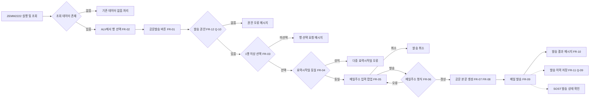
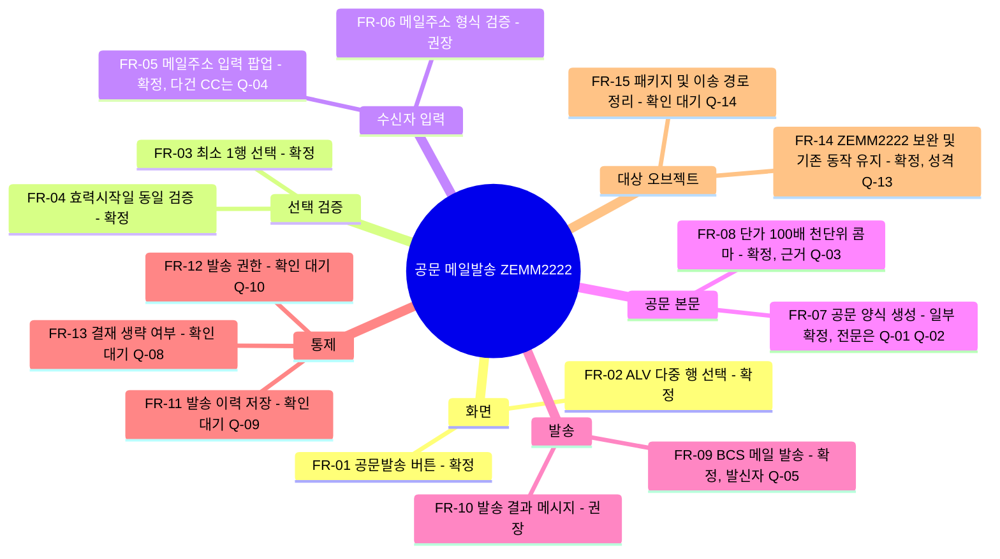
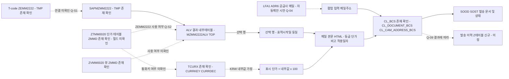

# 01. 요구사항 분석 - 스크랩(SCRAP) 기본단가 관리 공문 메일발송 기능 개발

- 요청 ID: 20261019-bce84c
- 대상 화면: **T-code ZEMM2222 (프로그램 SAPMZMM2222)** - 기존 오브젝트 보완(신규 기능 추가)
  - 팀장 수정 지시로 대상을 ZEMM0020에서 ZEMM2222로 바꿨습니다(9. 변경 이력 참고).
  - 현업 요청 원문과 첨부에는 "고철등급별 단가관리(ZEMM0020)"로 되어 있습니다. ZEMM2222는 ZEMM0020과 같은 구성의 로컬($TMP) 오브젝트로 확인되며, 성격은 확인이 필요합니다(Q-13).
- 작성: 요구사항 분석 담당 (sap-analyst) / 작성일: 2026-10-19 (2차 수정)
- 조회 시스템: srd-abap (http://dshldra1.dongkuksteel.com:8000, 클라이언트 250), 읽기 전용 조회만 수행
- 근거 자료
  - [REQ] `request.md` (정보처리의뢰서 원문)
  - [XLS] `attachments/(신규개발)스크랩(SCRAP) 기본단가 관리 공문 메일발송 기능 개발_261019.xlsx` (구글시트 사본) / 텍스트 추출본 `attachments/.text/(신규개발)스크랩(SCRAP) 기본단가 관리 공문 메일발송 기능 개발_261019.xlsx.txt`
    - [XLS-요청] 시트 "현업개발요청내용", [XLS-설계] 시트 "설계", [XLS-참고] 시트 "참고자료"(추출 텍스트 없음)
  - [SYS] srd-abap 조회 결과 (5장)
  - [지시] 팀장 수정 지시: "ZEMM0020에서 ZEMM2222 tcode 프로그램으로 변경해서 요구사항 분석부터 다시 설계 개발 변경해줘"

> **분석 한계 (반드시 확인)**
> 1. **첨부 xlsx의 이미지가 텍스트 추출본에 없습니다.** 추출본에는 셀 텍스트만 있고 아래 영역은 제목만 있거나 비어 있어 캡처 이미지로 들어 있는 것으로 보입니다. 이 영역 내용은 반영하지 못했습니다(Q-01).
>    - [XLS-요청] B27 "추가 메신저로 현업 요청 상세 대화 내용" ~ B44 (대화 캡처 추정)
>    - [XLS-요청] B45 "메일 양식" ~ B74 (공문 메일 양식 캡처 추정)
>    - [XLS-설계] B21 이후 ALV 결과 화면 캡처(버튼 위치), C63~C74 메일주소 입력 팝업, C79~C109 메일 샘플(1항 단가표와 2항 적용일자 외 3항 내용 없음)
>    - [XLS-참고] 시트 전체(텍스트 없음)
> 2. **srd-abap에서 오브젝트 존재 여부는 확인했지만 상세 내용은 조회하지 못했습니다.** SearchObject는 정상 동작했으나 GetTransaction(ZEMM2222, ZEMM0020 모두 "No suitable resource found")과 GetTable/GetStructure(ZTMM0020, MARA, BAPIRET2 모두 ADT `/ddic/structures/.../source/main` 없음 오류)는 실패했습니다. 이 시스템의 ADT가 해당 리소스를 지원하지 않는 것으로 보입니다. 따라서 **T-code와 프로그램의 연결, 화면 번호, Z테이블 필드명은 "시스템 미확인"** 이며 SE93/SE80/SE11에서 직접 확인해야 합니다(Q-S1~Q-S7).

## 표기 규칙

| 표기 | 의미 |
|---|---|
| [확정] | request.md, 첨부 셀 텍스트, 팀장 지시에 명시된 내용 |
| [SYS확인] | srd-abap 조회로 존재를 확인한 내용 |
| [가정] | 분석 담당 추정. 현업/팀장/시스템 확인 필요 |
| [미확인-시스템] | SAP에서 상세 조회가 필요한 오브젝트/필드 |

---

## 1. 요약

- **현행** [REQ][XLS-요청 B14~B15]: 스크랩 공급사가 국내스크랩 기본단가 공문을 요청하면 그룹웨어 Iris 결재작성의 "대외공문" 기능으로 공문을 수기 작성 → 결재 → 발송한다.
- **요청** [REQ][XLS-요청 B8~B10]: 고철등급별 단가관리 화면의 단가 정보로 스크랩 공급사 대상 공문을 메일로 작성·발송하는 기능을 새로 넣는다.
- **개발 대상** [지시][SYS]: 팀장 지시에 따라 **ZEMM2222(SAPMZMM2222)** 에 기능을 넣는다. srd-abap에 T-code ZEMM2222와 프로그램 SAPMZMM2222, 인클루드 MZMM2222TOP/O01/I01/F01/F02/ALV가 **이미 있으며 모두 패키지 `$TMP`(로컬, 이송 불가)** 다. 인클루드 구성이 ZEMM0020(SAPMZMM0020, 패키지 ZMMD)과 똑같아 ZEMM0020을 복사한 오브젝트로 보인다([가정], Q-13). 신규 생성 대상이 아니라 **기존 오브젝트 보완 대상**이다.
- **기대효과** [REQ][XLS-요청 B18~B20]: 공문 작성·발송 시간 단축, 수기 작성 오류(휴먼에러) 예방.
- **설계 시트의 처리 흐름** [XLS-설계 B21, C56~C111]
  1. ZEMM2222 조회 결과 ALV에 "공문발송" 버튼 추가
  2. 공문 보낼 행(등급별 단가) 선택 → "공문발송" 클릭
     - 1행 이상 선택 필수. 효력시작일이 다른 행을 함께 고르면 진행하지 않음(공문의 적용일자는 하나)
  3. 팝업에서 수신 메일주소 입력 → "발송" 클릭 → 정해진 양식으로 메일 발송
  4. 메일 본문: 1. 등급/단가/비고 표, 2. 적용일자(YYYY.MM.DD), 3. (내용 미추출)
  5. 단가 표시: ALV 단가 × 100, 천 단위 콤마
- **핵심 미결 사항**
  - ZEMM2222의 성격(최종 사용자 T-code인지, 개발·검증용 사본인지)과 `$TMP` 패키지 처리(이송 경로)
  - 메일 양식 전문(이미지 미추출), 단가 단위(kg/톤)와 ×100 근거(현업 확인 중 [XLS-요청 B75~B76])
  - 메일주소 입력 방식(다건/CC), 발신자, Iris 결재 생략 여부, 발송 이력 필요 여부

## 분석 다이어그램

### 1) 업무 흐름도

### 2) 요구사항 구성도

### 3) 데이터 범위도 (오브젝트 존재만 확인, 필드는 시스템 미확인)

---

## 2. 기능 요구사항

| ID | 설명 | 우선순위 | 상태 | 근거 |
|---|---|---|---|---|
| FR-01 | ZEMM2222 조회 결과 화면(ALV) 툴바(또는 GUI STATUS)에 "공문발송" 버튼을 추가한다. 기존 조회·저장 기능은 그대로 둔다. | 필수 | [확정] | [XLS-설계] B21 "조회 결과 화면에 공문발송 신규버튼 추가" / [지시] 대상 ZEMM2222 |
| FR-02 | ALV에서 공문 보낼 행을 여러 개 고를 수 있어야 한다(현재 선택 모드가 단일 선택이면 다중 선택으로 바꿈). | 필수 | [확정] 다중 선택 / [미확인-시스템] 현 선택 모드 | [XLS-설계] C56 "공문발송할 자료(행) 선택", C60 "다중 선택" |
| FR-03 | "공문발송" 클릭 시 선택 행이 없으면 오류 메시지를 띄우고 멈춘다. | 필수 | [확정] | [XLS-설계] C59 "최소 하나의 행은 선택이 되어야 한다" |
| FR-04 | 선택 행의 효력시작일이 둘 이상이면 오류 메시지를 띄우고 멈춘다(공문 적용일자는 하나). | 필수 | [확정] | [XLS-설계] C60~C61 |
| FR-05 | 검증을 통과하면 수신 메일주소 입력 팝업을 띄운다. 팝업에 "발송"과 "취소" 버튼을 둔다. 취소하면 아무것도 보내지 않는다. 주소 여러 개 입력·CC 지원, 공급사 마스터 메일 자동 제안 여부는 확인 필요. | 필수 | [확정] 팝업 입력 / [가정] 취소, 다건 | [XLS-설계] C63 "팝업으로 공문발송할 메일주소 입력창 표시", C63~C74 팝업 캡처(미추출) / Q-04 |
| FR-06 | 입력한 메일주소가 비었거나 형식이 틀리면(@, 도메인 등) 발송하지 않고 다시 입력받는다. | 권장 | [가정] | 휴먼에러 예방 취지 [REQ] 2-2) |
| FR-07 | "발송" 클릭 시 정해진 공문 양식으로 메일 본문을 만든다. 첨부에서 확인한 구성: **1항 단가표**(열: 등급 / 단가 / 비고, 선택 행 수만큼), **2항 적용일자**(선택 행의 효력시작일, `YYYY.MM.DD`, 예 2026.09.28), **3항**(내용 미추출). 메일 제목·인사말·맺음말·발신 명의·3항 내용은 메일 양식 캡처에서 확인 필요. | 필수 | [확정] 1항·2항 / [미확인] 나머지 | [XLS-설계] C77, C79, C95~C103 / [XLS-요청] B45 "메일 양식"(이미지 미추출) / Q-01, Q-02 |
| FR-08 | 메일 본문의 단가는 ALV 결과 화면 단가에 100을 곱해 표시하고 천 단위마다 콤마를 붙인다. 단가 단위(kg/톤)를 현업이 확인 중이므로 변환 로직을 한 곳(공통 루틴)에 모은다. | 필수 | [확정] 표시 규칙 / [미확인] 근거와 단위 | [XLS-설계] C110~C111 / [XLS-요청] B75~B76 "단가가 너무 크다.. kg이 아닌 톤당단가로 보낸거 같다 ==> 확인 요청 중" / Q-03 |
| FR-09 | SAP 메일(BCS: CL_BCS, CL_DOCUMENT_BCS, CL_CAM_ADDRESS_BCS)로 입력 주소에 외부 메일을 바로 발송한다(COMMIT WORK 포함). 결재 단계 없이 사용자가 바로 보낸다(설계 시트 흐름 기준). | 필수 | [확정] 발송 / [SYS확인] BCS 클래스 존재 / [가정] 즉시 발송 | [XLS-설계] C77 / [SYS] SearchObject CL_BCS 등(패키지 SBCOMS) / Q-05, Q-08 |
| FR-10 | 발송 성공·실패를 메시지로 알린다. 성공 시 발송 건수와 수신 주소, 실패 시 BCS 예외 내용을 보여 준다. | 권장 | [가정] | 일반 운영 요건 |
| FR-11 | 발송 이력(발송일시, 발송자, 수신 주소, 적용일자, 등급·단가 스냅샷, BCS 문서 ID)을 저장·조회한다. 첨부에 언급이 없으므로 현업 확인 후 범위를 정한다(SOST만으로 충분할 수 있음). | 선택 | [가정] | 첨부 미언급 / Q-09 |
| FR-12 | 공문발송 기능은 권한 있는 사용자만 쓰게 한다(ZEMM2222 T-code 권한(S_TCODE)으로 충분한지, 발송 권한을 따로 둘지). ZEMM2222는 새 T-code이므로 사용자 역할에 아직 없을 수 있다. | 권장 | [가정] | Q-10, Q-15 |
| FR-13 | 현행 Iris 결재(작성·결재 후 발송)를 SAP 발송에서도 거쳐야 하는지 확인한다. 설계 시트에 결재 단계가 없으므로 "결재 없이 발송"을 기본으로 둔다. | 확인 후 결정 | [가정] | [REQ] 2-1) "작성.결재 후 발송" vs [XLS-설계] C56~C77 / Q-08 |
| FR-14 | (신규, 대상 변경) 공문발송 기능은 **ZEMM2222(SAPMZMM2222 및 MZMM2222* 인클루드)** 에만 넣고, **ZEMM0020(SAPMZMM0020, ZMMD)은 수정하지 않는다.** ZEMM2222의 기존 조회·저장 동작은 그대로 둔다. | 필수 | [확정] 대상 / [가정] ZEMM0020 미수정 | [지시] / [SYS] SearchObject 결과 / Q-13 |
| FR-15 | (신규, 대상 변경) ZEMM2222 관련 오브젝트가 `$TMP`(로컬)여서 이송요청에 담을 수 없다. 품질·운영계에 반영하려면 정식 패키지(예: ZMMD)로 재지정하고 이송요청을 만들어야 한다. 개발계 전용 검증이면 그대로 둔다. 패키지 재지정은 되돌리기 어려운 작업이므로 팀장 확인 후 개발 단계에서 처리한다(이 분석 단계에서는 시스템에 쓰지 않음). | 필수 | [SYS확인] $TMP / [가정] 처리 방식 | [SYS] SearchObject packageName="$TMP" / Q-14 |

### FR-07 메일 본문 단가표 샘플 (첨부 그대로)

[XLS-설계] C79 "아래 4건을 선택해서 메일 발송했다면 아래와 같은 메일 양식으로 발송된다", C95~C101

| 등급 | 단가 | 비고 |
|---|---|---|
| 생철AL | 470.0 | |
| 생철A | 470.0 | |
| 주물A(모터블럭) | 470.0 | |
| 생철B | 465.0 | |

- 2. 적용일자: 2026.09.28
- 3. (내용 미추출)

참고: 샘플 단가는 "470.0"처럼 소수 첫째 자리가 붙어 있지만 C111은 "숫자형식으로 천단위 콤마"라고 해 소수점 표시 여부가 정해지지 않았습니다(Q-03). 비고 열 값의 출처도 샘플에서 비어 있어 확인이 필요합니다(Q-06).

## 3. 비기능 요구사항

| ID | 내용 | 근거 |
|---|---|---|
| NFR-01 | ZEMM2222의 기존 조회·저장 로직과 화면 동작에 영향이 없어야 한다. 신규 기능은 버튼 이벤트 안에서만 동작한다. ZEMM0020과 ZMMD 패키지 오브젝트(ZTMM0020 정의 등)는 바꾸지 않는다. | [가정] 기존 프로그램 보완 / FR-14 |
| NFR-02 | 개발계·품질계에서 실제 공급사에 메일이 나가지 않게 한다(SCOT 설정 확인, 테스트 시 사내 주소만 사용). | [가정] 운영 리스크 방지 |
| NFR-03 | 단가 변환(×100, 콤마, 소수 자리)은 한 곳에서 처리해 단위 확정(Q-03) 후 수정 범위를 줄인다. | [XLS-요청] B75~B76 확인 중 |
| NFR-04 | 메일 본문은 HTML 표로 만들어 메일 클라이언트(Outlook 등)에서 표가 깨지지 않게 하고, 한글이 깨지지 않게 UTF-8로 보낸다. | [가정] |
| NFR-05 | 화면·메시지 문구는 한국어로 하고, 메시지는 Z 메시지 클래스(또는 SAPMZMM2222가 쓰는 기존 메시지 클래스)로 관리한다. | [가정] 개발 표준 확인 필요 |
| NFR-06 | 단가는 대외 영업 정보이므로 발송 권한·이력 조회를 통제할 수 있어야 한다. | [가정] |
| NFR-07 | (신규) 변경 오브젝트는 이송 가능한 패키지와 이송요청으로 관리한다. `$TMP` 상태로는 운영 반영이 불가하므로 반영 경로가 정해지기 전에는 개발계 한정 산출물로 본다. | [SYS] $TMP / Q-14 |

## 4. 관련 모듈

- MM(구매): 스크랩(고철) 구매 단가 관리 - 주 모듈 (ZEMM2222, 원본 ZEMM0020)
- BC(Basis): SAP Office/BCS 메일 발송, SCOT(SMTP 노드), SOST(발송 상태), 패키지·이송(SE80/SE09)
- (외부) 그룹웨어 Iris: 현행 대외공문 결재. 연계 여부는 Q-08 (기본 가정: 연계 없음)

## 5. 관련 SAP 오브젝트·표준 테이블·필드

### 5-1. srd-abap 조회 결과 (2026-10-19, SearchObject)

| 오브젝트 | 유형 | 패키지 | 조회 결과 | 비고 |
|---|---|---|---|---|
| ZEMM2222 | TRAN/T | `$TMP` | [SYS확인] 존재 | GetTransaction 실패("No suitable resource found")로 연결 프로그램·화면 번호는 [미확인-시스템] |
| SAPMZMM2222 | PROG/P (모듈풀 명명) | `$TMP` | [SYS확인] 존재 | ZEMM2222 연결 프로그램으로 추정(이름 규칙). SE93 확인 필요(Q-S1) |
| MZMM2222TOP / O01 / I01 / F01 / F02 / ALV | PROG/I | `$TMP` | [SYS확인] 존재 | ZEMM0020의 MZMM0020* 인클루드와 같은 구성 |
| ZEMM0020 | TRAN/T | ZMMD | [SYS확인] 존재 | 현업 원문 대상. 이번 수정 대상 아님 |
| SAPMZMM0020 + MZMM0020TOP/O01/I01/F01/F02/ALV | PROG/P, PROG/I | ZMMD | [SYS확인] 존재 | ZEMM2222의 원본으로 추정 |
| ZTMM0020 | TABL/DT | ZMMD | [SYS확인] 존재 | 단가 원천 테이블로 추정. 필드 조회 실패(GetTable 오류) → [미확인-시스템] |
| ZVMM0020 | VIEW/DV | ZMMD | [SYS확인] 존재 | 사용 여부 미확인 |
| ZSMM0020 | TABL/DS | ZMMD | [SYS확인] 존재 | ALV 출력 구조 후보. 필드 조회 실패 |
| ZTMM2222 / ZSMM2222 등 MM용 2222 DDIC | - | - | [SYS확인] 없음 | `Z*2222*` 검색 결과 ZSSD2222(SD), ZTCO2222(CO)만 있음. ZEMM2222 전용 테이블은 없으므로 ZTMM0020 등 기존 테이블을 같이 쓰는 것으로 추정 |
| ZBMM0020, ZRMM0020, ZTMM0020 (T-code) | TRAN/T | ZMMD | [SYS확인] 존재 | 같은 번호대 관련 T-code. 이번 범위 아님 |
| CL_BCS, CL_DOCUMENT_BCS, CL_CAM_ADDRESS_BCS | CLAS/OC | SBCOMS | [SYS확인] 존재 | 메일 발송 |
| TCURX | TABL/DT | SFIB | [SYS확인] 존재 | 필드 CURRKEY, CURRDEC는 표준 지식 기반 [미확인-시스템] |

### 5-2. 상세 확인이 필요한 항목

| 오브젝트 | 용도 | 예상 필드 / 비고 | 상태 |
|---|---|---|---|
| ZEMM2222 / SAPMZMM2222 | 시작 화면 번호, ALV 방식(CL_GUI_ALV_GRID / REUSE_ALV_GRID_DISPLAY / SALV), GUI STATUS, 선택 모드, USER_COMMAND 구조 | ZEMM0020 사본이라면 같은 구조 | [미확인-시스템] |
| ZTMM0020 (또는 ZEMM2222가 실제 읽는 테이블) | 등급(코드/명), 단가, 통화, 단위, 효력시작일(종료일), 비고 필드명 | 단가 필드가 CURR 타입이고 참조 통화가 KRW인지 | [미확인-시스템] |
| TCURX | KRW 소수 자리. KRW가 CURRDEC = 0이면 CURR 필드 내부값이 표시값의 1/100로 저장됨 | CURRKEY, CURRDEC | [미확인-시스템] |
| SOOD / SOST | BCS 발송 문서·상태(T-code SOST) | - | [미확인-시스템] |
| LFA1 / ADR6 | (Q-04 자동 제안이 필요할 때만) 공급사 메일 | LFA1-LIFNR, LFA1-ADRNR, ADR6-ADDRNUMBER, ADR6-SMTP_ADDR | [미확인-시스템] |
| 발송 이력 Z테이블 | FR-11 채택 시 신규 생성 | - | [가정] 신규 |

### 5-3. 대상 오브젝트와 영향 범위 (ZEMM2222 기준)

| 구분 | 오브젝트 | 변경 내용(예상) |
|---|---|---|
| 수정 | SAPMZMM2222 GUI STATUS | "공문발송" 기능코드 추가(ALV 툴바 방식이면 해당 없음) |
| 수정 | MZMM2222ALV / F01 / F02 | 툴바 버튼, 다중 선택 모드, 선택 행 검증, 본문 생성, BCS 발송 |
| 수정 | MZMM2222TOP | 메일·선택 행용 데이터 선언 |
| 신규(예상) | 메일주소 입력 팝업 화면(SAPMZMM2222 내 신규 Dynpro) 또는 표준 팝업 FM | Q-04 결과에 따라 결정 |
| 신규(조건부) | 발송 이력 Z테이블 | FR-11 채택 시 |
| 신규(조건부) | 메시지 클래스·텍스트 심볼 | 기존 메시지 클래스 재사용 여부 확인 |
| 패키지·이송 | 위 오브젝트 전체 | `$TMP` → 정식 패키지 재지정, 이송요청 생성(Q-14) |
| 영향 없음(목표) | ZEMM0020, SAPMZMM0020, MZMM0020*, ZTMM0020 정의 | 수정하지 않음 |
| 운영 영향 | 사용자 역할 | ZEMM2222를 현업이 쓰게 하려면 S_TCODE 권한·메뉴 추가 필요(Q-15) |

**×100 규칙 분석 의견**: 첨부의 "ALV 단가 × 100" 규칙[XLS-설계 C110]은 단가 필드가 KRW를 참조하는 CURR 타입인데 통화 참조 없이 내부값(예: 4.70)을 그대로 쓸 때 생기는 현상과 같습니다. 그렇다면 하드코딩 ×100 대신 통화 변환(WRITE ... CURRENCY 또는 BAPI_CURRENCY_CONV_TO_EXTERNAL)을 쓰는 것이 맞습니다. 반대로 kg당 단가를 톤당 등으로 환산하는 의미라면 "단가가 너무 크다"는 지적[XLS-요청 B75]과 연결됩니다. 단가 필드 타입·통화 확인(Q-S2, Q-S3)과 현업 답변(Q-03)으로 확정해야 합니다. 이 판단은 ZEMM2222가 ZEMM0020과 같은 테이블·ALV 구조를 쓴다는 전제에서만 유효합니다.

## 6. 가정

| ID | 가정 내용 | ZEMM2222 적용 검토 |
|---|---|---|
| A-01 | 대상 프로그램은 ALV로 결과를 보여 주는 Z 프로그램이며 툴바 버튼 추가와 다중 행 선택이 가능하다. | **그대로 적용(보강).** SAPMZMM2222는 모듈풀 이름이고 MZMM2222ALV 인클루드가 있어 ALV 사용 가능성이 높다. 화면 번호·ALV 방식은 미확인. |
| A-02 | ALV 각 행은 "등급 × 효력시작일" 단위 단가이며 등급명·단가·효력시작일·비고 값이 ALV 출력 테이블에 있다. | **조건부 적용.** ZEMM2222 전용 테이블이 없어 ZTMM0020 등 같은 데이터를 쓸 것으로 보이나, 사본이 수정되어 출력 필드가 달라졌을 수 있다(Q-S2). |
| A-03 | 공문은 공급사와 무관한 공통 기본단가이며 수신자는 사용자가 팝업에 직접 입력한다. | 그대로 적용(업무 가정이라 T-code와 무관). |
| A-04 | 결재 없이 SAP에서 바로 발송한다. | 그대로 적용. |
| A-05 | 메일은 본문(HTML)만 보내고 PDF 첨부는 하지 않는다. | 그대로 적용. |
| A-06 | SCOT SMTP 외부 메일 발송이 운영 중이다. | 그대로 적용. 다만 ZEMM2222가 개발계 전용이면 개발계 SCOT 설정만 의미가 있다. |
| A-07 | 단가표 행 순서는 ALV 화면 정렬 순서를 따른다. | 그대로 적용. |
| A-08 | 효력시작일 외 다른 키(플랜트 등)가 다른 행을 함께 골라도 막지 않는다. | 그대로 적용. |
| A-09 | (1차) 기존 프로그램은 운영 중인 정식 오브젝트이며 이송요청으로 배포된다. | **적용 불가.** ZEMM0020은 ZMMD(이송 가능)지만 ZEMM2222는 `$TMP`(로컬)다. 패키지 재지정 없이는 운영 반영이 안 된다(FR-15, Q-14). |
| A-10 | (1차) 현업 사용자는 이미 해당 T-code 권한을 가진다. | **적용 불가 가능성.** ZEMM2222는 새로 만든 로컬 T-code라 사용자 역할에 없을 가능성이 높다(Q-15). |
| A-11 | (신규) ZEMM2222는 ZEMM0020을 복사한 것으로, 조회 조건·출력·저장 로직이 ZEMM0020과 같다. | 인클루드 구성이 같다는 사실만 확인됨. 소스 비교 필요(Q-S7). |

## 7. 현업 확인 필요 사항

| Q | 항목 | 확인 내용 | 근거 | 영향 FR |
|---|---|---|---|---|
| Q-01 | 첨부 이미지 내용 | xlsx 안의 캡처(메신저 대화 B27~, 메일 양식 B45~, ALV 화면, 팝업 C63~, 메일 샘플 C79~C109, 참고자료 시트)가 텍스트로 추출되지 않았습니다. 캡처를 이미지(PNG)나 PDF로 따로 첨부해 주세요. | [XLS] 전 시트 | FR-05, FR-07 |
| Q-02 | 메일 양식 전문 | 메일 제목, 인사말, 1~3항 문구(3항 내용), 맺음말, 발신 명의(회사·부서·담당자), 서명/로고·직인 사용 여부. 고정 문구와 사용자 수정 문구 구분. | [XLS-요청] B45, [XLS-설계] C103 | FR-07 |
| Q-03 | 단가 단위·변환 | (1) 공문 단가 단위가 원/kg인지 원/톤인지(B75 "확인 요청 중" 결과), (2) ×100이 통화 내부값 보정인지 단위 환산인지, (3) 소수점 표시 여부(샘플 "470.0" vs "천단위 콤마"), (4) 단위·통화 표기(예 "원/kg")를 본문에 넣을지. | [XLS-설계] C110~C111, [XLS-요청] B75~B76 | FR-08 |
| Q-04 | 수신 메일주소 입력 | 주소 여러 개 입력 가능 여부와 구분자, CC/BCC 필요 여부, 개별 발송인지 한 메일로 함께 보내는지, 공급사 마스터 메일 자동 제안 필요 여부, 사내 참조(본인/팀장) 자동 포함 여부. | [XLS-설계] C63 | FR-05 |
| Q-05 | 발신자 | 발신 주소(로그인 사용자 / 부서 공용 / 시스템 메일)와 회신 주소. | 첨부 미언급 | FR-09 |
| Q-06 | 비고 열 | 단가표 "비고" 값의 출처(테이블 비고 필드 / 사용자 입력 / 공란). | [XLS-설계] E95 | FR-07 |
| Q-07 | 등급 표시·정렬 | 등급명 표기, 행 정렬 순서, 같은 등급이 두 번 선택된 경우 처리. | [XLS-설계] C95~C99 | FR-07 |
| Q-08 | 결재 | 현행처럼 Iris 결재가 필요한지, SAP 발송은 결재 없이 해도 되는지. | [REQ] 2-1) | FR-13 |
| Q-09 | 발송 이력 | 이력 저장·조회 화면 필요 여부, 재발송 기능 필요 여부, 보관 기간. | 첨부 미언급 | FR-11 |
| Q-10 | 사용 권한 | 공문 발송 가능 사용자 범위, 조회 권한과 발송 권한을 나눌지. | 첨부 미언급 | FR-12 |
| Q-11 | 미리보기 | 발송 전 메일 본문 미리보기·문구 수정 필요 여부(설계 시트에는 없음). | 첨부 미언급 | FR-07 |
| Q-12 | 추가 검증 | 효력시작일 외에 플랜트·통화 등이 다른 행을 함께 골랐을 때도 막아야 하는지. | [XLS-설계] C60 | FR-04 |
| Q-13 | (팀장) ZEMM2222 성격 | ZEMM2222가 (가) 현업이 실제로 쓸 새 T-code인지, (나) ZEMM0020에 넣기 전 개발·검증용 사본인지. (나)라면 검증 후 ZEMM0020에 다시 반영하는 별도 작업이 필요하다. 현업 요청 원문은 ZEMM0020 기준이므로 현업에 T-code 변경을 알려야 하는지도 확인. | [지시], [REQ] 1. | FR-14 |
| Q-14 | (팀장) 패키지·이송 | `$TMP` 오브젝트(ZEMM2222, SAPMZMM2222, MZMM2222*)를 어느 패키지(예: ZMMD)로 재지정할지, 이송요청 번호는 누가 만들지, 개발계 반영(ADT) 대상에 포함할지. | [SYS] packageName="$TMP" | FR-15 |
| Q-15 | (팀장/현업) 사용자 전환 | ZEMM2222를 현업이 쓴다면 역할(S_TCODE)·메뉴 추가 일정, ZEMM0020과 병행 사용 여부, 화면 제목(현재 T-code 설명은 "트랜잭션코드"로만 조회됨) 변경 여부. | [SYS] | FR-12, FR-14 |

### 시스템(개발계) 확인 항목

| Q | 확인 내용 |
|---|---|
| Q-S1 | SE93에서 ZEMM2222의 연결 프로그램(SAPMZMM2222 추정)과 시작 화면 번호. ALV 방식, GUI STATUS, 현재 선택 모드, USER_COMMAND 구조 |
| Q-S2 | SAPMZMM2222가 읽는 테이블(ZTMM0020/ZVMM0020 추정)과 ALV 출력 구조(ZSMM0020 추정)의 필드(등급, 단가, 통화, 단위, 효력시작일, 비고), 단가 필드 타입(CURR 여부)과 참조 통화 |
| Q-S3 | TCURX의 KRW 소수 자리 설정(×100 근거) |
| Q-S4 | SCOT SMTP 설정, 기존 Z 프로그램의 CL_BCS 메일 발송 공통 모듈 존재 여부 |
| Q-S5 | 시스템 버전(ECC/S/4HANA) - 공급사 메일 자동 제안 시 LFA1/ADR6 또는 BP 경로 결정 |
| Q-S6 | 기존 이메일 형식 검증 함수·메시지 클래스 재사용 가능 여부 |
| Q-S7 | (신규) SAPMZMM2222와 SAPMZMM0020 소스 비교(사본 이후 바뀐 부분), ZEMM2222가 다른 개발자의 진행 중 작업인지(로컬 오브젝트 작성자·변경일), 잠금 여부 |
| 참고 | 이번 조회에서 GetTransaction, GetTable, GetStructure, GetTypeInfo가 모두 ADT 리소스 없음 오류로 실패했다. 설계 단계에서도 같은 제약이 있으면 SE11/SE80 수동 확인 결과를 받아야 한다. |

## 8. 설계 단계 전달 사항

1. 설계 대상은 **ZEMM2222(SAPMZMM2222, MZMM2222*)** 다. ZEMM0020 계열은 수정 대상에서 뺀다(FR-14).
2. Q-13(ZEMM2222 성격)과 Q-14(패키지·이송)를 먼저 정해야 개발계 반영 범위와 이송 계획을 설계서에 쓸 수 있다. 결정 전에는 "개발계 `$TMP` 내 보완"을 기본으로 설계한다.
3. Q-01(첨부 캡처), Q-S1~Q-S2(SAPMZMM2222 구조, 단가 필드 타입) 답이 있어야 화면·본문 설계를 확정할 수 있다. 상세 조회 도구가 실패하므로 SE80/SE11 확인 결과를 받거나, ZEMM0020과 같다는 가정(A-11)을 설계서에 명시한다.
4. 단가 변환(FR-08)은 통화 변환 방식과 ×100 하드코딩 중 하나로 정하되, 한 루틴에 모아 단위 확정 후 고치기 쉽게 설계한다.
5. 메일 본문은 HTML 표 템플릿(등급/단가/비고 + 적용일자 + 3항)으로 설계하고 고정 문구는 텍스트 심볼 또는 SO10 표준 텍스트로 분리한다.
6. 범위 확정 전 항목(FR-11 이력, FR-12 권한, FR-13 결재, Q-11 미리보기)은 설계서에 "선택 범위"로 따로 표시한다.
7. 테스트 시 실제 공급사 주소로 발송되지 않도록 테스트 수신자 기준을 설계서에 적는다.

## 9. 변경 이력

| 일자 | 차수 | 구분 | 내용 |
|---|---|---|---|
| 2026-10-19 | 1차 | 최초 작성 | request.md와 첨부 xlsx 텍스트 추출본(요청·설계 시트) 반영. 첨부 이미지 미추출, abap-mrd 조회 도구 미노출로 시스템 항목은 미확인 처리. CR 없음. |
| 2026-10-19 | 2차 | 팀장 수정 지시 (ZEMM0020 → ZEMM2222 변경) | 대상 T-code/프로그램을 ZEMM0020에서 **ZEMM2222(SAPMZMM2222)** 로 변경. srd-abap 조회로 ZEMM2222·SAPMZMM2222·MZMM2222* 인클루드 존재 확인(모두 `$TMP`) → 신규 생성이 아닌 보완 대상으로 정리. FR-01·FR-12 대상 변경, FR-14(ZEMM2222만 수정)·FR-15(패키지·이송) 추가, NFR-01 수정·NFR-07 추가, 5장 시스템 조회 결과·대상 오브젝트·영향 범위 신설, 가정별 ZEMM2222 적용 검토(A-09·A-10 적용 불가, A-11 신규), Q-13~Q-15·Q-S7 추가, 다이어그램 3종 갱신. CR 없음. |
