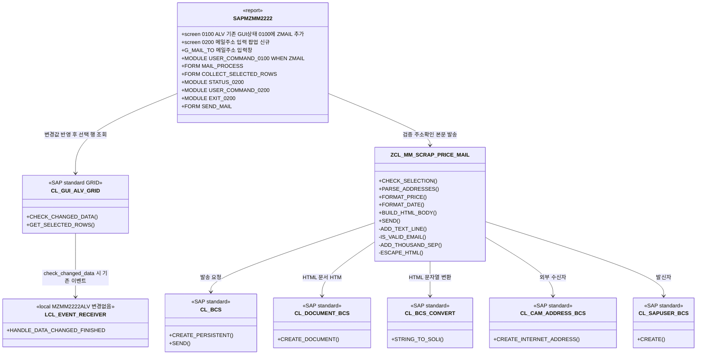
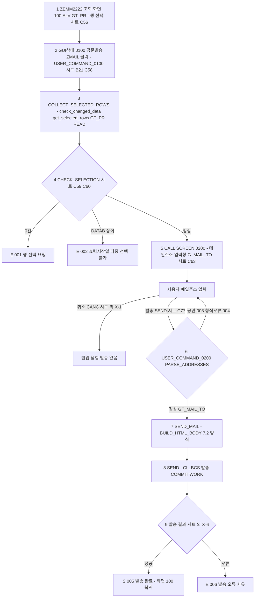
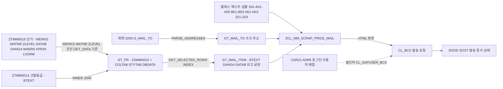

# 02. 설계 - 스크랩(SCRAP) 기본단가 관리 공문 메일발송 기능 개발

- 요청 ID: 20261019-bce84c
- 대상: **T-code ZEMM2222 (모듈풀 SAPMZMM2222, 인클루드 MZMM2222TOP / ALV / F01 / F02 / I01 / O01, 모두 패키지 `$TMP`)** 에 기능 추가
  - 팀장 지시("ZEMM0020에서 ZEMM2222 tcode 프로그램으로 변경")와 01_analysis.md 2차(FR-14)에 따라 대상을 바꿨다.
  - **ZEMM0020(SAPMZMM0020, MZMM0020TOP/ALV/F01/F02/I01/O01, 패키지 ZMMD)은 수정하지 않는다.** 이전 차수 설계·개발 산출물(src/SAPMZMM0020.abap, src/MZMM0020*.abap, src/SAPMZMM0020_0200_flow.abap)은 대상이 바뀌어 쓰지 않으며, 개발 단계에서 MZMM2222* 기준으로 다시 만든다.
- 작성: 설계 담당 (sap-designer) / 작성일: 2026-10-19 / 5차(대상 프로그램 ZEMM0020 → ZEMM2222 변경, 현행 소스 기준 확정)
- **설계 기준선: 첨부 구글시트 사본의 "설계" 시트** (`attachments/.text/...xlsx.txt`의 `## 시트: 설계`, B21, C56~C111). 01_analysis.md(FR-01~FR-15)는 시트 내용을 정리한 범위 안에서만 반영함
- 현행 구조 근거: PL이 srd-abap에서 조회해 저장한 `ref/SAPMZMM2222.abap`, `ref/MZMM2222TOP/I01/O01.abap`, 그리고 MZMM2222ALV/F01/F02와 내용이 같다고 대조된 `ref/MZMM0020ALV/F01/F02.abap` (ref/README.md)
- 개발표준: `standards/handbook.md` 적용. 핸드북에 규칙이 없는 유형은 3장 적용 메모대로 SAP 관례를 적용하고 해당 위치에 "핸드북 규칙 없음 - SAP 관례"로 표시
- 조회 시스템: srd-abap (http://dshldra1.dongkuksteel.com:8000, 클라이언트 250), sap MCP 읽기 전용 조회

> 표기: **[시트]** 설계 시트 셀 근거, **[시트 외 - 팀장 확인 필요]** 시트에는 없지만 개발에 최소한으로 필요해 넣은 항목, **[이미지 확인 필요]** 시트에 이미지로만 있어 텍스트 추출본에서 내용을 확인하지 못한 항목, **[소스 확인]** ref/ 현행 소스로 확정한 사실, **[분석서 추정과 다름 - 소스 확인]** 01_analysis.md 5장 추정과 실제 소스가 다른 부분.

> **메일 양식 확인 한계 (4차부터 유지)**: 구글시트의 메일 양식은 (1) 현업개발요청내용 시트 B45 "[메일 양식]" ~ B74, (2) 설계 시트 C79 ~ C109 두 곳에 있다. 텍스트 추출본에는 **C95~E95 표 헤더, C96~D99 샘플 4행, C101 "2. 적용일자: 2026.09.28", C103 "3.", C110~C111 단가 규칙만 있고 B46~B74·C80~C94·C104~C109는 비어 있다.** 캡처 이미지로 보이며 이 세션 도구로는 xlsx 안 이미지를 열 수 없다. 그래서 셀 텍스트로 확인된 부분만 시트와 1:1로 고정하고, 이미지 영역은 "문구 슬롯"(텍스트 심볼, 기본 공란)으로 비워 둔다. 문구를 추정해서 채우지 않는다(미결 U-02).

## 0. 기준 대응표

### 0.1 구글시트 설계 시트 ↔ 본 설계

| 시트 셀 | 시트 내용 (추출본 원문 요지) | 본 설계 반영 위치 | 반영 내용 |
|---|---|---|---|
| 설계 B21 | 조회 결과 화면에 "공문발송" 신규버튼 추가 | 2. 오브젝트 No 1-6, 7.1 단계 2, 8. 출력, 화면 2 | **SAPMZMM2222 GUI 상태 '0100'에 FCODE `ZMAIL`("공문발송") 추가 + USER_COMMAND_0100 `WHEN 'ZMAIL'` 분기** (ALV 툴바 이벤트 방식은 쓰지 않음 - 0.3 참조) |
| 설계 B21 이후 | 결과 화면 캡처(버튼 위치) | 화면 2 | [이미지 확인 필요] 버튼 위치는 애플리케이션 툴바 기존 버튼 뒤로 둠(U-04) |
| 설계 C56 | 처리 Flow 1. 공문발송할 자료(행) 선택 | 7.1 단계 1 | 현행 `gs_layout-sel_mode = 'A'`로 다중 행 선택 이미 가능 [소스 확인] → 변경 없음 |
| 설계 C58 | 2. "공문발송" 버튼 클릭 | 7.1 단계 2~3 | 버튼 클릭 시 `grid->check_changed_data` → `get_selected_rows`로 선택 행 수집 |
| 설계 C59 | 2-1) 최소 하나의 행은 선택 | 7.1 단계 4, 4.2 CHECK_SELECTION, 9. 메시지 001 | 0건이면 메시지 후 중단 |
| 설계 C60~C61 | 2-2) 효력시작일이 다른 건 다중 선택 시 진행 불가 | 7.1 단계 4, 4.2 CHECK_SELECTION, 9. 메시지 002 | GT_PR-DATAB(화면 라벨 '유효시작일')가 2종 이상이면 메시지 후 중단 |
| **설계 C63** | **3. 팝업으로 공문발송할 메일주소 입력창 표시** | **화면 3-1, 5.2 화면 0200 필드 G_MAIL_TO, 7.1 단계 5** | **SAPMZMM2222 신규 모달 화면 0200에 "메일주소" 입력창 1개(G_MAIL_TO, 255자). 검증 통과 직후 공란 표시** |
| 설계 C63~C74 | 팝업 화면 캡처 (추출본 C74는 "-"만 있음) | 화면 3-1, 3-2 | [이미지 확인 필요] 라벨·크기는 캡처 확인 후 조정(U-04) |
| **설계 C77** | **4. 메일주소 입력 후 "발송" 버튼 클릭 시 정해진 내용으로 메일 발송** | **화면 3-2, 5.2 GUI 상태 '0200' FCODE SEND, 7.1 단계 6~8** | **[발송](SEND) → PAI에서 PARSE_ADDRESSES → BUILD_HTML_BODY → SEND. 확인 팝업 없이 즉시 발송** |
| 설계 C79 | 4-1) 아래 4건 선택해 발송하면 아래 메일 양식으로 발송 | 화면 4, 7.2 | 선택 행 수만큼 표 행 생성 |
| 설계 C80~C94 | (텍스트 없음, 메일 샘플 캡처 추정) | 화면 4 영역 A·B01 슬롯 | [이미지 확인 필요] 기본 공란 |
| 설계 C95~E95 | 표 헤더 등급 / 단가 / 비고 | 화면 4, 7.2 텍스트 심볼 H01~H03 | 3열 표, 헤더 문구 그대로 |
| 설계 C96~D99 | 생철AL 470.0 / 생철A 470.0 / 주물A(모터블럭) 470.0 / 생철B 465.0 | 화면 4, 7.3 | 등급 = GT_PR-BTEXT, 단가 = GT_PR-DANGA ×100 소수 1자리 |
| 설계 C101 | 2. 적용일자: 2026.09.28 | 화면 4, 4.2 FORMAT_DATE | 선택 행 공통 DATAB를 `YYYY.MM.DD`로 |
| 설계 C103 | 3. (내용 없음) | 화면 4 3항 슬롯 B03 | 3항 문구 미정. B03 공란이면 줄 생략(U-02) |
| 설계 C104~C109 | (텍스트 없음) | 화면 4 영역 Z 슬롯 Z01~Z03 | [이미지 확인 필요] 기본 공란 |
| 설계 C110 | 단가는 ALV 결과 화면 단가에 ×100 해서 표시 | 7.3, 4.2 FORMAT_PRICE | 상수 C_PRICE_FACTOR = 100. 근거는 0.3 No 8 |
| 설계 C111 | 숫자형식으로 천 단위마다 콤마 | 7.3, 4.2 FORMAT_PRICE | `1,234.5` 형식 |
| 요청 B3~B20 | 정보처리의뢰서 문체 | 화면 4-4 D-1 | 참고용. 메일 문구로 추정 반영하지 않음 |
| 요청 B45~B74 | [메일 양식] (캡처) | 화면 4 영역 A·Z 슬롯, 미결 U-02, U-03, U-08 | [이미지 확인 필요] |
| 요청 B75~B76 | 단가가 너무 크다. kg이 아닌 톤당단가로 보낸 것 같다 → 확인 요청 중 | 미결 U-01 | 시트대로 ×100. 변환은 FORMAT_PRICE 한 곳 |

**메일주소 입력창 연결 (C63 → C77)**: 화면 3-1 "메일주소" = 화면 0200 필드 `G_MAIL_TO`(MZMM2222TOP, CHAR255) → [발송] FCODE `SEND` → MZMM2222I01 `USER_COMMAND_0200`에서 `PARSE_ADDRESSES( iv_text = g_mail_to )` → `GT_MAIL_TO` → MZMM2222F01 `SEND_MAIL`에서 `SEND( it_to = gt_mail_to )` → 화면 4 "받는 사람".

### 0.2 대상 변경 대응 (ZEMM0020 → ZEMM2222, 5차)

| 구분 | 4차 설계(이전) | 5차 설계(현재) |
|---|---|---|
| T-code | ZEMM0020 (ZMMD) | **ZEMM2222 ($TMP)** |
| 프로그램 | SAPMZMM0020 | **SAPMZMM2222** (`REPORT SAPMZMM2222 MESSAGE-ID ZMMM.`) |
| 인클루드 | MZMM0020TOP/ALV/F01/F02/I01/O01 | **MZMM2222TOP / I01 / O01 / F01** 수정, MZMM2222ALV / F02 변경 없음(조건부 F02 - U-09) |
| 화면 0200, GUI 상태·제목 | SAPMZMM0020 소속 PS0200 / TS0200 | **SAPMZMM2222 소속** GUI 상태 `0200`, 제목 `0200` (기존 프로그램 관례가 상태·제목 모두 '0100'이라 같은 형식으로 맞춤) |
| GUI 상태 0100 | (툴바 이벤트 방식 가정) | **SAPMZMM2222 GUI 상태 '0100'에 FCODE ZMAIL 추가** |
| 패키지 | ZMMD | 기존 오브젝트는 `$TMP` 그대로. 신규(클래스·메시지 클래스)도 결정 전 기본값 `$TMP` (미결 U-12 = 분석 Q-14) |
| ZEMM0020 계열 | 수정 대상 | **수정하지 않음** |

### 0.3 현행 소스 확인 결과 (ref/, 5차) - 분석서 추정과 다른 부분 포함

| No | 항목 | 01_analysis.md 기재(추정) | 실제 소스 [소스 확인] | 설계 반영 |
|---|---|---|---|---|
| 1 | **단가 원천 테이블** | ZTMM0020 (5-1, 5-2) | **[분석서 추정과 다름 - 소스 확인]** F01 GET_DATA가 **ZTMM0015(단가) INNER JOIN ZTMM0014(등급명 BTEXT)** 를 `WERKS`, `MATNR`, `ZLEVEL`로 조인. ZTMM0020은 쓰지 않음 | 6장, 데이터 관계도. 신규 DB SELECT 없음(GT_PR 값만 사용) |
| 2 | **ALV 출력 구조** | ZSMM0020 | **[분석서 추정과 다름 - 소스 확인]** `GT_PR` (OCCURS 0, 헤더라인) = `INCLUDE STRUCTURE ZSMM0015` + `COLTAB`(LVC_T_SCOL) / `STYTAB`(LVC_T_STYL) / `DBDATA`(C). 필드카탈로그 `LVC_FIELDCATALOG_MERGE i_structure_name = 'ZSMM0015'` | 6장 매핑, 8장 화면 2 컬럼 |
| 3 | ALV 객체 | 미확인 | `GRID TYPE REF TO CL_GUI_ALV_GRID`, 컨테이너 `CUSTOM_CONTAINER`('CTRL_CONTAINER'), 이벤트 클래스 `LCL_EVENT_RECEIVER`(인스턴스 `EVENT_RECEIVER`), 화면 100 | 7.1 단계 3에서 `grid` 사용 |
| 4 | 선택 모드·편집 | 단일 선택이면 변경 | `gs_layout-sel_mode = 'A'` 이미 다중 선택, `gs_layout-edit = 'X'`, 초기 `set_ready_for_input( 0 )`, TOGG로 입력 가능 전환 | SEL_MODE 변경 없음. 편집 중 값 처리는 U-06 |
| 5 | 버튼 방식 | 툴바 또는 GUI STATUS | CREATE_EVENT_RECEIVER에서 `SET HANDLER ... HANDLE_TOOLBAR`와 `SET_TOOLBAR_INTERACTIVE`가 **주석**. 기존 버튼 SAVE/COPY/DEL/CREA/TOGG/GRAD는 **GUI 상태 '0100' + `USER_COMMAND_0100`(CASE SAVE_OK)** 에서 처리 | **공문발송도 GUI 상태 0100 FCODE + USER_COMMAND_0100 WHEN 분기 방식 하나로 확정**. MZMM2222ALV 변경 없음 |
| 6 | 선택 행 수집 관례 | - | COPY_DATA / DEL_ROWS: `CALL METHOD grid->check_changed_data` → `grid->get_selected_rows( IMPORTING et_index_rows = lt_row[] )` → `READ TABLE gt_pr INDEX` | COLLECT_SELECTED_ROWS가 같은 순서 사용 |
| 7 | 매핑 필드 | 등급·단가·효력시작일·비고 필드명 미확인 | 등급명 `BTEXT`(ZTMM0014), 단가 `DANGA`(통화 `WAERS`, 가격단위 `KPEIN`), 효력시작일 `DATAB`(화면 라벨 '유효시작일', FR-04 검증 키). **비고 필드 없음** | 비고는 항상 공란. KPEIN이 1이 아닌 경우는 U-01 |
| 8 | ×100 근거 | 통화 내부값 보정 추정 | F01 SAVE_DATA 주석 로직: "경량B 단가 300원/kg 이상" → `lv_kb5_danga >= 3`. 즉 **DANGA 내부값 = 원/kg 값의 1/100** | ×100은 내부값 → 원/kg 환산으로 해석. 다만 ALV 화면 표시값이 내부값(4.70)인지 통화 참조로 환산된 값(470)인지는 ZSMM0015 DDIC 통화 참조 확인 필요(S-02, U-01) |
| 9 | 메시지 | 기존 메시지 클래스 재사용 여부 미확인 | `REPORT SAPMZMM2222 MESSAGE-ID ZMMM.`, 기존 메시지는 `MESSAGE s000 WITH '...'` (ZMMM 000에 텍스트 직접 전달) | 신규 기능은 ZMMM3(신규)로 번호 관리. 패키지는 U-12 |
| 10 | 버튼 노출 | 권한 미정 | F02 SET_PF_STATUS: `PA0001-ORGEH = '10005020'`(스크럽구매팀) 또는 `SY-UNAME(2) = 'DU'`이면 조회 모드에서 SAVE/COPY/CREA/DEL 제외, 그 외 사용자는 TOGG까지 제외 | 공문발송 버튼 노출 기준은 팀장 결정(U-09). 결정 전 기본값: 제외하지 않음(F02 변경 없음) |
| 11 | 화면 0100 / GUI 상태 0100 | - | 메인 프로그램이 `CALL SCREEN 100`, O01 `PERFORM SET_PF_STATUS`, `SET TITLEBAR '0100'`. 화면 레이아웃·흐름 논리·GUI 상태 내용은 **MCP로 조회 불가 → SAPMZMM0020 복사본으로 추정, SE80 확인 필요**(S-01). I01에 `EXIT`, `USER_COMMAND_XXXX`(SAVE_OK = OK_CODE), `USER_COMMAND_0100` 모듈이 있어 화면 100 PAI가 이 순서로 호출하는 것으로 추정 | ZMAIL 분기는 `USER_COMMAND_0100`의 `CASE SAVE_OK`에 넣음 |
| 12 | 선택화면 | 미확인 | MZMM2222TOP: `SO_WERKS`, `SO_MATNR`, `SO_LEVEL`(ZLEVEL), `SO_DATAB`(OBLIGATORY, INIT에서 오늘-1개월 ~ 오늘) | 화면 1. 변경 없음 |
| 13 | 헤더 주석 | - | SAPMZMM2222와 인클루드 헤더 주석이 'SAPMZMM0020', 'ZEMM0020'으로 남아 있음 | 주석 정정은 범위 밖(기능 영향 없음). 변경 이력 주석만 추가 |

### 0.4 시트 외 항목 (팀장 확인 필요)

| No | 항목 | 넣은 이유 | 위치 |
|---|---|---|---|
| X-1 | 팝업 "취소" 버튼 | 발송하지 않고 닫을 방법 필요 | 5.2, 7.1 단계 5 |
| X-2 | 메일주소 공란·형식 오류 메시지 | 잘못된 주소는 SOST에서야 오류가 보임 | 4.2 PARSE_ADDRESSES, 메시지 003, 004 |
| X-3 | 입력창 하나에 여러 주소를 `;`로 구분 입력 허용(한 메일 수신자로 모두) | 시트에 건수 언급 없음. 단일 주소만 쓰면 그대로 동작 | 4.2 PARSE_ADDRESSES |
| X-4 | 메일 제목 가안 "국내스크랩 기본단가 공문" | BCS 발송에 제목 필요, 시트 셀에 없음. 요청 B14 문구 사용 | 텍스트 심볼 S01 |
| X-5 | 발신자 = 로그인 사용자 메일(SU01) | BCS 발송에 발신자 필요 | 7.4 |
| X-6 | 발송 완료/오류 메시지 1줄 | 발송 여부 확인용 최소 결과 표시 | 메시지 005, 006 |
| X-7 | 메일 본문 문구 슬롯(텍스트 심볼, 기본 공란) | 이미지 영역 확인 후 코드 수정 없이 문구만 채우기 위함 | 7.2 |

### 0.5 선택안 (기본 미적용, 팀장 결정 필요)

| No | 항목 | 내용 | 미적용 이유 |
|---|---|---|---|
| P-1 | 발송 전 메일 미리보기 | 화면 0200에 [미리보기](FCODE PREV) → `CL_ABAP_BROWSER=>SHOW_HTML`(srd-abap 존재 확인). 화면 5 | 시트 C77은 즉시 발송(미결 U-07) |

### 0.6 1차 설계에서 뺀 항목 (시트에 없음)

팝업의 메일 제목 입력·참조(CC)·선택 건수·적용일자 표시 필드, 발송 확인 팝업, 발송 결과 팝업, 삭제지시자 행 차단·효력시작일 초기값 검증, 미저장 변경 차단, 별도 권한 체크(CHECK_AUTHORITY), 개발계 수신 도메인 가드, 수신자별 개별 발송, 최대 수신자 수 제한, 발송 이력 테이블, 인사말·맺음말 가안 문구. (삭제표시·미저장·신규 행 처리는 5차에서 U-06 팀장 결정 항목으로 다시 올림. 결정 전 기본값은 "차단 없음")

### 0.7 시스템 조회 결과 (5차 재확인 포함)

| 조회 | 결과 | 설계 반영 |
|---|---|---|
| SearchObject `ZEMM2222*` (5차) | T-code ZEMM2222, 패키지 `$TMP` | 대상 T-code |
| SearchObject `*MZMM2222*` (5차) | SAPMZMM2222(PROG/P), MZMM2222ALV/F01/F02/I01/O01/TOP(PROG/I), 모두 `$TMP` | 수정 대상 확정 |
| ref/ 현행 소스 (PL 조회본, 5차) | 0.3 표 | 구조·필드 확정 |
| SearchObject `ZTMM0015*` / `ZTMM0014*` / `ZSMM0015*` (5차) | ZTMM0015(TABL/DT), ZTMM0014(TABL/DT), ZSMM0015(TABL/DS) 모두 ZMMD 존재. 같은 이름 T-code ZTMM0015/ZTMM0014도 존재(ZMMD) | 6장 데이터 소스 |
| GetTable ZTMM0015 / GetStructure ZSMM0015 (5차) | 실패(`/ddic/structures/.../source/main does not exist`) | DANGA 타입·통화 참조·LVORM 포함 여부는 SE11 확인(S-02) |
| SearchObject `ZMMM*` (5차) | ZMMM, ZMMM1, ZMMM2 (ZMMD). ZMMM3 없음 | 신규 메시지 클래스 ZMMM3 |
| SearchObject `ZCL_MM_SCRAP*` (5차) | 없음 | 신규 클래스 ZCL_MM_SCRAP_PRICE_MAIL |
| CL_BCS, CL_DOCUMENT_BCS, CL_CAM_ADDRESS_BCS, CL_BCS_CONVERT (이전 차수) | 존재(SBCOMS) | 7.4 |
| CL_ABAP_BROWSER (이전 차수) | 존재(SABAPDOCU) | 선택안 P-1에서만 |

## 1. 개요

ZEMM2222(SAPMZMM2222) 결과 화면 100의 GUI 상태 '0100'에 "공문발송" 버튼(FCODE ZMAIL)을 추가한다[시트 B21]. 사용자가 ALV(GRID, ZSMM0015 기반 GT_PR)에서 행을 골라[C56] 버튼을 누르면, 기존 COPY/DEL과 같은 방식으로 선택 행을 모아 최소 1행 선택과 효력시작일(DATAB) 단일 여부를 검사하고[C59~C61], 메일주소 입력 팝업(신규 화면 0200)을 띄운다[C63]. 사용자가 주소를 입력하고 [발송]을 누르면 시트 양식(1. 등급/단가/비고 표, 2. 적용일자, 3.)으로 HTML 메일을 SAP BCS로 바로 보낸다[C77~C103]. 단가는 DANGA ×100, 천 단위 콤마로 표시한다[C110~C111]. ZEMM0020(SAPMZMM0020)은 건드리지 않는다.

설계 원칙
1. **시트 기준 최소 구현**: 버튼, 검증 2가지, 메일주소 입력 팝업, 정해진 양식 발송만 만든다.
2. **기존 동작 영향 최소화**: SAPMZMM2222에는 GUI 상태 0100 FCODE 1개, USER_COMMAND_0100 WHEN 1줄, 화면 0200과 그 PBO/PAI 모듈, F01 FORM 3개, TOP 선언만 추가한다. GET_DATA·SAVE_DATA·ALV 생성 로직(ALV/F02)은 바꾸지 않는다.
3. **핵심 로직은 ZCL_MM_SCRAP_PRICE_MAIL로 분리**: 선택 검증, 주소 확인, 단가·날짜 형식, 본문 생성, 발송을 메서드로 나눠 ABAP Unit으로 시험한다. DB 조회는 하지 않는다(GT_PR 값만 사용).
4. **단가 변환은 한 곳**: FORMAT_PRICE와 상수 C_PRICE_FACTOR(100), C_PRICE_DEC(1)로만 처리한다.
5. **메일 문구는 텍스트 심볼로 분리**: 확인된 문구와 이미지 확인 대기 문구 모두 클래스 텍스트 심볼로 둔다.
6. **기본값으로 바로 개발 가능**: 팀장 결정 항목(U-06, U-09~U-13)은 결정 전 기본값("개발계 $TMP 내 보완", 차단 없음, 버튼 제외 없음)으로 설계하고 고칠 위치를 12장에 적는다.

## 설계 다이어그램

### 1) 프로그램 구조도



### 2) 처리 흐름도



### 3) 데이터 관계도



조인키(기존 GET_DATA, 변경 없음): `ZTMM0015.WERKS = ZTMM0014.WERKS AND ZTMM0015.MATNR = ZTMM0014.MATNR AND ZTMM0015.ZLEVEL = ZTMM0014.ZLEVEL`. 공문발송은 DB를 다시 읽지 않고 `LVC_S_ROW-INDEX`로 `READ TABLE gt_pr INTO ls_pr INDEX`한다. 발신자 메일은 CL_SAPUSER_BCS가 `USR21.PERSNUMBER/ADDRNUMBER = ADR6.PERSNUMBER/ADDRNUMBER`로 찾는다(SAP 표준 동작).

## 예상 화면

### 화면 1. 선택화면 (기존, 변경 없음)

```sapscreen
{"type":"selection","title":"고철등급별 단가관리","tcode":"ZEMM2222","blocks":[{"title":"조회조건 (기존, 변경 없음)","fields":[{"label":"플랜트","kind":"select","required":false,"value":"","to":""},{"label":"자재","kind":"select","required":false,"value":"","to":""},{"label":"고철등급","kind":"select","required":false,"value":"","to":""},{"label":"유효시작일","kind":"select","required":true,"value":"2026.09.19","to":"2026.10.19"}]}]}
```

예시 값은 형식만 보여주는 가상 값이다(유효시작일은 INIT의 "오늘-1개월 ~ 오늘" 기본값을 작성일 기준으로 표시). 필드는 MZMM2222TOP의 SO_WERKS / SO_MATNR / SO_LEVEL / SO_DATAB(OBLIGATORY)이며 라벨(선택 텍스트)과 제목줄 문구는 조회하지 못해 의미로 적었다. 본문 '5.1 선택화면'과 대응(변경 없음).

### 화면 2. 결과 ALV (기존 화면 100 + "공문발송" 버튼) [시트 B21, C56]

```sapscreen
{"type":"alv","title":"고철등급별 단가관리","tcode":"ZEMM2222","toolbar":["TOGG","CREA","COPY","DEL","SAVE","GRAD","공문발송"],"columns":[{"label":"플랜트","key":true},{"label":"자재","key":true},{"label":"고철등급","key":true},{"label":"고철등급명"},{"label":"유효시작일"},{"label":"유효만료일"},{"label":"단가","align":"right"},{"label":"통화"},{"label":"가격단위","align":"right"},{"label":"품의상태"},{"label":"품의서번호"},{"label":"수정일자"},{"label":"수정시간"},{"label":"수정인"}],"rows":[["XXXX","MAT-0001","G01","생철AL","2026.09.28","9999.12.31","4.70","KRW","1","","","","",""],["XXXX","MAT-0001","G02","생철A","2026.09.28","9999.12.31","4.70","KRW","1","","","","",""],["XXXX","MAT-0001","G03","생철B","2026.09.28","9999.12.31","4.65","KRW","1","","","","",""]],"status":{"type":"E","text":"효력시작일이 다른 행은 함께 공문발송할 수 없습니다."}}
```

예시 값은 형식만 보여주는 가상 값이다(등급명은 시트 C96~C99 샘플, 단가 4.70은 시트 470.0을 ×100 규칙으로 역산한 값. 화면 표시가 4.70인지 470인지는 S-02). 툴바는 GUI 상태 0100의 기존 FCODE(버튼 텍스트 미확인, S-01)와 신규 "공문발송"이며 기존 버튼 중 일부는 SET_PF_STATUS 기준으로 숨겨진다. 컬럼은 F02 SET_GRID_FIELDCAT의 col_pos 1~14 순서·헤더(LVORM 등 col_pos 미지정 필드는 DDIC 순서로 뒤에 붙음)이며 본문 '8. 출력'과 대응. 필드카탈로그는 바꾸지 않는다.

### 화면 3. 메일주소 입력 팝업 (SAPMZMM2222 신규 화면 0200) [시트 C63, C77]

#### 화면 3-1. 메일주소 입력창 [시트 C63]

```sapscreen
{"type":"selection","title":"공문발송 - 메일주소 입력 (화면 0200)","tcode":"ZEMM2222","blocks":[{"title":"공문발송할 메일주소","fields":[{"label":"메일주소","kind":"param","required":true,"value":"user01@example.com"}]}]}
```

예시 주소는 형식만 보여주는 가상 값이다(실제로는 처음 열 때 공란). 본문 '5.2 화면 0200' 필드 `G_MAIL_TO`(라벨 "메일주소")와 대응. 필수 표시는 PAI 검사(메시지 003)로 처리하고 화면 속성 "필수"는 쓰지 않는다.

#### 화면 3-2. 팝업 버튼 [시트 C77]

```sapscreen
{"type":"popup","title":"공문발송","icon":"i","message":"공문발송할 메일주소를 입력하십시오.","buttons":["발송","취소"]}
```

화면 3-1 입력창 아래 버튼 영역이다. [발송] = FCODE `SEND`(시트 C77), [취소] = FCODE `CANC`(시트 외 X-1). 본문 '5.2' GUI 상태 `0200`, '7.1' 단계 5~8과 대응. 레이아웃은 시트 C63~C74 캡처 확인 후 조정한다(U-04).

### 화면 4. 발송되는 메일 (수신자 메일함) [시트 C79~C109, 요청 B45~B74]

SAP 화면 없음(수신자 Outlook 등에서 보이는 모습). sapscreen 형식이 메일 화면을 지원하지 않아 텍스트 목업으로 그린다.

#### 4-1. 메일 레이아웃 목업 (시트 C79 "아래 4건 선택" 예시)

```text
+------------------------------------------------------------------------+
| 보낸 사람 : 홍길동 <sender01@example.com>        <- 로그인 사용자 SU01 메일 (X-5)
| 받는 사람 : user01@example.com                   <- 화면 0200 G_MAIL_TO (C63)
| 참조      : (없음)                               <- 시트에 참조 입력 없음
| 제목      : 국내스크랩 기본단가 공문              <- 텍스트 심볼 S01 (X-4 가안, U-03)
+------------------------------------------------------------------------+
| [영역 A  상단 문구 A01~A05]                     <- 시트 C80~C94 / 요청 B45~B74 이미지 영역
|   (기본 공란 - 출력 안 함, U-02)
|                                                                        |
| 1. [B01 1항 제목 문구]                          <- 문구는 이미지 확인
|   +--------------------+------------+------------+
|   | 등급               |       단가 | 비고       |  <- 시트 C95~E95 (H01~H03)
|   +--------------------+------------+------------+
|   | 생철AL             |      470.0 |            |  <- GT_PR-BTEXT / DANGA x100 / 공란
|   | 생철A              |      470.0 |            |
|   | 주물A(모터블럭)    |      470.0 |            |
|   | 생철B              |      465.0 |            |
|   +--------------------+------------+------------+
|                                                                        |
| 2. 적용일자: 2026.09.28                         <- 시트 C101 (B02 + GT_PR-DATAB)
| 3. [B03 3항 문구]                               <- 시트 C103. B03 공란이면 줄 생략
| [영역 Z  하단 문구 Z01~Z03]                     <- 시트 C104~C109 이미지 영역 (기본 공란)
+------------------------------------------------------------------------+
```

보낸 사람·받는 사람은 형식만 보여주는 가상 값이고, 표 4행·적용일자는 시트 C96~D99, C101 샘플 값이다. 대괄호 영역은 이미지 확인 전 슬롯이며 공란이면 그 줄이 나오지 않는다. 본문 '7.2', '4.2 BUILD_HTML_BODY'와 대응.

**슬롯이 모두 공란인 기본 상태 본문** (시트 셀 텍스트와 1:1):

```text
1.
  등급 | 단가 | 비고
  생철AL | 470.0 |
  생철A | 470.0 |
  주물A(모터블럭) | 470.0 |
  생철B | 465.0 |
2. 적용일자: 2026.09.28
```

#### 4-2. HTML 목업

```html
<html><head><meta charset="utf-8"></head>
<body style="font-family:'맑은 고딕',sans-serif;font-size:10pt">
<p style="margin:0 0 6px 0">1.</p>
<table border="1" cellspacing="0" cellpadding="4" style="border-collapse:collapse;font-size:10pt">
  <tr style="background-color:#f2f2f2"><th style="width:160px">등급</th><th style="width:90px">단가</th><th style="width:120px">비고</th></tr>
  <tr><td>생철AL</td><td style="text-align:right">470.0</td><td>&nbsp;</td></tr>
  <tr><td>생철A</td><td style="text-align:right">470.0</td><td>&nbsp;</td></tr>
  <tr><td>주물A(모터블럭)</td><td style="text-align:right">470.0</td><td>&nbsp;</td></tr>
  <tr><td>생철B</td><td style="text-align:right">465.0</td><td>&nbsp;</td></tr>
</table>
<p style="margin:12px 0 0 0">2. 적용일자: 2026.09.28</p>
</body></html>
```

열 너비·헤더 배경·글꼴은 시트 이미지를 보지 못해 정한 기본값이다(D-6).

#### 4-3. 메일 항목 ↔ 데이터 출처 매핑표

| No | 메일 항목 | 시트 근거 | 값 출처 | 가공 | 생성 위치 |
|---|---|---|---|---|---|
| M01 | 보낸 사람 | 없음(X-5) | `SY-UNAME` → USR21 → ADR6-SMTP_ADDR | CL_SAPUSER_BCS=>CREATE | SEND |
| M02 | 받는 사람 | C63, C77 | 화면 0200 `G_MAIL_TO` | PARSE_ADDRESSES `;` 분리 → GT_MAIL_TO | SEND |
| M03 | 참조(CC) | 없음 | 없음 | - | (U-08) |
| M04 | 제목 | 없음(X-4) | 텍스트 심볼 S01 | SET_MESSAGE_SUBJECT | SEND |
| M05 | 상단 문구 | C80~C94, B45~B74 이미지 | A01~A05 (공란) | 공란 줄 생략, ESCAPE_HTML | BUILD_HTML_BODY |
| M06 | "1." + 1항 제목 | 이미지 | "1. " + B01 (공란) | - | BUILD_HTML_BODY |
| M07 | 표 헤더 | C95~E95 | H01~H03 | - | BUILD_HTML_BODY |
| M08 | 표 행 - 등급 | C96~C99 | **GT_PR-BTEXT** (ZTMM0014-BTEXT) → GT_MAIL_ITEM-GRADE_TXT | ESCAPE_HTML, 선택 INDEX 오름차순 | COLLECT_SELECTED_ROWS → BUILD_HTML_BODY |
| M09 | 표 행 - 단가 | D96~D99, C110, C111 | **GT_PR-DANGA** (ZTMM0015-DANGA) → GT_MAIL_ITEM-PRICE | FORMAT_PRICE ×100, 소수 1자리, 콤마. WAERS·KPEIN은 메일에 쓰지 않음(U-01) | BUILD_HTML_BODY |
| M10 | 표 행 - 비고 | E95 | **없음 - GT_PR(ZSMM0015)에 비고 필드 없음** → 항상 공란 | `&nbsp;` | BUILD_HTML_BODY |
| M11 | "2. 적용일자: " + 날짜 | C101 | B02 + **GT_PR-DATAB** 공통값(CHECK_SELECTION ev_datab → G_DATAB) | FORMAT_DATE | BUILD_HTML_BODY |
| M12 | "3." + 3항 | C103 | "3. " + B03 (공란 → 줄 생략) | - | BUILD_HTML_BODY |
| M13 | 하단 문구 | C104~C109 이미지 | Z01~Z03 (공란) | 공란 줄 생략 | BUILD_HTML_BODY |
| M14 | 발송 일시 | 없음 | BCS 자동 | - | BCS |

#### 4-4. 구글시트 메일 양식과의 차이·확인 필요

| No | 항목 | 시트 | 설계 | 상태 |
|---|---|---|---|---|
| D-1 | 상단 문구 | 이미지, 미확인 | 슬롯 A01~A05 공란 | 확인 필요(U-02) |
| D-2 | 1항 제목 | "1."도 셀 텍스트에 없음 | "1."만 출력, B01 슬롯 | 확인 필요(U-02) |
| D-3 | 표 헤더·샘플 4행 | C95~D99 | 동일 | 일치 |
| D-4 | 2항 적용일자 | C101 | 동일 | 일치 |
| D-5 | 3항 | C103 "3." 뒤 공란 | B03 공란이면 줄 생략 | 확인 필요(U-02) |
| D-6 | 표 모양 | 이미지 미확인 | 테두리 1px, 헤더 회색, 맑은 고딕 10pt | 확인 필요(U-02) |
| D-7 | 맺음말·서명·발신 명의 | 이미지 미확인 | Z01~Z03 공란 | 확인 필요(U-02) |
| D-8 | 메일 제목 | 셀 텍스트 없음 | 가안 S01 | 확인 필요(U-03) |
| D-9 | 참조·공문 머리 | 셀 텍스트 없음 | 없음 | 확인 필요(U-08) |
| D-10 | 직인·로고 | 미확인 | 없음 | 필요 시 CR |
| D-11 | 단가 크기 | B75 확인 중 | ×100 | 확인 필요(U-01) |
| D-12 | 미리보기 | 없음 | P-1로만 | 팀장 결정(U-07) |
| D-13 (5차) | 비고 값 | E95 열만 있고 샘플 값 공란 | GT_PR에 비고 필드가 없어 항상 공란 | 시트 샘플과 일치. 비고에 값이 필요하면 원천이 없어 CR |

### 화면 5. (선택안 P-1, 기본 미적용) 메일 미리보기

```sapscreen
{"type":"popup","title":"공문발송","icon":"i","message":"공문발송할 메일주소를 입력하십시오.","buttons":["발송","미리보기","취소"]}
```

P-1 채택 시 화면 0200 버튼 영역 모습이다. 본문 0.5 P-1, 12장 U-07과 대응.

| 구성 | 내용 |
|---|---|
| 버튼 | GUI 상태 `0200`에 FCODE `PREV`, 아이콘 ICON_DISPLAY |
| 동작 | USER_COMMAND_0200 `WHEN 'PREV'`: `cl_abap_browser=>show_html( html_string = go_mail->build_html_body( ... ) title = '공문 메일 미리보기' modal = abap_true )`. 주소 검사 없음, 닫으면 0200으로 복귀(입력값 보존) |
| 발송 | 미리보기 창에는 발송 버튼 없음 |

## 2. 오브젝트 목록

| No | 유형 | 이름 | 목적 | 명명 근거 | 신규/수정 | 패키지 |
|---|---|---|---|---|---|---|
| 1 | PROG (모듈풀) | SAPMZMM2222 | ZEMM2222 메인. **소스 변경 없음**(INCLUDE 구성 그대로) | 기존 | 변경 없음 | $TMP |
| 1-1 | INCL | MZMM2222TOP | 상수 C_FC_MAIL/C_FC_SEND/C_FC_CANC, 화면 필드 G_MAIL_TO, G_OK_0200, G_DATAB, G_ANSWER, GT_MAIL_ITEM, GT_MAIL_TO, GO_MAIL 선언 추가 | 기존 | 수정 | $TMP |
| 1-2 | INCL | MZMM2222I01 | USER_COMMAND_0100에 `WHEN c_fc_mail. PERFORM mail_process.` 추가, 신규 MODULE EXIT_0200 / USER_COMMAND_0200 | 기존 | 수정 | $TMP |
| 1-3 | INCL | MZMM2222O01 | 신규 MODULE STATUS_0200 | 기존 | 수정 | $TMP |
| 1-4 | INCL | MZMM2222F01 | 신규 FORM MAIL_PROCESS, COLLECT_SELECTED_ROWS, SEND_MAIL | 기존 | 수정 | $TMP |
| 1-5 | INCL | MZMM2222ALV / MZMM2222F02 | 변경 없음. 단 U-09에서 버튼 노출 제한을 택하면 F02 SET_PF_STATUS에 `ZMAIL` 제외 줄만 추가 | 기존 | 변경 없음(조건부 F02) | $TMP |
| 1-6 | CUAD (GUI 상태) | SAPMZMM2222 / GUI 상태 `0100` | 애플리케이션 툴바에 FCODE `ZMAIL`, 텍스트 "공문발송", 아이콘 ICON_MAIL, 기능 유형 일반(' ') 추가. 기존 버튼 뒤 | 기존 | 수정 | $TMP |
| 1-7 | DYNP | SAPMZMM2222 화면 `0200` | 모달 대화상자. 입력 필드 G_MAIL_TO, OK 필드 G_OK_0200 | 핸드북 규칙 없음 - SAP 관례(4자리). 미사용 여부 SE80 확인(S-03) | 신규 | $TMP(프로그램 소속) |
| 1-8 | CUAD (GUI 상태/제목) | SAPMZMM2222 / GUI 상태 `0200`(대화상자 유형), 제목 `0200` "공문발송" | 팝업 버튼 SEND/CANC | 핸드북 규칙 없음 - 기존 프로그램 관례(상태·제목 '0100')를 따름 | 신규 | $TMP(프로그램 소속) |
| 2 | CLAS | ZCL_MM_SCRAP_PRICE_MAIL | 선택 검증·주소 확인·단가/날짜 형식·본문 생성·발송 | 핸드북 규칙 없음 - SAP 관례(`ZCL_<모듈>_<서술>`). SearchObject 미존재 확인(5차) | 신규 | **기본 $TMP, U-12(Q-14) 결정 시 ZMMD** |
| 2-1 | 텍스트 요소 | ZCL_MM_SCRAP_PRICE_MAIL 텍스트 심볼 S01, A01~A05, B01~B03, H01~H03, Z01~Z03 | 메일 제목·본문 고정 문구 | 핸드북 규칙 없음 - SAP 관례(3자리 ID) | 신규 | 클래스와 동일 |
| 3 | CLAS 테스트 | LTC_SCRAP_PRICE_MAIL (클래스 로컬 테스트 인클루드) | ABAP Unit | 핸드북 규칙 없음 - SAP 관례 | 신규(테스트 단계) | 클래스와 동일 |
| 4 | MSAG | ZMMM3 | 공문발송 메시지 001~006 | 핸드북 `ZM<모듈><1자리>`. ZMMM/1/2 사용 중, ZMMM3 미존재 확인(5차) | 신규 | **기본 $TMP, U-12 결정 시 ZMMD** |
| - | (수정 안 함) | ZEMM0020, SAPMZMM0020, MZMM0020*, ZTMM0015, ZTMM0014, ZSMM0015 | 원본 T-code와 공용 DDIC | - | **수정하지 않음** | ZMMD |

- 패키지·이송: 결정 전 기본값은 **"개발계 $TMP 내 보완"** 이다. `$TMP` 오브젝트는 이송요청에 담을 수 없으므로 품질·운영 반영이 필요하면 U-12(분석 Q-14)에서 재지정 패키지(예: ZMMD)와 이송요청을 정한 뒤 개발 단계에서 처리한다. 신규 클래스·메시지 클래스를 ZMMD로 만들면 $TMP 프로그램이 ZMMD 오브젝트를 참조하게 되고, 반대로 $TMP로 만들면 나중에 재지정이 필요하다.
- 참고: 신규 이름 ZMMM3·ZCL_MM_SCRAP_PRICE_MAIL을 $TMP로 만들면 그 이름이 로컬 오브젝트로 점유된다. ZEMM0020에 다시 반영할 경우(Q-13 (나)) 같은 클래스를 그대로 쓰려면 ZMMD 재지정이 필요하다.
- T-code: 신규 없음(기존 ZEMM2222). 기존 T-code는 핸드북 이전 명명이므로 바꾸지 않는다. SAPMZMM2222는 핸드북 Module Pool 규칙(`SAPMZ<모듈><4자리>`) 형태다.
- 선택안 P-1 채택 시에만 GUI 상태 `0200`에 FCODE PREV 추가.

## 3. 프로그램 내부 이름 (SAPMZMM2222 추가분, MZMM2222TOP)

| 구분 | 이름 | 타입 | 용도 |
|---|---|---|---|
| 상수 | C_FC_MAIL | sy-ucomm VALUE 'ZMAIL' | 공문발송 FCODE |
| 상수 | C_FC_SEND / C_FC_CANC | sy-ucomm VALUE 'SEND' / 'CANC' | 화면 0200 [발송]/[취소] |
| 내부테이블 | GT_MAIL_ITEM | ZCL_MM_SCRAP_PRICE_MAIL=>TT_ITEM | 선택 행에서 만든 공문 대상 |
| 내부테이블 | GT_MAIL_TO | ZCL_MM_SCRAP_PRICE_MAIL=>TT_ADDR | 수신 주소 |
| 변수(화면 필드) | G_MAIL_TO | c LENGTH 255 | 화면 0200 "메일주소" [시트 C63] |
| 변수 | G_DATAB | d | 선택 행 공통 효력시작일 |
| 변수(OK 필드) | G_OK_0200 | sy-ucomm | 화면 0200 OK_CODE. 화면 100의 OK_CODE/SAVE_OK와 분리 |
| 변수 | G_ANSWER | c LENGTH 1 | 0200 결과('S' 발송, 'C' 취소) |
| 참조 | GO_MAIL | REF TO ZCL_MM_SCRAP_PRICE_MAIL | 클래스 인스턴스 (참조 접두어 핸드북 규칙 없음 - SAP 관례 `GO_`) |

- 기존 TOP의 변수 OK_CODE, SAVE_OK, GT_PR(헤더라인)은 핸드북 이전 명명이며 그대로 둔다.
- FORM 지역 이름: `LT_ROW TYPE lvc_t_row`, `LS_ROW TYPE lvc_s_row`, `LS_PR LIKE LINE OF gt_pr`, `LS_ITEM TYPE zcl_mm_scrap_price_mail=>ty_item`, `L_MSGNO TYPE symsgno`, `L_HTML TYPE string`, `L_OK TYPE abap_bool`, `L_ERROR TYPE string`, `L_INVALID TYPE string`.
- GT_PR 헤더라인은 기존 FORM들이 공유하므로 신규 FORM에서는 `READ TABLE gt_pr INTO ls_pr INDEX ...`로 읽고 헤더라인을 바꾸지 않는다.

## 4. 클래스 설계 - ZCL_MM_SCRAP_PRICE_MAIL

`PUBLIC FINAL CREATE PUBLIC`, 상태(속성) 없음. 메서드 파라미터는 핸드북 규칙 없음 - SAP 관례(`IV_/IT_/EV_/ET_/RV_`), 지역 변수는 핸드북 L_/LT_/LS_ 규칙.

### 4.1 타입·상수

```abap
TYPES: BEGIN OF ty_item,
         grade_txt TYPE c LENGTH 60,      " 등급명 = GT_PR-BTEXT
         price     TYPE ztmm0015-danga,   " 단가 = GT_PR-DANGA (내부값 그대로 MOVE)
         remark    TYPE c LENGTH 100,     " 비고 - 원천 없음, 항상 공란
         datab     TYPE d,                " 효력시작일 = GT_PR-DATAB
       END OF ty_item,
       tt_item TYPE STANDARD TABLE OF ty_item WITH DEFAULT KEY,
       tt_addr TYPE STANDARD TABLE OF ad_smtpadr WITH DEFAULT KEY.

CONSTANTS: c_msgid        TYPE symsgid VALUE 'ZMMM3',
           c_price_factor TYPE i VALUE 100, " 시트 C110, 근거 0.3 No 8. U-01 답변 시 변경
           c_price_dec    TYPE i VALUE 1.   " 시트 C96~D99 샘플 470.0 기준
```

- PRICE는 `ztmm0015-danga` DDIC 타입을 그대로 써서 자릿수·소수 손실이 없게 한다(DANGA 상세 타입은 S-02, 활성화 시 확인됨). BTEXT 길이가 60자를 넘으면 `ztmm0014-btext`로 바꾼다(개발 시 SE11 확인).
- 통화 변환(WRITE ... CURRENCY)은 하지 않는다. 시트 규칙이 "단가 ×100"이고, 소스 근거(0.3 No 8)상 내부값 ×100 = 원/kg이기 때문이다.

### 4.2 메서드

| 메서드 | 공개 | 시그니처 | 처리 | 근거 |
|---|---|---|---|---|
| CHECK_SELECTION | public | `IMPORTING it_item TYPE tt_item EXPORTING ev_datab TYPE d RETURNING VALUE(rv_msgno) TYPE symsgno` | (1) 0건 → '001' (2) DATAB 종류 2개 이상 → '002' (3) 정상 → ev_datab, rv_msgno 공란 | 시트 C59, C60~C61 |
| PARSE_ADDRESSES | public | `IMPORTING iv_text TYPE csequence EXPORTING et_addr TYPE tt_addr ev_invalid TYPE string RETURNING VALUE(rv_msgno) TYPE symsgno` | `;` `,` 공백 → `;` 치환 후 SPLIT, CONDENSE, 빈 값·중복 제외. 0건 '003'. IS_VALID_EMAIL 실패 주소 → ev_invalid, '004' | C63 입력값, X-2, X-3 |
| FORMAT_PRICE | public | `IMPORTING iv_price TYPE ty_item-price RETURNING VALUE(rv_text) TYPE string` | `l_val = iv_price * c_price_factor` → `round( val = l_val dec = c_price_dec )` → 정수부 ADD_THOUSAND_SEP + `.` + 소수 c_price_dec 자리. 음수면 `-`. 사용자 숫자 형식과 무관하게 `1,234.5` | C110, C111, C96~D99 |
| FORMAT_DATE | public | `IMPORTING iv_date TYPE d RETURNING VALUE(rv_text) TYPE string` | `|{ iv_date(4) }.{ iv_date+4(2) }.{ iv_date+6(2) }|` | C101 |
| BUILD_HTML_BODY | public | `IMPORTING it_item TYPE tt_item iv_datab TYPE d RETURNING VALUE(rv_html) TYPE string` | 7.2 순서: 머리 → 영역 A → `<p>1. `+B01 → 표(H01~H03, 행마다 등급 ESCAPE_HTML / 단가 FORMAT_PRICE 오른쪽 / 비고 공란이면 `&nbsp;`) → B02+FORMAT_DATE → B03 있으면 3항 → 영역 Z → 닫기 | C79~C109 |
| SEND | public | `IMPORTING it_to TYPE tt_addr iv_html TYPE string EXPORTING ev_error TYPE string RETURNING VALUE(rv_ok) TYPE abap_bool` | 7.4. 한 메일에 it_to 전원 수신, 제목 S01, 성공 시 COMMIT WORK | C77 |
| ADD_TEXT_LINE | private | `IMPORTING iv_text TYPE csequence CHANGING cv_html TYPE string` | 공란이면 생략, 값 있으면 `<p style="margin:0 0 6px 0">`+ESCAPE_HTML+`</p>` | X-7 |
| IS_VALID_EMAIL | private | `IMPORTING iv_addr TYPE csequence RETURNING VALUE(rv_valid) TYPE abap_bool` | `FIND REGEX '^[A-Za-z0-9._%+\-]+@[A-Za-z0-9.\-]+\.[A-Za-z]{2,}$'`, 241자 이하 | X-2 |
| ADD_THOUSAND_SEP | private | `IMPORTING iv_digits TYPE string RETURNING VALUE(rv_text) TYPE string` | 오른쪽부터 3자리마다 `,` | C111 |
| ESCAPE_HTML | private | `IMPORTING iv_text TYPE csequence RETURNING VALUE(rv_text) TYPE string` | `escape( val = iv_text format = cl_abap_format=>e_html_text )` | 기술 처리 |

- private 메서드는 테스트 클래스에서 `FRIENDS`로 시험한다.
- 클래스는 메시지를 직접 띄우지 않고 번호만 돌려준다. 프로그램이 `MESSAGE ID zcl_mm_scrap_price_mail=>c_msgid TYPE 'S' NUMBER l_msgno WITH l_invalid DISPLAY LIKE 'E'`로 표시한다(SAPMZMM2222 기본 MESSAGE-ID ZMMM과 섞이지 않게 ID 명시).
- 텍스트 심볼은 클래스 텍스트 풀(`TEXT-xxx`), 로그온 언어 KO 기준.

## 5. 선택화면 / 팝업 화면

### 5.1 선택화면

기존 MZMM2222TOP 선택화면(SO_WERKS, SO_MATNR, SO_LEVEL, SO_DATAB OBLIGATORY)을 그대로 쓴다. 신규 PARAMETERS/SELECT-OPTIONS 없음.

### 5.2 화면 0200 (SAPMZMM2222, 모달 대화상자) [시트 C63, C77] - 예상 화면 3-1, 3-2

화면 속성

| 항목 | 값 |
|---|---|
| 프로그램 / 화면 | SAPMZMM2222 / 0200 |
| 화면 유형 | 모달 대화상자 |
| 다음 화면 | 0200 |
| 크기(권장) | 행 3 × 열 70 (`CALL SCREEN 0200 STARTING AT 10 5 ENDING AT 80 8`) |
| OK 필드 | G_OK_0200 |

화면 요소 (화면 3-1)

| 순서 | 요소 | 이름 | 유형 | 행/열 | 길이 | 속성 | 근거 |
|---|---|---|---|---|---|---|---|
| 1 | 텍스트 | TXT_MAIL | 텍스트 필드 "메일주소" | 2 / 2 | 10 | - | 시트 C63 |
| 2 | 입력 | G_MAIL_TO | 입출력 필드 (프로그램 변수 참조) | 2 / 13 | 정의 255, 가시 55 | 입력 가능, 필수 아님(PAI 검사), 소문자 허용(Lower case 체크) | 시트 C63, X-2, X-3 |

흐름 논리

```abap
PROCESS BEFORE OUTPUT.
  MODULE status_0200.

PROCESS AFTER INPUT.
  MODULE exit_0200 AT EXIT-COMMAND.
  MODULE user_command_0200.
```

GUI 상태 `0200` (대화상자 유형, 화면 3-2) / 제목 `0200` "공문발송"

| FCODE | 텍스트 | 아이콘 | 기능 유형 | 키 | 처리 | 근거 |
|---|---|---|---|---|---|---|
| SEND | 발송 | ICON_MAIL | ' '(일반) | Enter 키에도 할당 | USER_COMMAND_0200 | 시트 C77 |
| CANC | 취소 | ICON_CANCEL | E (Exit) | F12 | EXIT_0200 | 시트 외 X-1 |
| (PREV) | (미리보기) | (ICON_DISPLAY) | ' ' | - | P-1 채택 시만 | 선택안 P-1 |

- "소문자 허용"을 켜지 않으면 주소가 대문자로 바뀌므로 반드시 체크한다.
- 레이아웃·라벨은 시트 C63~C74 캡처 확인 후 맞춘다(U-04).

## 6. 데이터 소스

| 소스 | 용도 | 키/연결 | 비고 |
|---|---|---|---|
| GT_PR (MZMM2222TOP, ZSMM0015 + COLTAB/STYTAB/DBDATA) | 등급명 BTEXT, 단가 DANGA, 효력시작일 DATAB (메일 M08, M09, M11) | `LVC_S_ROW-INDEX`로 READ TABLE INDEX | 신규 DB SELECT 없음. [분석서 추정(ZSMM0020)과 다름 - 소스 확인] |
| ZTMM0015 (기존 GET_DATA) | GT_PR 원천(단가) | 키 WERKS, MATNR, ZLEVEL, DATAB (SAVE_DATA 로직 기준 추정) | 직접 읽지 않음. [분석서 추정(ZTMM0020)과 다름 - 소스 확인] |
| ZTMM0014 (기존 GET_DATA 조인) | 등급명 BTEXT | `ZTMM0015.WERKS/MATNR/ZLEVEL = ZTMM0014.WERKS/MATNR/ZLEVEL` | 직접 읽지 않음 |
| 화면 0200 G_MAIL_TO | 수신 주소 | PARSE_ADDRESSES → GT_MAIL_TO | 저장하지 않음 |
| 클래스 텍스트 심볼 | 제목·고정 문구 | TEXT-xxx | 7.2 |
| USR21 / ADR6 | 발신자 메일 | CL_SAPUSER_BCS 내부 | SU01 메일 필요(X-5) |
| SOOD / SOST | 발송 문서·상태 | BCS 자동 | T-code SOST |

**GT_PR → TY_ITEM 매핑 (COLLECT_SELECTED_ROWS)**

| TY_ITEM | GT_PR 필드 | 원천 | 비고 |
|---|---|---|---|
| GRADE_TXT | BTEXT | ZTMM0014-BTEXT | 신규 행에서 등급 미입력이면 공란 가능(U-06) |
| PRICE | DANGA | ZTMM0015-DANGA | 편집 모드 미저장 값 포함 가능(U-06). WAERS·KPEIN은 옮기지 않음(U-01) |
| REMARK | (없음) | - | 항상 공란(CLEAR) |
| DATAB | DATAB | ZTMM0015-DATAB | FR-04 검증 키 |

## 7. 처리 로직

### 7.1 단계 (처리 흐름도 번호와 같음)

| 단계 | 위치 | 내용 | 근거 |
|---|---|---|---|
| 1 | 기존(변경 없음) | ZEMM2222 실행 → INIT → GET_DATA → `CALL SCREEN 100`. ALV `sel_mode = 'A'` 이미 다중 선택 | 시트 C56 |
| 2 | GUI 상태 0100 / I01 USER_COMMAND_0100 | 화면 100 PAI(USER_COMMAND_XXXX가 SAVE_OK = OK_CODE 설정, 추정 S-01) → `CASE save_ok.`에 `WHEN c_fc_mail. PERFORM mail_process.` 추가. 버튼 노출 제한 없음(기본값, U-09) | 시트 B21, C58 |
| 3 | F01 COLLECT_SELECTED_ROWS | `CLEAR gt_mail_item.` → `CALL METHOD grid->check_changed_data.` → `CALL METHOD grid->get_selected_rows IMPORTING et_index_rows = lt_row.` → `DELETE lt_row WHERE rowtype IS NOT INITIAL.` → `SORT lt_row BY index.` → `LOOP AT lt_row INTO ls_row. READ TABLE gt_pr INTO ls_pr INDEX ls_row-index. CHECK sy-subrc = 0.` → `ls_item-grade_txt = ls_pr-btext. ls_item-price = ls_pr-danga. ls_item-datab = ls_pr-datab. CLEAR ls_item-remark. APPEND ls_item TO gt_mail_item.` 신규 행(DBDATA 공란)·삭제표시(LVORM='X') 행도 기본값은 그대로 포함(U-06) | 시트 C56, 기존 COPY/DEL 관례 |
| 4 | F01 MAIL_PROCESS | `IF go_mail IS INITIAL. CREATE OBJECT go_mail. ENDIF.` → `PERFORM collect_selected_rows.` → `l_msgno = go_mail->check_selection( EXPORTING it_item = gt_mail_item IMPORTING ev_datab = g_datab ).` → 값이 있으면 `MESSAGE ID ... TYPE 'S' NUMBER l_msgno DISPLAY LIKE 'E'. RETURN.` | 시트 C59, C60~C61 |
| 5 | F01 MAIL_PROCESS / O01 STATUS_0200 / I01 EXIT_0200 | `CLEAR: g_mail_to, gt_mail_to, g_answer, g_ok_0200.` → `CALL SCREEN 0200 STARTING AT 10 5 ENDING AT 80 8.` STATUS_0200: `SET PF-STATUS '0200'. SET TITLEBAR '0200'. SET CURSOR FIELD 'G_MAIL_TO'.` [취소] → EXIT_0200: `IF g_ok_0200 = c_fc_canc. g_answer = 'C'. CLEAR g_ok_0200. LEAVE TO SCREEN 0. ENDIF.` | 시트 C63 / X-1 |
| 6 | I01 USER_COMMAND_0200 | `l_ok = g_ok_0200. CLEAR g_ok_0200.` `CASE l_ok. WHEN c_fc_send.` → `l_msgno = go_mail->parse_addresses( EXPORTING iv_text = g_mail_to IMPORTING et_addr = gt_mail_to ev_invalid = l_invalid ).` 오류면 `MESSAGE ID ... TYPE 'S' NUMBER l_msgno WITH l_invalid DISPLAY LIKE 'E'.` 후 그대로 종료(팝업 유지, 입력값 보존). 정상이면 `g_answer = 'S'. LEAVE TO SCREEN 0.` | 시트 C77, X-2, X-3 |
| 7 | F01 MAIL_PROCESS → SEND_MAIL | CALL SCREEN 복귀 후 `IF g_answer = 'S'. PERFORM send_mail. ENDIF.` SEND_MAIL: `l_html = go_mail->build_html_body( it_item = gt_mail_item iv_datab = g_datab ).` | 시트 C77, C79~C109 |
| 8 | F01 SEND_MAIL | `l_ok = go_mail->send( EXPORTING it_to = gt_mail_to iv_html = l_html IMPORTING ev_error = l_error ).` | 시트 C77 |
| 9 | F01 SEND_MAIL | 성공 → 005 S. 실패 → 006(&1 = l_error) S DISPLAY LIKE 'E'. 화면 100으로 돌아가며 PBO(SET_PF_STATUS, MAKE_ALV_DISP → REFRESH_GRID_SCR)가 기존대로 실행. GT_PR·선택 상태·편집 모드는 바꾸지 않음 | X-6 |

- I01 USER_COMMAND_0200 안의 지역 변수 `l_ok`는 sy-ucomm 타입(이름이 SEND_MAIL의 l_ok(abap_bool)와 겹치지 않게 모듈에서는 `l_ucomm`으로 써도 됨 - 개발 판단).
- 공문발송은 GT_PR를 바꾸지 않으므로 기존 SAVE 흐름과 독립이다. SEND의 COMMIT WORK는 DB 업데이트 대기분이 없는 상태에서 BCS 문서만 확정한다(GT_PR 편집값은 내부테이블에만 있어 영향 없음).

### 7.2 메일 양식 (HTML 템플릿) [시트 C79~C109, 화면 4]

```html
<html><head><meta charset="utf-8"></head>
<body style="font-family:'맑은 고딕',sans-serif;font-size:10pt">
<!-- 영역 A: A01~A05 중 값 있는 줄만 (ADD_TEXT_LINE) -->
<p style="margin:0 0 6px 0">1. {TEXT-B01, 공란이면 "1."만}</p>
<table border="1" cellspacing="0" cellpadding="4" style="border-collapse:collapse;font-size:10pt">
  <tr style="background-color:#f2f2f2"><th style="width:160px">{TEXT-H01}</th><th style="width:90px">{TEXT-H02}</th><th style="width:120px">{TEXT-H03}</th></tr>
  <!-- it_item 행마다 -->
  <tr><td>{ESCAPE_HTML(grade_txt)}</td><td style="text-align:right">{FORMAT_PRICE(price)}</td><td>{ESCAPE_HTML(remark) 또는 &nbsp;}</td></tr>
</table>
<p style="margin:12px 0 0 0">{TEXT-B02} {FORMAT_DATE(iv_datab)}</p>
<!-- TEXT-B03 값이 있을 때만: <p style="margin:12px 0 0 0">3. {TEXT-B03}</p> -->
<!-- 영역 Z: Z01~Z03 중 값 있는 줄만 (ADD_TEXT_LINE) -->
</body></html>
```

텍스트 심볼 (ZCL_MM_SCRAP_PRICE_MAIL 텍스트 요소)

| ID | 기본 문구 | 근거 | 확정 여부 |
|---|---|---|---|
| S01 | 국내스크랩 기본단가 공문 | 요청 B14, X-4 | 가안(U-03) |
| A01~A05 | (공란) | C80~C94, B45~B74 이미지 | U-02 |
| B01 | (공란) | 1항 제목 이미지 | U-02 |
| H01 / H02 / H03 | 등급 / 단가 / 비고 | C95 / D95 / E95 | 시트 확정 |
| B02 | `2. 적용일자:` (코드에서 공백 1칸 붙임) | C101 | 시트 확정 |
| B03 | (공란) | C103 | U-02 |
| Z01~Z03 | (공란) | C104~C109 이미지 | U-02 |

- 텍스트 심볼 끝 공백은 잘리므로 B02 뒤 공백은 `|{ TEXT-b02 } { 날짜 }|`로 붙인다.
- 문구가 5줄 넘게 확정되면 SO10 표준 텍스트(READ_TEXT) 전환을 검토한다(현재 범위 아님).

### 7.3 단가 변환 규칙 [시트 C110, C111, C96~D99]

| GT_PR-DANGA 내부값 | 메일 표시 |
|---|---|
| 4.70 | 470.0 |
| 4.65 | 465.0 |
| 12.35 | 1,235.0 |
| 1234.56 | 123,456.0 |
| 0 | 0.0 |

- 근거: SAVE_DATA 주석 로직 "경량B 단가 300원/kg 이상 → `lv_kb5_danga >= 3`"으로 DANGA 내부값이 원/kg의 1/100임을 확인(0.3 No 8). 따라서 ×100 결과는 원/kg 값이다.
- 확인 필요: (1) ZSMM0015-DANGA가 WAERS 통화 참조 CURR 필드라면 ALV 화면에는 이미 470처럼 보일 수 있어, 현업이 "화면 단가 470에 ×100"으로 이해하면 47,000이 된다. 요청 B75 "단가가 너무 크다"와 연결될 수 있으므로 S-02 확인 후 U-01로 현업과 정리한다. (2) KPEIN(가격단위)이 1이 아니거나 WAERS가 KRW가 아닌 행은 기본값으로 별도 처리 없이 DANGA ×100만 표시한다(U-01).
- 변경은 `c_price_factor`, `c_price_dec`만 고친다.

### 7.4 SEND 상세 (클래스)

```text
TRY.
  lo_req = cl_bcs=>create_persistent( ).
  lo_doc = cl_document_bcs=>create_document( i_type = 'HTM'
             i_text = cl_bcs_convert=>string_to_soli( iv_html )
             i_subject = CONV so_obj_des( TEXT-s01 ) ).
  lo_req->set_document( lo_doc ).
  lo_req->set_message_subject( CONV string( TEXT-s01 ) ).
  lo_req->set_sender( cl_sapuser_bcs=>create( sy-uname ) ).
  LOOP AT it_to INTO l_to.
    lo_req->add_recipient( cl_cam_address_bcs=>create_internet_address( l_to ) ).
  ENDLOOP.
  lo_req->set_send_immediately( abap_true ).
  rv_ok = lo_req->send( i_with_error_screen = space ).
  IF rv_ok = abap_true. COMMIT WORK. ENDIF.
CATCH cx_bcs INTO lx_bcs.
  rv_ok = abap_false. ev_error = lx_bcs->get_text( ).
ENDTRY.
```

- 커밋은 SEND 안에서 1회. 공문발송 FORM 안에서만 호출한다.
- 참조(CC)는 넣지 않는다(U-08).

### 7.5 HTML 본문 생성 규칙

| 규칙 | 내용 |
|---|---|
| 문서 유형 | `CREATE_DOCUMENT( i_type = 'HTM' )` |
| 문자 변환 | string → `CL_BCS_CONVERT=>STRING_TO_SOLI` |
| 인코딩 | `<meta charset="utf-8">` |
| 스타일 | inline style + `border="1"` (Outlook 대비) |
| 이스케이프 | 등급명·비고·텍스트 심볼은 ESCAPE_HTML |
| 슬롯 | 텍스트 심볼 공란이면 줄 생략. "1."은 항상 출력 |
| 행 순서 | GT_MAIL_ITEM 순서(선택 INDEX 오름차순 = ALV 표시 순서) |
| 첨부 | 없음 |

## 8. 출력 (ALV 변경 사항)

기존 ALV(GRID, 필드카탈로그 ZSMM0015 + SET_GRID_FIELDCAT)는 바꾸지 않는다.

| 항목 | 변경 내용 | 근거 |
|---|---|---|
| GUI 상태 0100 | FCODE `ZMAIL` "공문발송" ICON_MAIL 추가(애플리케이션 툴바, 기존 버튼 뒤). 조회 모드·편집 모드 모두 사용 가능 | 시트 B21 |
| ALV 툴바 | 변경 없음(HANDLE_TOOLBAR 미등록 상태 유지) | 0.3 No 5 |
| 레이아웃 | 변경 없음(`sel_mode = 'A'`, `edit = 'X'` 유지) | 0.3 No 4 |
| 필드카탈로그 (화면 2 컬럼 순서) | 변경 없음: 플랜트(WERKS) / 자재(MATNR) / 고철등급(ZLEVEL) / 고철등급명(BTEXT) / 유효시작일(DATAB) / 유효만료일(DATAI) / 단가(DANGA) / 통화(WAERS) / 가격단위(KPEIN) / 품의상태(ZDRFST) / 품의서번호(ZSCRDNO) / 수정일자(LAEDA) / 수정시간(LTIME) / 수정인(AENAM). WERKS·MATNR 헤더는 DDIC 텍스트 | F02 SET_GRID_FIELDCAT |
| 메일 결과 | ALV 출력 없음. 상태 줄 메시지 1줄 | X-6 |

## 9. 오류 처리

메시지 클래스 ZMMM3(신규, 패키지 U-12). `MESSAGE ID zcl_mm_scrap_price_mail=>c_msgid TYPE 'S' NUMBER ... DISPLAY LIKE 'E'`로 화면을 유지한다. 기존 기능의 `MESSAGE s000 WITH '...'`(ZMMM)은 그대로 둔다.

| 번호 | 표시 | 문구 | 발생 단계 | 근거 |
|---|---|---|---|---|
| 001 | E(S DISPLAY LIKE E) | 공문발송할 행을 하나 이상 선택하십시오. | 4 | 시트 C59 |
| 002 | E | 효력시작일이 다른 행은 함께 공문발송할 수 없습니다. | 4 | 시트 C60~C61 |
| 003 | E | 메일주소를 입력하십시오. | 6 | X-2 |
| 004 | E | 메일주소 형식이 올바르지 않습니다: &1 | 6 | X-2 |
| 005 | S | 공문 메일을 발송했습니다. | 9 | X-6 |
| 006 | E | 메일 발송 중 오류가 발생했습니다: &1 | 9 | X-6 |

- CX_BCS는 SEND에서 잡아 006으로 표시(덤프 없음). SU01 메일 없는 발신자는 CX_SEND_REQ_BCS → 006.
- 003/004는 화면 0200 PAI에서 표시, 팝업 유지·입력값 보존.
- 데이터 없음: GT_PR가 비어도 기존처럼 화면 100이 뜨며(메인 `CHECK GT_PR[] IS NOT INITIAL` 주석 상태), 공문발송 시 선택 행 0건 → 001.

## 10. 권한 체크

| 체크 | 내용 |
|---|---|
| T-code | S_TCODE ZEMM2222. ZEMM2222는 로컬 T-code라 현업 역할에 없을 수 있음(U-13 = 분석 Q-15) |
| 버튼 노출 | 기본값: SET_PF_STATUS를 바꾸지 않아 **모든 사용자에게 공문발송 노출**. 스크럽구매팀(`PA0001-ORGEH = '10005020'`) 또는 `SY-UNAME(2) = 'DU'` 사용자만 쓰게 하려면 F02 SET_PF_STATUS의 ELSE 분기(스크럽구매팀 아님)에 `ls_status = 'ZMAIL'. APPEND ls_status TO lt_status.`를 추가(조회·편집 모드 무관하게 IF 밖에 둠) - 팀장 결정(U-09) |
| 신규 AUTHORITY-CHECK | 없음(시트 언급 없음) |
| BCS 외부 메일 | S_OC_SEND 등 SAP 표준. Basis 확인 |

## 11. 테스트 포인트

| No | 구분 | 시나리오 | 기대 결과 | 근거 |
|---|---|---|---|---|
| T01 | Unit CHECK_SELECTION | 0건 | '001' | C59 |
| T02 | Unit CHECK_SELECTION | DATAB 같은 4건 | 공란, ev_datab | C60 |
| T03 | Unit CHECK_SELECTION | DATAB 2종 | '002' | C60~C61 |
| T04 | Unit FORMAT_PRICE | 4.70, 4.65, 1234.56, 0 | 470.0, 465.0, 123,456.0, 0.0 | C110, C111 |
| T05 | Unit FORMAT_PRICE | 사용자 숫자 형식 `1.234,56` | 동일 결과 | C111 |
| T06 | Unit FORMAT_DATE | 20260928 | 2026.09.28 | C101 |
| T07 | Unit BUILD_HTML_BODY | 시트 샘플 4건, 20260928 | 화면 4-2 구조, 3항 줄 없음 | C79~C103 |
| T08 | Unit BUILD_HTML_BODY | 등급명 `주물A(모터블럭)`, `<`, `&` | 표 깨지지 않음 | 기술 |
| T09 | Unit PARSE_ADDRESSES | `a@x.com` / `a@x.com; b@y.co.kr` / 공란 / `abc` | 1건 / 2건 / '003' / '004' | X-2, X-3 |
| T10 | 통합 | ZEMM2222 기존 조회·TOGG·CREA·COPY·DEL·SAVE·GRAD | 변경 전과 동일 | NFR-01 |
| T11 | 통합 | 행 미선택 / DATAB 상이 선택 후 공문발송 | 001 / 002, 팝업 안 뜸 | C59, C60 |
| T12 | 통합 | 정상 선택 후 공문발송 | 화면 0200 "메일주소" 공란, 커서 위치, [발송][취소] | C63 |
| T13 | 통합 | 공란 / 잘못된 형식으로 [발송] | 003 / 004, 팝업 유지·입력값 보존 | X-2 |
| T14 | 통합 | [취소] / F12 | 팝업 닫힘, 발송 없음, 화면 100 그대로 | X-1 |
| T15 | 통합 | 사내 주소로 [발송] | 즉시 발송, 005, SOST 확인, 표·한글 정상, 주소 대소문자 보존 | C77 |
| T16 | 통합 | ALV 단가와 메일 단가 대조 | DANGA 내부값 ×100 일치, 화면 표시값과의 관계를 기록(S-02, U-01) | C110, B75 |
| T17 | 통합 | SU01 메일 없는 사용자 | 006, 덤프 없음 | X-6 |
| T18 | Unit BUILD_HTML_BODY | A01·B03·Z01 값 지정 / 공란 | 값 있는 줄만 정해진 위치 | X-7 |
| T19 | 통합(현업 대조) | 시트 샘플 4건(DATAB 2026.09.28) 사내 발송 | 메일 양식 캡처와 M01~M14 대조 | 화면 4 |
| T20 | 통합 | Outlook 데스크톱·웹메일 | 표·정렬·한글·제목 정상 | 7.5 |
| T21 (5차) | 통합 | 편집 모드(TOGG)에서 DANGA 수정 후 저장 없이 공문발송 | check_changed_data 반영값(미저장값)으로 메일 생성 - 기본값 동작 확인, U-06 결정에 따라 기대값 변경 | U-06 |
| T22 (5차) | 통합 | 신규 행(CREA, DBDATA 공란)·삭제표시 행(LVORM='X') 포함 선택 | 기본값: 포함되어 발송(U-06 결정 시 변경) | U-06 |
| T23 (5차) | 통합 | 스크럽구매팀 사용자 / 그 외 사용자 로그인 | 기본값: 둘 다 공문발송 버튼 보임(U-09 결정 시 변경) | U-09 |
| T24 (5차) | 통합 | 플랜트(WERKS)가 다른 행을 같은 DATAB로 선택 | 기본값: 차단 없이 한 표로 발송(U-10) | U-10 |
| T25 (5차) | 회귀 | ZEMM0020 실행 | SAPMZMM0020 미변경, 공문발송 버튼 없음, 기존 동작 동일 | FR-14 |

테스트 수신자: 개발·품질계 테스트는 사내 메일주소만 쓴다. 외부 발송 차단 여부는 SCOT 설정을 Basis에 확인한다.

## 12. 미결 사항

설계는 위 내용으로 확정하고, 아래 항목은 답변이 오면 표시한 위치만 고친다. 개발은 기본값으로 바로 진행할 수 있다.

| 번호 | 구분 | 내용 | 설계 기본값 | 고칠 위치 |
|---|---|---|---|---|
| U-01 | 현업 (분석 Q-03) | 단가 단위(B75~B76). ×100 의미, 소수 표시. **추가(5차)**: ALV 화면 단가가 내부값인지 통화 환산값인지(S-02)에 따라 "화면 단가 ×100" 해석이 달라짐. **KPEIN(가격단위)이 1이 아닌 행**, WAERS가 KRW가 아닌 행 처리 | DANGA 내부값 ×100, 소수 1자리, 콤마. KPEIN·WAERS 무시 | c_price_factor, c_price_dec, (필요 시) TY_ITEM에 KPEIN/WAERS 추가 + FORMAT_PRICE |
| U-02 | 현업/시트 이미지 (Q-01, Q-02) | 메일 양식 캡처 PNG로 상단·1항 제목·3항·맺음말·표 모양 확인 | 슬롯 공란 | 텍스트 심볼, 7.2 스타일 |
| U-03 | 현업 | 메일 제목 | S01 가안 | 텍스트 심볼 S01 |
| U-04 | 시트 이미지 | 팝업 캡처(C63~C74), 버튼 위치 캡처(B21 이후) | 입력창 1개 + 발송/취소, 툴바 기존 버튼 뒤 | 화면 0200, GUI 상태 0100 |
| U-05 | 팀장 | 시트 외 X-1~X-7 유지 여부 | 유지 | 0.4 |
| **U-06** | **팀장** | **선택 행 상태별 처리**: (a) 편집 모드 미저장 수정값(check_changed_data 반영값), (b) 신규 행(DBDATA 공란, CREA/COPY로 추가, 미저장), (c) 삭제표시 행(LVORM='X'). 각각 포함/차단 중 선택 | **모두 포함(차단 없음)** - 시트에 규칙 없음 | COLLECT_SELECTED_ROWS(필터) 또는 CHECK_SELECTION(메시지 추가 007~ 필요) |
| U-07 | 팀장 (Q-11) | 미리보기 P-1 채택 | 미적용 | GUI 상태 0200 PREV, USER_COMMAND_0200 |
| U-08 | 현업/시트 이미지 (Q-04) | CC·공문 머리 | 없음 | 7.4, 화면 0200 |
| **U-09** | **팀장 (Q-10)** | **공문발송 버튼 노출 기준**: SET_PF_STATUS의 스크럽구매팀(ORGEH '10005020') 또는 SY-UNAME(2)='DU' 기준을 같이 적용할지 | **적용 안 함(모든 사용자 노출, F02 변경 없음)** | MZMM2222F02 SET_PF_STATUS (10장) |
| **U-10** | **팀장/현업 (Q-12)** | 플랜트(WERKS)가 다른 행을 함께 선택한 경우 차단 여부(통화·가격단위 상이 포함) | 차단 없음(분석 A-08) | TY_ITEM에 WERKS 추가 + CHECK_SELECTION 메시지 추가 |
| **U-11** | **팀장 (Q-13)** | ZEMM2222 성격: (가) 현업이 쓸 T-code / (나) ZEMM0020 반영 전 검증용 사본. (나)면 검증 후 ZEMM0020 반영은 별도 요청 | 개발계 $TMP 내 보완, ZEMM0020 미변경 | 2장, 배포 계획 |
| **U-12** | **팀장 (Q-14)** | 패키지·이송: SAPMZMM2222·MZMM2222*·ZEMM2222 재지정 여부, 신규 ZCL_MM_SCRAP_PRICE_MAIL·ZMMM3 패키지, 이송요청 담당, 개발계 반영 대상 포함 여부 | **모두 $TMP(개발계 한정)** | 2장 패키지 열. 재지정은 개발 단계에서 팀장 승인 후 |
| **U-13** | **팀장/현업 (Q-15)** | ZEMM2222 역할(S_TCODE)·메뉴 추가, ZEMM0020 병행, 제목줄 문구 | 변경 없음 | 10장, Basis |
| S-01 | 시스템 | 화면 0100 레이아웃·흐름 논리(USER_COMMAND_XXXX → USER_COMMAND_0100 호출 순서), GUI 상태 0100의 실제 FCODE·버튼 텍스트 | **SAPMZMM0020 복사본으로 추정, SE80 확인 필요** | 7.1 단계 2 |
| S-02 | 시스템 | ZSMM0015/ZTMM0015 DDIC: DANGA 타입(CURR 여부, 참조 필드 WAERS), BTEXT 길이, LVORM 포함 여부 (GetTable/GetStructure 실패) | DANGA 내부값 사용 | 4.1, 7.3, SE11 확인 |
| S-03 | 시스템 | SAPMZMM2222에 화면 0200, GUI 상태/제목 0200 미사용 여부 | 미사용 가정 | 사용 중이면 다음 빈 번호 |
| S-04 | Basis | SCOT SMTP, 개발·품질계 외부 차단 | - | Basis 확인 |

## 13. 변경 이력

| 일자 | 차수 | 내용 |
|---|---|---|
| 2026-10-19 | 1차 | 최초 설계. 01_analysis.md 기준, CR 없음. 대상 SAPMZMM0020, 신규 이름 ZCL_MM_SCRAP_PRICE_MAIL, ZMMM3 미존재 확인 |
| 2026-10-19 | 2차 | 팀장 수정 지시: 구글시트 설계 시트 기준으로 재정렬(시트 대응표, 시트 외 항목 표, 시트에 없는 기능 삭제, 단가 소수 1자리, 메시지 6개). CR 없음 |
| 2026-10-19 | 3차 | 팀장 수정 지시: 메일주소 입력 화면을 입력창이 보이게 재작성(화면 3-1/3-2 분리, G_MAIL_TO → PARSE_ADDRESSES → SEND 연결). CR 없음 |
| 2026-10-19 | 4차 | 팀장 수정 지시: 발송 메일 양식 화면 추가(화면 4 목업·HTML·매핑표·차이표, 화면 5 미리보기 선택안, 텍스트 심볼 슬롯, 7.5 HTML 규칙). 이미지 영역 문구는 추정하지 않음. CR 없음 |
| 2026-10-19 | 5차 | **팀장 수정 지시: "ZEMM0020에서 ZEMM2222 tcode 프로그램으로 변경"(01_analysis.md 2차 반영).** (변경) 대상 T-code·프로그램·인클루드를 ZEMM2222 / SAPMZMM2222 / MZMM2222TOP·I01·O01·F01로 변경, 화면 0200·GUI 상태·제목을 SAPMZMM2222 소속으로 변경하고 이름을 기존 프로그램 관례에 맞춰 PS0200/TS0200 → `0200`/`0200`으로 변경, ZEMM0020 계열은 수정하지 않음 명시 / ref/ 현행 소스 기준 확정: 단가 원천 ZTMM0015 INNER JOIN ZTMM0014, ALV 행 구조 ZSMM0015(GT_PR, 헤더라인)로 정정(**분석서 추정 ZTMM0020/ZSMM0020과 다름 - 소스 확인**), GRID·LCL_EVENT_RECEIVER·sel_mode 'A'·edit 'X' 반영, 버튼 방식을 GUI 상태 0100 FCODE ZMAIL + USER_COMMAND_0100 WHEN 분기 하나로 확정(ALV 툴바 이벤트 방식 삭제, MZMM2222ALV·F02 변경 없음), 선택 행 수집을 check_changed_data → get_selected_rows → READ TABLE gt_pr INTO로 확정, 매핑 BTEXT/DANGA/DATAB·비고 항상 공란, ×100 근거(SAVE_DATA 주석 lv_kb5_danga >= 3) 명기, 메시지 MESSAGE-ID ZMMM 관례와 ZMMM3 병행 명기 / 화면 1(실제 선택화면 4필드)·화면 2(실제 필드카탈로그 14컬럼, 툴바 FCODE) 재작성, 5.2 화면 0200 속성·요소·흐름 논리 구체화(소문자 허용), 7.1 FORM/MODULE 단위 코드 수준 기술 / (추가) 0.2 대상 변경 대응표, 0.3 현행 소스 확인표, D-13, 테스트 T21~T25, 미결 U-06 확장(미저장·신규·삭제표시 행), U-09(버튼 노출 SET_PF_STATUS), U-10(WERKS 상이, Q-12), U-11~U-13(분석 Q-13~Q-15 이어받음, 기본값 "개발계 $TMP 내 보완"), S-01(화면 0100·GUI 상태 0100은 SAPMZMM0020 복사본 추정, SE80 확인) / 신규 클래스·메시지 클래스 패키지를 ZMMD → 기본 $TMP(U-12 연동)로 변경 / srd-abap 재조회: ZEMM2222·SAPMZMM2222·MZMM2222*($TMP), ZTMM0015·ZTMM0014·ZSMM0015(ZMMD) 존재, ZMMM3·ZCL_MM_SCRAP* 미존재, GetTable/GetStructure 실패. 구글시트 범위 밖 신규 기능 추가 없음. CR 없음 |
