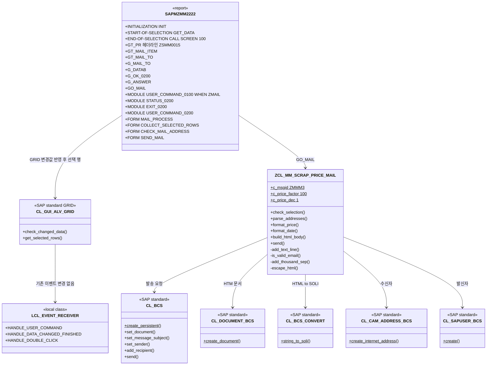
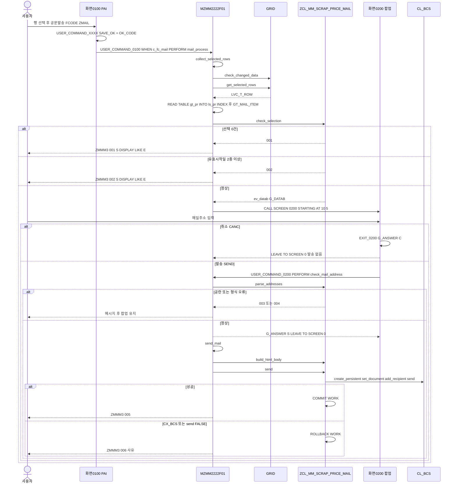
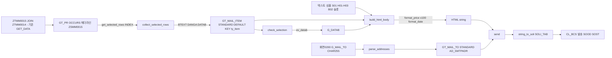

# 03. 개발 - 스크랩(SCRAP) 기본단가 관리 공문 메일발송 기능 개발

- 요청 ID: 20261019-bce84c
- 대상: **T-code ZEMM2222 / 모듈풀 SAPMZMM2222 (인클루드 MZMM2222TOP·I01·O01·F01 수정, 패키지 `$TMP`)**
- 작성: 개발 담당 (sap-developer) / 작성일: 2026-10-20 / **4차 (개발계 반영 오류 재수정 - MZMM2222* 인클루드는 기존 오브젝트에 추가/수정, 화면 플로우 로직 src/ 밖으로 이동)**
- **반영 원칙(3차 유지, 4차 강조)**: MZMM2222TOP·O01·I01·F01은 srd-abap에 이미 있는 인클루드(PROG/I, `$TMP`)다. **신규 생성 대상이 아니라 기존 인클루드에 추가/수정 반영**한다. src 파일 = **기존 원문 전체 + U4 추가분**(I01만 CASE 안 4줄 삽입)이므로 기존 인클루드 소스를 이 파일 내용으로 교체하거나 U4 블록만 붙여넣으면 된다. 현재 웹앱 반영 로직은 인클루드를 실행 프로그램으로 오인해 신규 생성을 시도하므로 같은 오류가 반복된다 - 3.0절 참고
- **src/ 구성(4차)**: 인클루드 4개(MZMM2222TOP/O01/I01/F01) + 클래스(ZCL_MM_SCRAP_PRICE_MAIL, 테스트 클래스 포함)만 둔다. 화면 0200 플로우 로직은 ABAP 소스 오브젝트가 아니므로 `screen/SAPMZMM2222_0200_flow.abap`으로 옮겼다. **`src/SAPMZMM2222_0200_flow.abap`은 삭제 대상**(개발 담당에게 삭제 도구가 없어 그대로 둠 - PL 정리 필요, 남아 있으면 웹앱이 실행 프로그램 SAPMZMM2222_0200_FLOW를 새로 만들 위험)
- 기준: 02_design.md(5차, 팀장 승인), 첨부 구글시트 "설계" 시트, 현행 소스 참고본 `ref/SAPMZMM2222.abap`, `ref/MZMM2222TOP/I01/O01.abap`, `ref/MZMM0020ALV/F01/F02.abap`(= MZMM2222ALV/F01/F02 현행, ref/README.md), 개발표준 `standards/handbook.md`
- 조회 시스템: srd-abap (클라이언트 250), 읽기 전용. 시스템에 쓴 것은 없음
- **ZEMM0020(SAPMZMM0020, MZMM0020*)은 수정하지 않는다.** 이전 차수 ZEMM0020용 소스 6개는 PL이 `old_zemm0020_src/`로 옮겼고 src/로 되돌리지 않았다.
- CR: 없음

## 개발 다이어그램

### 1) 소스 구성도

### 2) 실행 순서도

### 3) 데이터 흐름도

## 1. 오브젝트 목록

| No | 유형 | 오브젝트 | 내역(60자 이내) | 신규/변경 | 소스 파일 | 패키지 |
|---|---|---|---|---|---|---|
| 1 | PROG | SAPMZMM2222 | 고철등급 단가관리 메인 - 소스 변경 없음 | 변경 없음 | (파일 없음) | $TMP |
| 1-1 | INCL | MZMM2222TOP | 공문발송 전역 데이터·FCODE 상수 추가 | **기존 오브젝트에 추가(신규 생성 아님)** | src/MZMM2222TOP.abap (현행 원문 1~52행 + 끝 54~78행 추가) | $TMP |
| 1-2 | INCL | MZMM2222O01 | 화면 0200 PBO STATUS_0200 추가 | **기존 오브젝트에 추가(신규 생성 아님)** | src/MZMM2222O01.abap (현행 원문 1~14행 + 끝 16~32행 추가) | $TMP |
| 1-3 | INCL | MZMM2222I01 | ZMAIL 분기, 화면 0200 PAI 모듈 추가 | **기존 오브젝트에 수정+추가(신규 생성 아님)** | src/MZMM2222I01.abap (원문 + 49~52행 삽입 + 끝 56~90행 추가) | $TMP |
| 1-4 | INCL | MZMM2222F01 | 공문발송 FORM 4개 추가 | **기존 오브젝트에 추가(신규 생성 아님)** | src/MZMM2222F01.abap (현행 원문 1~693행 + 끝 695~845행 추가) | $TMP |
| 1-5 | INCL | MZMM2222ALV / MZMM2222F02 | 변경 없음 | 변경 없음 | (파일 없음) | $TMP |
| 1-6 | DYNP | SAPMZMM2222 0200 | 공문발송 메일주소 입력 모달 팝업 | 신규 | screen/SAPMZMM2222_0200_flow.abap (플로우 로직, 4차 이동) + 수작업 3.3 | $TMP |
| 1-7 | CUAD | SAPMZMM2222 GUI 상태 0100 | 기존 상태에 FCODE ZMAIL(공문발송) 추가 | 변경 | 수작업 3.4(a) | $TMP |
| 1-8 | CUAD | SAPMZMM2222 GUI 상태 0200 / 제목 0200 | 팝업 0200 GUI 상태(발송/취소)·제목 | 신규 | 수작업 3.4(b)(c) | $TMP |
| 2 | CLAS | ZCL_MM_SCRAP_PRICE_MAIL | 스크랩 단가 공문 메일 생성·발송 | 신규 | src/ZCL_MM_SCRAP_PRICE_MAIL.abap (정의+구현 전체) | $TMP (U-12) |
| 2-1 | 텍스트 요소 | ZCL_MM_SCRAP_PRICE_MAIL 텍스트 심볼 | 메일 제목·표 헤더·적용일자 문구 | 신규 | 수작업 3.2 | 클래스와 동일 |
| 3 | MSAG | ZMMM3 | 공문발송 메시지 001~006 | 신규 | 수작업 3.1 | $TMP (U-12) |
| - | (수정 안 함) | ZEMM0020, SAPMZMM0020, MZMM0020*, ZTMM0015, ZTMM0014, ZSMM0015 | 원본 T-code와 공용 DDIC | 수정 안 함 | - | ZMMD |

- src/ 구성(4차, 개발계 반영 시 전체 업로드 대상): `MZMM2222TOP.abap`, `MZMM2222O01.abap`, `MZMM2222I01.abap`, `MZMM2222F01.abap`(이상 **기존 인클루드 수정**), `ZCL_MM_SCRAP_PRICE_MAIL.abap`, `ZCL_MM_SCRAP_PRICE_MAIL.testclasses.abap`(이상 신규 클래스). SAPMZMM2222 메인·ALV·F02는 변경이 없어 파일을 만들지 않았다.
- src/ 밖: `screen/SAPMZMM2222_0200_flow.abap`(화면 0200 플로우 로직, SE51 수작업 3.3 붙여넣기용). **삭제 대상: `src/SAPMZMM2222_0200_flow.abap`**(screen/ 파일과 내용 동일, PL 정리).
- 수정 인클루드 4개는 모두 ref 원문 기반 **활성화 가능한 전체 소스**다(인클루드이므로 REPORT/PROGRAM 문 없음 - 3차 Grep 확인). 기존 FORM·모듈·로직·대소문자·주석은 그대로 두고 `*-- U4 START` ~ `*-- U4 END` 블록만 추가했다(헤더의 'MZMM0020' 표기도 원문대로 유지, 설계 0.3 No 13).
- **3차 보정**: 2차까지 원문 헤더 바로 아래(3행 다음)에 넣었던 변경 이력 주석 3줄을 빼고 각 파일 끝 U4 블록 머리로 옮겼다. TOP의 U4 선언 3블록(원문 중간 3곳 삽입)도 파일 끝으로 모았다. 그 결과 TOP·O01·F01은 **원문 전 줄이 같은 행 번호 그대로**이고 끝에만 추가분이 있으며, I01만 CASE 안 `WHEN c_fc_mail` 분기 4줄(주석 2줄 포함)이 불가피하게 중간 삽입이다.
- MZMM2222F01: ref/MZMM0020F01.abap(전체 원문, PL 대조 결과 MZMM2222F01과 동일) 693줄을 그대로 두고 694행 공백 다음 695~845행 U4 블록 추가. 기존 FORM 종료 행(INIT 26, GET_DATA 82, CREATE_DATA 120, TOGGLE_DISPLAY_CHANGE 143, FILL_COLTAB 188, FILL_STYTAB 284, COPY_DATA 324, SAVE_DATA 652, DEL_ROWS 693)이 원문 행 번호와 일치함을 확인.
- srd-abap 재확인(3차): SearchObject `MZMM2222*` → MZMM2222ALV/F01/F02/I01/O01/TOP 모두 **PROG/I, `$TMP`, URI `/sap/bc/adt/programs/includes/...`로 이미 존재**. `SAPMZMM2222` → PROG/P `$TMP`. `ZCL_MM_SCRAP*` 결과 없음(클래스는 아직 미생성 - 신규). 인클루드 소스 조회 도구(GetInclude)가 개발 담당에게 없어 현행 원문은 ref/ 참고본(2026-10-19 PL 조회) 기준이다(A-1).
- 명명: 메시지 클래스 ZMMM3은 핸드북 `ZM<모듈><1자리>`. 클래스(`ZCL_`), 메서드 파라미터(IV_/IT_/EV_/ET_/RV_/CV_), 참조 변수(GO_/LO_/LX_), 화면 번호·GUI 상태·제목 이름은 **핸드북 규칙 없음 - SAP 관례 적용**(GUI 상태·제목은 기존 프로그램 관례 '0100'에 맞춰 '0200'). 신규 프로그램 내부 이름은 핸드북 G_/GT_/C_/L_/LT_/LS_ 적용. 기존 이름(OK_CODE, SAVE_OK, GT_PR, GRID 등)은 손대지 않음.

## 2. 변경 내역 (인클루드별 위치)

| 오브젝트 | 위치 | 변경 내용 |
|---|---|---|
원문 행 = ref/ 참고본 행 번호, src 행 = 3차 src 파일 행 번호. "추가"는 원문 끝에 덧붙임, "삽입"은 원문 중간에 끼워 넣음.

| 오브젝트 | 구분 | 위치(원문 기준) | src 행 | 변경 내용 |
|---|---|---|---|---|
| MZMM2222TOP | 유지 | 원문 1~52행 | 1~52 | 변경 없음(행 번호 동일) |
| MZMM2222TOP | 추가 | 마지막 문장 `SELECT-OPTIONS ... SO_DATAB ... OBLIGATORY.`(52행) 다음 | 54~78 | U4 이력 주석, GT_MAIL_ITEM(`ZCL_MM_SCRAP_PRICE_MAIL=>TT_ITEM`), GT_MAIL_TO(`=>TT_ADDR`), G_MAIL_TO(C255, 화면 0200 필드), G_DATAB(D), G_OK_0200(SY-UCOMM), G_ANSWER(C1), GO_MAIL, 상수 C_FC_MAIL 'ZMAIL'·C_FC_SEND 'SEND'·C_FC_CANC 'CANC'·C_ANSWER_SEND 'S'·C_ANSWER_CANC 'C' |
| MZMM2222O01 | 유지 | 원문 1~14행 | 1~14 | 변경 없음 |
| MZMM2222O01 | 추가 | MODULE STATUS_0100 `ENDMODULE.`(14행) 다음 | 16~32 | MODULE STATUS_0200: `SET PF-STATUS '0200'`, `SET TITLEBAR '0200'`, `SET CURSOR FIELD 'G_MAIL_TO'` |
| MZMM2222I01 | 유지 | 원문 1~48행 | 1~48 | 변경 없음 |
| MZMM2222I01 | **삽입(유일한 중간 수정)** | USER_COMMAND_0100 `CALL TRANSACTION 'ZTMM0014'.`(48행) 다음, `ENDCASE.`(49행) 앞 | 49~52 | `*-- U4 START` / `WHEN c_fc_mail.` / `PERFORM mail_process.` / `*-- U4 END` |
| MZMM2222I01 | 유지 | 원문 49~50행(ENDCASE, ENDMODULE) | 53~54 | 변경 없음(4행 밀림) |
| MZMM2222I01 | 추가 | MODULE USER_COMMAND_0100 `ENDMODULE.`(50행) 다음 | 56~90 | U4 이력 주석, MODULE EXIT_0200(CANC → G_ANSWER 'C', LEAVE TO SCREEN 0), MODULE USER_COMMAND_0200(SEND → PERFORM check_mail_address) |
| MZMM2222F01 | 유지 | 원문 1~693행(FORM INIT ~ DEL_ROWS) | 1~693 | 변경 없음(행 번호 동일) |
| MZMM2222F01 | 추가 | 마지막 FORM DEL_ROWS `ENDFORM.`(693행) 다음 | 695~845 | U4 이력 주석, FORM MAIL_PROCESS(701~741), COLLECT_SELECTED_ROWS(~785), CHECK_MAIL_ADDRESS(~813), SEND_MAIL(~844) |
| 화면 0200 | 신규 | - | 플로우 전체 | 플로우 로직: PBO STATUS_0200 / PAI EXIT_0200 AT EXIT-COMMAND, USER_COMMAND_0200 |
| ZCL_MM_SCRAP_PRICE_MAIL | 신규 | - | 전체 | 2차: 헤더 주석만 변경(패키지 $TMP, 대상 ZEMM2222). **로직 변경 없음**. 3차: 변경 없음 |

ALV 매핑(실제 소스 기준): GT_PR-BTEXT → GRADE_TXT, GT_PR-DANGA → PRICE, GT_PR-DATAB → DATAB, REMARK는 GT_PR에 필드가 없어 항상 공란(메일에는 `&nbsp;`).

## 3. 수작업 절차 (개발계 반영 시, SE91 / SE24 / SE51 / SE41)

### 3.0 MZMM2222* 인클루드 반영 방법 (3차 추가 - 기존 오브젝트 수정, 신규 생성 아님)

**2차 반영 오류 원인**: 웹앱 개발계 반영이 `MZMM2222F01 생성 실패 (HTTP 500): 이름 MZMM2222F01으(로) 이미 프로그램이나 include가 있습니다.`로 실패했다. 반영 도구가 존재 여부를 `/sap/bc/adt/programs/programs/<name>`(PROG/P 경로)로만 확인해, 실제로는 `/sap/bc/adt/programs/includes/mzmm2222f01`(PROG/I)에 있는 인클루드를 404(없음)로 보고 **신규 생성**을 시도했기 때문이다. 소스 내용 문제가 아니라 오브젝트 유형 판별 문제이며, 웹앱 코드는 이번 개발 범위가 아니다(PL 분석). TOP·O01·I01도 같은 PROG/I라 같은 방식으로 실패할 수 있다.

**4차 확인 사실 (PL 재조회, 2026-10-20)**
- PL이 mcp__sap__GetInclude로 srd-abap 현행 MZMM2222F01을 다시 읽은 결과 src/MZMM2222F01.abap **1~693행(INIT ~ DEL_ROWS, 헤더 'MZMM0020F01' 표기 포함)과 같다**. src 파일은 이미 "기존 소스 전체 + 끝 U4 블록(695~845행)" 형태이고, 2차·3차 반영 시도로 SAP 쪽 소스가 바뀌지 않았다. SAPMZMM2222 메인도 INCLUDE MZMM2222TOP/ALV/F02/O01/I01/F01 그대로.
- 개발 담당 4차 대조: src TOP 1~52 = ref/MZMM2222TOP.abap 1~52, O01 1~14 = ref 1~14, I01 1~48·53~54 = ref 1~48·49~50(삽입 4줄 외 동일). 소스 내용은 4차에 고치지 않았다.
- **반영 실패 원인은 소스가 아니라 웹앱 반영 로직**이다. 웹앱(src/board.ts devObjects, src/adt.ts)은 src/ 아래 *.abap 중 CLASS 정의가 없는 파일을 모두 PROG/P(실행 프로그램)로 보고 `/sap/bc/adt/programs/programs/<이름>`으로 존재 확인한다. 인클루드는 `/programs/includes/`에 있으므로 "없음"으로 판정되어 신규 생성을 시도하고 HTTP 500으로 실패한다. 이 웹앱 코드는 개발 단계 산출물이 아니어서 고치지 않았다(PL이 팀장에게 별도 보고).
- **따라서 웹앱 로직이 그대로인 한 웹앱 개발계 반영은 같은 오류가 반복된다.** 반영은 다음 중 하나로 한다.
  - (a) 웹앱이 인클루드(PROG/I)를 판별해 `/programs/includes/<이름>` 기존 소스를 갱신하도록 수정한 뒤 재반영 (src 파일 = 기존 원문 전체 + 추가분이라 전체 교체여도 원문 유지)
  - (b) 아래 수작업 대안: SE38/ADT에서 **기존 인클루드를 열어** U4 블록을 붙여넣기(생성 버튼 사용 금지). 클래스는 신규라 웹앱 또는 SE24로 생성 가능
- 화면 0200 플로우 로직 파일도 src/에 있으면 웹앱이 `SAPMZMM2222_0200_FLOW` 실행 프로그램을 새로 만들 위험이 있어 4차에 screen/으로 옮겼다(src 쪽 파일은 삭제 대상).

**원칙**
- MZMM2222TOP·O01·I01·F01 4개는 모두 **기존 인클루드 수정**이다. 새로 만들거나 삭제 후 재생성하지 않는다(재생성 시 SAPMZMM2222와의 소속·버전 이력이 끊길 수 있음).
- src 파일은 "현행 원문 전체 + 끝 U4 블록"(I01만 CASE 안 4줄 삽입 추가)이므로, 반영 도구가 소스 전체 교체 방식이어도 원문은 그대로 남는다.
- 반영 직전 현행 인클루드가 ref/ 참고본 이후 바뀌지 않았는지 확인한다(A-1). 바뀌었으면 src 파일로 통째로 덮어쓰지 말고 아래 수작업 대안의 "U4 블록만 붙여넣기"로 반영한다.

**수작업 대안 (웹앱이 인클루드를 신규로 오인해 실패할 때)**

| 순서 | 대상 | 절차 |
|---|---|---|
| 0 | 공통 | 먼저 3.1 ZMMM3, 3.2 ZCL_MM_SCRAP_PRICE_MAIL(클래스는 신규라 웹앱/SE24 생성 가능)을 반영해 둔다. 클래스가 없으면 TOP 구문 검사에서 `ZCL_MM_SCRAP_PRICE_MAIL` 미정의 오류 |
| 1 | 열기 | SE38(또는 SE80 → 프로그램 SAPMZMM2222 → 인클루드) 프로그램 이름에 `MZMM2222TOP` 입력 → **변경**. ADT는 프로젝트 srd-abap(250) → Ctrl+Shift+A → `MZMM2222TOP`(유형 Include) 열기. **"생성" 버튼을 누르지 않는다** |
| 2 | 비교 | 편집기의 현행 소스가 ref/MZMM2222TOP.abap(=src 1~52행)과 같은지 눈으로 대조(마지막 문장이 `SO_DATAB FOR ZTMM0015-DATAB OBLIGATORY.`인지) |
| 3 | 붙여넣기 | 파일 맨 끝(52행 다음)에 커서를 두고 src/MZMM2222TOP.abap **54~78행**(`*-- U4 START` ~ `*-- U4 END`)을 복사해 붙여넣기 → 저장(로컬 오브젝트 $TMP라 이송요청 팝업 없음) |
| 4 | O01 | 같은 방법으로 `MZMM2222O01` 끝(STATUS_0100 `ENDMODULE.` 다음)에 src/MZMM2222O01.abap **16~32행** 붙여넣기 → 저장 |
| 5 | I01 | `MZMM2222I01`에서 (a) USER_COMMAND_0100의 `CALL TRANSACTION 'ZTMM0014'.` 다음 줄(`ENDCASE.` 앞)에 src **49~52행** 삽입, (b) 파일 끝(USER_COMMAND_0100 `ENDMODULE.` 다음)에 src **56~90행** 붙여넣기 → 저장 |
| 6 | F01 | `MZMM2222F01` 끝(DEL_ROWS `ENDFORM.` 다음)에 src/MZMM2222F01.abap **695~845행** 붙여넣기 → 저장 |
| 7 | 화면·GUI | 3.3 화면 0200, 3.4 GUI 상태 0100 변경·0200/제목 0200 생성 |
| 8 | 활성화 | SE80에서 SAPMZMM2222 선택 → 활성화 → 비활성 오브젝트 목록에서 MZMM2222TOP/O01/I01/F01, 화면 0200, GUI 상태 모두 체크 후 함께 활성화(TOP만 따로 활성화하면 다른 인클루드 참조 오류가 날 수 있음). 구문 검사(Ctrl+F2) 오류 0건 확인 |
| 9 | 확인 | ZEMM2222 실행 → 기존 버튼(TOGG/CREA/COPY/DEL/SAVE/GRAD) 동작 회귀 확인 + 공문발송 버튼 확인 |

- 대안으로 SE38에서 현행 소스를 src 파일 전체로 교체해도 결과는 같다(현행 = ref 원문일 때만).

아래 3.1~3.4는 ADT 소스 업로드로 반영되지 않는 항목이다. 클래스·메시지 클래스가 먼저 있어야 TOP(클래스 타입 참조)과 F01(메시지 ID)이 활성화된다.

**권장 순서**: (1) SE91 ZMMM3 생성 → (2) SE24 ZCL_MM_SCRAP_PRICE_MAIL 소스 활성화 + 텍스트 심볼 → (3) SAPMZMM2222 **기존** 인클루드 TOP → O01 → I01 → F01 수정 반영(3.0, 신규 생성 아님) → (4) SE51 화면 0200 생성·플로우 로직 → (5) SE41 GUI 상태 0100 수정, GUI 상태 0200·제목 0200 생성 → (6) SAPMZMM2222 전체 활성화(인클루드·화면·GUI 상태 함께)

- 신규 오브젝트 생성 시 패키지 입력란에 `$TMP`(로컬 오브젝트)를 지정한다(U-12 기본값). 이송요청은 생기지 않는다.

### 3.1 SE91 메시지 클래스 ZMMM3 (신규, $TMP)

| 번호 | 문구 | 사용 위치 | 표시 방식 |
|---|---|---|---|
| 001 | 공문발송할 행을 하나 이상 선택하십시오. | MAIL_PROCESS(CHECK_SELECTION) | TYPE 'S' DISPLAY LIKE 'E' |
| 002 | 효력시작일이 다른 행은 함께 공문발송할 수 없습니다. | MAIL_PROCESS(CHECK_SELECTION) | TYPE 'S' DISPLAY LIKE 'E' |
| 003 | 메일주소를 입력하십시오. | CHECK_MAIL_ADDRESS(PARSE_ADDRESSES), SEND 수신자 0건 사유 | TYPE 'S' DISPLAY LIKE 'E' (팝업 유지) |
| 004 | 메일주소 형식이 올바르지 않습니다: &1 | CHECK_MAIL_ADDRESS, &1 = 잘못된 주소(;로 연결, 50자까지) | TYPE 'S' DISPLAY LIKE 'E' (팝업 유지) |
| 005 | 공문 메일을 발송했습니다. | SEND_MAIL | TYPE 'S' |
| 006 | 메일 발송 중 오류가 발생했습니다: &1 | SEND_MAIL, &1 = CX_BCS 텍스트 또는 텍스트 심볼 E01(50자까지) | TYPE 'S' DISPLAY LIKE 'E' |

- 절차: SE91 → 메시지 클래스 `ZMMM3` 생성 → 속성 짧은 내역 "스크랩 단가 공문발송" → 패키지 `$TMP` → 메시지 탭에 위 6건 입력 → 저장. 언어 KO.
- 번호는 클래스 상수(C_MSGNO_NO_ROW 001 ~ C_MSGNO_SEND_ERROR 006)로만 참조한다. 기존 `MESSAGE-ID ZMMM`(s000)은 그대로 두고 신규 메시지는 `MESSAGE ID zcl_mm_scrap_price_mail=>c_msgid`로 띄운다.

### 3.2 SE24 텍스트 심볼 (ZCL_MM_SCRAP_PRICE_MAIL > 이동 > 텍스트 요소, 로그온 언어 KO)

| ID | 문구 | 근거 | 비고 |
|---|---|---|---|
| S01 | 국내스크랩 기본단가 공문 | X-4 가안 | 메일 제목(U-03) |
| H01 | 등급 | 시트 C95 | |
| H02 | 단가 | 시트 D95 | |
| H03 | 비고 | 시트 E95 | |
| B02 | 2. 적용일자: | 시트 C101 | 끝 공백은 잘리므로 코드에서 공백 1칸을 붙임 |
| E01 | BCS 발송 요청이 처리되지 않았습니다 | 시트 외(5장 No 6) | SEND 결과 FALSE 시 006 &1 |
| A01~A05, B01, B03, Z01~Z03 | **만들지 않음(공란)** | 시트 메일 양식 이미지 영역 | U-02 확정 후 문구만 등록하면 코드 수정 없이 반영. 미등록 시 줄 생략. 구문 검사에서 "텍스트 심볼 미정의" 경고가 날 수 있으나 활성화에는 영향 없음 |

- S01/H01~H03/B02/E01은 소스에 `'문구'(id)` 형태로 있으므로 텍스트 요소 화면의 "텍스트 심볼 비교"로 한 번에 생성할 수 있다.

### 3.3 SE51 화면 0200 (SAPMZMM2222, 신규)

1. SE51 → 프로그램 `SAPMZMM2222`, 화면 번호 `0200` → 생성. (먼저 SE80에서 0200 미사용 확인 - S-03)
2. 속성: 짧은 내역 "공문발송 메일주소 입력", 화면 유형 **모달 대화상자**, 다음 화면 `0200`.
3. 레이아웃(그래픽 Screen Painter):

| 요소 | 이름 | 유형 | 행/열 | 길이 | 속성 |
|---|---|---|---|---|---|
| 텍스트 | TXT_MAIL | 텍스트 필드 "메일주소" | 2 / 2 | 10 | - |
| 입출력 | G_MAIL_TO | 프로그램 필드에서 가져오기(Dict/Program fields → G_MAIL_TO) | 2 / 13 | 정의 255, 가시 55, 스크롤 가능 | 입력 가능, **필수 아님**(PAI 메시지 003), **소문자(Lower case) 체크 필수** |
| OK 코드 | G_OK_0200 | 요소 목록의 OK 필드 | - | - | - |

4. 플로우 로직: `screen/SAPMZMM2222_0200_flow.abap` 내용 그대로 붙여넣기(4차에 src/에서 이동).
5. 크기: 호출 `CALL SCREEN 0200 STARTING AT 10 5 ENDING AT 80 8`(70열 x 3행)에 들어가게 배치. 레이아웃·라벨은 시트 C63~C74 캡처 확인 후 조정(U-04).

### 3.4 SE41 GUI 상태 / 제목 (SAPMZMM2222)

**(a) 기존 GUI 상태 0100 변경 (FCODE ZMAIL 추가)**

| 항목 | 값 |
|---|---|
| 기능 코드 | ZMAIL |
| 기능 유형 | (공란, 일반) |
| 기능 텍스트 / 아이콘 텍스트 / 정보 텍스트 | 공문발송 |
| 아이콘 이름 | ICON_MAIL |
| 위치 | 응용 프로그램 툴바, 기존 버튼(TOGG/CREA/COPY/DEL/SAVE/GRAD) 뒤 |
| 기능 키 | 비어 있는 Shift+F키 하나 지정(기존 할당 확인 후 결정, S-06) |

- 절차: SE41 → 프로그램 SAPMZMM2222, 상태 `0100` → 변경 → 기능 키에 ZMAIL 지정 → 응용 프로그램 툴바에 배치 → 활성화.
- F02 SET_PF_STATUS의 EXCLUDING 목록에는 넣지 않았다(U-09 기본값: 모든 사용자, 조회·편집 모드 모두 표시).
- 화면 0100·GUI 상태 0100의 실제 내용은 MCP로 조회 불가. SAPMZMM0020 복사본으로 추정했으므로 SE41에서 기존 FCODE(BACK/EXIT/CANC/TOGG/CREA/COPY/DEL/SAVE/GRAD)를 확인한다(S-01).

**(b) 신규 GUI 상태 0200 (상태 유형: 대화상자)**

| 기능 코드 | 텍스트 | 아이콘 | 기능 유형 | 기능 키 |
|---|---|---|---|---|
| SEND | 발송 | ICON_MAIL | (공란, 일반) | Enter |
| CANC | 취소 | ICON_CANCEL | E (Exit 명령) | F12 (팝업 닫기 X도 CANC로 처리) |

**(c) 신규 제목 0200**: "공문발송"

## 4. 구현 메모

| 구분 | 내용 |
|---|---|
| 버튼 방식 | 설계 0.3 No 5대로 GUI 상태 0100 FCODE `ZMAIL` + USER_COMMAND_0100 `CASE SAVE_OK` 분기. 화면 100 PAI는 USER_COMMAND_XXXX가 `SAVE_OK = OK_CODE`로 옮긴 뒤 USER_COMMAND_0100이 처리하는 기존 순서를 그대로 이용(MZMM2222ALV HANDLE_TOOLBAR 미사용) |
| 선택 행 수집 | 기존 COPY_DATA/DEL_ROWS와 같이 `grid->check_changed_data` → `grid->get_selected_rows`. ROWTYPE 있는 행 제외, INDEX 오름차순, GT_PR 헤더라인을 바꾸지 않도록 `READ TABLE gt_pr INTO ls_pr INDEX` |
| 팝업 OK 필드 | 화면 0200은 `G_OK_0200`을 쓰고 화면 100의 OK_CODE/SAVE_OK와 분리. 팝업 종료 후 화면 100 PBO(SET_PF_STATUS, MAKE_ALV_DISP → REFRESH_GRID_SCR)가 기존대로 실행되며 GT_PR·선택·편집 모드는 바뀌지 않음 |
| 문법 기준 | ABAP 7.40 이상 가정: `line_exists( )`, 문자열 템플릿, `&&`, RETURNING과 EXPORTING을 함께 가진 함수형 메서드 호출. srd-abap SAP_BASIS 릴리스는 MCP로 확인 못 함(S-05) |
| 표준 클래스 시그니처 | 이전 차수 srd-abap GetClass 확인 내용 유지: CL_BCS(CREATE_PERSISTENT, SET_DOCUMENT, SET_MESSAGE_SUBJECT, SET_SENDER, ADD_RECIPIENT, SET_SEND_IMMEDIATELY, SEND), CL_DOCUMENT_BCS=>CREATE_DOCUMENT, CL_BCS_CONVERT=>STRING_TO_SOLI, CL_CAM_ADDRESS_BCS=>CREATE_INTERNET_ADDRESS, CL_SAPUSER_BCS=>CREATE, CL_ABAP_FORMAT=>E_HTML_TEXT. 예외는 상위 CX_BCS로 잡음 |
| DDIC 타입 | GetTable/GetStructure가 ZTMM0015·ZSMM0015에서 실패. TY_ITEM은 현행 GET_DATA SELECT 필드 `ZTMM0014-BTEXT`, `ZTMM0015-DANGA`, `ZTMM0015-DATAB` 참조(길이 추정 없음) |
| 단가 ×100 | SAVE_DATA 주석 "경량B 단가 300원/kg 이상" ↔ `lv_kb5_danga >= 3` → DANGA 내부값 ×100 = 원/kg. FORMAT_PRICE: 내부값 × C_PRICE_FACTOR(100) → 소수 C_PRICE_DEC(1)자리 반올림 → 천 단위 콤마. 문자열 템플릿 기본(RAW) 형식이라 사용자 숫자 형식(USR01-DCPFM)과 무관 |
| KPEIN / WAERS | 메일에 반영·표시하지 않음(U-01) |
| LUW | COMMIT WORK는 SEND 성공 시 클래스 안에서 1회. 실패 시 ROLLBACK WORK로 BCS 영속 객체를 버려 이후 SAVE_DATA의 COMMIT WORK AND WAIT에 섞이지 않게 함. 공문발송은 GT_PR·ZTMM0015를 바꾸지 않음 |
| 메시지 | 클래스는 번호만 돌려주고 프로그램이 `MESSAGE ID zcl_mm_scrap_price_mail=>c_msgid TYPE 'S' ... DISPLAY LIKE 'E'`로 표시(화면 0100/0200 유지). 기존 MESSAGE-ID ZMMM은 그대로 |
| 하드코딩 회피 | FCODE·팝업 결과는 TOP 상수, 메시지 ID·번호·단가 계수·문서 유형·주소 정규식·최대 길이는 클래스 상수, 메일 문구는 텍스트 심볼 |
| 권한 체크 | 신규 AUTHORITY-CHECK 없음(설계 10장). T-code 실행은 S_TCODE ZEMM2222, BCS 외부 메일은 SAP 표준(S_OC_SEND 등) |
| 0건/오류 처리 | 선택 0건 001, 유효시작일 상이 002, 주소 공란 003, 형식 오류 004, 발송 오류 006(CX_BCS 텍스트, 덤프 없음). GRID 미생성 시 아무것도 하지 않고 종료 |
| 테스트 FRIENDS | private 메서드 시험 시 테스트 인클루드에 `CLASS zcl_mm_scrap_price_mail DEFINITION LOCAL FRIENDS ltc_scrap_price_mail.` 필요(테스트 단계) |

## 5. 설계 대비 대응표

### 5.1 설계 항목 → 구현 위치

| 설계(02_design.md 5차) | 구현 위치 | 상태 |
|---|---|---|
| 시트 B21 GUI 상태 0100 FCODE ZMAIL | 수작업 3.4(a), MZMM2222TOP C_FC_MAIL | 일치 |
| 7.1 단계 2 USER_COMMAND_0100 `WHEN` 분기 | MZMM2222I01 USER_COMMAND_0100 | 일치 (`c_fc_mail` 상수 사용) |
| 7.1 단계 3 COLLECT_SELECTED_ROWS | MZMM2222F01 COLLECT_SELECTED_ROWS | 일치 |
| 7.1 단계 4 CHECK_SELECTION 001/002 | MZMM2222F01 MAIL_PROCESS, 클래스 CHECK_SELECTION | 일치 |
| 7.1 단계 5 CALL SCREEN 0200, STATUS_0200, EXIT_0200 | MZMM2222F01 MAIL_PROCESS, O01 STATUS_0200, I01 EXIT_0200, 화면 0200 플로우 로직 | 일치 |
| 7.1 단계 6 USER_COMMAND_0200 PARSE_ADDRESSES 003/004 | I01 USER_COMMAND_0200 → F01 CHECK_MAIL_ADDRESS | 위치 변경(5.2 No 1) |
| 7.1 단계 7~9 SEND_MAIL, BUILD_HTML_BODY, SEND, 005/006 | MZMM2222F01 SEND_MAIL, 클래스 | 일치 |
| 3장 내부 이름 C_FC_MAIL/SEND/CANC, GT_MAIL_ITEM, GT_MAIL_TO, G_MAIL_TO, G_DATAB, G_OK_0200, G_ANSWER, GO_MAIL | MZMM2222TOP | 일치 + C_ANSWER_SEND/CANC 추가(5.2 No 2) |
| 4장 클래스 메서드 10개, 상수 C_MSGID/C_PRICE_FACTOR/C_PRICE_DEC | ZCL_MM_SCRAP_PRICE_MAIL | 일치 + 메시지 번호 상수(5.2 No 4) |
| 5.2 화면 0200 / GUI 상태 0200 / 제목 0200 | 수작업 3.3, 3.4(b)(c) | 일치 |
| 7.2 HTML 템플릿, 텍스트 심볼 S01·A01~Z03 | 클래스 BUILD_HTML_BODY, 수작업 3.2 | 일치 |
| 7.3 ×100, 소수 1자리, 콤마 | 클래스 FORMAT_PRICE | 일치 |
| 7.4 SEND (BCS, COMMIT) | 클래스 SEND | 일치 + 실패 시 ROLLBACK(5.2 No 5) |
| 8장 ALV·필드카탈로그·레이아웃 변경 없음 | MZMM2222ALV/F02 미변경 | 일치 |
| 9장 메시지 ZMMM3 001~006 | 수작업 3.1 | 일치 |
| 10장 권한 - 신규 체크 없음, 버튼 노출 제한 없음 | F02 미변경 | 일치 |
| 2장 SAPMZMM2222 메인 변경 없음 | 파일 미작성 | 일치 |

### 5.2 설계와 다르게 구현한 부분

| No | 설계 | 실제 구현 | 근거 |
|---|---|---|---|
| 1 | USER_COMMAND_0200 모듈 안에서 PARSE_ADDRESSES 호출(F01 FORM 3개) | 모듈은 FCODE 분기만, 주소 검사·메시지·LEAVE는 FORM **CHECK_MAIL_ADDRESS**(F01 FORM 4개) | MODULE 안 DATA 선언은 프로그램 전역 변수가 되어 L_ 지역 변수 규칙(핸드북 2장)에 어긋남. 동작은 설계와 같음 |
| 2 | G_ANSWER 값 'S'/'C' 리터럴 | 상수 C_ANSWER_SEND 'S', C_ANSWER_CANC 'C' | 하드코딩 회피 |
| 3 | TY_ITEM grade_txt C60, datab D | `ZTMM0014-BTEXT`, `ZTMM0015-DATAB` 참조 | 실제 필드 타입과 맞춤(설계 4.1 "BTEXT 길이는 개발 시 확인"). 길이 추정 없음 |
| 4 | 메시지 번호 리터럴 | 클래스 상수 C_MSGNO_NO_ROW ~ C_MSGNO_SEND_ERROR | 하드코딩 회피 |
| 5 | SEND 실패 시 ev_error = CX_BCS 텍스트 | 추가로 SEND 반환 FALSE 시 텍스트 심볼 E01, 수신자 0건 시 003 문구. 실패 시 ROLLBACK WORK | 예외 없는 실패에도 006 사유가 비지 않게, 실패 요청이 이후 COMMIT에 섞이지 않게. 기능 추가 아님 |
| 6 | 인클루드 헤더 주석 정정 범위 밖 | 헤더의 'MZMM0020' 표기는 그대로 두고 U4 변경 이력 주석만 추가(3차: 이력 주석도 파일 끝 U4 블록 안으로 이동) | 설계 0.3 No 13 |
| 7 | 3장 TOP 선언 위치(각 절 안) | 3차: GT_MAIL_ITEM·GT_MAIL_TO·G_*·GO_MAIL·C_* 선언을 TOP 파일 끝(SELECT-OPTIONS 다음) U4 블록 하나로 모음. 이름·타입 동일 | 팀장 지시 "기존 있는거에 밑에 추가". 원문 행 번호 유지로 대조·수작업 붙여넣기 쉬움. 선언 위치만 다르고 동작 동일(TOP은 다른 인클루드보다 먼저 INCLUDE됨) |

시트에 없는 기능(미리보기 P-1, CC, 발송 이력, 확인 팝업, 권한 분리 등)은 구현하지 않았다. 시트 외 항목은 설계 0.4 X-1~X-7(취소 버튼, 주소 검증 메시지, `;` 다중 주소, 제목 가안, 발신자, 결과 메시지, 문구 슬롯)만 구현했다.

## 6. 팀장 결정 대기 항목 (설계 기본값으로 구현)

| 번호 | 내용 | 현재 구현(설계 기본값) | 결정이 바뀌면 고칠 위치 |
|---|---|---|---|
| **U-06** | 선택 행 상태별 처리: (a) 편집 모드 미저장 수정값, (b) CREA/COPY 신규 행(DBDATA 공란, 단가·유효시작일 공란 가능), (c) 삭제표시 행(LVORM='X') | **모두 포함(차단 없음)**. check_changed_data 반영값 그대로 메일에 실림. 유효시작일 공란 행끼리는 002에도 안 걸림 | F01 COLLECT_SELECTED_ROWS(필터) 또는 CHECK_SELECTION(+ ZMMM3 007~ 메시지) |
| **U-09** | 공문발송 버튼 노출 기준(스크럽구매팀 ORGEH '10005020' 또는 SY-UNAME(2)='DU') | **제한 없음(모든 사용자 노출, F02 미변경)** | MZMM2222F02 SET_PF_STATUS ELSE 분기에 `ls_status = 'ZMAIL'. APPEND ls_status TO lt_status.` (그때 F02 전체 소스 필요 - 7장 참고) |
| **U-10** | 플랜트(WERKS)가 다른 행 동시 선택 | **차단 없음**, 한 표로 발송(플랜트 미표시) | TY_ITEM에 WERKS 추가 + CHECK_SELECTION 메시지 추가 |
| **U-11** | ZEMM2222 성격: (가) 현업 사용 T-code / (나) ZEMM0020 반영 전 검증용 사본 | **개발계 $TMP 내 보완, ZEMM0020 미변경** | (나)면 ZEMM0020 반영은 별도 요청 |
| **U-12** | 패키지·이송: SAPMZMM2222·MZMM2222*·ZEMM2222 재지정, 신규 ZCL_MM_SCRAP_PRICE_MAIL·ZMMM3 패키지 | **모두 $TMP**(이송요청 없음, 품질·운영 반영 불가) | 재지정 시 SE80/SE03 오브젝트 디렉터리 변경(팀장 승인 후). ZMMD로 만들면 클래스·메시지 클래스 헤더 주석만 수정 |
| U-13 | ZEMM2222 역할(S_TCODE)·메뉴 | 변경 없음 | Basis |

## 7. 미결 / 가정

| 번호 | 구분 | 내용 | 현재 가정 | 고칠 위치 |
|---|---|---|---|---|
| U-01 | 현업 | 단가 단위(B75~B76 "단가가 너무 크다"). DANGA가 CURR(WAERS 참조)이면 ALV 화면값이 이미 ×100으로 보일 수 있어 "화면 단가 ×100" 해석이 달라짐. KPEIN≠1, WAERS≠KRW 행 처리 | 내부값 ×100, 소수 1자리, 콤마. KPEIN·WAERS 무시 | 클래스 상수 C_PRICE_FACTOR, C_PRICE_DEC |
| U-02 | 현업/시트 이미지 | 메일 양식 캡처(상단·1항 제목·3항·맺음말·표 모양) | 슬롯 공란, 기본 표 스타일 | 텍스트 심볼, BUILD_HTML_BODY |
| U-03 | 현업 | 메일 제목 | "국내스크랩 기본단가 공문" | 텍스트 심볼 S01 |
| U-04 | 시트 이미지 | 팝업 0200 레이아웃, 버튼 위치 | 입력창 1개 + 발송/취소, 툴바 기존 버튼 뒤 | 화면 0200, GUI 상태 0100 |
| U-07 | 팀장 | 미리보기(P-1) | 미구현 | - |
| U-08 | 현업 | 참조(CC)·공문 머리 | 없음 | 클래스 SEND |
| S-01 | 시스템 | 화면 0100 흐름 논리(USER_COMMAND_XXXX → USER_COMMAND_0100 순서)·GUI 상태 0100 실제 FCODE | SAPMZMM0020 복사본으로 추정 | SE80/SE41 확인 |
| S-02 | 시스템 | ZSMM0015/ZTMM0015 DDIC(DANGA CURR 여부, BTEXT 길이) | DDIC 필드 참조로 타입 맞춤 | SE11 확인 |
| S-03 | 시스템 | SAPMZMM2222 화면 0200, GUI 상태/제목 0200 미사용 여부 | 미사용 가정 | 사용 중이면 다음 빈 번호로 변경(O01, F01 CALL SCREEN, 플로우 로직) |
| S-04 | Basis | SCOT SMTP 외부 발송, 개발계 외부 차단, 발신 사용자 SU01 메일 | - | Basis 확인 |
| S-05 | 시스템 | srd-abap SAP_BASIS 릴리스 | 7.40 이상 | 4장 문법 |
| S-06 | 시스템 | GUI 상태 0100의 빈 기능 키(ZMAIL용) | 반영 시 SE41에서 결정 | 3.4(a) |
| A-1 | 가정(4차: F01은 PL 재조회로 현행 = src 1~693행 확인, TOP/O01/I01은 ref 기준 유지) | MZMM2222TOP/O01/I01 현행 = ref/MZMM2222*.abap, MZMM2222F01 현행 = ref/MZMM0020F01.abap(2026-10-19 PL 조회·대조). 개발 담당은 인클루드 소스 조회 도구가 없어 3차에 재조회 못 함(SearchObject로 존재·유형·패키지만 확인). 반영 직전 SE38에서 그 후 바뀌지 않았는지 확인 필요. 2차 반영 시도가 "생성" 단계에서 실패했으므로 F01 내용은 바뀌지 않았을 것으로 보지만, TOP/O01/I01이 F01보다 먼저 반영됐는지는 확인 필요(이미 U4 블록이 들어가 있으면 중복 붙여넣기 금지) | 동일 가정 | src/MZMM2222*.abap 재작성 또는 3.0 수작업 |
| A-2 | 가정 | U-09 결정으로 F02를 고칠 경우 ref/MZMM0020F02.abap은 일부 FORM 줄바꿈이 압축된 참고본이라 그대로 덮어쓰면 원문 서식이 달라짐 | F02 미변경 | 그때 PL이 MZMM2222F02 원문 재조회 필요 |

## 8. 테스트 단계 참고

| 대상 | 메서드/FORM | 시나리오(설계 11장 번호) |
|---|---|---|
| Unit | CHECK_SELECTION | T01 0건 → 001 / T02 같은 유효시작일 4건 → 공란·ev_datab / T03 2종 → 002 |
| Unit | FORMAT_PRICE | T04 4.70→470.0, 4.65→465.0, 1234.56→123,456.0, 0→0.0 / 12.35→1,235.0 / T05 사용자 숫자 형식 무관 |
| Unit | FORMAT_DATE | T06 20260928 → 2026.09.28, 초기값 → 공란 |
| Unit | BUILD_HTML_BODY | T07 시트 샘플 4건 → "1." / 헤더 등급·단가·비고 / "2. 적용일자: 2026.09.28" / 3항 없음, T08 `<` `&` 이스케이프, T18 슬롯 공란 시 `
` 없음 |
| Unit | PARSE_ADDRESSES | T09 `a@x.com` 1건 / `a@x.com; b@y.co.kr` 2건 / 공란 003 / `abc` 004 / 중복 1건 |
| Unit (FRIENDS) | ADD_THOUSAND_SEP, IS_VALID_EMAIL, ESCAPE_HTML, ADD_TEXT_LINE | 경계값(3·4·7자리, 241자 초과) |
| 통합 | MAIL_PROCESS, COLLECT_SELECTED_ROWS, CHECK_MAIL_ADDRESS, SEND_MAIL, SEND | T10~T17, T19, T20 (ZEMM2222 실행) |
| 통합 | 팀장 결정 기본값 | T21 미저장값 포함 / T22 신규·삭제표시 행 포함 / T23 모든 사용자 버튼 보임 / T24 플랜트 혼합 허용 |
| 회귀 | ZEMM0020 | T25 SAPMZMM0020 미변경, 공문발송 버튼 없음 |

- 테스트 클래스: LTC_SCRAP_PRICE_MAIL(로컬 테스트 인클루드).

## 9. 변경 이력

| 일자 | 차수 | 내용 |
|---|---|---|
| 2026-10-19 | 1차 | 최초 개발. 02_design.md(4차) 기준, 대상 ZEMM0020(SAPMZMM0020, ZMMD). 현행 소스 참고본 기준으로 이름·버튼 방식 조정. CR 없음 |
| 2026-10-20 | 2차 | **대상 ZEMM0020 → ZEMM2222(SAPMZMM2222, $TMP) 전환** (02_design.md 5차 기준). 이전 ZEMM0020용 소스 6개(SAPMZMM0020, MZMM0020TOP/O01/I01/F01, SAPMZMM0020_0200_flow)는 PL이 `old_zemm0020_src/`로 이동(참고용, src 미복원). 신규 작성: src/MZMM2222TOP·O01·I01·F01.abap(ref 원문 기반 **전체 소스**, F01은 추가 블록이 아닌 전체 소스로 변경), src/SAPMZMM2222_0200_flow.abap. GUI 상태·제목 이름 PS0200/TS0200 → `0200`/`0200`(설계 5차). SAPMZMM2222 메인은 변경 없어 파일 미작성. ZCL_MM_SCRAP_PRICE_MAIL은 헤더 주석만 변경(패키지 $TMP, 대상 ZEMM2222). 신규 클래스·메시지 클래스 패키지 ZMMD → $TMP(U-12 기본값). 팀장 결정 대기 항목 U-06/U-09/U-10/U-11/U-12는 설계 기본값으로 구현하고 6장에 표시. CR 없음 |
| 2026-10-20 | 3차 | **팀장 수정 지시: 개발계 반영 오류(MZMM2222F01 생성 실패 HTTP 500 "이미 프로그램이나 include가 있습니다") 수정.** 원인: 반영 도구가 인클루드(PROG/I, `/programs/includes/`)를 `/programs/programs/` 경로로만 존재 확인해 신규 생성 시도(웹앱 코드는 수정 대상 아님). 조치: MZMM2222TOP·O01·I01·F01을 **기존 오브젝트에 추가/수정(신규 생성 아님)**으로 오브젝트 목록에 명시, src 4개를 "현행 원문 그대로 + 끝에 U4 블록"으로 보정 - 원문 헤더 아래 넣었던 이력 주석 3줄을 끝 U4 블록으로 이동, TOP 선언 3블록을 파일 끝으로 이동(5.2 No 7). I01 USER_COMMAND_0100 `WHEN c_fc_mail` 4줄만 중간 삽입. REPORT/PROGRAM 문 없음 확인. 2장에 원문·src 행 범위, 3.0에 반영 원칙과 SE38/ADT 수작업 대안 추가. srd-abap SearchObject로 MZMM2222* 6개 PROG/I $TMP 존재, ZCL_MM_SCRAP* 미존재 확인. 로직 변경 없음. ZCL_MM_SCRAP_PRICE_MAIL, SAPMZMM2222_0200_flow, 테스트 파일 미변경. CR 없음 |
| 2026-10-20 | 4차 | **팀장 수정 지시: 개발계 반영 오류(MZMM2222F01 생성 실패 HTTP 500) 재발 - 기존 소스에 추가해 반영.** PL 재조회로 현행 MZMM2222F01 = src 1~693행, SAP 쪽 미변경 확인. src TOP/O01/I01/F01을 ref 원문과 다시 대조해 "기존 원문 전체 + U4 추가분"임을 확인, 소스 내용 변경 없음. 원인은 웹앱 반영 로직(인클루드를 PROG/P로 존재 확인 → 신규 생성 시도)이며 웹앱 수정 후 재반영 또는 3.0 수작업 반영 필요(3.0 4차 확인 사실). 화면 0200 플로우 로직을 `screen/SAPMZMM2222_0200_flow.abap`으로 이동(내용 동일), `src/SAPMZMM2222_0200_flow.abap`은 삭제 대상으로 표시(PL 정리). src/ 구성 = 인클루드 4개 + 클래스. ZCL_MM_SCRAP_PRICE_MAIL·테스트 클래스 미변경. CR 없음 |
