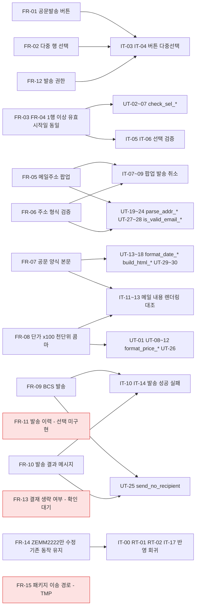
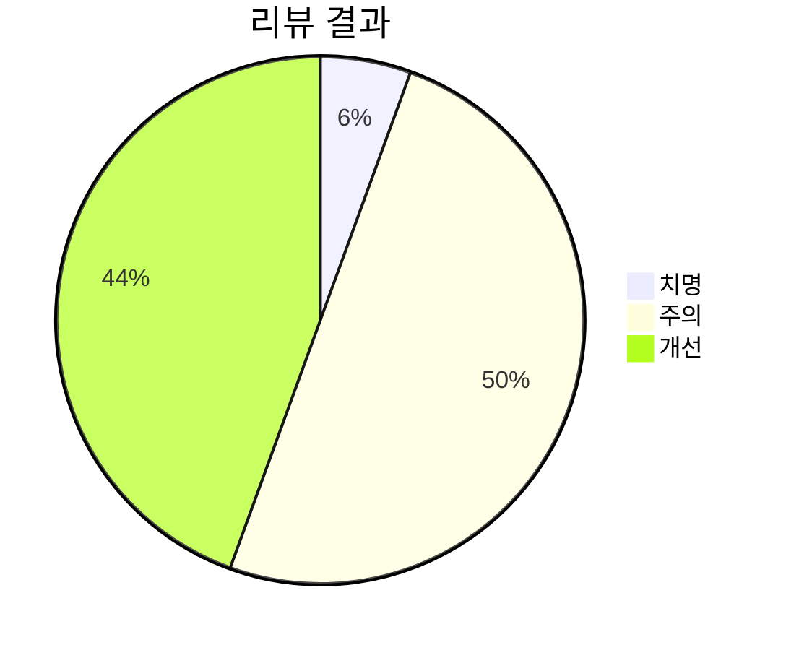
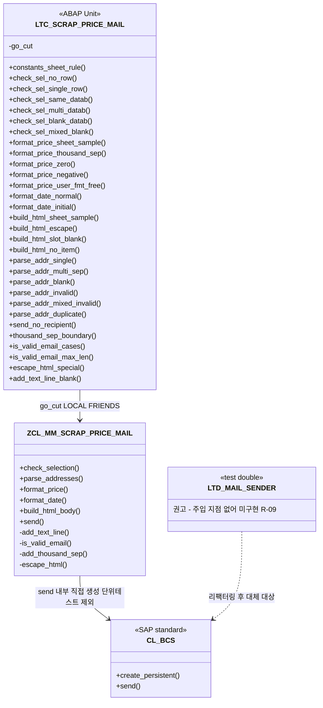

VERDICT: FAIL

# 04. 테스트 - 스크랩(SCRAP) 기본단가 관리 공문 메일발송 기능 개발

## 테스트 다이어그램

### 1) 요구사항 커버리지도

### 2) 리뷰 결과 분포

### 3) 단위테스트 구성도

---

- 요청 ID: 20261019-bce84c / 대상: T-code **ZEMM2222** (SAPMZMM2222, 기존 인클루드 MZMM2222TOP·O01·I01·F01 수정, 화면 0200, 클래스 ZCL_MM_SCRAP_PRICE_MAIL)
- 작성: 테스트 담당 (sap-tester) / 작성일: 2026-10-20 / **3차 (03_development.md 4차 기준 재검토)**
- 기준: request.md, 첨부 xlsx 텍스트 추출본("현업개발요청내용" B8~B76, "설계" B21, C56~C111), 01_analysis.md(2차), 02_design.md(5차), **03_development.md(4차)**, ref/ 현행 소스, `standards/handbook.md`
- 리뷰 대상: `src/` 전체(`MZMM2222TOP.abap` 78행, `MZMM2222O01.abap` 32행, `MZMM2222I01.abap` 90행, `MZMM2222F01.abap` 845행, `ZCL_MM_SCRAP_PRICE_MAIL.abap` 452행, `SAPMZMM2222_0200_flow.abap` 13행), `screen/SAPMZMM2222_0200_flow.abap`, 웹앱 반영 로직(`src/board.ts` devObjects, `src/adt.ts` objectUri·exists·create - 읽기만 함)
- 테스트 산출물: `src/ZCL_MM_SCRAP_PRICE_MAIL.testclasses.abap` (LTC_SCRAP_PRICE_MAIL, 테스트 메서드 30개. 대상 클래스가 바뀌지 않아 로직은 유지하고 헤더만 3차로 갱신)
- 조회 시스템: srd-abap (클라이언트 250), 읽기 전용. 시스템에 쓴 것 없음. 개발 소스와 웹앱 코드는 고치지 않음
- CR: 없음 (ticket.json·산출물에 반영된 CR 없음 확인)

## 1. 판정 요약

| 구분 | 결과 |
|---|---|
| 판정 | **FAIL**. ABAP 코드 자체에는 활성화 오류 요인이 없다. 하지만 `src/`에 ABAP 프로그램이 아닌 화면 흐름 로직 파일(`src/SAPMZMM2222_0200_flow.abap`)이 아직 남아 있다. 웹앱으로 개발계에 반영하면 이 파일이 실행 프로그램 `SAPMZMM2222_0200_FLOW`로 새로 만들어지고 활성화에 실패한다(R-18, 치명) |
| 치명 | 1건 (R-18 신규). **코드 수정은 필요 없다.** 파일 1개만 지우면 된다(팀장 승인 필요, 같은 내용이 `screen/`에 있음) |
| 주의 | 9건 (R-01~R-08, R-17). 모두 2차와 같고, 팀장·현업 결정이나 반영 도구 문제라 개발이 고칠 항목은 아니다 |
| 개선 | 8건 (R-09~R-16), 2차와 같음 |
| 개발표준 | 신규 이름 중 위반 0건(4장) |
| 단위테스트 | 30개. 대상 클래스가 2차 때와 같아 기대값을 그대로 둔다(활성화 후 IT-02로 실행) |

**판정 근거**
1. **4차 변경 대조**: 03_development.md 4차에서 소스 내용은 바뀌지 않았다. 바뀐 것은 화면 0200 흐름 로직 파일을 `screen/`으로 복사한 것뿐이다. 이번 단계에서 src 파일을 ref/ 원문과 다시 대조했다(3.1). 결과는 다음과 같다.
   - TOP 1~52, O01 1~14, F01 1~693은 원문과 행 번호까지 같다.
   - I01은 원문 1~48행 다음에 `WHEN c_fc_mail` 4줄만 들어갔다.
   - ZCL_MM_SCRAP_PRICE_MAIL은 2차 리뷰 때와 같다.
2. **R-18 (치명)**: 03 4차는 `src/SAPMZMM2222_0200_flow.abap`을 "삭제 대상"으로 적었다. 그러나 파일은 아직 `src/`에 있다(Glob 확인). 웹앱 반영 로직을 직접 읽어 보니 다음과 같이 처리된다.
   - `src/board.ts:89~103` devObjects는 `src/*.abap` 중 `.testclasses.abap`이 아닌 파일을 모두 반영 대상으로 삼는다. `CLASS ... DEFINITION`이 없으면 `PROG`로 본다.
   - 그래서 이 파일은 `SAPMZMM2222_0200_FLOW`(PROG/P)로 생성·저장된다(`board.ts:161~163`). 내용이 `PROCESS BEFORE OUTPUT.` 같은 화면 흐름 로직이라 ABAP 구문 오류가 난다.
   - `adt.activate(objs)`(`board.ts:170`)는 전체를 한 번에 활성화하므로 일괄 활성화가 실패한다. 반영 후 필요 없는 로컬 프로그램도 남는다.
   - 기준("활성화 실패 가능성은 치명")에 따라 치명으로 분류했다. 3차·4차 개발의 계기가 된 반영 오류 상황에서, 웹앱을 고쳐 다시 반영하는 경로(03 3.0 (a))를 막는 직접 원인이다.
3. **R-17 (주의 유지)**: 웹앱은 이번에도 바뀌지 않았다.
   - `adt.ts:27` objectUri는 PROG를 항상 `/programs/programs/`로 본다. 인클루드 4개(PROG/I, `/programs/includes/`)는 계속 "없음"으로 판정되어 신규 생성을 시도하고 HTTP 500으로 실패한다.
   - 반영 대상은 파일명 순서로 처리되므로 `MZMM2222F01`에서 먼저 멈춘다. 이 문제는 개발 소스로 고칠 수 없다. 03 3.0 수작업 대안이 있어 주의로 둔다.
4. 설계 시트의 명시 항목(B21, C56, C59, C60~C61, C63, C77, C95~C101, C110~C111)은 모두 구현되어 있고, 단위 또는 통합 시나리오로 추적된다(7장). 요구사항 누락으로 볼 항목은 없다.

**PASS로 바꾸는 조건**
- `src/SAPMZMM2222_0200_flow.abap`을 지우면(팀장 승인) 코드 재검토 없이 **PASS(조건부)** 로 바꿀 수 있다. `src/`에는 인클루드 4개, 클래스, 테스트 클래스 6개 파일만 남아야 한다.
- 조건부 조건은 2차와 같다. 개발계 반영 직후 IT-00(현행 소스 대조), IT-01(수작업 오브젝트·활성화), IT-02(ABAP Unit 30개 통과)를 확인하고, 하나라도 실패하면 FAIL로 되돌린다. 대외 발송(운영 사용) 전에는 R-01, R-02, R-03, R-04, R-07을 팀장·현업이 결정해야 한다.

## 2. 이전 테스트(2차) 지적 해소 여부

03_development.md 9장 4차 이력에 따르면, 이번 수정은 팀장 지시(개발계 반영 오류 재발)에 따른 것이고 소스 내용 변경은 없다.

| 2차 지적 | 4차 반영 여부 | 현재 상태 | 비고 |
|---|---|---|---|
| R-01~R-07 | 미반영 | 주의 유지 | 결정 대기(U-09, U-02/U-03, U-01/S-02, U-06, U-11/U-12) 또는 클래스 미변경 |
| R-08 수작업 선행 의존 | 미반영 | 주의 유지 | 3.3 플로우 로직 출처만 `screen/`으로 바뀜 |
| R-09~R-16 | 미반영 | 개선 유지 | 클래스 미변경 |
| R-17 반영 도구·현행 대조 | **원인 분석 보강, 도구는 미수정** | 주의 유지 | 4차에서 PL이 현행 F01 = src 1~693행임을 확인했다(03 3.0 "4차 확인 사실"). TOP/O01/I01의 현행 대조는 여전히 ref/ 스냅숏 기준이다. 웹앱 코드는 바뀌지 않았다(이번 단계에서 `adt.ts:27`, `board.ts:98` 확인) |
| (신규) 흐름 로직 파일 위치 | 4차에서 `screen/`으로 복사 | **`src/` 원본 미삭제 → R-18 치명** | 03 4차 본문에 "삭제 대상, PL 정리 필요"로 적혀 있음 |

## 3. 소스 리뷰 결과

### 3.1 src vs ref/ 원문 대조 (3차 재확인)

| 오브젝트 | 원문 범위 | src 범위 | 대조 결과 |
|---|---|---|---|
| MZMM2222TOP | 1~52 | 1~52 + 54~78(U4) | 일치. 마지막 원문 문장 `SO_DATAB FOR ZTMM0015-DATAB OBLIGATORY.`(52행) |
| MZMM2222O01 | 1~14 | 1~14 + 16~32(U4) | 일치 |
| MZMM2222I01 | 1~50 | 1~48, 49~52(삽입), 53~54(원문 49~50), 56~90(U4) | 일치. 원문 `   ENDCASE.` 들여쓰기 유지 |
| MZMM2222F01 | 1~693 | 1~693 + 695~845(U4) | 일치. GET_DATA SELECT(39~59) 필드 BTEXT/DATAB/DANGA 확인 |
| ZCL_MM_SCRAP_PRICE_MAIL | - | 1~452 | 2차 리뷰본과 같음(로직 변경 없음) |
| 화면 0200 흐름 로직 | - | `src/` 13행 = `screen/` 13행 | 내용 동일. **`src/` 쪽은 삭제해야 함(R-18)** |

### 3.2 리뷰 표

| ID | 심각도 | 오브젝트 / 위치 | 문제 | 수정 제안 | 관련 |
|---|---|---|---|---|---|
| **R-18 (신규)** | **치명** | `src/SAPMZMM2222_0200_flow.abap`:1~13 / 웹앱 `src/board.ts`:89~103, 161~163, 170 | ABAP 소스가 아닌 화면 흐름 로직(`PROCESS BEFORE OUTPUT.` 등)이 `src/`에 남아 있다. 웹앱 반영 때 실행 프로그램 `SAPMZMM2222_0200_FLOW`(PROG/P, `$TMP`)로 생성·저장되고, 구문 오류로 일괄 활성화가 실패한다. 반영 후 쓸데없는 프로그램도 남는다. 03 4차는 이 파일을 "삭제 대상"으로 적었지만 아직 지우지 않았다 | 팀장 승인을 받아 `src/SAPMZMM2222_0200_flow.abap`을 지운다(`screen/SAPMZMM2222_0200_flow.abap`에 같은 내용이 있음). 코드 수정은 필요 없다. 반영 전 `src/` 파일이 6개(TOP, O01, I01, F01, 클래스, 테스트 클래스)인지 확인한다(IT-00) | NFR-01, FR-14 |
| R-17 | 주의 | 개발계 반영 절차 / 웹앱 `src/adt.ts`:25~28, 95~100 | (1) 웹앱은 PROG를 항상 `/programs/programs/`로 확인한다. 그래서 기존 인클루드 4개(PROG/I)를 "없음"으로 보고 생성을 시도해 HTTP 500으로 실패한다. 이번 단계에서 코드를 직접 확인했고, 도구는 바뀌지 않았다. (2) TOP/O01/I01의 원문 부분은 2026-10-19 ref/ 스냅숏 기준이다. 전체 교체 방식으로 반영하면 그 뒤에 생긴 변경을 덮어쓸 수 있다(F01은 4차에서 PL이 현행과 대조함) | PL이 반영 도구의 인클루드 판별을 고치거나, 03 3.0 수작업 대안(U4 블록만 붙여넣기)으로 반영한다. 반영 직전 SE38 버전 비교로 확인한다(IT-00) | FR-14, NFR-01 |
| R-01 | 주의 | MZMM2222I01.abap:50~51, ref/MZMM0020F02.abap SET_PF_STATUS | 공문발송에 권한 체크가 없고 버튼은 모든 사용자에게 보인다. 기존 SET_PF_STATUS는 스크럽구매팀(ORGEH '10005020')이 아닌 사용자의 TOGG까지 막는데, 그런 사용자도 단가 공문은 외부로 보낼 수 있다(대외 영업 정보, NFR-06) | U-09를 결정한다. 최소 조치는 F02 SET_PF_STATUS의 ELSE 분기에 `ls_status = 'ZMAIL'. APPEND ls_status TO lt_status.`를 넣는 것이다. 또는 MAIL_PROCESS 처음에 AUTHORITY-CHECK를 둔다 | FR-12, NFR-06, U-09 |
| R-02 | 주의 | ZCL_MM_SCRAP_PRICE_MAIL.abap:272~282, 315~325 | 메일 양식 이미지(요청 B45~B74, 설계 C80~C94, C104~C109)를 확인하지 못해 상단 문구, 1항 제목, 3항, 맺음말, 발신 명의가 비어 있다. 지금 본문은 "1." + 단가표 + "2. 적용일자"뿐이라 대외 공문 형식으로는 부족하다 | 현업에게서 캡처(PNG/PDF)를 받아 텍스트 심볼 A01~A05, B01, B03, Z01~Z03, S01을 확정한다. 운영 사용 전 필수 | FR-07, U-02, U-03 |
| R-03 | 주의 | ZCL_MM_SCRAP_PRICE_MAIL.abap:46~47, 227 / MZMM2222F01.abap:780 | 메일 단가는 DANGA 내부값 ×100, 소수 1자리다. DANGA가 WAERS를 참조하는 CURR 필드라면 ALV에는 이미 470으로 보일 수 있어, "화면 단가 ×100" 해석과 어긋난다(요청 B75 "단가가 너무 크다"). KPEIN≠1이거나 WAERS≠KRW인 행도 그대로 ×100 한다 | SE11에서 ZSMM0015-DANGA 타입과 참조 통화를 확인하고(S-02, 이번 MCP 조회도 실패), U-01 답변을 받은 뒤 C_PRICE_FACTOR/C_PRICE_DEC만 고친다. 실제 값은 IT-12에서 대조한다 | FR-08, U-01, S-02 |
| R-04 | 주의 | MZMM2222F01.abap:772~783 / ZCL:157~167 | 선택 행을 상태 구분 없이 메일에 싣는다. (a) 삭제표시(LVORM='X') 행 단가가 외부로 나갈 수 있다. (b) 미저장 수정값이 DB와 다른 채로 발송된다. (c) 신규 행끼리(DATAB 공란) 고르면 002에 걸리지 않고 "2. 적용일자: "가 빈 공문이 나간다(UT-06) | U-06을 결정한다. 권고: LVORM='X' 행과 DATAB 공란 행은 차단하고(ZMMM3 007~ 추가), 미저장 변경이 있으면 저장 후 발송하도록 안내한다 | U-06, FR-04 |
| R-05 | 주의 | ZCL_MM_SCRAP_PRICE_MAIL.abap:358~363 | HTML을 `string_to_soli`로 255자씩 나눈 뒤 `i_length` 없이 `create_document`에 넘긴다. 줄 경계에서 끝 공백이 빠지면 속성·글꼴명이 붙을 수 있다. `<meta charset="utf-8">`과 SCOT 코드페이지가 다르면 한글이 깨질 수 있다 | `i_length = CONV so_obj_len( strlen( iv_html ) )`를 지정하거나, `string_to_solix( iv_codepage = '4110' )` + `i_hex`로 넘긴다. IT-13에서 20행 이상으로 확인한다 | FR-07, NFR-04 |
| R-06 | 주의 | MZMM2222F01.abap:761 | `grid->check_changed_data`의 `e_valid`를 확인하지 않아, 편집 모드에서 입력 오류 셀이 있어도 그 값으로 메일을 만든다 | `CALL METHOD grid->check_changed_data IMPORTING e_valid = l_valid.` 다음에 `IF l_valid IS INITIAL. RETURN. ENDIF.`를 넣는다 | FR-03, NFR-01 |
| R-07 | 주의 | 전체(SAPMZMM2222, MZMM2222*, ZCL_MM_SCRAP_PRICE_MAIL, ZMMM3) | 모두 `$TMP`라 이송요청에 담을 수 없고, 품질·운영 반영 경로가 없다(FR-15 '필수'). 이번 조회에서도 MZMM2222* 7개가 `$TMP` | U-11(ZEMM2222 성격), U-12(ZMMD 재지정·이송요청)를 팀장이 결정한다 | FR-15, NFR-07 |
| R-08 | 주의 | MZMM2222F01.abap:734, MZMM2222O01.abap:28~29, MZMM2222TOP.abap:60~61, 03_development.md 3장 | 기능이 수작업 오브젝트에 의존한다(ZMMM3, 텍스트 심볼, SE51 화면 0200, SE41 GUI 상태 0100 ZMAIL·0200·제목 0200). 화면 0200이 없으면 DYNPRO_NOT_FOUND가 난다. Lower case를 빼먹으면 주소가 대문자로 바뀐다. 클래스가 없으면 TOP 구문 오류가 난다. srd-abap에 ZCL_MM_SCRAP*·ZMMM3*은 아직 없다(이번 조회) | 03 3.0 권장 순서(ZMMM3 → 클래스 → 인클루드 → 화면·GUI → 전체 활성화)로 반영하고 IT-01로 확인한다 | FR-01, FR-05 |
| R-09 | 개선 | ZCL_MM_SCRAP_PRICE_MAIL.abap:332~395 | SEND가 CL_BCS를 직접 생성하고 COMMIT/ROLLBACK까지 해서, 테스트 더블을 넣을 지점이 없다 | 발송부를 인터페이스로 분리해 생성자로 주입하고(핸드북 규칙 없음 - SAP 관례 `ZIF_MM_MAIL_SENDER`), COMMIT은 호출 FORM으로 옮긴다 | 테스트 용이성 |
| R-10 | 개선 | ZCL_MM_SCRAP_PRICE_MAIL.abap:201~205 | 중복 제거가 대소문자를 구분한다(`A@X.com`과 `a@x.com`을 2건으로 봄) | `to_lower( )`로 비교하고 원래 표기는 유지한다 | FR-05 |
| R-11 | 개선 | MZMM2222TOP.abap:64 | G_MAIL_TO가 255자라 여러 주소를 넣으면 잘릴 수 있는데, 잘려도 알려 주지 않는다 | Q-04 확정 시 입력창을 늘리거나 수신자 표로 바꾼다 | FR-05, Q-04 |
| R-12 | 개선 | MZMM2222F01.abap:805~806 | 모달 팝업에서 `TYPE 'S' DISPLAY LIKE 'E'` 메시지는 눈에 덜 띌 수 있다 | IT-08에서 확인하고, 필요하면 POPUP_TO_INFORM을 쓴다 | FR-06 |
| R-13 | 개선 | ZCL_MM_SCRAP_PRICE_MAIL.abap:109~110, 421 | `FIND REGEX`(POSIX)는 7.55 이상에서 구식 문법 경고 대상이다 | 릴리스 확인(S-05) 후 `FIND PCRE` 전환을 검토한다 | 유지보수 |
| R-14 | 개선 | ZCL_MM_SCRAP_PRICE_MAIL.abap:273~277, 280, 316, 323~325 | 만들지 않은 텍스트 심볼(A01~A05, B01, B03, Z01~Z03)을 참조해 SLIN·ATC 경고가 난다(활성화에는 영향 없음) | U-02 확정 시 등록하고, 그전까지는 ATC 예외 사유를 기록한다 | 품질 점검 |
| R-15 | 개선 | MZMM2222TOP/I01/O01/F01.abap:2, ref/SAPMZMM2222.abap:4~17 | 인클루드 헤더 주석이 'MZMM0020'이고, 메인 변경 이력(U1~U3)에 U4가 없다 | U-11 확정 시 헤더를 정정하고 메인 이력에 U4를 추가한다(메인 수정이 허용될 때) | 유지보수 |
| R-16 | 개선 | (미구현) | 발송 이력(FR-11, 선택)이 없어 SOST로만 추적할 수 있다 | Q-09 결정 후 필요하면 CR로 처리한다(이력 Z테이블 `ZTMM`+4자리, 번호 확인 필요) | FR-11 |

**중점 검토 항목별 결과**

| 항목 | 결과 |
|---|---|
| 구문 오류 / 활성화 | ABAP 코드(인클루드 4개, 클래스, 테스트 클래스)에서 오류 요인을 찾지 못했다. 다시 확인한 문법: TOP 끝의 DATA/CONSTANTS, `LIKE LINE OF gt_pr`(헤더라인 테이블), 클래스 상수를 쓴 `MESSAGE ID ... NUMBER`, 문자열 템플릿 `DECIMALS =`, `MESSAGE ... INTO`. **단, `src/` 흐름 로직 파일은 웹앱 반영 시 활성화 실패(R-18)**. 수작업 오브젝트가 먼저 있어야 한다(R-08). 미정의 텍스트 심볼은 경고만 난다(R-14). 문법은 7.40 SP08 이상 전제이고 릴리스는 확인하지 못했다(S-05) |
| 필드·타입 존재 | SearchObject로 ZTMM0014·ZTMM0015(TABL/DT, ZMMD) 존재를 다시 확인했다. GetTable ZTMM0015 / GetStructure ZSMM0015 / GetTypeInfo AD_SMTPADR는 이번에도 실패했다(ADT 리소스 없음). BTEXT/DANGA/DATAB는 현행 GET_DATA SELECT(F01:39~59)로 간접 확인했다. BCS 표준 클래스 시그니처는 1·2차 GetClass 결과(CL_BCS, CL_SAPUSER_BCS=>CREATE RAISING CX_ADDRESS_BCS 등)를 그대로 쓴다 |
| 성능 | 신규 DB 접근이 없다. SELECT in LOOP, SELECT *도 없다(기존 SAVE_DATA의 SELECT in LOOP는 원문이라 범위 밖) |
| 권한 | 신규 권한 체크 없음(R-01) |
| 예외 처리 | SEND에서 CX_BCS(하위 CX_ADDRESS_BCS·CX_SEND_REQ_BCS 포함)를 잡아 006으로 표시한다. send()가 FALSE를 돌려주면 E01로 처리하고, GRID가 없으면 RETURN한다. 덤프 경로는 화면 0200 미생성(R-08)뿐이다 |
| 요구사항 누락 | 시트 명시 항목 중 누락 없음. 확인 대기(R-02, R-03), 선택(FR-11), 결정 대기(FR-13, FR-15)는 7장에 표시 |

## 4. 개발표준 준수 (standards/handbook.md)

### 4.1 오브젝트명

| 오브젝트 | 유형 | 핸드북 규칙 | 결과 |
|---|---|---|---|
| ZMMM3 | 메시지 클래스 | `Z`+`M`+모듈 2자리+순번 1자리 | 적합. srd-abap `ZMMM3*` 미존재(이번 조회) |
| ZCL_MM_SCRAP_PRICE_MAIL | 클래스 | 규칙 없음 - SAP 관례 `ZCL_` | 적합(관례). `ZCL_MM_SCRAP*` 미존재(이번 조회) |
| SAPMZMM2222 / MZMM2222* / ZEMM2222 | 기존 모듈풀·인클루드·T-code | Module Pool `SAPMZ`+모듈+4자리 | 기존 이름이라 변경 대상이 아님 |
| 화면 0200, GUI 상태 0200, 제목 0200 | DYNP/CUAD | 규칙 없음 - 기존 프로그램 관례('0100') | 적합(관례) |
| LTC_SCRAP_PRICE_MAIL | 로컬 테스트 클래스 | 규칙 없음 - SAP 관례 `LTC_` | 적합(관례) |
| (의도하지 않은 오브젝트) SAPMZMM2222_0200_FLOW | 웹앱이 만들 PROG/P | Programs `Z`+유형+모듈+4자리 / Module Pool 규칙 어디에도 맞지 않음 | **부적합. 만들어지면 안 되는 오브젝트다(R-18).** 파일 삭제로 해소한다. 화면 0200은 SE51에서 SAPMZMM2222 소속으로 만든다(03 3.3) |

### 4.2 프로그램 내부 이름 (신규분)

| 위치 | 이름 | 규칙 | 결과 |
|---|---|---|---|
| MZMM2222TOP:60~61 | GT_MAIL_ITEM, GT_MAIL_TO | Internal Table `GT_` | 적합 |
| MZMM2222TOP:64~67 | G_MAIL_TO, G_DATAB, G_OK_0200, G_ANSWER | Variables `G_` | 적합 |
| MZMM2222TOP:70 | GO_MAIL | 참조 변수 - 규칙 없음, SAP 관례 `GO_` | 적합(관례) |
| MZMM2222TOP:73~77 | C_FC_MAIL, C_FC_SEND, C_FC_CANC, C_ANSWER_SEND, C_ANSWER_CANC | Constants `C_`, 20자 이하 | 적합 |
| MZMM2222F01:708, 753~756, 795~797, 822~825 | L_MSGNO, LT_ROW, LS_ROW, LS_PR, LS_ITEM, L_INVALID, L_MSGV, L_HTML, L_ERROR, L_OK | `L_`/`LT_`/`LS_` | 적합 |
| ZCL_MM_SCRAP_PRICE_MAIL:39~47, 105~110 | C_MSGID ~ C_MSGNO_INVALID_ADDR(20자), C_PRICE_FACTOR, C_DOC_TYPE, C_REGEX_MAIL 등 | Constants `C_`, 20자 이하 | 적합 |
| ZCL_MM_SCRAP_PRICE_MAIL:145~146, 174~177, 220~224, 263~266, 338~341, 400, 431 | LS_ITEM, L_DATAB, L_TEXT, LT_PART, L_PART, L_ADDR, L_VAL, L_INT, L_DEC, L_NEG, L_REMARK, L_B01, L_B03, LT_TEXT, L_SUBJECT, L_SUBJ_LONG, L_TO, L_POS | `L_`/`LT_`/`LS_` | 적합 |
| ZCL_MM_SCRAP_PRICE_MAIL:334~337 | LO_REQ, LO_DOC, LO_RCPT, LX_BCS | 참조 변수 - 규칙 없음, SAP 관례 | 적합(관례) |
| 메서드 파라미터 | IV_/IT_/EV_/ET_/RV_/CV_ | 규칙 없음 - SAP 관례 | 적합(관례) |
| 테스트 클래스 | C_DATAB_SAMPLE/OTHER/BLANK, GO_CUT(클래스 속성 = Global, 참조 접두어 관례), LT_ITEM, LS_ITEM, L_MSGNO, L_DATAB, L_PRICE, L_HTML, LT_ADDR, LT_SLOT, L_EXP, L_B03 등 | 핸드북 2장 + 관례 | 적합 |

**프로그램 내부 이름 중 핸드북에 어긋난 것은 0건이다.** 기존 이름(OK_CODE, SAVE_OK, GT_PR, GRID, RT_EXTAB, LV_INDEX 등)은 핸드북 이전 명명이고 이번 범위가 아니어서 지적하지 않았다. 오브젝트 단위 위반은 의도하지 않은 SAPMZMM2222_0200_FLOW 1건이고 R-18과 같은 건이다.

## 5. 시스템 조회 결과 (srd-abap, 이번 단계)

| 조회 | 결과 | 반영 |
|---|---|---|
| SearchObject `ZCL_MM_SCRAP*` | 없음 | 클래스 미생성. 인클루드보다 먼저 만들어야 함(R-08) |
| SearchObject `ZMMM3*` | 없음 | 메시지 클래스 신규 생성 필요(IT-01) |
| SearchObject `*MZMM2222*` | SAPMZMM2222(PROG/P), MZMM2222ALV/F01/F02/I01/O01/TOP(PROG/I, URI `/programs/includes/`), 모두 `$TMP` | 기존 인클루드 수정 대상 확인(R-07, R-17) |
| SearchObject `SAPMZMM2222*` | SAPMZMM2222만 있음 | 이전 반영 시도로 `SAPMZMM2222_0200_FLOW`가 만들어지지는 않았음. 지금 파일을 지우면 정리할 SAP 오브젝트는 없음(R-18) |
| SearchObject `ZTMM001*` | ZTMM0014·ZTMM0015 TABL/DT(ZMMD) 존재 | 단가 원천 확인 |
| GetTable ZTMM0015, GetStructure ZSMM0015, GetTypeInfo AD_SMTPADR | 실패(ADT 리소스 없음) | S-02는 SE11에서 확인 |
| 인클루드 현행 소스 | 이 세션에는 조회 도구 없음 | F01은 4차 PL 재조회로 현행 = src 1~693행. TOP/O01/I01은 IT-00에서 확인 |

## 6. 테스트 시나리오

### 6.1 단위테스트 (ABAP Unit, `src/ZCL_MM_SCRAP_PRICE_MAIL.testclasses.abap`)

- 클래스 `LTC_SCRAP_PRICE_MAIL`(FOR TESTING, RISK LEVEL HARMLESS, DURATION SHORT). private 메서드는 `LOCAL FRIENDS`로 시험한다.
- DB 의존 없음(대상 클래스가 DB를 읽지 않음). BCS 실제 발송은 주입 지점이 없어 더블로 바꿀 수 없다. 그래서 수신자 0건 분기만 시험하고, 실제 발송은 IT-10/IT-14에서 확인한다(R-09).
- 대상 클래스가 2차 때와 같아 30개의 기대값은 바뀌지 않는다. 웹앱으로 반영하면 클래스와 함께 testclasses 인클루드에 저장되고, 활성화 후 자동 실행된다(`board.ts:164, 174~177`).

| ID | 테스트 메서드 | 절차(입력) | 기대 결과 | 근거 |
|---|---|---|---|---|
| UT-01 | constants_sheet_rule | 상수 확인 | C_PRICE_FACTOR 100, C_PRICE_DEC 1, C_MSGID 'ZMMM3' | 시트 C110, C96~D99 |
| UT-02 | check_sel_no_row | 0건 | '001', ev_datab 초기화 | C59, T01 |
| UT-03 | check_sel_single_row | 1건(20260928) | 공란, ev_datab 20260928 | 경계 |
| UT-04 | check_sel_same_datab | 시트 샘플 4건, 같은 DATAB | 공란, ev_datab 20260928 | C60, T02 |
| UT-05 | check_sel_multi_datab | 샘플 4건 + 다른 DATAB 1건 | '002', ev_datab 공란 | C60~C61, T03 |
| UT-06 | check_sel_blank_datab | DATAB 공란 2건 | 공란(현재 기본값에서는 통과) - R-04 | U-06 경계 |
| UT-07 | check_sel_mixed_blank | DATAB 값 + 공란 | '002' | 경계 |
| UT-08 | format_price_sheet_sample | 4.70 / 4.65 | `470.0` / `465.0` | C96~D99, C110 |
| UT-09 | format_price_thousand_sep | 9.99 / 12.35 / 1234.56 | `999.0` / `1,235.0` / `123,456.0` | C111 |
| UT-10 | format_price_zero | 0 | `0.0` | 경계 |
| UT-11 | format_price_negative | -12.35 | `-1,235.0` | 경계 |
| UT-12 | format_price_user_fmt_free | SET COUNTRY 'DE' 후 1234.56 | `123,456.0` | T05 |
| UT-13 | format_date_normal | 20260928 | `2026.09.28` | C101 |
| UT-14 | format_date_initial | 00000000 | 공란 | 경계 |
| UT-15 | build_html_sheet_sample | 샘플 4건, 20260928 | `<html>` 시작, 헤더 등급/단가/비고, 표 행 4개(선택 순서), 470.0/465.0 오른쪽 정렬, 비고 `&nbsp;`, `2. 적용일자: 2026.09.28`, B03 공란이면 3항 없음 | C79~C103, T07 |
| UT-16 | build_html_escape | 등급명 `<A&B>` | `&lt;A&amp;B&gt;`, 원문 문자열 없음 | T08 |
| UT-17 | build_html_slot_blank | 샘플 4건 | `
` 개수 = 1 + 값 있는 슬롯 수 | T18 |
| UT-18 | build_html_no_item | 0건 | 표 행 0, `</table>` 있음 | 경계 |
| UT-19 | parse_addr_single | `  User01@Example.com  ` | 1건, 대소문자 보존 | C63, T09 |
| UT-20 | parse_addr_multi_sep | `;` `,` 공백 혼합 4건 | 4건, 순서 유지, 하이픈 도메인 허용 | X-3 |
| UT-21 | parse_addr_blank | 공란 / 구분자만 | '003' | X-2 |
| UT-22 | parse_addr_invalid | `abc` / `a@b` | '004', ev_invalid `abc` | X-2 |
| UT-23 | parse_addr_mixed_invalid | `a@x.com;abc;def@` | '004', ev_invalid `abc;def@`, 정상 1건 | X-2 |
| UT-24 | parse_addr_duplicate | 같은 주소 2번 | 1건 | T09 |
| UT-25 | send_no_recipient | 수신자 0건 | rv_ok FALSE, ev_error 있음, SY-MSGID ZMMM3 / SY-MSGNO 003 | FR-10 |
| UT-26 | thousand_sep_boundary | 빈 값, 0, 470, 1235, 123456, 1234567 | 빈 값, 0, 470, 1,235, 123,456, 1,234,567 | C111 |
| UT-27 | is_valid_email_cases | 정상 2건, 오류 4건 | TRUE 2 / FALSE 4 | X-2 |
| UT-28 | is_valid_email_max_len | 241자 / 242자 | TRUE / FALSE | AD_SMTPADR 길이 |
| UT-29 | escape_html_special | `<A&B>`, `주물A(모터블럭)` | `&lt;A&amp;B&gt;` / 그대로 | T08 |
| UT-30 | add_text_line_blank | 공백만 / `A&B` | 추가 없음 / `
A&amp;B
` | X-7 |

### 6.2 통합 테스트 (개발계 srd-abap, T-code ZEMM2222)

테스트 수신자는 **사내 메일주소만** 쓴다(NFR-02). 외부 발송 차단 여부는 SCOT 설정을 Basis에 확인한다(S-04).

| ID | 제목 | 절차 | 기대 결과 | 근거 |
|---|---|---|---|---|
| IT-00 | 반영 전 점검 | (1) `work/20261019-bce84c/src/`에 6개 파일(MZMM2222TOP/O01/I01/F01, ZCL_MM_SCRAP_PRICE_MAIL, .testclasses)만 있는지 확인한다. (2) SE38 버전 관리나 ADT에서 현행 MZMM2222TOP/O01/I01/F01을 열어 src의 원문 범위(TOP 1~52, O01 1~14, I01 1~48·53~54, F01 1~693)와 대조하고, `*-- U4` 블록이 이미 있는지 본다. (3) 웹앱이 고쳐지지 않았으면 03 3.0 수작업 대안으로 반영한다 | (1) 흐름 로직 파일 없음 (2) 현행 = 원문이고 U4 없음 (3) 반영 경로 확정. 하나라도 다르면 반영을 멈추고 PL에 보고 | R-18, R-17, FR-14 |
| IT-01 | 수작업 선행 반영 | 03 3.0 순서로 진행한다: SE91 ZMMM3 001~006 → SE24 클래스·텍스트 심볼(S01, H01~H03, B02, E01) → 인클루드 4개 → SE51 화면 0200(모달, G_MAIL_TO Lower case, OK 필드 G_OK_0200, 흐름 로직은 `screen/` 파일) → SE41 GUI 상태 0100 ZMAIL / 0200 SEND·CANC(E) / 제목 0200 → SAPMZMM2222 전체 활성화 | 활성화 오류 0건 | R-08 |
| IT-02 | ABAP Unit 실행 | ZCL_MM_SCRAP_PRICE_MAIL 단위 테스트 실행 | UT-01~UT-30 모두 성공 | 6.1 |
| IT-03 | 버튼 표시 | 스크럽구매팀 사용자와 그 외 사용자로 조회 모드·편집 모드에 들어간다 | 기본값: 모두 "공문발송"이 보임 | FR-01, FR-12 |
| IT-04 | 다중 행 선택 | Ctrl/Shift로 4행 선택 | 다중 선택 가능 | FR-02, C56 |
| IT-05 | 미선택 | 행을 선택하지 않고 공문발송 | 001(E 표시), 팝업 안 뜸 | FR-03, C59 |
| IT-06 | 유효시작일 상이 | DATAB가 다른 2행 선택 후 공문발송 | 002, 팝업 안 뜸 | FR-04, C60~C61 |
| IT-07 | 팝업 표시 | DATAB가 같은 4행 선택 후 공문발송 | 화면 0200: 제목 "공문발송", "메일주소" 공란, 커서 위치, [발송][취소] | FR-05, C63 |
| IT-08 | 주소 오류 | 공란 / `abc` 입력 후 [발송] | 003 / 004, 팝업 유지, 입력값 보존. 메시지 가시성 기록(R-12) | FR-06 |
| IT-09 | 취소 | [취소] / F12 / 창 닫기(X) | 팝업 닫힘, 메시지 없음, SOST 신규 문서 없음 | FR-05, X-1 |
| IT-10 | 정상 발송 | 사내 주소 2개를 `;`로 입력하고 [발송] | 005, SOST 문서 1건(수신자 2), 메일 도착, 대소문자 보존 | FR-09, FR-10, C77 |
| IT-11 | 메일 내용 대조 | 시트 샘플 4건(DATAB 2026.09.28) 발송 | 제목 "국내스크랩 기본단가 공문", 헤더 등급/단가/비고, 470.0/470.0/470.0/465.0, "2. 적용일자: 2026.09.28". 현업 캡처와 대조 결과 기록(R-02) | FR-07, C79~C103 |
| IT-12 | 단가 대조 | ALV 표시값, SE16 ZTMM0015-DANGA, 메일 단가 비교 | 메일 단가 = DANGA ×100. 화면 표시값과의 관계 기록(U-01) | FR-08, R-03 |
| IT-13 | 렌더링 | 20행 이상 발송 후 Outlook 데스크톱·웹메일에서 열기 | 표·정렬·한글 정상, 255자 경계 깨짐 없음 | NFR-04, R-05 |
| IT-14 | 발송 실패 | SU01 메일이 없는 사용자로 발송 | 006 + 사유, 덤프 없음 | FR-10 |
| IT-15 | 행 상태 기본값 | (a) 미저장 수정값 (b) 신규 행(DATAB 공란) 2행 (c) 삭제표시 행 | 기본값: 모두 발송((b)는 적용일자 공란). U-06 결정 자료로 기록 | R-04 |
| IT-16 | 플랜트 혼합 | WERKS가 다른 행을 같은 DATAB로 선택 | 기본값: 차단 없이 한 표로 발송 | U-10 |
| IT-17 | 발송 후 기존 동작 | IT-10 직후 편집 모드 유지 확인 후 SAVE | GT_PR·편집 모드 유지, SAVE 정상 | NFR-01 |

### 6.3 회귀 테스트

| ID | 제목 | 절차 | 기대 결과 | 근거 |
|---|---|---|---|---|
| RT-01 | ZEMM2222 기존 기능 | 조회 → TOGG / CREA / COPY / DEL / SAVE / GRAD / BACK / EXIT 실행. SE38 버전 비교로 반영 전후 대조 | 동작이 변경 전과 같음. 차이는 TOP·O01·F01 끝 U4 블록과 I01 `WHEN c_fc_mail` 4줄·끝 U4 블록뿐 | FR-14, NFR-01 |
| RT-02 | ZEMM0020 미변경 | ZEMM0020 실행, SAPMZMM0020·MZMM0020* 버전 이력 확인 | 공문발송 버튼 없음, 버전 변경 없음 | FR-14 |
| RT-03 (신규) | 불필요 오브젝트 미생성 | 반영 후 SearchObject / SE80에서 `SAPMZMM2222*` 검색 | SAPMZMM2222 외에 `SAPMZMM2222_0200_FLOW` 같은 신규 프로그램 없음 | R-18 |

### 6.4 항목별 판정 (이번 단계에서 확인 가능한 범위)

| 항목 | 결과 | 비고 |
|---|---|---|
| 요구사항 부합(시트 B21, C56~C111) | PASS | 7장 추적표 |
| 설계 부합(02 5차) | PASS | 03 5.2의 설계 차이 7건은 동작이 같은 범위의 차이 |
| ABAP 코드 구문·런타임 위험 | PASS(주의 포함) | 치명 없음. 주의 R-05, R-06 |
| 오브젝트 존재(SAP 조회) | PASS(조건부) | 신규 클래스·ZMMM3 미존재(신규 생성 예정), DDIC 상세는 조회 실패 |
| 개발표준 | PASS | 내부 이름 위반 0. 의도하지 않은 오브젝트 1건은 R-18로 처리 |
| 반영 산출물 구성(src/) | **FAIL** | R-18 |
| 단위테스트 작성 | PASS | 30개, 실행은 IT-02 |
| 통합·회귀 | 미실행 | 개발계 반영 후 진행 |

## 7. 요구사항 추적표

| 요구사항 | 내용 | 구현 위치 | 테스트 | 상태 |
|---|---|---|---|---|
| FR-01 | 공문발송 버튼 | GUI 상태 0100 ZMAIL(수작업), I01:50~51, TOP:73 | IT-01, IT-03 | 구현 |
| FR-02 | 다중 행 선택 | 기존 sel_mode 'A', F01:763~765 | IT-04 | 구현(기존) |
| FR-03 | 1행 이상 선택 | ZCL:151~154, F01:723~730 | UT-02, IT-05 | 구현 |
| FR-04 | 유효시작일 동일 | ZCL:157~167 | UT-03~07, IT-06 | 구현(DATAB 공란은 R-04) |
| FR-05 | 메일주소 팝업, 취소 | 화면 0200(screen/ 흐름 로직), O01:27~31, I01:66~89, F01:733~734 | UT-19~24, IT-07, IT-09 | 구현 |
| FR-06 | 주소 형식 검증 | ZCL:172~215, 413~426, F01:793~813 | UT-21~23, UT-27~28, IT-08 | 구현 |
| FR-07 | 공문 양식 본문 | ZCL:261~329, 텍스트 심볼 | UT-13~18, UT-29~30, IT-11, IT-13 | 구현(양식 슬롯 미확정 R-02) |
| FR-08 | 단가 ×100, 천 단위 콤마 | ZCL:218~246, 429~443 | UT-01, UT-08~12, UT-26, IT-12 | 구현(단위 확인 대기 R-03) |
| FR-09 | BCS 발송 | ZCL:332~395, F01:820~844 | UT-25, IT-10 | 구현 |
| FR-10 | 발송 결과 메시지 | F01:834~842 | UT-25, IT-10, IT-14 | 구현 |
| FR-11 | 발송 이력 (선택) | 없음 | 없음 | **미구현(선택, Q-09)** - R-16 |
| FR-12 | 발송 권한 | 없음(기본값: 전원 노출) | IT-03(기본값 확인만) | 결정 대기(U-09) - R-01 |
| FR-13 | 결재 생략 여부 | 결재 없이 즉시 발송(기본값) | 없음 | 확인 대기(Q-08) |
| FR-14 | ZEMM2222만 수정, 기존 동작 유지 | src에 MZMM0020* 없음, 원문 유지 + U4 블록 | IT-00, RT-01, RT-02, RT-03, IT-17 | 구현(반영 산출물 구성은 R-18) |
| FR-15 | 패키지·이송 경로 | 전체 $TMP | 없음 | 결정 대기(U-12) - R-07 |
| NFR-01 | 기존 동작 영향 없음 | 버튼 이벤트 안에서만 동작, 원문 행 번호 유지 | IT-00, RT-01, IT-17 | 구현 |
| NFR-02 | 테스트 시 외부 발송 방지 | 운영 절차 | 6.2 전제 | 절차로 관리 |
| NFR-03 | 단가 변환 한 곳 | C_PRICE_FACTOR/C_PRICE_DEC, FORMAT_PRICE | UT-01 | 구현 |
| NFR-04 | HTML 표, UTF-8 | ZCL:269~270 | UT-15, IT-13 | 구현(변환 위험 R-05) |
| NFR-05 | 한국어 메시지, Z 메시지 클래스 | ZMMM3 001~006 | IT-05~IT-10 | 구현(수작업) |
| NFR-06 | 발송 통제 | 없음 | IT-03 | 결정 대기 - R-01 |
| NFR-07 | 이송 가능 패키지 | $TMP | 없음 | 결정 대기 - R-07 |

## 8. 결함 목록 (수정 필요)

| 번호 | 심각도 | 위치 | 내용 | 수정안 | 담당 |
|---|---|---|---|---|---|
| D-01 (R-18) | 치명 | `work/20261019-bce84c/src/SAPMZMM2222_0200_flow.abap` | 화면 흐름 로직이 `src/`에 남아 있어, 웹앱 반영 시 PROG/P로 생성되고 활성화 실패 | 파일 삭제(팀장 승인). `screen/` 사본으로 SE51 작업. 코드 수정 없음 | 팀장 승인 → PL 정리 |
| D-02 (R-17) | 주의 | 웹앱 `src/adt.ts` objectUri·exists, `src/board.ts` devObjects | 인클루드(PROG/I)를 실행 프로그램으로 판정해 신규 생성 시도 → HTTP 500 | 웹앱 수정(인클루드 URI 판별), 또는 03 3.0 수작업 반영 | 팀장 결정 → PL |

나머지 주의·개선(R-01~R-16)은 결정 대기나 품질 개선 항목이라 결함 목록에 넣지 않았다(3.2 표).

## 9. 팀장·현업 확인 요청 (테스트 관점)

| 번호 | 내용 | 관련 리뷰 |
|---|---|---|
| (팀장) | `src/SAPMZMM2222_0200_flow.abap` 삭제 승인 | R-18 |
| (팀장/PL) | 반영 도구의 인클루드(PROG/I) 판별을 고칠지, 03 3.0 수작업으로 반영할지 | R-17 |
| U-01 / S-02 | DANGA 타입·통화 참조, 단가 단위(kg/톤), KPEIN≠1 처리 | R-03 |
| U-02 / U-03 | 메일 양식 캡처, 제목 | R-02 |
| U-06 | 삭제표시·미저장·신규 행 차단 여부 | R-04, R-06 |
| U-09 | 버튼 노출·권한 기준 | R-01 |
| U-11 / U-12 | ZEMM2222 성격, 패키지·이송 | R-07 |
| S-05 | srd-abap SAP_BASIS 릴리스(7.40 SP08 이상 여부) | 테스트 클래스 문법, R-13 |

## 10. 변경 이력

| 일자 | 차수 | 내용 |
|---|---|---|
| 2026-10-20 | 1차 | 최초 작성. 02_design.md 5차·03_development.md 2차 기준 소스 리뷰(치명 0, 주의 8, 개선 8), 개발표준 점검(위반 0), 단위테스트 30개(LTC_SCRAP_PRICE_MAIL) 작성, 통합 17건·회귀 2건 시나리오, 요구사항 추적표 작성. CR 없음 |
| 2026-10-20 | 2차 | 03_development.md 3차(MZMM2222* 기존 인클루드에 U4 블록 추가 방식) 기준 재검토. ref/ 원문 대조, 1차 지적 해소표, R-17·IT-00 신설, 행 번호 갱신, srd-abap 재조회. 판정 PASS(조건부)(치명 0, 주의 9, 개선 8). CR 없음 |
| 2026-10-20 | 3차 | **03_development.md 4차 기준 재검토.** (1) src 4개 인클루드를 ref/ 원문과 다시 대조했다. 원문 유지와 U4 추가 위치가 그대로이고, 클래스 로직도 바뀌지 않았다(3.1). (2) 4차에서 `screen/`으로 옮긴 흐름 로직의 원본 `src/SAPMZMM2222_0200_flow.abap`이 지워지지 않고 남아 있는 것을 확인했다. 웹앱 반영 코드(board.ts devObjects, adt.ts objectUri)를 직접 읽어 이 파일이 PROG/P로 생성되고 활성화에 실패함을 확인하고 **R-18 치명**으로 추가했다(결함 D-01, RT-03 신설, IT-00 점검 항목 추가). (3) R-17은 웹앱 코드 미수정을 직접 확인해 근거를 보강했다. (4) srd-abap 재조회: ZCL_MM_SCRAP*·ZMMM3* 미존재, MZMM2222* 7개 `$TMP`, `SAPMZMM2222_0200_FLOW` 미생성, ZTMM0014/0015 존재, DDIC 상세 조회 실패. (5) 항목별 판정표(6.4)와 결함 목록(8장)을 추가했다. (6) 테스트 클래스는 대상 클래스가 바뀌지 않아 헤더만 3차로 갱신했다. 판정 **FAIL**(치명 1, 주의 9, 개선 8). 파일 삭제만으로 PASS(조건부) 전환 가능. CR 없음 |
