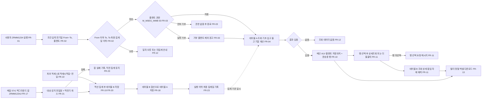
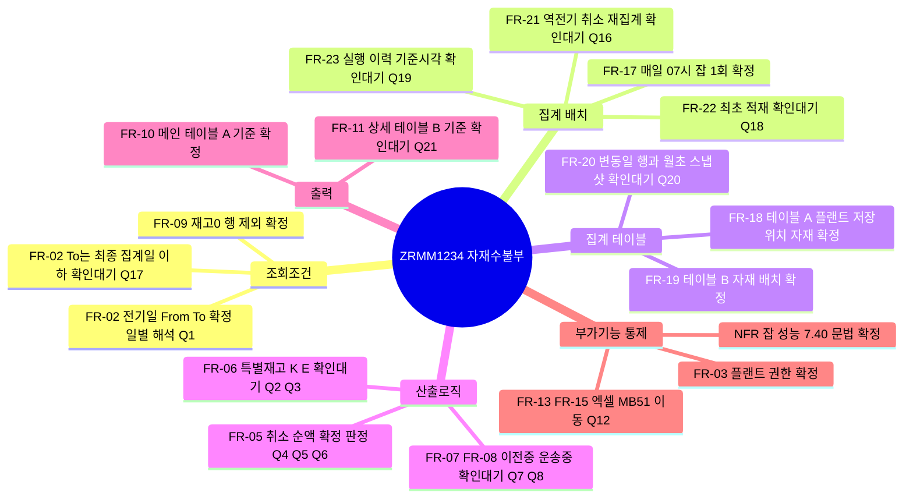
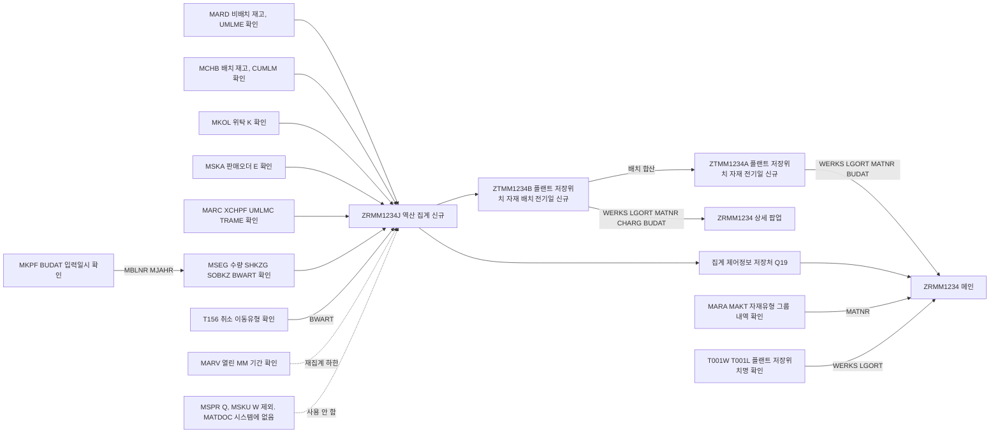

# 01. 요구사항 분석서 — 전기일자 기준 자재수불부 조회(일별)_저장위치레벨포함

| 항목 | 내용 |
|---|---|
| 요청 ID | 20261022-9149a8 |
| 단계 | 요구사항 분석 (v1.2 — 팀장 2차 수정 지시 반영: 07시 일 집계 + 집계 Z테이블 2개 + 집계 테이블 기준 조회) |
| 대상 시스템 | srd-abap (http://dshldra1.dongkuksteel.com:8000, 클라이언트 250). `mcp__sap__*`로 읽기 조회만 수행 |
| 근거 자료 | request.md 본문 + 하단 추가 요청 3건("재고금액은 빼줘", 기초/입고/출고/기말 예시, "sap ecc버전에 맞게 진행해줘") + **팀장 1차 수정 지시 6건(이하 "팀장지시 1~6")** + **팀장 2차 수정 지시 3건(2026-10-22, 이하 "팀장지시 7~9")**. 첨부 자료 없음(attachments/ 폴더 없음 [확인]) |
| 참고 위키 | ECC 7.40 시스템 ABAP 개발 제약 / 배치관리 자재 판정 기준 / 자재마스터 조회 리포트 설계 패턴 / SAP 시스템 미확인 상태에서 작업하는 방법 |

> 표기 규칙: **[확인]**은 srd-abap에서 SearchObject 등으로 존재를 확인한 것, **[미확인]**은 SAP 표준 지식에 기반한 추정(이 시스템 ADT에서는 필드 목록·도메인·인덱스·Customizing 데이터를 읽을 수 없음), **[가정]**은 분석 담당의 판단입니다. 팀장 확인이 필요한 항목은 **Q** 번호로, 운영 리스크는 **R** 번호로 11장에 모았습니다.
>
> 팀장지시 번호: 1 재고유형 미구분 / 2 취소 순액 / 3 ZRMM1234 / 4 전기일 From~To / 5 특별재고 K·E(Q·W 제외) / 6 이전중·운송중 / **7 매일 07:00 집계 저장 / 8 집계 Z테이블 A·B 분리 / 9 ZRMM1234는 집계 테이블 기준 조회 + 미결·리스크·최초 적재 정리**

---

## 1. 요약

- 사용자가 입력한 **전기일 From~To 기간**에 대해 플랜트·저장위치·자재(배치관리 자재는 배치까지) 단위로 **기초재고(From 시작 시점) / 입고·출고(From~To 합계) / 기말재고(To 종료 시점)** 수량을 보여 주는 자재수불부를 만듭니다. From=To로 입력하면 하루 조회가 됩니다(팀장지시 4). "일별"의 최종 해석은 팀장이 결정합니다(Q1).
- **구조 변경(팀장지시 7~9)**: 조회 때마다 MKPF/MSEG를 실시간으로 집계하던 v1.1 방식을 버리고, 아래 두 가지로 나눕니다.
  1. **집계 배치 프로그램(가칭 ZRMM1234J)** 이 **매일 07:00 백그라운드 잡(일 1회)** 으로 돌며 전기일자별 수불을 계산해 Z테이블 두 개에 저장합니다.
     - **테이블 A(가칭 ZTMM1234A)**: 플랜트 + 저장위치 + 자재 + 전기일 단위의 요약
     - **테이블 B(가칭 ZTMM1234B)**: 플랜트 + 저장위치 + 자재 + **배치** + 전기일 단위의 상세. 배치관리를 하지 않는 자재는 배치를 공란으로 둡니다.
  2. **조회 프로그램 ZRMM1234(T-code 동일)** 는 MSEG를 읽지 않고 **테이블 A로 메인 화면을, 테이블 B로 상세(드릴다운) 화면을** 만듭니다.
- **집계 기준 시각**: 집계는 07:00 시점까지 입력된 전표로 **전일(D-1)까지**의 전기일자를 확정합니다. 당일 전표와 07:00 이후에 입력된 과거 일자 전표는 **다음 날 07:00 집계 후에야 조회에 반영**됩니다(R-01). 과거 일자로 전기(역전기)하거나 취소한 전표는 다음 집계 때 **해당 전기일부터 전일까지 해당 키를 다시 집계**합니다(FR-21, Q16).
- **최초 적재**: 운영을 시작할 때 적재 시작일부터 전일까지를 한 번에 채우는 **초기 적재 모드**가 필요합니다. 시작일·대상 플랜트·MSEG 아카이빙 여부는 Q18입니다.
- 산출 원칙은 v1.1과 같고, 이제 **집계 배치 안에서** 적용합니다.
  - ECC 역산: 현재고(MARD/MCHB/MKOL/MSKA/MARC)에서 이후 전표(MKPF/MSEG)를 빼서 과거 시점 재고를 구합니다. 시스템에 MATDOC이 없습니다 [확인].
  - 재고유형은 나누지 않고 기말 수량 하나로 표시합니다(팀장지시 1).
  - 취소전표는 원래 방향에서 빼서 순액으로 표시합니다(팀장지시 2).
  - 특별재고 K·E는 별도 컬럼으로 두고, Q·W는 제외합니다. E/Q 표기가 지시와 맞지 않는 문제는 Q2로 남깁니다(팀장지시 5).
  - 이전중·운송중을 표시합니다(팀장지시 6).
- 재고금액은 넣지 않습니다. ABAP 문법은 SAP_BASIS 7.40 SP09 이상·7.50 미만 [추정]에 맞춥니다. 프로그램·T-code는 ZRMM1234, 패키지는 ZMMD입니다(팀장지시 3).

## 분석 다이어그램

### 1) 업무 흐름도

### 2) 요구사항 구성도

### 3) 데이터 범위도

> 표준 테이블 존재는 [확인], 필드명은 SAP ECC 표준 기준 [미확인](이 시스템 ADT는 필드 목록을 돌려주지 않음, 12장). ZTMM1234A/B, ZRMM1234J는 이름이 비어 있는 것만 [확인]했고 이름 자체는 제안입니다(Q22).

---

## 2. 요청 해석 — 요청서, 하단 추가 요청, 팀장 지시의 충돌 정리

| # | 요청서 본문 | 하단 추가 요청 / 팀장 지시 / 시스템 확인 | 분석 결정 | 근거 |
|---|---|---|---|---|
| C1 | S/4HANA: CDS `I_MaterialStock`, MATDOC | "sap ecc버전에 맞게" / MATDOC·ACDOCA·`I_MATERIALSTOCK*` 없음 [확인] | ECC 역산 방식(현재고 − 이후 MKPF/MSEG). **v1.2부터 역산은 집계 배치(ZRMM1234J)가 수행** | request.md 6·29~33·82행, 팀장지시 7 |
| C2 | "ABAP 7.5x 이상" | `CL_ABAP_CORRESPONDING` 없음, `CL_ABAP_TESTDOUBLE` 있음 [확인] | 7.40 SP09 이상·7.50 미만 [추정] 문법 | request.md 7행 |
| C3 | 재고금액 [필요 시] | "재고금액은 빼줘" | 금액·통화 컬럼 없음, MBEW 조회 안 함. 집계 테이블에도 금액 필드 없음 | request.md 45·53·75행 |
| C4 | 가용/QI/보류/합계 | **팀장지시 1**: 3분할 안 함 | 기말재고 **수량 하나**(가용+QI+보류+제한 합계). 집계 테이블도 유형별 필드를 두지 않음 | 팀장지시 1 |
| C5 | 기준 전기일자 P_BUDAT 단일 | **팀장지시 4**: 전기일 From~To | 기초 = From 시작, 기말 = To 종료, 입출고 = 기간 합계. From=To이면 하루 조회. "일별" 해석은 팀장 결정(Q1) | 팀장지시 4, request.md 19·76행 |
| C6 | 특별재고 [제외/별도 컬럼] | **팀장지시 5**: 포함하되 Q·W 제외, 위탁(K)·오더/프로젝트(E,Q) 별도 컬럼 | K 컬럼과 E 컬럼 추가. 컬럼명의 Q와 "Q 제외"가 상충하므로 **잠정안: E만 집계**(Q2). **v1.2부터 테이블 구조에 영향을 주므로 설계 전에 확정 필요** | 팀장지시 5 |
| C7 | 프로그램 [ZMMR0000], T-code [ZMM0000], 개발 클래스 [ZMM] | **팀장지시 3**: ZRMM1234 / ZRMM1234 | 조회 프로그램·T-code ZRMM1234, 패키지 ZMMD(ZMM 패키지는 없음 [확인]). 집계 배치 프로그램명은 제안(ZRMM1234J, Q22) | 팀장지시 3 |
| C8 | 취소전표 "이중 집계 주의" | **팀장지시 2**: 원래 방향에서 빼서 순액 | 취소 이동은 원 방향 컬럼에서 마이너스. 집계 배치에서 적용 | 팀장지시 2 |
| C9 | 이전중 재고 언급 없음 | **팀장지시 6**: '이전중' 컬럼, '(운송중)' 행 | 313 이전중은 받는 저장위치 행, 303/STO 운송중은 플랜트별 '(운송중)' 행. 집계 테이블에 재고구분 키로 저장 | 팀장지시 6 |
| C10 | 조회 시점 실시간 계산(요청서 '재고 산출 로직') | **팀장지시 7**: 매일 07:00 집계해 저장 | 백그라운드 잡(일 1회 07:00)으로 집계. 조회는 **전일까지 확정된 집계분만** 보여 줌. 실시간성 상실은 R-01 | 팀장지시 7 |
| C11 | (해당 없음) | **팀장지시 8**: Z테이블 2개(A 요약 / B 자재+배치 상세) | A = 플랜트+저장위치+자재+전기일, B = 플랜트+저장위치+자재+배치+전기일. A는 B를 배치 합산해 만든다(5.2) | 팀장지시 8 |
| C12 | "상세는 메인에서 읽은 데이터 재사용(팝업 열 때 DB 재조회 안 함)" | **팀장지시 9**: 상세/드릴다운은 테이블 B 활용 | 메인은 A만 읽고, **상세 팝업을 열 때 선택한 플랜트/저장위치로 B를 읽는다**(인덱스 조회라 부담이 작음). 요청서 문구와 달라지므로 Q21 | 팀장지시 9, request.md 60행 |
| C13 | "LOOP 안 SELECT 금지, DB에서 SUM/GROUP BY"(조회 성능) | 팀장지시 7~9 | 성능 요건은 **집계 배치**와 **조회 프로그램** 둘 다에 적용(7장) | request.md 57~61행 |

---

## 3. 기능 요구사항

### 3.1 조회 프로그램 ZRMM1234

| ID | 설명 | 우선순위 | 상태 | 근거 |
|---|---|---|---|---|
| FR-01 | 조회 리포트 **ZRMM1234**와 T-code **ZRMM1234**(리포트 트랜잭션)를 새로 만든다. 패키지 ZMMD. INCLUDE는 ZRMM1234_TOP / _SEL / _C01 / _F01(기존 ZRMM0005 명명 패턴). 집계 배치 프로그램은 FR-17에서 따로 정한다 | 필수 | 확정 | 팀장지시 3, request.md 8·65행 |
| FR-02 | 선택화면: 전기일 From `P_BUDFR`(필수), 전기일 To `P_BUDTO`(필수), 플랜트 `S_WERKS`(필수), 저장위치 `S_LGORT`, 자재 `S_MATNR`, 자재유형 `S_MTART`, 자재그룹 `S_MATKL`, 배치 `S_CHARG`, `P_NOZERO` 재고 0 행 제외(기본 체크). **From·To 기본값은 최종 집계 대상일(보통 전일)**. 검증: From ≤ To, **To ≤ 최종 집계 대상일**(넘으면 "YYYY.MM.DD까지 집계됨" 오류), **From ≥ 적재 시작일**(FR-22). 화면 상단(또는 ALV 제목)에 **집계 기준 일시**(마지막 잡 실행 시각, 집계 대상일)를 표시 | 필수 | 확정("일별" 해석 Q1, To=당일 허용 여부 Q17) | 팀장지시 4·7·9, request.md 18~25행 |
| FR-03 | 권한: 플랜트마다 `M_MSEG_WMB`(ACTVT 03, WERKS)를 확인한다. 일부가 거부되면 해당 플랜트를 빼고 경고하고, 전부 거부되면 오류로 종료한다. T001W에 없는 플랜트는 "플랜트 없음"으로 따로 알린다. 플랜트 range가 비어 전체 조회되지 않게 막는다. 집계 테이블은 SE16 등으로 직접 조회하지 못하도록 권한그룹을 지정하고 테이블 유지보수(SM30)는 허용하지 않는다 [가정] | 필수 | 확정 | request.md 26행 |
| FR-04 | **산출 방식(변경)**: ZRMM1234는 MKPF/MSEG/MARD 등을 읽지 않고 **테이블 A(메인)와 B(상세)만** 읽어 기초·입고·출고·기말을 계산한다. 계산식은 5.7 | 필수 | 확정 | 팀장지시 9 |
| FR-09 | 재고 0 행 제외(`P_NOZERO`): 기초·입고·출고·기말·K·E·이전중이 **모두 0**인 행을 뺀다. 메인 건수는 제외한 뒤 기준으로 센다 | 필수 | 확정 | request.md 25행 |
| FR-10 | 메인 ALV(**테이블 A 기준**): 플랜트+저장위치 1행, 플랜트별 '(운송중)' 행 포함. 컬럼은 플랜트, 플랜트명, 저장위치, 저장위치명('(운송중)' 행은 저장위치 공란, 저장위치명 '(운송중)'), 자재 건수, 배치 건수, (권장) 기간 내 입출고 발생 자재 건수. **수량 합계 컬럼과 금액 컬럼은 없다**. 배치 건수는 테이블 B에서 플랜트·저장위치별로 DB 집계(COUNT)한다(5.8) | 필수 | 확정(배치 건수 산출·발생 건수 컬럼은 Q11, Q21) | request.md 43~46행, 팀장지시 6·8 |
| FR-11 | [상세조회] 버튼과 더블클릭으로 상세를 연다. 여러 행을 선택하면 선택한 플랜트/저장위치 전체를 보여 주고, 선택이 없으면 안내 메시지를 띄운다. **상세 팝업은 테이블 B를 읽어 만든다**(팝업 열 때 선택 키로 조회하고, 한 번 읽은 키는 메모리에 보관해 다시 읽지 않음). SALV `set_screen_popup`(화면 약 80%). 컬럼: 플랜트, 저장위치, 저장위치명, 자재, 자재내역, 배치, 기본단위, **기초, 입고, 출고, 기말(일반), 위탁재고(K), 오더재고(E), 이전중**. 정렬은 플랜트 → 저장위치('(운송중)'은 플랜트 마지막) → 자재 → 배치 | 필수 | 확정(팝업 시 DB 조회 방식은 Q21) | request.md 47~55·60행, 팀장지시 1·5·6·9 |
| FR-12 | 메시지: 조회 결과 없음, 권한 없음/일부 제외, 플랜트 없음, 행 미선택, From > To, **To > 최종 집계 대상일(미집계)**, **From < 적재 시작일**, **최근 집계 잡 실패(직전 집계 기준으로 조회됨) 경고** | 필수 | 확정 | request.md 67행, 팀장지시 7·9 |
| FR-13 | 메인과 팝업 모두 SALV 표준 기능(필터, 정렬, 엑셀 다운로드, 레이아웃)을 제공한다 | 필수 | 확정 | request.md 55행 |
| FR-15 | 상세 행 더블클릭 시 MB51로 이동(자재·플랜트·저장위치·From~To). MB51은 실시간 전표이므로 집계 이후 전표가 함께 보일 수 있다는 점을 안내한다 | 선택 | 확인 대기 Q12 | [가정] 수불 검증 편의 |
| FR-16 | 산출물: 텍스트 엘리먼트(선택화면 텍스트, Text Symbol), 메시지 목록, MB5B 비교 테스트 시나리오(배치 자재, 비배치 자재, 기준일 이후 입출고 자재 + 취소·K/E·이전중·역전기 재집계·최초 적재 보조) | 필수 | 확정 | request.md 67·69~72행 |

### 3.2 집계 배치 프로그램과 집계 테이블

| ID | 설명 | 우선순위 | 상태 | 근거 |
|---|---|---|---|---|
| FR-17 | **집계 배치 프로그램**(가칭 **ZRMM1234J**, 패키지 ZMMD)을 새로 만든다. **SM36 백그라운드 잡으로 매일 07:00에 1회** 실행한다(잡명 예: `ZRMM1234J_DAILY`, 주기 일 1회). 선택화면은 실행 모드(일 집계 / 수동 재집계 / 초기 적재), 플랜트, 기간(수동 재집계·초기 적재용), 테스트 실행(저장 안 함) 정도로 둔다. 잡 등록(SM36)은 시스템별 설정이라 이송요청으로 옮겨지지 않으므로 운영 반영 절차에 **Basis 잡 등록**을 포함한다 | 필수 | 확정(프로그램명 Q22) | 팀장지시 7 |
| FR-18 | **테이블 A(가칭 ZTMM1234A, 요약)**: 키 = 플랜트 + 저장위치 + 자재 + 전기일 + 재고구분(저장위치/운송중). 측정값 = 기초·입고·출고·기말(일반), K·E 기말(입출고는 권장), 이전중(운송중) 기말. **같은 키의 테이블 B 행을 배치 합산한 값**과 항상 같아야 한다. 필드 정의는 5.2 | 필수 | 확정 | 팀장지시 8 |
| FR-19 | **테이블 B(가칭 ZTMM1234B, 상세)**: 키 = 플랜트 + 저장위치 + 자재 + **배치** + 전기일 + 재고구분. **배치관리 자재가 아니면 배치 = 공란**, '(운송중)' 행은 저장위치·배치 공란. 측정값은 A와 같다. 플랜트·저장위치를 키에 넣는 이유: 배치 재고(MCHB)가 저장위치 단위이고, A→B 드릴다운 키를 맞추기 위함(5.2) | 필수 | 확정 | 팀장지시 8·9 |
| FR-20 | **전기일 키 저장 방식**: 잠정안은 **"변동일 행 + 월초 스냅샷 행"** 이다. 키(플랜트·저장위치·자재·배치)에 그날 이동이 있을 때만 그 전기일 행을 만들고, 각 행에는 **당일 기초·입고·출고·기말**을 저장한다. 매월 1일(그리고 적재 시작일)에는 재고가 0이 아닌 모든 키에 스냅샷 행을 만든다. 그러면 조회 때 To가 속한 달 안에서만 마지막 행을 찾으면 되므로 읽는 양이 제한된다. 대안은 **매일 전체 스냅샷**이다(조회는 단순하지만 데이터량 = 키 수 × 일수). 비교는 5.3 | 필수 | 확인 대기 Q20 | 팀장지시 8 |
| FR-21 | **일 집계와 재집계(역전기·취소)**: 07:00 실행 시 (a) 지난 실행 이후 **입력된**(MKPF 입력일시 기준) 전표와 (b) 지난 집계 대상일 다음 날부터 전일까지 **전기된** 전표를 찾는다. 이 전표들이 건드린 키(플랜트·저장위치·자재·배치)마다 **그 전표들의 가장 이른 전기일부터 전일(D-1)까지** 테이블 B 행을 지우고 다시 계산한 뒤, 해당 (플랜트·저장위치·자재)의 테이블 A를 다시 만든다. 과거 일자 취소(MBST 등)와 역전기는 이 규칙으로 처리한다. 재집계 하한은 열린 MM 기간(MARV)으로 제한될 것으로 보며 [미확인], 안전장치로 정기 전체 재집계(예: 월 1회 열린 기간 전체)를 둔다 | 필수 | 확인 대기 Q16 | 팀장지시 9 |
| FR-22 | **최초 적재(초기 데이터 이관)**: 초기 적재 모드로 **적재 시작일 S부터 전일까지** 대상 플랜트의 테이블 B·A를 만든다. S일에 재고가 있는 모든 키의 스냅샷 행을 만들고, 그 뒤로는 FR-20 규칙을 따른다. 플랜트 단위로 나눠 실행하고 커밋할 수 있어야 하며, 다시 실행하면 해당 플랜트·기간을 지우고 다시 적재한다(재실행 가능). 적재 시작일은 제어정보에 기록하고, ZRMM1234는 그 이전 일자 조회를 막는다 | 필수 | 확인 대기 Q18 | 팀장지시 9 |
| FR-23 | **실행 이력과 기준 시각 관리**: 잡마다 실행 시작·종료 일시, 집계 대상일(D-1), 처리 플랜트, 재집계 키 수, 결과(성공/실패)를 기록한다. 일 집계는 **성공했을 때만** "최종 집계 대상일"을 갱신하고, 실패하면 직전 집계를 유지한다(다음 실행 때 빠진 일자를 이어서 처리). 상세 로그는 애플리케이션 로그(SLG1, BAL)에 남긴다. 저장처(별도 Z 제어 테이블 vs TVARVC)는 Q19 | 필수 | 확인 대기 Q19 | 팀장지시 7·9 |
| FR-24 | **수동 재집계**: 플랜트·기간(·자재)을 지정해 다시 집계하는 모드. 장애 복구나 데이터 보정에 쓴다. 실행 권한은 운영 담당자로 제한한다 | 권장 | 확인 대기 Q17 | [가정] 운영 복구 |
| FR-25 | **정합성 점검**: 집계 후 (1) A = Σ B(배치 합산), (2) 플랜트별 표본 키에서 집계 대상일 기말 = 현재고 − 이후 이동인지 검사하고, 다르면 로그에 경고를 남긴다 | 권장 | 확정 | [가정] 품질 |
| FR-26 | **보존·삭제**: 보존 기간이 지난 행을 지우는 정리 모드(또는 아카이빙 방침) | 선택 | 확인 대기 Q23 | [가정] 용량 관리 |

### 3.3 산출 규칙(집계 배치에서 적용)

| ID | 설명 | 우선순위 | 상태 | 근거 |
|---|---|---|---|---|
| FR-05 | **입고/출고(일반재고)**: 정상 이동은 SHKZG=S이면 입고(+), H이면 출고(+). **취소 이동은 원래 방향에서 차감**한다. 취소이면서 SHKZG=H(예: 102)는 입고 −수량, 취소이면서 SHKZG=S(예: 262)는 출고 −수량. 예: 101 100개, 102 20개면 입고 80, 출고 0. 당일 기초 = 당일 기말 − 입고 + 출고. 취소 판정은 5.6.3(Q4), 122는 Q5, 재고유형 간 이동은 Q6 | 필수 | 확정(판정 세부 Q4~Q6) | 팀장지시 2 |
| FR-06 | **특별재고 별도 측정값**: `위탁재고(K)` = SOBKZ K(MKOL), `오더재고(E)` = SOBKZ E(MSKA). **Q(MSPR)와 W(MSKU)는 제외**. 잠정안은 컬럼명 "E,Q"와 "Q 제외"가 상충하므로 **E만 집계**하고 컬럼명은 "오더재고(E)". 기타 특별재고(O, V, M 등)는 제외 [가정](Q3). **테이블 필드가 걸리므로 설계 전에 Q2·Q3 확정 필요** | 필수 | 확인 대기 Q2, Q3 | 팀장지시 5 |
| FR-07 | **이전중(저장위치 레벨)**: 저장위치 간 2단계 이전(313 출고 후 315 입고 전)의 수량을 **받는 저장위치 행**의 이전중 측정값에 저장한다(MARD-UMLME / MCHB-CUMLM 역산) | 필수 | 확정(역산 규칙 검증 Q8) | 팀장지시 6 |
| FR-08 | **운송중(플랜트 레벨)**: 플랜트 간 2단계 이전(303 후 305 전, MARC-UMLMC)과 STO 운송중(MARC-TRAME)을 재고구분 '운송중' 행(저장위치·배치 공란)의 이전중 측정값에 저장한다. 잠정안은 받는 플랜트에 표시하고 기초/입고/출고/기말은 0(Q7) | 필수 | 확인 대기 Q7, Q8 | 팀장지시 6 |
| FR-14 | **배치관리 판정**: MARC-XCHPF(플랜트 레벨)로 한다. 배치관리 자재는 테이블 B에 배치별 행을, 비배치 자재는 배치 공란 행을 만든다. MARA-XCHPF 보조 판정 유지 여부는 Q10 | 필수 | 확정(보조 판정 Q10) | request.md 38~41행, 팀장지시 8 |

> 삭제·대체한 요구사항: v1.0 FR-06(기말 재고유형별 3컬럼, 팀장지시 1), v1.0 FR-13(특별재고 제외, 팀장지시 5로 대체). **v1.1 FR-04(조회 시 실시간 역산)는 FR-04(집계 테이블 조회) + FR-17~FR-23(집계 배치)로 대체**(팀장지시 7~9).

---

## 4. 관련 모듈 / 표준 테이블·필드

- 관련 모듈은 **MM-IM(재고관리)**(특별재고, 저장위치·플랜트 간 재고이전, STO 운송중 포함), 배치관리, MM 자재마스터, **BC 백그라운드 처리(SM36/SM37)·애플리케이션 로그(SLG1)** 입니다. FI/CO 금액 연계는 없습니다.
- 확인 방법: `SearchObject`로 존재를 확인했습니다. `GetTable`(MKPF, MSEG, MARC, MKOL, ZTMM0001)은 `ExceptionResourceNotFound`(`/sap/bc/adt/ddic/structures/<표>/source/main does not exist`)로 실패해 **필드 수준은 확인할 수 없습니다**. 필드명은 SAP ECC 표준 기준이며, 개발할 때 `TYPE mseg-shkzg`처럼 필드 참조로 선언해 활성화 단계에서 검증합니다.

### 4.1 데이터 소스(집계 배치 ZRMM1234J가 읽음)

| 테이블 | 존재 | 패키지 | 용도 | 사용 필드(표준, 필드 수준 [미확인]) |
|---|---|---|---|---|
| MKPF | [확인] | MB | 자재전표 헤더 | MBLNR, MJAHR, BUDAT, **CPUDT·CPUTM(입력일·시각 — 증분 감지)** |
| MSEG | [확인] | MB | 자재전표 품목(유일한 이동 소스. MATDOC은 없음) | MBLNR, MJAHR, ZEILE, BWART, MATNR, WERKS, LGORT, CHARG, SHKZG, MENGE(기본단위), SOBKZ, LIFNR, KDAUF/KDPOS, SMBLN/SJAHR/SMBLP(취소 참조), UMMAT/UMWRK/UMLGO/UMCHA/UMSOK(이전 상대), XAUTO, EBELN/EBELP(STO), BUDAT_MKPF(EhP4 이상, 이 시스템 존재 여부 [미확인]) |
| T156 | [확인] | MB | 취소 이동유형 판정 | BWART, XSTBW(취소 이동유형 지시자 — 필드명 [미확인], 설계에서 SE11로 확인) |
| MARD | [확인] | MG | 비배치 일반재고, 저장위치 이전중 | MATNR, WERKS, LGORT, LABST, INSME, SPEME, EINME, **UMLME(이전중)** |
| MCHB | [확인] | MG | 배치 일반재고, 배치 이전중 | MATNR, WERKS, LGORT, CHARG, CLABS, CINSM, CSPEM, CEINM, **CUMLM(이전중)** |
| MKOL | [확인] | MG | 위탁재고 K | MATNR, WERKS, LGORT, CHARG, SOBKZ, LIFNR, SLABS, SINSM, SSPEM, SEINM |
| MSKA | [확인] | MG | 판매오더재고 E | MATNR, WERKS, LGORT, CHARG, SOBKZ, VBELN, POSNR, KALAB, KAINS, KASPE, KAEIN |
| MARC | [확인] | — | 배치관리, 플랜트 이전중·운송중 | MATNR, WERKS, XCHPF, **UMLMC**, **TRAME** |
| MARA / MAKT | [확인] | — / MG | 자재유형·그룹·기본단위 / 자재내역(ZRMM1234 화면용) | MATNR, MTART, MATKL, MEINS, XCHPF / MATNR, SPRAS, MAKTX |
| T001W / T001L | [확인] | WFILCORE / MG | 플랜트명 / 저장위치명(ZRMM1234 화면용) | WERKS, NAME1 / WERKS, LGORT, LGOBE |
| **MARV** | [확인] | MG | 열린 MM 기간 — 역전기 가능 하한 판단(재집계 범위) | BUKRS, LFGJA, LFMON, VMGJA, VMMON, XRUEM(전기간 전기 허용) [미확인] |
| MSPR (Q), MSKU (W·V), MSLB (O) | [확인] | MG | **사용 안 함**(Q·W 제외 지시, O·V는 Q3) | — |
| 이력 테이블 MARDH, MCHBH, MKOLH, MSKAH, MARCH | [확인] | MGA | 기본안에서는 쓰지 않음. 초기 적재 시작일이 아주 먼 과거일 때 성능 대안으로만 검토(Q18) | — |
| MATDOC, ACDOCA, I_MaterialStock* | **없음** [확인] | — | S/4 전용이라 쓸 수 없음 | — |

### 4.2 신규 Z 오브젝트(제안) 및 기타 오브젝트

| 오브젝트 | 존재 | 비고 |
|---|---|---|
| `ZRMM1234`(조회 프로그램·T-code) | 없음 [확인] | 새로 만듦 |
| `ZRMM1234J`(집계 배치 프로그램, 가칭) | 없음 [확인] | 새로 만듦. 수동 실행용 T-code는 선택(Q22) |
| `ZTMM1234A`(테이블 A, 가칭) / `ZTMM1234B`(테이블 B, 가칭) | 없음 [확인] | 새로 만듦. 기존 Z 테이블은 `ZTMM0001`~`ZTMM0175` 순번 규칙이 많아 순번 이름을 써야 하는지는 Q22 |
| 집계 제어정보 저장처 | — | 별도 Z 제어 테이블(가칭 ZTMM1234C, 없음 [확인]) 또는 표준 `TVARVC`([확인], SLDBV). Q19 |
| 패키지 `ZMMD`, 메시지 클래스 `ZMM` | [확인] | ZRMM0005·ZRMM0010이 ZMMD에 있음 [확인] |
| 권한 오브젝트 `M_MSEG_WMB` | [확인] (MB) | 필드 정의는 SU21에서 확인 필요 |
| SM36 / `TBTCO`(잡 상태) | [확인] (SBTI / SBTC) | 잡 등록·모니터링. 잡 등록은 이송 대상 아님 |
| `BALHDR`(애플리케이션 로그) | [확인] (SZAL_COMMON) | SLG1 로그. 로그 오브젝트·서브오브젝트(SLG0) 생성 필요 [가정] |
| MB5B / RM07MLBD, MB5T | [확인] | 검증 기준 |
| 기존 Z 재고 자산 | 존재만 [확인] | `ZHCL_MM_REPORT_STOCK`, `ZHCL_MM_BATCH_STOCK`, 데이터 엘리먼트 `ZEMM_STOCK_DAY`(ZMMD). 이름상 **기존 일자별 재고 집계가 있을 수 있어** 중복 여부를 확인해야 함(Q14) |

---

## 5. 산출 로직 정의 (설계 입력)

### 5.1 전체 구조

| 구성 | 역할 | 실행 |
|---|---|---|
| ZRMM1234J (집계 배치) | 현재고 + MKPF/MSEG로 전기일자별 수불을 역산해 B를 저장하고, B를 배치 합산해 A를 저장. 제어정보·로그 기록 | SM36 잡 매일 07:00 / 초기 적재·수동 재집계는 별도 실행 |
| ZTMM1234B | 플랜트·저장위치·자재·배치·전기일·재고구분 단위 일 수불 | 집계 배치만 쓰기 |
| ZTMM1234A | 플랜트·저장위치·자재·전기일·재고구분 단위 일 수불(B 합산) | 집계 배치만 쓰기 |
| ZRMM1234 (조회) | A로 메인, B로 상세. 읽기만 함 | 사용자 온라인 |

- **집계 대상일**: 07:00 실행일을 D라고 하면 집계 대상은 **전기일 ≤ D-1** 입니다. 전기일 = D(당일)와 미래 일자 전표는 저장하지 않고 역산 때 빼기만 합니다.
- 07:00 실행에서 D-1 이전의 기말을 역산하면 "실행 순간의 현재고 − (그 날짜 이후 전기된 모든 전표)"가 되므로, 실행 순간까지 입력된 전표는 전기일과 관계없이 모두 반영됩니다.

### 5.2 집계 테이블 필드 정의 (요구사항 수준, 이름·타입은 설계에서 확정)

**공통 키**

| 필드(가칭) | A | B | 설명 | 참조 타입 [미확인] |
|---|---|---|---|---|
| MANDT | 키 | 키 | 클라이언트 | MANDT |
| WERKS | 키 | 키 | 플랜트 | WERKS_D |
| BUDAT | 키 | 키 | 전기일(집계 일자) | BUDAT |
| LGORT | 키 | 키 | 저장위치. 운송중 행은 공란 | LGORT_D |
| MATNR | 키 | 키 | 자재 | MATNR |
| CHARG | — | 키 | 배치. **비배치 자재와 운송중 행은 공란** | CHARG_D |
| STKTP | 키 | 키 | 재고구분: `L` 저장위치 재고 행 / `T` 운송중 행(팀장 예시의 '(운송중)') | CHAR1, 도메인 고정값 [가정] |

- 키 순서 권고: MANDT, WERKS, BUDAT, LGORT, MATNR, (CHARG), STKTP. 조회가 항상 "플랜트 + 전기일 범위"로 들어오기 때문입니다. 자재 단위 조회가 많으면 (MANDT, MATNR, WERKS, BUDAT) 보조 인덱스를 검토합니다(설계).

**측정값과 관리 필드**

| 필드(가칭) | 의미 | 우선순위 |
|---|---|---|
| MEINS | 기본단위(수량 필드 참조 단위) | 필수 |
| SNAPF | 스냅샷 행 표시(월초·적재 시작일 행 = 'X') | 필수(FR-20 잠정안일 때) |
| BEG_QTY / GR_QTY / GI_QTY / END_QTY | 당일 기초 / 입고(취소 순액) / 출고(취소 순액) / 기말 — 일반재고(가용+QI+보류+제한 합) | 필수 |
| K_END / E_END | 위탁(K) / 오더(E) 당일 기말 | 필수 |
| K_GR, K_GI, E_GR, E_GI | 위탁·오더재고의 당일 입고/출고 | 권장(Q9가 바뀌어도 테이블을 바꾸지 않기 위함) |
| TRF_END | 이전중 당일 기말. STKTP=L이면 저장위치 이전중(313), STKTP=T이면 플랜트 운송중(303+STO) | 필수 |
| ERDAT / ERZET / ERNAM | 집계 일시·실행 사용자(잡 사용자) | 필수 |
| (Q2 결과) Q_END | 프로젝트재고(Q)를 넣기로 하면 추가 | Q2 |

- 수량 필드는 기본단위 수량(MENGE_D 상당, 13자리 3소수 [가정])이고 MEINS를 참조합니다. 금액 필드는 없습니다.
- **A와 B의 관계**: A의 각 행 = 같은 (WERKS, BUDAT, LGORT, MATNR, STKTP)를 가진 B 행들의 합입니다. 배치 하나라도 그날 행이 있으면 A에도 그날 행이 생깁니다. 비배치 자재는 A와 B 값이 같습니다(B는 배치 공란 1행).
- 기술 설정 [가정]: 데이터 클래스 APPL1(트랜잭션 데이터), 크기 범주는 Q20 데이터량 추정 후 결정, 버퍼링 안 함, 납품 클래스 A, 테이블 유지보수 생성 안 함, 변경 로그 안 함.

### 5.3 전기일 키 저장 방식 비교 (FR-20, Q20)

| 방식 | 행이 생기는 조건 | 장점 | 단점 |
|---|---|---|---|
| **① 변동일 행 + 월초 스냅샷(잠정안)** | 그날 해당 키에 이동이 있거나, 그날이 매월 1일·적재 시작일이고 재고가 0이 아닐 때 | 데이터량이 이동 건수에 비례. 역전기 재집계 때 다시 쓸 행이 적음 | 조회 때 "To 이전 마지막 행"을 찾아야 함(월 안으로 범위 제한) |
| ② 매일 전체 스냅샷 | 매일, 재고가 0이 아니거나 이동이 있는 모든 키 | 조회가 단순(기말 = To일 행) | 행 수 = 키 수 × 일수. 역전기 하루가 이후 모든 날짜 행을 다시 쓰게 함 |
| ③ 순수 일자별 수불만(스냅샷 없음) | 이동이 있을 때만 | 가장 작음 | 기말을 구하려면 처음부터 누적해야 해서 조회가 느림. 권하지 않음 |

### 5.4 일 집계 처리 (07:00, FR-17·FR-21)

| 순서 | 처리 |
|---|---|
| 1 | 중복 실행을 막는다(잠금). 제어정보에서 지난 성공 실행 시작 시각 `T_last`와 최종 집계 대상일 `D_last`를 읽는다 |
| 2 | **대상 전표 찾기**: (a) MKPF 입력일시(CPUDT·CPUTM)가 `T_last − 여유시간` 이후인 전표, (b) 전기일이 `D_last+1` ~ `D-1`인 전표. 여유시간은 업데이트 지연(V1)으로 늦게 커밋되는 전표를 잡기 위한 것(예: 1시간, 설계 확정, R-02) |
| 3 | **영향 키와 시작일**: 대상 전표 품목의 (WERKS, LGORT, MATNR, CHARG)마다 가장 이른 전기일 `d0`을 구한다. 이전 상대(UMWRK/UMLGO/UMCHA)와 운송중 행(받는 플랜트)도 영향 키에 넣는다 |
| 4 | **재계산**: 영향 키마다 `d0` ~ `D-1` 구간의 B 행을 지우고, 현재고 − 이후 이동으로 구간 각 날짜의 기말을 역산한 뒤 이동이 있는 날짜와 월초 스냅샷 날짜의 행을 다시 넣는다. 계산 규칙은 5.6 |
| 5 | `D-1`이 매월 1일이면 재고가 있는 **모든 키**의 월초 스냅샷 행을 만든다(영향 키가 아니어도) |
| 6 | 바뀐 (WERKS, LGORT, MATNR, STKTP)·날짜 구간의 A 행을 B 합산으로 다시 만든다 |
| 7 | 플랜트 단위로 커밋하고, 모두 성공하면 `T_last` = 이번 실행 시작 시각, `D_last` = D-1로 갱신한다. 실패하면 갱신하지 않는다(다음 실행이 빠진 날을 이어서 처리) |
| 8 | 정합성 점검(FR-25)과 SLG1 로그 기록 |

- 재집계 하한: 역전기는 열린 MM 기간 안에서만 가능하므로(MARV, 일반적으로 당월과 전월) `d0`은 대부분 전월 1일 이후입니다 [미확인]. 그보다 이른 `d0`이 나오면 경고 로그를 남기고 그대로 처리합니다.
- 안전장치(잠정): 월 1회(예: 매월 첫 일요일) 열린 MM 기간 전체를 모든 키에 대해 다시 집계합니다(Q16). 전표 없이 재고가 바뀌는 경우(R-05)를 바로잡는 용도입니다.

### 5.5 최초 적재 (FR-22, Q18)

| 항목 | 요구사항 |
|---|---|
| 범위 | 적재 시작일 S ~ 실행일 전일, 대상 플랜트(선택) |
| 방법 | 일 집계와 같은 역산 로직. S일에 재고가 있는 모든 키의 스냅샷 행(SNAPF='X')을 만들고, S 이후는 변동일 행 + 월초 스냅샷 |
| 필요 데이터 | 현재고 + 전기일 S 이후의 MSEG 전체. **S 이후 MSEG가 아카이빙되어 있으면 역산이 틀어짐** → 아카이빙 기준일 확인 필요(Q18, R-06) |
| 실행 | 업무 외 시간에 백그라운드로 플랜트 단위 분할 실행, 플랜트 단위 커밋, 재실행하면 해당 플랜트·기간을 지우고 다시 적재 |
| 완료 처리 | 제어정보에 적재 시작일 S, `D_last` = 적재 전일, `T_last` = 적재 시작 시각을 기록한 뒤 일 집계 잡을 켠다. 적재 중 입력된 전표는 다음 일 집계가 입력일시 기준으로 다시 잡는다 |
| 검증 | 표본 키를 골라 MB5B(S~전일)의 기초·기말과 비교, 전일 기말과 MMBE 현재고(당일 이동 차감) 비교 |
| 운영 반영 순서 | ① 테이블·프로그램 이송 → ② 초기 적재 실행·검증 → ③ SM36 일 집계 잡 등록 → ④ ZRMM1234 사용 개시(권한 부여) |

### 5.6 측정값 산출 규칙 (집계 배치 내부, v1.1 로직 유지)

#### 5.6.1 측정값

| 측정값 | 의미 | 현재고 소스 | 대상 MSEG 행 |
|---|---|---|---|
| 일반 | 자사 재고(가용+QI+보류+제한). **재고유형 구분 없이 합 하나** | MARD LABST+INSME+SPEME+EINME(비배치) / MCHB CLABS+CINSM+CSPEM+CEINM(배치) | SOBKZ 공란, LGORT ≠ 공란, 이전중 영향 행(5.6.5) 제외 |
| K | 공급업체 위탁재고 | MKOL SLABS+SINSM+SSPEM+SEINM(LIFNR 합산) | SOBKZ = 'K' |
| E | 판매오더재고 | MSKA KALAB+KAINS+KASPE+KAEIN(VBELN/POSNR 합산) | SOBKZ = 'E' |
| 이전중(저장위치) | 313 후 315 전 수량 | MARD-UMLME / MCHB-CUMLM | 313/314/315/316 중 이전중 영향 행 |
| 운송중(플랜트) | 303 후 305 전 + STO 운송중 | MARC-UMLMC + MARC-TRAME | 303/304/305/306, STO 관련 이동 |
| 제외 | Q, W 및 컬럼이 없는 특별재고 | 읽지 않음 | SOBKZ 'Q', 'W'(그리고 O, V 등, Q3) 행은 버림 |

- 수량은 모두 기본단위입니다. 부호 수량: SHKZG='S'이면 +MENGE, 'H'이면 −MENGE.

#### 5.6.2 일자별 계산식 (전기일 d, 집계 실행일 D)

| 항목 | 계산식 |
|---|---|
| 기말(d) | 현재고(실행 순간) − Σ 부호수량(BUDAT > d) |
| 입고(d) | Σ_{BUDAT = d} [정상·S: +MENGE] + [취소·H: −MENGE] |
| 출고(d) | Σ_{BUDAT = d} [정상·H: +MENGE] + [취소·S: −MENGE] |
| 기초(d) | 기말(d) − 입고(d) + 출고(d) (= 기말(d−1)) |

- 구현 권고: 키별로 BUDAT > d0−1인 이동을 날짜별 부호수량으로 DB 집계(SUM/GROUP BY 키·BUDAT·SOBKZ·BWART·SHKZG)해 읽고, 현재고에서 최근 날짜부터 거꾸로 빼며 날짜별 기말을 구합니다(LOOP 안 SELECT 없음).
- K, E, 이전중, 운송중도 같은 원리로 날짜별 기말을 구합니다.
- 입고·출고는 마이너스가 될 수 있습니다(이전 날짜 입고분을 그날 취소). 의도한 동작입니다.

#### 5.6.3 취소 이동 판정 (팀장지시 2)

| 단계 | 규칙 |
|---|---|
| 1차 | T156의 취소 이동유형 지시자(XSTBW [필드명 미확인])가 'X'인 BWART를 취소로 봅니다. 예: 102, 202, 262, 302, 304, 306, 312, 314, 316, 352, 642 등 |
| 2차(보조) | MSEG-SMBLN이 채워진 행을 취소로 봅니다 |
| 결과 적용 | 취소·SHKZG=H는 입고 −MENGE, 취소·SHKZG=S는 출고 −MENGE |

- 예: 101 100개, 102 20개면 입고 80, 출고 0. 261 50개, 262 10개면 출고 40. 311 30개, 312 30개면 보내는 쪽 출고 0, 받는 쪽 입고 0.
- 122(공급업체 반품)는 SAP에서 정상 이동입니다(취소는 123). 잠정안은 SHKZG 기준 출고(Q5).
- 1차·2차 결과가 다를 때의 우선순위는 설계에서 실제 T156 값을 보고 정합니다(Q4).
- **취소 전표의 전기일**이 원 전표와 다른 날짜이면 각자의 전기일에 잡힙니다(예: 10/20 입고 100, 10/22 취소 20이면 10/20 입고 100, 10/22 입고 −20). 원 전표의 전기일로 되돌려 잡지 않습니다 [가정, MB5B와 같은 방식].

#### 5.6.4 재고유형 간 이동 (팀장지시 1의 결과)

- 같은 키 안의 유형 변경(321/322, 343/344, 349/350 등)은 일반재고 합계를 바꾸지 않으므로 **잠정안은 입고·출고에서 제외**합니다(Q6). 판정은 UMWRK=WERKS, UMLGO=LGORT, UMMAT=MATNR(또는 공란), UMCHA=CHARG(또는 공란), UMSOK·SOBKZ 공란인 행입니다.
- 자사재고와 특별재고 사이 이전(411K, 411E, 412E/413E 등)은 측정값이 달라지므로 제외하지 않고 일반 컬럼의 입고 또는 출고로 잡습니다 [가정].

#### 5.6.5 이전중 — 저장위치 간 2단계 이전 (팀장지시 6)

| 이동 | 보내는 저장위치(0001) 일반 | 받는 저장위치(0002) 일반 | 받는 저장위치(0002) 이전중 |
|---|---|---|---|
| 313 출고 | 출고 + | — | + |
| 315 입고 | — | 입고 + | − |
| 314(313 취소) | 출고 − | — | − |
| 316(315 취소) | — | 입고 − | + |

- 이전중 기말(d) = 현재 MARD-UMLME 또는 MCHB-CUMLM(받는 저장위치) − d 이후 위 이전중 영향의 합.
- **설계 확인 필요 [미확인]**: 313/315의 MSEG 행 구성(LGORT/UMLGO/XAUTO/SHKZG)을 실제 전표로 확정해야 합니다(Q8).

#### 5.6.6 운송중 — 플랜트 간 이전·STO (팀장지시 6)

| 구분 | 현재고 소스 | 늘어나는 이동 | 줄어드는 이동 | 저장 위치(잠정) |
|---|---|---|---|---|
| 플랜트 간 2단계 이전 | MARC-UMLMC(받는 플랜트) | 303 (304는 취소 −) | 305 (306은 취소 +) | 받는 플랜트 STKTP=T 행 |
| STO 운송중 | MARC-TRAME(받는 플랜트) | 351, 641/643 | STO 참조 101, 352/642/644 취소 | 받는 플랜트 STKTP=T 행 |

- 보내는 플랜트는 출고 시점에 일반 **출고**, 받는 플랜트는 입고 시점에 일반 **입고**로 잡히므로 일반 기초·기말에는 운송중이 들어가지 않습니다.
- **설계 확인 필요 [미확인]**: 351/641 행의 받는 플랜트 식별(UMWRK vs EBELN→EKPO-WERKS), 303 받는 쪽 행 유무. 과거 일자 TRAME 역산 정확도는 MB5T로 검증하고, 불안정하면 운송중은 "집계 대상일 = 전일 값만 정확" 등으로 축소하는 안을 설계에서 보고합니다(Q8).
- 운송중 행은 자재 단위(배치 공란)이고 이전중 측정값만 값이 있습니다(Q7).

#### 5.6.7 대상 MSEG 행 필터 [가정, 설계에서 확정]

- 포함: 대상 플랜트 전체(집계는 선택 조건 없이 플랜트 전체 자재). 제외: SOBKZ ∈ {Q, W}와 Q3 결과에 따른 기타 특별재고, LGORT가 공란이고 재고에 영향이 없는 행(계정지정 직접소비 등), 수량갱신이 없는 자재유형.
- 집계 대상 플랜트: 전 플랜트 vs 지정 플랜트(잡 변형으로 관리)는 Q18에서 함께 확정합니다.

#### 5.6.8 배치관리 판정

- MARC-XCHPF 단독 판정을 권고합니다(Q10). MCHB에 재고가 있는데 MARC-XCHPF가 공란인 자재가 있는지는 테스트에서 표본으로 점검합니다. 자재의 배치관리 여부가 운영 중 바뀌면 이전 날짜 B 행과 키가 달라지므로 R-05로 관리합니다.

### 5.7 ZRMM1234 조회 계산식 (테이블 A·B 공통, From = F, To = T)

| 항목 | 계산 |
|---|---|
| 읽는 범위 | 허용 플랜트, 저장위치·자재 조건, BUDAT BETWEEN **min(F, 월초(T))** AND T. 자재유형·그룹은 MARA로 먼저 자재 목록을 만들거나 조인 |
| 입고 / 출고 | Σ GR_QTY / Σ GI_QTY (F ≤ BUDAT ≤ T) |
| 기말(T) | **[월초(T)와 적재 시작일 중 늦은 날] ~ T** 구간에서 BUDAT가 가장 큰 행의 END_QTY. 그 구간에 행이 없으면 0 |
| 기초(F) | 기말(T) − 입고 + 출고 |
| K / E / 이전중 | 기말(T)와 같은 행의 K_END / E_END / TRF_END |

- FR-20 대안 ②(매일 전체 스냅샷)를 고르면 기말(T) = T일 행, 기초(F) = F일 행의 BEG_QTY로 단순해집니다.
- 메인은 A로 계산한 행을 (플랜트, 저장위치/운송중)으로 묶어 건수를 셉니다. 상세는 선택한 (플랜트, 저장위치)로 B를 같은 방식으로 계산합니다.
- "일별" 해석(Q1)이 "기간 안 일자별 행"으로 정해지면, 저장된 일자 행을 그대로 펼치면 되므로 v1.1보다 구현이 쉬워졌습니다.

### 5.8 메인 건수 정의

- 자재 건수: 해당 플랜트·저장위치(또는 운송중) A 행의 DISTINCT 자재 수(재고 0 제외 적용 후).
- 배치 건수: 배치관리 자재의 DISTINCT (자재, 배치) 수. 재고 0 제외를 정확히 적용하려면 B를 키별로 계산해야 하므로, **잠정안은 메인 조회 때 B도 함께 읽어 계산**(이 경우 상세 팝업은 메모리 재사용 가능)하는 것과 **B를 DB에서 COUNT만 하는 것** 중 설계에서 성능을 보고 고릅니다(Q21). 운송중 행은 0.
- (권장) 입출고 발생 자재 건수: 기간 입고 또는 출고가 0이 아닌 자재 수(Q11).

---

## 6. 화면 구성

### 6.1 ZRMM1234 선택화면

| 블록 | 항목 | 타입(참조, [미확인]) | 필수 | 기본값 |
|---|---|---|---|---|
| 기간 | P_BUDFR 전기일 From | budat | O | 최종 집계 대상일 |
| 기간 | P_BUDTO 전기일 To | budat | O | 최종 집계 대상일 |
| 조직 | S_WERKS 플랜트 | werks_d | O | 사용자 파라미터 WRK [가정] |
| 조직 | S_LGORT 저장위치 | lgort_d | | |
| 자재 | S_MATNR / S_MTART / S_MATKL / S_CHARG | matnr / mtart / matkl / charg_d | | |
| 옵션 | P_NOZERO 재고 0 행 제외 | 체크박스 | | 체크 |
| 옵션 | P_VARI 레이아웃 | slis_vari | | (권장) |

- 선택화면 안내: "매일 07:00에 전일까지 집계된 자료를 조회합니다. 마지막 집계: YYYY.MM.DD HH:MM(대상일 YYYY.MM.DD)". From=To이면 하루의 수불입니다.

### 6.2 메인 ALV (테이블 A)

플랜트 | 플랜트명 | 저장위치 | 저장위치명 | 자재 건수 | 배치 건수 | (권장) 입출고 발생 자재 건수
- 플랜트마다 마지막에 '(운송중)' 행(STKTP=T, 저장위치 공란, 저장위치명 '(운송중)').
- 제목: "자재수불부 전기일 YYYY.MM.DD ~ YYYY.MM.DD (집계 기준 YYYY.MM.DD HH:MM)".

### 6.3 상세 팝업 ALV (테이블 B)

플랜트 | 저장위치 | 저장위치명 | 자재 | 자재내역 | 배치 | 기본단위 | 기초 | 입고 | 출고 | 기말(일반) | 위탁재고(K) | 오더재고(E) | 이전중

팀장 레이아웃 예시(동일 자재 기준):

| 플랜트 | 저장위치 | 기초 | 입고 | 출고 | 기말 | 위탁(K) | 오더(E) | 이전중 |
|---|---|---|---|---|---|---|---|---|
| 1000 | 0001 | … | … | … | … | … | … | 0 |
| 1000 | 0002 | … | … | … | … | … | … | 100 (313으로 받는 중) |
| 1000 | (운송중) | 0 | 0 | 0 | 0 | 0 | 0 | 50 (303/STO 운송중) |

- 수량 컬럼은 기본단위(MEINS)를 참조합니다. 금액 컬럼은 없습니다.

---

## 7. 비기능 요구사항

| ID | 항목 | 내용 | 우선순위 |
|---|---|---|---|
| NFR-01 | 성능(집계) | 플랜트 단위로 한꺼번에 읽고 내부테이블에서 계산. **LOOP 안 SELECT 금지**. MSEG는 DB에서 SUM/GROUP BY(키 + BUDAT + SOBKZ + BWART + SHKZG)로 집계. FOR ALL ENTRIES는 드라이버가 비었는지 먼저 확인. 대량 INSERT/DELETE는 배열 처리 | 필수 |
| NFR-02 | 운영 시간(집계) | 일 집계는 **07:00 시작, 업무 시작 전 완료**를 목표로 한다(완료 목표 시각은 Q24). 실행 시간·처리 키 수를 로그에 남긴다 | 필수 |
| NFR-03 | 문법 | 7.40 SP09 이상·7.50 미만 [추정]. 인라인 선언, NEW/VALUE/CONV/COND, `@` 호스트 변수, FOR/REDUCE 사용 가능. SQL 호스트 표현식, UNION, `CL_ABAP_CORRESPONDING`, CDS 전제 로직 금지 | 필수 |
| NFR-04 | 성능(조회) | ZRMM1234는 A/B의 키 범위 조회만 한다. 목표: 1개 플랜트·1개월 조회가 수 초 이내 [가정]. 필요 시 보조 인덱스(5.2) | 필수 |
| NFR-05 | 정합성 | 집계 대상일 = 전일일 때 기말(일반) = MB5B(전일) 기말, A = Σ B. K/E/이전중/운송중은 MB5B 특별재고·MMBE·MB5T와 대조(9장) | 필수 |
| NFR-06 | 동시성 | 잡 실행 중 전기되는 전표 때문에 현재고와 MSEG 읽는 시점이 어긋날 수 있다. 플랜트별로 현재고와 MSEG를 연달아 읽고, 어긋난 키는 다음 날 입력일시 감지로 다시 집계되게 한다(R-04). 같은 프로그램 중복 실행은 잠금으로 막는다 | 필수 |
| NFR-07 | 코드 구조 | ZRMM1234: `lcl_data`(A/B 조회·계산), `lcl_view`(ALV·이벤트), INCLUDE _TOP/_SEL/_C01/_F01. ZRMM1234J: 역산·취소 분류·순액 계산을 **DB 없는 정적 메서드**로 분리해 ABAP Unit 대상으로 둔다. 두 프로그램이 공유할 상수·타입이 생기면 공통 INCLUDE 또는 글로벌 클래스(설계 판단) | 필수 |
| NFR-08 | 재시작성 | 잡이 중간에 실패해도 플랜트 단위 커밋과 "성공 시에만 최종 집계일 갱신" 원칙으로 다음 실행이 이어서 처리한다 | 필수 |
| NFR-09 | 모니터링 | 잡 실패는 SM37 상태와 SLG1 로그로 확인. 실패 알림(메일 등) 방식은 Q24 | 권장 |
| NFR-10 | 용량 | 테이블 A/B의 연간 행 수를 초기 적재 후 측정해 크기 범주·보존 기간을 정한다(Q20, Q23) | 필수 |
| NFR-11 | 텍스트 | 선택화면 텍스트, Text Symbol, 메시지 목록(ZMM 신규 번호 vs Text Symbol은 Q15) | 필수 |

---

## 8. 권한

- ZRMM1234: `M_MSEG_WMB` ACTVT 03, WERKS 플랜트별(필드 정의는 SU21 확인 필요). '(운송중)' 행은 표시 플랜트(받는 플랜트) 권한 기준 [가정].
- ZRMM1234J: 잡 사용자(배치 사용자)로 실행. 온라인 수동 실행(재집계·초기 적재)은 운영 담당자로 제한한다(T-code를 만들면 별도 권한 오브젝트 또는 S_TCODE로 통제) [가정].
- 집계 테이블: 테이블 권한그룹을 지정해 SE16/SE16N 직접 열람을 제한한다 [가정].
- MB51 이동(FR-15)은 `CALL TRANSACTION ... WITH AUTHORITY-CHECK`.

---

## 9. 검증 방법 (MB5B 대비 + 집계 운영)

| 항목 | ZRMM1234 | 대조 기준 |
|---|---|---|
| 기초·기말(일반) | From~To(To ≤ 전일) | MB5B 같은 기간, "저장위치/배치 재고", 특별재고 제외. **차이 0** |
| 입고·출고(일반) | 취소 순액 + 재고유형 간 이동 제외(잠정) | MB5B 입고/출고. MB5B가 취소를 SHKZG 방향으로 집계하면 기간 내 취소 수량만큼, 재고유형 간 이동 수량만큼 차이 가능. MB51로 설명 [MB5B 실제 동작 미확인] |
| K, E | 기말(T) | MB5B 특별재고 기말 |
| 이전중 / 운송중 | 기말(T) | 전일 기준 MMBE 이전중(당일 이동 보정), MB5T |
| A·B 일치 | A 행 = Σ B 행 | 집계 후 자동 점검(FR-25) |

| TS | 대상 | 데이터 조건 | 기대 결과 |
|---|---|---|---|
| TS-01 | 배치 자재 1건 | MARC-XCHPF='X', 배치 2개 이상, 기간 내 입출고 | B 배치별 기초·기말 = MB5B, A = 배치 합, 메인 배치 건수 = 배치 수 |
| TS-02 | 비배치 자재 1건 | 기간 내 311 이전 | 보내는 저장위치 출고, 받는 저장위치 입고, B 배치 공란 1행 |
| TS-03 | 기준일 이후 입출고 자재 1건 | T+1 ~ 집계일 사이 입출고·취소 | 기말(T) = MB5B 기말 |
| TS-04 | 취소 순액 | 101 100 / 102 20, 261 50 / 262 10 | 입고 80·출고 0 / 출고 40 |
| TS-05 | 특별재고 | K, E, Q 재고 보유 자재 | K·E 값 표시, Q 미표시(Q2 결과에 따름) |
| TS-06 | 이전중 | 313 후 315 전 | 받는 저장위치 이전중 = 313 수량 |
| TS-07 | 운송중 | 303 또는 351 후 미입고 | 받는 플랜트 '(운송중)' 행 = MB5T/MMBE |
| TS-08 | 하루 조회 | From=To | 해당 일의 수불 |
| TS-09 | 권한·0행 | 일부 플랜트 권한, 모두 0인 자재 | 경고 후 제외, 0행 제외 |
| **TS-10** | **당일 전표 미반영** | 당일 07:00 이후 전기 | 당일 조회 불가(To 검증), 다음 날 집계 후 반영 |
| **TS-11** | **역전기** | 집계 완료된 3일 전 일자로 입고 전기 | 다음 집계 후 그날부터 전일까지 해당 키 기초·기말이 바뀜, 다른 키는 그대로 |
| **TS-12** | **과거 일자 취소** | 집계된 과거 입고 전표를 MBST로 취소(원 전기일 또는 당일) | 취소 전기일에 입고 마이너스, 이후 기말 재계산 |
| **TS-13** | **잡 실패 후 복구** | 하루 잡 실패 후 다음 날 성공 | 빠진 일자까지 채워짐, 실패 기간 조회 시 경고 |
| **TS-14** | **최초 적재** | 적재 시작일 S, 표본 플랜트 | S~전일 MB5B와 일치, S 이전 조회 차단 |
| **TS-15** | **월초 스냅샷** | 전월에만 이동이 있고 당월 이동 없는 자재, To = 당월 | 당월 1일 스냅샷으로 기말 계산 |

---

## 10. 가정

| ID | 가정 |
|---|---|
| A-01 | 시스템은 ECC이고(MATDOC 없음 확인), SAP_BASIS는 7.40 SP09 이상·7.50 미만으로 추정 |
| A-02 | 기초는 From 시작 시점(= From−1일 종료), 기말은 To 종료 시점 재고 |
| A-03 | 기말(일반)은 가용+QI+보류+제한의 합이며, 이전중·운송중·특별재고는 들어가지 않음 |
| A-04 | K, E, 이전중, 운송중은 화면에 기말(To) 하나만 표시(Q9). K·E 일 입출고는 테이블에만 저장(권장) |
| A-05 | 금액·통화는 표시·저장하지 않음 |
| A-06 | MSEG-MENGE는 기본단위 수량이며 단위 환산은 하지 않음 |
| A-07 | 자재내역은 SY-LANGU 기준 MAKT, 없으면 공란. 텍스트는 집계 테이블에 저장하지 않고 조회 때 읽음 |
| A-08 | 필드명은 ECC 표준 기준이며 필드 참조 선언으로 활성화 때 검증 |
| A-09 | 패키지 ZMMD. 조회 INCLUDE ZRMM1234_TOP/_SEL/_C01/_F01 |
| A-10 | 자사재고↔특별재고 이전(411K 등)은 일반 컬럼 입고 또는 출고 |
| **A-11** | 집계 대상일은 잡 실행일의 전일(D-1)까지이며, 07:00 잡은 서버 시간 기준 |
| **A-12** | 역전기는 열린 MM 기간 안에서만 발생(MARV) |
| **A-13** | 잡 등록·변형 관리는 Basis/운영 담당이 시스템별로 수행(이송요청 대상 아님) |
| **A-14** | 취소 전표는 자신의 전기일에 집계(원 전표 전기일로 소급하지 않음) |

---

## 11. 미결 사항 및 리스크

### 11.1 미결 사항 (팀장/현업 확인 필요)

| Q | 우선순위 | 질문 | 잠정안(설계는 이 안으로 진행 가능) |
|---|---|---|---|
| Q1 | 상 | "일별"을 하루 조회 / 기간 조회 / 기간 안 일자별 행 중 무엇으로 볼지 | **팀장 결정 사항**. 현재 사양은 From~To 기간 합계(From=To면 하루). 일자별 행 전개는 집계 테이블로 쉽게 추가 가능 |
| Q2 | **상(테이블 구조 영향)** | 팀장지시 5의 "Q 제외"와 컬럼명 "오더/프로젝트재고(E,Q)"가 상충. Q를 집계할지 | **E만 집계**, 컬럼명 "오더재고(E)". Q를 넣으면 Q_END 필드 추가 → **테이블 생성 전에 확정 필요** |
| Q3 | 중 | 기타 특별재고(O, V, M 등) 처리 | 제외 |
| Q4 | 중 | 취소 판정: T156 지시자 vs MSEG-SMBLN | T156 우선, SMBLN 보조 |
| Q5 | 중 | 122를 출고로 볼지, 입고 마이너스로 볼지 | SHKZG 기준 출고 |
| Q6 | 중 | 재고유형 간 이동(321/322 등)을 입출고에 포함할지 | 제외 |
| Q7 | 중 | '(운송중)' 행 위치(받는/보내는 플랜트), 일반 컬럼 0 처리, S_LGORT 입력 시 표시 여부 | 받는 플랜트, 이전중만 값, S_LGORT 비었을 때만 표시 |
| Q8 | 상(설계 리스크) | 313/315, 303/351/641 MSEG 행 구조로 과거 일자 이전중·운송중을 역산할 수 있는지 | 설계에서 실제 전표로 확정, 불안정하면 축소안 보고 |
| Q9 | 중 | K·E·이전중을 기말 하나로만 볼지 | 화면은 기말 하나. 테이블에는 K·E 입출고도 저장(권장) |
| Q10 | 중 | MARA-XCHPF 보조 판정 유지 여부 | MARC-XCHPF 단독 |
| Q11 | 하 | 메인 "입출고 발생 자재 건수" 컬럼 | 넣음 |
| Q12 | 하 | MB51 이동 기능 | 선택 기능(넣음) |
| Q13 | 중 | DB 종류, MKPF·MSEG 인덱스(BUDAT, CPUDT) | 설계에서 확인. 집계 배치의 증분 감지 SELECT 성능에 영향 |
| Q14 | 중 | 기존 Z 재고 자산(`ZHCL_MM_REPORT_STOCK`, `ZEMM_STOCK_DAY` 등)에 **이미 일자별 재고 집계가 있는지**, 재사용할지 | 설계 단계에서 소스·사용처 열람 후 판단 |
| Q15 | 하 | 메시지: ZMM 신규 번호 vs Text Symbol | ZMM 신규 번호 |
| **Q16** | **상** | 재집계 방식: (a) 입력일시 기반 증분 감지(FR-21) + 월 1회 열린 기간 전체 재집계, (b) 매일 열린 MM 기간 전체 재집계(단순하지만 무거움) 중 무엇으로 할지. 안전장치 주기 | (a). 안전장치는 월 1회 |
| **Q17** | **상** | 07:00 기준 정책 수용 여부: 당일(D) 자료는 조회 불가, D-1 자료도 07:00 이후 입력분은 D+1에 반영. 당일 실시간이 필요한 사용자는 MB5B/MMBE를 쓰도록 안내할지, 수동 재집계(FR-24)를 현업에 열어 줄지 | 정책 수용, To ≤ 최종 집계일. 수동 재집계는 운영 담당만 |
| **Q18** | **상** | 최초 적재: 적재 시작일(예: 2026-01-01, 회계연도 시작, 과거 N개월), 대상 플랜트(전체 vs 일부), 그 기간 MSEG 아카이빙 여부 | 시작일은 현업 결정 필요. 대상은 조회 권한이 있는 전 플랜트. 아카이빙 기준일 이후로만 시작일 허용 |
| **Q19** | 중 | 집계 제어정보(최종 집계일, 마지막 실행 시각, 적재 시작일, 실행 이력) 저장처: 지시는 Z테이블 2개인데 제어용 작은 테이블(가칭 ZTMM1234C)을 추가할지, 표준 TVARVC를 쓸지 | **ZTMM1234C 추가 권고**(실행 이력까지 보관 가능). 불가하면 TVARVC + SLG1 |
| **Q20** | 중 | 전기일 키 저장 방식: ① 변동일 행 + 월초 스냅샷 vs ② 매일 전체 스냅샷. 현재 재고 보유 키 수(플랜트·저장위치·자재·배치) | ①. 초기 적재 후 행 수 측정 |
| **Q21** | 중 | 상세 팝업을 열 때 테이블 B를 DB 조회하는 것(요청서 "팝업 시 DB 재조회 안 함"과 다름)을 허용할지, 메인 조회 때 B를 함께 읽어 둘지. 메인 배치 건수 산출 방식 | 설계에서 데이터량을 보고 선택. 기본은 메인 때 B도 함께 읽기(요청서 원칙 유지), 대량이면 팝업 시 조회 |
| **Q22** | 하 | 이름: 테이블 ZTMM1234A/B(/C) vs 순번 규칙(ZTMM0xxx), 집계 프로그램 ZRMM1234J, 수동 실행 T-code 필요 여부 | 제안 이름 사용, 수동 실행 T-code는 만들지 않고 SA38/잡으로 실행 |
| **Q23** | 하 | 집계 테이블 보존 기간과 삭제 방식 | 보존 기간은 현업 결정, 삭제 모드는 선택 기능 |
| **Q24** | 중 | 잡 완료 목표 시각, 실패 알림 대상·방법(메일, 담당자) | 08:00 이전 완료, 알림은 SM37 모니터링 + 운영 담당 |

### 11.2 리스크

| R | 리스크 | 영향 | 대응 |
|---|---|---|---|
| R-01 | **집계 기준 시각 이후(당일 07:00 이후) 전표 미반영** | 당일 조회 불가, 전일 자료도 07:00 이후 입력분은 하루 늦게 반영. 사용자가 MMBE·MB5B와 값이 다르다고 문의할 수 있음 | 화면에 집계 기준 일시 표시(FR-02), To ≤ 최종 집계일 검증, 사용자 교육. Q17 |
| R-02 | **역전기·취소 재집계 누락** | 업데이트 지연으로 입력시각(CPUTM)이 잡 시작 전이지만 커밋이 잡 후인 전표를 놓칠 수 있음 | 입력일시 감지에 여유시간(overlap) 적용, 월 1회 전체 재집계, 정합성 점검(FR-25). Q16 |
| R-03 | **잡 실패·지연** | 최종 집계일이 늘지 않아 전일 자료 공백 | 성공 시에만 최종 집계일 갱신, 다음 실행이 이어서 처리, ZRMM1234 경고, 실패 알림(Q24) |
| R-04 | **잡 실행 중 전기** | 현재고와 MSEG 읽는 시점 차이로 일부 키 오차 | 플랜트별로 연달아 읽기, 다음 날 입력일시 감지로 자동 보정 |
| R-05 | **전표 없는 재고 변화** | 배치관리 여부 변경, 재고 재구성 등은 감지되지 않음 | 월 1회 전체 재집계, 배치관리 변경 시 해당 자재 수동 재집계 |
| R-06 | **초기 적재 성능·아카이빙** | 적재 시작일이 오래될수록 MSEG 양 증가, 아카이빙된 전표 구간은 역산 불가 | 플랜트 분할·업무 외 시간 실행, 아카이빙 기준일 이후로 시작일 제한(Q18) |
| R-07 | **테이블 용량** | 매일 스냅샷을 고르면 행 수 급증 | 잠정안 ①, 보존 기간 정책(Q20, Q23) |
| R-08 | **과거 일자 이전중·운송중 역산 정확도** | TRAME·UMLME 역산이 실제와 다를 수 있음 | 설계에서 전표 구조 확정, MB5T 검증(Q8) |
| R-09 | **운영 반영 순서** | 잡 등록·초기 적재 없이 T-code를 열면 빈 화면 | 5.5의 반영 순서 준수, 잡 등록은 이송요청에 포함되지 않음을 반영 계획서에 명시 |

---

## 12. 시스템 확인 기록 (2026-10-22, srd-abap)

| 조회 | 도구 | 결과 |
|---|---|---|
| MATDOC, ACDOCA, I_MATERIALSTOCK*, I_MATERIALDOCUMENT* | SearchObject | 없음, 따라서 ECC |
| CL_ABAP_CORRESPONDING / CL_ABAP_TESTDOUBLE / IF_AMDP_MARKER_HDB / CL_OSQL_TEST_ENVIRONMENT | SearchObject | 없음 / 있음 / 있음 / 없음 → 7.40 SP09 이상·7.50 미만으로 추정 |
| MKPF, MSEG, MARD, MCHB, MARC, MARA, MAKT, T001W, T001L, MKOL, MSKA, MSKU, MSLB, MSPR, T156* | SearchObject | 존재 |
| MARDH, MCHBH, MKOLH, MSKAH, MSPRH, MSKUH, MARCH | SearchObject | 존재(패키지 MGA) |
| MSEG / MARC / MKOL / **MKPF / ZTMM0001** 필드 목록 | GetTable / GetStructure | 실패: `/sap/bc/adt/ddic/structures/<표>/source/main does not exist` |
| MB5B / RM07MLBD / MB5T | SearchObject | 존재 |
| ZRMM1234* (ZRMM1234J* 포함) | SearchObject | 없음(새로 만들 수 있음) |
| **ZTMM1234*** | SearchObject | 없음(ZTMM1234A/B/C 이름 사용 가능) |
| **ZTMM*** | SearchObject | ZTMM0001~ZTMM0175 등 순번형 Z 테이블 다수(ZMMD). 일부는 같은 이름의 T-code 보유 |
| **Z*STOCK_D*, ZEMM_STOCK*** | SearchObject | 데이터 엘리먼트 ZEMM_STOCK_DAY, ZEMM_STOCK_SEC(ZMMD) 존재. 사용 테이블은 미확인(Q14) |
| **MARV, TVARVC, BALHDR, TBTCO, SM36** | SearchObject | 존재(MG / SLDBV / SZAL_COMMON / SBTC / SBTI) |
| ZRMM* | SearchObject | ZRMM0005, ZRMM0010(프로그램+T-code, ZMMD), ZRMM0000TOP(Include) 존재 |
| M_MSEG_WMB, ZMMD, 메시지 클래스 ZMM | SearchObject | 존재 |

---

## 13. 변경 이력

| 버전 | 일자 | 작성 | 내용 |
|---|---|---|---|
| 1.0 | 2026-10-22 | sap-analyst | 최초 작성. S/4 로직을 ECC 역산 방식으로 재정의, 재고금액 제외, 기초/입고/출고/기말 구성 (CR 없음) |
| 1.1 | 2026-10-22 | sap-analyst | 팀장 1차 수정 지시 반영(CR 없음): 재고유형 3분할 삭제, 취소 순액, ZRMM1234·ZMMD, 전기일 From~To(Q1), 특별재고 K·E(Q2), 이전중·운송중 행 추가 |
| 1.2 | 2026-10-22 | sap-analyst | **팀장 2차 수정 지시 반영(CR 없음, 팀장지시 7~9)**: (1) 매일 07:00 백그라운드 잡으로 집계하는 배치 프로그램 ZRMM1234J(가칭) 추가(FR-17, FR-21, FR-23~FR-26) (2) 집계 Z테이블 A(플랜트+저장위치+자재+전기일, ZTMM1234A)·B(+배치, 비배치는 공란, ZTMM1234B) 정의와 키·측정값·재고구분(저장위치/운송중) 필드 정의(FR-18, FR-19, 5.2), 전기일 키 저장 방식 비교와 잠정안 "변동일 행 + 월초 스냅샷"(FR-20, 5.3) (3) ZRMM1234는 실시간 MKPF/MSEG 집계를 하지 않고 A(메인)·B(상세) 조회로 변경(FR-04, FR-10, FR-11, 5.7), To ≤ 최종 집계일 검증과 집계 기준 일시 표시(FR-02, FR-12) (4) 최초 적재 요건(FR-22, 5.5)과 운영 반영 순서 (5) 미결 Q16~Q24, 리스크 R-01~R-09(당일 미반영, 역전기·취소 재집계, 잡 실패, 아카이빙 등) 추가, Q2는 테이블 구조 영향으로 상향 (6) 검증 시나리오 TS-10~TS-15, NFR(운영 시간·재시작성·모니터링·용량) 추가 (7) 시스템 확인: ZTMM1234*·ZRMM1234J* 없음, MARV·TVARVC·BALHDR·TBTCO·SM36 존재, ZEMM_STOCK_DAY 존재 확인. v1.1의 산출 로직(5.1~5.8)은 집계 배치 내부 규칙(5.6)으로 옮기고 내용은 유지. v1.1 FR-04(조회 시 실시간 역산) 폐기 |
