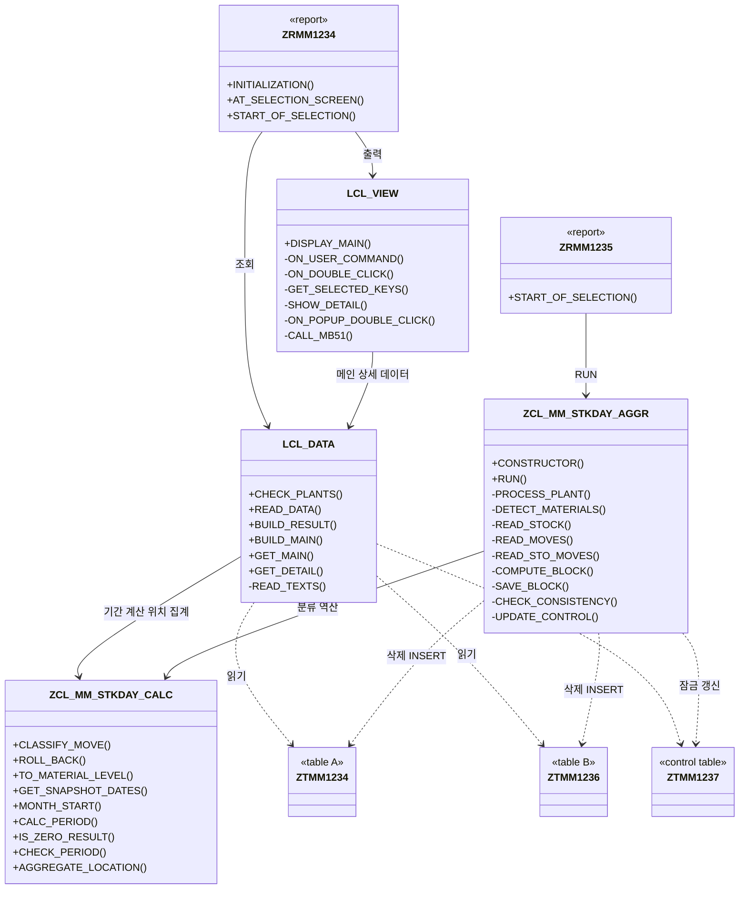
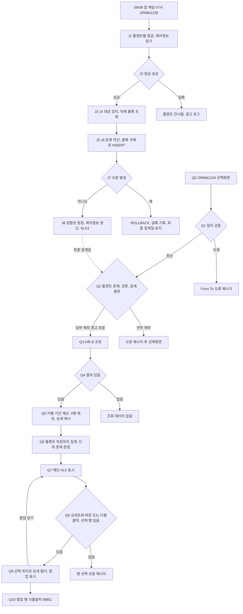
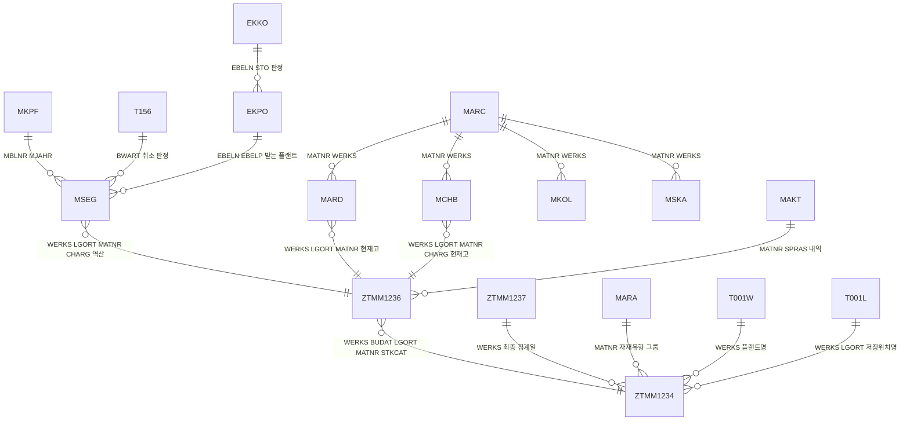

# 02. 설계서 — 전기일자 기준 자재수불부 조회(일별)_저장위치레벨포함

| 항목 | 내용 |
|---|---|
| 요청 ID | 20261022-9149a8 |
| 단계 | 설계 v1.1 (팀장 수정 지시 1차 반영: 메인 ALV 플랜트+저장위치 수량 집계, [상세조회] 버튼·더블클릭·다중 선택 상세. CR 없음) |
| 설계 기준 | 01_analysis.md v1.2(팀장 승인) + request.md + **팀장 설계 수정 지시(2026-10-22, 이하 "설계지시 1~3")** |
| 대상 시스템 | srd-abap (http://dshldra1.dongkuksteel.com:8000, 클라이언트 250, ECC). `mcp__sap__*` 읽기 조회만 수행 |
| 개발표준 | standards/handbook.md (Dongkuk Steel ABAP 개발표준 Handbook) |
| 참고 위키 | ECC 7.40 시스템 ABAP 개발 제약 / 자재마스터 조회 리포트 설계 패턴 / 배치관리 자재 판정 기준 / SAP 시스템 미확인 상태에서 작업하는 방법 / 테스트계 반영 전 점검 항목 / 기존 모듈풀 ALV 화면에 기능 추가하는 방법 |

> 표기: **[확인]** srd-abap에서 SearchObject·GetClass·GetProgram으로 확인함. **[확인-간접]** 시스템의 활성 소스(표준 MB5B 소스, ZMMD의 활성 Z 클래스)가 그 필드를 참조하는 것으로 확인함(DDIC 필드 목록 자체는 못 읽음). **[미확인]** SAP ECC 표준 지식 기반 추정. 이 시스템 ADT는 테이블 필드 목록을 돌려주지 않습니다. `GetTable T156` → `ExceptionResourceNotFound (/sap/bc/adt/ddic/structures/T156/source/main does not exist)`. 그래서 소스는 모두 `TYPE mseg-shkzg`처럼 필드 참조로 선언하고, 필드가 없으면 활성화 때 드러나게 합니다.

> **설계지시(팀장 수정 지시, v1.1 반영)**
> 1. 메인 ALV는 "플랜트 + 저장위치" 단위로 집계한다. 컬럼: 플랜트, 플랜트명, 저장위치, 저장위치명, 기초재고, 입고, 출고, 기말재고.
> 2. 툴바에 [상세조회] 버튼을 추가하고, 메인 ALV 행 더블클릭으로도 상세조회할 수 있게 한다.
> 3. 여러 행을 선택하면 선택한 플랜트/저장위치 전체를 상세 화면에 표시한다.
>
> v1.0의 메인 컬럼(자재 건수·배치 건수·입출고 자재 건수)은 **모두 폐기**했습니다. 반영 위치는 16장 변경 이력에 정리했습니다.

---

## 1. 개요

### 1.1 목적과 범위

- 매일 07:00 백그라운드 잡으로 도는 **집계 배치 프로그램 ZRMM1235**가 ECC 역산 방식(현재고 − 이후 자재전표)으로 전기일자별 수불을 계산합니다. 결과는 집계 테이블 두 개(**A = ZTMM1234** 플랜트+저장위치+자재 요약, **B = ZTMM1236** +배치 상세)에 저장합니다.
- **조회 프로그램 ZRMM1234(T-code ZRMM1234)** 는 MKPF/MSEG를 읽지 않고 A·B만 읽습니다. 사용자가 입력한 전기일 From~To에 대해 기초(From 시작)·입고·출고(기간 합)·기말(To 종료)을 계산합니다.
  - **메인 화면(설계지시 1)**: **플랜트 + 저장위치 1행**(플랜트별 '(운송중)' 행 포함). 그 위치에 속한 자재들의 **기초재고·입고·출고·기말재고(일반재고)** 합계를 보여 줍니다. 기본단위가 서로 다른 자재가 섞인 위치는 수량을 더하지 않습니다(D11).
  - **상세 화면(설계지시 2·3)**: [상세조회] 버튼(선택한 여러 행 전체) 또는 행 더블클릭(그 행 하나)으로 여는 SALV 팝업입니다. 선택한 플랜트/저장위치의 **자재+배치 단위** 기간 수불(기존 v1.0 상세와 같은 컬럼)을 보여 주고, 팝업을 닫으면 메인으로 돌아갑니다.
- 분석서에서 확정한 원칙을 그대로 따릅니다. 기말은 재고유형을 나누지 않은 수량 하나, 취소는 원래 방향에서 차감, 위탁(K)·오더(E)는 별도 컬럼(상세), Q·W는 제외, 저장위치 이전중(313)과 플랜트 '(운송중)' 행(303/STO), 재고금액 없음, ECC 7.40 문법.

### 1.2 설계 핵심 결정 (분석서 대비)

| # | 결정 | 이유 |
|---|---|---|
| D1 | **오브젝트명을 핸드북 규칙으로 정했습니다.** 가칭 ZRMM1234J → **ZRMM1235**, ZTMM1234A/B → **ZTMM1234 / ZTMM1236**, 제어 테이블 ZTMM1234C → **ZTMM1237** | 핸드북은 프로그램 `ZR`+모듈+4자리, 테이블 `ZT`+모듈+4자리(8자리)를 요구합니다. 가칭은 9자리라 규칙에 맞지 않습니다. **ZTMM1235는 이미 있어서[확인]** B는 ZTMM1236을 씁니다 |
| D2 | **메시지 클래스는 ZMMM3입니다**(분석서 Q15 잠정안 'ZMM'과 다름) | 핸드북 규칙은 `ZM`+모듈+1자리입니다. ZMMM, ZMMM1, ZMMM2는 이미 있고[확인] ZMMM3은 비어 있습니다[확인] |
| D3 | 재집계 단위는 **(플랜트, 자재)** 이고, 자재별 시작일 d0부터 전일까지 해당 자재의 모든 키(저장위치·배치·운송중)를 지운 뒤 다시 씁니다 | 같은 자재의 저장위치 간 이전(311 등)은 상대 키가 자동으로 같이 재계산됩니다. 삭제를 `matnr IN range AND budat >= d0`로 한 번에 처리할 수 있어 LOOP 안 DB 처리가 없습니다 |
| D4 | **A는 B를 합산해서 만들지 않고, 같은 역산 메서드를 자재 레벨 입력(배치 합산)에 한 번 더 적용해 만듭니다** | 변동일 행 방식에서는 배치마다 행이 있는 날짜가 달라 "그날 B 행 합"이 기말을 뜻하지 않습니다. 같은 입력을 합산해 같은 식으로 계산하면 A = Σ B(각 배치의 그날 기준 기말)가 수학적으로 보장되고, 이 관계는 정합성 점검(J8)에서 확인합니다 |
| D5 | 전기일 저장 방식은 **변동일 행 + 월초 스냅샷 + 적재 시작일 스냅샷**(분석서 Q20 잠정안 ①)으로 합니다 | 데이터량이 이동 건수에 비례하고, 조회할 때 To가 속한 달 안에서만 마지막 행을 찾으면 됩니다 |
| D6 | 이전중(313/303) 판정은 **표준 MB5B(RM07MLBD)의 규칙을 그대로 따릅니다**: `XAUTO='X'`이면서 `BUSTM ∈ {MA02, MA05, MAUO, MA0L, MAVA}`인 행은 일반재고에서 빼고 이전중으로 보냅니다 | srd-abap의 RM07MLBD `FORM summen_bilden` 원문(3320~3496행)에서 확인했습니다[확인]. 이 시스템 MB5B와 기준이 같아지므로 분석서 Q8의 리스크가 줄어듭니다 |
| D7 | 상세 데이터는 **메인 조회 때 B와 자재내역(MAKT)을 함께 읽어 메모리(GT_DETAIL)에 보관**하고, [상세조회]·더블클릭으로 팝업을 열 때는 DB를 읽지 않고 선택 키로 거르기만 합니다(분석서 Q21 기본안) | 요청서 원칙("팝업 시 DB 재조회 안 함", request.md 60행)을 지키고, 여러 행을 선택해도 추가 SELECT가 생기지 않습니다 |
| D8 | 기존 Z 재고 자산은 **재사용하지 않습니다**(분석서 Q14 결론) | `ZHCL_MM_REPORT_STOCK`은 현재고(MARC/MCHB) AMDP이고, `ZHCL_MM_BATCH_STOCK`은 기간 MSEG 합(WERKS/MATNR/CHARG, 저장위치 없음) AMDP입니다[확인, GetClass]. 둘 다 일자별 저장 집계가 아니고 저장위치 레벨이 없습니다. `ZEMM_STOCK_DAY`의 사용처는 읽을 수 없어 SE11 사용처 목록으로 확인할 것을 권고합니다 |
| D9 | DB는 **SAP HANA(Suite on HANA)로 추정합니다** | ZMMD에 `IF_AMDP_MARKER_HDB`를 구현한 활성 클래스(ZHCL_MM_*)가 있습니다[확인]. 집계(SUM/GROUP BY)를 DB에서 처리하고, 보조 인덱스는 처음에는 만들지 않습니다(9장). 단, 로직은 Open SQL로만 작성하고 AMDP/CDS는 쓰지 않습니다(NFR-03) |
| D10 | 핵심 계산(이동 분류, 역산, 기간 계산, 일자 검증, **메인 위치별 집계**)은 **DB를 쓰지 않는 글로벌 클래스 ZCL_MM_STKDAY_CALC의 정적 메서드**로 분리하고 ABAP Unit 대상으로 둡니다 | 시스템에 `CL_OSQL_TEST_ENVIRONMENT`가 없어 DB를 읽는 로직은 단위테스트할 수 없습니다(위키). 두 프로그램이 같은 계산 규칙과 상수를 공유합니다 |
| **D11** | **메인 수량 집계(설계지시 1)**: 메인 1행 = (플랜트, 저장위치, 재고구분). 기초·입고·출고·기말은 그 위치에 속한 자재 결과(재고 0 제외 적용 후)의 **일반재고** 값(BEG/GR/GI/END)을 더합니다. K·E·이전중은 메인에 더하지 않고 상세에서만 보여 줍니다. **기본단위(MEINS) 혼재 처리**: 위치 안 자재의 MEINS가 하나면 합산하고 그 단위를 수량 참조 단위로 씁니다. **둘 이상이면 서로 다른 단위를 더하지 않습니다**: 수량 4개는 공란(0, 화면에서 0을 공란 표시), 행은 노란색, 숨김 플래그 UNIT_MIX = 'X', 조회 후 W 016으로 건수를 알립니다. 단위 환산(MARM)은 하지 않습니다 | request.md 46행 "단위가 서로 다른 자재 수량은 합산하지 않는다"와 설계지시 1을 함께 만족시키는 방법입니다. 환산 단위가 없는 자재가 있을 수 있고, 환산하면 상세 합과 메인이 달라져 검증이 어렵습니다. 방침은 팀장 확인 항목 D-11로 올립니다(대안: 단위 컬럼 표시 / 위치+단위별 행 분할) |
| **D12** | **상세 호출(설계지시 2·3)**: 메인 SALV 선택 모드는 `IF_SALV_C_SELECTION_MODE=>ROW_COLUMN`(다중 행)[확인: 인터페이스 존재]. 툴바 FCODE `DETAIL`([상세조회])은 **선택한 모든 행**의 (플랜트, 저장위치, 재고구분)으로, 더블클릭은 **더블클릭한 행 하나**로 상세를 엽니다. 선택 행이 없으면 S 012. 상세는 SALV 팝업(화면 약 80%)이고, 계속/취소로 닫으면 메인 화면(선택·정렬·필터 상태 유지)으로 돌아갑니다 | request.md 47~51행과 설계지시 2·3. 풀스크린 SALV에서는 `get_functions( )->add_function`을 쓸 수 없으므로 GUI 상태를 복사해 버튼을 넣습니다(8.3) |

---

## 설계 다이어그램

### 1) 프로그램 구조도



### 2) 처리 흐름도



### 3) 데이터 관계도



> 다이어그램의 단계 번호(J1~J8, Q0~Q10)는 7장 '처리 로직 단계'의 번호와 같습니다. MARC는 배치관리(XCHPF)와 운송중(UMLMC+TRAME) 현재고의 소스이기도 합니다(6장). 메인 ALV 1행은 ZTMM1234의 (WERKS, LGORT, STKCAT) 단위 합계이고, 상세 팝업은 같은 키로 ZTMM1236 결과를 거른 것입니다.

---

## 예상 화면

### 화면 1. ZRMM1234 선택화면

```sapscreen
{"type":"selection","title":"전기일자 기준 자재수불부 조회","tcode":"ZRMM1234","blocks":[{"title":"전기일 기간 (매일 07:00에 전일까지 집계된 자료)","fields":[{"label":"전기일 From","kind":"param","required":true,"value":"2026.10.21"},{"label":"전기일 To","kind":"param","required":true,"value":"2026.10.21"}]},{"title":"조직","fields":[{"label":"플랜트","kind":"select","required":true,"value":"","to":""},{"label":"저장위치","kind":"select","required":false,"value":"","to":""}]},{"title":"자재","fields":[{"label":"자재","kind":"select","required":false,"value":"","to":""},{"label":"자재유형","kind":"select","required":false,"value":"","to":""},{"label":"자재그룹","kind":"select","required":false,"value":"","to":""},{"label":"배치","kind":"select","required":false,"value":"","to":""}]},{"title":"옵션","fields":[{"label":"재고 0 행 제외","kind":"check","checked":true},{"label":"레이아웃","kind":"param","required":false,"value":""}]}]}
```

예시 값(일자)은 형식만 보여 주는 가상 값입니다. 기본값은 실행 시점의 최종 집계일입니다.
대응: 5.1 '선택화면' 표의 PA_BUDFR, PA_BUDTO, SO_WERKS, SO_LGORT, SO_MATNR, SO_MTART, SO_MATKL, SO_CHARG, PA_NOZER, PA_VARI 순서와 같습니다. 블록 제목 아래 안내 줄(Text Symbol)에 "마지막 집계: YYYY.MM.DD HH:MM (대상일 YYYY.MM.DD)"를 표시합니다. 선택화면은 v1.1에서 바뀐 것이 없습니다.

### 화면 2. 메인 ALV (플랜트 + 저장위치 집계, 테이블 A 기준)

```sapscreen
{"type":"alv","title":"자재수불부 전기일 2026.10.21 ~ 2026.10.21 (집계 기준 2026.10.22 07:05)","tcode":"ZRMM1234","toolbar":["상세조회","정렬","필터","합계","엑셀 다운로드","레이아웃"],"columns":[{"label":"플랜트","key":true},{"label":"플랜트명"},{"label":"저장위치","key":true},{"label":"저장위치명"},{"label":"기초재고","align":"right"},{"label":"입고","align":"right"},{"label":"출고","align":"right"},{"label":"기말재고","align":"right"}],"rows":[["P001","플랜트A","SL01","저장위치A","100","50","30","120"],["P001","플랜트A","SL02","저장위치B","","","",""],["P001","플랜트A","","(운송중)","","","",""]],"status":{"type":"W","text":"단위가 서로 다른 자재가 있는 저장위치 1건은 수량을 합산하지 않았습니다. 상세조회에서 확인하십시오."}}
```

예시 데이터는 형식만 보여 주는 가상 값입니다. 2행(SL02)은 기본단위가 섞인 위치라 수량이 공란이고 행이 노란색입니다. 3행 '(운송중)'은 일반재고가 없고(Q7) 이전중 수량은 상세에서만 보입니다. 단위 혼재 위치가 없으면 상태줄은 S 011 "3건이 조회되었습니다."입니다.
대응: 8.1 '메인 ALV 필드카탈로그'의 표시 컬럼 1~8 순서·헤더와 같습니다(설계지시 1). 숨김 컬럼 MEINS·UNIT_MIX·STKCAT는 화면에 나오지 않습니다. [상세조회]는 GUI 상태 STANDARD의 FCODE DETAIL(8.3)이고, 행 선택 버튼으로 여러 행을 고를 수 있습니다. 합계 행은 기본으로 표시하지 않습니다.

### 화면 3. 상세 팝업 ALV (선택한 플랜트/저장위치의 자재·배치, 테이블 B 기준)

```sapscreen
{"type":"alv","title":"수불 상세 (자재/배치) 전기일 2026.10.21 ~ 2026.10.21 / 선택 위치 2개","tcode":"ZRMM1234","toolbar":["정렬","필터","합계","엑셀 다운로드","레이아웃"],"columns":[{"label":"플랜트","key":true},{"label":"저장위치","key":true},{"label":"저장위치명"},{"label":"자재","key":true},{"label":"자재내역"},{"label":"배치","key":true},{"label":"단위"},{"label":"기초","align":"right"},{"label":"입고","align":"right"},{"label":"출고","align":"right"},{"label":"기말","align":"right"},{"label":"위탁재고(K)","align":"right"},{"label":"오더재고(E)","align":"right"},{"label":"이전중","align":"right"}],"rows":[["P001","SL01","저장위치A","MAT-A","자재A","BATCH-1","KG","60","30","10","80","0","0","0"],["P001","SL01","저장위치A","MAT-A","자재A","BATCH-2","KG","40","20","20","40","0","0","0"],["P001","SL02","저장위치B","MAT-B","자재B","","KG","10","5","0","15","0","0","0"],["P001","SL02","저장위치B","MAT-C","자재C","","EA","3","0","1","2","0","0","0"]],"status":{"type":"S","text":"선택한 2개 위치의 상세 4건을 표시합니다."}}
```

예시 데이터는 형식만 보여 주는 가상 값입니다. 화면 2에서 SL01·SL02 두 행을 선택하고 [상세조회]를 누른 경우입니다. SL01 상세 합(기초 100, 입고 50, 출고 30, 기말 120)이 메인 SL01 행과 같습니다. 팝업 크기는 전체 화면의 약 80%이고, 계속(Enter)·취소(F12)로 닫으면 화면 2로 돌아갑니다.
대응: 8.2 '상세 팝업 필드카탈로그'와 같습니다(v1.0과 같은 컬럼). 단위가 서로 달라 합계 행은 기본으로 표시하지 않습니다.

### 화면 4. ZRMM1235 집계 배치 선택화면 (운영 담당 수동 실행용)

```sapscreen
{"type":"selection","title":"자재수불부 일자별 집계","tcode":"SA38","blocks":[{"title":"실행 모드","fields":[{"label":"일 집계 (전일까지, 잡 기본)","kind":"radio","checked":true},{"label":"수동 재집계","kind":"radio","checked":false},{"label":"초기 적재","kind":"radio","checked":false}]},{"title":"대상","fields":[{"label":"플랜트","kind":"select","required":false,"value":"","to":""},{"label":"시작 전기일 (재집계/초기 적재)","kind":"param","required":false,"value":""},{"label":"재집계 시작 = 전월 1일","kind":"check","checked":false},{"label":"자재 (재집계만)","kind":"select","required":false,"value":"","to":""}]},{"title":"옵션","fields":[{"label":"입력일시 여유시간(분)","kind":"param","required":false,"value":"60"},{"label":"블록 크기(자재 수)","kind":"param","required":false,"value":"1000"},{"label":"테스트 실행 (저장 안 함)","kind":"check","checked":false}]}]}
```

정상 운영에서는 화면 없이 **SM36 잡 ZRMM1235_DAILY**(변형 DAILY, 매일 07:00)로 실행합니다. 수동 실행은 SA38에서 운영 담당자만 합니다.
대응: 5.2 'ZRMM1235 선택화면'의 PA_DAILY/PA_RECAL/PA_INIT, SO_WERKS, PA_FROM, PA_PRVMO, SO_MATNR, PA_OVLAP, PA_BLKSZ, PA_TEST와 같습니다.

### 화면 5. 초기 적재 확인 팝업 (ZRMM1235 온라인 실행 + 초기 적재 모드일 때만)

```sapscreen
{"type":"popup","title":"초기 적재 확인","icon":"!","message":"선택한 플랜트의 기존 집계 데이터를 모두 지우고 시작 전기일부터 전일까지 다시 적재합니다. 적재가 끝날 때까지 ZRMM1234에서 해당 플랜트를 조회할 수 없습니다. 계속하시겠습니까?","buttons":["예","아니오"]}
```

대응: 7.1 J0 단계(초기 적재 확인). 백그라운드 실행(SY-BATCH = 'X')이면 팝업 없이 진행합니다.

### 메시지 표시 위치

| 상황 | 표시 | 메시지 |
|---|---|---|
| From > To, To ≥ 오늘 | 선택화면 상태줄 E | ZMMM3 001, 002 |
| 입력 플랜트 없음 / 권한 없음 / 미집계 | 상태줄 E (전부) 또는 W (일부 제외) | 004~008 |
| 집계 지연·실패 | 메인 ALV 표시 전 W | 009 |
| 조회 결과 없음 | 선택화면으로 돌아가 S(표시 형식 W) | 010 |
| 메인 조회 건수 | 메인 상태줄 S | 011 |
| 단위 혼재 위치 있음 | 메인 상태줄 S(표시 형식 W), 011 대신 표시 | 016 |
| 행 미선택 상태에서 [상세조회] | 메인 상태줄 S | 012 |
| 상세 팝업 표시 | 팝업 상태줄 S | 017 |
| 선택 위치의 상세가 0건(방어) | 메인 상태줄 S(표시 형식 W), 팝업 열지 않음 | 010 |

전체 메시지 목록은 10.3에 있습니다.

---

## 2. 오브젝트 목록

| # | 유형 | 이름 | 목적 | 이름 확인 | 명명 근거 |
|---|---|---|---|---|---|
| 1 | 패키지 | ZMMD | MM 개발 패키지 | 있음 [확인] | 핸드북 1장 |
| 2 | 테이블(TABL) | **ZTMM1234** | 테이블 A: 플랜트+저장위치+자재+전기일+재고구분 단위 일 수불 요약 | 비어 있음 [확인] | 핸드북 Tables `ZT`+MM+4자리 |
| 3 | 테이블(TABL) | **ZTMM1236** | 테이블 B: A의 키 + 배치 단위 일 수불 상세(비배치·운송중은 배치 공란) | 비어 있음 [확인]. ZTMM1235는 다른 테이블로 이미 있음 [확인] | 같음 |
| 4 | 테이블(TABL) | **ZTMM1237** | 집계 제어 테이블(플랜트별 적재 시작일·최종 집계일·마지막 실행 결과). 분석서 Q19 권고안 채택 | 비어 있음 [확인] | 같음 |
| 5 | 도메인 | **ZDSTCAT** | 재고구분 CHAR 1, 고정값 `L` 저장위치 / `T` 운송중 | 비어 있음 [확인]. ZDSTK*에는 ZDSTKFLAG·ZDSTKYN만 있음 | 핸드북 Domains `ZD`+5자 |
| 6 | 데이터 엘리먼트 | **ZESTCAT** | 재고구분(ZDSTCAT). 필드 레이블 "재고구분" | 비어 있음 [확인]. ZESTKTP는 다른 패키지(ZOMS)에 이미 있어 쓰지 않음 | 핸드북 Data Elements `ZE`+5자 |
| 7 | 잠금 오브젝트 | **EZTMM1237** | ZTMM1237(MANDT, WERKS) 기반 플랜트별 집계 배타 잠금 → ENQUEUE_/DEQUEUE_EZTMM1237 생성 | 비어 있음 [확인]. 같은 패턴의 EZTMM0001 등이 있음 [확인] | 핸드북 Lock Objects `E`+테이블명 |
| 8 | 클래스 | **ZCL_MM_STKDAY_CALC** | DB 없는 계산 클래스: 이동 분류, 역산, 스냅샷 일자, 기간 계산, 일자 검증, **메인 위치별 수량 집계·단위 혼재 판정(AGGREGATE_LOCATION, v1.1)**, 공용 타입·상수. ABAP Unit 대상 | 비어 있음 [확인] | 핸드북 규칙 없음 — SAP 관례(`ZCL_`+모듈) 적용 |
| 9 | 클래스 | **ZCL_MM_STKDAY_AGGR** | 집계 실행 클래스: 잠금·감지·현재고/이동 조회·블록 처리·저장·제어 갱신·로그 | 비어 있음 [확인] | 같음 |
| 10 | 프로그램(PROG/P) | **ZRMM1235** | 집계 배치 리포트(선택화면 + `ZCL_MM_STKDAY_AGGR->run( )` 호출 + 결과 목록). INCLUDE 없음 | 비어 있음 [확인] | 핸드북 Programs `ZR`+MM+4자리 |
| 11 | 프로그램(PROG/P) | **ZRMM1234** | 조회 리포트(메인 플랜트+저장위치 집계 ALV, 상세 팝업) | 비어 있음 [확인] | 팀장지시 3, 핸드북 일치 |
| 12 | INCLUDE(PROG/I) | ZRMM1234_TOP / ZRMM1234_SEL / ZRMM1234_C01 / ZRMM1234_F01 | 전역 선언·출력 타입(8.4) / 선택화면 / 로컬 클래스 LCL_DATA·LCL_VIEW / 선택화면 보조 FORM(F4, 기본값) | 비어 있음 [확인] | 핸드북 규칙 없음 — 기존 ZRMM0005_TOP/_SEL/_F01 [확인] 명명 관례 적용 |
| 13 | GUI 상태 | ZRMM1234 `STANDARD` | 메인 SALV 전체 화면 상태. 함수 그룹 SALV_METADATA_STATUS [확인]의 `SALV_STANDARD`를 복사하고 응용 툴바에 FCODE **`DETAIL`(상세조회)** 추가(8.3). 상세 팝업은 SALV 기본 팝업 상태를 그대로 씀(별도 GUI 상태 없음) | — | 핸드북 규칙 없음 — SAP 관례(SALV 표준 상태명 STANDARD) 적용. SE41 수작업 |
| 14 | T-code | **ZRMM1234** | 리포트 트랜잭션 → ZRMM1234 | 비어 있음 [확인] | 팀장지시 3, 핸드북 일치 |
| 15 | T-code | (만들지 않음) | ZRMM1235는 잡·SA38로 실행합니다(분석서 Q22 잠정안) | — | — |
| 16 | 메시지 클래스 | **ZMMM3** | 두 프로그램과 클래스의 메시지 | 비어 있음 [확인] | 핸드북 Message Class `ZM`+MM+1자리 |
| 17 | 애플리케이션 로그 오브젝트 | 오브젝트 `ZMM` / 서브오브젝트 `ZRMM1235` (SLG0) | 집계 상세 로그(SLG1) | **확인 필요**: BALOBJ는 Customizing 데이터라 조회할 수 없음. 없으면 SLG0에서 만듭니다(Customizing 이송) | 핸드북 규칙 없음 — 오브젝트는 모듈, 서브오브젝트는 프로그램명(관례) |
| 18 | 잡 | `ZRMM1235_DAILY`(변형 DAILY, 매일 07:00) / `ZRMM1235_MONTHLY`(변형 MONTHLY, 매월 첫 일요일 05:00, 전월 1일부터 재집계) | 일 집계 / 안전장치 재집계(분석서 Q16) | 이송 대상 아님 — Basis 등록 | 핸드북 규칙 없음 — 프로그램명+주기(관례) |
| 19 | 텍스트 | Selection Text, Text Symbol(10.1, 10.2) | 소스 파일에 포함되지 않으므로 반영 체크리스트로 처리 | — | — |

- DDIC 구조(ZSMM....)는 만들지 않습니다. 타입은 클래스 PUBLIC SECTION과 프로그램 TOP에 둡니다(8.4). 메인 출력 구조도 DDIC가 아니라 TOP의 로컬 타입 TY_MAIN입니다.
- 수량·관리 필드는 표준 데이터 엘리먼트(MENGE_D, MEINS, XFELD, CPUDT, CPUTM, BAPI_MSG, BTCJOB, BTCJOBCNT 등)를 씁니다. MENGE_D·XFELD·CPUTM·BAPI_MSG·BTCJOBCNT는 있습니다[확인]. 행 색상 테이블 유형 LVC_T_SCOL은 있습니다[확인, 패키지 SLIS].
- **활성화·반영 순서**: 도메인 → 데이터 엘리먼트 → 테이블 3개 → 잠금 오브젝트 → 메시지 클래스 → ZCL_MM_STKDAY_CALC → ZCL_MM_STKDAY_AGGR → ZRMM1235 → ZRMM1234 INCLUDE와 본문 → GUI 상태 → 텍스트 → T-code. 웹앱 반영 도구는 src/ 파일을 파일명 순서로 처리하므로 클래스를 먼저 올려야 합니다(위키 '테스트계 반영 전 점검 항목'). DDIC 오브젝트(1~7)는 소스 파일이 아니므로 SE11에서 수작업으로 만듭니다. GUI 상태(13)도 SE41 수작업이며, 없으면 메인 화면에서 [상세조회] 버튼과 표준 툴바가 나오지 않습니다(TP-I17에서 확인).

---

## 3. 집계 테이블 정의

### 3.1 공통 기술 속성

| 항목 | ZTMM1234 (A) | ZTMM1236 (B) | ZTMM1237 (제어) |
|---|---|---|---|
| 내역 | 자재수불부 일자별 집계(저장위치) | 자재수불부 일자별 집계(배치) | 자재수불부 집계 제어 |
| 납품 클래스 | A | A | A |
| 데이터 클래스 | APPL1 | APPL1 | APPL2 |
| 크기 범주 | 4 [가정, 초기 적재 후 행 수를 측정해 다시 정함, Q20] | 5 [가정, 같음] | 0 |
| 버퍼링 | 허용 안 함 | 허용 안 함 | 허용 안 함 |
| 테이블 유지보수 | 표시/유지보수 제한 허용(SM30 생성 안 함) | 같음 | 같음 |
| 변경 로그 | 안 함 | 안 함 | 안 함 |
| 권한그룹(S_TABU_DIS) | **확인 필요**(팀 표준 MM 권한그룹. SE16 직접 열람 제한) | 같음 | 같음 |
| 보조 인덱스 | 처음에는 없음(HANA 컬럼 스토어 추정, D9). QAS에서 ST05로 확인 | 같음. AnyDB로 판명되면 (MANDT, WERKS, MATNR, BUDAT) 추가 | 없음 |
| 쓰기 주체 | ZCL_MM_STKDAY_AGGR만 | 같음 | 같음 |

### 3.2 ZTMM1234 (테이블 A, 요약)

| # | 필드 | 키 | 데이터 엘리먼트 | 타입(길이) | 설명 |
|---|---|---|---|---|---|
| 1 | MANDT | X | MANDT | CLNT 3 | 클라이언트 |
| 2 | WERKS | X | WERKS_D | CHAR 4 | 플랜트 |
| 3 | BUDAT | X | BUDAT | DATS 8 | 전기일(집계 일자) |
| 4 | LGORT | X | LGORT_D | CHAR 4 | 저장위치. 운송중 행(STKCAT='T')은 공란 |
| 5 | MATNR | X | MATNR | CHAR 18 | 자재 (ECC 18자리 — 위키 ECC 판정 근거) |
| 6 | STKCAT | X | ZESTCAT | CHAR 1 | 재고구분 `L` 저장위치 행 / `T` 운송중 행 |
| 7 | MEINS | | MEINS | UNIT 3 | 기본단위(MARA-MEINS). 수량 필드의 참조 단위. **ZRMM1234 메인의 단위 혼재 판정에 사용(D11)** |
| 8 | SNAPF | | XFELD | CHAR 1 | 스냅샷 행 표시('X' = 월초 또는 적재 시작일 스냅샷 날짜의 행) |
| 9 | BEG_QTY | | MENGE_D | QUAN 13,3 | 당일 기초(일반) |
| 10 | GR_QTY | | MENGE_D | QUAN 13,3 | 당일 입고(일반, 취소 순액) |
| 11 | GI_QTY | | MENGE_D | QUAN 13,3 | 당일 출고(일반, 취소 순액) |
| 12 | END_QTY | | MENGE_D | QUAN 13,3 | 당일 기말(일반 = 가용+QI+보류+제한(+반품, D-01)) |
| 13 | K_GR | | MENGE_D | QUAN 13,3 | 위탁(K) 당일 입고 |
| 14 | K_GI | | MENGE_D | QUAN 13,3 | 위탁(K) 당일 출고 |
| 15 | K_END | | MENGE_D | QUAN 13,3 | 위탁(K) 당일 기말 |
| 16 | E_GR | | MENGE_D | QUAN 13,3 | 오더(E) 당일 입고 |
| 17 | E_GI | | MENGE_D | QUAN 13,3 | 오더(E) 당일 출고 |
| 18 | E_END | | MENGE_D | QUAN 13,3 | 오더(E) 당일 기말 |
| 19 | TRF_END | | MENGE_D | QUAN 13,3 | 이전중 당일 기말. STKCAT='L'이면 저장위치 이전중(313), 'T'이면 플랜트 운송중(303+STO) |
| 20 | ERDAT | | ERDAT | DATS 8 | 집계일 |
| 21 | ERZET | | ERZET | TIMS 6 | 집계 시각 |
| 22 | ERNAM | | ERNAM | CHAR 12 | 실행 사용자(잡 사용자) |

- 수량 필드(9~19)의 참조 테이블·필드는 ZTMM1234-MEINS입니다. 금액·통화 필드는 없습니다.
- MENGE_D 길이(QUAN 13,3)는 표준 지식 기준이며 [미확인]입니다. SE11에서 확인합니다. 데이터 엘리먼트 MENGE_D가 있는 것은 [확인].
- 키 순서(WERKS, BUDAT, LGORT, MATNR, STKCAT)는 분석서 5.2 권고를 따랐습니다. 조회는 항상 "플랜트 + 전기일 범위"로 들어옵니다.
- **Q2 영향**: 프로젝트재고(Q)를 넣기로 결정하면 Q_GR/Q_GI/Q_END 필드 3개를 A·B 끝에 추가합니다(키 변경 없음, 비키 컬럼 추가라 테이블 변환 부담이 작음). 그러면 MSPR 현재고 조회와 SOBKZ='Q' 분류가 추가되고 상세 화면 컬럼이 하나 늘어납니다.
- 집계 테이블 구조는 v1.1 설계지시로 바뀌지 않습니다. 메인 수량 합계는 조회 시점에 계산합니다(D11).

### 3.3 ZTMM1236 (테이블 B, 상세)

ZTMM1234와 같고, **6번 앞에 키 필드 CHARG(CHARG_D, CHAR 10)를 넣습니다.**

| 키 순서 | MANDT, WERKS, BUDAT, LGORT, MATNR, **CHARG**, STKCAT |
|---|---|
| CHARG 규칙 | 배치관리 자재(MARC-XCHPF ≠ 공란)는 배치값을 씁니다. 비배치 자재와 운송중 행은 공란입니다. MSEG에 배치가 있어도 현재 MARC-XCHPF가 공란이면 공란으로 바꿉니다(현재고 MARD와 키를 맞추기 위함, R-05) |
| 비배치 자재 | A 행과 B 행(배치 공란 1행)의 값이 같습니다 |

### 3.4 ZTMM1237 (집계 제어)

| # | 필드 | 키 | 데이터 엘리먼트 | 설명 |
|---|---|---|---|---|
| 1 | MANDT | X | MANDT | 클라이언트 |
| 2 | WERKS | X | WERKS_D | 플랜트(초기 적재를 한 플랜트만 행이 있음 = 일 집계 대상) |
| 3 | LOAD_FROM | | BUDAT | 적재 시작일 S. ZRMM1234는 이 날짜 이전 From을 막습니다 |
| 4 | LAST_BUDAT | | BUDAT | 최종 집계 대상일 `D_last`. **성공했을 때만** 갱신합니다. 초기 적재 중에는 공란(조회 차단) |
| 5 | LAST_CPUDT | | CPUDT | 마지막 성공 실행의 시작일 `T_last`(전표 입력일 감지 기준) |
| 6 | LAST_CPUTM | | CPUTM | 마지막 성공 실행의 시작 시각 |
| 7 | RUN_DATE | | DATUM | 마지막 실행 시작일(성공·실패 무관) |
| 8 | RUN_TIME | | UZEIT | 마지막 실행 시작 시각 |
| 9 | RUN_MODE | | CHAR1 | `D` 일 집계 / `R` 재집계 / `I` 초기 적재 |
| 10 | RUN_STAT | | CHAR1 | `R` 실행 중 / `S` 성공 / `E` 실패 / `W` 성공(정합성 경고) |
| 11 | RUN_MATS | | INT4 | 마지막 실행에서 재계산한 자재 수 |
| 12 | RUN_MSG | | BAPI_MSG | 마지막 결과 메시지(실패 사유) |
| 13 | JOBNAME | | BTCJOB | 잡명(SY-BATCH일 때) |
| 14 | JOBCOUNT | | BTCJOBCNT | 잡 번호 |
| 15 | AEDAT / AEZET / AENAM | | AEDAT / AEZET / AENAM | 변경 일시·사용자 |

- 실행 이력은 행마다 덮어쓰고, 날짜별 이력은 SLG1(외부 ID = 플랜트+실행일시)과 SM37 잡 로그로 봅니다. 이력 전용 테이블은 만들지 않습니다(최소 구성).
- `CHAR1`, `DATUM`, `UZEIT`, `INT4`, `BTCJOB` 데이터 엘리먼트는 표준 지식 기준 [미확인]이고 BAPI_MSG·BTCJOBCNT·CPUTM은 [확인]입니다. RUN_MODE·RUN_STAT 값은 클래스 상수(C_MODE_*, C_STAT_*)로 관리하고 도메인은 만들지 않습니다(최소 구성).

---

## 4. 전기일 저장 규칙과 계산식 (FR-20, D5)

### 4.1 행이 생기는 조건 (B, A 공통)

키 = (WERKS, LGORT, MATNR, [CHARG], STKCAT). 계산 구간 [d0, D−1]의 각 날짜 d에 대해 다음 중 하나면 행을 만듭니다.

1. 그날 그 키에 분류 결과 이동(일반 입고·출고, K·E 입출고, 이전중 증감)이 0이 아닌 값으로 있음
2. d가 **매월 1일**이고, 그날 기말(END_QTY, K_END, E_END, TRF_END) 중 하나라도 0이 아님 → SNAPF='X'
3. d가 **적재 시작일 S**이고, 기말 중 하나라도 0이 아님 → SNAPF='X'

### 4.2 역산식 (ZCL_MM_STKDAY_CALC=>ROLL_BACK)

집계 실행일을 D라 하고, 현재고는 실행 순간 값입니다. 측정값 m ∈ {일반, K, E, 이전중}마다 일자별 증감 Δm(d)를 씁니다.

| 항목 | 식 |
|---|---|
| 기말(D−1) | 현재고 − Σ Δ(BUDAT ≥ D) (당일·미래 일자 전표 차감) |
| 기말(d−1) | 기말(d) − Δ(d) |
| 입고(d) / 출고(d) | 분류 결과 합(4.3). 일반은 Δ(d) = 입고(d) − 출고(d) |
| 기초(d) | 기말(d) − 입고(d) + 출고(d) |

**예시**(가상 값): 실행일 10/23 07:00, 현재고 150, 10/23 입고 30이 이미 전기됨 → 기말(10/22) = 120. 10/22에 101 50, 261 20 → 입고 50, 출고 20, 기초(10/22) = 90 = 기말(10/21). 10/21에 이동이 없으면 10/21 행은 없음(월초가 아니면).

### 4.3 이동 분류 규칙 (ZCL_MM_STKDAY_CALC=>CLASSIFY_MOVE)

입력: MSEG 집계 행(WERKS, LGORT, MATNR, CHARG, BUDAT, BWART, SHKZG, SOBKZ, XAUTO, BUSTM, 받는 플랜트, SUM(MENGE)), 취소 여부(T156), 배치관리 여부.

| 단계 | 규칙 | 근거 |
|---|---|---|
| C1 제외 | SOBKZ ∉ {공란, K, E} → 버림(Q, W, O, V, M 등. Q2·Q3 잠정안) | 팀장지시 5 |
| C2 제외 | 수량 갱신이 없는 자재유형(T134M MENGU 공란, 평가영역 = T001W-BWKEY) → 버림 (D-02) | 분석서 5.6.7 |
| C3 이전중 행 판정 | `XAUTO = 'X'` **AND** (`BUSTM ∈ {MA02, MA05, MAUO, MA0L, MAVA}` 또는 BUSTM 공란이면서 `BWART ∈ {303, 304, 313, 314}`) → **일반재고에 넣지 않고** 이전중 증감으로 보냄. 대상: BWART 313/314 또는 BUSTM MA05 → 그 행의 (WERKS, LGORT, CHARG) L 키 TRF / BWART 303/304 또는 BUSTM MA02 → 그 행 WERKS의 T 키(LGORT·CHARG 공란). 부호: SHKZG='S' +, 'H' − | RM07MLBD 3346~3352, 3361~3367행 [확인]: MB5B 재고 개요가 같은 조건의 XAUTO 행을 버림. MAUO/MA0L/MAVA의 L/T 구분은 D-04 |
| C4 이전중 해소 | BWART 315/316 → 일반 입고(315 +, 316 취소 −) 그리고 같은 L 키 TRF −MENGE(315) / +MENGE(316). BWART 305/306 → 일반 입고와 같은 WERKS T 키 TRF −(305) / +(306) | 분석서 5.6.5·5.6.6 [미확인, D-04] |
| C5 STO 운송중 | BWART 351/641/643(공급 플랜트 H): 일반 출고(자기 L 키) + **받는 플랜트** T 키 TRF +MENGE. 352/642/644: 반대 부호. STO 입고(BWART 101/102이면서 EBELN의 EKKO-RESWK ≠ 공란): 일반 입고(±) + 자기 플랜트 T 키 TRF −(101) / +(102). 받는 플랜트 = MSEG-UMWRK, 공란이면 EKPO-WERKS | 분석서 5.6.6 [미확인, D-05] |
| C6 재고유형 간 이동 | BWART ∈ C_TYPECHG_BWART = {321, 322, 341, 342, 343, 344, 349, 350} → 일반 입고·출고에서 제외(같은 키 안 순증감 0) | Q6 잠정안. 상수로 관리 |
| C7 일반·K·E | 나머지 행: SOBKZ 공란 → 일반, K → K, E → E 측정값. LGORT 공란 행은 버림. **정상**: SHKZG S → 입고 +MENGE, H → 출고 +MENGE. **취소**(T156-XSTBW = 'X' [필드명 미확인, D-03]): SHKZG H → 입고 −MENGE, S → 출고 −MENGE | 팀장지시 2, 분석서 5.6.3 |
| C8 배치 | 배치관리 아님 → CHARG 공란 | 분석서 FR-14 |

- 122(공급업체 반품)는 T156 취소 지시자가 공란이라 C7에 따라 출고로 잡힙니다(Q5 잠정안).
- 411K(위탁 → 자사)는 K 행(H)이 K 출고, 자사 행(S)이 일반 입고로 각각 잡힙니다(A-10).
- 취소 판정에 MSEG-SMBLN은 쓰지 않습니다. DB 집계(GROUP BY)에 전표번호 성격의 필드를 넣으면 집계 효과가 없어지기 때문입니다. **분석서 Q4 잠정안 "T156 우선, SMBLN 보조"에서 "T156 단독"으로 좁혔습니다.** 테스트에서 "SMBLN이 있는데 XSTBW가 공란인 BWART"가 없는지 점검합니다(TP-I05).
- 분류 규칙(C3~C6의 이동유형 목록)은 **ZCL_MM_STKDAY_CALC의 상수 테이블**로 둡니다. 실제 전표 확인(D-04, D-05) 결과가 다르면 상수만 고칩니다.

### 4.4 조회 계산식 (ZCL_MM_STKDAY_CALC=>CALC_PERIOD)

From = F, To = T, 플랜트 적재 시작일 = S. 하한 L = max(월초(T), S).

| 항목 | 계산 |
|---|---|
| 읽는 범위 | BUDAT BETWEEN min(F, L) AND T |
| 입고 / 출고 | Σ GR_QTY / Σ GI_QTY (F ≤ BUDAT ≤ T) |
| 기말(T) | [L, T] 구간에서 BUDAT가 가장 큰 행의 END_QTY. 행이 없으면 0 |
| 기초(F) | 기말(T) − 입고 + 출고 |
| K / E / 이전중 | 기말(T)과 같은 행의 K_END / E_END / TRF_END. 행이 없으면 0 |

예시: F = 10/21, T = 10/22, 10/01 스냅샷 행 END 90, 10/22 행(입고 50, 출고 20, END 120) → 기말 120, 입고 50, 출고 20, 기초 90.

### 4.5 메인 위치별 집계식 (ZCL_MM_STKDAY_CALC=>AGGREGATE_LOCATION, 설계지시 1, D11)

입력은 4.4로 계산하고 재고 0 제외(PA_NOZER)를 적용한 **자재 레벨 결과**(키 WERKS·LGORT·STKCAT·MATNR, 값 MEINS·BEG·GR·GI·END)입니다. SO_CHARG를 입력했으면 자재 레벨 대신 **배치 레벨 결과**(B 기준)를 넣습니다(7.2 Q6).

| 항목 | 계산 |
|---|---|
| 집계 키 | (WERKS, LGORT, STKCAT). 운송중 행은 LGORT 공란·STKCAT 'T' |
| 단위 | 키 안 입력 행의 MEINS가 모두 같으면 그 값. 하나라도 다르면 UNIT_MIX = 'X', MEINS = 공란 |
| 기초재고 / 입고 / 출고 / 기말재고 | UNIT_MIX 공란: Σ BEG_QTY / Σ GR_QTY / Σ GI_QTY / Σ END_QTY. UNIT_MIX = 'X': 4개 모두 0(합산하지 않음) |
| 항등식 | 단위가 하나인 위치에서 기초재고 = 기말재고 − 입고 + 출고 (자재별 식의 합이므로 그대로 성립) |
| K·E·이전중 | 메인에 더하지 않음(상세 전용). 운송중 행은 Q7에 따라 4개 값이 모두 0 |

- 입력 순서와 관계없이 결과가 같아야 합니다(먼저 들어온 단위와 나중 단위가 달라도 혼재로 판정). 알고리즘: 입력을 차례로 읽어 키가 처음이면 그 MEINS로 행을 만들고, 이미 있으면 MEINS를 비교해 다르면 UNIT_MIX = 'X'로 표시하면서 값은 계속 더합니다. 모두 읽은 뒤 UNIT_MIX = 'X' 행의 MEINS·수량을 지웁니다.
- 예시(가상 값): SL01에 MAT-A 배치1(KG, 60/30/10/80)과 배치2(KG, 40/20/20/40) → SL01 = KG, 100/50/30/120. SL02에 MAT-B(KG)와 MAT-C(EA) → SL02 UNIT_MIX = 'X', 수량 공란.

---

## 5. 선택화면

### 5.1 ZRMM1234 (조회)

| 블록 | 이름 | 유형 | 참조 타입 | 필수 | 기본값 | 비고 |
|---|---|---|---|---|---|---|
| B01 전기일 기간 | PA_BUDFR | PARAMETERS | budat | O | 최종 집계일 | 전기일 From |
| B01 | PA_BUDTO | PARAMETERS | budat | O | 최종 집계일 | 전기일 To |
| B02 조직 | SO_WERKS | SELECT-OPTIONS | t001w-werks | O(OBLIGATORY) | 사용자 파라미터 WRK | MEMORY ID WRK |
| B02 | SO_LGORT | SELECT-OPTIONS | t001l-lgort | | | 입력하면 '(운송중)' 행 미표시(Q7) |
| B03 자재 | SO_MATNR | SELECT-OPTIONS | mara-matnr | | | MATCHCODE OBJECT MAT1 |
| B03 | SO_MTART | SELECT-OPTIONS | mara-mtart | | | |
| B03 | SO_MATKL | SELECT-OPTIONS | mara-matkl | | | |
| B03 | SO_CHARG | SELECT-OPTIONS | mchb-charg | | | B(상세)에 적용. **입력하면 메인 수량도 B(배치 레벨) 결과로 집계**(선택한 배치분만 합산, 4.5) |
| B04 옵션 | PA_NOZER | PARAMETERS AS CHECKBOX | xfeld | | 'X' | 재고 0 행 제외(메인·상세 공통, 메인은 제외 후 남은 자재로 집계) |
| B04 | PA_VARI | PARAMETERS | slis_vari | | | 메인 레이아웃. F4 = cl_salv_layout_service=>f4_layouts |

- **이름 변경**: 분석서의 P_BUDFR/P_BUDTO/S_WERKS/P_NOZERO는 핸드북(PA_ 4~8자리, SO_)에 맞춰 PA_BUDFR/PA_BUDTO/SO_WERKS/PA_NOZER로 바꿨습니다. `PA_NOZERO`는 9자리라 규칙(최대 8자리)을 넘습니다.
- 기본값은 INITIALIZATION에서 `SELECT MAX( last_budat ) FROM ztmm1237`로 넣습니다. 행이 없으면 SY-DATUM − 1입니다. 변형 값이 있으면 변형이 우선합니다.
- 블록 B01 아래 안내 줄 2개(Text Symbol T01, T02)를 AT SELECTION-SCREEN OUTPUT에서 채웁니다. SO_WERKS 첫 값 플랜트의 LAST_CPUDT/LAST_CPUTM/LAST_BUDAT를 보여 줍니다.
- 선택화면은 v1.1 설계지시로 바뀌지 않았습니다. SO_CHARG와 PA_NOZER의 메인 적용 범위만 명확히 했습니다.

### 5.2 ZRMM1235 (집계 배치)

| 블록 | 이름 | 유형 | 참조 타입 | 기본값 | 비고 |
|---|---|---|---|---|---|
| B01 실행 모드 | PA_DAILY / PA_RECAL / PA_INIT | RADIOBUTTON GROUP RMD | | PA_DAILY | 일 집계 / 수동 재집계 / 초기 적재 |
| B02 대상 | SO_WERKS | SELECT-OPTIONS | t001w-werks | | 일 집계: 비우면 ZTMM1237의 모든 플랜트. 재집계·초기 적재: 필수 |
| B02 | PA_FROM | PARAMETERS | budat | | 재집계·초기 적재의 시작 전기일 |
| B02 | PA_PRVMO | CHECKBOX | xfeld | | 재집계 시작일 = 전월 1일(월 1회 잡 변형용, PA_FROM보다 우선) |
| B02 | SO_MATNR | SELECT-OPTIONS | mara-matnr | | 재집계만 사용(일부 자재 복구용) |
| B03 옵션 | PA_OVLAP | PARAMETERS | int4 | 60 | 입력일시 감지 여유시간(분), R-02 |
| B03 | PA_BLKSZ | PARAMETERS | int4 | 1000 | 블록당 자재 수(1~5000으로 제한). 초기 적재는 500 권고 |
| B03 | PA_TEST | CHECKBOX | xfeld | | 계산·로그만, DB 저장·제어 갱신 안 함 |

- 기본값(60, 1000)은 INITIALIZATION에서 클래스 상수(C_DEFAULT_OVLAP, C_DEFAULT_BLKSZ)로 넣습니다(위키 패턴).
- 검증(AT SELECTION-SCREEN): 재집계·초기 적재인데 SO_WERKS가 비었으면 E 018. PA_FROM이 공란이고 PA_PRVMO도 공란이면 E 019. PA_FROM ≥ SY-DATUM이면 E 019. SO_MATNR는 초기 적재 모드에서 쓸 수 없습니다(E 020, 부분 적재는 키 정합성을 깨기 때문).

---

## 6. 데이터 소스

### 6.1 집계 배치(ZCL_MM_STKDAY_AGGR)가 읽는 테이블

| 테이블 | 용도 | 사용 필드 | 조인키·조건 | 필드 확인 |
|---|---|---|---|---|
| MKPF | 전기일, 입력일시(감지) | MBLNR, MJAHR, BUDAT, CPUDT, CPUTM | MSEG와 MBLNR·MJAHR | 테이블 [확인], 필드 [미확인]. CPUTM 데이터 엘리먼트 [확인] |
| MSEG | 이동(유일한 소스) | MBLNR, MJAHR, WERKS, LGORT, MATNR, CHARG, BWART, SHKZG, SOBKZ, MENGE, XAUTO, BUSTM, UMWRK, EBELN, EBELP | WERKS = 플랜트, MATNR IN 블록 range | WERKS·MATNR·CHARG·MENGE·MEINS·SHKZG [확인-간접: ZHCL_MM_BATCH_STOCK 타입 참조]. XAUTO·BUSTM·SMBLN [확인-간접: RM07MLBD 사용]. 나머지 [미확인]. BUDAT_MKPF는 RM07DOCS가 동적 ASSIGN으로만 다룸[확인] → 있다고 보장할 수 없어 **쓰지 않고 MKPF를 조인**합니다 |
| T156 | 취소 이동유형 | BWART, XSTBW | BWART | 테이블 [확인], XSTBW [미확인, D-03] |
| T134M / T001W | 수량 갱신 자재유형 | BWKEY, MTART, MENGU / WERKS, BWKEY | T001W-BWKEY = T134M-BWKEY, MARA-MTART | 테이블 [확인], 필드 [미확인] |
| MARC | 배치관리, 플랜트 운송중 현재고 | MATNR, WERKS, XCHPF, UMLMC, TRAME | WERKS, MATNR | UMLMC·TRAME·XCHAR [확인-간접: ZHCL_MM_REPORT_STOCK 타입 참조], XCHPF [미확인] (MARA-XCHPF는 [확인-간접]) |
| MARA | 자재유형(C2), 기본단위 | MATNR, MTART, MEINS | MATNR | [확인-간접] |
| MARD | 비배치 일반재고, 저장위치 이전중 | MATNR, WERKS, LGORT, LABST, INSME, SPEME, EINME, RETME, UMLME | WERKS, MATNR IN range, 배치관리 아닌 자재만 | [미확인] |
| MCHB | 배치 일반재고, 배치 이전중 | MATNR, WERKS, LGORT, CHARG, CLABS, CINSM, CSPEM, CEINM, CRETM, CUMLM | WERKS, MATNR IN range | WERKS·LGORT·CHARG·CLABS·CSPEM [확인-간접], 나머지 [미확인] |
| MKOL | 위탁(K) 현재고 | MATNR, WERKS, LGORT, CHARG, SOBKZ, SLABS, SINSM, SSPEM, SEINM | WERKS, MATNR IN range, LIFNR 합산 | [미확인] |
| MSKA | 판매오더(E) 현재고 | MATNR, WERKS, LGORT, CHARG, SOBKZ, KALAB, KAINS, KASPE, KAEIN | WERKS, MATNR IN range, VBELN/POSNR 합산 | [미확인] |
| EKKO / EKPO | STO 판정, 받는 플랜트 | EBELN, RESWK / EBELN, EBELP, WERKS | MSEG-EBELN/EBELP (FOR ALL ENTRIES, 드라이버 비었는지 먼저 확인) | 테이블 [확인], 필드 [미확인, D-05] |
| MARV | 재집계 시작일 경고(열린 MM 기간보다 이르면 W) | BUKRS, VMGJA, VMMON | T001K로 플랜트 → 회사코드 | [미확인]. 경고 용도라 없거나 실패해도 처리 계속 |
| ZTMM1237 | 제어 | 3.4 전체 | WERKS | 신규 |

### 6.2 조회 프로그램(ZRMM1234)이 읽는 테이블

| 테이블 | 용도 | 사용 필드 | 조인키·조건 | 읽는 시점 |
|---|---|---|---|---|
| T001W | 플랜트 존재·**플랜트명(메인 NAME1)** | WERKS, NAME1 | WERKS IN SO_WERKS. 결과를 GT_T001W(HASHED, 키 WERKS)에 보관해 메인 NAME1에 씀 | Q2 |
| ZTMM1237 | 플랜트별 적재 시작일·최종 집계일·실행 상태 | 3.4 | WERKS IN 허용 플랜트 | Q2 |
| ZTMM1234 ⋈ MARA | **메인 수량 집계 원천(자재 레벨)** | A: WERKS, LGORT, MATNR, STKCAT, BUDAT, MEINS, GR_QTY, GI_QTY, END_QTY, K_*, E_*, TRF_END | `a~matnr = m~matnr`. WERKS IN R_WERKS, BUDAT 범위, LGORT·MATNR·MTART·MATKL·STKCAT 조건 | Q3 |
| ZTMM1236 ⋈ MARA | 상세(자재·배치), SO_CHARG 입력 시 메인 수량 원천 | A 필드 + CHARG | 같음 + CHARG IN SO_CHARG | Q3 |
| T001L | **저장위치명(메인·상세 LGOBE)** | WERKS, LGORT, LGOBE | FOR ALL ENTRIES IN 메인 위치 키(STKCAT = 'L'만, 드라이버 비었는지 확인) `WHERE werks = …-werks AND lgort = …-lgort`. 결과는 GT_T001L(HASHED, 키 WERKS·LGORT) | Q6 |
| MAKT | 자재내역(상세) | MATNR, MAKTX | FOR ALL ENTRIES (GT_DETAIL의 서로 다른 MATNR), SPRAS = SY-LANGU. 없으면 공란(A-07) | Q5 (팝업 열기 전 한 번) |

- 상세 팝업([상세조회]·더블클릭)에서는 **DB를 읽지 않습니다**(D7). 위 SELECT는 조회 1회당 고정 횟수입니다.
- 운송중 행의 저장위치명은 T001L이 아니라 Text Symbol T10 '(운송중)'입니다. T001L에 없는 저장위치는 저장위치명 공란으로 둡니다.

---

## 7. 처리 로직 단계

### 7.1 집계 배치 ZRMM1235 → ZCL_MM_STKDAY_AGGR->RUN( )

| 단계 | 처리 | 세부 |
|---|---|---|
| J0 | 시작 | 실행 시작 일시 `L_RUN_DATE/L_RUN_TIME` = SY-DATUM/SY-UZEIT(서버 시간, A-11), D−1 = SY-DATUM − 1. 대상 플랜트: 일 집계는 `ZTMM1237 WHERE werks IN so_werks AND load_from <> '00000000'`, 재집계·초기 적재는 SO_WERKS ∩ T001W. 초기 적재를 온라인에서 실행하면 확인 팝업(POPUP_TO_CONFIRM, 화면 5). 로그 오픈(BAL_LOG_CREATE [확인]) |
| J1 | 플랜트 잠금·제어 읽기 | 플랜트마다 `ENQUEUE_EZTMM1237`(werks, `_SCOPE = '1'`: COMMIT WORK 후에도 유지). 제어 행을 읽고 RUN_STAT='R', RUN_DATE/TIME, RUN_MODE로 갱신한 뒤 COMMIT. **초기 적재는 이때 LAST_BUDAT을 공란으로 바꿔 조회를 막습니다** |
| J2 | 잠금 실패 | `foreign_lock`이면 W 021 로그 남기고 다음 플랜트로 넘어갑니다(제어 행 변경 없음) |
| J3 | 대상 감지·자재별 시작일 d0 | **일 집계**: (a) `MKPF⋈MSEG WHERE werks = P AND ( cpudt > T_last일 OR ( cpudt = T_last일 AND cputm >= T_last시각 ) ) AND budat <= D−1`의 `MATNR, MIN( budat )` GROUP BY MATNR. T_last = (LAST_CPUDT, LAST_CPUTM) − PA_OVLAP분. (b) `budat BETWEEN D_last+1 AND D−1`의 `MATNR, MIN( budat )`. (c) STO 운송중: `MSEG WHERE bwart IN C_STO_ISSUE(351/352/641~644)` 중 (a) 또는 (b) 조건에 맞는 행 → EKPO-WERKS(또는 UMWRK) = P인 MATNR. (d) **스냅샷 일자**: GET_SNAPSHOT_DATES(D_last+1, D−1)에 월초가 있으면 플랜트의 모든 재고 보유 자재(MARD/MCHB/MKOL/MSKA/MARC 현재고 ≠ 0 또는 [첫 스냅샷일, D−1]에 이동이 있는 자재)를 d0 = 첫 스냅샷일로 추가. 자재별 d0 = (a)~(d)의 최솟값. **재집계**: SO_MATNR(공란이면 플랜트 전체 자재) 모두 d0 = 시작일(PA_PRVMO면 전월 1일), 구간 끝은 LAST_BUDAT. **초기 적재**: 플랜트 전체 자재, d0 = PA_FROM, 구간 끝은 D−1, 먼저 `DELETE FROM ztmm1234/ztmm1236 WHERE werks = P` 후 COMMIT. d0가 열린 MM 기간보다 이르면 W 025(처리는 계속) |
| J4 | 자재 블록 조회 | 자재를 d0 오름차순으로 정렬해 PA_BLKSZ개씩 블록을 나눕니다. 블록마다 `R_MATNR`(I EQ)와 `L_FROM` = 블록 내 최소 d0를 만들고, **블록 단위로 한 번씩만** 읽습니다. ① MARC(XCHPF, UMLMC, TRAME) ② MARA⋈T134M(수량 갱신) ③ MARD(비배치만, 합계 필드 ≠ 0) ④ MCHB ⑤ MKOL ⑥ MSKA: 모두 `werks = P AND matnr IN r_matnr` ⑦ MSEG⋈MKPF **DB 집계**: `SELECT s~werks, s~lgort, s~matnr, s~charg, k~budat, s~bwart, s~shkzg, s~sobkz, s~xauto, s~bustm, s~umwrk, SUM( s~menge ) … WHERE s~werks = @p AND s~matnr IN @r_matnr AND k~budat >= @l_from GROUP BY …` (상한 없음. 당일·미래 일자 포함) ⑧ STO: `bwart IN C_STO_ISSUE AND budat >= l_from AND matnr IN r_matnr`의 EBELN/EBELP별 합 → EKPO FAE로 받는 플랜트 = P인 것만 ⑨ T156(XSTBW = 'X'인 BWART range)은 실행당 한 번 읽어 캐시 |
| J5 | 분류·역산 | ⑦⑧ 행마다 CLASSIFY_MOVE → 키·일자별 증감표(TY_DELTA). 현재고 표(TY_STOCK): 일반 = LABST+INSME+SPEME+EINME(+RETME, D-01) 또는 CLABS+CINSM+CSPEM+CEINM(+CRETM), K·E 합, TRF = UMLME/CUMLM(L 키), UMLMC+TRAME(T 키). B 행 = 키마다 ROLL_BACK(현재고, 증감, d0(자재), 구간 끝, 스냅샷 일자). A 행 = TO_MATERIAL_LEVEL(현재고·증감의 CHARG 공란 합산)에 같은 ROLL_BACK. MEINS = MARA-MEINS, ERDAT/ERZET/ERNAM 채움 |
| J6 | 저장 | `DELETE FROM ztmm1236 WHERE werks = @p AND matnr IN @r_matnr AND budat >= @l_from`, ZTMM1234도 같은 조건 → `INSERT ztmm1236 FROM TABLE @lt_b`, `INSERT ztmm1234 FROM TABLE @lt_a` → 블록마다 COMMIT WORK. 블록 안의 자재는 블록 최소 d0부터 다시 계산했으므로 지운 범위와 다시 넣는 범위가 같습니다. PA_TEST면 저장하지 않습니다 |
| J7 | 오류 처리 | SQL 오류(INSERT sy-subrc ≠ 0, `cx_sy_open_sql_db`) 또는 계산 예외 → ROLLBACK WORK(그 블록만 취소), 제어 행 RUN_STAT='E', RUN_MSG 기록 후 COMMIT, 잠금 해제, 다음 플랜트로 넘어갑니다. **LAST_BUDAT·LAST_CPUDT/TM은 갱신하지 않습니다**(다음 실행이 같은 감지 기준으로 이어서 처리). 이미 커밋한 앞 블록은 올바른 값이므로 그대로 둡니다 |
| J8 | 정합성·제어 갱신·로그 | **정합성 점검(FR-25)**: 블록마다 (1) A 행의 기말 = 같은 (WERKS, LGORT, MATNR, STKCAT)의 B 키별 "그날 기준 기말" 합인지 메모리에서 비교 (2) 기말이 음수인 행 수 (3) 재계산 키 중 d0 이전 저장 기말과 새 기초(d0)가 다른 키 수(연속성). 다르면 W 026 로그, RUN_STAT='W'. **성공 시 제어 갱신**: 일 집계 → LAST_BUDAT = D−1, LAST_CPUDT/TM = J0 시작 일시. 초기 적재 → LOAD_FROM = PA_FROM, LAST_BUDAT = D−1, LAST_CPUDT/TM = J0 시작 일시. 재집계 → LAST_* 그대로. RUN_MATS, RUN_STAT, JOBNAME/JOBCOUNT(GET_JOB_RUNTIME_INFO) 기록 → COMMIT, DEQUEUE. 로그 저장(BAL_DB_SAVE), 결과 목록(플랜트, 모드, 자재 수, B/A 행 수, 상태, 소요 시간)을 SALV로 출력(백그라운드면 스풀) |

- 다시 실행해도 결과가 같습니다(멱등). 일 집계가 실패해도 감지 기준(T_last)이 그대로라 다음 실행에서 같은 전표를 다시 찾습니다. 새 일자 행은 J6가 블록마다 `budat >= l_from`으로 지우고 다시 넣습니다.
- 같은 날 일 집계를 두 번 실행해도 됩니다. 새 일자 구간은 비어 있고, 첫 실행 이후 입력된 역전기만 재계산됩니다.
- 07:00 이후 업무 전 완료가 목표입니다(NFR-02, Q24). 플랜트별 소요 시간을 로그에 남깁니다.

### 7.2 조회 ZRMM1234

| 단계 | 처리 | 세부 |
|---|---|---|
| Q0 | INITIALIZATION | 기본 일자(5.1), SO_WERKS 기본값(GET PARAMETER ID 'WRK'), 레이아웃 F4 |
| Q1 | 일자 검증 (AT SELECTION-SCREEN) | `ZCL_MM_STKDAY_CALC=>CHECK_PERIOD`: From > To → E 001. To ≥ SY-DATUM → E 002 "당일 자료는 다음 날 07:00 집계 후 조회할 수 있습니다"(Q17 잠정안) |
| Q2 | 플랜트 확정 (START-OF-SELECTION, LCL_DATA->CHECK_PLANTS) | ① `SELECT werks, name1 FROM t001w WHERE werks IN @so_werks INTO TABLE @gt_t001w` → 0건이면 E 004. ② 플랜트마다 `AUTHORITY-CHECK OBJECT 'M_MSEG_WMB' ID 'ACTVT' FIELD '03' ID 'WERKS' FIELD l_werks` → 거부 플랜트 제외. ③ ZTMM1237: 행 없음 또는 LAST_BUDAT 공란 → 미집계로 제외(W 007), To > LAST_BUDAT → 제외(W 006 "&1은 &2까지 집계됨"), From < LOAD_FROM → 제외(W 008). ④ 남은 플랜트가 없으면 거부 사유에 맞는 E 메시지(005/006/007/008) 후 선택화면으로 돌아감. 일부 제외는 W 메시지를 한 줄로 합쳐 보여 줌. ⑤ RUN_STAT ∈ {E, R} 이거나 LAST_BUDAT < SY-DATUM − 1이면 W 009(집계 지연·실패, 직전 집계 기준). 남은 플랜트로 R_WERKS 구성(비어 있으면 SELECT하지 않음 — 빈 range 전체 조회 방지 가드) |
| Q3 | 조회 (LCL_DATA->READ_DATA) | 하한 `L_LOW` = min(From, 월초(To)). A: `SELECT a~werks, a~lgort, a~matnr, a~stkcat, a~budat, a~meins, a~gr_qty, a~gi_qty, a~end_qty, a~k_gr, a~k_gi, a~k_end, a~e_gr, a~e_gi, a~e_end, a~trf_end FROM ztmm1234 AS a INNER JOIN mara AS m ON m~matnr = a~matnr WHERE a~werks IN @r_werks AND a~budat BETWEEN @l_low AND @pa_budto AND a~lgort IN @so_lgort AND a~matnr IN @so_matnr AND m~mtart IN @so_mtart AND m~matkl IN @so_matkl AND a~stkcat IN @r_stkcat INTO TABLE @gt_a` (SO_LGORT를 입력했으면 R_STKCAT = I EQ 'L', 아니면 빈 range). B: 같은 형태로 ztmm1236 + `charg IN @so_charg` → GT_B. 정렬은 ABAP SORT(키, BUDAT) |
| Q4 | 결과 없음 | A·B 모두 0건이면 MESSAGE S 010 DISPLAY LIKE 'W' 후 선택화면으로(`LEAVE LIST-PROCESSING`) |
| Q5 | 키별 기간 계산·상세 캐시 (LCL_DATA->BUILD_RESULT) | ① GT_A를 키(WERKS·LGORT·STKCAT·MATNR)별로 묶어 CALC_PERIOD(L = max(월초(To), 플랜트 LOAD_FROM)) → **GT_MATRES**(자재 레벨 결과, TY_MATRES). ② GT_B를 키(+CHARG)별로 같은 방식 → **GT_DETAIL**(TY_DETAIL). ③ PA_NOZER = 'X'면 두 결과 모두 IS_ZERO_RESULT(기초·입고·출고·기말·K·E·이전중이 모두 0)인 행 제외. ④ MAKT FAE로 GT_DETAIL-MAKTX 채움(한 번만, 팝업에서는 DB를 읽지 않음, D7). LOOP는 `LOOP AT … GROUP BY` 대신 정렬된 테이블에서 키 변경 감지(AT NEW 미사용, 키 비교)로 처리합니다 |
| Q6 | 플랜트+저장위치 집계 (LCL_DATA->BUILD_MAIN, 설계지시 1) | ① 원천 선택: SO_CHARG가 비었으면 GT_MATRES, 입력했으면 GT_DETAIL(선택 배치분만 합산). ② 원천을 `ZCL_MM_STKDAY_CALC=>TT_LOC_QTY`로 옮겨 `AGGREGATE_LOCATION( )` 호출 → 위치별 합계·UNIT_MIX(4.5). ③ 결과를 TY_MAIN으로 옮기며 NAME1 = GT_T001W, LGOBE = GT_T001L(T001L FAE, STKCAT='L' 키만), 운송중 행 LGOBE = TEXT-T10. ④ UNIT_MIX = 'X' 행은 T_COLOR에 행 전체 노란색(`color-col = col_total`(3), `int = 0`, `inv = 0`) 1건 추가하고 G_MIX_CNT += 1. ⑤ 정렬: WERKS, STKCAT(L 먼저, T 나중), LGORT → **GT_MAIN**. 메인 행이 0건이 되는 경우는 없음(Q4에서 이미 걸렀고, PA_NOZER로 모두 빠지면 GT_MATRES가 비므로 이때도 S 010 후 선택화면) |
| Q7 | 메인 ALV (LCL_VIEW->DISPLAY_MAIN) | `cl_salv_table=>factory( IMPORTING r_salv_table = g_main CHANGING t_table = gt_main )`(GT_MAIN은 LCL_VIEW 속성으로 복사해 보관, 8.4). `g_main->set_screen_status( pfstatus = 'STANDARD' report = sy-repid set_functions = cl_salv_table=>c_functions_all )`(8.3). 선택: `g_main->get_selections( )->set_selection_mode( if_salv_c_selection_mode=>row_column )`(다중 행 선택, 행 선택 버튼 표시). 컬럼(8.1): 수량 4개 `set_quantity_column( 'MEINS' )`, `set_zero( abap_false )`(0을 공란 표시 — 혼재 행 공란 표시용), MEINS `set_visible( abap_false )`, UNIT_MIX·STKCAT `set_technical( abap_true )`, `get_columns( )->set_color_column( 'T_COLOR' )`, `set_optimize( abap_true )`. 이벤트: `SET HANDLER on_user_command FOR g_main->get_event( )`(ADDED_FUNCTION), `SET HANDLER on_double_click FOR …`(DOUBLE_CLICK). 레이아웃 저장(키 = 리포트명 + 핸들 'MAIN', 초기 레이아웃 = PA_VARI). 제목 = TEXT-T11 + " From ~ To (집계 기준 LAST_CPUDT LAST_CPUTM)". 표시 직전 메시지: G_MIX_CNT > 0이면 `MESSAGE s016 WITH g_mix_cnt DISPLAY LIKE 'W'`, 아니면 S 011(GT_MAIN 건수). `display( )` |
| Q8 | 상세 요청 (ON_USER_COMMAND / ON_DOUBLE_CLICK, 설계지시 2·3) | **[상세조회]**: `e_salv_function = 'DETAIL'`이면 `lt_rows = g_main->get_selections( )->get_selected_rows( )`. 비었으면 `MESSAGE s012` 후 종료(팝업 안 엶). 있으면 각 인덱스로 `gt_main[ l_idx ]`의 (WERKS, LGORT, STKCAT)를 LT_KEYS(TY_T_LOC_KEY, SORTED UNIQUE)에 모음(GET_SELECTED_KEYS) → SHOW_DETAIL( lt_keys ). 셀만 선택하고 행을 선택하지 않은 경우도 "선택 없음"으로 봅니다. **더블클릭**: `on_double_click( row column )`에서 `row > 0`이면 `gt_main[ row ]` **한 행만** LT_KEYS로 만들어 SHOW_DETAIL(다른 선택 행은 무시). 그 밖의 FCODE는 처리하지 않음(SALV 표준 기능은 SALV가 처리). SALV가 돌려주는 행 인덱스는 정렬·필터와 관계없이 GT_MAIN의 인덱스입니다 |
| Q9 | 상세 팝업 (LCL_VIEW->SHOW_DETAIL) | ① `gt_popup = g_data->get_detail( lt_keys )`: GT_DETAIL(SORTED, 키 WERKS·STKCAT·LGORT·MATNR·CHARG)에서 키마다 `LOOP AT gt_detail INTO ls_det WHERE werks = ls_key-werks AND stkcat = ls_key-stkcat AND lgort = ls_key-lgort` → APPEND. DB 조회 없음. ② 결과 0건(방어)이면 `MESSAGE s010 DISPLAY LIKE 'W'` 후 종료. ③ 정렬 WERKS → STKCAT → LGORT → MATNR → CHARG(운송중은 플랜트 마지막). ④ 새 CL_SALV_TABLE 인스턴스(L_POPUP)로 GT_POPUP(LCL_VIEW 속성) 표시: `set_screen_popup( start_column = c_pop_scol end_column = c_pop_ecol start_line = c_pop_slin end_line = c_pop_elin )`(화면 약 80%, 상수 5/180/2/26, 테스트에서 조정), `get_functions( )->set_all( abap_true )`, 수량 컬럼 7개 `set_quantity_column( 'MEINS' )`, STKCAT technical, 레이아웃 핸들 'DETL', 제목 = TEXT-T12 + 기간 + TEXT-T13(선택 위치 n개), `SET HANDLER on_popup_double_click`, 상태 메시지 S 017(위치 수, 건수). ⑤ **메인으로 돌아가기**: 팝업의 계속(Enter)·취소(F12/ESC)로 닫으면 `display( )`가 끝나고 핸들러가 반환되어 메인 화면이 그대로 남습니다(메인 선택·정렬·필터 유지, 메인 refresh 불필요). 팝업은 매번 새로 만들고 닫힐 때 버림 |
| Q10 | MB51 이동 (팝업 ON_POPUP_DOUBLE_CLICK, Q12) | `gt_popup[ row ]` 기준. `AUTHORITY-CHECK OBJECT 'S_TCODE' ID 'TCD' FIELD 'MB51'` 실패 → S 013 DISPLAY LIKE 'E'. 성공 → `SUBMIT rm07docs WITH matnr = … WITH werks = … WITH lgort = …(운송중 행은 생략) WITH charg = …(공란이면 생략) WITH budat BETWEEN From AND To VIA SELECTION-SCREEN AND RETURN` 후 팝업으로 복귀. 선택 필드 이름은 RM07DOCS가 테이블 필드명으로 생성[확인: RM07DOCS 3561~3584행 FORM fill_single_line]하지만, 어떤 필드가 선택화면에 있는지는 시스템 설정을 따름[미확인, D-07]. 안내 S 014 "MB51은 실시간 전표라 집계 이후 전표도 보입니다" |

- 메인·팝업 모두 SALV 표준 정렬·필터·합계·엑셀 다운로드·레이아웃을 씁니다(FR-13). 합계는 기본으로 켜지 않습니다. 사용자가 수량 컬럼 합계를 켜면 SALV가 MEINS별로 나눠 보여 주며, 단위 혼재 행(MEINS 공란, 값 0)은 합계에 영향을 주지 않습니다.
- "일별" 해석(Q1): 상세는 v1.0과 같이 **선택 기간(From~To)의 자재·배치별 수불**이고, From = To로 조회하면 하루(일별) 수불입니다. "기간 안 일자별 행 전개"로 정해지면 CALC_PERIOD를 하루 단위로 반복하는 메서드와 상세 전기일 컬럼만 추가하면 됩니다(테이블 변경 없음). 이번 설계 범위에는 넣지 않았습니다(D-13).

---

## 8. 출력 (ALV 필드카탈로그)

### 8.1 메인 ALV (출력 구조 TY_MAIN, ZRMM1234_TOP, 설계지시 1)

| # | 필드 | 참조 타입 | 헤더(Text Symbol) | 키 | 정렬 | 표시 | 비고 |
|---|---|---|---|---|---|---|---|
| 1 | WERKS | werks_d | 플랜트 (C01) | X | 좌 | 표시 | |
| 2 | NAME1 | t001w-name1 | 플랜트명 (C02) | | 좌 | 표시 | T001W |
| 3 | LGORT | lgort_d | 저장위치 (C03) | X | 좌 | 표시 | 운송중 행 공란 |
| 4 | LGOBE | t001l-lgobe | 저장위치명 (C04) | | 좌 | 표시 | T001L. 운송중 행 '(운송중)'(T10) |
| 5 | BEG_QTY | menge_d | 기초재고 (C05) | | 우 | 표시 | Σ 일반 기초(From 시작). 단위 = MEINS. 0은 공란 |
| 6 | GR_QTY | menge_d | 입고 (C06) | | 우 | 표시 | Σ 일반 입고(취소 순액, 마이너스 가능) |
| 7 | GI_QTY | menge_d | 출고 (C07) | | 우 | 표시 | Σ 일반 출고(취소 순액, 마이너스 가능) |
| 8 | END_QTY | menge_d | 기말재고 (C08) | | 우 | 표시 | Σ 일반 기말(To 종료, 재고유형 미구분) |
| - | MEINS | meins | 단위 (C14) | | 좌 | 숨김(레이아웃에서 표시 가능) | 수량 참조 단위. 단위 혼재 행은 공란 |
| - | UNIT_MIX | xfeld | 단위 혼재 | | | technical | 'X' = 기본단위 혼재로 수량 미합산(D11) |
| - | STKCAT | zestcat | 재고구분 | | | technical | 상세 필터 키(L/T) |
| - | T_COLOR | lvc_t_scol | — | | | 색상 컬럼 | 혼재 행 노란색 |

- 표시 컬럼은 설계지시 1의 8개뿐입니다. v1.0의 자재 건수·배치 건수·입출고 자재 건수 컬럼은 없습니다.
- 수량 컬럼 5~8은 `set_quantity_column( 'MEINS' )`, `set_zero( abap_false )`를 적용합니다. 헤더는 `set_short_text/set_medium_text/set_long_text`로 Text Symbol 값을 넣습니다(MENGE_D 기본 라벨 대신). 0을 공란으로 표시하므로 단위가 하나인 위치의 실제 0도 공란으로 보입니다. 혼재 행은 노란색과 W 016으로 구분합니다.
- 합계 행은 기본으로 표시하지 않습니다(위치마다 단위가 다를 수 있음). 금액 컬럼은 없습니다.

### 8.2 상세 팝업 ALV (출력 구조 TY_DETAIL)

| # | 필드 | 참조 타입 | 헤더 | 키 | 정렬 | 비고 |
|---|---|---|---|---|---|---|
| 1 | WERKS | ztmm1236-werks | 플랜트 (C01) | X | 좌 | |
| 2 | LGORT | ztmm1236-lgort | 저장위치 (C03) | X | 좌 | |
| 3 | LGOBE | t001l-lgobe | 저장위치명 (C04) | | 좌 | 운송중 행 '(운송중)' |
| 4 | MATNR | ztmm1236-matnr | 자재 (C11) | X | 좌 | |
| 5 | MAKTX | makt-maktx | 자재내역 (C12) | | 좌 | |
| 6 | CHARG | ztmm1236-charg | 배치 (C13) | X | 좌 | 비배치·운송중 공란 |
| 7 | MEINS | ztmm1236-meins | 단위 (C14) | | 좌 | |
| 8 | BEG_QTY | ztmm1236-beg_qty | 기초 (C15) | | 우 | 단위 컬럼 = MEINS |
| 9 | GR_QTY | ztmm1236-gr_qty | 입고 (C16) | | 우 | 취소 순액, 마이너스 가능 |
| 10 | GI_QTY | ztmm1236-gi_qty | 출고 (C17) | | 우 | 같음 |
| 11 | END_QTY | ztmm1236-end_qty | 기말 (C18) | | 우 | 재고유형 미구분 |
| 12 | K_END | ztmm1236-k_end | 위탁재고(K) (C19) | | 우 | |
| 13 | E_END | ztmm1236-e_end | 오더재고(E) (C20) | | 우 | Q2 결과에 따라 헤더 변경 가능 |
| 14 | TRF_END | ztmm1236-trf_end | 이전중 (C21) | | 우 | 저장위치 행 = 313 이전중, 운송중 행 = 303/STO |
| - | STKCAT | ztmm1236-stkcat | 재고구분 | | | technical. 필터·정렬 키 |

- 수량 컬럼 8~14는 `set_quantity_column( 'MEINS' )`를 적용합니다. 0은 그대로 0으로 표시합니다(상세는 자재마다 단위가 있으므로 공란 처리 불필요).
- 합계 행은 없습니다(단위가 서로 다름). 사용자가 필터 후 SALV 합계를 쓰는 것은 막지 않습니다.
- 상세 컬럼은 v1.0과 같습니다. 설계지시 3에 따라 선택한 모든 위치의 행이 한 팝업에 함께 나옵니다.

### 8.3 GUI 상태와 function code (ZRMM1234)

| 항목 | 내용 |
|---|---|
| GUI 상태 | `STANDARD` (프로그램 ZRMM1234). SE41에서 프로그램 `SAPLSALV_METADATA_STATUS`, 상태 `SALV_STANDARD`를 복사[함수 그룹 SALV_METADATA_STATUS 확인]. 표준 기능 코드(&OUP, &ODN, &MB_FILTER, &MB_SUM, &VEXCEL, &MB_VARIANT 등 SALV 표준)는 그대로 둠 |
| 추가 function code | **`DETAIL`** — 함수 유형: 일반(공란), 기능 텍스트 '상세조회'(F01), 아이콘 `ICON_DETAIL` [미확인 — SE41 아이콘 F4로 선택, 없으면 ICON_SELECT_DETAIL], 응용 툴바 첫 위치, 기능키 = 비어 있는 Shift+F키 중 하나(F2는 SALV에서 더블클릭 PICK과 연결되므로 쓰지 않음) |
| BACK / EXIT / CANC | 복사본의 표준 코드 사용(SALV가 처리, 선택화면으로 복귀) |
| 이벤트 연결 | `DETAIL` → `CL_SALV_EVENTS_TABLE` ADDED_FUNCTION → LCL_VIEW->ON_USER_COMMAND( e_salv_function ) |
| 더블클릭 | `CL_SALV_EVENTS_TABLE` DOUBLE_CLICK → LCL_VIEW->ON_DOUBLE_CLICK( row column ) |
| 상세 팝업 상태 | 별도 GUI 상태 없음. `set_screen_popup`을 쓴 SALV의 기본 팝업 상태(계속·취소와 표준 툴바)를 씀. 팝업 더블클릭 → ON_POPUP_DOUBLE_CLICK |
| 상수 | `C_FC_DETAIL TYPE salv_de_function VALUE 'DETAIL'`, `C_STATUS TYPE sypfkey VALUE 'STANDARD'` (TOP) |

- 풀스크린 SALV는 `get_functions( )->add_function( )`을 쓸 수 없어서(컨테이너 모드 전용) GUI 상태 복사 방식을 씁니다.
- GUI 상태는 소스 파일이 아니므로 개발계 반영 후 SE41에서 수작업으로 만들고, 반영 체크리스트(13장)에 넣습니다.

### 8.4 주요 타입·내부 테이블·변수 (명명: 핸드북 2장. 타입 TY_/TT_, 메서드 파라미터 IT_/IV_/RT_/RV_는 핸드북 규칙 없음 — SAP 관례 적용)

**ZCL_MM_STKDAY_CALC PUBLIC SECTION (v1.1 추가분)**

| 이름 | 정의 | 용도 |
|---|---|---|
| TY_LOC_KEY | werks TYPE werks_d, lgort TYPE lgort_d, stkcat TYPE zestcat | 위치 키 |
| TT_LOC_KEY | SORTED TABLE OF ty_loc_key WITH UNIQUE KEY werks stkcat lgort | 선택 위치 목록 |
| TY_LOC_QTY | INCLUDE TYPE ty_loc_key + matnr TYPE matnr, meins TYPE meins, beg_qty / gr_qty / gi_qty / end_qty TYPE menge_d | AGGREGATE_LOCATION 입력 1행(자재 또는 배치 결과) |
| TT_LOC_QTY | STANDARD TABLE OF ty_loc_qty WITH EMPTY KEY | 입력 |
| TY_LOC_SUM | INCLUDE TYPE ty_loc_key + meins TYPE meins, unit_mix TYPE xfeld, beg_qty / gr_qty / gi_qty / end_qty TYPE menge_d | 위치별 합계 |
| TT_LOC_SUM | SORTED TABLE OF ty_loc_sum WITH UNIQUE KEY werks stkcat lgort | 출력(정렬 = WERKS, STKCAT, LGORT) |
| AGGREGATE_LOCATION | `CLASS-METHODS aggregate_location IMPORTING it_qty TYPE tt_loc_qty RETURNING VALUE(rt_sum) TYPE tt_loc_sum.` | 4.5 계산. 내부: `READ TABLE rt_sum ASSIGNING <ls_sum> WITH TABLE KEY …` 없으면 INSERT, 있으면 MEINS 비교 후 합산, 마지막에 혼재 행 초기화 |

**ZRMM1234_TOP**

| 이름 | 종류 | 정의 |
|---|---|---|
| TY_MAIN | 타입 | werks TYPE werks_d, name1 TYPE t001w-name1, lgort TYPE lgort_d, lgobe TYPE t001l-lgobe, beg_qty TYPE menge_d, gr_qty TYPE menge_d, gi_qty TYPE menge_d, end_qty TYPE menge_d, meins TYPE meins, unit_mix TYPE xfeld, stkcat TYPE zestcat, t_color TYPE lvc_t_scol |
| TY_T_MAIN | 타입 | STANDARD TABLE OF ty_main WITH EMPTY KEY (SALV 출력용, 인덱스 = 선택 행 인덱스) |
| TY_MATRES | 타입 | werks, lgort, stkcat, matnr, meins, beg_qty, gr_qty, gi_qty, end_qty, k_end, e_end, trf_end (A 계산 결과) |
| TY_T_MATRES | 타입 | SORTED TABLE OF ty_matres WITH UNIQUE KEY werks stkcat lgort matnr |
| TY_DETAIL | 타입 | 8.2 필드 1~14 + stkcat (참조는 8.2 표) |
| TY_T_DETAIL | 타입 | SORTED TABLE OF ty_detail WITH UNIQUE KEY werks stkcat lgort matnr charg (선택 위치 LOOP WHERE 최적화) |
| TY_T_POPUP | 타입 | STANDARD TABLE OF ty_detail WITH EMPTY KEY (팝업 출력·더블클릭 인덱스용) |
| C_FC_DETAIL, C_STATUS | 상수 | 8.3 |
| C_STK_LOC / C_STK_TRANSIT | 상수 | zestcat 'L' / 'T' (클래스 상수 별칭 가능) |
| C_POP_SCOL / C_POP_ECOL / C_POP_SLIN / C_POP_ELIN | 상수 | 5 / 180 / 2 / 26 (팝업 약 80%) |
| G_DATA | 참조 변수 | TYPE REF TO lcl_data (핸드북 Variables 규칙 G_ 적용) |
| G_VIEW | 참조 변수 | TYPE REF TO lcl_view |
| R_WERKS / R_STKCAT | 레인지 | RANGE OF werks_d / zestcat |

**LCL_DATA 속성(클래스 속성 = Global 규칙)**

| 이름 | 타입 | 내용 |
|---|---|---|
| GT_T001W | HASHED TABLE (werks, name1) UNIQUE KEY werks | 플랜트명 |
| GT_T001L | HASHED TABLE (werks, lgort, lgobe) UNIQUE KEY werks lgort | 저장위치명 |
| GT_CTRL | HASHED TABLE OF ztmm1237 UNIQUE KEY werks | 제어 정보 |
| GT_A / GT_B | STANDARD TABLE (Q3 SELECT 결과) | 원천 |
| GT_MATRES | TY_T_MATRES | 자재 레벨 결과 |
| GT_DETAIL | TY_T_DETAIL | 상세 캐시(D7) |
| GT_MAIN | TY_T_MAIN | 메인 결과 |
| G_MIX_CNT | i | 단위 혼재 위치 수 |
| 메서드 | CHECK_PLANTS, READ_DATA, BUILD_RESULT, BUILD_MAIN, `GET_MAIN RETURNING VALUE(rt_main) TYPE ty_t_main`, `GET_DETAIL IMPORTING it_keys TYPE zcl_mm_stkday_calc=>tt_loc_key RETURNING VALUE(rt_detail) TYPE ty_t_popup`, READ_TEXTS(private) | |

**LCL_VIEW 속성**

| 이름 | 타입 | 내용 |
|---|---|---|
| G_MAIN | REF TO cl_salv_table | 메인 SALV(선택 행 조회에 계속 사용) |
| GT_MAIN | TY_T_MAIN | `g_data->get_main( )` 복사본. SALV factory CHANGING 대상(READ-ONLY 속성은 CHANGING에 넘길 수 없어 복사) |
| GT_POPUP | TY_T_POPUP | 현재 팝업 데이터(팝업 더블클릭 인덱스용) |
| G_DATA | REF TO lcl_data | 생성자에서 받음 |
| 메서드 | DISPLAY_MAIN, ON_USER_COMMAND FOR EVENT added_function OF cl_salv_events_table IMPORTING e_salv_function, ON_DOUBLE_CLICK FOR EVENT double_click OF cl_salv_events_table IMPORTING row column, GET_SELECTED_KEYS RETURNING VALUE(rt_keys) TYPE zcl_mm_stkday_calc=>tt_loc_key, SHOW_DETAIL IMPORTING it_keys, ON_POPUP_DOUBLE_CLICK FOR EVENT double_click …, CALL_MB51 IMPORTING is_detail TYPE ty_detail | |

- 메서드 로컬 변수는 L_/LT_/LS_ 규칙(예: LT_ROWS TYPE salv_t_row, L_IDX, LS_KEY, L_POPUP TYPE REF TO cl_salv_table, LX_SALV TYPE REF TO cx_salv_error)을 씁니다.

---

## 9. 성능 설계 (NFR-01, NFR-04)

| # | 항목 | 설계 |
|---|---|---|
| P1 | LOOP 안 SELECT 금지 | 모든 조회는 플랜트·자재 블록 단위의 집합 조회입니다. 블록 반복(J4)은 "자재 PA_BLKSZ개당 SELECT 9회"인 패키지 처리이고, 행 단위 SELECT가 아닙니다. 조회 프로그램은 SELECT가 고정 횟수(T001W, ZTMM1237, A, B, T001L, MAKT)이고, **[상세조회]·더블클릭·MB51 복귀 때는 SELECT가 없습니다** |
| P2 | DB 집계 | MSEG는 `SUM( menge ) GROUP BY` 키·BUDAT·BWART·SHKZG·SOBKZ·XAUTO·BUSTM·UMWRK로 DB에서 줄여 읽습니다. 감지는 `MIN( budat ) GROUP BY matnr`입니다 |
| P3 | FAE 금지 위치 | 집계 함수와 FOR ALL ENTRIES는 같이 쓸 수 없으므로 블록 자재는 **range(I EQ)** 로 넘깁니다. PA_BLKSZ 상한 5,000(SQL 문장 길이 보호). FAE는 EKPO·EKKO·T001L·MAKT에만 쓰고 드라이버가 비었는지 먼저 확인합니다 |
| P4 | 대량 쓰기 | DELETE는 WHERE 한 문장, INSERT는 `FROM TABLE` 배열 처리입니다. 블록마다 COMMIT해 로그 세그먼트와 메모리를 제한합니다 |
| P5 | 감지 SELECT | MKPF CPUDT/CPUTM 조건은 인덱스가 없을 수 있습니다[미확인, Q13]. HANA 추정(D9)이라 컬럼 스캔으로 처리될 것으로 보고, QAS에서 ST05로 확인합니다. AnyDB면 MKPF 보조 인덱스(MANDT, CPUDT)를 Basis와 협의합니다 |
| P6 | 초기 적재 | 시작일이 멀수록 블록당 이동 행이 늘어납니다. PA_BLKSZ 500, 플랜트별 별도 잡, 업무 외 시간 실행을 권고합니다. 실행 시간과 행 수를 로그로 남겨 Q20(용량)·Q23(보존)을 판단합니다 |
| P7 | 조회 | A·B는 키 앞부분(WERKS, BUDAT)으로 범위 조회합니다. 읽는 기간은 최대 "From ~ To"와 "To가 속한 달" 중 넓은 쪽입니다. 목표는 1개 플랜트·1개월 수 초 이내입니다[가정] |
| P8 | 메모리 | 내부 테이블은 처리 단위별 SORTED/HASHED 키(키 + BUDAT)를 씁니다. 해시 테이블에 SELECT INTO TABLE을 할 때는 DB 키와 같은 키를 써서 중복 덤프를 막습니다(위키). 상세 필터는 SORTED 키 앞부분(WERKS, STKCAT, LGORT) WHERE라 선택 위치 수가 많아도 전체 스캔하지 않습니다 |

---

## 10. 텍스트·메시지

### 10.1 Selection Text

| 프로그램 | 이름 | 텍스트 |
|---|---|---|
| ZRMM1234 | PA_BUDFR / PA_BUDTO | 전기일 From / 전기일 To |
| | SO_WERKS / SO_LGORT | 플랜트 / 저장위치 |
| | SO_MATNR / SO_MTART / SO_MATKL / SO_CHARG | 자재 / 자재유형 / 자재그룹 / 배치 |
| | PA_NOZER / PA_VARI | 재고 0 행 제외 / 레이아웃 |
| ZRMM1235 | PA_DAILY / PA_RECAL / PA_INIT | 일 집계 / 수동 재집계 / 초기 적재 |
| | SO_WERKS / PA_FROM / PA_PRVMO / SO_MATNR | 플랜트 / 시작 전기일 / 재집계 시작 = 전월 1일 / 자재 |
| | PA_OVLAP / PA_BLKSZ / PA_TEST | 입력일시 여유시간(분) / 블록 크기(자재 수) / 테스트 실행 |

### 10.2 Text Symbol (ZRMM1234 기준, ZRMM1235는 B01~B03만)

| ID | 텍스트 |
|---|---|
| B01 / B02 / B03 / B04 | 전기일 기간 / 조직 / 자재 / 옵션 |
| T01 | 매일 07:00에 전일까지 집계된 자료를 조회합니다. |
| T02 | 마지막 집계: &1 &2 (대상일 &3) — 실행 중 값 치환 |
| C01~C04 | 플랜트, 플랜트명, 저장위치, 저장위치명 (메인·상세 공용) |
| C05~C08 | 기초재고, 입고, 출고, 기말재고 (메인 수량 헤더) |
| C11~C17 | 자재, 자재내역, 배치, 단위, 기초, 입고, 출고 (상세. C14 단위는 메인 숨김 컬럼에도 사용) |
| C18~C21 | 기말, 위탁재고(K), 오더재고(E), 이전중 |
| T10 | (운송중) |
| T11 / T12 | 자재수불부 전기일 / 수불 상세 (자재/배치) |
| T13 | / 선택 위치 &1개 |
| F01 | 상세조회 (GUI 상태 DETAIL 함수 텍스트) |

Text Symbol을 받는 메서드 파라미터는 `csequence`로 둡니다(위키 ECC 7.40 제약). v1.0의 C05~C07(자재 건수, 배치 건수, 입출고 자재 건수)은 삭제하고 C05~C08을 수량 헤더로 다시 정의했습니다.

### 10.3 메시지 클래스 ZMMM3

| 번호 | 유형 | 텍스트 | 사용 |
|---|---|---|---|
| 001 | E | 전기일 From이 To보다 늦습니다. | Q1 |
| 002 | E | 당일 자료는 다음 날 07:00 집계 후 조회할 수 있습니다. To를 전일 이전으로 입력하십시오. | Q1 |
| 003 | E | 플랜트를 입력하십시오. | Q2 방어 |
| 004 | E | 입력한 플랜트가 없습니다. | Q2 |
| 005 | E/W | 조회 권한이 없는 플랜트가 있습니다: &1 | Q2 (전부면 E, 일부면 W) |
| 006 | E/W | 플랜트 &1은 &2까지 집계되어 있습니다. | Q2 |
| 007 | E/W | 플랜트 &1은 집계되지 않았거나 초기 적재 중입니다. | Q2 |
| 008 | E/W | 플랜트 &1은 &2부터 조회할 수 있습니다(적재 시작일). | Q2 |
| 009 | W | 최근 집계가 지연되었거나 실패했습니다. 집계 기준: &1 &2 (플랜트 &3) | Q2 |
| 010 | S | 조회된 데이터가 없습니다. | Q4, Q6, Q9(방어) |
| 011 | S | &1건이 조회되었습니다. | Q7 |
| 012 | S | 상세 조회할 행을 선택하십시오(여러 행 선택 가능). | Q8 |
| 013 | E | MB51 실행 권한이 없습니다. | Q10 |
| 014 | S | MB51은 실시간 전표를 보여 주므로 집계 이후 전표가 함께 보일 수 있습니다. | Q10 |
| 015 | E | ALV 출력 오류: &1 | CX_SALV_ERROR |
| **016** | W | 단위가 서로 다른 자재가 있는 저장위치 &1건은 수량을 합산하지 않았습니다. 상세조회에서 확인하십시오. | Q7 (v1.1 신규) |
| **017** | S | 선택한 &1개 위치의 상세 &2건을 표시합니다. | Q9 (v1.1 신규) |
| 018 | E | 재집계와 초기 적재는 플랜트를 입력해야 합니다. | ZRMM1235 |
| 019 | E | 시작 전기일을 오늘 이전 날짜로 입력하십시오. | ZRMM1235 |
| 020 | E | 초기 적재에는 자재 조건을 쓸 수 없습니다. | ZRMM1235 |
| 021 | W | 플랜트 &1은 다른 집계가 실행 중이라 건너뜁니다(&2). | J2 |
| 022 | S | 플랜트 &1 집계 완료: 자재 &2, B &3건, A &4건 | J8 |
| 023 | E | 플랜트 &1 집계 실패: &2 | J7 |
| 024 | E | 재집계 시작일 &1이 적재 시작일 &2보다 이릅니다. | J3 |
| 025 | W | 플랜트 &1 재계산 시작일 &2이 열린 MM 기간보다 이릅니다. | J3 |
| 026 | W | 정합성 경고 플랜트 &1: A/B 불일치 &2, 음수 기말 &3, 연속성 &4 | J8 |
| 027 | S | 테스트 실행이라 저장하지 않았습니다. | J6 |
| 028 | E | 집계 대상 플랜트가 없습니다. | J0 |
| 029 | I | 사용자가 초기 적재를 취소했습니다. | J0 |

---

## 11. 오류 처리

| 상황 | 처리 |
|---|---|
| 선택화면 입력 오류 | AT SELECTION-SCREEN에서 E 메시지 → 선택화면 유지 |
| 플랜트 전부 제외 | E 메시지 후 `LEAVE LIST-PROCESSING`(선택화면 복귀) |
| 조회 결과 없음(0행 제외 후 포함) | S 010 DISPLAY LIKE 'W' 후 선택화면 복귀 |
| 단위 혼재 위치 | 오류 아님. 수량 공란·노란색, S 016 DISPLAY LIKE 'W'(D11) |
| [상세조회] 시 선택 행 없음 | S 012, 팝업을 열지 않고 메인 유지(셀만 선택한 경우 포함) |
| 더블클릭 위치가 데이터 행이 아님(row = 0) | 아무 처리 안 함 |
| 선택 위치의 상세 0건(방어) | S 010 DISPLAY LIKE 'W', 팝업 열지 않음 |
| SALV 오류(메인·팝업) | `CATCH cx_salv_error INTO lx_salv` 하나로 받고 `lx_salv->get_text( )`로 E 015를 S로 표시(위키: 이 시스템의 SALV 예외 상속 확인됨). 팝업 오류여도 메인은 그대로 유지 |
| MB51 권한 | S_TCODE 사전 체크 + SUBMIT. 권한 없으면 E 013을 S로 표시 |
| 집계 잠금 실패 | W 021, 그 플랜트만 건너뜀 |
| 집계 SQL·계산 오류 | 블록 ROLLBACK, 제어 RUN_STAT='E'·RUN_MSG, E 023 로그, 다음 플랜트 계속. 잡 상태는 **한 플랜트라도 실패하면 마지막에 `MESSAGE e023` 성격의 종료 메시지로 잡을 '취소됨'으로 끝내** SM37에서 바로 보이게 합니다(종료 직전에 로그·제어를 모두 COMMIT) |
| 정합성 경고 | W 026, RUN_STAT='W'. 값은 저장하고 운영 담당이 SLG1에서 확인 |
| 잡 중간 비정상 종료(덤프) | 제어 RUN_STAT가 'R'로 남습니다 → 다음 실행 J1이 'R'을 덮어쓰고 정상 진행(잠금은 프로그램 종료로 이미 해제). ZRMM1234는 'R'이 남은 플랜트에 W 009 표시 |
| 초기 적재 중단 | LAST_BUDAT 공란 상태 유지 → 조회 차단(W/E 007). 같은 조건으로 다시 실행하면 처음부터 다시 적재합니다 |

---

## 12. 권한 체크

| 대상 | 체크 | 비고 |
|---|---|---|
| ZRMM1234 실행 | S_TCODE(T-code ZRMM1234) + 프로그램 권한그룹(S_PROGRAM) | 권한그룹명 **확인 필요**(팀 표준). 지정하지 않으면 SA38 직접 실행 때 S_TCODE를 거치지 않습니다(위키 리뷰 I7) |
| 플랜트 | `M_MSEG_WMB` ACTVT '03', WERKS — 플랜트별, 거부 플랜트 제외 | 권한 오브젝트 있음[확인]. 필드 정의(ACTVT, WERKS)는 SU21 확인 필요 [미확인]. '(운송중)' 행은 표시 플랜트(받는 플랜트) 권한 기준 |
| [상세조회]·더블클릭 | 추가 체크 없음 | 메인에는 Q2에서 권한을 통과한 플랜트만 있고, 상세는 메인 데이터의 부분집합이기 때문입니다 |
| MB51 이동 | `S_TCODE` TCD 'MB51' 사전 체크 후 SUBMIT RM07DOCS | SUBMIT은 S_TCODE를 거치지 않기 때문입니다. MB51 안의 M_MSEG_* 체크는 표준 프로그램이 합니다 |
| ZRMM1235 실행 | 프로그램 권한그룹(운영 담당·배치 사용자만) | T-code 없음. 잡 사용자는 Basis 배치 사용자 |
| 집계 테이블 3개 | 테이블 권한그룹(S_TABU_DIS), SM30 생성 안 함 | SE16/SE16N 직접 열람 제한 |

---

## 13. 운영 반영 순서와 잡

1. DDIC(도메인·데이터 엘리먼트·테이블·잠금 오브젝트)·메시지 클래스·SLG0 로그 오브젝트 → 클래스 → 프로그램 → 텍스트 → GUI 상태(STANDARD + DETAIL, 8.3) → T-code 이송
2. **초기 적재**: 플랜트별로 ZRMM1235 초기 적재 모드를 백그라운드로 실행(시작일은 Q18 결정)하고 검증(TP-I10)
3. **SM36 잡 등록**(Basis, 이송 대상 아님): `ZRMM1235_DAILY` 매일 07:00 변형 DAILY(일 집계, SO_WERKS 공란) / `ZRMM1235_MONTHLY` 매월 첫 일요일 05:00 변형 MONTHLY(재집계, PA_PRVMO='X', 대상 플랜트 지정)
4. ZRMM1234 권한 부여·사용 시작

- 순서를 지키지 않고 T-code를 먼저 열면 모든 플랜트가 "집계되지 않음"(007)으로 막힙니다(R-09).

---

## 14. 테스트 포인트

### 14.1 ABAP Unit (ZCL_MM_STKDAY_CALC, RISK LEVEL HARMLESS, DURATION SHORT)

| # | 메서드 | 검증 내용 |
|---|---|---|
| TP-U01 | CLASSIFY_MOVE | 101 S 100 → 일반 입고 100. 102 H 20(취소) → 입고 −20. 261 H 50 → 출고 50. 262 S 10(취소) → 출고 −10 (TS-04) |
| TP-U02 | CLASSIFY_MOVE | 313 비XAUTO H → 일반 출고. 313 XAUTO S(BUSTM MA05) → 일반 0, L 키 TRF +. 315 S → 일반 입고 + TRF −. 314/316 반대 부호 |
| TP-U03 | CLASSIFY_MOVE | 303 XAUTO(BUSTM MA02) → T 키 TRF +. 305 → 일반 입고 + T 키 TRF −. BUSTM 공란 + BWART 303 XAUTO도 같은 결과 |
| TP-U04 | CLASSIFY_MOVE | 351 H(받는 플랜트 P2) → 자기 L 출고 + P2 T 키 TRF +. STO 101 → 일반 입고 + T 키 TRF − |
| TP-U05 | CLASSIFY_MOVE | SOBKZ Q/W/O → 결과 없음. K → K 측정값, E → E 측정값. 321 → 일반 입출고 없음. LGORT 공란 일반 행 → 없음. 비배치면 CHARG 공란 |
| TP-U06 | ROLL_BACK | 4.2 예시(현재고 150, 미래 30, 10/22 +50/−20) → 10/22 행 BEG 90/GR 50/GI 20/END 120. 이동 없는 날은 행 없음 |
| TP-U07 | ROLL_BACK | 월초 스냅샷: 10/01 이동 없음·기말 ≠ 0 → SNAPF='X' 행 생성. 기말 0이면 행 없음. 적재 시작일 스냅샷도 같음 (TS-15) |
| TP-U08 | ROLL_BACK + TO_MATERIAL_LEVEL | 배치 2개가 서로 다른 날에 행이 있을 때 A 기말 = 각 배치의 그날 기준 기말 합 (D4) |
| TP-U09 | CALC_PERIOD | 4.4 예시. 행 없음 → 0. From이 전월이고 To가 당월(F < L)이면 입출고에 전월분 포함, 기말은 당월 구간 |
| TP-U10 | IS_ZERO_RESULT | 7개 값이 모두 0일 때만 참. 이전중만 있으면 거짓 |
| TP-U11 | CHECK_PERIOD | From > To, To ≥ 오늘, To > LAST_BUDAT, From < LOAD_FROM, LAST_BUDAT 공란 각각의 반환 코드 |
| TP-U12 | GET_SNAPSHOT_DATES / MONTH_START | 10/15~12/03 → 11/01, 12/01(+적재 시작일). 윤년 2/29 월초 |
| **TP-U13** | AGGREGATE_LOCATION (단일 단위) | 4.5 예시 SL01(KG 2행) → KG, 100/50/30/120, UNIT_MIX 공란. 기초 = 기말 − 입고 + 출고 성립. 마이너스 입고 행 포함 시 순액 합 |
| **TP-U14** | AGGREGATE_LOCATION (단위 혼재) | SL02(KG + EA) → UNIT_MIX 'X', MEINS 공란, 수량 4개 0. 입력 순서를 바꿔도(EA 먼저) 같은 결과. 같은 위치에 KG 3행 + EA 1행(마지막)도 혼재 |
| **TP-U15** | AGGREGATE_LOCATION (키·정렬) | 서로 다른 플랜트·저장위치·운송중(STKCAT T, LGORT 공란) 입력 → 위치별 1행, 정렬 WERKS → L → T. 빈 입력 → 빈 결과 |

DB를 읽는 ZCL_MM_STKDAY_AGGR, LCL_DATA·LCL_VIEW(SALV 이벤트·선택 행)와 AUTHORITY-CHECK 분기는 이 시스템에 OSQL·권한 테스트 더블이 없고 SALV 이벤트는 단위테스트로 띄울 수 없어 QAS 통합 테스트로 확인합니다(위키). 메인 집계 규칙 자체는 TP-U13~U15로 단위테스트합니다(D10).

### 14.2 통합 테스트 (QAS, 분석서 9장 TS 대응)

| # | 시나리오 | 기대 결과 | TS |
|---|---|---|---|
| TP-I01 | 배치 자재, 배치 2개 이상, 기간 내 입출고 | 상세 배치별 기초·기말 = MB5B(저장위치/배치 재고). 메인 해당 위치 기초·입고·출고·기말 = 상세 행 합(단일 단위일 때) | TS-01 |
| TP-I02 | 비배치 자재 311 이전 | 보내는 저장위치 출고, 받는 저장위치 입고, B 배치 공란 1행 = A. 메인 두 위치에 각각 출고·입고 반영 | TS-02 |
| TP-I03 | To 이후 ~ 집계일 사이 입출고·취소 | 기말(To) = MB5B 기말 | TS-03 |
| TP-I04 | 313 후 315 전 / 303·351 후 미입고 | 받는 저장위치 이전중 = 313 수량(상세), 받는 플랜트 '(운송중)' 행 = MB5T·MMBE(상세 이전중). 메인 '(운송중)' 행 수량 4개는 공란(0) | TS-06, TS-07 |
| TP-I05 | 취소 판정 점검 | SE16N으로 기간 내 SMBLN ≠ 공란인 MSEG의 BWART가 모두 T156-XSTBW='X'인지 확인 | Q4 |
| TP-I06 | K·E·Q 재고 자재 | 상세에 K·E 값 표시, Q 미표시. 메인 기초·기말에는 K·E가 더해지지 않음 | TS-05 |
| TP-I07 | 권한 일부 / 미집계 플랜트 / 0행 | 경고 후 제외, 0행 제외(메인 합계도 제외 후 기준), 빈 range로 전체 조회되지 않음 | TS-09 |
| TP-I08 | 당일 조회 / 07:00 이후 과거 일자 전기 | To = 오늘이면 E 002, 다음 날 집계 후 반영 | TS-10 |
| TP-I09 | 3일 전 일자 역전기, MBST 과거 취소 | 다음 집계 후 해당 자재만 그날부터 다시 계산, 다른 자재 행의 ERDAT 불변 | TS-11, TS-12 |
| TP-I10 | 초기 적재 | 시작일 S~전일 표본 키 MB5B 일치, S 이전 From은 W/E 008, 적재 중 조회 차단 | TS-14 |
| TP-I11 | 잡 실패 후 복구 | 강제 실패(테스트 플랜트 잠금 유지) → RUN_STAT E, LAST_BUDAT 불변, 다음 실행에서 빠진 일자 채움, 조회 시 W 009 | TS-13 |
| TP-I12 | 같은 날 두 번 실행, PA_TEST | 결과 동일(멱등), 테스트 실행은 DB 변경 없음 | — |
| TP-I13 | 성능 | 가장 큰 플랜트 일 집계 시간, 초기 적재 1개월분 시간, 조회 1개월 응답(ST05) 기록. [상세조회] 시 ST05에 SELECT가 없음 | NFR-02, 04 |
| TP-I14 | 정합성 로그 | SLG1에 A/B 불일치 0, 음수 기말 건수 확인 | FR-25 |
| TP-I15 | 엑셀·레이아웃 | 메인·팝업 엑셀 다운로드, 레이아웃 저장(MAIN/DETL 별도), 팝업 크기 약 80% | FR-13 |
| **TP-I16** | 메인 집계 정합성(설계지시 1) | 표본 위치 3개(단일 단위)에서 메인 기초·입고·출고·기말 = 같은 위치 상세 행의 기초·입고·출고·기말 합. 메인 플랜트명 = T001W-NAME1, 저장위치명 = T001L-LGOBE, 운송중 '(운송중)'. 메인 행 수 = 상세에 나오는 서로 다른 (플랜트, 저장위치, 재고구분) 수 | — |
| **TP-I17** | [상세조회]·더블클릭·다중 선택(설계지시 2·3) | ① 행 없이 [상세조회] → S 012, 팝업 없음 ② 셀만 선택 후 [상세조회] → S 012 ③ 1행 선택 → 그 위치만 ④ 3행(다른 플랜트 포함, 운송중 행 포함) 선택 → 세 위치 전체가 한 팝업에, 정렬 플랜트 → 저장위치 → 운송중 → 자재 → 배치, S 017 위치 수·건수 일치 ⑤ 다른 행을 선택한 상태에서 더블클릭 → 더블클릭한 행만 ⑥ 메인을 정렬·필터한 뒤 선택 → 화면에서 고른 위치와 상세 위치가 일치(인덱스 매핑) ⑦ 팝업 계속/취소 → 메인 복귀, 선택·정렬·필터 유지 ⑧ GUI 상태 미생성 상태 검출(버튼 없음) | — |
| **TP-I18** | 단위 혼재 위치 | KG·EA 자재가 함께 있는 저장위치 → 메인 수량 공란, 노란색, W 016 건수 일치. 상세에서는 자재별 단위·수량 표시. 사용자가 메인 합계를 켜도 단위별로 나뉘어 표시되고 혼재 행은 영향 없음 | D11 |
| **TP-I19** | SO_CHARG 입력 | 메인 수량 = 선택 배치 상세 합(A 전체가 아님). 비배치 자재는 SO_CHARG가 공란 배치 조건에 맞을 때만 포함 | 5.1 |
| **TP-I20** | MB51 이동 후 복귀 | 팝업 행 더블클릭 → MB51 선택화면(자재·플랜트·저장위치·기간), 뒤로 → 팝업, 팝업 닫기 → 메인 | Q10 |

---

## 15. 미결 사항과 잠정안 (설계에 영향 주는 것)

### 15.1 분석서 Q 목록 중 설계 영향

| Q | 내용 | 설계 반영(잠정안) | 바뀌면 영향 |
|---|---|---|---|
| **Q2** | **Q(프로젝트재고) 포함 여부 — 결정 필요** | E만 집계, 컬럼 "오더재고(E)" | A·B에 Q_GR/Q_GI/Q_END 추가, MSPR 조회, C1 규칙, 상세 컬럼 1개 추가. **테이블 생성 전에 결정하면 변경 비용이 없습니다** |
| Q1 | "일별" 해석 | From~To 기간 합계(From=To면 하루). 메인·상세 모두 같은 기간 기준 | 일자별 행 전개 메서드와 상세 전기일 컬럼 추가(테이블 변경 없음, D-13) |
| Q3 | 기타 특별재고 | 제외(C1) | 측정값 추가 시 테이블 변경 |
| Q4 | 취소 판정 | **T156 XSTBW 단독**(4.3, SMBLN 미사용으로 좁힘) | SMBLN을 쓰려면 MSEG 집계 단위가 커짐 |
| Q5 | 122 | 출고 | 규칙 상수 |
| Q6 | 재고유형 간 이동 | 제외(C_TYPECHG_BWART) | 상수 |
| Q7 | 운송중 행 | 받는 플랜트, 이전중만 값, SO_LGORT 입력 시 미표시. 메인에서는 수량 4개가 공란인 행으로 남고 상세에서 이전중 확인 | 조회 로직 |
| Q8 | 이전중·운송중 역산 | 저장위치/플랜트 이전(313/303)은 **MB5B와 같은 XAUTO+BUSTM 규칙으로 일부 해소**(D6). STO(351/641/101)는 D-05로 남음 | 규칙 상수 |
| Q11 | 입출고 자재 건수 컬럼 | **해당 없음** — 설계지시 1로 메인 컬럼이 확정되어 건수 컬럼을 모두 뺐습니다 | — |
| Q12 | MB51 이동 | 넣음(Q10 단계) | 제거 시 이벤트 1개 삭제 |
| Q13 | DB·인덱스 | HANA 추정, 보조 인덱스 없음(D9) | AnyDB면 인덱스 추가 |
| Q14 | 기존 Z 자산 | 재사용 안 함(D8). ZEMM_STOCK_DAY 사용처는 SE11로 확인 권고 | — |
| Q15 | 메시지 | **ZMMM3 신규**(핸드북. 분석서 'ZMM' 대신) | — |
| Q16 | 재집계 방식 | 입력일시 감지 + 월 1회 재집계 잡(MONTHLY) | 매일 전체 재집계면 잡 변형만 바꿈 |
| Q17 | 07:00 정책 | 수용, To ≤ 전일·최종 집계일, 수동 재집계는 운영 담당만 | — |
| **Q18** | **적재 시작일·대상 플랜트·아카이빙 — 결정 필요** | 시작일은 현업 결정, 아카이빙 기준일 이후만 허용 | 운영 반영 2단계 일정·시간 |
| Q19 | 제어정보 저장처 | **ZTMM1237 채택** | — |
| Q20 | 저장 방식 | 변동일 행 + 월초 스냅샷(D5) | 매일 스냅샷이면 ROLL_BACK 행 생성 조건·조회식 변경 |
| Q21 | 팝업 데이터 | 메인 때 B·MAKT까지 읽어 캐시(D7). 다중 선택도 메모리 필터 | 대량이면 팝업 시 선택 키로 B 조회로 변경(READ_DATA 분리, GET_DETAIL만 수정) |
| **Q22** | **이름 — 확인 필요** | 핸드북에 맞춰 **ZRMM1235 / ZTMM1234 / ZTMM1236 / ZTMM1237**로 바꿈(D1) | 가칭을 쓰려면 핸드북 예외 승인 필요 |
| Q23 | 보존 기간 | 삭제 모드 미포함 | 정리 모드 추가 |
| Q24 | 완료 목표·알림 | 08:00 전 완료, 실패는 잡 '취소됨' + SM37 모니터링 | 메일 알림 추가 |
| Q9, Q10 | 기말만 표시 / MARC-XCHPF 단독 | 잠정안 그대로 | — |

### 15.2 설계에서 새로 생긴 확인 항목 (개발 착수 전 확인 목록)

| # | 항목 | 잠정안 | 확인 방법 |
|---|---|---|---|
| D-01 | 일반재고에 반품 보류(MARD-RETME, MCHB-CRETM)를 넣을지. 451/453 반품 전표는 SOBKZ 공란이라 일반 이동으로 잡히므로, 현재고에서 빼면 역산이 어긋납니다 | **넣음**(이동과 현재고의 기준을 맞춤) | SE11 필드 존재, MB5B 결과와 비교, 팀장 확인 |
| D-02 | 수량 갱신 판정 T134M(BWKEY, MTART, MENGU) | C2 규칙 사용 | SE11 / SE16 T134M |
| D-03 | T156 취소 지시자 필드명(XSTBW) | XSTBW = 'X' | SE11 T156 |
| D-04 | BUSTM MAUO/MA0L/MAVA가 저장위치 이전(L)인지 플랜트 이전(T)인지, 315/305에 XAUTO 행이 따로 있는지 | MA05·313/314 → L, MA02·303/304 → T, 그 밖의 코드는 BWART로 판단 | SE16N MSEG에서 313/315/303/305 실제 전표 각 1건, T156S/T156M |
| D-05 | STO 받는 플랜트(MSEG-UMWRK vs EKPO-WERKS), STO 판정(EKKO-RESWK), 351/641 행 구조 | UMWRK 우선, 없으면 EKPO-WERKS. EKKO-RESWK ≠ 공란이면 STO | SE16N 실제 STO 전표, MB5T 비교. 불안정하면 운송중을 "전일 값만 정확"으로 줄이는 안 보고 |
| D-06 | SLG0 로그 오브젝트 ZMM/ZRMM1235 존재 | 없으면 생성(Customizing 이송) | SLG0 |
| D-07 | MB51(RM07DOCS) 선택화면에 MATNR/WERKS/LGORT/CHARG/BUDAT가 있는지 | 있다고 보고 SUBMIT WITH | SE38 RM07DOCS 실행 화면 |
| D-08 | 테이블·프로그램 권한그룹 표준명 | 팀 표준 사용 | 팀장/Basis |
| D-09 | MENGE_D 길이(13,3)와 MSEG-MENGE 일치 | 일치 | SE11 |
| D-10 | MKPF CPUDT/CPUTM이 서버 시간 기준인지 | 서버 시간 | 표본 전표 입력 후 SE16N 비교 |
| **D-11** | **메인 단위 혼재 처리 방침**(설계지시 1 + request.md 46행) | 혼재 위치는 수량 미합산(공란·노란색·W 016). 메인 기말재고 = 일반재고만(K·E·이전중 제외). 단위 환산 안 함 | **팀장 확인**. 대안 ① 단위 컬럼 표시(현재 숨김 MEINS를 표시로 바꾸기만 하면 됨) ② (플랜트, 저장위치, 단위)별로 행을 나눔(AGGREGATE_LOCATION 키에 MEINS 추가) ③ 공통 단위(KG 등)로 MARM 환산 |
| D-12 | GUI 상태 아이콘 ICON_DETAIL 존재·기능키 배정 | ICON_DETAIL, 비어 있는 Shift+F키 | SE41 아이콘 F4 |
| D-13 | 상세 "자재·일별"이 기간 합계(현 설계)인지 일자별 행 전개인지 | 기간 합계(From=To면 일별), Q1과 같이 결정 | 팀장 확인 |
| D-14 | 팝업 크기 상수(5/180/2/26)가 사용자 화면에서 약 80%인지 | 상수로 두고 QAS에서 조정 | TP-I15 |

### 15.3 리스크 (분석서 R 대비 설계 대응)

| R | 설계 대응 |
|---|---|
| R-01 당일 미반영 | E 002, 선택화면 안내 줄 T01/T02, 메인 제목에 집계 기준 일시 |
| R-02 지연 커밋 누락 | PA_OVLAP(기본 60분), 월 1회 재집계 잡, 연속성 점검 |
| R-03 잡 실패 | 성공할 때만 LAST_* 갱신, 실패 시 잡 '취소됨', 조회 W 009 |
| R-04 실행 중 전기 | 블록 안에서 현재고와 MSEG를 연달아 읽음, 다음 날 입력일시 감지로 보정 |
| R-05 전표 없는 변화(배치관리 변경 등) | 월 1회 재집계, 해당 자재 수동 재집계(SO_MATNR) |
| R-06 초기 적재 성능·아카이빙 | 블록·플랜트 분할, Q18 |
| R-08 이전중·운송중 정확도 | MB5B 규칙 채택(D6), D-04·D-05 확인 |
| R-09 반영 순서 | 13장 순서, 미집계 플랜트 조회 차단 |
| R-10 메인 수량 오해(v1.1 신규) | 서로 다른 단위를 더하지 않음(D11), 혼재 행 색상·메시지, K·E·이전중은 메인 미포함임을 헤더 대신 매뉴얼·교육으로 안내. 0 공란 표시로 실제 0과 혼재가 같아 보이는 점은 색상으로 구분 |

---

## 16. 변경 이력

| 버전 | 일자 | 작성 | 내용 |
|---|---|---|---|
| 1.0 | 2026-10-22 | sap-designer | 최초 작성(CR 없음). 01_analysis.md v1.2 기준. 핸드북에 맞춰 이름 확정(ZRMM1234/ZRMM1235, ZTMM1234/ZTMM1236/ZTMM1237, ZDSTCAT/ZESTCAT, EZTMM1237, ZMMM3, ZCL_MM_STKDAY_CALC/_AGGR). 시스템 확인: ZTMM1235 기존 사용, ZMMM~ZMMM2 기존, ZESTKTP 기존(타 패키지), 기존 Z 재고 클래스 2개 AMDP 소스 열람(재사용 안 함, HANA 추정), RM07MLBD 이전중 XAUTO/BUSTM 규칙·RM07DOCS 선택 필드 생성 방식 확인 |
| 1.1 | 2026-10-22 | sap-designer | **팀장 설계 수정 지시 반영(CR 아님)**. ① 설계지시 1: 메인 ALV를 플랜트+저장위치 수량 집계로 변경 — 컬럼 플랜트·플랜트명·저장위치·저장위치명·기초재고·입고·출고·기말재고. v1.0의 자재 건수·배치 건수·입출고 자재 건수 컬럼과 관련 산출(분석서 5.8, Q11) 폐기. 집계식 4.5, ZCL_MM_STKDAY_CALC=>AGGREGATE_LOCATION(+타입 TY_LOC_*) 추가, 단위 혼재 방침 D11(미합산·노란색·W 016, D-11 팀장 확인), 메인 기말재고 = 일반재고. 플랜트명 T001W·저장위치명 T001L 조회 시점·방식 명시(6.2). ② 설계지시 2: GUI 상태 STANDARD에 FCODE DETAIL([상세조회]) 정의(8.3), DOUBLE_CLICK 이벤트 연결. ③ 설계지시 3: 다중 행 선택(ROW_COLUMN), 선택 행 전체 위치로 상세 필터, 선택 없음 S 012, 더블클릭은 그 행만, 팝업 닫으면 메인 복귀(Q8·Q9). 처리 단계 Q5~Q10 재구성, 메시지 016·017 추가, Text Symbol C05~C08·T13 재정의, 출력·내부 테이블 타입(8.4), 오류 처리·권한·테스트 포인트(TP-U13~U15, TP-I16~I20) 갱신, 다이어그램·예상 화면 갱신. 시스템 확인: SALV_METADATA_STATUS, IF_SALV_C_SELECTION_MODE, LVC_T_SCOL 존재 [확인]. 테이블 구조·집계 배치는 변경 없음 |
