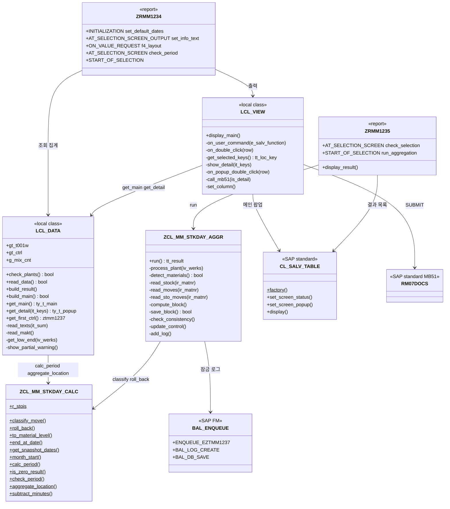
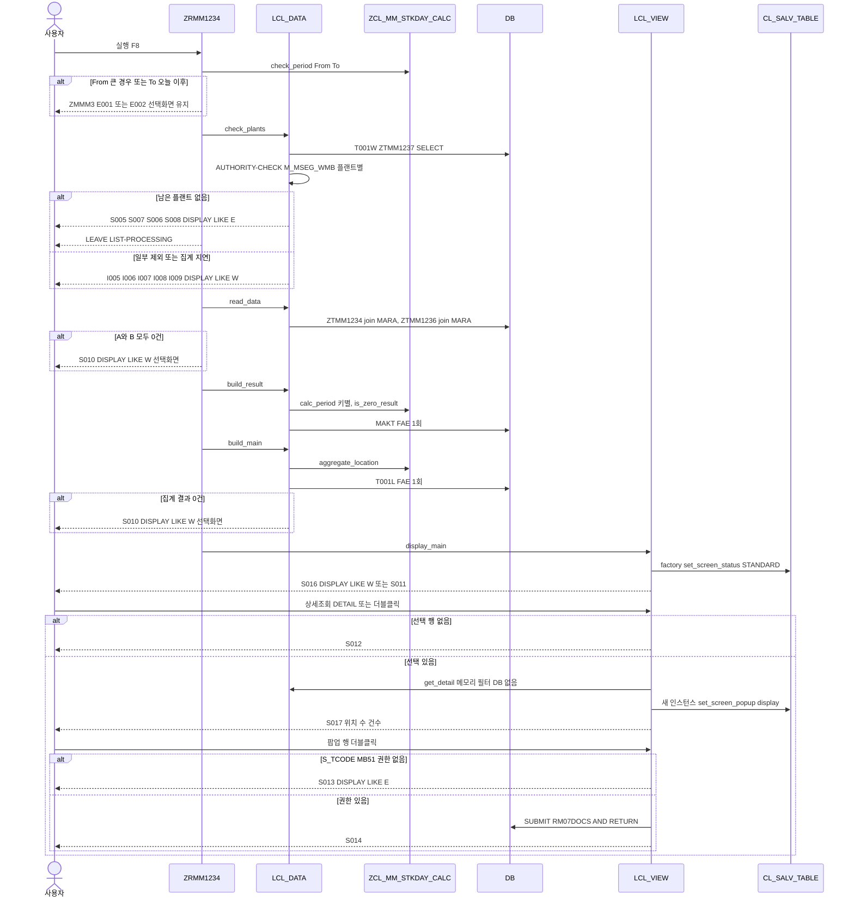

# 03. 개발 - 전기일자 기준 자재수불부 조회(일별)_저장위치레벨포함

| 항목 | 내용 |
|---|---|
| 요청 ID | 20261022-9149a8 |
| 단계 | 개발 1차 (첫 작업. 팀장 수정 지시 없음, CR 없음) |
| 기준 | 02_design.md v1.1(팀장 승인, 931줄 전체 확인), 01_analysis.md v1.2, request.md, standards/handbook.md, 위키 'ECC 7.40 시스템 ABAP 개발 제약'·'테스트계 반영 전 점검 항목' |
| 대상 시스템 | srd-abap (클라이언트 250, ECC, ABAP 7.40). `mcp__sap__*` 읽기 조회만 수행, 시스템에 쓴 것 없음 |
| 패키지 | ZMMD (반영 시 팀장이 보드에서 패키지·이송요청 지정. `$TMP`면 이송 불가 - 위키) |
| 문법 기준 | ABAP 7.40 SP05 이상(New Open SQL `@`·콤마 목록·`INTO CORRESPONDING`·FAE, `VALUE`/`CONV`/문자열 템플릿, `line_exists`). `FOR`/`REDUCE`/`xsdbool`/`LOOP AT ... GROUP BY`/`+=`/SELECT 끝 INTO/`@DATA` 인라인은 쓰지 않음 |

개발 착수 전 시스템 확인(2026-10-22): `ZCL_MM_STKDAY*`, `ZRMM123*`, `ZMMM3` 모두 없음. `ZTMM123*`는 ZTMM1230·ZTMM1235만 있어서 ZTMM1234/1236/1237은 비어 있음. `EZTMM*` 패턴은 기존에도 쓰이고 있음. `GET_JOB_RUNTIME_INFO`, `BAL_LOG_MSG_ADD`, `CL_SALV_LAYOUT_SERVICE`(F4_LAYOUTS 시그니처 포함), `CX_SALV_ERROR`(CX_STATIC_CHECK 상속)가 있음을 확인함.

---

## 개발 다이어그램

### 1) 소스 구성도

### 2) 실행 순서도 (ZRMM1234 조회)

### 3) 데이터 흐름도

```mermaid
flowchart LR
  MS["MKPF MSEG DB 집계 SUM GROUP BY"] --> RM["read_moves read_sto_moves"]
  ST["MARC MARD MCHB MKOL MSKA"] --> RS["read_stock"]
  RM --> TM["tt_move STANDARD"]
  RS --> TS["tt_stock SORTED 키 werks lgort matnr charg stkcat"]
  TM --> CM["classify_move C1 to C8"]
  CM --> TD["tt_delta SORTED 키 + budat COLLECT"]
  TS --> RBB["roll_back B 레벨"]
  TD --> RBB
  TS --> TML["to_material_level"]
  TD --> TML
  TML --> RBA["roll_back A 레벨"]
  RBB --> ZB["ZTMM1236 B 배치"]
  RBA --> ZA["ZTMM1234 A 자재"]
  ZA --> GA["GT_A STANDARD"]
  ZB --> GB["GT_B STANDARD"]
  GA --> CP["calc_period 키별"]
  GB --> CP
  CP --> MR["GT_MATRES SORTED werks stkcat lgort matnr"]
  CP --> GD["GT_DETAIL SORTED werks stkcat lgort matnr charg"]
  MR --> AL["aggregate_location tt_loc_sum"]
  GD --> AL
  AL --> GM["GT_MAIN STANDARD 메인 SALV"]
  GD --> GP["get_detail GT_POPUP 팝업 SALV"]
```

- SO_CHARG가 비어 있으면 GT_MATRES, 값이 있으면 GT_DETAIL을 AGGREGATE_LOCATION에 넣습니다(설계 Q6 ①). 그래서 두 화살표 중 하나만 쓰입니다.
- 위쪽 절반(MSEG~ZTMM1234/1236)은 ZRMM1235(ZCL_MM_STKDAY_AGGR)가 블록 단위로 처리합니다. 아래쪽 절반은 ZRMM1234가 처리합니다.

---

## 1. 오브젝트 목록

| # | 유형 | 오브젝트 | 내역(60자 이내) | 신규/변경 | 반영 방법 | 파일 |
|---|---|---|---|---|---|---|
| 1 | DOMA | ZDSTCAT | 재고구분(L 저장위치/T 운송중) | 신규 | SE11 수작업 (4.1) | - |
| 2 | DTEL | ZESTCAT | 재고구분 | 신규 | SE11 수작업 (4.1) | - |
| 3 | TABL | ZTMM1234 | 자재수불부 일자별 집계(저장위치) | 신규 | SE11 수작업 (4.2) | - |
| 4 | TABL | ZTMM1236 | 자재수불부 일자별 집계(배치) | 신규 | SE11 수작업 (4.2) | - |
| 5 | TABL | ZTMM1237 | 자재수불부 집계 제어 | 신규 | SE11 수작업 (4.2) | - |
| 6 | ENQU | EZTMM1237 | 자재수불부 집계 플랜트 잠금 | 신규 | SE11 수작업 (4.3) | - |
| 7 | MSAG | ZMMM3 | 자재수불부 조회·집계 메시지 | 신규 | SE91 수작업 (4.4) | - |
| 8 | CLAS | ZCL_MM_STKDAY_CALC | 자재수불부 계산(분류·역산·기간·위치집계) | 신규 | 웹앱(ADT) | src/ZCL_MM_STKDAY_CALC.abap |
| 9 | CLAS | ZCL_MM_STKDAY_AGGR | 자재수불부 일자별 집계 실행 | 신규 | 웹앱(ADT) | src/ZCL_MM_STKDAY_AGGR.abap |
| 10 | PROG/P | ZRMM1235 | 자재수불부 일자별 집계 배치 | 신규 | 웹앱(ADT) | src/ZRMM1235.abap |
| 11 | PROG/P | ZRMM1234 | 전기일자 기준 자재수불부 조회(일별) | 신규 | 웹앱(ADT) | src/ZRMM1234.abap |
| 12 | PROG/I | ZRMM1234_TOP | 전역 타입·상수·데이터 | 신규 | 웹앱(ADT, 메인 ZRMM1234) | src/ZRMM1234_TOP.abap |
| 13 | PROG/I | ZRMM1234_SEL | 선택화면 | 신규 | 웹앱(ADT, 메인 ZRMM1234) | src/ZRMM1234_SEL.abap |
| 14 | PROG/I | ZRMM1234_C01 | 로컬 클래스 LCL_DATA·LCL_VIEW | 신규 | 웹앱(ADT, 메인 ZRMM1234) | src/ZRMM1234_C01.abap |
| 15 | PROG/I | ZRMM1234_F01 | 선택화면 보조 FORM | 신규 | 웹앱(ADT, 메인 ZRMM1234) | src/ZRMM1234_F01.abap |
| 16 | GUI 상태 | ZRMM1234 STANDARD | 메인 SALV 상태 + DETAIL(상세조회) | 신규 | SE41 수작업 (4.5) | - |
| 17 | 텍스트 | ZRMM1234 / ZRMM1235 텍스트 요소 | Selection Text, Text Symbol | 신규 | SE38 수작업 (4.6) | - |
| 18 | TRAN | ZRMM1234 | 리포트 트랜잭션 → ZRMM1234 | 신규 | SE93 수작업 (4.7) | - |
| 19 | 로그 | SLG0 ZMM / ZRMM1235 | 집계 상세 로그 | 확인 후 필요 시 신규 | SLG0 수작업 (4.8) | - |
| 20 | 잡 | ZRMM1235_DAILY / _MONTHLY | 일 집계 / 월 재집계 | Basis 등록 | SM36 (4.9) | - |

- src/에는 ABAP 소스 오브젝트 8개만 두었습니다(위키: 비소스 파일 금지). 단위테스트(`*.testclasses.abap`)는 테스트 단계에서 만듭니다.
- 명명: 프로그램·테이블·도메인·데이터 엘리먼트·잠금 오브젝트·메시지 클래스·내부 이름(GT_/G_/GS_/LT_/L_/LS_/C_/PA_/SO_/R_)은 핸드북을 따랐습니다. 클래스(`ZCL_`), 메서드 파라미터(IV_/IT_/ET_/EV_/RV_/RT_/RS_/CT_/CS_/IS_/IO_/IR_), 참조 변수(LO_/LX_), 로컬 타입(TY_/TT_/LTY_), FORM 이름, GUI 상태 이름은 **핸드북 규칙이 없어 SAP 관례를 적용**했습니다.

### 1.1 반영·활성화 순서 (설계 2장 '활성화·반영 순서' 기준)

| 순서 | 대상 | 방법 | 비고 |
|---|---|---|---|
| 1 | ZDSTCAT → ZESTCAT → ZTMM1234·ZTMM1236·ZTMM1237 → EZTMM1237 | SE11 | **반드시 웹앱 반영 전에** 활성화합니다. 클래스·프로그램이 `TYPE ztmm1236-...`, `zestcat`을 참조합니다 |
| 2 | ZMMM3 메시지 001~029 | SE91 | 없으면 활성화는 되지만 메시지가 빈칸으로 나옵니다 |
| 3 | SLG0 ZMM / ZRMM1235 | SLG0 | 없어도 집계는 동작합니다(로그만 생략) |
| 4 | src/ 8개 | 웹앱 개발계 반영 | 아래 '웹앱 동작' 참고 |
| 5 | GUI 상태 STANDARD | SE41 | 없으면 메인 화면에 툴바와 [상세조회]가 나오지 않습니다 |
| 6 | 텍스트 요소 | SE38 | 없으면 블록 제목·컬럼 헤더가 빈칸입니다 |
| 7 | T-code ZRMM1234 | SE93 | |
| 8 | 초기 적재 → SM36 잡 | 운영 | 설계 13장 |

**웹앱 동작(src/board.ts 확인)**: 반영 도구는 파일명 순서가 아니라 **PROG → INCL → CLAS 순서로 생성·소스 저장**을 하고, 마지막에 전체를 **한 번에 일괄 활성화**합니다(`adt.activate(objs)`). 그래서 `ZCL_MM_STKDAY_AGGR`가 파일명상 `ZCL_MM_STKDAY_CALC`보다 앞에 오는 점이나 클래스가 프로그램보다 나중에 저장되는 점은 일괄 활성화에서 함께 풀립니다. 다만 위키 기록대로 일괄 활성화의 순서 영향은 실제 반영에서 확인해야 합니다(시스템 미확인). 실패하면 SE24에서 CALC → AGGR, SE38에서 ZRMM1235 → ZRMM1234(INCLUDE 포함) 순서로 활성화합니다.

**반영 도구의 유형 판별에 맞춘 조치**: 도구는 `^\s*CLASS\s+\S+\s+DEFINITION`이 있으면 CLAS, `^\s*(REPORT|PROGRAM)\b`가 있으면 PROG, 둘 다 없으면 INCL로 판별합니다(대소문자 무시). 그래서 다음과 같이 맞췄습니다.
- ZRMM1234_TOP/C01의 로컬 클래스 문장은 콜론 체인 형식(`CLASS: lcl_data DEFINITION FINAL.`, `CLASS: lcl_data DEFINITION DEFERRED, lcl_view DEFINITION DEFERRED.`)으로 썼습니다. 일반 형식으로 쓰면 INCLUDE가 전역 클래스로 생성되어 반영이 실패합니다.
- C01의 `set_screen_status( ... report = sy-repid ...)`에서는 `report`가 줄 머리에 오지 않게 했습니다. 줄 머리에 오면 PROG로 오인됩니다.
- INCLUDE의 메인 프로그램은 ZRMM1234 본문의 `INCLUDE zrmm1234_xxx.` 문장으로 찾습니다(도구 정규식과 일치).
- 오브젝트 내역은 `*& Report ZRMM1234 - 내역` 줄에서 가져갑니다. 클래스와 INCLUDE는 오브젝트명이 내역으로 들어가므로, 반영 후 SE24/SE38에서 1장 표의 내역으로 바꿉니다.

---

## 2. 오브젝트별 구현 요약

### 2.1 ZCL_MM_STKDAY_CALC (DB 없음, 정적 메서드, ABAP Unit 대상)

| 메서드 | 구현 | 설계 |
|---|---|---|
| CLASS_CONSTRUCTOR | 분류 규칙 상수 테이블(레인지)을 채웁니다. R_TRFBW(303/304/313/314), R_TRFLB(313/314), R_TRFTB(303/304), R_TRFBS(MA02/MA05/MAUO/MA0L/MAVA), R_RSOLB(315/316), R_RSOTB(305/306), R_STOIS(351/352/641~644), R_STORC(101/102), R_TYPCH(321/322/341~344/349/350). D-04·D-05 결과가 다르면 여기만 고칩니다 | 4.3 상수 관리 |
| CLASSIFY_MOVE | C2(IV_QTY_UPDATE 공란이면 버림) → C1(SOBKZ 공란/K/E만) → C8(배치 아님이면 CHARG 공란) → C3(XAUTO + BUSTM 목록, 또는 BUSTM 공란 + 303/304/313/314이면 일반에 넣지 않고 TRF 증감. S +, H −. MA02 또는 303/304는 T 키, 나머지는 L 키) → C6(재고유형 간 이동 버림) → C4(315/316 L 키 TRF, 305/306 T 키 TRF) → C5(STO 출고는 받는 플랜트 T 키, STO 입고 101/102는 자기 T 키. TRF 부호 H +, S −) → C7(LGORT 공란 버림. 정상 S 입고 +, H 출고 + / 취소 H 입고 −, S 출고 −. 일반/K/E 측정값 구분). 결과는 CT_DELTA에 COLLECT | 4.3 C1~C8 |
| ROLL_BACK | 키 = 현재고 키 ∪ 증감 키. 키마다 기말(To) = 현재고 − Σ증감(BUDAT > To)을 구하고, (이동일 ∪ 스냅샷일)을 내림차순으로 돌며 기말(d) = 기말(d+) − Σ증감(d < x ≤ d+)으로 계산합니다. 이동이 있는 날, 또는 스냅샷일이면서 기말 중 하나가 0이 아닌 날에만 행을 만듭니다(SNAPF). 기초 = 기말 − 입고 + 출고 | 4.1, 4.2 |
| TO_MATERIAL_LEVEL | CHARG를 지우고 COLLECT(D4: A는 같은 역산식을 자재 레벨 입력에 적용) | D4 |
| END_AT_DATE | 키별 "그날 종료 시점 재고" = 현재고 − 그날 이후 증감. 정합성 점검(1)(3)에 사용 | 추가(설계와 다른 점 1) |
| GET_SNAPSHOT_DATES / MONTH_START | 구간 안의 매월 1일 + 적재 시작일. 윤년은 날짜 연산으로 자동 처리 | 4.1 |
| CALC_PERIOD | 입고·출고 = From~To 합. 기말 = [L, To]에서 BUDAT가 가장 큰 행의 END/K/E/TRF. 행이 없으면 0. 기초 = 기말 − 입고 + 출고 | 4.4 |
| IS_ZERO_RESULT | 7개 값이 모두 0일 때만 참 | 7.2 Q5 ③ |
| CHECK_PERIOD | 코드 반환: '1' From > To, '2' To ≥ 오늘, (IV_WITH_CTRL='X'일 때) '3' 미집계, '4' To > 최종 집계일, '5' From < 적재 시작일 | Q1, Q2 |
| AGGREGATE_LOCATION | 키(WERKS, STKCAT, LGORT)가 처음 나오면 그 MEINS로 행을 만들고, 이미 있으면 MEINS가 다를 때 UNIT_MIX='X'로 표시하면서 값은 계속 더합니다. 다 읽은 뒤 혼재 행의 MEINS·수량 4개를 지웁니다. 결과는 SORTED(WERKS, STKCAT, LGORT)라서 L 행이 T 행보다 앞에 옵니다 | 4.5, D11 |
| SUBTRACT_MINUTES | 일시 − 분(일 경계 처리). 입력일시 감지 여유시간 T_last 계산 | 추가(설계와 다른 점 1) |

- 공용 타입: TY_KEY, TY_STOCK/TT_STOCK, TY_DELTA/TT_DELTA(비키 필드가 모두 수치라 COLLECT를 씀), TY_ROW/TT_ROW(필드명 = ZTMM1236 필드명), TY_MOVE/TT_MOVE, TY_PERIOD_IN/TY_PERIOD, TY_LOC_KEY/TT_LOC_KEY, TY_LOC_QTY/TT_LOC_QTY, TY_LOC_SUM/TT_LOC_SUM(설계 8.4와 같음), 레인지 타입.
- 공용 상수: C_MSGID('ZMMM3'), C_STK_LOC/C_STK_TRANSIT, C_MODE_*(D/R/I), C_STAT_*(R/S/E/W), C_CHK_*.

### 2.2 ZCL_MM_STKDAY_AGGR (집계 실행)

| 메서드 | 단계 | 구현 |
|---|---|---|
| CONSTRUCTOR | J0 | 실행 조건을 저장합니다. 블록 크기는 1~5000으로 제한하고(범위 밖이면 기본값/상한), 여유시간이 음수면 기본값을 씁니다 |
| RUN | J0 | 실행 시작 일시(서버) 기록. T156 `XSTBW = 'X'` 취소 BWART는 실행당 한 번 읽습니다(⑨). 대상 플랜트를 고르고 플랜트마다 PROCESS_PLANT를 부릅니다. 한 플랜트라도 E면 EV_ERROR |
| GET_TARGET_PLANTS | J0 | 일 집계: `ZTMM1237 WHERE werks IN r_werks AND load_from <> 초기값`. 재집계·초기 적재: T001W ∩ SO_WERKS(range가 비면 빈 결과) |
| PROCESS_PLANT | J1~J8 | `ENQUEUE_EZTMM1237`(E, _SCOPE '1'). 실패하면 W 021 로그를 남기고 결과 상태를 W로 둔 채 건너뜁니다. 제어 행을 읽고, 일 집계·재집계인데 LAST_BUDAT가 비어 있으면 E 023(사유 = 007 문구)으로 건너뜁니다. 구간 끝은 일 집계·초기 적재 = 전일, 재집계 = LAST_BUDAT입니다. 테스트 실행이 아니면 RUN_STAT='R'로 표시하고 COMMIT합니다(초기 적재는 LAST_BUDAT를 지워 조회를 막음). TRY 안에서 감지 → (초기 적재: 플랜트 A/B 전체 DELETE + COMMIT) → W 025 점검 → 블록 반복(read_stock / read_moves / read_sto_moves / compute_block / save_block)을 합니다. `CX_SY_OPEN_SQL_DB`·`CX_SY_ARITHMETIC_ERROR`·`CX_SY_CONVERSION_ERROR`가 나면 ROLLBACK, E 023, RUN_STAT='E'로 처리하고 LAST_*는 유지합니다. 성공하면 정합성 건수에 따라 S 또는 W(W 026), S 022, (테스트면 S 027), 제어 갱신을 합니다. 마지막에 DEQUEUE, 로그 저장, 소요 시간 기록 |
| DETECT_MATERIALS | J3 | 일 집계: (a)+(b)를 한 SQL로 처리합니다. `MIN(budat) GROUP BY matnr`, 조건은 `cpudt/cputm ≥ T_last − 여유시간 OR budat ≥ D_last+1`이고 budat ≤ D−1입니다. (c) 다른 플랜트의 STO 출고(R_STOIS, werks ≠ P, UMWRK = P 또는 공란, UMWRK가 공란이면 EKPO-WERKS = P). (d) 새 구간에 월초가 있으면 MARD/MCHB/MKOL/MSKA/MARC(UMLMC·TRAME)에 재고가 있는 자재와, 첫 스냅샷일 이후(상한 없음) 이동이 있는 자재를 d0 = 첫 스냅샷일로 추가합니다. 재집계: 시작일(PA_PRVMO면 전월 1일)이 LOAD_FROM보다 이르면 E 024. MARC ∩ SO_MATNR 자재 전체를 시작일부터 처리합니다. 초기 적재: MARC 전체를 PA_FROM부터 처리합니다. 결과는 d0, MATNR 오름차순 |
| CHECK_OPEN_PERIOD | J3 | T001K → MARV(VMGJA/VMMON) 1일보다 d0가 이르면 W 025(처리는 계속) |
| READ_STOCK | J4 ①~⑥ | MARC⋈MARA(XCHPF·UMLMC·TRAME·MTART·MEINS)를 읽습니다. T134M MENGU로 수량 갱신을 판정하고, T 키 TRF = UMLMC+TRAME입니다. MARD(비배치, 일반 = LABST+INSME+SPEME+EINME+RETME, TRF = UMLME), MCHB(배치, CLABS+CINSM+CSPEM+CEINM+CRETM, TRF = CUMLM), MKOL(K), MSKA(E)는 모두 `werks = P AND matnr IN 블록 range` 집합 조회입니다 |
| READ_MOVES | J4 ⑦ | MKPF⋈MSEG `SUM(menge) GROUP BY werks, lgort, matnr, charg, budat, bwart, shkzg, sobkz, xauto, bustm, umwrk, ebeln`, 조건 `budat ≥ 블록 최소 d0`(상한 없음). STO 입고 판정은 101/102 EBELN으로 EKKO FAE(`reswk <> 공란`). 자기 STO 출고의 받는 플랜트는 UMWRK |
| READ_STO_MOVES | J4 ⑧ | 다른 플랜트(werks ≠ P)의 R_STOIS 이동 중 UMWRK = P 또는 (공란이면서 EKPO-WERKS = P)인 행. RECV_WERKS = P로 넣습니다 |
| COMPUTE_BLOCK | J5 | 행마다 CLASSIFY_MOVE(취소 = T156 캐시) → 다른 플랜트 키 삭제 → 스냅샷 일자 → B = ROLL_BACK(현재고, 증감) → A = TO_MATERIAL_LEVEL 후 ROLL_BACK → ZTMM1236/ZTMM1234 행(MEINS = MARA-MEINS, ERDAT/ERZET = 실행 시작, ERNAM) → CHECK_CONSISTENCY |
| SAVE_BLOCK | J6 | 테스트면 건수만 셉니다. 아니면 `DELETE ztmm1236/ztmm1234 WHERE werks = P AND matnr IN 블록 AND budat >= 블록 최소 d0` → `INSERT ... FROM TABLE` → 블록마다 COMMIT |
| CHECK_CONSISTENCY | J8 | (1) 구간 끝·스냅샷 일자에서 A 행 기말 = END_AT_DATE(B)의 자재 레벨 합인지 비교 (2) B 행 기말(일반/K/E/TRF) 음수 건수 (3) 연속성: 초기 적재가 아니면 블록 시작 전날의 저장 B 기말(그 달 1일 또는 적재 시작일 이후 마지막 행)과 새로 계산한 전날 기말을 비교. 불일치·저장 행 없음 건수를 셉니다 |
| UPDATE_CONTROL | J8 | 테스트면 갱신하지 않습니다. 성공 시 일 집계는 LAST_BUDAT = D−1, LAST_CPUDT/TM = 실행 시작으로 갱신하고, 초기 적재는 여기에 LOAD_FROM = PA_FROM을 더합니다. 재집계는 LAST_*를 유지합니다. RUN_STAT/RUN_MATS/RUN_MSG, 백그라운드면 JOBNAME/JOBCOUNT(GET_JOB_RUNTIME_INFO), AEDAT/AEZET/AENAM을 쓰고 MODIFY + COMMIT |
| OPEN_LOG / ADD_LOG / SAVE_LOG | J8 | BAL_LOG_CREATE(외부 ID = 플랜트+실행일시, 플랜트마다 로그 1개), BAL_LOG_MSG_ADD, BAL_DB_SAVE + COMMIT. 로그 오브젝트가 없으면 로그 없이 계속합니다. 백그라운드면 같은 메시지를 S 유형으로 잡 로그에도 남깁니다 |

### 2.3 ZRMM1235 (집계 배치 리포트, INCLUDE 없음)

- 선택화면은 설계 5.2와 같습니다(PA_DAILY/PA_RECAL/PA_INIT, SO_WERKS, PA_FROM, PA_PRVMO, SO_MATNR, PA_OVLAP, PA_BLKSZ, PA_TEST). PA_OVLAP·PA_BLKSZ 기본값은 INITIALIZATION에서 클래스 상수로 넣습니다.
- AT SELECTION-SCREEN에서 E 018(재집계·초기 적재인데 플랜트 없음), E 019(시작일 없음 또는 오늘 이후. 재집계는 PA_PRVMO가 있으면 PA_FROM 생략 가능), E 020(초기 적재 + 자재 조건)을 검사합니다.
- 초기 적재를 온라인으로 실행하면 POPUP_TO_CONFIRM(P01/P02)을 띄우고, '예'가 아니면 I 029로 끝냅니다.
- RUN 결과를 SALV 목록(컬럼 헤더 R01~R08)으로 보여 줍니다. 백그라운드는 스풀로 나갑니다.
- 대상 플랜트가 없으면 백그라운드는 E 028(잡 취소), 온라인은 S 028 DISPLAY LIKE 'E'입니다. 실패 플랜트가 있으면 목록 출력 뒤 백그라운드는 E 023(잡 '취소됨'), 온라인은 S 023 DISPLAY LIKE 'E'입니다. 제어·로그는 그 전에 COMMIT되어 있습니다.

### 2.4 ZRMM1234 (조회) + INCLUDE 4개

| 단계 | 위치 | 구현 |
|---|---|---|
| Q0 | F01 SET_DEFAULT_DATES / SEL | `SELECT MAX( last_budat ) FROM ztmm1237`. 없으면 전일. SO_WERKS는 `MEMORY ID wrk`. 변형이 있으면 변형 값이 우선합니다 |
| 안내 줄 | F01 SET_INFO_TEXT (AT SELECTION-SCREEN OUTPUT) | G_INFO1 = T01. G_INFO2 = T02의 &1~&3을 SO_WERKS 첫 값 플랜트의 LAST_CPUDT/LAST_CPUTM/LAST_BUDAT로 바꾼 문구 |
| Q1 | F01 CHECK_PERIOD | CALC=>CHECK_PERIOD → E 001 / E 002 |
| Q2 | LCL_DATA->CHECK_PLANTS | T001W(0건 S 004), ZTMM1237을 한 번에 읽습니다. 플랜트마다 `AUTHORITY-CHECK M_MSEG_WMB ACTVT 03 WERKS`와 CHECK_PERIOD(제어 포함)로 판정하고, 통과한 플랜트로 R_WERKS를 만듭니다. 전부 제외되면 005 > 007 > 006 > 008 순서로 고른 메시지를 S DISPLAY LIKE 'E'로 보여 주고 선택화면으로 돌아갑니다. 일부 제외는 사유별 I DISPLAY LIKE 'W'(플랜트 목록을 한 줄로 묶음), 집계 지연·실패(RUN_STAT E/R 또는 LAST_BUDAT < 전일)는 I 009 DISPLAY LIKE 'W'로 보여 줍니다 |
| Q3 | LCL_DATA->READ_DATA | R_WERKS가 비면 SELECT하지 않습니다. 하한 = min(From, 월초(To)). SO_LGORT를 입력하면 R_STKCAT = L. A: ZTMM1234⋈MARA, B: ZTMM1236⋈MARA(+CHARG IN SO_CHARG) |
| Q4 | 본문 | A·B 모두 0건이면 S 010 DISPLAY LIKE 'W' + LEAVE LIST-PROCESSING |
| Q5 | LCL_DATA->BUILD_RESULT | 정렬된 GT_A/GT_B에서 다음 행과 키를 비교해 키 끝을 찾습니다(AT NEW·GROUP BY 미사용). L = max(월초(To), LOAD_FROM)으로 CALC_PERIOD를 부릅니다. PA_NOZER면 IS_ZERO_RESULT 행은 제외합니다. 결과는 GT_MATRES(SORTED 키 WERKS·STKCAT·LGORT·MATNR)와 GT_DETAIL(SORTED 키 +CHARG)이고, 원천 GT_A/GT_B는 FREE합니다. MAKT는 FAE로 1회 읽습니다(SPRAS = SY-LANGU, HASHED 키 = DB 키) |
| Q6 | LCL_DATA->BUILD_MAIN | SO_CHARG가 비면 GT_MATRES, 값이 있으면 GT_DETAIL을 TT_LOC_QTY로 바꿔 AGGREGATE_LOCATION을 부릅니다. T001L은 FAE 1회(메인·상세의 L 키, 드라이버 빈 값 확인). NAME1 = T001W, LGOBE = T001L, 운송중은 TEXT-T10. UNIT_MIX 행은 T_COLOR(col_total, int 0, inv 0)로 표시하고 G_MIX_CNT를 셉니다. 상세 캐시 LGOBE도 여기서 채웁니다. 0건이면 S 010 |
| Q7 | LCL_VIEW->DISPLAY_MAIN | factory → `set_screen_status( STANDARD, sy-repid, c_functions_all )` → `set_selection_mode( row_column )` → 컬럼(헤더 C01~C08, 수량 4개 `set_quantity_column('MEINS')`·`set_zero(false)`, MEINS 숨김, UNIT_MIX·STKCAT technical, `set_color_column('T_COLOR')`, optimize) → 이벤트(참조 변수로 SET HANDLER) → 레이아웃(MAIN, 초기 = PA_VARI, 저장 제한 없음) → 제목 T11 + 기간 + T02 → S 016 DISPLAY LIKE 'W' 또는 S 011 → display |
| Q8 | ON_USER_COMMAND / ON_DOUBLE_CLICK / GET_SELECTED_KEYS | FCODE `DETAIL`: `get_selected_rows`의 인덱스로 GT_MAIN에서 (WERKS, LGORT, STKCAT)를 SORTED UNIQUE로 모읍니다. 비었으면 S 012. 더블클릭: row > 0일 때 그 행 하나만 엽니다 |
| Q9 | SHOW_DETAIL | GET_DETAIL(메모리 LOOP WHERE 정렬 키 앞부분, DB 없음). 0건이면 S 010 DISPLAY LIKE 'W'. 정렬 WERKS → STKCAT → LGORT → MATNR → CHARG. 새 SALV 인스턴스를 만들고 `set_screen_popup(5,180,2,26)`, `set_all`, 컬럼(C01·C03·C04·C11~C21, 수량 7개 단위 MEINS, STKCAT technical), 레이아웃 DETL, 제목 T12 + 기간 + T13, 팝업 더블클릭 핸들러를 붙입니다. S 017 → display. 닫힌 뒤 핸들러를 해제합니다 |
| Q10 | ON_POPUP_DOUBLE_CLICK / CALL_MB51 | `AUTHORITY-CHECK S_TCODE TCD MB51`, 실패 시 S 013 DISPLAY LIKE 'E'. RSPARAMS(MATNR, WERKS, 저장위치 행만 LGORT, 배치가 있으면 CHARG, BUDAT BT From~To)로 `SUBMIT rm07docs VIA SELECTION-SCREEN AND RETURN` → S 014 |

---

## 3. 설계 대비 구현 매핑

### 3.1 팀장 설계지시

| 설계지시 | 구현 위치 | 결과 |
|---|---|---|
| 1. 메인 ALV = 플랜트+저장위치 집계, 컬럼 8개(플랜트, 플랜트명, 저장위치, 저장위치명, 기초재고, 입고, 출고, 기말재고) | TOP TY_MAIN, C01 BUILD_MAIN·SET_MAIN_COLUMNS, CALC AGGREGATE_LOCATION | 표시 컬럼은 이 8개뿐입니다. MEINS(숨김), UNIT_MIX·STKCAT(technical), T_COLOR(색상)는 화면에 나오지 않습니다. 단위 혼재 위치는 수량 공란·노란색·W 016(D11). 운송중 행은 저장위치명 '(운송중)', 수량은 0(공란) |
| 2. 툴바 [상세조회] + 더블클릭 상세 | C01 DISPLAY_MAIN(set_screen_status STANDARD, ADDED_FUNCTION·DOUBLE_CLICK 핸들러), ON_USER_COMMAND(FCODE `DETAIL` = 상수 C_FC_DETAIL), ON_DOUBLE_CLICK | 버튼은 SE41 GUI 상태 STANDARD에 FCODE DETAIL을 추가해야 나옵니다(4.5) |
| 3. 여러 행 선택 시 선택 위치 전체를 상세에 | C01 `set_selection_mode( row_column )`, GET_SELECTED_KEYS, LCL_DATA->GET_DETAIL | 선택 행 전체 위치가 한 팝업에 나옵니다. 행 미선택(셀만 선택 포함)이면 S 012. 더블클릭은 그 행만. 팝업을 닫으면 메인(선택·정렬·필터)이 유지됩니다 |

### 3.2 설계 결정 D1~D12

| # | 반영 |
|---|---|
| D1 | ZRMM1235 / ZTMM1234 / ZTMM1236 / ZTMM1237 이름 그대로 |
| D2 | 메시지 클래스 ZMMM3 (`REPORT ... MESSAGE-ID zmmm3`, 클래스는 C_MSGID). **다른 요청과 충돌 가능성이 있어 6장 U-01로 올림** |
| D3 | 재집계 단위 (플랜트, 자재). 블록 DELETE를 `matnr IN 블록 range AND budat >= 블록 최소 d0` 한 문장으로 처리 |
| D4 | A = TO_MATERIAL_LEVEL 후 같은 ROLL_BACK. B 합산으로 만들지 않음. 정합성(1)로 확인 |
| D5 | 변동일 행 + 월초 스냅샷 + 적재 시작일 스냅샷(GET_SNAPSHOT_DATES, ROLL_BACK 행 생성 조건) |
| D6 | C3: XAUTO + BUSTM {MA02, MA05, MAUO, MA0L, MAVA}(BUSTM 공란이면 303/304/313/314) → 일반에서 빼고 이전중으로 |
| D7 | 메인 조회 때 B·MAKT·T001L까지 읽어 GT_DETAIL에 캐시. [상세조회]·더블클릭·MB51 복귀 때 SELECT 없음 |
| D8 | 기존 Z 재고 클래스 재사용 안 함 |
| D9 | Open SQL만 사용. AMDP/CDS 없음. 집계는 DB SUM/MIN GROUP BY |
| D10 | 계산 로직을 ZCL_MM_STKDAY_CALC 정적 메서드로 분리(DB 접근 없음) |
| D11 | AGGREGATE_LOCATION(혼재 시 MEINS·수량 지움), 메인은 일반재고만, K·E·이전중은 상세에서만 |
| D12 | ROW_COLUMN 다중 선택, DETAIL = 선택 행 전체, 더블클릭 = 그 행, 선택 없음 S 012, 팝업 약 80% |

### 3.3 핵심 준수 사항 점검

| 항목 | 확인 |
|---|---|
| LOOP 안 SELECT 금지 | ZRMM1234는 SELECT 횟수가 고정입니다(T001W, ZTMM1237, A, B, MAKT, T001L. 선택화면 PBO의 ZTMM1237 SINGLE 1회 별도). ZRMM1235는 플랜트·블록 단위 집합 조회(블록당 MARC⋈MARA, MARD, MCHB, MKOL, MSKA, MSEG 2회, EKKO/EKPO FAE, 연속성용 ZTMM1236 1회)이고 행 단위 SELECT는 없습니다 |
| 팝업 시 DB 재조회 안 함 | SHOW_DETAIL → GET_DETAIL은 GT_DETAIL 메모리 필터만 합니다 |
| 취소 순액 | CLASSIFY_MOVE C7(T156 XSTBW 취소: 입고 −/출고 −). 입고·출고는 마이너스가 될 수 있습니다 |
| K/E 별도, Q/W 제외 | C1(SOBKZ 공란/K/E만), K·E는 별도 측정값(상세 K_END·E_END) |
| 이전중/운송중 행 | L 키 TRF(313/315), T 키(303/305, STO 351/641/643·101/102). 운송중 행 LGORT 공란·STKCAT T, 저장위치명 '(운송중)' |
| 단위 혼재 미합산 | AGGREGATE_LOCATION |
| ECC 7.40 문법 | 문서 머리의 '문법 기준' 참고 |
| 권한 | M_MSEG_WMB(플랜트별), S_TCODE(MB51 SUBMIT 전). 실행 권한은 T-code/S_PROGRAM 권한그룹(수작업) |
| 예외 | SALV는 `CATCH cx_salv_error` 하나로 받아 E 015를 S로 표시합니다(팝업 오류여도 메인 유지). 집계는 SQL/산술/변환 예외를 블록 ROLLBACK으로 처리 |
| 하드코딩 | FCODE·GUI 상태·핸들·팝업 크기·권한 오브젝트·T-code·재고구분·모드·상태·BWART 규칙·로그 오브젝트·기본값이 모두 상수입니다. 화면 문구는 Text Symbol입니다. 남은 리터럴은 RSPARAMS 선택 필드명(MATNR 등, RM07DOCS 필드명)과 INSERT 실패 메시지의 테이블명뿐입니다 |

---

## 4. 수작업 체크리스트 (반영 전·후)

### 4.1 SE11 도메인·데이터 엘리먼트

| 오브젝트 | 설정 |
|---|---|
| 도메인 ZDSTCAT | 내역 "재고구분", 데이터 유형 CHAR 1, 고정값 `L` 저장위치 / `T` 운송중, 패키지 ZMMD |
| 데이터 엘리먼트 ZESTCAT | 도메인 ZDSTCAT, 필드 레이블 짧은/중간/긴/헤더 모두 "재고구분" |

### 4.2 SE11 테이블 (납품 클래스 A, 표시/유지보수 제한 허용, SM30 생성 안 함, 버퍼링 허용 안 함, 변경 로그 안 함)

**ZTMM1234** (내역 "자재수불부 일자별 집계(저장위치)", 데이터 클래스 APPL1, 크기 범주 4 [가정])

| 필드 | 키 | 데이터 엘리먼트 | 비고 |
|---|---|---|---|
| MANDT | X | MANDT | |
| WERKS | X | WERKS_D | |
| BUDAT | X | BUDAT | |
| LGORT | X | LGORT_D | 운송중 행 공란 |
| MATNR | X | MATNR | |
| STKCAT | X | ZESTCAT | |
| MEINS | | MEINS | 수량 참조 단위 |
| SNAPF | | XFELD | |
| BEG_QTY, GR_QTY, GI_QTY, END_QTY, K_GR, K_GI, K_END, E_GR, E_GI, E_END, TRF_END | | MENGE_D | 참조 테이블/필드 = ZTMM1234-MEINS |
| ERDAT / ERZET / ERNAM | | ERDAT / ERZET / ERNAM | |

**ZTMM1236** (내역 "자재수불부 일자별 집계(배치)", APPL1, 크기 범주 5 [가정]): ZTMM1234와 같고 MATNR 뒤·STKCAT 앞에 키 필드 **CHARG(CHARG_D)** 를 넣습니다. 키 순서는 MANDT, WERKS, BUDAT, LGORT, MATNR, CHARG, STKCAT입니다. 수량 참조는 ZTMM1236-MEINS입니다.

**ZTMM1237** (내역 "자재수불부 집계 제어", APPL2, 크기 범주 0)

| 필드 | 키 | 데이터 엘리먼트 |
|---|---|---|
| MANDT | X | MANDT |
| WERKS | X | WERKS_D |
| LOAD_FROM | | BUDAT |
| LAST_BUDAT | | BUDAT |
| LAST_CPUDT | | CPUDT |
| LAST_CPUTM | | CPUTM |
| RUN_DATE | | DATUM |
| RUN_TIME | | UZEIT |
| RUN_MODE | | CHAR1 |
| RUN_STAT | | CHAR1 |
| RUN_MATS | | INT4 |
| RUN_MSG | | BAPI_MSG |
| JOBNAME | | BTCJOB |
| JOBCOUNT | | BTCJOBCNT |
| AEDAT / AEZET / AENAM | | AEDAT / AEZET / AENAM |

- 소스는 이 필드명을 그대로 씁니다(MOVE-CORRESPONDING·INSERT FROM TABLE). 이름이 하나라도 다르면 활성화 오류가 납니다.
- 기술 설정 크기 범주, 권한그룹(S_TABU_DIS)은 팀장/Basis 확인 사항입니다(설계 D-08).

### 4.3 SE11 잠금 오브젝트 EZTMM1237

- 기본 테이블 ZTMM1237, 잠금 모드 E(쓰기 잠금), 잠금 파라미터 MANDT, WERKS → `ENQUEUE_EZTMM1237` / `DEQUEUE_EZTMM1237`이 생성됩니다(소스는 파라미터 `mode_ztmm1237`, `mandt`, `werks`, `_scope`를 사용).

### 4.4 SE91 메시지 클래스 ZMMM3 (패키지 ZMMD, 언어 KO)

| 번호 | 텍스트 | 호출 유형 |
|---|---|---|
| 001 | 전기일 From이 To보다 늦습니다. | E |
| 002 | 당일 자료는 다음 날 07:00 집계 후 조회할 수 있습니다. To를 전일 이전으로 입력하십시오. | E |
| 003 | 플랜트를 입력하십시오. | S(E 표시) |
| 004 | 입력한 플랜트가 없습니다. | S(E 표시) |
| 005 | 조회 권한이 없는 플랜트가 있습니다: &1 | S(E 표시) / I(W 표시) |
| 006 | 플랜트 &1은 &2까지 집계되어 있습니다. | S(E 표시) / I(W 표시) |
| 007 | 플랜트 &1은 집계되지 않았거나 초기 적재 중입니다. | S(E 표시) / I(W 표시) / 023 사유 |
| 008 | 플랜트 &1은 &2부터 조회할 수 있습니다(적재 시작일). | S(E 표시) / I(W 표시) |
| 009 | 최근 집계가 지연되었거나 실패했습니다. 집계 기준: &1 &2 (플랜트 &3) | I(W 표시) |
| 010 | 조회된 데이터가 없습니다. | S(W 표시) |
| 011 | &1건이 조회되었습니다. | S |
| 012 | 상세 조회할 행을 선택하십시오(여러 행 선택 가능). | S |
| 013 | MB51 실행 권한이 없습니다. | S(E 표시) |
| 014 | MB51은 실시간 전표를 보여 주므로 집계 이후 전표가 함께 보일 수 있습니다. | S |
| 015 | ALV 출력 오류: &1 | S(E 표시) |
| 016 | 단위가 서로 다른 자재가 있는 저장위치 &1건은 수량을 합산하지 않았습니다. 상세조회에서 확인하십시오. | S(W 표시) |
| 017 | 선택한 &1개 위치의 상세 &2건을 표시합니다. | S |
| 018 | 재집계와 초기 적재는 플랜트를 입력해야 합니다. | E |
| 019 | 시작 전기일을 오늘 이전 날짜로 입력하십시오. | E |
| 020 | 초기 적재에는 자재 조건을 쓸 수 없습니다. | E |
| 021 | 플랜트 &1은 다른 집계가 실행 중이라 건너뜁니다(&2). | W(로그) |
| 022 | 플랜트 &1 집계 완료: 자재 &2, B &3건, A &4건 | S(로그) |
| 023 | 플랜트 &1 집계 실패: &2 | E(로그·잡 종료) / S(E 표시) |
| 024 | 재집계 시작일 &1이 적재 시작일 &2보다 이릅니다. | E(로그) |
| 025 | 플랜트 &1 재계산 시작일 &2이 열린 MM 기간보다 이릅니다. | W(로그) |
| 026 | 정합성 경고 플랜트 &1: A/B 불일치 &2, 음수 기말 &3, 연속성 &4 | W(로그) |
| 027 | 테스트 실행이라 저장하지 않았습니다. | S(로그) |
| 028 | 집계 대상 플랜트가 없습니다. | E(잡) / S(E 표시) |
| 029 | 사용자가 초기 적재를 취소했습니다. | I |

- 메시지 텍스트는 73자 제한이 있습니다. 002·016은 길어서 SE91에서 잘리면 "To를 전일 이전으로 입력하십시오." 등을 줄이거나 장문(Long Text)에 넣습니다.

### 4.5 SE41 GUI 상태 ZRMM1234 / STANDARD

1. SE41 → 상태 복사: 원본 프로그램 `SAPLSALV_METADATA_STATUS`, 상태 `SALV_STANDARD` → 대상 프로그램 `ZRMM1234`, 상태 `STANDARD`.
2. 응용 툴바 첫 위치에 기능 코드 `DETAIL`을 추가합니다. 기능 유형은 일반(공란), 기능 텍스트 '상세조회'(Text Symbol F01과 같은 문구), 아이콘 `ICON_DETAIL`(F4에 없으면 `ICON_SELECT_DETAIL`, D-12), 기능키는 비어 있는 Shift+F키(F2 사용 금지).
3. 표준 기능 코드(&OUP, &ODN, &MB_FILTER, &MB_SUM, &VEXCEL, &MB_VARIANT, BACK/EXIT/CANC 등)는 그대로 둡니다.
4. 활성화 후 ZRMM1234를 다시 활성화합니다.

### 4.6 SE38 텍스트 요소 (SE63 EN 번역 포함, Text Symbol 길이는 문구 길이 이상)

**ZRMM1234 Selection Text**: PA_BUDFR 전기일 From / PA_BUDTO 전기일 To / SO_WERKS 플랜트 / SO_LGORT 저장위치 / SO_MATNR 자재 / SO_MTART 자재유형 / SO_MATKL 자재그룹 / SO_CHARG 배치 / PA_NOZER 재고 0 행 제외 / PA_VARI 레이아웃

**ZRMM1234 Text Symbol**

| ID | 텍스트 | ID | 텍스트 |
|---|---|---|---|
| B01 | 전기일 기간 | C08 | 기말재고 |
| B02 | 조직 | C11 | 자재 |
| B03 | 자재 | C12 | 자재내역 |
| B04 | 옵션 | C13 | 배치 |
| T01 | 매일 07:00에 전일까지 집계된 자료를 조회합니다. | C14 | 단위 |
| T02 | 마지막 집계: &1 &2 (대상일 &3) | C15 | 기초 |
| T10 | (운송중) | C16 | 입고 |
| T11 | 자재수불부 전기일 | C17 | 출고 |
| T12 | 수불 상세 (자재/배치) | C18 | 기말 |
| T13 | / 선택 위치 &1개 | C19 | 위탁재고(K) |
| C01 | 플랜트 | C20 | 오더재고(E) |
| C02 | 플랜트명 | C21 | 이전중 |
| C03 | 저장위치 | F01 | 상세조회 (GUI 상태 텍스트와 동일, 소스 미사용) |
| C04 | 저장위치명 | | |
| C05 | 기초재고 | | |
| C06 | 입고 | | |
| C07 | 출고 | | |

**ZRMM1235 Selection Text**: PA_DAILY 일 집계 / PA_RECAL 수동 재집계 / PA_INIT 초기 적재 / SO_WERKS 플랜트 / PA_FROM 시작 전기일 / PA_PRVMO 재집계 시작 = 전월 1일 / SO_MATNR 자재 / PA_OVLAP 입력일시 여유시간(분) / PA_BLKSZ 블록 크기(자재 수) / PA_TEST 테스트 실행

**ZRMM1235 Text Symbol**: B01 실행 모드 / B02 대상 / B03 옵션 / **P01 초기 적재 확인 / P02 선택한 플랜트의 기존 집계 데이터를 모두 지우고 시작 전기일부터 전일까지 다시 적재합니다. 계속하시겠습니까? / R01 플랜트 / R02 모드 / R03 자재 수 / R04 B 행 수 / R05 A 행 수 / R06 상태 / R07 소요(초) / R08 메시지** (P01~P02·R01~R08은 개발에서 추가, 5장 #9)

### 4.7 SE93 T-code ZRMM1234

- 프로그램과 선택화면(리포트 트랜잭션), 프로그램 ZRMM1234, 선택화면 1000, 내역 "전기일자 기준 자재수불부 조회(일별)", GUI 지원 SAP GUI(Windows/HTML) 체크.
- 프로그램 권한그룹(S_PROGRAM): ZRMM1234·ZRMM1235 모두 팀 표준 그룹을 지정합니다(D-08, 확인 필요). ZRMM1235는 운영 담당·배치 사용자만 실행할 수 있게 합니다.

### 4.8 SLG0 애플리케이션 로그

- 오브젝트 `ZMM`, 서브오브젝트 `ZRMM1235`가 있는지 확인하고, 없으면 만듭니다(Customizing 이송). 없으면 BAL_LOG_CREATE가 실패하고, 그때는 로그 없이 집계만 하므로 SLG1에 아무것도 남지 않습니다(D-06).

### 4.9 운영 반영 순서와 잡 (설계 13장 그대로)

1. 1~7번 반영 → 2. 플랜트별 ZRMM1235 초기 적재(백그라운드, PA_BLKSZ 500 권고) → 3. SM36 `ZRMM1235_DAILY`(변형 DAILY: PA_DAILY, SO_WERKS 공란, 매일 07:00), `ZRMM1235_MONTHLY`(변형 MONTHLY: PA_RECAL, PA_PRVMO='X', 플랜트 지정, 매월 첫 일요일 05:00) → 4. ZRMM1234 권한 부여.

---

## 5. 설계와 달라진 점 (이유)

| # | 내용 | 이유 |
|---|---|---|
| 1 | CALC에 **END_AT_DATE**와 **SUBTRACT_MINUTES** 정적 메서드를 추가했습니다(DB 없음) | 정합성 점검(1)(3)의 "그날 기준 기말"과 T_last − 여유시간 계산을 단위테스트할 수 있게 공용화했습니다. 기능 추가가 아니라 설계 J3·J8 계산의 분리입니다 |
| 2 | ROLL_BACK은 "키마다 호출"이 아니라 **키 전체 테이블을 받아 안에서 키별로 처리**합니다. d0는 블록 최소 d0 하나입니다 | 블록 DELETE가 `budat >= 블록 최소 d0`이므로 블록 안 모든 자재를 그 날짜부터 다시 써야 지운 범위와 넣는 범위가 같습니다(설계 J6 문장과 일치). 메서드 호출 횟수도 줄어듭니다 |
| 3 | ⑦ MSEG 집계 GROUP BY에 **EBELN**을 넣고, ⑧에는 **EBELN·EBELP**를 넣었습니다 | C5의 STO 입고 판정(EKKO-RESWK)과 받는 플랜트 판정(EKPO-WERKS)에 필요합니다. 설계 J4 ⑦의 필드 목록에는 빠져 있었습니다. 구매오더 관련 이동만 그룹이 나뉘므로 집계 효과는 유지됩니다 |
| 4 | ⑧ STO 조회에 `werks <> P AND (umwrk = P OR umwrk = 공란)` 조건을 넣었습니다. 자기 플랜트 STO 출고(⑦)의 받는 플랜트는 UMWRK만 씁니다(EKPO 조회 안 함) | ⑦과 ⑧의 이중 집계를 막기 위함입니다. 받는 플랜트 T 키는 받는 플랜트 쪽 처리(⑧)에서 만들어지므로, 공급 플랜트 쪽의 T 키는 플랜트 필터로 버립니다. 같은 플랜트 안 STO이면서 UMWRK가 공란인 경우만 운송중이 빠질 수 있습니다(D-05와 함께 확인) |
| 5 | 감지 (d)의 "이동 있는 자재"를 [첫 스냅샷일, D−1]이 아니라 **첫 스냅샷일 이후 전체(상한 없음)** 로 넓혔습니다 | 월초에 재고가 있었는데 오늘 전부 출고되어 현재고가 0이면, 상한이 있을 때 그 자재의 월초 스냅샷이 빠집니다 |
| 6 | 정합성 (1) A/B 비교는 모든 A 행이 아니라 **구간 끝 날짜와 스냅샷 일자**에서만 합니다 | 초기 적재처럼 구간이 길면 모든 날짜에서 비교하는 비용이 큽니다. A = ΣB는 같은 식으로 계산되어 수학적으로 보장되므로(D4) 표본 일자 점검으로 충분하다고 판단했습니다 |
| 7 | ZRMM1234의 "일부 제외 W"와 W 009를 **I 메시지(DISPLAY LIKE 'W', 팝업)** 로 보여 줍니다. 전부 제외·결과 없음 같은 오류는 **S DISPLAY LIKE 'E'/'W' + LEAVE LIST-PROCESSING** 입니다 | START-OF-SELECTION에서 E/W 메시지를 내면 프로그램이 끝나 선택화면 복귀 처리가 불안정합니다. 또 S로 내면 바로 뒤의 S 011/016이 상태줄을 덮어 경고가 보이지 않습니다. 메시지 번호와 문구는 설계와 같습니다 |
| 8 | 전부 제외 사유가 섞이면 005 > 007 > 006 > 008 순서로 하나를 보여 줍니다. 일부 제외 경고는 사유별로 플랜트를 묶어 한 줄로 보여 줍니다(006/008의 &2는 첫 플랜트 날짜) | 설계에 우선순위가 없어 정했습니다 |
| 9 | ZRMM1235 Text Symbol **P01·P02**(초기 적재 확인 팝업)와 **R01~R08**(결과 목록 컬럼 헤더)을 추가했습니다 | 설계 10.2는 ZRMM1235에 B01~B03만 두었지만, 화면 5 팝업 문구와 결과 목록 헤더를 하드코딩하지 않으려면 필요합니다 |
| 10 | 메인 제목의 "집계 기준" 부분은 Text Symbol **T02**("마지막 집계: &1 &2 (대상일 &3)")를 다시 씁니다 | 제목용 별도 Text Symbol이 설계에 없어서 하드코딩 대신 T02를 재사용했습니다 |
| 11 | ZRMM1234의 A 조회는 K_GR·K_GI·E_GR·E_GI를 읽지 않습니다 | 조회 계산(CALC_PERIOD)에는 기말 값만 쓰이므로 읽을 필요가 없습니다 |
| 12 | 일 집계·재집계인데 제어 행의 LAST_BUDAT가 비어 있는 플랜트(초기 적재 중단)는 E 023(사유 = 007 문구)으로 건너뜁니다. 잠금 실패 플랜트의 결과 상태는 W입니다 | 설계에 처리 방법이 없었습니다. 적재가 끝나지 않은 데이터를 일 집계로 덮지 않기 위함입니다 |
| 13 | T134M에 (평가영역, 자재유형) 행이 없으면 **수량 갱신 자재로 봅니다**(C2 미적용) | 행이 없을 때의 처리가 설계에 없었습니다. 자료를 빠뜨리지 않는 쪽을 택했습니다(7장 가정) |
| 14 | LCL_DATA/LCL_VIEW에 보조 메서드를 추가했습니다: LCL_DATA는 GET_FIRST_CTRL(public), READ_MAKT·GET_LOW_END·SHOW_PARTIAL_WARNING·PLANT_LIST·DATE_TEXT(private), LCL_VIEW는 CONSTRUCTOR·SET_MAIN_COLUMNS·SET_POPUP_COLUMNS·SET_COLUMN·GET_PERIOD_TEXT | 설계 메서드를 나누어 쓴 것이고 기능 추가는 없습니다 |
| 15 | 로컬 클래스 문장을 `CLASS: ... DEFINITION` 콜론 체인 형식으로 썼습니다 | 웹앱 반영 도구가 INCLUDE를 전역 클래스로 오인하지 않게 하기 위함입니다(1.1) |
| 16 | 백그라운드 실행이면 집계 로그 메시지를 S 유형으로 잡 로그에도 남깁니다 | SLG0 오브젝트가 없을 때도 SM37에서 결과를 볼 수 있게 했습니다 |

---

## 6. 미해결 사항

| # | 항목 | 내용 | 결정·확인 주체 |
|---|---|---|---|
| **U-01** | **메시지 클래스 ZMMM3 충돌 가능성** | 요청 20261019-bce84c(스크랩 공문 메일, 개발계 반영 실패 상태)도 ZMMM3(`$TMP`, 001~006)를 쓰도록 개발되어 있습니다. 지금 시스템에는 ZMMM3이 없습니다[확인]. 두 요청이 모두 반영되면 001~006의 문구가 서로 덮입니다. 해결안은 둘 중 하나입니다. ① 이 요청을 ZMMM4로 바꿉니다. 바꿀 곳은 두 리포트의 `MESSAGE-ID`와 CALC의 `C_MSGID` 세 군데입니다. ② 다른 요청을 다른 번호로 바꿉니다 | 팀장 |
| U-02 | 필드명 미확인 | ADT가 표준 테이블 필드 목록을 돌려주지 않아 필드 참조 선언으로 작성했습니다. 활성화가 통과하면 존재가 확인됩니다. 미확인 필드: T156-XSTBW(D-03), MARC-XCHPF, MARD-RETME/UMLME, MCHB-CRETM/CUMLM, MKOL-SEINM, MSKA-KAEIN, MSEG-UMWRK/EBELN/EBELP/XAUTO/BUSTM, MKPF-CPUDT/CPUTM, EKKO-RESWK, EKPO-WERKS, T134M-MENGU, T001K-BUKRS, MARV-VMGJA/VMMON, MENGE_D 길이(D-09) | 반영 시 활성화 |
| U-03 | `CLASS:` 콜론 체인 문법 | 7.40에서 문법상 허용되는 것으로 보지만 이 시스템에서 활성화로 확인하지 않았습니다. 실패하면 반영 도구를 고치거나 SE38에서 수작업으로 반영합니다 | 반영 시 |
| U-04 | RM07DOCS 선택 필드명(D-07) | MATNR/WERKS/LGORT/CHARG/BUDAT가 선택화면에 없으면 SUBMIT WITH SELECTION-TABLE이 그 값을 무시합니다(덤프는 아님) | 테스트 TP-I20 |
| U-05 | M_MSEG_WMB 필드(ACTVT, WERKS) | SU21 확인 필요 | 반영 전 |
| U-06 | D-01, D-04, D-05, D-11, D-13 등 설계 미결 | 소스는 설계 잠정안대로 구현했습니다. 규칙이 바뀌면 CALC CLASS_CONSTRUCTOR 상수나 CLASSIFY_MOVE만 고칩니다 | 팀장/현업 |
| U-07 | Q2(프로젝트재고 Q), Q18(적재 시작일) | **테이블 생성 전에** 결정해야 변경 비용이 없습니다(설계 15.1) | 팀장/현업 |

## 7. 가정

- 열린 MM 기간 경고(W 025)는 회계연도 = 역년, 기간 = 월로 보고 MARV-VMGJA/VMMON의 1일과 비교합니다. 특수 회계연도 변형이면 경고 시점이 다를 수 있습니다(경고 전용이라 처리에는 영향 없음).
- T134M 행이 없는 자재유형은 수량 갱신 자재로 봅니다(5장 #13).
- 서버 시간 = MKPF CPUDT/CPUTM 기준 시간(D-10)으로 봅니다.
- MSEG-MENGE는 기본단위 수량이고, MARA-MEINS를 집계 행 단위로 씁니다.
- GUI 상태가 없으면 `set_screen_status`는 오류 없이 툴바 없는 화면을 띄우는 것으로 봅니다(TP-I17 ⑧에서 확인).

## 8. 테스트 단계에 넘길 포인트

| # | 포인트 | 관련 |
|---|---|---|
| T-1 | ABAP Unit 대상은 ZCL_MM_STKDAY_CALC 정적 메서드 전부입니다. 설계 TP-U01~U15에 더해 **END_AT_DATE**(이후 증감 차감, 증감만 있는 키도 결과에 포함)와 **SUBTRACT_MINUTES**(자정 경계, 날짜 초기값 → 초기값)를 넣어 주십시오. CLASS_CONSTRUCTOR 레인지는 public READ-ONLY라 `'313' IN zcl_mm_stkday_calc=>r_trflb`처럼 의미를 검증할 수 있습니다 | 14.1 |
| T-2 | CLASSIFY_MOVE는 CT_DELTA에 COLLECT로 누적합니다. 같은 키·일자에 입력을 두 번 넣으면 합산되는지, STO 출고(351 H)는 받는 플랜트(RECV_WERKS) T 키 + 자기 L 키 출고 두 행이 생기는지 확인합니다. 이전중 부호: C3 S +/H −, C4·C5 H +/S − | TP-U02~U04 |
| T-3 | ROLL_BACK은 키 전체를 한 번에 받습니다. 현재고만 있고 이동·스냅샷이 없는 키는 행이 0건이어야 합니다. 스냅샷일과 이동일이 겹치면 SNAPF='X'이면서 입출고 값이 있는 행이 1건이어야 합니다 | TP-U06~U08 |
| T-4 | AGGREGATE_LOCATION의 반환 정렬(WERKS → STKCAT → LGORT)이 메인 행 순서가 됩니다. 운송중(T) 행이 같은 플랜트 저장위치 행 뒤에 오는지 확인합니다 | TP-U15 |
| T-5 | 반영 직후 확인: (1) 웹앱 로그에서 ZRMM1234_TOP/SEL/C01/F01이 **INCL**, 두 클래스가 **CLAS**, 두 리포트가 **PROG**로 처리되었는지 (2) 일괄 활성화 결과 (3) 클래스·INCLUDE 내역 수정 | 1.1, 위키 |
| T-6 | 정적 검사: SLIN/SCI. 예상 경고는 다음과 같습니다. ON_DOUBLE_CLICK의 미사용 파라미터 `column`, 메시지 002·016 길이, CALL FUNCTION 'ENQUEUE_EZTMM1237'(잠금 오브젝트 생성 전 확장 검사) | |
| T-7 | 통합(QAS): 메인 위치 합 = 상세 행 합(TP-I16), [상세조회]·더블클릭·다중 선택(TP-I17 ①~⑧), 단위 혼재(TP-I18), SO_CHARG(TP-I19), MB51(TP-I20), **[상세조회] 때 ST05에 SELECT 없음**(TP-I13), I 메시지 팝업 표시(5장 #7) | 14.2 |
| T-8 | 집계: 같은 날 두 번 실행(멱등), PA_TEST(DB·제어 무변경, S 027), 잠금 유지 상태에서 W 021, 강제 실패 시 RUN_STAT E·LAST_BUDAT 불변·잡 '취소됨'(TP-I11), 정합성 로그 W 026 건수(TP-I14), 백그라운드 스풀 + E 023 종료 후에도 결과 목록 스풀이 남는지 | 7.1 |
| T-9 | 미결 U-01(ZMMM3 충돌)은 반영 전에 팀장 결정이 필요합니다 | 6장 |

---

## 9. 변경 이력

| 버전 | 일자 | 작성 | 내용 |
|---|---|---|---|
| 1.0 | 2026-10-22 | sap-developer | 최초 작성(CR 없음, 팀장 수정 지시 없음). 02_design.md v1.1 기준 소스 8개 작성: ZCL_MM_STKDAY_CALC, ZCL_MM_STKDAY_AGGR, ZRMM1235, ZRMM1234 + TOP/SEL/C01/F01. 웹앱 반영 도구(src/board.ts)의 유형 판별 규칙에 맞춰 로컬 클래스 문장 형식 조정 |
