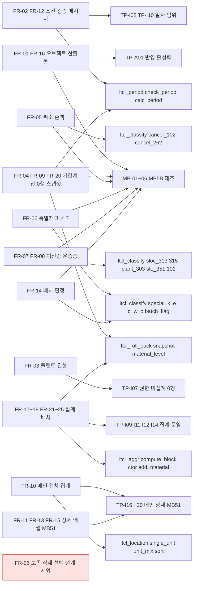
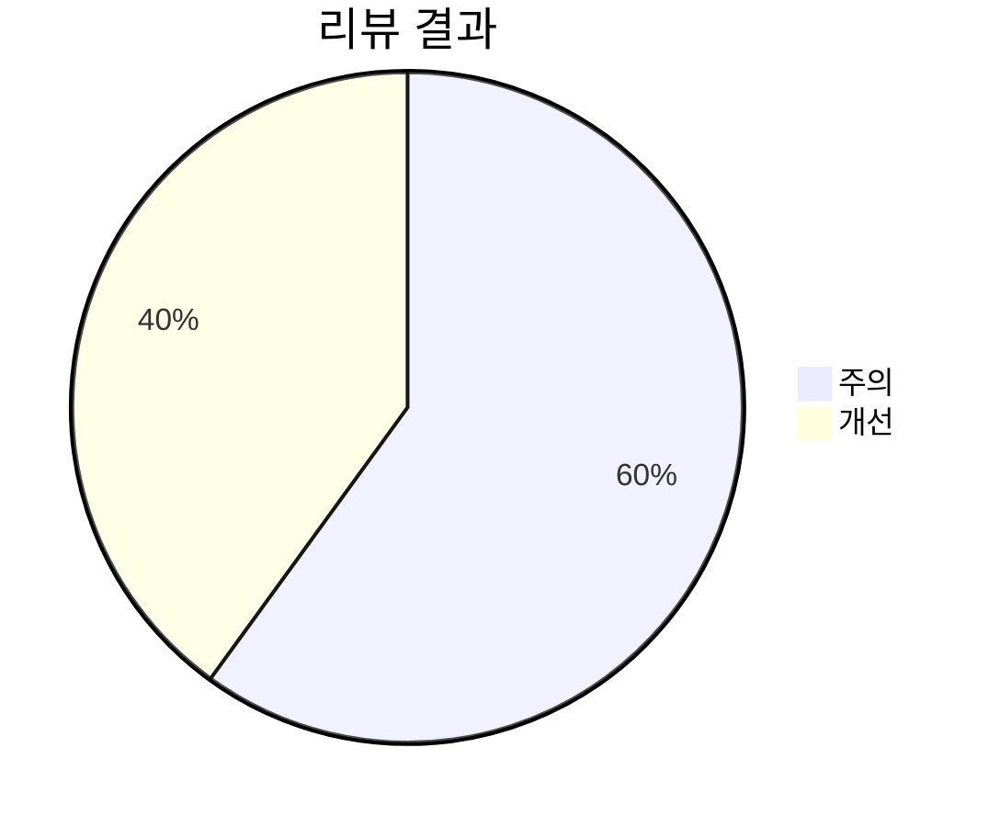
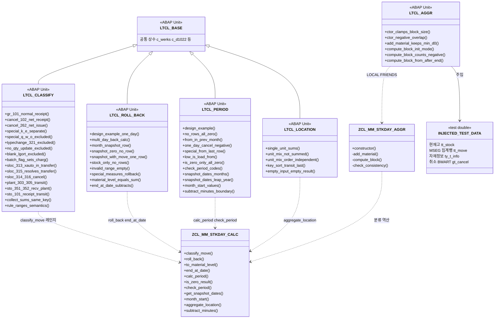

VERDICT: PASS
# 04. 테스트 — 전기일자 기준 자재수불부 조회(일별)_저장위치레벨포함

## 테스트 다이어그램

### 1) 요구사항 커버리지도

### 2) 리뷰 결과 분포

### 3) 단위테스트 구성도

---

| 항목 | 내용 |
|---|---|
| 요청 ID | 20261022-9149a8 |
| 단계 | 테스트 1차 (팀장 수정 지시 없음, CR 없음) |
| 기준 | request.md, 01_analysis.md v1.2, 02_design.md v1.1(TP-U01~U15, TP-I01~I20), 03_development.md v1.0, standards/handbook.md, 위키 'ECC 7.40 시스템 ABAP 개발 제약'·'테스트계 반영 전 점검 항목' |
| 대상 소스 | src/ZCL_MM_STKDAY_CALC.abap, ZCL_MM_STKDAY_AGGR.abap, ZRMM1235.abap, ZRMM1234.abap + _TOP/_SEL/_C01/_F01 (8개, 전체 정독) |
| 작성 산출물 | 04_test.md, src/ZCL_MM_STKDAY_CALC.testclasses.abap(테스트 메서드 44개), src/ZCL_MM_STKDAY_AGGR.testclasses.abap(6개) |
| 대상 시스템 | srd-abap (클라이언트 250, ECC, ABAP 7.40). `mcp__sap__*` 읽기 조회만, 시스템 쓰기 없음 |

## 1. 판정 요약

**판정: PASS(조건부).** 치명 결함은 없습니다. 주의 9건, 개선 6건입니다.

- 팀장 지시 규칙(취소 순액, K/E 별도·Q/W 제외, 이전중·운송중 행, From~To 기초/기말, 단위 혼재 미합산)은 소스에 모두 반영되어 있습니다. 같은 규칙을 ABAP Unit 50개(CALC 44, AGGR 6)로 검증하도록 작성했습니다.
- LOOP 안 SELECT는 없습니다. 조회 프로그램의 SELECT 횟수는 고정이고, 집계 배치는 블록 단위 집합 조회입니다. 상세 팝업을 열 때도 DB를 읽지 않습니다. 권한은 M_MSEG_WMB(플랜트별), MB51은 S_TCODE를 확인합니다. SALV·SQL·산술 예외도 처리합니다.
- 테스트 단계는 시스템에 반영하지 않고 정적 리뷰만 했으므로 PASS는 조건부입니다. 9장의 유지 조건(DDIC 선행 생성 → 일괄 활성화 성공 → ABAP Unit 50개 성공 → MB5B 대조 MB-01~03 일치) 중 하나라도 실패하면 FAIL로 바꾸고 개발 단계로 되돌립니다.
- 반영 전에 팀장 결정이 필요한 항목은 두 가지입니다. 메시지 클래스 ZMMM3 충돌(U-01, R-T1)과 주의 W1(단위 혼재 판정 범위)입니다.

## 2. 리뷰 결과

심각도 기준: **치명** = 활성화 실패가 확실하거나 요구사항 누락 / **주의** = 반영 전 결정·확인이 필요하거나 특정 조건에서 결과가 틀릴 수 있음 / **개선** = 동작에는 영향이 없고 품질만 개선.

| # | 심각도 | 오브젝트(파일:줄) | 문제 | 수정 제안 |
|---|---|---|---|---|
| W1 | 주의 | ZRMM1234_C01.abap:436-456, ZCL_MM_STKDAY_CALC.abap:777-796 | 단위 혼재 판정에 **일반재고 4개 값(기초·입고·출고·기말)이 모두 0인 행도 들어갑니다.** 예를 들어 K·E·이전중만 있는 EA 자재가 KG 자재와 같은 저장위치에 있으면, 실제로 더할 일반 수량이 KG뿐인데도 위치 전체가 공란·노란색이 되고 W 016 건수에 들어갑니다. '(운송중)' 행도 단위가 다른 자재가 둘 이상이면 수량은 원래 0인데 노란색이 되고 "저장위치 n건 합산하지 않음"으로 셉니다. 설계 D11 문구("위치 안 자재의 MEINS")와는 일치하지만 request.md 46행의 의도와 다르고 화면을 오해하게 만듭니다 | BUILD_MAIN에서 일반 4개 값이 모두 0인 행은 MEINS를 공란으로 넘깁니다. AGGREGATE_LOCATION은 MEINS가 공란인 행을 혼재 비교에서 빼고, 처음 들어온 공란이 아닌 단위를 채택합니다. 운송중(T) 행은 혼재 판정에서 제외합니다. **설계 확인 항목 D-11과 함께 팀장 결정**을 받습니다. 바꾸면 TP-U14에 "0 수량 EA 행은 혼재 아님" 케이스를 추가합니다 |
| W2 | 주의 | ZRMM1235.abap:157-175 | 백그라운드에서 실패 플랜트가 있으면 결과 SALV를 출력한 **뒤에** `MESSAGE e023`으로 잡을 취소합니다. E 메시지로 비정상 종료하면 앞서 만든 리스트가 스풀로 남지 않을 수 있습니다 [미확인]. 그러면 SM37에서 결과 목록을 볼 수 없습니다(03 T-8) | QAS에서 TP-I11로 스풀이 남는지 확인합니다. 남지 않으면 결과를 `MESSAGE s...`로 잡 로그에 플랜트별로 남긴 뒤 E 023으로 종료하거나, 결과 목록을 SLG1에 기록합니다 |
| W3 | 주의 | ZRMM1235.abap:58-60, ZCL_MM_STKDAY_AGGR.abap:386-389 | 집계 배치에 **프로그램 안 권한 체크가 없습니다.** 초기 적재 모드는 플랜트의 ZTMM1234/1236을 전부 지우고 다시 적재합니다. 프로그램 권한그룹(S_PROGRAM)을 지정하지 않으면(D-08 미결) SA38 권한이 있는 사람은 누구나 실행할 수 있습니다 | 반영 체크리스트에서 S_PROGRAM 권한그룹 지정을 **필수**로 둡니다. 추가로 START-OF-SELECTION에서 PA_INIT/PA_RECAL이면 플랜트별 권한(예: M_MSEG_WMB ACTVT 01/02 또는 팀 표준 Z 권한 오브젝트)을 확인하도록 권고합니다 |
| W4 | 주의 | ZCL_MM_STKDAY_AGGR.abap:562-572, 580-592, 641-647 | 일 집계 감지 SQL이 MKPF⋈MSEG에 `cpudt/cputm OR budat` 조건을 걸고 플랜트 전 기간을 대상으로 합니다. (c)는 **다른 모든 플랜트**의 STO 출고(werks <> P)를, (d)는 첫 스냅샷일 이후 플랜트 전체 이동을 읽습니다. HANA가 아니거나 MSEG 양이 많으면 07:00 잡 시간 목표(NFR-02)를 넘을 수 있습니다(설계 P5) | TP-I13에서 ST05·SAT로 가장 큰 플랜트의 감지 SQL 시간을 기록합니다. 느리면 (a)에 `k~budat >= 열린 MM 기간 1일` 하한을 넣고, (c)는 `umwrk = P` 경로와 EKPO 경로를 나눠 bwart·budat 하한을 줍니다 |
| W5 | 주의 | ZCL_MM_STKDAY_CALC.abap:347-434 | 이전중·운송중 분류가 실제 전표 구조에 의존합니다(D-04, D-05 미확인). ① 315/305 전표에 BUSTM이 r_trfbs에 속하는 XAUTO 행이 따로 있으면 C3과 C4가 모두 TRF를 빼서 **이전중이 두 번 차감**됩니다. ② 351 없이 101로 바로 입고되는 STO(1단계 STO 등)에 EKKO-RESWK가 있으면 T 키 TRF가 차감되어 과거 일자 운송중이 음수가 됩니다 | TP-I04에서 313/315/303/305/351/641/101 실제 전표를 SE16N으로 한 건씩 보고 XAUTO·BUSTM·UMWRK를 기록합니다. 결과에 맞춰 CLASS_CONSTRUCTOR 레인지만 고칩니다. 정합성 로그(W 026의 음수 기말 건수)로 이상 여부를 감시합니다 |
| W6 | 주의 | ZCL_MM_STKDAY_CALC.abap:153, ZRMM1234.abap:12, ZRMM1235.abap:12 | 메시지 클래스 **ZMMM3이 요청 20261019-bce84c와 충돌**합니다(U-01, 팀장 미결정). 저쪽은 `$TMP`에 001~006을 씁니다. 지금 시스템에는 ZMMM3이 없습니다[확인: SearchObject 0건]. 먼저 반영된 쪽의 001~006 문구가 덮여서 잘못된 메시지가 나옵니다 | 반영 전에 팀장이 결정합니다. ① 이 요청을 ZMMM4로 바꾸면 고칠 곳은 위 3곳입니다(ZMMM4는 반영 전에 SearchObject로 빈 번호인지 확인). ② 다른 요청의 번호를 바꿉니다 |
| W7 | 주의 | ZRMM1234_TOP.abap:20-110, ZCL_MM_STKDAY_AGGR.abap:82-83·102, ZCL_MM_STKDAY_CALC.abap:29 외 | **DDIC 미생성**: ZTMM1234/1236/1237, ZESTCAT/ZDSTCAT, EZTMM1237이 아직 없습니다[확인: ZTMM123*는 ZTMM1230·ZTMM1235만 있음]. 웹앱 반영 전에 SE11로 만들지 않으면 4개 오브젝트 모두 **일괄 활성화에 실패**합니다. 표준 필드는 데이터 엘리먼트 XSTBW·BUSTM(패키지 MB), MENGU(BM), RETME(MG)가 있음을 확인했습니다[확인-간접]. 테이블 필드 목록은 ADT가 돌려주지 않아 활성화로 확인합니다(7장) | 반영 순서 1단계(SE11)를 반영 체크리스트의 **선행 게이트**로 둡니다. 소스가 쓰는 필드명이 03 문서 4.2 표와 하나라도 다르면 활성화 오류가 나므로, 표를 보고 그대로 만듭니다 |
| W8 | 주의 | ZCL_MM_STKDAY_AGGR.abap:851·875·1097-1100 | request.md 39행은 "MARC-XCHPF가 없으면 MARA-XCHPF 참고"를 요구하지만, 구현은 **MARC-XCHPF만** 봅니다(분석 Q10 잠정안, 설계 승인). MARC는 공란이고 MARA는 'X'인 자재가 있으면 MCHB 재고를 읽지 않아 배치 재고가 빠집니다 | Q10 결정을 팀장에게 다시 확인합니다. QAS에서 `MCHB에 재고가 있는데 MARC-XCHPF가 공란인 자재` 건수를 SE16N으로 점검합니다(MB-01 사전 점검). 0건이 아니면 READ_STOCK의 XCHPF 판정에 MARA-XCHPF 보조 판정을 넣습니다 |
| W9 | 주의 | ZRMM1234_C01.abap:12·70, ZRMM1234_TOP.abap:137-138 | 로컬 클래스 정의를 `CLASS: lcl_data DEFINITION FINAL.`처럼 콜론 체인으로 썼습니다(웹앱 유형 판별 회피, U-03). 문법상 허용되는 것으로 보지만 이 시스템에서 활성화로 확인하지 않았습니다 | TP-A01에서 활성화 결과를 확인합니다. 실패하면 소스를 고치지 말고 반영 도구를 수정하거나 SE38 수작업 반영을 선택합니다(위키: 도구 문제는 개발 재작업으로 풀리지 않음) |
| I1 | 개선 | ZRMM1235.abap:94-95, ZCL_MM_STKDAY_AGGR.abap:264·535·946-947·1015 | 레인지 변수에 `lr_` 접두어를 썼습니다. 핸드북 Ranges 규칙은 `R_`입니다(3장 표) | `r_werks`, `r_matnr`, `r_block`, `r_stois`, `r_storc`로 바꿉니다 |
| I2 | 개선 | ZRMM1234_C01.abap:676-689 vs 819, ZRMM1235.abap:183-184 | 참조 변수 이름이 섞여 있습니다. 같은 파일에서 `lo_sel`·`lx_salv`(LO_/LX_)와 `l_popup`·`l_salv`(L_)를 함께 씁니다. 핸드북에는 참조 변수 규칙이 없고 Variables는 `L_`입니다 | 핸드북 Variables 규칙(`L_`)으로 통일하거나, LO_/LX_를 팀 관례로 핸드북에 추가해 달라고 요청합니다 |
| I3 | 개선 | ZRMM1234_C01.abap:159, ZCL_MM_STKDAY_AGGR.abap:322 | `SELECT *`를 씁니다. ZTMM1237은 행이 적은 제어 테이블이라 성능 영향은 없습니다 | 쓰는 필드만 나열하거나, 전체 필드가 필요하다는 주석을 남깁니다 |
| I4 | 개선 | ZRMM1234_F01.abap:11 | 기본 전기일을 `MAX( last_budat )`으로 **모든 플랜트**에서 구합니다. 입력 플랜트가 늦게 집계되었으면 첫 실행 때 W 006으로 제외됩니다 | SO_WERKS 기본값(메모리 ID WRK)이 있으면 그 플랜트 기준으로 구합니다 |
| I5 | 개선 | ZRMM1234_C01.abap:189-195 | W 009(집계 지연·실패)는 첫 번째로 지연된 플랜트 하나만 보여 줍니다 | 지연된 플랜트를 PLANT_LIST로 묶어 &3에 넣습니다 |
| I6 | 개선 | ZCL_MM_STKDAY_AGGR.abap:1185-1190, 1194-1199 | `INSERT ... FROM TABLE`은 키가 중복되면 sy-subrc가 아니라 CX_SY_OPEN_SQL_DB 예외를 냅니다. 그래서 `sy-subrc <> 0` 분기는 실행되지 않는 코드입니다(예외는 PROCESS_PLANT에서 잡으므로 동작은 정상) | 분기를 지우거나 주석으로 "예외로 처리됨"을 밝힙니다 |

**중점 검토 결과**

| 관점 | 결과 |
|---|---|
| 구문 오류 | 정적 리뷰에서 발견하지 못했습니다. 7.40 문법(New Open SQL `@`·콤마 목록, INTO는 WHERE 앞, VALUE/CONV, line_exists)과 위키 제약(SET HANDLER에 참조 변수 사용, csequence 파라미터, CX_SALV_ERROR 단일 CATCH)을 지켰습니다. `CL_SALV_COLUMN`의 set_quantity_column·set_zero·set_technical·set_visible이 있음을 GetClass로 확인했습니다[확인]. 남은 확인 대상은 W7(DDIC)과 W9(콜론 체인)입니다 |
| 존재하지 않는 필드·타입 | Z DDIC 미생성(W7). 표준 필드는 7장 표 참조 |
| 성능 | LOOP 안 SELECT 없음. 조회 SELECT는 고정 6회(+PBO 1회). 집계는 블록당 집합 조회이고 DB SUM/MIN GROUP BY를 씁니다. FAE는 드라이버가 비었는지 먼저 확인합니다. 감지 SQL 부하는 W4 |
| 권한 | ZRMM1234: M_MSEG_WMB(플랜트별 제외·경고), MB51은 S_TCODE 사전 체크, 빈 range 가드 있음. ZRMM1235: 프로그램 안 체크 없음(W3) |
| 예외 | SALV는 CX_SALV_ERROR로 받고 팝업 오류여도 메인을 유지합니다. 집계는 SQL/산술/변환 예외 시 블록 ROLLBACK, RUN_STAT E, LAST_* 유지. 잠금 실패는 W 021 후 다음 플랜트로 넘어갑니다 |
| 요구사항 누락 | 누락 없음. FR-26(보존·삭제)은 선택 항목이고 설계(Q23)에서 범위 밖으로 정했습니다. FR-14 MARA 보조 판정은 Q10 잠정안에 따라 생략했습니다(W8) |

## 3. 개발표준 준수 (standards/handbook.md)

### 3.1 오브젝트명

| 오브젝트 | 유형 | 핸드북 규칙 | 판정 |
|---|---|---|---|
| ZRMM1234 / ZRMM1235 | 프로그램 | Z + R + MM + 4자리 | 준수 |
| ZRMM1234 | T-code | Z + R + MM + 4자리 | 준수 |
| ZTMM1234 / ZTMM1236 / ZTMM1237 | 테이블 | Z + T + MM + 4자리 | 준수 |
| ZDSTCAT | 도메인 | Z + D + 5자 | 준수 |
| ZESTCAT | 데이터 엘리먼트 | Z + E + 5자 | 준수 |
| EZTMM1237 | 잠금 오브젝트 | E + 테이블명 | 준수 |
| ZMMM3 | 메시지 클래스 | Z + M + MM + 1자리 | 준수(번호 충돌은 W6) |
| ZMMD | 패키지 | Z + MM + D | 준수 |
| ZCL_MM_STKDAY_CALC / _AGGR | 클래스 | 핸드북 규칙 없음 — SAP 관례(ZCL_) | 해당 없음 |
| ZRMM1234_TOP/_SEL/_C01/_F01 | INCLUDE | 핸드북 규칙 없음 — 기존 ZRMM0005_* 관례 | 해당 없음 |

### 3.2 프로그램 내부 이름 — 어긋난 이름

| 파일:줄 | 현재 이름 | 규칙 | 올바른 이름 |
|---|---|---|---|
| ZRMM1235.abap:94 | lr_werks | Ranges `R_` + 이름 | r_werks |
| ZRMM1235.abap:95 | lr_matnr | Ranges `R_` | r_matnr |
| ZCL_MM_STKDAY_AGGR.abap:264 | lr_block | Ranges `R_` | r_block |
| ZCL_MM_STKDAY_AGGR.abap:535 | lr_stois | Ranges `R_` | r_stois |
| ZCL_MM_STKDAY_AGGR.abap:946 | lr_storc | Ranges `R_` | r_storc |
| ZCL_MM_STKDAY_AGGR.abap:947 | lr_stois | Ranges `R_` | r_stois |
| ZCL_MM_STKDAY_AGGR.abap:1015 | lr_stois | Ranges `R_` | r_stois |
| ZRMM1234_C01.abap:676-679·689·796·820-823·831·959-960·995-996·1023, ZRMM1235.abap:184-185·217 | lo_sel, lo_events, lo_layout, lo_disp, lx_salv, lo_func, lo_cols, lo_col | 핸드북에 참조 변수 규칙 없음. Variables는 `L_` | (권고) l_sel, l_events … 또는 핸드북에 LO_/LX_ 관례 추가. 같은 파일의 l_popup·l_salv와 통일(I2) |

그 밖의 이름은 핸드북과 일치합니다. 전역 변수 G_/GT_/GS_, 로컬 L_/LT_/LS_, 상수 C_, 파라미터 PA_(4~8자: PA_BUDFR·PA_NOZER·PA_DAILY 등), 셀렉트옵션 SO_, 레인지 R_WERKS·R_STKCAT·R_TRFBW 등을 확인했습니다. 클래스 속성(GT_CTRL, G_MIX_CNT, G_BLKSZ 등)은 Global 규칙을 따릅니다.

### 3.3 테스트 클래스 코드 명명

- 테스트 클래스 `LTCL_*`와 테스트 메서드명은 핸드북 규칙이 없어 SAP 관례를 적용했습니다.
- 속성은 `G_CUT`, 상수는 `C_WERKS`·`C_D1022` 등, 로컬은 `LT_DELTA`·`LS_B`·`L_BEG`, 레인지는 `R_MATNR`·`R_WERKS`로 핸드북 2장을 따랐습니다.

## 4. 시스템 확인 기록 (2026-10-23, srd-abap)

| 조회 | 도구 | 결과 |
|---|---|---|
| T156 필드 | GetTable | 실패: `/sap/bc/adt/ddic/structures/T156/source/main does not exist`(분석·설계와 같음) |
| 데이터 엘리먼트 XSTBW | GetTypeInfo / SearchObject | GetTypeInfo는 실패. SearchObject 결과 DTEL **XSTBW(패키지 MB)** 있음 → T156-XSTBW 존재 가능성 높음[확인-간접] |
| BUSTM / MENGU / RETME | SearchObject | DTEL·DOMA BUSTM(MB), DTEL MENGU(BM), DTEL RETME(MG) 있음[확인-간접] |
| ZMMM3* | SearchObject | 0건(아직 없음). U-01 충돌은 반영 순서에 따라 생김 |
| ZTMM123* | SearchObject | ZTMM1230, ZTMM1235만 있음 → ZTMM1234/1236/1237 비어 있음(미생성) |
| ZCL_MM_STKDAY* | SearchObject | 0건(미반영) |
| CL_SALV_COLUMN | GetClass | set_quantity_column(CX_SALV_NOT_FOUND·CX_SALV_DATA_ERROR), set_zero, set_technical, set_visible, set_short/medium/long_text 있음[확인] |

## 5. ABAP Unit 커버 범위

모든 테스트 클래스는 `FOR TESTING RISK LEVEL HARMLESS DURATION SHORT`입니다. DB 접근이 없고 테스트 데이터를 직접 주입합니다. 시스템에 `CL_OSQL_TEST_ENVIRONMENT`가 없어서 DB를 읽는 메서드는 단위테스트 대상에서 뺐습니다(위키).

### 5.1 ZCL_MM_STKDAY_CALC.testclasses.abap (44개)

| 설계 TP | 테스트 클래스 | 테스트 메서드 | 검증 내용 |
|---|---|---|---|
| TP-U01 | ltcl_classify | gr_101_normal_receipt, cancel_102_net_receipt, cancel_262_net_issue | 101 → 입고 +. **102(취소)는 입고 −**(101 100 + 102 20 = 입고 80·출고 0, 102 단독 = 입고 −20). **262(취소)는 출고 −**(261 50 + 262 10 = 출고 40·입고 0) |
| TP-U02 | ltcl_classify | sloc_313_xauto_in_transfer, sloc_315_resolves_transfer, sloc_314_316_cancel | 313 비XAUTO → 보내는 쪽 출고. 313 XAUTO MA05 → 받는 쪽 L 키 이전중 +. 315 → 입고 + 이전중 −. 314·316 반대 부호 |
| TP-U03 | ltcl_classify | plant_303_305_transit | 303 XAUTO(MA02 또는 BUSTM 공란) → 받는 플랜트 T 키 +. 305 → 입고 + T 키 −. 보내는 플랜트는 출고 |
| TP-U04 | ltcl_classify | sto_351_352_recv_plant, sto_101_receipt_transit | 351 → 공급 플랜트 출고 + 받는 플랜트 T 키 +, 352 반대. STO 입고 101만 T 키 차감(일반 101은 입고만) |
| TP-U05 | ltcl_classify | special_k_e_separate, special_q_w_o_excluded, typechange_321_excluded, blank_lgort_excluded, batch_flag_sets_charg, no_qty_update_excluded | **K·E는 별도 측정값**(일반 0). **Q·W**(그리고 O·V) 제외. 321·343 제외. 저장위치 공란 제외. 비배치 배치 공란. 수량 갱신 없음 제외 |
| 03 T-1·T-2 | ltcl_classify | collect_sums_same_key, rule_ranges_semantics | COLLECT 합산. 분류 레인지를 '값 IN 레인지'로 검증(313∈L, 303∉L, 311∉재고유형 등) |
| TP-U06 | ltcl_roll_back | design_example_one_day, multi_day_back_calc | 설계 4.2 예시 90/50/20/120, 이동 없는 날 행 없음, 전일 기말 = 당일 기초 |
| TP-U07 | ltcl_roll_back | month_snapshot_row, snapshot_zero_no_row, snapshot_with_move_one_row, stock_only_no_rows | 월초 스냅샷(SNAPF X), 재고 0이면 스냅샷 행 없음, 스냅샷+이동 같은 날 1행, 현재고만 있으면 행 없음 |
| TP-U08 | ltcl_roll_back | material_level_equals_sum | TO_MATERIAL_LEVEL 합산, A 기말 = 배치별 그날 기준 기말 합(D4) |
| (추가) | ltcl_roll_back | special_measures_rollback, invalid_range_empty, end_at_date_subtracts | K/E/이전중 역산, From>To·공란 가드, END_AT_DATE(증감만 있는 키 포함) |
| TP-U09 | ltcl_period | design_example, no_rows_all_zero, from_in_prev_month, one_day_cancel_negative, special_from_last_row, low_is_load_from | **From~To 기초/기말**: 설계 4.4 예시, From 전월 + 기말 당월 구간, From=To 하루 + 다른 날 취소 입고 −20, K/E/이전중 마지막 행, To 이후 행 무시, 적재 시작일 하한 |
| TP-U10 | ltcl_period | is_zero_only_all_zero | 7개 값 모두 0일 때만 참, 이전중·K·입출고만 있으면 거짓 |
| TP-U11 | ltcl_period | check_period_codes | 코드 1(From>To), 2(To≥오늘), 3(미집계), 4(To>LAST_BUDAT), 5(From<LOAD_FROM), 정상 |
| TP-U12 | ltcl_period | snapshot_dates_months, snapshot_dates_leap_year, month_start_values | 10/15~12/03 → 11/01·12/01, 적재 시작일 포함·제외, 연도 경계, 윤년 2028.02.29 |
| 03 T-1 | ltcl_period | subtract_minutes_boundary | 자정·연도 경계, 0분, 날짜 공란 → 공란 |
| TP-U13 | ltcl_location | single_unit_sums | 단일 단위 합산(마이너스 입고 순액 포함), 기초 = 기말 − 입고 + 출고 |
| TP-U14 | ltcl_location | unit_mix_not_summed, unit_mix_order_independent | **단위 혼재 시 합산 안 함**(UNIT_MIX X, MEINS 공란, 수량 0). 입력 순서와 무관 |
| TP-U15 | ltcl_location | key_sort_transit_last, empty_input_empty_result | 위치별 1행, 정렬 WERKS → L → T(운송중이 저장위치 행 뒤), 빈 입력 |

### 5.2 ZCL_MM_STKDAY_AGGR.testclasses.abap (6개)

| 테스트 메서드 | 검증 내용 |
|---|---|
| ctor_clamps_block_size | 블록 크기 0 → 1000, 9999 → 5000, 1·5000은 그대로 |
| ctor_negative_overlap | 여유시간 음수 → 60, 0은 그대로 |
| add_material_keeps_min_d0 | 자재별 가장 이른 d0 유지, 공란 자재·일자 무시 |
| compute_block_init_mode | 분류 → 다른 플랜트(STO 공급 쪽 P002) 키 제거 → B 6행·A 4행 → **102 취소는 B1 입고 −4·출고 0**, 적재 시작일 스냅샷, A 10/21 기말 124 = B1 64 + B2 60, **운송중 행**(저장위치 공란, 이전중 7), MARC 정보 없는 자재 제외, 정합성 불일치·음수 0 |
| compute_block_counts_negative | 음수 기말 행을 정합성 경고 건수(G_CNT_NEG)로 셈 |
| compute_block_from_after_end | 블록 시작일 > 구간 끝이면 결과 없음 |

- 격리 방식: `CLASS zcl_mm_stkday_aggr DEFINITION LOCAL FRIENDS ltcl_aggr`(본 소스 변경 없음)로 private 속성(G_WERKS, G_D_END, GT_CANCEL 등)을 직접 넣습니다. 초기 적재 모드에서는 CHECK_CONSISTENCY (3)이 ZTMM1236 SELECT 전에 RETURN하므로 DB 접근이 없습니다.
- 테스트 클래스 파일은 클래스의 Local Test Classes include(CCAU)로 들어갑니다. 웹앱은 `<클래스명>.testclasses.abap`을 testclasses include로 씁니다(src/board.ts 확인).

### 5.3 단위테스트 범위 밖 (QAS 통합 테스트로 확인)

| 대상 | 이유 | 시나리오 |
|---|---|---|
| AGGR READ_STOCK/READ_MOVES/READ_STO_MOVES/DETECT_MATERIALS/SAVE_BLOCK/UPDATE_CONTROL/CHECK_OPEN_PERIOD, 잠금·SLG1 | DB 의존(OSQL 더블 없음) | TP-I09~I14 |
| ZRMM1234 LCL_DATA(CHECK_PLANTS의 AUTHORITY-CHECK, READ_DATA), LCL_VIEW(SALV 이벤트·선택 행·팝업·MB51) | DB·권한·SALV 이벤트(권한 더블 없음) | TP-I07, TP-I15~I20 |
| ZRMM1234 BUILD_RESULT/BUILD_MAIN 조립 | 로컬 클래스가 선택화면 전역(PA_/SO_)에 의존 | TP-I16, TP-I18, TP-I19 |

## 6. 테스트 시나리오 (QAS)

### 6.1 반영·활성화

| ID | 제목 | 절차 | 기대 결과 |
|---|---|---|---|
| TP-A01 | 반영·활성화·ABAP Unit | ① SE11: ZDSTCAT → ZESTCAT → ZTMM1234/1236/1237(03 문서 4.2 필드명 그대로) → EZTMM1237. ② SE91 ZMMM3(또는 U-01 결정 번호) 001~029. ③ 웹앱 반영(src 8개 + testclasses 2개). ④ 웹앱 로그에서 _TOP/_SEL/_C01/_F01 = INCL, 두 클래스 = CLAS, 두 리포트 = PROG인지 확인. ⑤ 일괄 활성화. ⑥ SE24 → 두 클래스 ABAP Unit 실행(Ctrl+Shift+F10). ⑦ SLIN/SCI | 활성화 오류 0(W7·W9 해소). ABAP Unit **50개 모두 성공**. SLIN 예상 경고(ON_DOUBLE_CLICK의 미사용 COLUMN, 메시지 002·016 길이) 외 오류 없음 |

### 6.2 설계 통합 테스트 (TP-I01~I20)

| ID | 제목 | 절차 | 기대 결과 |
|---|---|---|---|
| TP-I01 | 배치 자재 | 배치 2개 이상인 자재(MARC-XCHPF='X')로 From~To 조회 → 상세 | 배치별 기초·기말 = MB5B(MB-01). 메인 위치 4개 값 = 상세 행 합(단일 단위) |
| TP-I02 | 비배치 311 이전 | 기간 안에 311 이전한 비배치 자재 | 보내는 저장위치 출고, 받는 저장위치 입고. 상세 배치 공란 1행. 메인 두 위치에 반영 |
| TP-I03 | 기준일 이후 입출고 | To+1 ~ 전일 사이에 입출고·취소가 있는 자재, To 조회 | 기말(To) = MB5B 기말(MB-03) |
| TP-I04 | 이전중·운송중 | 313 후 315 전, 303/351 후 미입고 자재. **D-04/D-05**: SE16N MSEG에서 313/315/303/305/351/641/STO 101 전표 1건씩 XAUTO·BUSTM·UMWRK·EBELN 기록 | 받는 저장위치 이전중 = 313 수량, 받는 플랜트 '(운송중)' 행 이전중 = MB5T·MMBE. 메인 '(운송중)' 행 수량 공란. 315 XAUTO 행이 있으면 W5에 따라 레인지 조정 |
| TP-I05 | 취소 판정 점검 | SE16N: 기간 안 SMBLN ≠ 공란인 MSEG의 BWART 목록 → T156-XSTBW 비교 | 모두 XSTBW = 'X'(T156 단독 판정의 전제, Q4) |
| TP-I06 | 특별재고 K·E·Q | K, E, Q 재고를 가진 자재 | 상세 K·E 값 표시, Q 미표시. 메인 기초·기말에 K·E 미포함 |
| TP-I07 | 권한·미집계·0행 | ① M_MSEG_WMB 일부 플랜트만 있는 사용자 ② ZTMM1237에 없는 플랜트 ③ 모두 0인 자재 + PA_NOZER | ① I 005(W 표시) 후 제외 ② I 007 후 제외, 전부면 S 005/007 E 표시 후 선택화면 ③ 0행 제외, 메인 합도 제외 후 기준. 빈 range로 전체 조회되지 않음 |
| TP-I08 | 당일·미집계 | To = 오늘 / To > LAST_BUDAT | E 002 / 플랜트 제외 W 006(전부면 E 표시) |
| TP-I09 | 역전기·과거 취소 | 3일 전 일자로 입고 전기, MBST로 과거 입고 취소 → 다음 날 일 집계 | 해당 자재만 그날부터 재계산, 다른 자재 행 ERDAT 불변, 취소 전기일에 입고 − |
| TP-I10 | 초기 적재 | 표본 플랜트 S~전일 초기 적재 | S~전일 표본 키 MB5B 일치, S 이전 From은 W/E 008, 적재 중 조회 차단(LAST_BUDAT 공란) |
| TP-I11 | 잡 실패 후 복구 | 테스트 플랜트 잠금 유지(다른 세션 ENQUEUE) 또는 강제 오류 → 다음 날 정상 실행 | RUN_STAT E, LAST_BUDAT 불변, 잡 '취소됨', 다음 실행에서 빠진 일자 채움, 조회 W 009. **W2: 실패 시 결과 스풀 존재 여부 기록** |
| TP-I12 | 멱등·테스트 실행 | 같은 날 일 집계 2회, PA_TEST | 결과 동일, PA_TEST는 ZTMM1234/1236/1237 변경 없음 + S 027 |
| TP-I13 | 성능 | 가장 큰 플랜트 일 집계, 초기 적재 1개월분, 조회 1개월(ST05) | 소요 시간 기록, 07:00 잡 업무 전 완료. **[상세조회]·더블클릭 때 ST05에 SELECT 없음.** W4 감지 SQL 시간 기록 |
| TP-I14 | 정합성 로그 | SLG1 ZMM/ZRMM1235 | A/B 불일치 0, 음수 기말 건수 확인(W5 감시) |
| TP-I15 | 엑셀·레이아웃 | 메인·팝업 엑셀 다운로드, 레이아웃 MAIN/DETL 저장 | 각각 동작, 팝업 크기 약 80%(D-14) |
| TP-I16 | 메인 집계 정합성 | 단일 단위 위치 3개 | 메인 4개 값 = 상세 합. NAME1 = T001W, LGOBE = T001L, 운송중 '(운송중)' |
| TP-I17 | 상세조회·더블클릭·다중 선택 | 설계 14.2 ①~⑧ | 선택 없음·셀만 선택 → S 012. 1행·3행(운송중 포함) 선택 → 선택 위치 전체가 한 팝업에, 정렬 플랜트 → 저장위치 → 운송중 → 자재 → 배치, S 017 건수 일치. 더블클릭은 그 행만. 정렬·필터 후 인덱스 매핑 정확. 닫으면 메인 유지. GUI 상태 미생성 시 버튼 없음 검출 |
| TP-I18 | 단위 혼재 | KG·EA 자재가 함께 있는 저장위치 + **K만 있는 EA 자재가 KG 위치에 있는 경우 + 단위가 다른 운송중 자재 2개** | 첫째 경우는 공란·노란색·W 016 건수 일치. 둘째·셋째 경우는 현재 소스에서 노란색으로 표시됨 → **W1 결정 결과와 대조** |
| TP-I19 | SO_CHARG 입력 | 배치 조건 입력 | 메인 수량 = 선택 배치 상세 합. 비배치 자재는 공란 배치가 조건에 맞을 때만 포함 |
| TP-I20 | MB51 이동(D-07, AI 검증 지시) | 팝업 행 더블클릭(① 배치 행 ② 비배치 행 ③ 운송중 행) → MB51 선택화면 확인 → 뒤로 → 팝업 닫기 | 선택화면에 **자재(MATNR)·플랜트(WERKS)·저장위치(LGORT, ③은 비어 있어야 함)·배치(CHARG, ②③은 비어 있어야 함)·전기일(BUDAT From~To)** 이 채워짐. 하나라도 비면 RM07DOCS 선택 필드명을 SE38에서 확인해 CALL_MB51(C01:917~946)의 SELNAME을 고침. MB51 권한이 없으면 S 013(E 표시). 복귀 후 S 014, 팝업 → 메인 순서로 돌아옴 |

### 6.3 MB5B 대조 시나리오 (request.md 72행 + 팀장 확인 규칙)

공통 절차: ZRMM1234에서 플랜트·저장위치·자재(·배치)와 From~To(To ≤ 최종 집계일)로 조회하고 상세 팝업 값을 기록합니다. MB5B는 같은 조건으로 "저장위치/배치 재고"를 선택하고, 특별재고는 조회하지 않거나 K/E로 따로 조회해 기초·입고 합·출고 합·기말을 기록합니다. MB51로 같은 기간 전표를 펼쳐 차이를 설명합니다. MB5B가 취소·재고유형 간 이동을 SHKZG 방향으로 입고/출고에 넣는지는 [미확인]입니다.

| ID | 제목 | 데이터 조건 | 기대 결과 |
|---|---|---|---|
| MB-01 | 배치 자재 1건 | MARC-XCHPF='X', 배치 2개, 기간 안 입고·출고. 사전 점검: MCHB 재고는 있는데 MARC-XCHPF가 공란인 자재 수(W8) | 배치별 **기초·기말 = MB5B 차이 0**, 입고 − 출고(순증감) = MB5B 순증감. 메인 위치 = 배치 합 |
| MB-02 | 비배치 자재 1건 | MARC-XCHPF 공란, 기간 안 입출고 | 상세 배치 공란 1행, 기초·기말 = MB5B 차이 0 |
| MB-03 | 기준일 이후 입출고 1건 | To 다음 날 ~ 전일 사이에 입고·출고(취소 포함)가 있는 자재 | **기말(To) = MB5B 기말(To)** (역산이 To 이후 전표를 정확히 되돌림) |
| MB-04 | 취소 순액 | 같은 기간 101 100 / 102 20, 261 50 / 262 10 | ZRMM1234 **입고 80, 출고 40**(102는 입고 −, 262는 출고 −). 기초·기말·순증감 = MB5B. MB5B 입고/출고가 다르면 차이가 취소 수량(20, 10)과 같은지 MB51로 설명 |
| MB-05 | 월 경계 From~To | From = 전월 말일, To = 당월 중순, 당월에는 이동이 없는 자재 포함 | 기초(From) = MB5B 기초, 기말(To) = MB5B 기말(월초 스냅샷 사용) |
| MB-06 | 특별재고 K·E | 위탁 K와 판매오더 E 재고를 가진 자재 | 상세 위탁재고(K)·오더재고(E) 기말 = MB5B 특별재고 K·E 기말. 일반 기말에는 K·E가 들어가지 않음 |

### 6.4 팀장 확인 사항 대응표

| 팀장 확인 사항 | 검증 위치 |
|---|---|
| AI 검증 지시: MB51 선택 필드 전달(D-07) | TP-I20(필드별 확인, 실패 시 수정 위치 C01:917~946) |
| 메시지 클래스 ZMMM3 충돌(U-01) 미결정 | W6, 8장 R-T1(반영 전 결정 게이트) |
| DDIC 미생성·표준 필드 미확인 | W7, 7장 활성화 확인 항목, TP-A01 |
| 취소 순액(102 입고 −, 262 출고 −) | cancel_102_net_receipt, cancel_262_net_issue, one_day_cancel_negative, compute_block_init_mode, MB-04 |
| 특별재고 K/E 별도 컬럼(Q·W 제외) | special_k_e_separate, special_q_w_o_excluded, special_measures_rollback, TP-I06, MB-06 |
| 이전중/운송중 행 | sloc_313/315/314_316, plant_303_305_transit, sto_351_352, sto_101, key_sort_transit_last, compute_block_init_mode(운송중 행), TP-I04 |
| From~To 기초/기말 | design_example, from_in_prev_month, one_day_cancel_negative, low_is_load_from, MB-01~05 |
| 단위 혼재 시 합산 안 함(노란색) | unit_mix_not_summed, unit_mix_order_independent, TP-I18(노란색·W 016), W1 |

## 7. 활성화 시 확인 항목

| 구분 | 항목 | 확인 방법 | 상태 |
|---|---|---|---|
| Z DDIC | ZDSTCAT(CHAR1, L/T), ZESTCAT, ZTMM1234·ZTMM1236·ZTMM1237(03 문서 4.2 필드명·순서), EZTMM1237(MANDT, WERKS) | SE11 생성 후 활성화 | 미생성[확인] |
| 메시지 | ZMMM3 001~029(U-01 결정 후 번호 확정) | SE91 | 미생성[확인] |
| 표준 필드 | T156-XSTBW | 활성화(RUN의 SELECT) | DTEL XSTBW(MB) 있음[확인-간접] |
| 표준 필드 | MSEG-XAUTO/BUSTM/UMWRK/EBELN/EBELP, MKPF-CPUDT/CPUTM | 활성화(TY_MOVE, 감지 SQL) | BUSTM DTEL 있음[확인-간접], 나머지 [미확인] |
| 표준 필드 | MARD-RETME/UMLME, MCHB-CRETM/CUMLM, MKOL-SEINM, MSKA-KAEIN, MARC-XCHPF/UMLMC/TRAME | 활성화(READ_STOCK·DETECT 타입·SQL) | RETME DTEL 있음[확인-간접], 나머지 [미확인] |
| 표준 필드 | T134M-MENGU, T001K-BUKRS, MARV-VMGJA/VMMON, EKKO-RESWK, EKPO-WERKS | 활성화 | MENGU DTEL 있음[확인-간접], 나머지 [미확인] |
| 길이 | MENGE_D(QUAN 13,3)와 MSEG-MENGE 일치(D-09) | SE11 | [미확인] |
| 문법 | `CLASS:` 콜론 체인(W9) | 일괄 활성화 | [미확인] |
| 권한 | M_MSEG_WMB 필드 ACTVT·WERKS(U-05) | SU21 | [미확인] |
| 수작업 | GUI 상태 STANDARD + DETAIL, Text Symbol·Selection Text, T-code, SLG0 ZMM/ZRMM1235, S_PROGRAM 권한그룹(W3) | SE41/SE38/SE93/SLG0 | 반영 후 |

## 8. 남은 리스크

| ID | 리스크 | 영향 | 대응 |
|---|---|---|---|
| R-T1 | 메시지 클래스 ZMMM3 충돌(U-01) 미결정 | 먼저 반영된 요청의 001~006 문구가 덮임 | 반영 전 팀장 결정(ZMMM4 전환 시 소스 3곳) |
| R-T2 | DDIC·표준 필드 미확인(W7) | 활성화 실패 | SE11 선행, TP-A01 |
| R-T3 | 이전중·운송중 규칙의 실제 전표 구조(D-04/D-05, W5) | 과거 일자 이전중·운송중 오차, 음수 | TP-I04, 정합성 로그 |
| R-T4 | 단위 혼재 판정 범위(W1, D-11) | 메인 위치가 불필요하게 공란·노란색 | 팀장 결정 후 BUILD_MAIN/AGGREGATE_LOCATION 보정 |
| R-T5 | MB5B의 취소·재고유형 간 이동 집계 방식 [미확인] | 입고/출고 개별 값이 MB5B와 다를 수 있음(기초·기말·순증감은 같아야 함) | MB-04에서 MB51로 차이 설명, 현업 안내 |
| R-T6 | 집계 배치 권한(W3)·감지 SQL 성능(W4) | 오사용 시 플랜트 데이터 재적재, 잡 시간 초과 | S_PROGRAM 지정 필수, TP-I13 |
| R-T7 | MARA-XCHPF 보조 판정 생략(W8, Q10) | 배치 재고 누락 가능 | MB-01 사전 점검 |
| R-T8 | 분석 미결 Q2(Q 재고)·Q18(적재 시작일)·Q1(일별 해석) | 테이블 구조·운영 일정 영향 | **테이블 생성 전** 팀장 결정 |

## 9. 판정과 PASS 유지 조건

**VERDICT: PASS(조건부)** — 치명 0, 주의 9, 개선 6.

PASS를 유지하려면 반영 때 다음을 순서대로 통과해야 합니다. 하나라도 실패하면 FAIL로 바꾸고 개발 단계로 되돌립니다.

1. 반영 전: U-01(ZMMM3) 결정, W1(D-11) 결정, Q2·Q18 결정, SE11 DDIC 생성(W7)
2. TP-A01: 일괄 활성화 성공(W9 포함) + ABAP Unit 50개 전부 성공
3. MB-01·MB-02·MB-03에서 기초·기말이 MB5B와 차이 0
4. TP-I07 권한 제외·경고, TP-I17 상세조회·다중 선택, TP-I20 MB51 필드 전달

## 10. 변경 이력

| 버전 | 일자 | 작성 | 내용 |
|---|---|---|---|
| 1.0 | 2026-10-23 | sap-tester | 최초 작성(CR 없음, 팀장 수정 지시 없음). 소스 8개 리뷰(치명 0·주의 9·개선 6), 개발표준 점검(lr_ 레인지 7곳), 시스템 확인(XSTBW·BUSTM·MENGU·RETME DTEL, CL_SALV_COLUMN, ZMMM3·ZTMM123* 미생성), ABAP Unit 2개 파일 50개 메서드, TP-A01·TP-I01~I20·MB-01~06 시나리오 |
