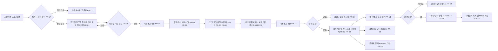
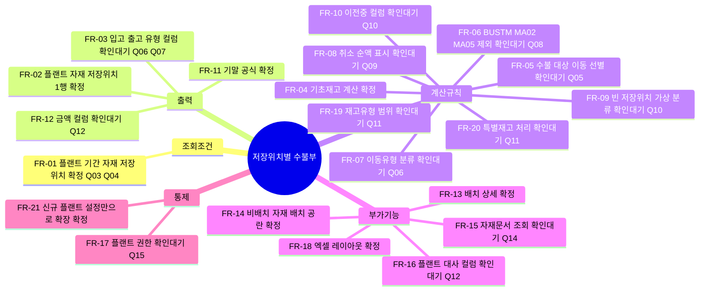
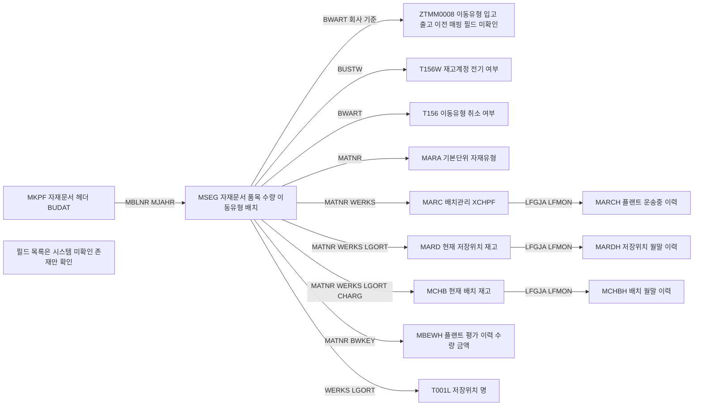

# 01. 요구사항 분석 - (신규)저장위치별 수불부 개발

- 요청 ID: 20261023-6ffbce
- 작성: sap-analyst (분석 단계, 최초 작업)
- 작성일: 2026-10-23
- 조회 시스템: srd-abap (http://dshldra1.dongkuksteel.com:8000, 클라이언트 250), `mcp__sap__*` 읽기 전용 조회
- 근거 자료
  - 요청 원문: `request.md`
  - 첨부: `attachments/저장위치별 수불부 개발 고민_261022.xlsx` (구글시트 사본) → 추출본 `attachments/.text/저장위치별 수불부 개발 고민_261022.xlsx.txt`
    - 시트: `분석(저장위치수불부)`, `(참고)기존열연수불부`, `(고려사항)운송중재고`, `(고려사항)취소전표 표시방법`, `(고려사항)특별재고`
  - 이하 근거 표기: [요청] = request.md, [첨부:시트명] = 위 xlsx의 해당 시트

> 시스템 확인 수준 안내: srd-abap에서 SearchObject로 테이블·T-code·권한 오브젝트·Z 오브젝트의 **존재**는 확인했습니다. GetTable/GetTypeInfo는 `MSEG`, `MARDH`, `MCHBH`, `MATDOC`, `ZTMM0008`에서 모두 `/sap/bc/adt/ddic/.../source/main does not exist`(ExceptionResourceNotFound)로 실패해 **필드 목록은 시스템에서 확인하지 못했습니다**(7.50 미만 ADT의 알려진 제약, wiki "SAP 시스템 미확인 상태에서 작업하는 방법" 참고). 아래 필드명은 (1) 첨부에 실린 기존 프로그램 ZRMM0034의 운영 SELECT 문, (2) SAP ECC 표준 지식에 근거하며 항목마다 출처를 표시합니다.
>
> 첨부 엑셀 안의 캡처 이미지(기존 ZRMM0034/ZRMM0035 화면, MB5B 화면 등으로 보이는 영역)는 텍스트 추출본에 들어가지 않습니다. 추출본에서 셀 번호가 크게 비는 구간(예: `(참고)기존열연수불부` 행 100~680)이 이미지 영역으로 보이며, 이 부분의 내용은 지어내지 않고 Q 항목으로 남겼습니다.

---

## 1. 요약

- **무엇을**: 기간(전기일 From~To) 동안 **플랜트 + 자재 + 저장위치** 단위로 기초재고 · 입고(유형별) · 출고(유형별) · 기말재고를 보여 주는 수불부 ALV 리포트를 신규 개발합니다. [요청]
- **추가 기능**: 결과에서 행을 선택하고 [상세] 버튼을 누르면 같은 기간·플랜트·자재·저장위치의 수불을 **배치 단위**로 보여 줍니다. 배치관리 대상이 아닌 자재는 배치 값만 공란으로 표시합니다. [요청]
- **참고 모델**: 기존 열연 수불부 ZRMM0034(자재문서 집계 → CBO 테이블 저장)와 ZRMM0035(MBEWH·MARDH·S032 기반 월 수불 조회)의 방식을 따르되, 집계 레벨에 저장위치를 추가합니다. [첨부:(참고)기존열연수불부]
- **핵심 계산 규칙(첨부에서 도출)**
  1. 수불 대상 이동 = 회사 기준 매핑 테이블(ZTMM0008)에서 입고·출고·이전 중 하나에 해당하고, T156W 기준으로 재고 계정에 실제 전기되는 품목. 수량 전기 문자열(BUSTM) MA02·MA05 제외. [첨부:(참고)기존열연수불부]
  2. 기초재고 = 조회 시작월 직전 월말 이력(MARDH/MCHBH, "해당 월 이하 가장 최근 레코드", 없으면 현재 MARD/MCHB) + 월초~시작일 전날의 이동 수량. [첨부:분석(저장위치수불부)], [첨부:(참고)기존열연수불부 H619]
  3. 취소전표는 **원래 방향에서 차감(순액)**: 262는 출고 컬럼에서 마이너스, 102는 입고 컬럼에서 마이너스. 첨부 샘플(261 17건 254,420KG − 262 15건 229,395KG = 생산출고 25,025KG)이 이 방식임을 확인했습니다. [첨부:(참고)기존열연수불부 행 72~103, 270~280], [첨부:(고려사항)취소전표 표시방법]
  4. 저장위치가 빈 이동은 가상 저장위치로 분류(동국은 **운송중 재고 위주**로 고려). 313/315 이전중은 받는 쪽 저장위치 행의 별도 컬럼으로 둡니다. [첨부:(고려사항)운송중재고], [첨부:(참고)기존열연수불부 H626]
  5. 수량은 저장위치 단위로 정확하지만, 금액은 플랜트 단위 평가(MBEWH)라 저장위치별 금액은 근사치(자재문서 DMBTR 합)입니다. 플랜트 합계 대사 장치를 둡니다. [첨부:분석(저장위치수불부) B10]
- **대상 시스템 상태**: srd-abap은 MATDOC·ACDOCA가 없어 **ECC**로 판단됩니다. 그런데 "기존 다른 시스템"의 프로그램이라던 ZRMM0034·ZRMM0035·ZTMM0008이 **srd-abap에도 존재**합니다. 이 시스템이 "신규 시스템"인지, 아니면 기존 시스템과 같은 시스템인지 확인이 필요합니다(Q01).

---

## 분석 다이어그램

### 1) 업무 흐름도

### 2) 요구사항 구성도

### 3) 데이터 범위도

---

## 2. 업무 배경

- 현업은 기존 열연 시스템에서 플랜트 + 자재 + 전기일 단위의 수불부(ZRMM0034 집계, ZRMM0035 조회)를 쓰고 있습니다. 신규 시스템에도 같은 방식의 수불부를 만들되, **저장위치 레벨**까지 내려서 보고 싶어 합니다. [요청], [첨부:(참고)기존열연수불부]
- 기존 ZRMM0034 구조(첨부 소스 발췌): `data_mseg_select` → `cbo_data_delete` → `data_table_modify` → `write_result`. 즉 기간의 MKPF/MSEG를 읽어 ZTMM0008 기준으로 걸러 이동유형별로 분류하고, 일자별로 COLLECT해 CBO 테이블(내부 테이블 `GT_38`, MANDT 포함 구조라 DB 테이블로 추정)에 지우고 다시 쓰는 배치성 프로그램입니다. "신규 플랜트 추가 시 Variant만 진행하면 됨" 메모로 보아 플랜트 하드코딩 없이 Variant로 운영됩니다. [첨부:(참고)기존열연수불부 A27, B41~44, I51~67, D264~266]
- 기존 ZRMM0035는 자재코드 단위라 S032(재고 정보구조)와 MBEWH(금액, 플랜트 단위) · MARDH(수량, 저장위치 단위)를 사용합니다. "얼마어치 있었나 = 플랜트 단위 MBEWH", "어디에 어떤 상태로 몇 개 있었나 = 저장위치 단위 MARDH"로 구분했습니다. [첨부:(참고)기존열연수불부 A536, I572, J581~N582]
- 첨부 문서의 대부분은 AI 자문 내용과 현업 메모(`==>`로 시작하는 셀)로 구성되어 있습니다. 현업 메모로 남긴 판단은 "확정에 가까운 의견", AI 자문만 있는 내용은 "제안"으로 구분해 반영했습니다.

### 2.1 첨부 샘플 데이터 해석

| 항목 | 값 | 해석 | 근거 |
|---|---|---|---|
| 자재/플랜트/저장위치 | R1D1 / 3000 / 4000 | 테스트 시나리오 기준 데이터 | [첨부:(참고)기존열연수불부 행 72~103] |
| 전기일 | 엑셀 일련번호 46145 | 2026-05-03 (LFGJA 2026, LFMON 5와 일치) | 동일 |
| 261 생산출고 | 17건, SHKZG=H, 합계 254,420 KG | 출고 | 동일 |
| 262 생산출고 취소 | 15건, SHKZG=S, 합계 229,395 KG | 출고 취소 | 동일 |
| 집계 결과 | ZPP_GI = 25,025, ZCLSTC = −25,025 | 생산출고 컬럼에 순액(254,420 − 229,395) → 취소는 **원래 방향 차감** 방식 | [첨부:(참고)기존열연수불부 행 270~280] |
| MB5B 비교 | 262 수량(1,208 등)이 MB5B에서는 입고에 표시 | 부호 기준(MB5B) 방식은 현업이 헷갈려 함 → 채택하지 않음 | [첨부:(고려사항)취소전표 표시방법 I83, J83, J112] |
| BUSTM/BUSTW | MA01 / WA01, WERTU=X, MENGU=X | 수량·금액 모두 갱신되는 일반 이동 | [첨부:(참고)기존열연수불부] |

### 2.2 기존 집계 결과 구조(참고)

첨부에 기존(플랜트 레벨, 행 270)과 저장위치 추가안(행 279) 두 가지가 있습니다. [첨부:(참고)기존열연수불부 D270~V280]

| 구분 | 컬럼 | 추정 의미 (컬럼명 기준, 확인 필요 Q06) |
|---|---|---|
| 키 | MANDT, LFGJA, LFMON, WERKS, (LGORT), BUDAT, MATNR, MEINS | 클라이언트, 연도, 월, 플랜트, 저장위치(추가안), 전기일, 자재, 단위 |
| 입고(+) | ZPO_GR, ZPP_GR, ZTP_GR, ZRE_GR, ZOT_GR | 구매입고, 생산입고, 이전입고, 반품(?)입고, 기타입고 |
| 출고(−) | ZSD_GI, ZPP_GI, ZTP_GI, ZSP_GI, ZOT_GI | 판매출고, 생산출고, 이전출고, (?)출고, 기타출고 |
| 증감 | ZCLSTC | 일 순증감(입고 합 − 출고 합)으로 추정. 샘플은 −25,025 |

---

## 3. 기능 요구사항

우선순위: 필수 / 권장 / 선택. 상태: 확정(요청·첨부 현업 메모로 결정됨) / 확인 대기(Q 번호).

### 3.1 조회조건

| ID | 설명 | 우선순위 | 상태 | 근거 |
|---|---|---|---|---|
| FR-01 | 선택화면: 플랜트(WERKS, 필수, 복수), 전기일 기간(BUDAT From~To, 필수), 자재(MATNR, 복수), 저장위치(LGORT, 복수), 자재유형(MTART, 선택). 기간 단위가 일자 범위인지, 연월 단위인지 확인 필요. 기간 From > To, 미래일 등은 오류 처리 | 필수 | 확인 대기 Q03, Q04 | [요청], [첨부:분석(저장위치수불부) B2~B8], [첨부:(참고)기존열연수불부 I62~65 so_budat/so_werks/so_matnr/so_mtart] |
| FR-21 | 신규 플랜트 추가 시 프로그램 수정 없이 Variant(또는 설정 테이블)만으로 확장 가능해야 함. 플랜트·저장위치·이동유형 하드코딩 금지 | 필수 | 확정 | [첨부:(참고)기존열연수불부 I51] |

### 3.2 출력 (메인 ALV)

| ID | 설명 | 우선순위 | 상태 | 근거 |
|---|---|---|---|---|
| FR-02 | 결과 1행 = 플랜트 + 자재 + 저장위치(가상 저장위치 포함). 결과가 없으면 "데이터 없음" 메시지 | 필수 | 확정 | [요청] |
| FR-03 | 출력 컬럼(안): 플랜트, 플랜트명, 자재, 자재내역, 저장위치, 저장위치명, 기본단위, 기초재고, 입고 유형별(구매/생산/이전/반품/기타) + 입고계, 출고 유형별(판매/생산/이전/ZSP/기타) + 출고계, 기말재고, 이전중(FR-10), 특별재고 컬럼(FR-20 결정 시). 유형 컬럼 구성은 기존 ZRMM0034와 동일하게 할지 확인 | 필수 | 확인 대기 Q06, Q07 | [첨부:(참고)기존열연수불부 D270~V280], [첨부:(고려사항)특별재고 B33] |
| FR-11 | 기말재고 = 기초재고 + 입고계 − 출고계. 입고·출고 컬럼은 부호 있는 순액(FR-08)이므로 공식이 그대로 성립해야 함 | 필수 | 확정 | [첨부:분석(저장위치수불부) B8] |
| FR-12 | 금액 컬럼(기초금액·입고금액·출고금액·기말금액) 제공 여부. 제공 시 저장위치별 금액은 자재문서 금액(MSEG-DMBTR) 합 기준의 **근사치**임을 화면에 표시하고, 플랜트 합계는 MBEWH(SALK3) 기준으로 대사 | 선택 | 확인 대기 Q12 | [첨부:분석(저장위치수불부) B10], [첨부:(참고)기존열연수불부 J581~I582] |

### 3.3 계산 규칙

| ID | 설명 | 우선순위 | 상태 | 근거 |
|---|---|---|---|---|
| FR-04 | **기초재고 계산(정순 방식)**: ① 조회 시작일이 속한 월의 직전 월말 재고를 MARDH에서 "해당 월 이하에서 가장 최근 레코드(LFGJA·LFMON)"로 찾고, 그 이후 이력이 없으면 현재 MARD 값을 사용 ② 월 1일 ~ 시작일 전날의 수불 대상 이동 수량을 더함. MARDH는 매월 생기지 않고 "새 기간 첫 변동 시 직전 기간 마감 값"만 기록되는 점을 반드시 반영. MB5B의 역산 방식(현재 재고에서 시작일 이후 이동을 빼기)은 채택하지 않음(자재문서 조회량이 많음) | 필수 | 확정(방식), 설계에서 상세화 | [첨부:분석(저장위치수불부) B3~B8], [첨부:(참고)기존열연수불부 H619] |
| FR-05 | **수불 대상 이동 선별**: ZTMM0008(회사 기준 이동유형 매핑)에서 입고·출고·이전 구분 중 하나라도 해당하고, T156W(SAP 회계 기준)로 재고 계정에 실제 전기되는 품목만 남김. 세 구분이 모두 비어 있으면 제외. MATNR 공란 품목 제외 | 필수 | 확인 대기 Q05 | [첨부:(참고)기존열연수불부 I64, L120, K143, B184] |
| FR-06 | 수량 전기 문자열 BUSTM이 'MA02', 'MA05'인 품목 제외(기존 로직 계승). 첨부 설명은 "재고 총량에 변화가 없는 이동 중복 방지"로 되어 있으나, **저장위치 레벨에서는 플랜트 내 이전(311 등)이 저장위치 재고를 바꾸므로** 같은 기준을 그대로 쓰면 저장위치 수불이 틀어질 수 있음. 저장위치 레벨에서 제외 대상이 맞는지 재확인 필요 | 필수 | 확인 대기 Q08 | [첨부:(참고)기존열연수불부 I66, M66, M67] |
| FR-07 | **이동유형 분류**: ZTMM0008의 입고/출고 유형값으로 FR-03의 유형 컬럼에 배분(기존 "이동유형별 입고/출고 유형값에 따라 분류"). 플랜트 내 저장위치 간 이전(311/312 등)은 보내는 저장위치 = 이전출고, 받는 저장위치(UMLGO) = 이전입고로 양쪽 행에 각각 반영 | 필수 | 확인 대기 Q06, Q08 | [첨부:(참고)기존열연수불부 G293], [첨부:(고려사항)운송중재고 B15] |
| FR-08 | **취소전표 표시 = 원래 방향 차감(순액)**: 부호 있는 수량(SHKZG S=+, H=−)을 원래 컬럼에 더함. 102 → 입고 컬럼 마이너스, 262 → 출고 컬럼 마이너스. 전월 입고분의 당월 취소로 당월 입고가 마이너스가 될 수 있음을 화면/매뉴얼에 안내. 취소 판별은 이동유형 기준(T156 취소 여부 또는 ZTMM0008 매핑) | 필수 | 확인 대기 Q09(방식은 샘플로 확인됨, 취소 컬럼 별도 표시 여부만 확인) | [첨부:(고려사항)취소전표 표시방법 B4~B52, J112], 샘플 25,025 |
| FR-09 | **빈 저장위치(MSEG-LGORT 공란) 처리**: 가상 저장위치로 분류해 "실제 저장위치 + 가상 저장위치 = 플랜트 전체"가 되게 함. 첨부 제안 코드: SOBKZ 'O' → SUBC, 'W' → CONS, BWART 103~104 → GRBL, XAUTO='X' → TRNS, 그 외 → ZZZZ(규칙 미적중 감지용). 현업 메모 "동국은 운송중재고만 고려하면 될 것 같다"에 따라 **TRNS + ZZZZ를 기본안**으로 하고, 분류 규칙은 하드코딩 대신 매핑 테이블(ZTMM0008에 가상 저장위치 컬럼 추가 또는 신규 Z 테이블)로 관리하는 안을 설계에서 검토. 가상 저장위치의 기초재고는 MARDH에 없으므로 운송중은 MARCH(플랜트 운송중·이전중 이력)에서 가져와야 함 | 필수 | 확인 대기 Q10 | [첨부:(고려사항)운송중재고 B53~B69, B74], [첨부:(참고)기존열연수불부 H621~H626] |
| FR-10 | **저장위치 간 이전중(313/315)**: SAP가 받는 쪽 저장위치에 이전중 재고로 기록하므로 해당 저장위치 행에 "이전중" 컬럼을 별도로 두고 일반 재고와 합치지 않음. **플랜트 간 운송중(303/305, STO 641/643 등)**은 저장위치가 없으므로 플랜트별 "운송중" 가상 행(FR-09 TRNS)으로 표시해 플랜트 합계가 회계와 맞게 함(첨부의 두 안 중 가상 행 방식 기본안) | 필수 | 확인 대기 Q10 | [첨부:(고려사항)운송중재고 B22~B46] |
| FR-19 | **재고 유형 범위**: 첨부 메모 "(가용재고로만 계산을 한다)"에 따라 일반 가용재고(MARD-LABST 기준)만 대상으로 할지, 품질검사(INSME)·보류(SPEME)·반품(RETME) 재고도 포함/별도 컬럼으로 할지 결정 필요. 이 결정에 따라 기초재고 필드와 이동 품목(재고유형 지시자) 선별 조건이 달라짐 | 필수 | 확인 대기 Q11 | [첨부:(고려사항)운송중재고 J95], [첨부:(참고)기존열연수불부 J581~P581] |
| FR-20 | **특별재고 처리**: 저장위치가 없는 O(외주)·W(고객위탁)는 저장위치별 수불부에서 제외(필요 시 MBLB 등 별도). 저장위치가 있는 K(위탁)·E/Q(오더·프로젝트)는 일반재고와 섞지 않고 별도 컬럼 또는 제외. 현업 메모상 동국은 운송중만 고려 → 기본안은 **특별재고 제외(SOBKZ 공란만 집계)**, 사용 여부 확인 필요 | 권장 | 확인 대기 Q11 | [첨부:(고려사항)특별재고 B2~B35], [첨부:(참고)기존열연수불부 H626] |

### 3.4 부가기능

| ID | 설명 | 우선순위 | 상태 | 근거 |
|---|---|---|---|---|
| FR-13 | 메인 ALV에서 행을 선택하고 [상세] 버튼을 누르면 선택 행의 플랜트·자재·저장위치·조회기간 기준으로 **배치(CHARG) 단위** 수불(기초·입고 유형별·출고 유형별·기말)을 별도 화면(팝업 또는 2nd ALV)에 표시. 행 미선택 시 안내 메시지. 복수 행 선택 허용 여부 확인 | 필수 | 확정(복수 선택만 Q13) | [요청] |
| FR-14 | 배치관리 대상이 아닌 자재(MARC-XCHPF 공란)는 상세 화면에 배치 공란 1행으로 표시하며 값은 메인 행과 동일. 배치관리 자재의 배치별 합계는 메인 행과 일치해야 함(검증 포인트). 배치 기초재고는 MCHBH(없으면 MCHB) + 월초~시작일 전날 이동 | 필수 | 확정 | [요청], wiki "배치관리 자재 판정 기준" |
| FR-15 | 상세(배치) 화면에서 다시 자재문서 목록(전기일·자재문서·이동유형·수량)을 보고, 문서번호 더블클릭 시 MB03으로 이동 | 선택 | 확인 대기 Q14 | 오류 분석용 제안([첨부:(고려사항)취소전표 표시방법 B18]) |
| FR-16 | **대사 컬럼/기능**: 플랜트별로 "저장위치 일반재고 합 + 이전중 + 가상 저장위치(운송중) = 플랜트 평가 수량(MBEWH-LBKUM, 월말 시점)"을 비교해 차이를 표시. 차이가 있으면 로직 오류 또는 미분류(ZZZZ) 건 존재를 의미 | 권장 | 확인 대기 Q12 | [첨부:(고려사항)운송중재고 B46, B69], [첨부:분석(저장위치수불부) B10] |
| FR-18 | ALV 표준 기능: 정렬·필터·합계(플랜트별 소계), 엑셀 다운로드, 레이아웃 저장/선택(선택화면 레이아웃 파라미터) | 필수 | 확정 | 리포트 표준(팀 관행, wiki "자재마스터 조회 리포트 설계 패턴") |

### 3.5 통제

| ID | 설명 | 우선순위 | 상태 | 근거 |
|---|---|---|---|---|
| FR-17 | 플랜트 권한 점검. 표준 재고 리포트(MB5B 등)와 같은 권한 오브젝트 M_MSEG_WWA(플랜트) 사용을 기본안으로 하며, 권한 없는 플랜트는 제외 또는 중단(방식 확인 필요). 저장위치 단위 권한 통제가 필요한지 확인 | 필수 | 확인 대기 Q15 | 가정(시스템에서 M_MSEG_WWA 존재 확인) |

---

## 4. 비기능 요구사항

| ID | 구분 | 내용 | 근거 |
|---|---|---|---|
| NFR-01 | 성능 | MSEG 대량 조회가 핵심 부하. 기초재고는 정순 방식(FR-04)으로 월초~시작일 구간만 추가 조회. 플랜트·기간 필수로 범위 제한. 1개월·1개 플랜트 기준 응답 목표(예: 온라인 1분 이내)는 현업과 합의 필요. MKPF-BUDAT 조인 또는 MSEG-BUDAT_MKPF(첨부 SQL 예시에 사용) 활용, 인덱스는 시스템 미확인 | [첨부:분석(저장위치수불부) B3], [첨부:(고려사항)특별재고 B42] |
| NFR-02 | 처리 방식 | 기존 ZRMM0034처럼 CBO 테이블에 일자별 사전 집계(배치 Job) 후 조회하는 방식 vs 실시간 집계 방식 중 선택 필요. 배치 상세(FR-13)까지 사전 집계하면 테이블 건수가 크게 늘어남 | [첨부:(참고)기존열연수불부 B41~44, D264], Q02 |
| NFR-03 | 백그라운드 | 장기간 조회를 위해 백그라운드 실행(스풀 출력) 가능해야 함 | 팀 관행 |
| NFR-04 | 릴리스 | ECC(MATDOC·ACDOCA 없음), SAP_BASIS 7.40 SP09~7.50 미만 추정(CL_ABAP_CORRESPONDING 없음). New Open SQL·인라인 선언 사용 가능, 7.50 이상 구문 금지. MATNR 18자리 | 시스템 조회, wiki "ECC 7.40 시스템 ABAP 개발 제약" |
| NFR-05 | 유지보수 | 이동유형 분류·가상 저장위치 규칙·제외 BUSTM은 매핑 테이블로 관리(프로그램 수정 없이 변경) | [첨부:(고려사항)운송중재고 B69], [첨부:(고려사항)취소전표 표시방법 B33] |
| NFR-06 | 정합성 | 기말재고가 MMBE/MB5B(같은 조건: 일반재고, 특별재고 지시자 미지정)와 일치. 단 입고·출고 컬럼은 취소 표시 방식 차이로 MB5B와 다를 수 있음을 명시 | [첨부:(고려사항)특별재고 B35], [첨부:(고려사항)취소전표 표시방법 B14] |
| NFR-07 | 단위 | 수량은 자재 기본단위(MARA-MEINS) 기준. 기존 소스는 MSEG-MEINS를 LMEIN, MARA-MEINS를 MEINS로 읽음 | [첨부:(참고)기존열연수불부 I56] |

---

## 5. 관련 모듈

- MM-IM(재고관리): 자재문서, 저장위치/배치 재고, 이력 테이블
- MM 평가(MM-IV/FI 연계): MBEW/MBEWH 금액·평가 수량(금액 컬럼·대사 시)
- 배치관리(LO-BM): MCHA/MCHB/MCHBH
- 참고: SD/PP는 이동유형 분류(판매출고·생산입출고)로만 관련

---

## 6. 관련 SAP 오브젝트 (srd-abap 조회 결과)

### 6.1 표준 테이블

존재 여부는 SearchObject로 확인(TABL/DT). 필드는 시스템 미확인(GetTable 실패) → 출처 표기.

| 테이블 | 존재(패키지) | 용도 | 사용 예정 필드 | 필드 출처 |
|---|---|---|---|---|
| MKPF | 확인(MB) | 자재문서 헤더 | MBLNR, MJAHR, BUDAT | 기존 ZRMM0034 SELECT |
| MSEG | 확인(MB) | 자재문서 품목 | MBLNR, MJAHR, ZEILE, MATNR, WERKS, LGORT, CHARG, MENGE, MEINS, BWART, SHKZG, SOBKZ, KZBEW, KZZUG, KZVBR, UMWRK, UMLGO, UMMAT, BUSTM, BUSTW, WERTU, MENGU, XAUTO, EBELN, EBELP, DMBTR, INSMK, BUDAT_MKPF, SMBLN/SJAHR/SMBLP, LFBNR/LFPOS | CHARG·DMBTR·INSMK·BUDAT_MKPF·SMBLN·LFBNR은 표준 지식/첨부 설명, 나머지는 ZRMM0034 SELECT |
| MATDOC | **없음** | S/4 자재문서 | - | → ECC 판단 근거 |
| ACDOCA | **없음** | S/4 Universal Journal | - | → ECC 판단 근거 |
| MARA | 확인 | 기본단위, 자재유형 | MATNR, MEINS, MTART | ZRMM0034 SELECT |
| MARC | 확인(표준) | 배치관리 지시자 | XCHPF | wiki 배치관리 판정 기준(표준 지식) |
| MARD | 확인(MG) | 현재 저장위치 재고 | MATNR, WERKS, LGORT, LFGJA, LFMON, LABST, UMLME, INSME, SPEME, RETME | 표준 지식 |
| MARDH | 확인(MGA) | 저장위치 월말 이력 | 위 MARD와 동일 키 + LFGJA, LFMON | 표준 지식, [첨부] |
| MCHB | 확인(MG) | 현재 배치 재고 | MATNR, WERKS, LGORT, CHARG, CLABS, CUMLM, CINSM, CSPEM, CRETM, LFGJA, LFMON | 표준 지식 |
| MCHBH | 확인(MGA) | 배치 월말 이력 | MCHB와 동일 + LFGJA, LFMON | 표준 지식 |
| MCHA | 확인(MG) | 배치 마스터 | MATNR, WERKS, CHARG | 표준 지식 |
| MARCH | 확인(MGA) | 플랜트 월말 이력(운송중·이전중) | UMLMC, TRAME, LFGJA, LFMON | [첨부:(고려사항)운송중재고 B69] + 표준 지식, SE11 확인 필요 |
| MBEW | 확인(MG) | 현재 평가 수량·금액 | MATNR, BWKEY, BWTAR, LBKUM, SALK3 | 표준 지식 |
| MBEWH | 확인(MGA) | 평가 월말 이력 | MBEW 키 + LFGJA, LFMON, LBKUM, SALK3 | [첨부], 표준 지식 |
| MSKAH / MSLBH / MSKUH / MKOLH | 확인(MGA) | 특별재고 이력(E / O / W / K) | - | [첨부:(고려사항)운송중재고 B69, (참고)기존열연수불부 H621]. FR-20에서 포함 결정 시에만 사용 |
| MSSL | 확인(MG) | 외주 특별재고 합계 | - | 참고(현 범위 제외 예정) |
| S032 | 확인(MCS) | 재고 정보구조(기존 ZRMM0035 사용) | - | [첨부:(참고)기존열연수불부 I572]. 배치·저장위치 레벨에는 부적합 → 신규에서는 사용 안 함(제안) |
| T156 | 확인(MB) | 이동유형 마스터(취소 이동유형 여부) | - | [첨부:(고려사항)취소전표 표시방법 B33] |
| T156W | 확인(MB) | 전기 문자열 → 계정 수정(재고계정 전기 여부) | BUSTW 등 | [첨부:(참고)기존열연수불부 L120] |
| T001L | 확인(MG) | 저장위치 명 | WERKS, LGORT, LGOBE | 표준 지식 |

### 6.2 Z 오브젝트 (srd-abap에 존재)

| 오브젝트 | 유형 | 패키지 | 비고 |
|---|---|---|---|
| ZRMM0034 | PROG/P, TRAN/T, 인클루드 ZRMM0034TOP/SEL/F01 | ZMMD | 기존 열연 수불부 집계 프로그램(첨부 [ZRMM0034]). 이 분석 세션에는 GetProgram/GetInclude 도구가 없어 소스 원문은 읽지 못함 → 설계 단계에서 원문 확인 필요 |
| ZRMM0035 | PROG/P, TRAN/T, 인클루드 ZRMM0035TOP/F01/ALV | ZMMD | 기존 수불부 조회(첨부 [ZRMM0035]). 동일하게 설계 단계 원문 확인 |
| ZTMM0008 | TABL/DT | ZMMD | 이동유형 입고/출고/이전 매핑(첨부 설명). 필드 목록 GetTable 실패(시스템 미확인) |
| ZTMM0038 | **없음** | - | 첨부 `GT_38`의 원천 CBO 테이블명은 확인 못 함(ZTMM0030~0037만 존재). 집계 CBO 테이블명은 ZRMM0034 소스로 확인 필요 |
| ZRMM0030~ZRMM0054 | 사용 중 | ZMMD/ZMMD_BACK | 신규 프로그램 번호는 ZRMM0055 이후 등 미사용 번호를 설계에서 확인(ZRMM0053·0054는 TRAN 존재) |

### 6.3 T-code / 권한

| 오브젝트 | 확인 | 용도 |
|---|---|---|
| MB5B | TRAN 존재(MB) | 기간 재고 비교·대사 기준 |
| MMBE | TRAN 존재(MG) | 현재 재고(운송중 포함) 대사 |
| MB03 | TRAN 존재(MB) | 자재문서 조회 이동(FR-15) |
| M_MSEG_WWA | SUSO/B 존재(MB) | 플랜트 권한(FR-17 기본안). 필드 정의(SU21)는 확인 불가 |
| M_MSEG_WMB | SUSO/B 존재(MB) | 이동유형 권한(참고) |

---

## 7. 가정

| ID | 가정 |
|---|---|
| A-01 | 개발 대상 시스템은 보드에서 선택된 srd-abap(ECC)이며, 기존 ZRMM0034/0035·ZTMM0008이 이 시스템에도 있으므로 ZTMM0008 매핑을 그대로 재사용할 수 있다(Q01, Q05에서 확인). |
| A-02 | 평가 레벨은 플랜트(MBEWH-BWKEY = WERKS)이며 분할평가(BWTAR)는 사용하지 않는다(사용 시 금액 집계 변경). |
| A-03 | 수량은 MSEG-MENGE(기본단위)와 SHKZG(S=+, H=−) 부호로 계산한다. |
| A-04 | 특별재고(SOBKZ ≠ 공란)는 기본 제외하고, 저장위치 공란 건은 운송중(TRNS)과 미분류(ZZZZ) 가상 저장위치로만 분류한다. |
| A-05 | 재고 유형은 일반 가용재고 기준(첨부 메모)으로 시작하되, 품질검사·보류 재고 처리는 Q11 결과로 확정한다. |
| A-06 | 취소전표는 원래 방향 순액 방식(샘플 근거)이며 별도 취소 컬럼은 두지 않는다(Q09). |
| A-07 | 가상 저장위치 코드(TRNS, ZZZZ 등)는 실제 T001L 저장위치 코드와 겹치지 않는다(설계 시 T001L 확인). |
| A-08 | 메인 화면 결과는 기간 합계(플랜트+자재+저장위치 1행)이며, 전기일별 행 분할은 하지 않는다(Q04). |

---

## 8. 첨부에서 나온 고민 / 미결 사항 정리

| No | 주제 | 첨부 내용 요약 | 현업 메모/판단 | 분석 반영 |
|---|---|---|---|---|
| D-01 | 일별 기초재고 | 이력 테이블은 월말만 보유 → 정순(전월말 + 이동) 또는 역산(MB5B) | 정순 권장 | FR-04 정순 확정 |
| D-02 | 이력 레코드 공백 | 매월 레코드가 생기지 않음, 최근 레코드/현재 테이블 사용 | "자주 틀리는 부분" 강조 | FR-04에 명시, 테스트 포인트 |
| D-03 | MARDH ≠ MBEWH | MBEWH는 운송중·특별재고 포함 | "동국은 운송중재고만 고려" | FR-09/10/16 |
| D-04 | 빈 저장위치 | 소모성 입고, 운송중(XAUTO), 103 입고보류, 외주·위탁, OMJJ 설정 | "그래서 별도로 추가 표시해주는 것" | FR-09 가상 저장위치 |
| D-05 | 이전중/운송중 | 313/315는 받는 쪽 저장위치, 303/305·STO는 플랜트 레벨 | 두 안(가상 행 / 별도 리포트) 미결 | FR-10 가상 행 기본안, Q10 |
| D-06 | 취소전표 | 순액 / 부호(MB5B) / 별도 컬럼 | MB5B식은 헷갈림 → 순액 | FR-08 |
| D-07 | 특별재고 | O·W 제외, K·E·Q는 관점별, 컬럼 분리 권장 | 명시 결정 없음 | FR-20, Q11 |
| D-08 | 금액 | 저장위치별 금액은 근사치 | 명시 결정 없음 | FR-12, Q12 |
| D-09 | 가용재고 | "(가용재고로만 계산을 한다)" | 메모만 있음, 범위 불명확 | FR-19, Q11 |
| D-10 | BUSTM 제외 | MA02·MA05 제외 사유 설명 | 저장위치 레벨 적용 여부 미검토 | FR-06, Q08 |
| D-11 | 이미지 영역 | 기존 화면 캡처 등 추출 불가 | - | Q16 |

---

## 9. 현업 확인 필요 사항

| Q | 질문 | 관련 FR | 기본안(답이 없을 때) |
|---|---|---|---|
| Q01 | "신규 시스템"이 지금 선택된 srd-abap(ECC)이 맞습니까? srd-abap에 기존 열연 수불부 ZRMM0034/0035와 ZTMM0008이 이미 있습니다. 같은 시스템이라면 기존 프로그램을 복사·확장할지, 완전히 새로 만들지 정해 주세요. | 전체 | srd-abap 기준 신규 프로그램 작성, ZTMM0008 재사용 |
| Q02 | 기존처럼 CBO 테이블에 미리 집계(배치 Job)해 두고 조회할까요, 조회 시점에 실시간 집계할까요? 예상 조회 기간·플랜트 수·월 자재문서 건수를 알려 주세요. | NFR-01, NFR-02 | 실시간 집계(배치 상세 때문에), 성능 미달 시 사전 집계 검토 |
| Q03 | 조회 기간을 일자 범위(예: 5/3~5/20)로 받을까요, 연월(월 단위)로 받을까요? 여러 달에 걸친 조회도 필요합니까? | FR-01, FR-04 | 일자 범위, 최대 기간 제한은 설계에서 제안 |
| Q04 | 메인 결과를 기간 합계 1행으로 볼까요, 전기일별(일자 × 저장위치 × 자재) 행으로도 보고 싶습니까? | FR-02 | 기간 합계 1행 |
| Q05 | ZTMM0008 매핑(입고/출고/이전 구분, 유형값)을 신규 수불부에도 그대로 쓰면 됩니까? 저장위치 간 이전(311/312, 313/315 등)이 매핑에 들어 있습니까? | FR-05, FR-07 | 그대로 재사용, 누락 이동유형은 추가 등록 요청 |
| Q06 | 입고·출고 유형 컬럼 구성(ZPO_GR 구매, ZPP_GR 생산, ZTP_GR 이전, ZRE_GR ?, ZOT_GR 기타 / ZSD_GI 판매, ZPP_GI 생산, ZTP_GI 이전, ZSP_GI ?, ZOT_GI 기타)을 기존과 동일하게 가져갈까요? ZRE_GR, ZSP_GI의 정확한 의미를 알려 주세요. | FR-03, FR-07 | 기존 10개 컬럼 유지 |
| Q07 | 화면 컬럼 순서·명칭 양식(기존 ZRMM0035 화면 캡처 등)이 있으면 별도 이미지로 주세요. | FR-03 | 기초-입고-출고-기말-이전중 순 |
| Q08 | BUSTM 'MA02', 'MA05' 제외를 저장위치 수불부에도 적용해야 합니까? 저장위치 레벨에서는 플랜트 내 이전도 저장위치 재고를 바꾸므로 제외하면 저장위치별 기말이 틀릴 수 있습니다. 해당 이동유형 예시를 알려 주세요. | FR-06 | 저장위치 레벨에서는 제외하지 않고 이전입고/이전출고로 표시(설계에서 실데이터 검증) |
| Q09 | 취소전표는 원래 컬럼에서 차감(순액)으로 확정해도 됩니까? 상세 화면에서만 취소 수량을 따로 보여 줄 필요가 있습니까? | FR-08 | 순액, 별도 컬럼 없음 |
| Q10 | 플랜트 간 운송중(303/305, STO)을 메인 ALV에 "운송중" 가상 행으로 넣을까요, 저장위치 수불부에서 빼고 별도로 볼까요? 313/315 이전중은 받는 쪽 행의 "이전중" 컬럼으로 두면 됩니까? 실제로 이 이동유형을 사용합니까? | FR-09, FR-10 | 운송중 가상 행 + 이전중 컬럼 |
| Q11 | 재고 범위: 가용(일반) 재고만 볼까요, 품질검사·보류 재고도 포함(또는 별도 컬럼)할까요? 특별재고 K(위탁)·E/Q(오더·프로젝트)를 사용합니까? 사용하면 컬럼을 분리할까요? | FR-19, FR-20 | 가용 일반재고만, 특별재고 제외 |
| Q12 | 금액 컬럼이 필요합니까? 필요하면 저장위치별 금액은 근사치(자재문서 금액 합)라는 점을 받아들일 수 있습니까? MBEWH 플랜트 대사 컬럼이 필요합니까? | FR-12, FR-16 | 1차는 수량만, 대사는 수량 기준 권장 기능으로 제공 |
| Q13 | [상세] 버튼에서 여러 행을 한 번에 선택해 배치 상세를 볼 수 있어야 합니까? | FR-13 | 복수 선택 허용 |
| Q14 | 배치 상세에서 자재문서 목록/MB03 이동까지 필요합니까? | FR-15 | 선택 기능으로 설계에 포함, 개발 범위는 팀장 결정 |
| Q15 | 권한은 플랜트 단위(M_MSEG_WWA)로 충분합니까? 권한 없는 플랜트는 결과에서 빼고 진행할까요, 오류로 중단할까요? | FR-17 | 플랜트 단위, 권한 없는 플랜트 제외 후 메시지 |
| Q16 | 첨부 엑셀 안의 캡처 이미지(기존 화면·MB5B 비교 등)는 텍스트로 추출되지 않았습니다. 필요한 부분은 PNG/PDF로 따로 첨부해 주세요. | 전체 | 이미지 내용 미반영 |
| Q17 | 분할평가(BWTAR) 자재가 있습니까? 배치 = 평가유형인 자재가 있으면 금액·대사 방식이 바뀝니다. | FR-12, FR-16 | 분할평가 없음 |

---

## 10. 설계 단계로 넘길 사항

1. **기존 소스 원문 확인(필수)**: srd-abap의 ZRMM0034(TOP/SEL/F01), ZRMM0035(TOP/F01/ALV)를 GetProgram/GetInclude로 읽어 다음을 "확인됨"으로 정리합니다(이 분석 세션에는 해당 도구가 없었음).
   - ZTMM0008 필드(입고/출고/이전 구분, 유형값)와 T156W 판정 로직의 실제 조건
   - `GT_38`이 저장되는 CBO 테이블명과 구조, `cbo_data_delete` 범위
   - 이동유형 → ZPO_GR 등 컬럼 배분 규칙, ZCLSTC 의미
   - ZRMM0035의 기초재고 계산(MBEWH/MARDH/S032 사용 방식)
2. **기초재고 알고리즘 상세화**: MARDH/MCHBH "해당 월 이하 최근 레코드, 이후 이력 없으면 현재 테이블" 규칙의 정확한 판정(현재 MARD-LFGJA/LFMON과 비교), 월초~시작일 전날 이동 누적. 가상 저장위치(TRNS)의 기초는 MARCH.
3. **저장위치 이전 처리**: 311/312·313/315 등에서 보내는 쪽(LGORT)과 받는 쪽(UMLGO) 품목이 MSEG에 각각 생성되는지 실데이터로 확인하고 이중 집계를 막는 규칙 정의. BUSTM MA02/MA05 제외 영향 검증(Q08).
4. **처리 방식 결정**: 실시간 vs CBO 사전 집계(Q02). 사전 집계라면 저장위치·배치 레벨 CBO 테이블 신규(DB 스키마 변경, 팀장 승인 필요).
5. **매핑 테이블 확장안**: 가상 저장위치 규칙을 ZTMM0008 컬럼 추가로 할지 신규 Z 테이블로 할지(기존 프로그램 영향 포함).
6. **필드 확인 목록(SE11)**: MSEG-BUDAT_MKPF·CHARG·INSMK·DMBTR, MARCH 운송중 필드명(UMLMC, TRAME), MARDH/MCHBH 재고유형 필드, T156W 판정 필드, MSEG 인덱스(MATNR/WERKS/BUDAT_MKPF). ADT로 필드 목록이 안 읽히므로 필드 참조 타입으로 선언해 활성화 때 검증.
7. **신규 오브젝트명**: ZRMM0055 이후 미사용 번호(또는 팀 명명 규칙) 확인, 패키지 ZMMD.
8. **테스트 기준 데이터**: 첨부 샘플(3000/4000/R1D1, 2026-05-03, 261/262 순액 25,025KG)을 회귀 테스트 케이스로 사용. 추가로 MB5B(일반재고) 기말 비교, 배치 합계 = 메인 행, 저장위치 합 + 이전중 + 운송중 = MBEWH-LBKUM 대사.
9. **ECC 7.40 제약 준수**: wiki "ECC 7.40 시스템 ABAP 개발 제약" 참고(SELECT 절 순서, 7.50 구문 금지, SALV 예외 처리).

---

## 변경 이력

| 버전 | 일자 | 내용 | CR |
|---|---|---|---|
| 1.0 | 2026-10-23 | 최초 작성 | - |
