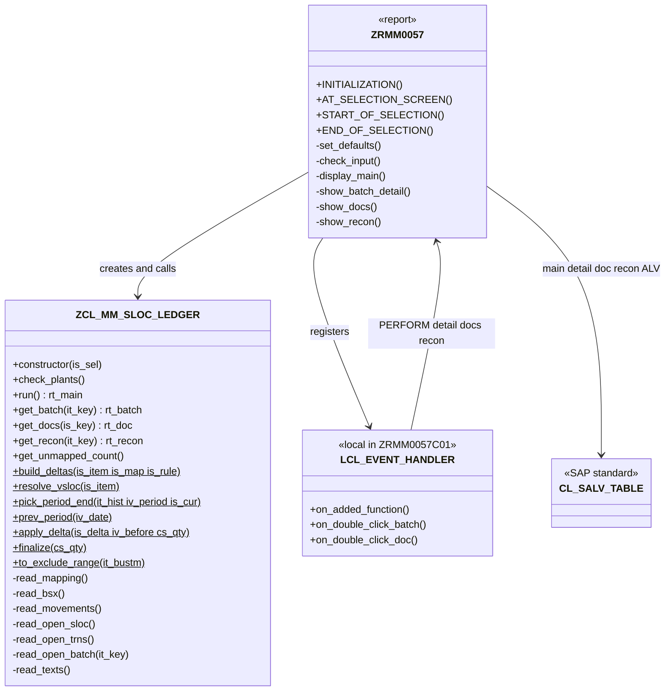
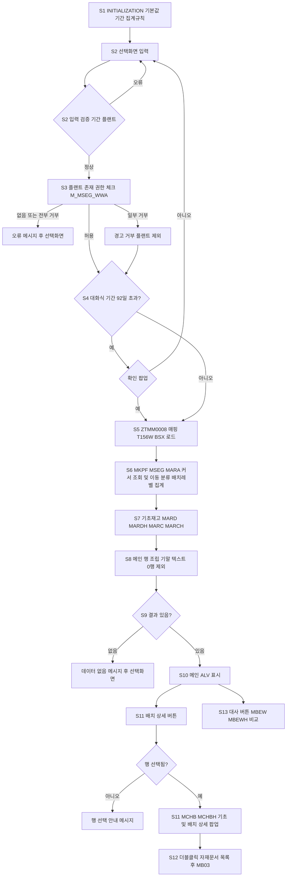
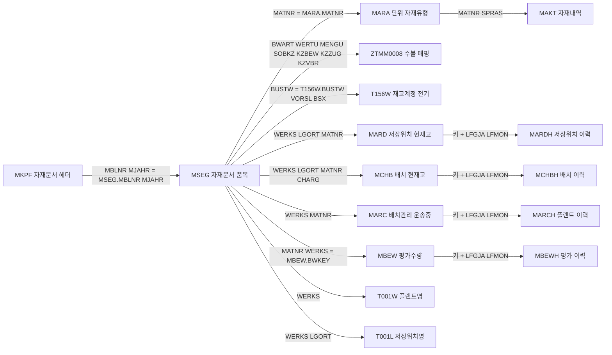

# 02. 설계서 - (신규)저장위치별 수불부 개발

- 요청 ID: 20261023-6ffbce
- 작성: sap-designer (설계 단계, 최초 작업)
- 작성일: 2026-10-23
- 입력: `request.md`, `01_analysis.md`(승인본), 첨부 추출본 `attachments/.text/저장위치별 수불부 개발 고민_261022.xlsx.txt`, ticket.json의 분석 단계 AI 검증 지적 5건
- 개발표준: `standards/handbook.md` (Dongkuk Steel ABAP 개발표준 Handbook)
- 조회 시스템: srd-abap (http://dshldra1.dongkuksteel.com:8000, 클라이언트 250), `mcp__sap__*` 읽기 전용

### 근거 표기 규칙

| 표기 | 의미 |
|---|---|
| **[확인]** | 이 설계 세션이 srd-abap에서 직접 조회해 확인함 (SearchObject, GetProgram) |
| **[검증보고]** | 분석 단계 AI 검증 세션이 ZRMM0034F01 원문을 읽고 보고한 내용. 이 설계 세션은 원문을 직접 읽지 못함(아래 0.2) |
| **[첨부]** | 현업 첨부 시트 내용 |
| **[표준]** | SAP ECC 표준 지식. 시스템에서 확인하지 않음 |
| **[가정]** | 설계 가정. 확인 목록(13장)으로 넘김 |

---

## 0. 설계 전 확인 결과 (AI 검증 지적 반영)

### 0.1 시스템에서 직접 확인한 것 [확인]

| 대상 | 도구 | 결과 |
|---|---|---|
| ZRMM0034 메인 소스 | GetProgram | 확인함. "일별 수불부 집계 프로그램"(2007, B.W.KANG)이고 인클루드는 `ZRMM0034TOP`, `ZRMM0034F01`. START-OF-SELECTION에서 확인 팝업("수량 수불을 업데이트 하시겠습니까?")을 띄운 뒤 `PERFORM data_ledger_exec`를 실행. `write_result`가 `gt_68`(Plant daily qty), `gt_10`(Plant tp), **`gt_69`(Storage daily qty)**, `gt_12`(Storage tp) 건수를 출력함. 주석: "매일 새벽 7시 수불부 집계를 위한 Batch가 실행되는데(플랜트별 Variant)". 3000 플랜트 배치일 때 `Z_PUT_MES_SCRAPIRON_STOCK` 호출. 변형명 `+7(2)='BS'`이면 `TOTAL_STOCK_BARSHAPED`(봉형강 배치단위 집계) |
| ZRMM0034 오브젝트 | SearchObject | PROG/P ZRMM0034, TRAN ZRMM0034, PROG/I ZRMM0034TOP·ZRMM0034SEL·ZRMM0034F01 (패키지 ZMMD) |
| ZRMM0035 메인 소스 | GetProgram | 확인함. "자재수불 일별 조회 프로그램". 변경 이력: U1 2007.08.28 "저장위치 레벨검색 삭제, CO기준 기초재고적용", U2 2012.06.21 "현재고 세분류", **U3 2012.09.21 "저장위치 레벨검색 복원"**. 흐름은 `data_select` 다음 REUSE 계열 ALV(`alvprn_*`). 인클루드는 `ZRMM0035TOP`·`ZRMM0035ALV`·`ZRMM0035F01` |
| 집계 테이블 존재 | SearchObject | TABL: ZTMM0068, ZTMM0068_T, **ZTMM0069, ZTMM0069B, ZTMM0069M, ZTMM0069_T**, ZTMM0070, ZTMM0070B, ZTMM0070M, ZTMM0070_T (모두 ZMMD). ZTMM0010·ZTMM0012도 있음 |
| ZTMM0008 | SearchObject | TABL ZTMM0008 (ZMMD) 있음 |
| 테이블 필드 목록 | GetTable / GetStructure / GetTypeInfo | ZTMM0069·ZTMM0069B·ZTMM0069M 모두 `ExceptionResourceNotFound`(`/ddic/structures/.../source/main does not exist`). 7.50 미만 ADT 제약이며 wiki 기록과 같음. **필드는 확인 불가** |
| 신규 번호 | SearchObject | `ZRMM0057*`·`ZRMM0058*` 결과 없음(PROG·TRAN·인클루드 모두 없음). `ZCL_MM_SLOC*` 결과 없음. 메시지 클래스는 ZMMM·ZMMM1·ZMMM2 있음 |

### 0.2 원문을 직접 읽지 못한 것

- 이 설계 세션의 도구에는 GetInclude가 없습니다. `GetProgram ZRMM0034TOP`·`GetProgram ZRMM0034F01`은 `Resource PROGRAM ... does not exist`로 실패했습니다(인클루드는 PROG/I라 `/programs/includes/` 경로임). 그래서 아래 항목은 **[검증보고]** 기준으로 설계하고, 개발 착수 전 **PL이 GetInclude로 원문 스냅숏을 `work/20261023-6ffbce/ref/`에 저장**하도록 확인 항목 C-01로 넘깁니다(wiki "SAP 시스템 미확인 상태에서 작업하는 방법": 요약본이 아니라 원문 전체를 넘김).
  - `storage_ledger_collect` 루틴이 저장위치 단위로 집계하고 `MODIFY ztmm0069`로 저장함. 플랜트 단위는 `MODIFY ztmm0068`
  - ZTMM0008 조회 키는 BWART·WERTU·MENGU·SOBKZ·KZBEW·KZZUG·KZVBR이고, 결과는 GRIND·GIIND·TPIND·SHKZG
  - T156W 판정 조건은 `VORSL = 'BSX'`이며 BUSTW·XBGBB를 사용
  - BUSTM 'MA02'·'MA05' 제외를 저장위치 집계에도 똑같이 적용함. 같은 플랜트·같은 저장위치·같은 자재 사이의 이동만 건너뜀
  - GRIND 3 = '고객반품입고'(ZRE_GR)
- ZTMM0070을 검증 세션은 "로그"로 보았습니다. 그러나 ZTMM0070B·ZTMM0070M·ZTMM0070_T가 ZTMM0069와 같은 접미사 계열로 함께 있어 **로그가 아닐 수도 있습니다**. ZTMM0069B·ZTMM0069M이 배치 단위(B)·월 단위(M) 집계인지도 **확인하지 못했습니다** → 확인 항목 C-03.
- ZRMM0035의 기초재고 계산식(F01)도 읽지 못했습니다. 메인 소스의 이력 "CO기준 기초재고적용"과 첨부 메모(S032·MBEWH·MARDH 사용)까지만 근거로 삼습니다 → C-01.

### 0.3 결론: 개발 방식 결정 (Q01·Q02 설계 판단)

| 항목 | 판단 |
|---|---|
| **srd-abap의 성격 (Q01)** | srd-abap은 요청에서 말한 "기존 다른 시스템"일 가능성이 높습니다. 근거: 기존 열연 수불부 ZRMM0034/0035가 2007년부터 운영 중이고, 첨부 샘플 플랜트(3000) 분기가 메인 소스에 있으며, ZRMM0035에 저장위치 레벨 조회(2012 복원)와 ZTMM0069 저장위치 일별 집계가 이미 있습니다. 다만 보드에서 개발 대상으로 고른 시스템이 srd-abap이고 개발계 반영도 이 서버로 하므로, **설계는 srd-abap 기준으로 작성합니다.** 실제 "신규 시스템"이 다른 SAP라면 팀장이 보드에서 그 시스템을 골라야 하며, 이때 ZTMM0008 존재 여부를 다시 확인해야 합니다(**팀장 확인 필요**) |
| **사전집계 vs 실시간 (Q02)** | **권고: 실시간 집계 (신규 리포트 + 계산 클래스). 기존 ZTMM0069는 회귀 검증 기준으로만 사용** |
| 근거 1 - 배치 상세 | 요청의 핵심 신규 기능은 배치 단위 상세입니다. ZTMM0069 키는 첨부 시트 행 279(LFGJA·LFMON·WERKS·LGORT·BUDAT·MATNR·MEINS)로 보아 **배치(CHARG)가 없습니다** [첨부]. ZTMM0069B가 배치 단위라는 근거는 없습니다(C-03) |
| 근거 2 - 메인·상세 일치 | 메인은 ZTMM0069, 상세는 MSEG 실시간처럼 소스를 섞으면 계산 규칙과 시점이 달라집니다. ZTMM0069는 매일 07시 배치라 당일분이 없습니다. 그러면 "배치 합계 = 메인 행"(FR-14)을 보장할 수 없습니다. 같은 엔진이 배치 레벨로 집계한 뒤 저장위치로 올려야 항상 일치합니다 |
| 근거 3 - 이식성 | 실시간 방식은 표준 테이블과 ZTMM0008만 씁니다. 신규 시스템이 따로 있더라도 ZTMM0008만 옮기면 됩니다. ZTMM0069를 쓰면 ZRMM0034 배치 Job까지 함께 이관해야 합니다 |
| 근거 4 - 스키마 변경 없음 | 신규 DB 테이블이 필요 없습니다. 사전집계안은 배치 레벨 집계 테이블을 새로 만들어야 하며(스키마 변경), 건수도 크게 늘어납니다 |
| 위험과 대응 | MSEG 대량 조회 성능(11장). 대응: 플랜트·기간 필수, 커서·패키지 처리, 대화식 3개월 초과 시 확인 팝업, 백그라운드 실행 지원. 성능이 목표에 못 미치면 2단계로 "메인만 ZTMM0069 사용" 데이터 접근 분리를 검토합니다(그때는 CR) |
| 기존 로직과의 관계 | 이동 분류·제외 규칙은 **ZRMM0034와 같게** 맞춥니다(ZTMM0008, T156W BSX, BUSTM MA02/MA05 제외, 상대 저장위치 반영, 같은 키 이동 건너뜀). 그래서 같은 날·같은 저장위치 결과가 ZTMM0069와 같아야 하며, 이를 회귀 테스트(TP-02)로 확인합니다 |
| DB 테이블 신규·변경 | **권고안에는 없습니다.** 대안을 고를 때만 필요합니다: (a) 사전집계를 택하면 배치 레벨 집계 테이블 신규, (b) 가상 저장위치 규칙을 테이블로 관리하려면 ZTMM0008에 컬럼 추가. 둘 다 **팀장 승인 필요(스키마 변경)**이며 이번 범위에서는 제외합니다 |

---

## 1. 개요

- **목적**: 지정한 전기일 기간에 대해 **플랜트 + 자재 + 저장위치** 단위로 기초재고, 입고(유형 5종)·출고(유형 5종), 기말재고, 이전중 재고를 보여 주는 수불부를 만듭니다. 행을 선택하고 [배치 상세]를 누르면 같은 조건의 **배치 단위** 수불을 팝업으로 보여 줍니다. 비배치 자재는 배치 칸을 비운 1행으로 보여 줍니다.
- **구성(최소 오브젝트)**: 리포트 `ZRMM0057`(선택화면·ALV·이벤트) 1개, 계산 클래스 `ZCL_MM_SLOC_LEDGER`(조회·분류·기초재고·집계) 1개, T-code `ZRMM0057` 1개입니다. 신규 DB 테이블·화면(Dynpro)·GUI 상태는 없습니다.
- **핵심 규칙**
  1. 수불 대상 이동은 ZRMM0034와 같습니다: ZTMM0008 매핑이 있고, T156W(VORSL='BSX')로 재고 계정에 전기되며, BUSTM이 MA02·MA05가 아닌 품목입니다.
  2. 취소는 **원래 컬럼에서 차감(순액)**합니다. 첨부 샘플에서 261(254,420) − 262(229,395) = 생산출고 25,025 KG입니다.
  3. 기초재고 = 시작월 직전 월말 재고(MARDH/MCHBH/MARCH 기간말 규칙, 5.4) + 월초~시작일 전날 이동.
  4. 저장위치 간 이동은 보내는 쪽 = 이전출고, 받는 쪽(UMLGO) = 이전입고입니다. 313/315 이전중은 받는 쪽 행의 "이전중" 컬럼으로, 플랜트 간 2단계 운송중과 저장위치가 빈 품목은 가상 저장위치(TRNS 운송중, ZZZZ 미분류) 행으로 보여 줍니다.
- **대상 릴리스**: ECC, SAP_BASIS 7.40 SP09 이상·7.50 미만 추정입니다(wiki). MATNR은 18자리입니다.

---

## 설계 다이어그램

### 1) 프로그램 구조도



### 2) 처리 흐름도



### 3) 데이터 관계도



---

## 예상 화면

### 화면 1. 선택화면

```sapscreen
{"type":"selection","title":"저장위치별 수불부","tcode":"ZRMM0057","blocks":[{"title":"조회 조건","fields":[{"label":"플랜트","kind":"select","required":true,"value":"3000","to":""},{"label":"전기일","kind":"select","required":true,"value":"2026.05.01","to":"2026.05.31"},{"label":"자재","kind":"select","required":false,"value":"","to":""},{"label":"저장위치","kind":"select","required":false,"value":"","to":""},{"label":"자재유형","kind":"select","required":false,"value":"","to":""}]},{"title":"출력 옵션","fields":[{"label":"가상 저장위치(운송중/미분류) 표시","kind":"check","checked":true},{"label":"수불 없는 0 행 제외","kind":"check","checked":true},{"label":"레이아웃","kind":"param","required":false,"value":""}]},{"title":"집계 규칙 (변경 시 팀장 확인)","fields":[{"label":"제외 수량전기문자열(BUSTM)","kind":"select","required":false,"value":"MA02","to":""},{"label":"저장위치 이전중 출고 이동유형","kind":"select","required":false,"value":"313","to":"314"},{"label":"저장위치 이전중 입고 이동유형","kind":"select","required":false,"value":"315","to":"316"},{"label":"플랜트간 운송중 출고 이동유형","kind":"select","required":false,"value":"303","to":"304"},{"label":"플랜트간 운송중 입고 이동유형","kind":"select","required":false,"value":"305","to":"306"}]}]}
```
예시 값은 형식을 보여 주는 가상 값입니다. BUSTM 기본값은 MA02·MA05 두 건(단일값 2행)이며, 그림에는 첫 값만 보입니다.
본문 4장 "선택화면" 표의 블록·필드 순서와 같습니다.

### 화면 2. 메인 결과 (ALV)

```sapscreen
{"type":"alv","title":"저장위치별 수불부","tcode":"ZRMM0057","toolbar":["배치 상세","대사","정렬","필터","합계","엑셀 다운로드","레이아웃"],"columns":[{"label":"플랜트","key":true},{"label":"자재","key":true},{"label":"자재내역"},{"label":"저장위치","key":true},{"label":"저장위치명"},{"label":"단위"},{"label":"기초재고","align":"right"},{"label":"구매입고","align":"right"},{"label":"생산입고","align":"right"},{"label":"이전입고","align":"right"},{"label":"고객반품입고","align":"right"},{"label":"기타입고","align":"right"},{"label":"입고계","align":"right"},{"label":"판매출고","align":"right"},{"label":"생산출고","align":"right"},{"label":"이전출고","align":"right"},{"label":"ZSP출고","align":"right"},{"label":"기타출고","align":"right"},{"label":"출고계","align":"right"},{"label":"기말재고","align":"right"},{"label":"이전중(기말)","align":"right"}],"rows":[["3000","R1D1","(자재내역)","4000","(저장위치명)","KG","100,000.000","0.000","0.000","0.000","0.000","0.000","0.000","0.000","25,025.000","0.000","0.000","0.000","25,025.000","74,975.000","0.000"],["3000","MAT-A","(자재내역)","4100","(저장위치명)","KG","5,000.000","1,000.000","0.000","200.000","0.000","0.000","1,200.000","0.000","0.000","0.000","0.000","0.000","0.000","6,200.000","300.000"],["3000","MAT-A","(자재내역)","TRNS","운송중(가상)","KG","0.000","0.000","0.000","500.000","0.000","0.000","500.000","0.000","0.000","0.000","0.000","0.000","0.000","500.000","0.000"]],"status":{"type":"S","text":"3건이 조회되었습니다."}}
```
예시 값은 형식을 보여 주는 가상 값입니다. R1D1 행의 생산출고 25,025는 첨부 샘플(2026-05-03, 261−262 순액)이고, 기초재고 100,000은 가상 값입니다.
본문 8.1 "메인 ALV 필드 카탈로그"의 표시 컬럼 순서·헤더와 같습니다. 기본 숨김 컬럼(플랜트명·배치관리·가상구분·증감·이전중(기초))은 그림에서 뺐습니다.

### 화면 3. 배치 상세 팝업 (ALV)

```sapscreen
{"type":"alv","title":"배치 상세 - 3000 / R1D1 / 4000 (2026.05.03 ~ 2026.05.03)","tcode":"ZRMM0057","toolbar":["정렬","필터","합계","엑셀 다운로드"],"columns":[{"label":"플랜트","key":true},{"label":"자재","key":true},{"label":"저장위치","key":true},{"label":"배치","key":true},{"label":"단위"},{"label":"기초재고","align":"right"},{"label":"구매입고","align":"right"},{"label":"생산입고","align":"right"},{"label":"이전입고","align":"right"},{"label":"고객반품입고","align":"right"},{"label":"기타입고","align":"right"},{"label":"입고계","align":"right"},{"label":"판매출고","align":"right"},{"label":"생산출고","align":"right"},{"label":"이전출고","align":"right"},{"label":"ZSP출고","align":"right"},{"label":"기타출고","align":"right"},{"label":"출고계","align":"right"},{"label":"기말재고","align":"right"},{"label":"이전중(기말)","align":"right"}],"rows":[["3000","R1D1","4000","BATCH-0001","KG","60,000.000","0.000","0.000","0.000","0.000","0.000","0.000","0.000","15,000.000","0.000","0.000","0.000","15,000.000","45,000.000","0.000"],["3000","R1D1","4000","BATCH-0002","KG","40,000.000","0.000","0.000","0.000","0.000","0.000","0.000","0.000","10,025.000","0.000","0.000","0.000","10,025.000","29,975.000","0.000"]],"total":["","","","","","100,000.000","0.000","0.000","0.000","0.000","0.000","0.000","0.000","25,025.000","0.000","0.000","0.000","25,025.000","74,975.000","0.000"],"status":{"type":"S","text":"배치 2건 (합계가 메인 행과 일치합니다)"}}
```
예시 배치번호와 수량은 형식만 보여 주는 가상 값입니다. 비배치 자재는 배치 칸이 빈 1행으로 나옵니다.
본문 8.2 "배치 상세 ALV 필드 카탈로그"와 대응합니다. 합계 행은 메인 행과 같아야 합니다(FR-14).

### 화면 4. 자재문서 목록 팝업 (배치 상세 행 더블클릭)

```sapscreen
{"type":"alv","title":"자재문서 - 3000 / R1D1 / 4000 / BATCH-0001","tcode":"ZRMM0057","toolbar":["정렬","필터","엑셀 다운로드"],"columns":[{"label":"구분"},{"label":"전기일"},{"label":"자재문서","key":true},{"label":"연도"},{"label":"항목"},{"label":"이동유형"},{"label":"차대"},{"label":"배치"},{"label":"저장위치"},{"label":"상대저장위치"},{"label":"반영 컬럼"},{"label":"반영 수량","align":"right"},{"label":"단위"}],"rows":[["기간","2026.05.03","49XXXXXXXX","2026","1","261","H","BATCH-0001","4000","","생산출고","16,690.000","KG"],["기간","2026.05.03","49XXXXXXXX","2026","1","262","S","BATCH-0001","4000","","생산출고","-1,208.000","KG"]],"status":{"type":"S","text":"자재문서를 더블클릭하면 MB03으로 이동합니다."}}
```
문서번호는 가린 가상 값입니다. 수량 16,690과 1,208은 첨부 샘플 행 72·89의 값이며, 배치 귀속은 가상입니다.
본문 8.3 "자재문서 목록 필드 카탈로그"와 대응합니다(FR-15, Q14 기본안 포함).

### 화면 5. 확인 팝업 (대화식, 기간 92일 초과)

```sapscreen
{"type":"popup","title":"확인","icon":"?","message":"조회 기간이 92일을 넘습니다. 시간이 오래 걸릴 수 있습니다. 백그라운드 실행(F9)을 권장합니다. 계속하시겠습니까?","buttons":["예","아니오"]}
```
본문 6장 처리 로직 S4와 대응합니다.

### 화면 6. 대사 팝업 (대사 버튼, FR-16)

```sapscreen
{"type":"alv","title":"플랜트 대사 - 기준일 2026.05.31","tcode":"ZRMM0057","toolbar":["정렬","필터","엑셀 다운로드"],"columns":[{"label":"플랜트","key":true},{"label":"자재","key":true},{"label":"자재내역"},{"label":"단위"},{"label":"저장위치 재고합","align":"right"},{"label":"이전중","align":"right"},{"label":"운송중(가상)","align":"right"},{"label":"계산 합계","align":"right"},{"label":"평가수량(MBEW)","align":"right"},{"label":"차이","align":"right"}],"rows":[["3000","MAT-A","(자재내역)","KG","6,200.000","300.000","500.000","7,000.000","7,000.000","0.000"],["3000","MAT-B","(자재내역)","KG","1,000.000","0.000","0.000","1,000.000","1,050.000","-50.000"]],"status":{"type":"W","text":"차이가 있는 자재가 1건 있습니다(미분류 ZZZZ 또는 특별재고 확인)."}}
```
예시 값은 형식을 보여 주는 가상 값입니다.
본문 8.4 "대사 ALV 필드 카탈로그"와 대응합니다.

### 메시지 (상태줄)

| 상황 | 유형 | 문구 (Text Symbol) |
|---|---|---|
| 입력한 플랜트가 T001W에 없음 | E | 입력한 플랜트가 없습니다. |
| 허용 플랜트 0개 | E | 조회 권한이 있는 플랜트가 없습니다. |
| 일부 플랜트 거부 | W(S 표시) | 권한 없는 플랜트 &1개를 제외했습니다. |
| 시작일이 미래 | E | 시작일은 오늘 이후일 수 없습니다. |
| 결과 0건 | S, DISPLAY LIKE 'W' | 조건에 맞는 데이터가 없습니다. |
| 정상 조회 | S | &1건이 조회되었습니다. |
| 매핑 누락 품목 있음 | S, DISPLAY LIKE 'W' | 수불 매핑(ZTMM0008)이 없는 재고전기 품목 &1건이 제외되었습니다. |
| 상세 버튼, 행 미선택 | S, DISPLAY LIKE 'E' | 행을 선택한 뒤 배치 상세 버튼을 누르세요. |
| 배치 합계 ≠ 메인 | S, DISPLAY LIKE 'W' | 배치 합계가 메인 행과 &1 만큼 다릅니다(이력 확인 필요). |
| 대사 기준일 부적합 | S, DISPLAY LIKE 'W' | 대사는 종료일이 월말이거나 오늘 이후일 때만 가능합니다. |
| MB03 권한 없음 | S, DISPLAY LIKE 'E' | MB03 실행 권한이 없습니다. |

---

## 2. 오브젝트 목록

| 유형 | 이름 | 패키지 | 신규/변경 | 목적 | 명명 근거 |
|---|---|---|---|---|---|
| PROG (Report) | **ZRMM0057** | ZMMD | 신규 | 선택화면, ALV, 이벤트 처리 | 핸드북 Programs: Z+R+MM+4자리. `ZRMM0057*` 검색 결과 없음 [확인] |
| PROG/I | ZRMM0057TOP | ZMMD | 신규 | 전역 데이터 선언 | 핸드북에 인클루드 규칙 없음 → SAP 관례와 기존 ZRMM0034(TOP/SEL/F01) 패턴 적용 |
| PROG/I | ZRMM0057SEL | ZMMD | 신규 | 선택화면 | 위와 같음 |
| PROG/I | ZRMM0057C01 | ZMMD | 신규 | 로컬 이벤트 핸들러 클래스 `LCL_EVENT_HANDLER` | 위와 같음 (기존 ZRMM0050C01 등과 같은 패턴) |
| PROG/I | ZRMM0057F01 | ZMMD | 신규 | FORM 루틴 (화면 출력·팝업) | 위와 같음 |
| CLAS | **ZCL_MM_SLOC_LEDGER** | ZMMD | 신규 | 조회·분류·기초재고·집계 엔진. 정적 순수 메서드는 ABAP Unit 대상 | 핸드북 규칙 없음 → SAP 관례 `ZCL_` 적용. `ZCL_MM_SLOC*` 검색 결과 없음 [확인] |
| CLAS 테스트 include | ZCL_MM_SLOC_LEDGER (CCAU) | ZMMD | 신규 | ABAP Unit (`*.testclasses.abap`, 테스트 단계 작성) | wiki "ECC 7.40 제약" |
| TRAN | **ZRMM0057** | ZMMD | 신규 | 리포트 T-code | 핸드북 T-code: Z+R+MM+4자리. TRAN ZRMM0057 없음 [확인] |
| Text Symbol / Selection Text | ZRMM0057 텍스트 요소 | - | 신규 | 블록 제목·라벨·메시지·컬럼 헤더 | 소스 업로드에 포함되지 않으므로 수작업 체크리스트로 처리(wiki) |
| 메시지 클래스 | (사용 안 함) | - | - | Text Symbol 메시지를 사용합니다. ZMMM1/ZMMM2(핸드북 형식 ZM+MM+1자리)는 있으나 번호를 추가하면 SE91 쓰기 작업이 되므로 팀장이 원할 때만 적용 | 팀 관행(wiki) |
| DB 테이블 | (없음) | - | - | 권고안에는 스키마 변경이 없습니다 | 0.3 |

- 번호 선택: ZRMM0050~0081 구간에서 0057·0058만 PROG·TRAN·인클루드가 모두 없습니다 [확인]. 그중 앞 번호 **0057**을 고릅니다. 다른 시스템(QAS/PRD)에서 이 번호를 쓰고 있는지는 SE80/이송 이력으로 확인해야 합니다(C-11).
- 프로그램 내부 이름은 핸드북 2장을 따릅니다(GT_/LT_, G_/L_, GS_/LS_, C_, PA_, SO_, R_). 클래스 메서드 파라미터(IV_/IS_/IT_/EV_/ET_/RV_/RT_/CS_/CT_)는 **핸드북에 규칙이 없어 SAP 관례를 적용**합니다. 클래스 속성은 핸드북 3장 메모대로 Global(G_/GT_/GS_)로 봅니다.
- 반영 순서: 클래스 → 인클루드 TOP·SEL·C01·F01 → 메인 → 텍스트 요소 → T-code. 화면·GUI 상태는 없으므로 웹앱 ADT 반영만으로 끝납니다. 텍스트 요소는 별도 등록이 필요합니다.

---

## 3. 데이터 소스

| 테이블 | 용도 | 조인키 / 조건 | 사용 필드 | 근거 |
|---|---|---|---|---|
| MKPF | 전기일 | MBLNR, MJAHR = MSEG | BUDAT | ZRMM0034 SELECT [첨부], 존재 [확인] |
| MSEG | 이동 품목 | MKPF 조인. WHERE BUDAT 월초(F)~T, (WERKS 또는 UMWRK) IN 허용 플랜트, (MATNR 또는 UMMAT) IN SO_MATNR, MATNR ≠ 공란, BUSTM IN R_BUSTM(제외 range) | MBLNR, MJAHR, ZEILE, MATNR, WERKS, LGORT, CHARG, MENGE, MEINS, BWART, SHKZG, SOBKZ, KZBEW, KZZUG, KZVBR, WERTU, MENGU, UMWRK, UMLGO, UMMAT, UMCHA, UMSOK, XAUTO, BUSTM, BUSTW | CHARG·UMCHA·UMSOK은 [표준], 나머지는 ZRMM0034 SELECT [첨부] |
| MARA | 기본단위, 자재유형 | MATNR = MSEG-MATNR | MEINS, MTART | [첨부] |
| ZTMM0008 | 수불 매핑 | 키 BWART, WERTU, MENGU, SOBKZ, KZBEW, KZZUG, KZVBR (MSEG 값) | GRIND, GIIND, TPIND, SHKZG | [검증보고]. 필드명은 C-01·C-02에서 확정 |
| T156W | 재고계정 전기 여부 | VORSL = 'BSX', BUSTW(+XBGBB 조건은 원문대로) | BUSTW, XBGBB, VORSL | [검증보고] |
| MARD | 저장위치 현재고(기초 드라이버) | WERKS IN, MATNR IN, LGORT IN, MARA-MTART IN | LFGJA, LFMON, LABST, INSME, EINME, SPEME, RETME, UMLME | [표준] |
| MARDH | 저장위치 기간말 이력 | MARD 키 + (LFGJA, LFMON) ≥ 직전월 | 위와 같음 | [표준], 존재 [확인 - 분석] |
| MCHB / MCHBH | 배치 기초(상세 시) | WERKS, MATNR, LGORT(선택 행), + LFGJA/LFMON | CHARG, LFGJA, LFMON, CLABS, CINSM, CEINM, CSPEM, CRETM, CUMLM | [표준] |
| MARC / MARCH | 운송중 기초(TRNS), 배치관리 여부 | WERKS, MATNR (+LFGJA/LFMON) | XCHPF(MARC), LFGJA, LFMON, UMLMC, TRAME | [표준], 첨부 B69 |
| MBEW / MBEWH | 대사용 평가수량 | MATNR, BWKEY = WERKS, BWTAR = 공란 | LBKUM, LFGJA, LFMON | [표준] (A-02 평가레벨 = 플랜트) |
| MAKT | 자재내역 | MATNR, SPRAS = SY-LANGU | MAKTX | [표준] |
| T001W | 플랜트명, 플랜트 존재 확인 | WERKS | NAME1 | [표준] |
| T001L | 저장위치명 | WERKS, LGORT | LGOBE | [표준] |

- 필드 목록은 시스템에서 확인하지 못했습니다(0.1). 그래서 모든 타입을 `mseg-umcha`, `ztmm0008-grind`처럼 **테이블 필드 참조**로 선언합니다. 필드가 없으면 클래스 활성화 때 바로 드러납니다(wiki "테스트계 반영 전 점검 항목").
- **ZTMM0069는 프로그램에서 읽지 않습니다.** 회귀 테스트(TP-02)의 비교 기준으로만 SE16에서 봅니다.

---

## 4. 선택화면 (ZRMM0057SEL)

| 블록 | 이름 | 유형 | 참조 | 필수 | 기본값 | 설명 |
|---|---|---|---|---|---|---|
| B1 조회 조건 | SO_WERKS | SELECT-OPTIONS | mseg-werks | O (OBLIGATORY) | - | 플랜트. 하드코딩 없음, Variant로 운영(FR-21) |
| B1 | SO_BUDAT | SELECT-OPTIONS NO-EXTENSION | mkpf-budat | O | 당월 1일 ~ 오늘 (INITIALIZATION) | 전기일 기간. HIGH가 비면 LOW와 같게 |
| B1 | SO_MATNR | SELECT-OPTIONS | mseg-matnr | | | 자재 |
| B1 | SO_LGORT | SELECT-OPTIONS | mseg-lgort | | | 저장위치. 가상 코드(TRNS/ZZZZ)에도 같은 조건을 적용 |
| B1 | SO_MTART | SELECT-OPTIONS | mara-mtart | | | 자재유형 |
| B2 출력 옵션 | PA_VSLOC | PARAMETERS AS CHECKBOX | abap_bool | | 'X' | 가상 저장위치(TRNS·ZZZZ) 행 표시 |
| B2 | PA_NOZER | PARAMETERS AS CHECKBOX | abap_bool | | 'X' | 기초·입고·출고·기말·이전중이 모두 0인 행 제외 |
| B2 | PA_VARI | PARAMETERS | slis_vari | | | ALV 레이아웃 (F4: `cl_salv_layout_service=>f4_layouts`) |
| B3 집계 규칙 (변경 시 팀장 확인) | SO_XBUST | SELECT-OPTIONS NO INTERVALS | mseg-bustm | | I EQ MA02, I EQ MA05 | 제외할 BUSTM. 클래스에서 SIGN 'E' range로 바꿔 씀(빈 값이면 조건 없음) |
| B3 | SO_BWIT | SELECT-OPTIONS | mseg-bwart | | 313, 314 | 저장위치 이전중 출고(받는 쪽은 이전중 컬럼으로) |
| B3 | SO_BWIR | SELECT-OPTIONS | mseg-bwart | | 315, 316 | 저장위치 이전중 입고 |
| B3 | SO_BWPT | SELECT-OPTIONS | mseg-bwart | | 303, 304 | 플랜트 간 운송중 출고(받는 플랜트 TRNS) |
| B3 | SO_BWPR | SELECT-OPTIONS | mseg-bwart | | 305, 306 | 플랜트 간 운송중 입고 |

- 기본값은 PARAMETERS DEFAULT가 아니라 **INITIALIZATION에서 클래스 상수**(`ZCL_MM_SLOC_LEDGER=>C_*`)로 넣습니다. Variant 값이 우선합니다(wiki 패턴). B3는 Q08·Q10 답에 따라 기본값만 바꾸거나 NO-DISPLAY로 숨길 수 있습니다.
- 검증(AT SELECTION-SCREEN, SSCRFIELDS-UCOMM이 ONLI/PRIN/SJOB일 때만):
  - SO_BUDAT-LOW가 오늘보다 크면 E. HIGH가 비면 LOW로 채움.
  - B3 range 정합성(예: 같은 이동유형이 SO_BWIT와 SO_BWIR 양쪽에 있음)이 깨지면 E.
- 플랜트 존재·권한 체크는 START-OF-SELECTION에서 클래스로 합니다(S3).

---

## 5. 핵심 계산 규칙 (ZCL_MM_SLOC_LEDGER)

### 5.1 수불 대상 품목 선별 (FR-05, FR-06) — ZRMM0034와 동일하게

| 순서 | 조건 | 처리 | 근거 |
|---|---|---|---|
| 1 | MATNR 공란 | SQL에서 제외 | ZRMM0034 SELECT [첨부] |
| 2 | BUSTM ∈ SO_XBUST(기본 MA02, MA05) | SQL에서 제외 (`b~bustm IN @r_bustm`, r_bustm은 SIGN 'E') | ZRMM0034 SELECT [첨부], 저장위치 집계에도 적용 [검증보고] |
| 3 | T156W에 (BUSTW = 품목 BUSTW, VORSL='BSX'[, XBGBB 조건])이 없음 | 제외 (재고계정 미전기: 소모성 입고, 103 입고보류, 비평가 등) | [검증보고], 첨부 L120 |
| 4 | ZTMM0008에 키(BWART, WERTU, MENGU, SOBKZ, KZBEW, KZZUG, KZVBR)가 없거나 GRIND·GIIND·TPIND가 모두 공란 | 제외. **3번은 통과했는데 4번에서 빠진 건수**는 `G_UNMAPPED`로 세어 경고(매핑 누락 감지) | 첨부 K143, [검증보고] |

- **MA02·MA05 재정리 (분석서 FR-06·Q08 우려 정정)**: 분석서는 "MA02·MA05를 빼면 저장위치 간 이전이 틀어질 수 있다"고 우려했습니다. 그러나 기존 ZRMM0034는 저장위치 집계(ZTMM0069)에도 같은 제외 조건을 쓰고, 이전 품목은 **남은 품목의 상대 필드(UMWRK·UMLGO·UMMAT)로 받는 쪽까지 반영**합니다. 같은 플랜트·같은 저장위치·같은 자재 사이의 이동만 건너뜁니다 [검증보고]. ZRMM0034가 SELECT에 UMWRK·UMLGO·UMMAT를 넣은 것도 이와 맞습니다 [첨부].
  - 해석 [추정]: 이전 전기에서 시스템이 만드는 반대쪽 품목(XAUTO='X')이 MA02/MA05 문자열을 가져서 SQL에서 빠집니다. 그 대신 남은 품목 하나가 양쪽(보내는 쪽 = 이전출고, 받는 쪽 = 이전입고)을 모두 반영하므로 이중 계산이 없습니다.
  - 그래서 **설계 기본안은 "기존과 동일하게 제외 + 상대 반영"**입니다. 분석서 Q08 기본안("제외하지 않음")을 이것으로 대체합니다.
  - 확인 조건(C-05): SE16 MSEG로 실제 311·313·315·303·305 문서의 품목 쌍(XAUTO, BUSTM, LGORT, UMLGO)을 보고 위 해석이 맞는지 확인합니다. 해석이 틀리면(받는 쪽 품목이 MA01이라 남는 경우 등) 이중 계산이 생기므로 설계를 바꿔야 합니다(CR).
- **특별재고(FR-20 기본안)**: 자기 위치 반영은 `SOBKZ = 공란`일 때만, 상대 위치 반영은 `UMSOK = 공란`일 때만 합니다. 예를 들어 411 K(위탁 → 자사)는 자사 저장위치 입고만 잡힙니다.

### 5.2 이동 분류 → 델타 생성 `build_deltas( is_item, is_map, is_rule )` (정적, 단위테스트 대상)

품목 하나가 0~3개의 델타를 만듭니다. 델타 구조: `werks, matnr, lgort, charg, fname(컬럼명), value(컬럼 값), stock(재고 영향), uml(이전중 영향), intra(같은 저장위치 내부 이동 표시)`.
부호: `s = +1 (SHKZG='S')`, `s = −1 (SHKZG='H')`, `q = MENGE`(기본단위 = MARA-MEINS. ZRMM0034는 MSEG-MEINS를 LMEIN으로 따로 읽음).

**(A) 일반 입고·출고 (TPIND 공란)**

| 조건 | 대상 위치 | 컬럼 | value | stock |
|---|---|---|---|---|
| GRIND ≠ 공란 (GIIND 공란) | 자기 위치 | `gr_column(GRIND)` | s·q | +value |
| GIIND ≠ 공란 (GRIND 공란) | 자기 위치 | `gi_column(GIIND)` | −s·q | −value |
| 둘 다 있음 | 자기 위치 | S면 GR, H면 GI 규칙 | 위와 같음 | 위와 같음 |

- 샘플 검증: 261(H) → ZPP_GI += +q, 262(S) → ZPP_GI += −q. 합계 254,420 − 229,395 = **25,025**, 재고 영향 −25,025입니다(첨부 ZCLSTC −25,025와 일치).
- 102(S가 아닌 H) → 입고 컬럼 −q이므로 "원래 방향 차감"입니다(FR-08).

**(B) 이전 (TPIND ≠ 공란)**

| 경우 | 자기 위치 델타 | 상대 위치 델타 |
|---|---|---|
| 공통 대상 키 | 자기 = (WERKS, LGORT 또는 가상, MATNR, CHARG) | 상대 = (UMWRK 또는 WERKS, UMLGO, UMMAT 또는 MATNR, UMCHA 또는 CHARG) |
| 같은 저장위치 내부 이동 (UMWRK·UMLGO·UMMAT가 자기와 같음) | ZTP_GI value −s·q, `intra='X'` | ZTP_GR value −s·q, `intra='X'` |
| BWART ∈ SO_BWIT (313/314) | ZTP_GI −s·q | 상대 저장위치의 **이전중**: uml −s·q (ZTP_GR은 반영 안 함) |
| BWART ∈ SO_BWIR (315/316) | ZTP_GR +s·q, 그리고 자기 위치 uml −s·q | 없음 |
| BWART ∈ SO_BWPT (303/304) 또는 UMLGO 공란·UMWRK ≠ WERKS | ZTP_GI −s·q | 상대 플랜트의 가상 **TRNS** 행: ZTP_GR −s·q (PA_VSLOC='X'일 때만) |
| BWART ∈ SO_BWPR (305/306) | ZTP_GR +s·q | 자기 플랜트의 가상 TRNS 행: ZTP_GI +s·q (PA_VSLOC='X'일 때만) |
| 그 밖의 이전 (311/312, 301/302, 309/310 등) | ZTP_GI −s·q | ZTP_GR −s·q |

- 311(H): 보내는 쪽 이전출고 +q, 받는 쪽 이전입고 +q. 312(S): 양쪽 −q(순액)입니다.
- **같은 저장위치 내부 이동**: 기존은 건너뜁니다 [검증보고]. 이 설계는 배치 간 이동(같은 저장위치에서 배치만 바뀌는 311·309)을 배치 상세에서 보여 주려고 `intra='X'` 델타를 만듭니다. 대신 **메인(저장위치) 집계에서는 intra 델타를 버려** 기존과 같은 결과를 냅니다. 배치까지 같은 경우(재고유형 변경 321·343 등)는 상세에서도 버립니다.
- 컬럼 매핑 `gr_column`/`gi_column`: ZTMM0008 값 → 컬럼명 상수표(`C_MAP_GR`, `C_MAP_GI`)입니다.
  - 확인된 값은 GRIND '3' → ZRE_GR(고객반품입고) [검증보고]뿐입니다.
  - 나머지 값(ZPO_GR·ZPP_GR·ZOT_GR / ZSD_GI·ZPP_GI·ZSP_GI·ZOT_GI)은 **C-01 원문으로 확정**합니다.
  - 표에 없는 값은 ZOT_GR / ZOT_GI(기타)로 보냅니다.
- 이 표는 기존 소스 [검증보고]와 첨부 시트를 바탕으로 한 설계입니다. 313/315·303/305의 실제 품목 구성은 [표준] 추정이므로 C-05에서 확인합니다.

### 5.3 가상 저장위치 `resolve_vsloc( is_item )` (FR-09)

| 조건 (MSEG-LGORT 공란인 품목) | 가상 코드 | 표시명 |
|---|---|---|
| XAUTO = 'X' | `C_VSLOC_TRNS` = 'TRNS' | 운송중(가상) |
| 그 밖 | `C_VSLOC_UNKN` = 'ZZZZ' | 미분류(가상) — 데이터가 있으면 규칙 보완 대상 |

- 현업 메모 "동국은 운송중재고만 고려"[첨부 H626]에 따라 SUBC·CONS·GRBL은 만들지 않습니다. O·W 특별재고는 5.1 규칙으로 이미 빠지고, 103은 T156W에서 빠집니다.
- PA_VSLOC = 공란이면 가상 델타를 버립니다.
- 가상 코드가 실제 T001L 저장위치와 겹치지 않는지 확인합니다(C-07). 메인 행의 `VSLOC='X'`로 실제와 구분합니다.

### 5.4 기초재고 (FR-04)

- 정의: F = SO_BUDAT-LOW, T = SO_BUDAT-HIGH, P0 = F가 속한 달, X = P0 직전 달(YYYYMM).
- **기초재고(F 시작 시점) = 기간말재고(X) + Σ stock(월초(P0) ≤ BUDAT < F 인 델타)**
  - 월초~F−1 이동은 본 조회와 **같은 커서**(BUDAT 월초~T)에서 읽고 `apply_delta( iv_before = 'X' )`로 기초에만 더합니다. 그래서 SQL은 한 번이면 됩니다.
- **기간말재고(X)** `pick_period_end( it_hist, iv_period = X, is_cur )` (정적, 단위테스트 대상):
  1. 이력(MARDH 등)에 기간 ≥ X인 레코드가 있으면 **그중 가장 이른 기간**의 값
  2. 없고 현재 레코드(MARD 등)의 기간(LFGJA·LFMON) ≤ X이면 현재 레코드 값
  3. 둘 다 아니면 0 (X 이후에 생긴 레코드)
  - 근거 [표준]: 이력 레코드는 새 기간에 처음 이동이 생길 때 "그 직전 기간"의 마감값으로 한 번 기록됩니다. 그래서 레코드가 없는 달은 그 뒤 첫 레코드 값과 같습니다.
  - **분석서와 다른 점(팀장 확인 필요)**: 첨부 H619·분석서 FR-04는 "해당 월 **이하**에서 가장 최근 레코드"로 적었습니다. 이 방식은 이동이 있던 달 사이의 공백 월에서 틀린 값을 줍니다. 예: 1월말 100, 2월 +50, 다음 이동 5월이면 이력은 1월 = 100, 4월 = 150입니다. 3월말 재고를 구할 때 "이하 최근"은 100(틀림), "이상 가장 이른"은 150(맞음)입니다. 설계는 SAP 표준 동작 기준인 "이상 가장 이른"을 택하고, TP-06(MB5B 대조, 공백 월이 있는 자재)으로 확정합니다. 규칙은 정적 메서드 한 곳에만 있어 결과가 다르면 이 메서드만 고치면 됩니다.
- 재고 범위 (FR-19, Q11 설계 기본안):
  - 저장위치 재고 = LABST + INSME + EINME + SPEME + RETME, 이전중 = UMLME
  - 배치 재고 = CLABS + CINSM + CEINM + CSPEM + CRETM, 이전중 = CUMLM
  - TRNS = MARC/MARCH UMLMC + TRAME
  - ZZZZ 기초 = 0 (원천 없음)
  - 이유: 기존 규칙은 같은 저장위치 내부 이동(재고유형 변경 321 등)을 건너뛰므로, 가용재고(LABST)만 보면 품질검사 해제 수량이 사라져 기말이 틀립니다. 그래서 저장위치 재고유형 합계로 계산합니다. 첨부 메모 "(가용재고로만 계산)"[J95]과 다르므로 **현업 확인이 필요합니다**(Q11). 가용재고만으로 바꾸려면 재고유형별 이동 처리(MSEG-INSMK)를 추가해야 하며, 이는 설계 변경입니다.
- 기간 = 달력월 가정입니다(MM 기간 = 회계연도 변형 K4 등). 다르면 X 계산을 바꿔야 합니다(C-06).

### 5.5 메인 행 계산 (FR-11)

- `GR_SUM = ZPO_GR + ZPP_GR + ZTP_GR + ZRE_GR + ZOT_GR`, `GI_SUM = ZSD_GI + ZPP_GI + ZTP_GI + ZSP_GI + ZOT_GI`
- `ZCLSTC = GR_SUM − GI_SUM`(기존 ZTMM0069 컬럼과 같은 의미 [첨부 V280])
- `END_QTY = BEG_QTY + ZCLSTC`, `UML_END = UML_BEG + Σ uml`
- 메인 행은 저장위치 레벨 기초(MARD/MARDH)를 쓰고, 상세는 배치 레벨 기초(MCHB/MCHBH)를 씁니다. 이동은 같은 델타를 씁니다.

---

## 6. 처리 로직 단계 (흐름도 S1~S13과 같음)

| 단계 | 위치 | 내용 |
|---|---|---|
| S1 | ZRMM0057 INITIALIZATION | SO_BUDAT = 당월 1일~SY-DATUM. SO_XBUST/SO_BWIT/SO_BWIR/SO_BWPT/SO_BWPR 기본값을 클래스 상수로 채움(비어 있을 때만) |
| S2 | AT SELECTION-SCREEN (+ ON VALUE-REQUEST PA_VARI) | 4장 검증 |
| S3 | START-OF-SELECTION → `NEW zcl_mm_sloc_ledger( ls_sel )`, `check_plants( )` | T001W에서 SO_WERKS 플랜트를 읽음. 0건이면 "입력한 플랜트가 없습니다"(E). 플랜트마다 `AUTHORITY-CHECK OBJECT 'M_MSEG_WWA' ID 'ACTVT' FIELD '03' ID 'WERKS' FIELD l_werks`. 거부 플랜트는 제외하고 경고. 허용 0이면 E. 내부 플랜트 range는 **허용 플랜트 EQ 목록으로 다시 만듦**(빈 range로 전체가 조회되는 것을 막는 가드) |
| S4 | F01 | SY-BATCH = 공란이고 (T − F + 1) > 92일이면 `POPUP_TO_CONFIRM`. 아니오면 선택화면으로 돌아감 |
| S5 | `read_mapping( )`, `read_bsx( )` | ZTMM0008 전체 → `GT_MAP`(HASHED, 키 7필드). T156W WHERE vorsl = 'BSX' → `GT_BSX`(HASHED, BUSTW[+XBGBB]) |
| S6 | `read_movements( )` | `OPEN CURSOR` MKPF⋈MSEG⋈MARA (3장 조건, BUDAT 월초(F)~T) → `FETCH ... PACKAGE SIZE 20000`. 각 품목에 5.1 필터 → `build_deltas` → 대상 키 필터(플랜트 ∈ 허용, LGORT ∈ SO_LGORT, MATNR ∈ SO_MATNR) → `GT_BAL`(HASHED 키 WERKS·MATNR·LGORT·CHARG, 수량 구조)에 `apply_delta`. BUDAT < F면 기초 쪽에 더함. intra 델타는 배치 키에만 반영하고 표시(5.2). MSEG 원본 행은 보관하지 않음(메모리) |
| S7 | `read_open_sloc( )`, `read_open_trns( )` | MARD⋈MARA(WERKS·MATNR·LGORT·MTART 조건)를 드라이버로 읽음. 이동이 없어도 재고가 있는 행이 나와야 하기 때문. MARDH는 같은 조건 + `( lfgja > @l_y OR ( lfgja = @l_y AND lfmon >= @l_m ) )`. `pick_period_end`로 기간말재고(X)를 구함. PA_VSLOC='X'면 MARC/MARCH로 TRNS 기초를 구함 |
| S8 | `run( )` 안 `build_main` + `read_texts( )` | GT_BAL을 CHARG 없이 COLLECT(intra 제외) + 기초 병합 → `finalize`. MAKT·T001W·T001L·MARC-XCHPF 텍스트(FAE, 드라이버 비었는지 확인). 가상 행 LGOBE = '운송중(가상)'/'미분류(가상)'. PA_NOZER면 0행 제외. 정렬 WERKS·MATNR·LGORT |
| S9 | F01 | 0건이면 메시지 후 `LEAVE LIST-PROCESSING`(선택화면). G_UNMAPPED > 0이면 경고 메시지 |
| S10 | F01 `display_main` | **대화식**: `cl_salv_table=>factory( r_container = cl_gui_container=>default_screen )`, 함수 `set_all`. `add_function`으로 'DETAIL'(배치 상세), 'RECON'(대사) 추가. 선택 모드 `row_column`(복수 행). 이벤트 `added_function`. 표시 후 `WRITE space.`로 리스트 화면 호출. 이렇게 하면 **GUI 상태 없이** 툴바 버튼을 넣을 수 있음. **백그라운드**: 컨테이너 없이 fullscreen factory로 스풀 출력(상세·대사 없음). 레이아웃 키 `report = sy-repid, handle = 'MAIN'`, 저장 `restrict_none`, 기본 레이아웃 PA_VARI |
| S11 | 핸들러 → F01 `show_batch_detail` | `get_selections( )->get_selected_rows( )`가 0건이면 메시지. 있으면 선택 키 목록 → `get_batch( it_key )`. 이 메서드는 `read_open_batch`로 MCHB/MCHBH 기간말 + GT_BAL 배치 행 + 월초 이동을 계산함. 비배치 자재(XCHPF 공란)와 가상 행은 CHARG 공란 1행 = 메인 값. TRNS 기초는 CHARG 공란 행에 둠. 선택 키별 배치 합계 END_QTY와 메인 END_QTY가 다르면 경고. fullscreen SALV `set_screen_popup( start_column = 5 end_column = 200 start_line = 3 end_line = 25 )`, handle 'BTCH', 이벤트 `double_click` |
| S12 | 핸들러 → F01 `show_docs` | 배치 상세 행 더블클릭 → `get_docs( is_key )`. MKPF⋈MSEG를 BUDAT 월초(F)~T, `( matnr = @M OR ummat = @M ) AND ( werks = @W OR umwrk = @W )` 조건으로 다시 조회하고, 같은 필터와 `build_deltas`를 적용해 **대상 키에 닿는 델타만** 문서 행으로 만듦(구분: BUDAT < F = '기초', 그 외 '기간'). 그래서 반영 컬럼과 수량이 화면 수치와 1:1로 맞음. 팝업 handle 'DOCS'. 문서 더블클릭: `AUTHORITY_CHECK_TCODE`('MB03') → `SET PARAMETER ID 'MBN'`·`'MJA'` → `CALL TRANSACTION 'MB03' AND SKIP FIRST SCREEN` |
| S13 | 핸들러 → F01 `show_recon` | T가 월말이 아니고 T < 오늘이면 메시지만 냄. 그 외에는 선택 행(없으면 전체)의 플랜트·자재별로 Σ실제 저장위치 END_QTY, Σ UML_END, TRNS END_QTY를 구하고, 평가수량과 비교함. 평가수량은 T ≥ 오늘이면 MBEW-LBKUM, 아니면 MBEWH 기간(T)에 `pick_period_end` 규칙을 적용함. 차이를 팝업으로 표시(handle 'RECN') |

### 6.1 SQL 형식 (ECC 7.40, 개발 참고)

```abap
OPEN CURSOR WITH HOLD @l_cursor FOR
  SELECT b~mblnr, b~mjahr, b~zeile, a~budat, b~werks, b~lgort, b~charg,
         b~matnr, b~bwart, b~shkzg, b~menge, c~meins, b~sobkz,
         b~kzbew, b~kzzug, b~kzvbr, b~wertu, b~mengu,
         b~umwrk, b~umlgo, b~ummat, b~umcha, b~umsok, b~xauto,
         b~bustm, b~bustw
    FROM mkpf AS a
    INNER JOIN mseg AS b ON b~mblnr = a~mblnr AND b~mjahr = a~mjahr
    INNER JOIN mara AS c ON c~matnr = b~matnr
    WHERE a~budat BETWEEN @l_month_start AND @l_to
      AND ( b~werks IN @gs_sel-werks OR b~umwrk IN @gs_sel-werks )
      AND ( b~matnr IN @gs_sel-matnr OR b~ummat IN @gs_sel-matnr )
      AND b~matnr <> @space
      AND b~bustm IN @gr_bustm
      AND c~mtart IN @gs_sel-mtart.
```
- `gs_sel-werks`는 S3 이후 허용 플랜트의 EQ 목록입니다(빈 range 금지). `gr_bustm`은 SIGN 'E' range이며, 비어 있으면 조건이 없는 것과 같습니다.
- `WITH HOLD`는 커밋에 대비한 것이고 필수는 아닙니다. FETCH 사이에 DB 커밋이 없으면 빼도 됩니다.

---

## 7. ZCL_MM_SLOC_LEDGER 상세

### 7.1 주요 타입 (PUBLIC)

| 타입 | 구성 |
|---|---|
| ty_r_werks / ty_r_matnr / ty_r_lgort / ty_r_mtart / ty_r_bustm / ty_r_bwart | `RANGE OF mseg-werks` 등 |
| ty_s_sel | werks, budat_from(mkpf-budat), budat_to, matnr, lgort, mtart, xbustm(ty_r_bustm, I값), bw_it, bw_ir, bw_pt, bw_pr(ty_r_bwart), vsloc(abap_bool), no_zero(abap_bool) |
| ty_s_item | 6.1 SELECT 필드 전부 (mseg-* / mkpf-budat / mara-meins 참조) |
| ty_s_map | grind TYPE ztmm0008-grind, giind TYPE ztmm0008-giind, tpind TYPE ztmm0008-tpind (C-01·C-02 확정 전까지 [검증보고] 이름) |
| ty_s_rule | bw_it, bw_ir, bw_pt, bw_pr, vsloc |
| ty_s_delta | werks, matnr, lgort, charg, fname(fieldname), value/stock/uml(mseg-menge), intra(abap_bool) |
| ty_s_qty | beg_qty, zpo_gr, zpp_gr, ztp_gr, zre_gr, zot_gr, gr_sum, zsd_gi, zpp_gi, ztp_gi, zsp_gi, zot_gi, gi_sum, zclstc, end_qty, uml_beg, uml_end (모두 mseg-menge. P형이라 음수 가능) |
| ty_s_main | werks, name1(t001w-name1), matnr, maktx(makt-maktx), lgort, lgobe(t001l-lgobe), vsloc(char1), xchpf(marc-xchpf), meins(mara-meins), INCLUDE ty_s_qty |
| ty_s_batch | werks, matnr, maktx, lgort, charg(mseg-charg), meins, INCLUDE ty_s_qty |
| ty_s_doc | kind(char4), budat, mblnr, mjahr, zeile, bwart, shkzg, charg, lgort, umlgo, xauto, fname, coltx(char20), value, meins |
| ty_s_recon | werks, matnr, maktx, meins, sloc_end, uml_end, trns_end, calc_sum, val_qty(mbew-lbkum), diff |
| ty_s_key | werks, matnr, lgort |
| ty_s_hist | period(n6), qty, uml (mseg-menge) |

### 7.2 상수 (C_)

`C_VSLOC_TRNS 'TRNS'`, `C_VSLOC_UNKN 'ZZZZ'`, `C_VORSL_BSX 'BSX'`, `C_BUSTM_MA02`, `C_BUSTM_MA05`, `C_BWART_313`~`C_BWART_316`, `C_BWART_303`~`C_BWART_306`, `C_MAX_DAYS_DIALOG 92`, `C_FN_ZPO_GR`~`C_FN_ZOT_GI`, `C_MAP_GR`/`C_MAP_GI`(값 → 컬럼명, C-01 확정). 플랜트·저장위치 하드코딩은 없습니다(FR-21).

### 7.3 메서드

| 메서드 | 종류 | 시그니처(요약) | 설명 | Unit |
|---|---|---|---|---|
| constructor | 인스턴스 | IMPORTING is_sel | 입력 정규화(budat_to 공란 → from), 제외 range 변환 | ○ |
| check_plants | 인스턴스 | EXPORTING ev_exist ev_allowed ev_denied TYPE i | S3 | × (DB·권한) |
| run | 인스턴스 | RETURNING rt_main | S5~S8 | × |
| get_unmapped_count | 인스턴스 | RETURNING rv_count | 매핑 누락 건수 | - |
| get_batch | 인스턴스 | IMPORTING it_key EXPORTING et_diff_key RETURNING rt_batch | S11 | × |
| get_docs | 인스턴스 | IMPORTING is_key(+charg) RETURNING rt_doc | S12 | × |
| get_recon | 인스턴스 | IMPORTING it_key EXPORTING ev_ok RETURNING rt_recon | S13 | × |
| build_deltas | 정적 | IMPORTING is_item is_map is_rule RETURNING rt_delta | 5.2·5.3 | ○ 핵심 |
| resolve_vsloc | 정적 | IMPORTING is_item RETURNING rv_lgort | 5.3 | ○ |
| gr_column / gi_column | 정적 | IMPORTING iv_ind RETURNING rv_fname | 값 → 컬럼 | ○ |
| pick_period_end | 정적 | IMPORTING it_hist iv_period is_cur RETURNING rs_hist | 5.4 | ○ 핵심 |
| prev_period / month_start | 정적 | IMPORTING iv_date RETURNING rv_period / rv_date | 1월 → 전년 12월 | ○ |
| apply_delta | 정적 | IMPORTING is_delta iv_before CHANGING cs_qty | 기초/기간 반영 | ○ |
| finalize | 정적 | CHANGING cs_qty | 합계·기말 | ○ |
| to_exclude_range | 정적 | IMPORTING it_bustm RETURNING rt_bustm | I → E, 빈 값 유지 | ○ |
| read_* | private | - | S5~S7, S11 DB 조회 | × |

- 클래스 속성: `GS_SEL`, `GS_RULE`, `GT_MAP`(HASHED), `GT_BSX`(HASHED), `GT_BAL`(HASHED), `GT_MAIN`, `G_UNMAPPED`.

---

## 8. 출력 (필드 카탈로그)

### 8.1 메인 ALV (`ty_s_main`, handle 'MAIN')

| No | 필드 | 헤더 | 참조 | 키 | 기본 표시 | 비고 |
|---|---|---|---|---|---|---|
| 1 | WERKS | 플랜트 | mseg-werks | ○ | 표시 | |
| 2 | NAME1 | 플랜트명 | t001w-name1 | | 숨김 | |
| 3 | MATNR | 자재 | mseg-matnr | ○ | 표시 | |
| 4 | MAKTX | 자재내역 | makt-maktx | | 표시 | |
| 5 | LGORT | 저장위치 | mseg-lgort | ○ | 표시 | 가상 TRNS/ZZZZ 포함 |
| 6 | LGOBE | 저장위치명 | t001l-lgobe | | 표시 | 가상: 운송중(가상)/미분류(가상) |
| 7 | VSLOC | 가상구분 | char1 | | 숨김 | 'X' = 가상 |
| 8 | XCHPF | 배치관리 | marc-xchpf | | 숨김 | 체크박스 셀(wiki) |
| 9 | MEINS | 단위 | mara-meins | | 표시 | 수량 단위 컬럼 |
| 10 | BEG_QTY | 기초재고 | mseg-menge | | 표시 | quantity column = MEINS, 합계 가능 |
| 11~15 | ZPO_GR, ZPP_GR, ZTP_GR, ZRE_GR, ZOT_GR | 구매입고, 생산입고, 이전입고, 고객반품입고, 기타입고 | mseg-menge | | 표시 | 순액(음수 가능) |
| 16 | GR_SUM | 입고계 | mseg-menge | | 표시 | |
| 17~21 | ZSD_GI, ZPP_GI, ZTP_GI, ZSP_GI, ZOT_GI | 판매출고, 생산출고, 이전출고, ZSP출고, 기타출고 | mseg-menge | | 표시 | ZSP 명칭은 Q06 답으로 확정 |
| 22 | GI_SUM | 출고계 | mseg-menge | | 표시 | |
| 23 | ZCLSTC | 증감 | mseg-menge | | 숨김 | GR_SUM − GI_SUM |
| 24 | END_QTY | 기말재고 | mseg-menge | | 표시 | |
| 25 | UML_BEG | 이전중(기초) | mseg-menge | | 숨김 | |
| 26 | UML_END | 이전중(기말) | mseg-menge | | 표시 | |

- 정렬은 WERKS·MATNR 순이고 플랜트 소계를 냅니다. 수량 컬럼은 집계 가능하게 둡니다. 컬럼 헤더는 Text Symbol로 `set_short_text`·`set_medium_text`·`set_long_text`에 넣습니다. 최적화는 컬럼별로 합니다.
- 상태줄에 "취소전표는 원래 컬럼에서 차감되어 음수가 나올 수 있습니다"를 안내합니다(첨부 B50). TOP-OF-LIST 대신 조회 직후 S 메시지로 냅니다.

### 8.2 배치 상세 ALV (`ty_s_batch`, handle 'BTCH')

- WERKS, MATNR, MAKTX(숨김), LGORT, **CHARG(배치)**, MEINS 다음에 8.1의 10~26번과 같은 수량 컬럼(같은 표시/숨김 규칙)이 옵니다. 키는 WERKS·MATNR·LGORT·CHARG입니다.
- 여러 행을 골랐으면 키별로 정렬하고 소계를 냅니다(Q13 기본안: 복수 선택 허용). 제목은 "배치 상세 - 플랜트 / 자재 / 저장위치 (기간)"이고, 여러 건이면 "배치 상세 - n개 행"입니다.

### 8.3 자재문서 목록 ALV (`ty_s_doc`, handle 'DOCS')

| 필드 | 헤더 | 비고 |
|---|---|---|
| KIND | 구분 | 기초(월초~F−1) / 기간 |
| BUDAT | 전기일 | |
| MBLNR | 자재문서 | 키, 더블클릭 → MB03 |
| MJAHR, ZEILE | 연도, 항목 | |
| BWART, SHKZG | 이동유형, 차대 | |
| CHARG, LGORT, UMLGO | 배치, 저장위치, 상대저장위치 | |
| COLTX | 반영 컬럼 | 컬럼 헤더 텍스트 (이전중 포함) |
| VALUE | 반영 수량 | 컬럼 값(순액 부호) |
| MEINS | 단위 | |

### 8.4 대사 ALV (`ty_s_recon`, handle 'RECN')

- WERKS, MATNR, MAKTX, MEINS, SLOC_END(저장위치 재고합), UML_END(이전중), TRNS_END(운송중(가상)), CALC_SUM(계산 합계), VAL_QTY(평가수량(MBEW)), DIFF(차이)
- 차이가 있으면 상태 W입니다. 차이가 생기는 원인 안내: ZZZZ 미분류, 특별재고 E/Q(평가 수량 포함), 비평가 이동, 분할평가.

---

## 9. 오류 처리

| 상황 | 처리 |
|---|---|
| 입력 오류 (시작일 미래, 집계 규칙 range 충돌) | AT SELECTION-SCREEN에서 E 메시지 → 선택화면에 머묾 |
| 플랜트 없음 / 허용 0 | S3에서 `MESSAGE ... TYPE 'S' DISPLAY LIKE 'E'` + `LEAVE LIST-PROCESSING` |
| 결과 0건 | S9에서 S/W 표시 후 선택화면 |
| SALV 예외 | `CATCH cx_salv_error INTO lx_salv` 하나로 받고 `lx_salv->get_text( )`를 메시지로 냄(wiki: 7.40 상속 확인) |
| 행 미선택 | 메시지만 내고 화면 유지 |
| 배치 합계 불일치 | 상세 팝업은 그대로 띄우고 경고 표시(이력 공백·MCHBH 누락 감지용) |
| MB03 권한 없음 | `AUTHORITY_CHECK_TCODE` 예외 → 메시지 |
| FAE 드라이버가 빔 | 해당 SELECT를 건너뜀(전체 조회 방지) |
| 커서 처리 중 런타임 오류 | 별도 처리 없음. 대량이면 백그라운드 권장 팝업(S4)으로 예방 |

---

## 10. 권한 체크

| 대상 | 오브젝트 | 필드 | 처리 |
|---|---|---|---|
| 플랜트 | M_MSEG_WWA (존재 [확인 - 분석]) | ACTVT '03', WERKS | 플랜트별 체크. 거부 플랜트는 제외하고 경고, 전부 거부면 중단(Q15 기본안). 필드 정의는 SU21에서 확인(C-08) |
| T-code | S_TCODE | ZRMM0057 | 표준 |
| 프로그램 직접 실행 | S_PROGRAM | 권한그룹 | 팀 표준 권한그룹을 지정합니다(wiki). 그룹명은 팀장 확인 |
| MB03 이동 | S_TCODE | MB03 | `AUTHORITY_CHECK_TCODE` |
| 저장위치 단위 권한 | (없음) | - | 요구 없음. Q15에서 필요하다는 답이 오면 CR로 추가 |

---

## 11. 성능

- 부하의 중심은 MKPF⋈MSEG입니다. BUDAT 범위(월초~T)와 플랜트 필수 조건으로 범위를 줄입니다. 인덱스(MKPF BUDAT, MSEG~M)는 시스템에서 확인하지 못했으므로 C-09에서 ST05로 확인합니다.
- `OR`(WERKS/UMWRK, MATNR/UMMAT) 조건은 상대 플랜트·자재 반영 때문에 필요합니다. 자재를 지정한 조회가 느리면 SELECT를 두 번(MATNR 기준, UMMAT 기준)으로 나누고 MBLNR·MJAHR·ZEILE로 중복을 없애는 방식으로 바꿉니다(개발 단계 판단 허용).
- MSEG 원본을 보관하지 않고 패키지 단위로 바로 집계합니다(HASHED COLLECT). 자재문서 목록은 필요할 때만 다시 조회합니다.
- 대화식에서 92일을 넘으면 확인 팝업을 띄우고, 백그라운드(스풀) 실행을 지원합니다(NFR-03).
- 응답 목표(예: 1개 플랜트 1개월 1분 이내)는 현업 합의가 필요합니다(NFR-01). 목표에 못 미치면 2단계로 ZTMM0069 기반 메인 조회를 검토합니다(0.3, CR).

---

## 12. ECC 7.40 제약 (wiki "ECC 7.40 시스템 ABAP 개발 제약")

- 사용 가능: New Open SQL(`@`, 쉼표 목록), 인라인 선언, VALUE/CONV/COND, `FOR`(SP08 이상).
- SELECT 절 순서는 `INTO ... WHERE`(INTO는 FROM 앞 또는 7.40 표준 위치)이고, 커서는 `FETCH NEXT CURSOR ... INTO TABLE ... PACKAGE SIZE`입니다.
- 금지(7.50 이상): SQL 안의 CASE·산술식·`UNION`·CTE·`FIELDS` 절, `CL_ABAP_CORRESPONDING`, `CL_OSQL_TEST_ENVIRONMENT`. 기간 비교는 OR 조건으로 씁니다(`lfgja > y OR ( lfgja = y AND lfmon >= m )`).
- `SET HANDLER`에는 함수형 호출을 직접 넘기지 않고 `DATA(lo_events) = lo_salv->get_event( )` 참조를 넘깁니다.
- HASHED 테이블에 `SELECT INTO TABLE`하면 키가 중복될 때 덤프가 납니다. ZTMM0008·T156W는 STANDARD로 읽은 뒤 `SORT` + `DELETE ADJACENT DUPLICATES`를 하고 HASHED로 옮깁니다.
- `CALL TRANSACTION ... WITH AUTHORITY-CHECK`가 이 릴리스에서 지원되는지 확인되지 않았으므로 `AUTHORITY_CHECK_TCODE`를 씁니다.
- 컨테이너 SALV(`cl_gui_container=>default_screen`)는 대화식에서만 씁니다. SY-BATCH면 fullscreen으로 분기합니다.

---

## 13. 개발 착수 전 확인 목록 (시스템 미확인 항목)

| ID | 확인 대상 | 방법 | 결과에 따른 조치 | 담당 |
|---|---|---|---|---|
| **C-01** | ZRMM0034TOP·SEL·F01, ZRMM0035TOP·ALV·F01 **원문 전체** | PL이 GetInclude로 `work/20261023-6ffbce/ref/`에 스냅숏(조회일 기록) | ZTMM0008 필드명·값 → `C_MAP_GR/GI` 확정, T156W XBGBB 조건, 상대 반영·같은 키 건너뜀 규칙을 5.2와 대조, ZRMM0035 기초재고식 대조 | PL → 개발 |
| C-02 | ZTMM0008 구조·내용 | SE11, SE16 | 311·313·315·303·305·641·101·261·262 매핑 존재 여부, GRIND/GIIND/TPIND 값 목록 | 개발 |
| C-03 | ZTMM0068/_T, ZTMM0069/B/M/_T, ZTMM0070/B/M/_T 구조와 용도 | SE11 | 0069B가 배치 단위면 0.3 근거 1 재검토(팀장 보고) | 개발 |
| C-04 | MSEG UMCHA·UMSOK·XAUTO, MARD EINME, MCHB CEINM, MARCH UMLMC·TRAME | SE11 (또는 활성화로 확인) | 없는 필드는 빼고 재고 범위 조정 | 개발 |
| **C-05** | MA02/MA05의 의미, 이전 품목 쌍 구성 | SE16 T156M·T156S, SE16 MSEG 샘플 문서(311·313·315·303·305) | 5.1 해석과 다르면 설계 변경(CR) | 개발 → 팀장 |
| C-06 | MM 기간 = 달력월 여부 | T001-PERIV, MARV | 다르면 prev_period 변경 | 개발 |
| C-07 | T001L에 TRNS·ZZZZ가 이미 있는지 | SE16 T001L | 겹치면 가상 코드 변경 | 개발 |
| C-08 | M_MSEG_WWA 필드 | SU21 | ACTVT/WERKS가 아니면 수정 | 개발 |
| C-09 | MKPF·MSEG 인덱스 | SE11, ST05 | 11장 대안 적용 | 테스트 |
| C-10 | 기간말 규칙(5.4) | MB5B와 대조(공백 월 자재) | 결과가 다르면 pick_period_end만 수정 | 테스트 |
| C-11 | ZRMM0057 번호가 QAS·PRD에서 쓰이는지 | SE80, 이송 이력 | 쓰이면 ZRMM0058로 변경 | 개발 |
| C-12 | srd-abap = 개발 대상 "신규 시스템" 여부 | 팀장·현업 | 아니면 시스템 재선택 후 설계 재검토 | 팀장 |

---

## 14. 분석서 Q01~Q17 설계 기본안

| Q | 주제 | 설계 기본안 (답이 없을 때 이대로 개발) | 바뀔 때 영향 |
|---|---|---|---|
| Q01 | 신규 시스템 여부 | srd-abap 기준 신규 개발. 기존 ZRMM0034/0035는 수정하지 않고, 이식성 있게 설계(표준 + ZTMM0008) | 다른 시스템이면 보드 시스템 변경, C-12 |
| Q02 | 사전집계 vs 실시간 | **실시간**(0.3). ZTMM0069는 회귀 기준 | 사전집계를 택하면 신규 테이블(스키마 변경, 팀장 승인) |
| Q03 | 기간 단위 | 일자 범위(SO_BUDAT), 여러 달 허용, 대화식 92일 초과 시 확인 | 연월로 바꾸면 선택화면만 변경 |
| Q04 | 일자별 행 | 기간 합계 1행 | 일자별이 필요하면 키에 BUDAT 추가(CR) |
| Q05 | ZTMM0008 재사용 | 그대로 재사용. 누락은 경고 건수로 알림 | 누락 이동유형은 ZTMM0008 등록(데이터 변경, 현업) |
| Q06 | 유형 컬럼 | 기존 10개 컬럼 유지. ZRE_GR = 고객반품입고(GRIND 3) [검증보고]. ZSP_GI 명칭은 확인 전까지 "ZSP출고" | 헤더 텍스트만 변경 |
| Q07 | 컬럼 순서 | 첨부 행 279 순서(입고 5 → 출고 5)에 기초·합계·기말·이전중을 더함 | 레이아웃으로 조정 가능 |
| Q08 | MA02/MA05 | **기존과 같게 제외 + 상대 위치 반영 + 같은 키 이동 건너뜀**(5.1). Variant(SO_XBUST)로 변경 가능 | C-05 결과가 다르면 CR |
| Q09 | 취소 표시 | 순액, 별도 컬럼 없음. 상세 문서 목록에서 취소 건 개별 확인 | - |
| Q10 | 운송중·이전중 | TRNS 가상 행 + 이전중 컬럼. 이동유형은 SO_BW* Variant로 관리 | 미사용이면 B3 숨김 |
| Q11 | 재고 범위·특별재고 | 저장위치 재고유형 합(가용+품질+제한+보류+반품), 이전중 별도. 특별재고(SOBKZ/UMSOK ≠ 공란) 제외 | 가용만이면 설계 변경(재고유형별 처리) |
| Q12 | 금액·대사 | 1차는 수량만. 대사(수량, MBEW/MBEWH) 버튼 제공 | 금액이 필요하면 DMBTR 근사치(CR) |
| Q13 | 복수 선택 | 허용 | 단건이면 선택 모드만 변경 |
| Q14 | 문서 목록·MB03 | 포함(배치 상세 더블클릭) | 빼도 다른 기능 영향 없음 |
| Q15 | 권한 | M_MSEG_WWA 플랜트 단위, 거부 플랜트 제외 후 경고 | 중단 방식이면 S3 분기만 변경 |
| Q16 | 첨부 이미지 | 반영 안 함(텍스트 기준) | 이미지 받으면 레이아웃·명칭 보정 |
| Q17 | 분할평가 | 없음 가정. 대사는 BWTAR 공란 레코드 사용 | 있으면 대사 차이 설명 추가 |

---

## 15. 테스트 포인트

### 15.1 ABAP Unit (DB 없는 정적 메서드, RISK LEVEL HARMLESS)

| ID | 대상 | 입력 | 기대 |
|---|---|---|---|
| UT-01 | build_deltas | 261, H, 16,690, GIIND=생산출고 매핑 | ZPP_GI value +16,690, stock −16,690 |
| UT-02 | build_deltas | 262, S, 1,208 | ZPP_GI value −1,208, stock +1,208 |
| UT-03 | build_deltas 누적 | 첨부 행 72~103(261 17건, 262 15건) | ZPP_GI = **25,025**, ZCLSTC = **−25,025** |
| UT-04 | build_deltas | 311 H, 4000 → UMLGO 4100 | 4000 ZTP_GI +q, 4100 ZTP_GR +q |
| UT-05 | build_deltas | 312 S, 같은 구성 | 양쪽 −q |
| UT-06 | build_deltas | 같은 저장위치·같은 배치(321류) | 델타 0건 |
| UT-07 | build_deltas | 같은 저장위치·다른 배치 311 | intra='X' 델타 2건 |
| UT-08 | build_deltas | 313 H → UMLGO B | A ZTP_GI +q, B uml +q |
| UT-09 | build_deltas | 315 S at B | B ZTP_GR +q, uml −q |
| UT-10 | build_deltas | 303 H → UMWRK 다른 플랜트, UMLGO 공란, vsloc on/off | on: 상대 TRNS ZTP_GR +q / off: 상대 델타 없음 |
| UT-11 | build_deltas | SOBKZ='K' 411, UMSOK 공란 | 자기 델타 없음, 상대(자사) 델타만 |
| UT-12 | resolve_vsloc | LGORT 공란, XAUTO X / 공란 | TRNS / ZZZZ |
| UT-13 | pick_period_end | 이력 202601=100, 202604=150, 현재 202605=160, X=202603 | 150 |
| UT-14 | pick_period_end | 이력 없음, 현재 기간 202602 ≤ X(202603) | 현재값 |
| UT-15 | pick_period_end | 이력 없음, 현재 기간 202605 > X | 0 |
| UT-16 | prev_period / month_start | 2026-01-15 | 202512 / 2026-01-01 |
| UT-17 | to_exclude_range | MA02, MA05 / 빈 값 | SIGN E 2행, 'MA01' IN = true, 'MA02' IN = false / 빈 range |
| UT-18 | finalize | 임의 수량 | GR_SUM·GI_SUM·ZCLSTC·END_QTY 공식 |
| UT-19 | constructor | budat_to 공란 | budat_to = budat_from |

- 매핑 값(GIIND 등)은 C-01 확정 전까지 테스트용 로컬 값으로 주입합니다(`is_map` 파라미터라 DB 없이 가능).

### 15.2 통합 테스트 (QAS 또는 데이터가 있는 클라이언트)

| ID | 시나리오 | 기대 |
|---|---|---|
| TP-01 | **첨부 샘플**: 플랜트 3000, 저장위치 4000, 자재 R1D1, 전기일 2026-05-03 ~ 2026-05-03 | 생산출고(ZPP_GI) = **25,025 KG**, 다른 입출고 0, 증감 −25,025, 기말 = 기초 − 25,025 |
| TP-02 | **ZTMM0069 회귀**: TP-01과 같은 조건에서 SE16 ZTMM0069(WERKS 3000, LGORT 4000, MATNR R1D1, BUDAT 20260503) | 10개 유형 컬럼과 ZCLSTC가 같음. 다르면 C-01 원문과 대조. 샘플이 MANDT 100 데이터라 클라이언트 250에 없을 수 있음 → 데이터가 있는 클라이언트에서 수행 |
| TP-03 | 같은 플랜트·1개월, 일반 자재 몇 개 | 기말 = MB5B(저장위치/배치 재고, 특별재고 미지정) 기말. 입출고 컬럼은 취소 표시 방식 차이로 다를 수 있음 |
| TP-04 | 배치관리 자재 행 상세 | 배치 합계 = 메인 행(경고 없음). 비배치 자재 상세 = 배치 공란 1행 |
| TP-05 | 311 문서가 있는 자재(C-05 확인 문서) | 보내는 쪽 이전출고 = 받는 쪽 이전입고, 두 저장위치 기말이 MMBE와 일치 |
| TP-06 | 이력 공백 월이 있는 자재(기간말 규칙) | 기초재고가 MB5B 시작일 재고와 일치 |
| TP-07 | 월 중간 시작(예: 5/15~5/20) | 기초 = 4월말 + 5/1~5/14 이동 |
| TP-08 | 해를 넘는 기간(12/20~1/10) | 기초 = 11월말 + 12/1~12/19 |
| TP-09 | 313/315, 303/305 사용 시 | 이전중·TRNS 행이 MMBE 이전중·운송중과 일치. 대사 차이 0 |
| TP-10 | 권한: 플랜트 2개 중 1개 권한 없음 | 1개만 조회되고 경고. 전부 없으면 중단 |
| TP-11 | 0행 제외 on/off | off에서 행 수 증가, on에서 모든 값 0인 행 없음 |
| TP-12 | 매핑 누락 이동유형 | 경고 건수 표시 |
| TP-13 | 상세 행 미선택, 복수 선택 | 메시지 / 복수 키 소계 |
| TP-14 | 문서 목록 → MB03 | 반영 수량 합계 = 상세 행의 해당 컬럼. MB03 문서 열림 |
| TP-15 | 백그라운드(F9) | 스풀에 메인 리스트 출력 |
| TP-16 | 성능 | 1개 플랜트·1개월 응답시간, ST05 인덱스 사용 기록 |
| TP-17 | 엑셀 다운로드, 레이아웃 저장 | 정상 |

---

## 16. 요구사항 추적표

| 요구 | 설계 항목 |
|---|---|
| FR-01 조회조건 | 4장 B1, S2 |
| FR-02 플랜트+자재+저장위치 1행, 데이터 없음 | 5.5, S8·S9, 8.1 |
| FR-03 출력 컬럼 | 8.1, Q06·Q07 |
| FR-04 기초재고 | 5.4, S6·S7, UT-13~16, TP-06~08 |
| FR-05 수불 대상 선별 | 5.1, S5·S6 |
| FR-06 MA02/MA05 | 5.1 재정리, SO_XBUST, C-05 |
| FR-07 이동유형 분류 | 5.2, C_MAP_GR/GI, C-01 |
| FR-08 취소 순액 | 5.2(A), UT-01~03, TP-01 |
| FR-09 빈 저장위치 가상 분류 | 5.3, PA_VSLOC, C-07 |
| FR-10 이전중·운송중 | 5.2(B), SO_BWIT/BWIR/BWPT/BWPR, UML 컬럼, TP-09 |
| FR-11 기말 공식 | 5.5, UT-18 |
| FR-12 금액 | 1차 제외(Q12) |
| FR-13 배치 상세 | S11, 8.2, 화면 3 |
| FR-14 비배치 공란·배치 합계 일치 | S11, TP-04 |
| FR-15 문서 목록·MB03 | S12, 8.3, 화면 4 |
| FR-16 대사 | S13, 8.4, 화면 6 |
| FR-17 플랜트 권한 | 10장, S3, TP-10 |
| FR-18 ALV 표준 기능·레이아웃 | S10, PA_VARI |
| FR-19 재고 범위 | 5.4 재고 범위(팀장·현업 확인) |
| FR-20 특별재고 | 5.1 SOBKZ/UMSOK 규칙, UT-11 |
| FR-21 Variant 확장 | 하드코딩 없음, B3 Variant |
| NFR-01 성능 | 11장, TP-16 |
| NFR-02 처리 방식 | 0.3 |
| NFR-03 백그라운드 | S10 분기, TP-15 |
| NFR-04 릴리스 | 12장 |
| NFR-05 유지보수 | ZTMM0008 매핑, B3 Variant, 정적 규칙 메서드 |
| NFR-06 정합성 | TP-02·TP-03 |
| NFR-07 단위 | MARA-MEINS 기준(5.2) |

### 16.1 첨부 시트 ↔ 설계 대응

| 시트·셀 | 내용 | 설계 반영 |
|---|---|---|
| 분석(저장위치수불부) B3~B8 | 정순 기초재고 | 5.4 |
| 분석 B10 | 금액 근사치·대사 | Q12 수량 우선, S13 대사 |
| (참고)기존열연수불부 I51 | Variant만으로 플랜트 추가 | FR-21, 4장 |
| I52~I67 | ZRMM0034 SELECT, MA02/MA05 | 6.1, 5.1 |
| 행 72~103, 270~280 | 261/262 샘플, ZTMM0069 구조 | UT-03, TP-01·TP-02, 8.1 컬럼 |
| G293, K120, K143 | 매핑 분류, T156W, 3구분 공란 제외 | 5.1, 5.2 |
| H619 | 이력 레코드 공백 | 5.4(규칙 방향 정정, 팀장 확인) |
| H621~H626 | MARDH ≠ MBEWH, 운송중만 고려 | 5.3, S13 |
| (고려사항)운송중재고 B15~B46 | 이전중 컬럼, 운송중 가상 행, 대사 공식 | 5.2(B), 8.4 |
| B53~B74 | 빈 저장위치, 가상 코드, 기초 MARCH | 5.3, 5.4 |
| J95 | 가용재고로만 | 5.4 재고 범위(차이 설명, Q11) |
| (고려사항)취소전표 B4~B52, J112 | 순액 방식, 마이너스 안내 | 5.2(A), 8.1 안내 |
| (고려사항)특별재고 B20~B35 | O·W 제외, K·E·Q 분리 | 5.1 특별재고 제외 |
| (고려사항)특별재고 B38~B45 | 이전 이동유형 사용 건수 SQL | C-05, Q10 |

---

## 17. 가정

| ID | 가정 |
|---|---|
| D-A1 | [검증보고]로 들어온 ZRMM0034F01 내용(ZTMM0008 키·결과 필드, T156W BSX, MA02/MA05, 상대 반영, 같은 키 건너뜀)이 원문과 같습니다(C-01로 확인). |
| D-A2 | MM 기간 = 달력월입니다(C-06). |
| D-A3 | 평가레벨 = 플랜트이고 분할평가가 없습니다(분석 A-02, Q17). |
| D-A4 | 가상 코드 TRNS·ZZZZ는 실제 저장위치와 겹치지 않습니다(C-07). |
| D-A5 | 이력 레코드는 "직전 기간" 마감값으로 기록됩니다(SAP 표준, C-10에서 확인). |

---

## 변경 이력

| 버전 | 일자 | 내용 | CR |
|---|---|---|---|
| 1.0 | 2026-10-23 | 최초 작성. 분석 단계 AI 검증 지적 5건 반영: ZTMM0068/0069 계열 확인과 실시간 권고(0.3), MA02/MA05 재정리(5.1), ZRE_GR·ZTMM0008 키·T156W 조건(5.1·5.2), 스키마 변경 없음(팀장 승인 필요 대안 명시). 분석서와 다르게 정한 점: Q08 기본안(제외 유지), FR-04 이력 규칙 방향(이상 가장 이른 레코드), FR-19 재고 범위(재고유형 합계) — 셋 다 팀장 확인 필요 | - |
