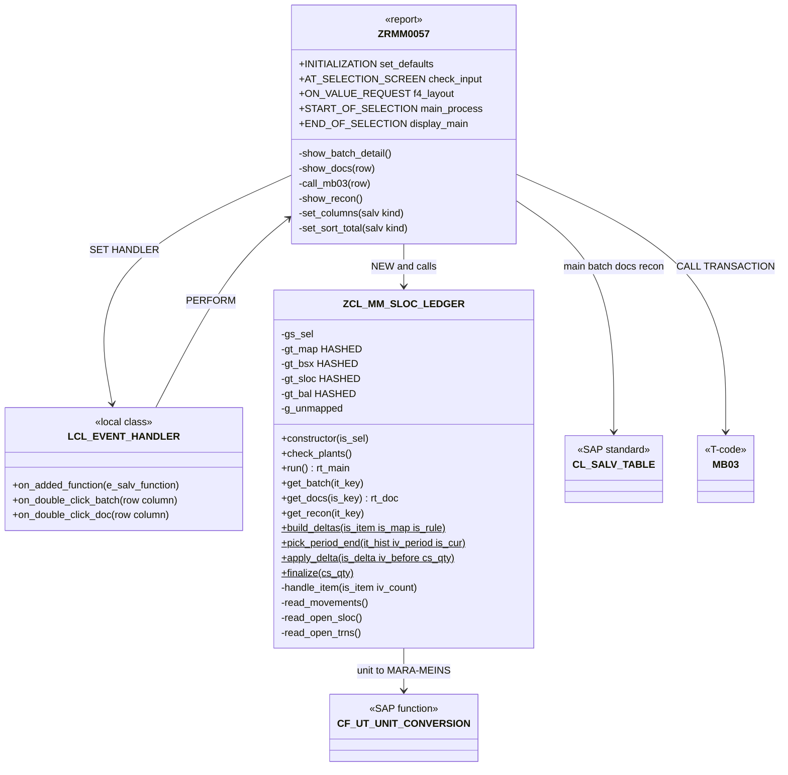
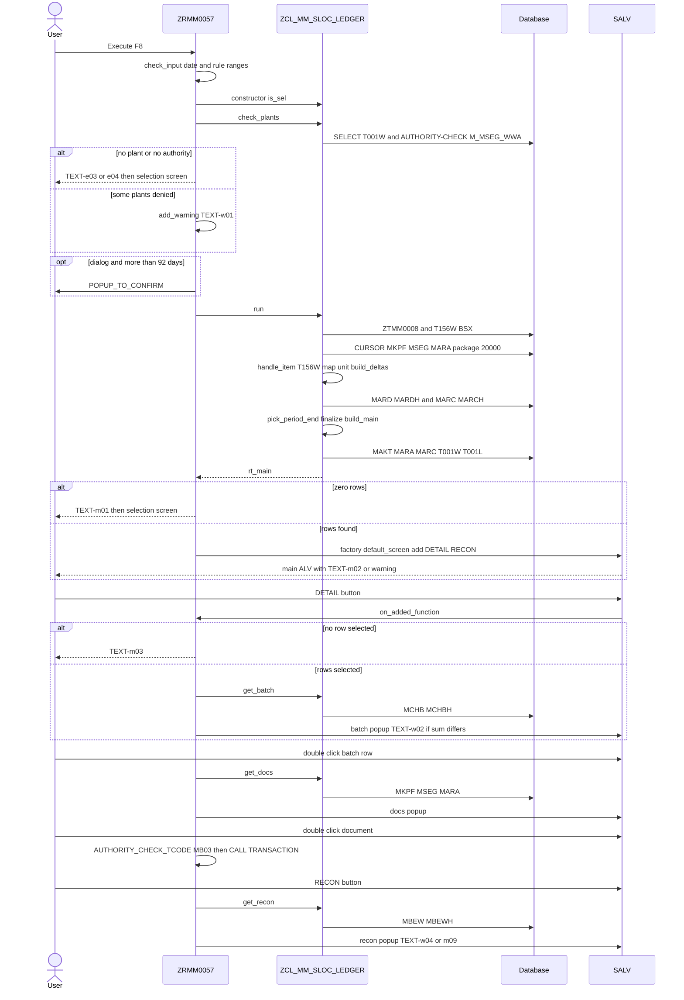
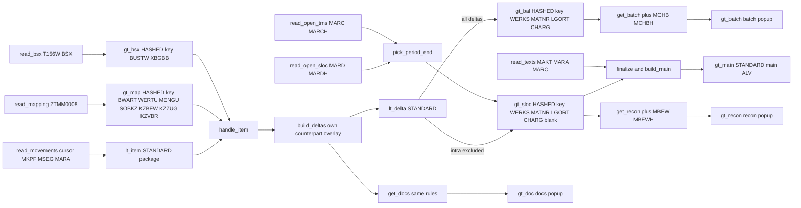

# 03. 개발 - (신규)저장위치별 수불부 개발

- 요청 ID: 20261023-6ffbce
- 작성: sap-developer (개발 단계, 1차)
- 작성일: 2026-10-24
- 입력: `request.md`, `01_analysis.md`(승인), `02_design.md`(승인), 첨부 추출본, `ticket.json` 설계 단계 PL 검토·AI 검증 기록, 기존 원문 스냅숏 ZRMM0034F01(1,456줄, PL 조회 2026-10-24)·`ref/ZRMM0034TOP.abap`
- 개발표준: `standards/handbook.md`, wiki "ECC 7.40 시스템 ABAP 개발 제약", "테스트계 반영 전 점검 항목", "자재마스터 조회 리포트 설계 패턴"
- 조회 시스템: srd-abap (클라이언트 250), `mcp__sap__*` 읽기 전용. 시스템에 쓰기 작업은 하지 않았습니다.

### 근거 표기

| 표기 | 의미 |
|---|---|
| **[확인]** | 이 개발 세션이 srd-abap에서 직접 조회함 (SearchObject, GetFunction, GetClass) |
| **[원문]** | ZRMM0034F01 원문 스냅숏의 행 번호 (PL이 GetInclude로 조회, 이 세션이 1~1,456행 전체를 읽음) |
| **[설계]** | 승인된 02_design.md |
| **[추정]** | 시스템에서 확인하지 못함. 활성화·테스트로 확인 (C-xx) |

---

## 개발 다이어그램

### 1) 소스 구성도

### 2) 실행 순서도

### 3) 데이터 흐름도

---

## 1. 오브젝트 목록

| 유형 | 이름 | 패키지 | 신규/변경 | 내역 (60자 이내) | 파일 |
|---|---|---|---|---|---|
| CLAS | ZCL_MM_SLOC_LEDGER | ZMMD | 신규 | 저장위치별 수불부 계산 엔진(분류·기초재고·배치·대사) | `src/ZCL_MM_SLOC_LEDGER.abap` |
| PROG/P | ZRMM0057 | ZMMD | 신규 | 저장위치별 수불부 | `src/ZRMM0057.abap` |
| PROG/I | ZRMM0057TOP | ZMMD | 신규 | 저장위치별 수불부 - 전역 데이터 | `src/ZRMM0057TOP.abap` |
| PROG/I | ZRMM0057SEL | ZMMD | 신규 | 저장위치별 수불부 - 선택화면 | `src/ZRMM0057SEL.abap` |
| PROG/I | ZRMM0057C01 | ZMMD | 신규 | 저장위치별 수불부 - 이벤트 핸들러 클래스 | `src/ZRMM0057C01.abap` |
| PROG/I | ZRMM0057F01 | ZMMD | 신규 | 저장위치별 수불부 - FORM 루틴 | `src/ZRMM0057F01.abap` |
| TRAN | ZRMM0057 | ZMMD | 신규 | 저장위치별 수불부 (SE93, 리포트 ZRMM0057, 선택화면 1000) | 수작업 |
| 텍스트 요소 | ZRMM0057 Text Symbol / Selection Text | - | 신규 | 4장 표 | 수작업 |

- 번호: `ZRMM0057*`·`ZCL_MM_SLOC*`를 2026-10-24에 다시 SearchObject로 조회해 결과가 없음을 확인했습니다 [확인]. QAS·PRD 사용 여부는 C-11.
- 명명: 리포트·T-code는 핸드북 Programs/Transaction Codes(Z+R+MM+4자리). 인클루드 접미사(TOP/SEL/C01/F01)·클래스(`ZCL_`)·메서드 파라미터(IV_/IS_/IT_/EV_/ET_/RV_/RT_/CS_/CT_)는 **핸드북 규칙 없음 → SAP 관례 적용**했습니다. 프로그램·클래스 내부 이름은 핸드북 2장(GT_/LT_, G_/L_, GS_/LS_, C_, PA_, SO_, R_)을 따랐습니다. 클래스 속성은 핸드북 3장대로 Global(GS_SEL, GT_MAP, G_UNMAPPED, R_BUSTM 등)로 두었습니다. 필드심볼(`<LS_...>`, `<L_VALUE>`)은 핸드북 규칙이 없어 Structure/Variable 규칙에 맞춘 SAP 관례로 썼습니다.
- 테스트 클래스(`*.testclasses.abap`)는 테스트 단계에서 작성합니다. 정적 메서드(build_deltas, resolve_vsloc, gr_column, gi_column, pick_period_end, prev_period, month_start, to_period, apply_delta, finalize, is_zero, to_exclude_range, mov_fields)는 DB 없이 호출할 수 있게 PUBLIC STATIC으로 두었습니다.
- 메시지 클래스는 쓰지 않고 Text Symbol 메시지를 씁니다(설계 2장, SE91 쓰기 회피).

---

## 2. 구현 내용 (설계 대비)

### 2.1 처리 단계

| 단계 | 위치 | 구현 |
|---|---|---|
| S1 | F01 `set_defaults` | 전기일 = 당월 1일~오늘, SO_XBUST = MA02·MA05, SO_BWIT 313·314, SO_BWIR 315·316, SO_BWPT 303·304, SO_BWPR 305·306, PA_VSLOC·PA_NOZER = 'X'. 비어 있을 때만 클래스 상수로 채움 |
| S2 | F01 `check_input` | ONLI/PRIN/SJOB일 때만. 전기일 SIGN I + EQ/BT만 허용(e05), 시작일 미래면 e01, SO_BWIT↔SO_BWIR·SO_BWPT↔SO_BWPR 같은 값이면 e02 |
| S3 | `check_plants` | 빈 플랜트 range면 SELECT 전에 RETURN. T001W → 플랜트별 `AUTHORITY-CHECK OBJECT 'M_MSEG_WWA' ID 'ACTVT' '03' ID 'WERKS'`. 내부 플랜트 range를 허용 플랜트 EQ 목록으로 다시 만듦. 0건 e03, 허용 0 e04, 일부 거부 w01(경고 결합) |
| S4 | F01 `main_process` | 대화식이고 (종료−시작+1) > 92일이면 POPUP_TO_CONFIRM(기본 버튼 아니오). 아니오면 m05 후 선택화면 |
| S5 | `read_mapping`, `read_bsx` | ZTMM0008 전체 → SORT + DELETE ADJACENT DUPLICATES(키 7필드) → HASHED. T156W VORSL='BSX' → SORT·중복 제거·BUSTW 공란 삭제 → HASHED(BUSTW, XBGBB) |
| S6 | `read_movements` → `handle_item` → `build_deltas` | 커서 + PACKAGE SIZE 20000. 품목별 T156W → ZTMM0008 → 단위 변환 → 델타 → 대상 키 필터(허용 플랜트, SO_LGORT). BUDAT < 시작일이면 기초에만 반영. GT_BAL(배치 레벨, 전체 델타)·GT_SLOC(저장위치 레벨, intra 제외)에 바로 집계, MSEG 원본은 보관하지 않음 |
| S7 | `read_open_sloc`, `read_open_trns` | MARD⋈MARA 드라이버 + MARDH(기간 ≥ X, OR 조건) → `pick_period_end`. PA_VSLOC='X'이고 'TRNS' ∈ SO_LGORT면 MARC/MARCH UMLMC+TRAME로 TRNS 기초 |
| S8 | `build_main`, `read_texts` | `finalize` → PA_NOZER면 0행 제외 → MAKT(SY-LANGU)·MARA-MEINS·MARC-XCHPF(FAE, 드라이버 빈 경우 건너뜀), T001W·T001L. 가상 행 명칭은 리포트가 v01/v02로 채움. 정렬 WERKS·MATNR·VSLOC·LGORT |
| S9 | F01 | 0건이면 m01(+경고) 후 `LEAVE LIST-PROCESSING`. 매핑 누락 w05, 단위 변환 실패 w06은 경고 결합 |
| S10 | F01 `display_main` | 대화식: `cl_salv_table=>factory( r_container = cl_gui_container=>default_screen )` + `add_function`(DETAIL, RECON) + 행 복수 선택 + `added_function` 이벤트, 표시 후 `WRITE space.` 백그라운드: fullscreen(스풀). 레이아웃 키 sy-repid/MAIN, restrict_none, 기본 PA_VARI. 플랜트 소계·수량 합계 |
| S11 | F01 `show_batch_detail` → `get_batch` | 선택 행 0건 m03. 비배치 자재·가상 행은 배치 공란 1행 = 메인 값. 배치관리 자재는 GT_BAL 배치 행 + MCHB/MCHBH 기간말 + 월초 이동. 키별 배치 END 합 ≠ 메인 END면 w02. 팝업 handle BTCH |
| S12 | F01 `show_docs` → `get_docs` | 같은 기간·같은 규칙으로 MSEG 재조회, 대상 키(플랜트·자재·저장위치·배치)에 닿는 델타만, **0이 아닌 컬럼마다 1행**(ZCLSTC·UML 포함). 문서 더블클릭: AUTHORITY_CHECK_TCODE → SET PARAMETER MBN/MJA → CALL TRANSACTION MB03 AND SKIP FIRST SCREEN |
| S13 | F01 `show_recon` → `get_recon` | 종료일이 월말도 아니고 오늘 이전이면 w03. 실제 저장위치 END + UML_END + TRNS END vs MBEW-LBKUM(종료일 ≥ 오늘) 또는 MBEWH `pick_period_end`(종료월). 차이 건수 w04 / 없으면 m09 |

### 2.2 이동 분류 규칙 (build_deltas, 원문 기준으로 구현)

부호: `l_sq` = S면 +MENGE, H면 −MENGE (MENGE는 기본단위로 변환 후). 출고 컬럼 값 = −l_sq, 입고 컬럼 값 = +l_sq [원문 690~729].

| 조건 (ZTMM0008) | 자기 위치 컬럼 | ZCLSTC(재고 증감) | 상대 위치 | 원문 |
|---|---|---|---|---|
| 같은 플랜트·저장위치·자재(WERKS=UMWRK, LGORT=UMLGO, MATNR=UMMAT) | 건너뜀. 단 CHARG·UMCHA가 모두 있고 다르면 아래 규칙으로 계산해 `intra='X'`(배치 상세에만) | - | - | 583~587 |
| TPIND 1·2, GRIND 4 | ZTP_GR = l_sq, GI(GIIND) = −l_sq | GIIND 공란이면 l_sq, 아니면 0 | 없음 | 598~616, 663~682 |
| TPIND 1·2, GRIND 1·2·3 | 반영 없음("세팅불가") | 0 | 없음 | 603, 612 |
| TPIND 1, GRIND 그 밖, MSEG-SHKZG = ZTMM0008-SHKZG | ZTP_GI = −l_sq | l_sq | 없음 | 740~767 |
| TPIND 1, GRIND 그 밖, MSEG-SHKZG ≠ ZTMM0008-SHKZG | ZTP_GR = l_sq, GI(GIIND) = −l_sq | GIIND 공란이면 l_sq, 아니면 0 | 없음 | 740~767 |
| TPIND 1, ZTMM0008-SHKZG 공란 | 반영 없음 | 0 | 없음 | 743, 754 |
| TPIND 2, GRIND 그 밖, UMWRK ≠ 공란·≠ WERKS | ZTP_GI = −l_sq | l_sq | (UMWRK, UMLGO, **MATNR**): ZTP_GR = −l_sq, GI(GIIND) = −l_sq, ZCLSTC 0 | 1187~1207, 1136~1176, 1234~1265 |
| TPIND 2, GRIND 그 밖, UMWRK = WERKS | GI(GIIND) = **+l_sq** (원문 부호 그대로) | l_sq | 없음 | 1208~1215 |
| TPIND 2, GRIND 그 밖, UMWRK 공란 | GI(GIIND) = −l_sq | l_sq | 없음 | 1217~1224 |
| TPIND 그 밖, GRIND 1/2/3/4 | ZPO_GR/ZPP_GR/ZRE_GR/ZOT_GR = l_sq, GI(GIIND) = −l_sq | GIIND 공란이면 l_sq, 아니면 0(동시출고) | 없음 | 617~629, 775~860 |
| TPIND 그 밖, GRIND 그 밖 | GI(GIIND) = −l_sq | l_sq | 없음 | 627, 868~878 |

- **C_MAP 확정 [원문]**: GR 1 ZPO_GR(구매), 2 ZPP_GR(생산), 3 ZRE_GR(고객반품), 4 ZOT_GR(기타) — 618~629. GI 1 ZSD_GI, 2 ZPP_GI, 3 ZSP_GI, 4 ZOT_GI — 692~705. 표에 없는 값은 원문 CASE에 OTHERS가 없으므로 **컬럼에 반영하지 않습니다**. `gr_column`/`gi_column` 정적 메서드로 구현했습니다.
- **첨부 샘플 검증(손계산)**: 261 H(GIIND 2 가정) → ZPP_GI +q, ZCLSTC −q / 262 S → ZPP_GI −q, ZCLSTC +q. 261 17건 254,420 − 262 15건 229,395 = **ZPP_GI 25,025, ZCLSTC −25,025**(첨부 V280과 같음).
- **이중 집계 방지 규칙(지시 1)**:
  1. SQL은 MKPF⋈MSEG 조인이라 MSEG 품목(MBLNR·MJAHR·ZEILE)마다 1행만 나옵니다. `WERKS IN 허용 OR UMWRK IN 허용`은 같은 품목을 두 번 읽게 하지 않습니다.
  2. 품목 하나는 **자기 위치 델타 최대 1개**(대상 플랜트 = 품목 WERKS)와 **상대 위치 델타 최대 1개**(TPIND 2이고 UMWRK ≠ WERKS일 때만, 대상 플랜트 = UMWRK)를 만듭니다. 두 대상은 플랜트가 달라 같은 키에 겹치지 않습니다.
  3. 모든 델타는 대상 키 필터(대상 플랜트 ∈ 허용 플랜트, 대상 저장위치 ∈ SO_LGORT)를 거칩니다. UMWRK 조건으로 읽힌 다른 플랜트 품목은 자기 위치 델타가 이 필터에서 빠지고, 상대 위치 델타만 남습니다.
  4. 상대 위치 델타의 ZCLSTC는 0입니다(원문 gs_tp2_69에 ZCLSTC를 넣지 않음). 그래서 2품목 이전(예: 301에 TPIND 2가 매핑된 경우)에서 받는 쪽 품목이 따로 있어도 **재고 증감(기말)은 한 번만** 반영됩니다. 이전입고/이전출고 컬럼은 원문처럼 양쪽 값이 함께 찍힐 수 있습니다(C-05).
  5. 311 등 TPIND 1 이전은 보내는 품목·받는 품목이 각자 자기 저장위치에만 반영됩니다(원문 581~655). 설계 5.2(B)의 "그 밖의 이전: 자기 ZTP_GI + 상대 ZTP_GR"은 쓰지 않습니다.
- **보조 델타(설계 5.2 유지, 원문에 없음)**: 이전중·운송중은 ZTMM0008 컬럼과 별개로, **자동생성 품목(XAUTO ≠ 공란)과 intra는 제외**하고 다음만 더합니다. 313/314(SO_BWIT): 받는 저장위치(UMWRK 또는 WERKS, UMLGO, MATNR, UMCHA 또는 CHARG) UML += −l_sq. 315/316(SO_BWIR): 자기 저장위치 UML += −l_sq. 303/304(SO_BWPT): 받는 플랜트 TRNS ZCLSTC += −l_sq. 305/306(SO_BWPR): 자기 플랜트 TRNS ZCLSTC += −l_sq. 가상 TRNS는 PA_VSLOC='X'일 때만.
- **특별재고(설계 5.1 유지)**: 자기 위치는 SOBKZ 공란일 때만, 상대 위치·이전중은 UMSOK 공란일 때만 반영합니다.
- **가상 저장위치(설계 5.3 유지)**: 품목 LGORT 공란 → XAUTO 'X'면 TRNS, 그 밖 ZZZZ(배치 공란). 상대 위치 UMLGO 공란 → TRNS.

### 2.3 수불 대상 선별 (지시 5, 7)

| 순서 | 조건 | 구현 | 원문 |
|---|---|---|---|
| 1 | MATNR 공란 | SQL `b~matnr <> space` | 59 |
| 2 | BUSTM ∈ SO_XBUST(MA02·MA05) | SQL `b~bustm IN r_bustm` (`to_exclude_range`로 SIGN E 변환, 빈 값이면 조건 없음) | 61 |
| 3 | T156W에 (BUSTW = MSEG-BUSTW, XBGBB = MSEG-XAUTO, XAUTO 'U'는 공란으로) 없음 | 제외 | 143~150, 172~183 |
| 4 | ZTMM0008(7필드 키) 없음 또는 GRIND·GIIND·TPIND 모두 공란 | 제외, 3번 통과 후 4번 제외 건수를 G_UNMAPPED(자기 플랜트 기준)로 세어 w05 | 156~170 |
| 5 | MSEG-MEINS ≠ MARA-MEINS | `CF_UT_UNIT_CONVERSION`(MATNR_IMP, UNIT_NEW_IMP = MARA-MEINS, UNIT_OLD_IMP = MSEG-MEINS)으로 기본단위 변환. 예외면 원문처럼 원래 수량 유지 + G_CONV_ERR → w06 | 185~198 |

- 원문은 ZTMM0008 → T156W 순서로 거르고, 이 소스는 T156W → ZTMM0008 순서입니다. 남는 품목 집합은 같고, "재고계정 전기인데 매핑이 없는 건"을 세기 위해 순서만 바꿨습니다.
- `CF_UT_UNIT_CONVERSION` 시그니처는 시스템에서 확인했습니다 [확인]: IMPORTING MATNR_IMP(MARA-MATNR), MEINS_IMP, UNIT_NEW_IMP·UNIT_OLD_IMP(T006-MSEHI), VALUE_OLD_IMP(PLFH-MGVGW) / EXPORTING VALUE_NEW_EXP(PLFH-MGVGW) / EXCEPTIONS OVERFLOW. 값 전달은 PLFH-MGVGW 타입 지역 변수로 했습니다.

### 2.4 기초재고·기말 (설계 5.4·5.5)

- 기초 = 기간말재고(X = 시작월 직전 달) + 월초~시작일 전날 델타의 ZCLSTC. 이전중 기초 = 기간말 UMLME/CUMLM + 같은 기간 UML.
- `pick_period_end`: 기간 ≥ X인 이력 중 가장 이른 기간 → 없고 현재 레코드 기간 ≤ X면 현재 값 → 둘 다 아니면 0. **설계대로이며 팀장 확인 사항이라 바꾸지 않았습니다.**
- 재고 범위: 저장위치 LABST+INSME+EINME+SPEME+RETME(이전중 UMLME), 배치 CLABS+CINSM+CEINM+CSPEM+CRETM(이전중 CUMLM), TRNS UMLMC+TRAME, ZZZZ 기초 0. **설계대로(팀장 확인 사항)**.
- 기말: `END_QTY = BEG_QTY + ZCLSTC`, `UML_END = UML_BEG + UML_CHG`. GR_SUM·GI_SUM은 컬럼 합계입니다(설계 대비 변경 D-08 참고).

---

## 3. 설계 대비 변경

| No | 설계 항목 | 설계 내용 | 구현 | 근거 (원문 행) |
|---|---|---|---|---|
| D-01 | 5.1 MA02/MA05 해석, 5.2(B) 그 밖의 이전 | 남은 품목 하나가 양쪽(자기 ZTP_GI + 상대 ZTP_GR)을 반영 | 각 품목은 자기 저장위치에만 반영. TPIND 1은 ZTMM0008-SHKZG와 MSEG-SHKZG 비교로 ZTP_GI/ZTP_GR 결정 | 581~655, 740~767. 지시 1. 설계 해석대로면 311 2품목에서 이중 계산 |
| D-02 | 5.2(B) 상대 위치 반영 | 이전 전반에 상대 위치 델타 | TPIND 2이면서 UMWRK ≠ 공란·≠ WERKS일 때만. 대상 = UMWRK·UMLGO·**MATNR**(UMMAT 아님), 컬럼 ZTP_GR = −l_sq, GI(GIIND) = −l_sq, **ZCLSTC 0** | 1185~1226, 1136~1176(tp2_add_line p_matnr = g_mseg_t-matnr), 1234~1265 |
| D-03 | 5.2(B) GRIND 4 + TPIND 1/2 | 없음 | ZTP_GR = l_sq + GI(GIIND) = −l_sq, ZCLSTC = GIIND 공란일 때만 l_sq | 598~616, 663~682 |
| D-04 | 5.2(B) TPIND 1/2 + GRIND 1/2/3 | 없음 | 반영 없음(원문 "세팅불가") | 603, 612 |
| D-05 | 5.2(A) 동시출고 | 둘 다 있으면 S면 GR, H면 GI 한쪽만 | 입고 컬럼 = l_sq, 출고 컬럼 = −l_sq를 **둘 다** 채우고 ZCLSTC = 0 | 775~860(slo_gr1~4), 690~729(gi_sqty_s/h_rtn). 지시 3 |
| D-06 | 5.2 C_MAP_GR/GI | GRIND 3만 확인, 나머지 C-01, 미등록 값은 ZOT | GR 1/2/3/4 = ZPO/ZPP/ZRE/ZOT_GR, GI 1/2/3/4 = ZSD/ZPP/ZSP/ZOT_GI로 확정. **미등록 값은 반영 없음**(원문 CASE에 OTHERS 없음) | 618~629, 692~705. 지시 4 |
| D-07 | 5.2 TPIND 2 같은 플랜트 | 없음 | UMWRK = WERKS면 출고 컬럼을 원문 부호대로 **+l_sq**(다른 경우와 반대), ZCLSTC = l_sq | 1208~1215 (원문 주석 "사용자가 동일 플랜트를 넣은 경우") |
| D-08 | 5.5 ZCLSTC·기말 | ZCLSTC = GR_SUM − GI_SUM, END = BEG + ZCLSTC | ZCLSTC는 원문 계산식으로 품목마다 누적(동시출고 0, 상대 위치 0). END = BEG + ZCLSTC. 그래서 동시출고·TPIND 2 상대 반영이 있으면 **END ≠ BEG + GR_SUM − GI_SUM**일 수 있음 | 원문 전 루틴의 gt_69-zclstc 대입. ZTMM0069 회귀(TP-02) 일치를 위해 |
| D-09 | 5.1 T156W 조건 | VORSL='BSX', BUSTW[+XBGBB 원문대로] | 키 (BUSTW, XBGBB), XBGBB = MSEG-XAUTO, XAUTO 'U' → 공란, BUSTW 공란 행 삭제 | 143~150, 172~183. 지시 5 |
| D-10 | 7.1 ty_s_map | GRIND, GIIND, TPIND | **SHKZG(ZTMM0008-SHKZG) 추가** | 156~157. 지시 5 |
| D-11 | 5.2 단위 | MENGE 그대로(기본단위 가정) | MSEG-MEINS ≠ MARA-MEINS면 CF_UT_UNIT_CONVERSION | 185~198. 지시 6 |
| D-12 | 6.1 SQL range 이름 | `gr_bustm` | `r_bustm`(핸드북 Ranges R_) | 지시 7 |
| D-13 | 6.1 SQL 자재 조건 | `( matnr IN so_matnr OR ummat IN so_matnr )` | `matnr IN so_matnr`만. 모든 대상 키의 자재가 품목 MATNR이라(D-02) UMMAT 조건이 필요 없음. 성능에도 유리 | 1192, 1201 |
| D-14 | 5.2(B) 303/304, 305/306, UMLGO 공란·UMWRK≠WERKS | 상대 TRNS ZTP_GR / 자기 TRNS ZTP_GI 컬럼 | 상대 TRNS 컬럼은 D-02(원문 TPIND 2, UMLGO 공란 → TRNS)로 대체. SO_BWPT/SO_BWPR은 **TRNS 재고 증감(ZCLSTC)만** 더하는 보조 델타로 축소 | 원문에 운송중 처리 없음. 가상 저장위치는 설계 유지 지시 |
| D-15 | 5.2(B) 313/314, 315/316 | 상대 이전중 / 자기 ZTP_GR + 이전중 | 컬럼은 ZTMM0008 매핑(원문)대로, 이전중(UML)만 보조 델타로 더함. **XAUTO ≠ 공란 품목 제외**(2품목 구성일 때 이중 이전중 방지) | 원문에 이전중 없음. C-05 |
| D-16 | 5.2 intra | 같은 저장위치 내부 이동(UMWRK·UMLGO·UMMAT 같음)이면 ZTP_GI/ZTP_GR 델타 2개 | 원문 건너뜀 조건(583)과 같게 판정하고, CHARG·UMCHA가 모두 있고 다를 때만 **그 품목의 자기 위치 델타 1개**를 원문 규칙으로 만들어 intra 표시. 2품목(보내는 배치·받는 배치)이 각자 자기 배치에 반영되므로 1번 규칙과 일관. 메인은 intra를 버림 | 583~587. 지시 2 |
| D-17 | 7.1 ty_s_delta | fname, value, stock, uml | 품목 하나가 입고·출고 컬럼을 함께 채울 수 있어(D-05) **컬럼 구조(ty_s_mov: 10개 컬럼 + ZCLSTC + UML)**로 바꿈. side(O/C/V), vsloc 추가 | 구현상 필요 |
| D-18 | 7.1 ty_s_qty | UML_BEG, UML_END | **UML_CHG(이전중 증감, 기본 숨김)** 추가. finalize를 여러 번 불러도 같은 값이 나오게 하려고 | 구현상 필요 |
| D-19 | 7.1 ty_s_doc, 8.3 | 반영 컬럼·수량 1행 | 0이 아닌 컬럼마다 1행(ZCLSTC "증감", UML "이전중(증감)" 포함). kindtx·coltx·werks·matnr 필드 추가(텍스트는 리포트가 채움, 클래스는 텍스트 없음) | D-17 결과 |
| D-20 | 7.3 get_batch / get_recon | RETURNING + EXPORTING | EXPORTING만(et_batch, et_diff_key, ev_diff_qty / et_recon, ev_ok) | 7.40에서 RETURNING과 EXPORTING을 함께 쓰는 함수형 호출 위험 회피 |
| D-21 | 6.1 커서 | New Open SQL `OPEN CURSOR WITH HOLD @...` | 기존 Open SQL 형식 `OPEN CURSOR` / `FETCH ... PACKAGE SIZE`, WITH HOLD 없음(FETCH 사이 커밋 없음) | 7.40 SP별 `PACKAGE SIZE @` 허용 여부 미확인. 나머지 SELECT는 New Open SQL |
| D-22 | S7 TRNS 기초 | MARC/MARCH 전체로 TRNS 행 | 기간말 운송중이 0이고 이동도 없으면 TRNS 행을 만들지 않음 | MARC 전체 자재마다 0인 TRNS 행이 생기는 것 방지 |
| D-23 | 설계 0.3 "ZRMM0034와 동일" | 원문과 같은 결과 | 다음은 원문과 다르게 남음(설계 유지 지시 범위): ① 특별재고 SOBKZ/UMSOK ≠ 공란 제외(원문은 ZTMM0008 키에 SOBKZ가 있어 매핑되면 집계) ② 저장위치 공란 → TRNS/ZZZZ(원문은 LGORT 공란 행) ③ 원문 tp2_add_line이 기존 ZTMM0069 행을 SELECT해 그 값을 다시 COLLECT하는 부분(1159~1173, DB 상태 의존)은 재현하지 않음 ④ 원문 상대 행은 BUDAT이 비거나 다른 날짜로 저장될 수 있음(1166~1172) → 이 소스는 품목 BUDAT 기준 | TP-02 비교 시 이 차이를 빼고 봄 |

---

## 4. 텍스트 요소 등록 목록 (SE38 > 텍스트 요소, 수작업)

소스 업로드에는 텍스트 요소가 포함되지 않습니다. 반영 후 등록하고 SE63 EN 번역을 체크리스트로 처리합니다. 정의 길이(최대 길이)는 아래 이상으로 잡습니다.

### 4.1 Selection Text

| 이름 | 텍스트 | | 이름 | 텍스트 |
|---|---|---|---|---|
| SO_WERKS | 플랜트 | | PA_VARI | 레이아웃 |
| SO_BUDAT | 전기일 | | SO_XBUST | 제외 수량전기문자열(BUSTM) |
| SO_MATNR | 자재 | | SO_BWIT | 저장위치 이전중 출고 이동유형 |
| SO_LGORT | 저장위치 | | SO_BWIR | 저장위치 이전중 입고 이동유형 |
| SO_MTART | 자재유형 | | SO_BWPT | 플랜트간 운송중 출고 이동유형 |
| PA_VSLOC | 가상 저장위치 표시 | | SO_BWPR | 플랜트간 운송중 입고 이동유형 |
| PA_NOZER | 수불 없는 0 행 제외 | | | |

### 4.2 Text Symbol

| ID | 텍스트 | 길이 | 용도 |
|---|---|---|---|
| B01 | 조회 조건 | 20 | 블록 |
| B02 | 출력 옵션 | 20 | 블록 |
| B03 | 집계 규칙 (변경 시 팀장 확인) | 40 | 블록 |
| E01 | 시작일은 오늘 이후일 수 없습니다. | 60 | 입력 검증 |
| E02 | 같은 이동유형이 출고·입고 집계 규칙 양쪽에 있습니다. | 70 | 입력 검증 |
| E03 | 입력한 플랜트가 없습니다. | 60 | S3 |
| E04 | 조회 권한이 있는 플랜트가 없습니다. | 60 | S3 |
| E05 | 전기일은 단일값 또는 범위(포함)로만 입력하세요. | 70 | 입력 검증 |
| E06 | MB03 실행 권한이 없습니다. | 60 | MB03 |
| W01 | 권한 없는 플랜트 &1개를 제외했습니다. | 60 | S3 |
| W02 | 배치 합계가 메인 행과 &1 만큼 다릅니다(이력 확인 필요). | 80 | S11 |
| W03 | 대사는 종료일이 월말이거나 오늘 이후일 때만 가능합니다. | 80 | S13 |
| W04 | 차이가 있는 자재가 &1건 있습니다(미분류 ZZZZ 또는 특별재고 확인). | 90 | S13 |
| W05 | 수불 매핑(ZTMM0008)이 없는 재고전기 품목 &1건이 제외되었습니다. | 90 | S9 |
| W06 | 단위 변환에 실패한 품목 &1건은 원래 수량으로 집계했습니다. | 80 | S9 |
| M01 | 조건에 맞는 데이터가 없습니다. | 60 | S9 |
| M02 | &1건이 조회되었습니다. | 40 | S10 |
| M03 | 행을 선택한 뒤 배치 상세 버튼을 누르세요. | 60 | S11 |
| M04 | 표시할 데이터가 없습니다. | 40 | S11·S13 |
| M05 | 조회를 취소했습니다. | 40 | S4 |
| M06 | 배치 &1건 (합계가 메인 행과 일치합니다) | 60 | S11 |
| M07 | 이 행에 반영된 자재문서가 없습니다. | 60 | S12 |
| M08 | 자재문서를 더블클릭하면 MB03으로 이동합니다. | 60 | S12 |
| M09 | 대사 차이가 없습니다. | 40 | S13 |
| M10 | 취소전표는 원래 컬럼에서 차감되어 음수가 나올 수 있습니다. | 80 | S10 (첨부 B50) |
| Q00 | 확인 | 20 | S4 팝업 제목 |
| Q01 | 조회 기간이 92일을 넘습니다. 시간이 오래 걸릴 수 있습니다. 백그라운드 실행(F9)을 권장합니다. 계속하시겠습니까? | 132 | S4 |
| Q02 | 예 | 12 | S4 버튼 |
| Q03 | 아니오 | 12 | S4 버튼 |
| F01 | 배치 상세 | 20 | 툴바 |
| F02 | 선택한 행을 배치 단위로 봅니다 | 40 | 툴바 툴팁 |
| F03 | 대사 | 20 | 툴바 |
| F04 | 플랜트 평가수량(MBEW)과 비교합니다 | 40 | 툴바 툴팁 |
| T01 | 저장위치별 수불부 | 30 | 메인 제목 |
| T02 | 배치 상세 | 20 | 팝업 제목 |
| T03 | &1개 행 | 20 | 팝업 제목(복수 선택) |
| T04 | 플랜트 대사 - 기준일 | 30 | 팝업 제목 |
| T05 | 자재문서 | 20 | 팝업 제목 |
| V01 | 운송중(가상) | 20 | 가상 저장위치명 |
| V02 | 미분류(가상) | 20 | 가상 저장위치명 |
| K01 | 기초분 | 10 | 문서 구분(월초~시작일 전날) |
| K02 | 기간 | 10 | 문서 구분 |
| C01 | 플랜트 | 20 | 컬럼 |
| C02 | 플랜트명 | 20 | 컬럼 |
| C03 | 자재 | 20 | 컬럼 |
| C04 | 자재내역 | 20 | 컬럼 |
| C05 | 저장위치 | 20 | 컬럼 |
| C06 | 저장위치명 | 20 | 컬럼 |
| C07 | 가상구분 | 20 | 컬럼 |
| C08 | 배치관리 | 20 | 컬럼 |
| C09 | 단위 | 20 | 컬럼 |
| C10 | 기초재고 | 20 | 컬럼 |
| C11 | 구매입고 | 20 | 컬럼 |
| C12 | 생산입고 | 20 | 컬럼 |
| C13 | 이전입고 | 20 | 컬럼 |
| C14 | 고객반품입고 | 20 | 컬럼 |
| C15 | 기타입고 | 20 | 컬럼 |
| C16 | 입고계 | 20 | 컬럼 |
| C17 | 판매출고 | 20 | 컬럼 |
| C18 | 생산출고 | 20 | 컬럼 |
| C19 | 이전출고 | 20 | 컬럼 |
| C20 | ZSP출고 | 20 | 컬럼 (Q06 답으로 명칭 확정) |
| C21 | 기타출고 | 20 | 컬럼 |
| C22 | 출고계 | 20 | 컬럼 |
| C23 | 증감 | 20 | 컬럼(ZCLSTC) |
| C24 | 기말재고 | 20 | 컬럼 |
| C25 | 이전중(기초) | 20 | 컬럼 |
| C26 | 이전중(증감) | 20 | 컬럼(UML_CHG, 문서 UML) |
| C27 | 이전중(기말) | 20 | 컬럼 |
| C28 | 배치 | 20 | 컬럼 |
| C29 | 구분 | 20 | 문서 |
| C30 | 전기일 | 20 | 문서 |
| C31 | 자재문서 | 20 | 문서 |
| C32 | 연도 | 20 | 문서 |
| C33 | 항목 | 20 | 문서 |
| C34 | 이동유형 | 20 | 문서 |
| C35 | 차대 | 20 | 문서 |
| C36 | 상대저장위치 | 20 | 문서 |
| C37 | 반영 컬럼 | 20 | 문서 |
| C38 | 반영 수량 | 20 | 문서 |
| C39 | 저장위치 재고합 | 20 | 대사 |
| C41 | 운송중(가상) | 20 | 대사 |
| C42 | 계산 합계 | 20 | 대사 |
| C43 | 평가수량(MBEW) | 20 | 대사 |
| C44 | 차이 | 20 | 대사 |
| C45 | 자동생성 | 20 | 문서(XAUTO) |

- 컬럼 헤더는 `set_short_text`(10자)·`set_medium_text`(20자)·`set_long_text`(40자)에 같은 텍스트를 넣습니다. 10자를 넘는 텍스트는 짧은 헤더에서 잘립니다.
- 대사 팝업의 UML_END는 메인과 같은 필드명이라 C27 "이전중(기말)"로 나옵니다(설계 "이전중"과 같은 뜻).

---

## 5. 반영 순서

1. **CLAS ZCL_MM_SLOC_LEDGER** 생성·활성화 (TOP이 타입을 참조하므로 먼저). 활성화가 통과하면 참조 필드(아래 C-04)가 있다는 뜻입니다.
2. **PROG/I** ZRMM0057TOP → ZRMM0057SEL → ZRMM0057C01 → ZRMM0057F01 생성
3. **PROG/P** ZRMM0057 생성 후 인클루드와 함께 **일괄 활성화**
4. 텍스트 요소(4장) 등록, SE63 EN 번역
5. **TRAN ZRMM0057** SE93 생성(리포트 트랜잭션, 프로그램 ZRMM0057, 화면 1000), 프로그램 권한그룹(S_PROGRAM) 팀 표준 지정
6. SLIN·SCI → ABAP Unit(테스트 단계 산출물) → 통합 테스트

- 웹앱 반영 도구는 src/ 파일을 **파일명 순서**로 처리합니다(wiki). 이 요청의 파일명 순서는 `ZCL_MM_SLOC_LEDGER` → `ZRMM0057` → `ZRMM0057C01` → `ZRMM0057F01` → `ZRMM0057SEL` → `ZRMM0057TOP`이라 클래스가 먼저 반영됩니다. 그러나 메인 `ZRMM0057`이 인클루드보다 먼저 오므로, 도구가 오브젝트마다 바로 활성화하면 메인 활성화가 인클루드 없음으로 실패할 수 있습니다. 모든 오브젝트를 만든 뒤 일괄 활성화하는지 반영 때 확인합니다(시스템 미확인).
- 모두 **신규** 오브젝트이며 기존 ZRMM0034/0035·ZTMM0008은 수정하지 않습니다. DB 테이블·화면·GUI 상태·메시지 클래스 변경은 없습니다.
- src/에는 ABAP 소스 6개만 있습니다(비소스 파일 없음).

---

## 6. 시스템 확인 / 추정 구분

| 항목 | 상태 | 내용 |
|---|---|---|
| ZRMM0034F01 원문 | [원문] | 1~1,456행 전체를 읽고 2.2·2.3·3장에 행 번호로 대조 |
| ZTMM0008 필드 BWART·WERTU·MENGU·SOBKZ·KZBEW·KZZUG·KZVBR·GRIND·GIIND·TPIND·SHKZG | [원문] | 원문 SELECT(156~165)·TOP(74~77)에 쓰여 운영 중. GetTable은 7.50 미만 ADT 제약으로 실패 |
| T156W BUSTW·XBGBB·VORSL | [원문] | 143~146 |
| MSEG BUSTM·BUSTW·XAUTO·UMWRK·UMLGO·UMMAT·WERTU·MENGU·KZBEW·KZZUG·KZVBR | [원문] | 47~51 |
| CF_UT_UNIT_CONVERSION 시그니처 | [확인] | GetFunction(CFUT) |
| AUTHORITY_CHECK_TCODE (EXCEPTIONS OK/NOT_OK) | [확인] | GetFunction(SUSE) |
| POPUP_TO_CONFIRM 시그니처 | [확인] | GetFunction(SPO1) |
| CL_SALV_FUNCTIONS->ADD_FUNCTION (ICON/TEXT/TOOLTIP string, CX_SALV_EXISTING·CX_SALV_WRONG_CALL) | [확인] | GetClass |
| CX_SALV_WRONG_CALL → CX_SALV_ACCESS_ERROR (→ CX_SALV_ERROR) | [확인] | GetClass + wiki 상속 기록 |
| CL_SALV_LAYOUT_SERVICE=>F4_LAYOUTS | [확인] | GetClass |
| PLFH 테이블 존재 | [확인] | SearchObject |
| MSEG CHARG·UMCHA·UMSOK·MENGE·MEINS·SOBKZ | [추정] | 표준 지식. 활성화로 확인(C-04) |
| MARD EINME, MCHB CEINM·CUMLM, MARC/MARCH LFGJA·LFMON·UMLMC·TRAME, MBEW/MBEWH LFGJA·LFMON·LBKUM | [추정] | 표준 지식. 활성화로 확인(C-04) |
| M_MSEG_WWA 필드 ACTVT·WERKS | [추정] | 오브젝트 존재만 확인(분석). SU21 확인(C-08) |
| 컨테이너 SALV(default_screen) + `WRITE space` 표시 방식 | [추정] | 설계 S10 방식. 통합 테스트로 확인 |

---

## 7. 남은 확인 사항

| ID | 확인 대상 | 방법 | 결과에 따른 조치 | 담당 |
|---|---|---|---|---|
| C-01 | (남은 부분) ZRMM0035F01 기초재고 계산식, ZRMM0034SEL | PL GetInclude 스냅숏 | 기초재고 규칙은 설계(팀장 확인 사항) 유지. 다르면 보고만 | PL |
| C-02 | ZTMM0008 내용 | SE16 | 101·102·261·262·311·312·313·315·301·303·305·641 매핑과 GRIND/GIIND/TPIND/SHKZG 값. TPIND 1인데 SHKZG 공란인 행이 있으면 반영되지 않음(2.2). ZTMM0008 기본키에 7필드 외 필드가 있으면 첫 행만 씀 | 개발 |
| C-03 | ZTMM0069B/M, ZTMM0070 계열 용도 | SE11 | 원문 total_stock_barshaped로 0069M = 봉형강 배치 재고 스냅숏, 0070M = 그 로그로 보임(1336~1436). 0069B는 원문에 없음 | 개발 |
| C-04 | 4.6장 [추정] 필드 | 클래스 활성화 | 없는 필드는 빼고 재고 범위 조정(설계 변경, 팀장 보고) | 반영 |
| C-05 | 이전 품목 구성 | SE16 MSEG(311·313·315·301·303·305·641 문서의 품목 쌍, XAUTO, BUSTM, LGORT, UMLGO) | TPIND 2 2품목 이동은 이전입고·이전출고 컬럼이 양쪽에 같이 찍힘(원문 동작). 313/315가 2품목이면 XAUTO 제외 규칙으로 이전중 이중 반영 방지가 되는지 확인 | 개발 → 팀장 |
| C-06 | MM 기간 = 달력월 | T001-PERIV, MARV | 다르면 prev_period 변경 | 개발 |
| C-07 | T001L에 TRNS·ZZZZ 코드 존재 여부 | SE16 | 겹치면 가상 코드 상수 변경 | 개발 |
| C-08 | M_MSEG_WWA 필드 | SU21 | ACTVT/WERKS가 아니면 check_plants 수정 | 개발 |
| C-09 | MKPF·MSEG 인덱스, 응답시간 | ST05 | 느리면 WERKS/UMWRK 조건을 SELECT 2회로 분리(설계 11장) | 테스트 |
| C-10 | 기간말 규칙(이상 가장 이른 레코드) | MB5B 대조(공백 월 자재) | 다르면 pick_period_end만 수정(팀장 확인 사항) | 테스트 |
| C-11 | ZRMM0057 번호의 QAS·PRD 사용 여부 | SE80·이송 이력 | 쓰이면 ZRMM0058 | 개발 |
| C-12 | srd-abap = "신규 시스템" 여부 | 팀장·현업 | 아니면 시스템 재선택 | 팀장 |
| **C-13** | **동시출고(GRIND·GIIND 둘 다) 매핑 이동유형 목록** | SE16 ZTMM0008 | 원문대로 ZCLSTC 0이라, 그 품목이 실제로 재고를 바꾸면 기말이 MARD/MB5B와 어긋남(TP-03). 목록과 실재고 영향 확인 후 팀장 판단 | 개발 → 팀장 |
| **C-14** | **ZCLSTC(증감) 컬럼 표시 여부** | 팀장 | D-08로 END ≠ BEG + 입고계 − 출고계가 될 수 있음. 설계대로 기본 숨김으로 두었고 레이아웃에서 표시 가능. 기본 표시로 바꿀지 결정 | 팀장 |
| **C-15** | **TRNS(운송중 가상) 기말 정확도** | TP-09 | 원문 상대 반영은 ZCLSTC 0이고 운송중 재고 증감은 SO_BWPT/SO_BWPR 보조 델타로만 반영. STO(641→101) 등은 범위에 넣지 않으면 TRNS 기말이 MARC 운송중과 다를 수 있음 → 대사 차이로 드러남 | 테스트 → 팀장 |
| **C-16** | **CF_UT_UNIT_CONVERSION 내부 오류 무시** | 소스 확인됨 | 이 함수는 OVERFLOW만 예외로 올리고 다른 변환 오류는 조용히 넘김(원문과 같음). 단위가 다른 품목이 있으면 수량을 MB51과 대조 | 테스트 |
| **C-17** | **TP-02 ZTMM0069 회귀 비교 범위** | SE16 ZTMM0069 | D-23 차이(특별재고, 저장위치 공란, tp2_add_line DB 재사용·BUDAT)는 비교에서 제외. 비교는 자기 위치 반영분(일반재고, 실제 저장위치) 기준 | 테스트 |
| **C-18** | **컨테이너 SALV 표시·툴바 버튼** | 통합 테스트 | default_screen + `WRITE space`에서 툴바 DETAIL/RECON이 보이지 않으면 GUI 상태 복사 방식으로 바꿔야 함(설계 변경) | 테스트 |

---

## 8. 7.40 문법 메모

- 쓴 구문의 최소 릴리스: `VALUE #( ( ... ) )`(7.40 SP02), 인라인 선언·`boolc`·문자열 템플릿 `ALPHA = OUT`/`DATE = USER`(7.40), New Open SQL `@`·쉼표 목록·`INTO` 위치(FROM 뒤, WHERE 앞, 7.40 SP05). `FOR` 반복식·`xsdbool`·`CORRESPONDING`·SQL 식은 쓰지 않았습니다. 그래서 **7.40 SP05 이상**이면 됩니다.
- HASHED 테이블은 STANDARD로 읽고 SORT + DELETE ADJACENT DUPLICATES 후 옮겼습니다(ZTMM0008, T156W). 텍스트 테이블은 키 = DB 기본키로 1건을 보장했습니다(MAKT MATNR+SPRAS, MARC MATNR+WERKS, T001L WERKS+LGORT).
- FOR ALL ENTRIES는 드라이버가 비면 실행하지 않습니다. 빈 플랜트 range는 check_plants·run에서 막았습니다.
- `SET HANDLER`는 `get_event( )` 결과를 참조 변수로 받아 넘겼습니다. SALV 예외는 `cx_salv_error` 하나로 받습니다(FORM은 `RAISING cx_salv_error`).
- `CALL TRANSACTION ... WITH AUTHORITY-CHECK` 대신 AUTHORITY_CHECK_TCODE를 썼습니다(설계 12장).

---

## 변경 이력

| 버전 | 일자 | 내용 | CR |
|---|---|---|---|
| 1.0 | 2026-10-24 | 최초 작성. 설계(02_design.md) 기준으로 개발하고, PL 지시 1~7에 따라 이동 분류·제외 규칙을 ZRMM0034F01 원문(행 번호 대조)으로 바꿈: 자기 위치 반영·TPIND 2 상대 반영(D-01·02), GRIND 4 조합·세팅불가(D-03·04), 동시출고(D-05), C_MAP 확정(D-06), T156W·SHKZG(D-09·10), 단위 변환(D-11), r_bustm(D-12). 설계 유지: 화면, 기초재고 규칙, 재고 범위, MA02/MA05 제외, 가상 저장위치, 권한, 성능 | - |
