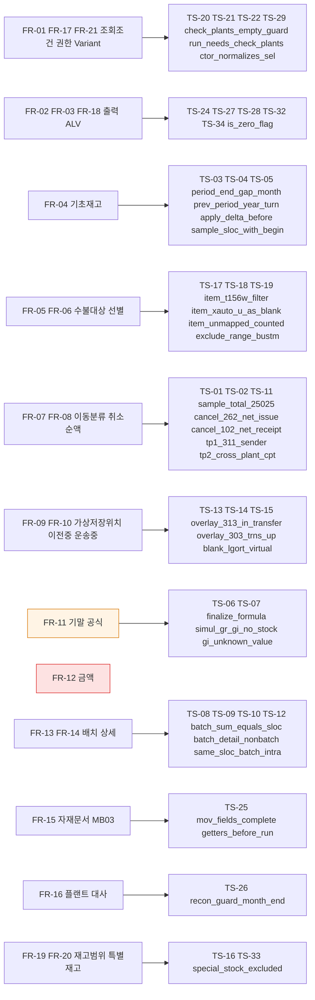
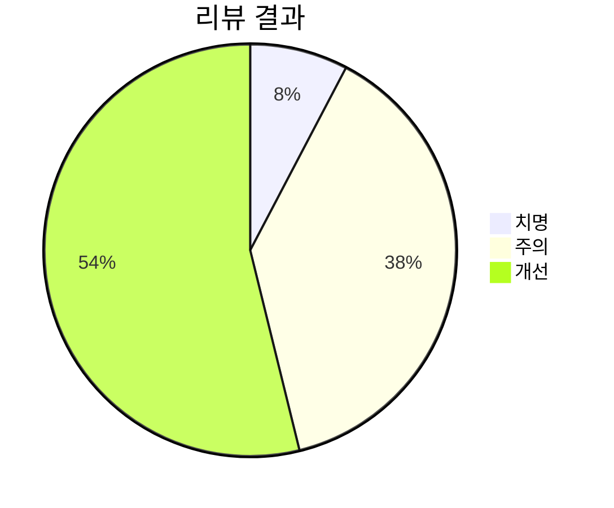
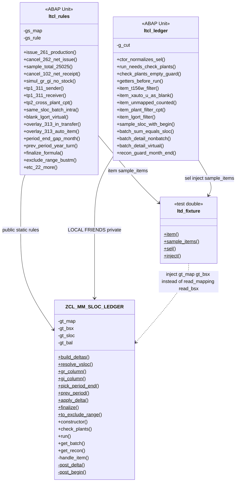

VERDICT: FAIL
# 04. 테스트 - (신규)저장위치별 수불부 개발

- 요청 ID: 20261023-6ffbce
- 작성: sap-tester (테스트 단계, 최초)
- 작성일: 2026-10-24
- 입력: `request.md`, 첨부 추출본(`attachments/.text/저장위치별 수불부 개발 고민_261022.xlsx.txt`), `01_analysis.md`, `02_design.md`, `03_development.md`, `src/*.abap` 6개, `ref/ZRMM0034TOP.abap`, ZRMM0034F01 원문 스냅숏(1,456행, PL 조회 2026-10-24)
- 개발표준: `standards/handbook.md`
- 조회 시스템: srd-abap(클라이언트 250), `mcp__sap__*` 읽기 전용. 쓰기 작업은 하지 않았습니다.
- 팀장 수정 지시: 없음(최초 테스트)

## 테스트 다이어그램

### 1) 요구사항 커버리지도

FR-12(금액)은 설계 Q12 기본안으로 1차 범위에서 빠져 시나리오가 없습니다(빨간색). FR-11은 시나리오가 있으나 TS-07이 FAIL입니다(주황색, R-01).

### 2) 리뷰 결과 분포

### 3) 단위테스트 구성도

---

## 1. 요약과 판정

| 항목 | 결과 |
|---|---|
| 종합 판정 | **FAIL** (치명 1건: R-01 FR-11 기말 공식 불일치) |
| 원문(ZRMM0034F01) 대조 | 이동 분류·부호·T156W·ZTMM0008·단위 변환·같은 키 건너뜀·TPIND 2 상대 반영은 **원문과 일치**합니다(3장). 원문과 다른 부분은 03_development.md D-23에 적힌 것뿐입니다 |
| 첨부 샘플 25,025KG | 손계산과 ABAP Unit 기대값 모두 생산출고 25,025 / 증감 −25,025 / 기말 = 기초 − 25,025. **PASS(정적)**. 실데이터 대조는 개발계 확인 필요(샘플은 클라이언트 100 데이터) |
| 활성화 가능성 | 확정된 문법 오류는 없습니다. 7.40 SP05 범위 구문만 씁니다. 필드 참조(MARD-EINME, MCHB-CEINM, MARC-LFGJA/LFMON/UMLMC/TRAME, MSEG-UMCHA/UMSOK)와 ICON 상수는 ADT로 읽을 수 없어 활성화로 확인해야 합니다(10장) |
| 시나리오 | 35건: PASS(정적) 21, FAIL 1, 개발계 확인 필요 13. PASS(정적) 중 TS-01·08·11 등은 실데이터 대조가 따로 남습니다 |
| ABAP Unit | `src/ZCL_MM_SLOC_LEDGER.testclasses.abap`: 테스트 클래스 2개(메서드 52개), 테스트 더블 1개(`LTD_FIXTURE`). DB 의존 없음 |

**FAIL 사유(R-01)**: FR-11(필수·확정)은 "기말 = 기초 + 입고계 − 출고계가 그대로 성립해야 한다"고 정했습니다. 그런데 구현은 원문을 따라 `END_QTY = BEG_QTY + ZCLSTC`로 계산하고, ZCLSTC는 숨김 컬럼입니다. 다음 세 경우에는 화면의 입고계·출고계로 기말을 설명할 수 없습니다.
1. 동시출고(GRIND·GIIND 둘 다 매핑): S 품목은 입고 +q, 출고 **−q**(원문 GI_SQTY_S_RTN), 증감 0입니다. 화면에서는 입고계 − 출고계 = 2q인데 기말 변화는 0입니다.
2. TPIND 2 상대 위치: 이전입고 +q가 찍히지만 증감은 0입니다.
3. GIIND가 1~4가 아닌 값: 출고 컬럼 없이 재고 증감만 생깁니다.

개발이 이 차이를 C-13·C-14로 넘겼지만, 화면에 차이를 보여 주는 장치가 없어 현업 기준 FR-11을 만족하지 못합니다. 수정 방법은 4장 R-01에 있습니다. 팀장이 C-14에서 "원문 동작 유지, FR-11 완화"로 정하면(CR) R-01을 주의로 낮추고 PASS로 바꿀 수 있습니다.

---

## 2. 리뷰 범위와 방법

| 대상 | 방법 |
|---|---|
| `ZCL_MM_SLOC_LEDGER.abap` (2,001행) | 전체 정독. 문법(7.40), 원문 대조, 이중 계산, 성능, 예외 |
| `ZRMM0057.abap`, `TOP`, `SEL`, `C01`, `F01` | 전체 정독. 이벤트 흐름, SALV, 권한, 메시지, 명명 |
| ZRMM0034F01 원문 | 25~223(조회·필터), 581~878(저장위치 집계), 1081~1305(TPIND 2·상대 반영) 행을 구현과 한 줄씩 대조 |
| 시스템 확인 | `SearchObject`: `ZRMM0057*`·`ZCL_MM_SLOC*` 없음(신규 번호 유효), `CL_ABAP_UNIT_ASSERT` 있음, 유형그룹 `ICON` 있음, `MARCH` 있음. `GetClass CL_SALV_FUNCTIONS`: `ADD_FUNCTION(NAME, ICON, TEXT, TOOLTIP, POSITION)`·예외 `CX_SALV_EXISTING`·`CX_SALV_WRONG_CALL` 확인. `GetTable MARC/ZTMM0008`, `GetTypeInfo ICON`은 7.50 미만 ADT 제약으로 실패(필드 미확인) |
| 손계산 | 첨부 행 72~103의 261 17건(254,420)과 262 15건(229,395)을 다시 더해 25,025를 확인 |

---

## 3. 원문(ZRMM0034F01) 대조 결과

| 규칙 | 원문 행 | 구현 위치 (ZCL_MM_SLOC_LEDGER.abap) | 결과 |
|---|---|---|---|
| SQL: MATNR 공란 제외, BUSTM MA02·MA05 제외 | 59, 61 | 703~718 (`r_bustm` SIGN E) | 일치 |
| ZTMM0008 7필드 키 → GRIND·GIIND·TPIND·SHKZG, 3구분 공란이면 제외 | 156~170 | 775~797 | 일치. 원문은 SELECT SINGLE(첫 행), 구현은 SORT 후 첫 행. 7필드 외 키가 있으면 다를 수 있음(C-02) |
| T156W VORSL BSX, XBGBB = XAUTO, XAUTO 'U' → 공란 | 143~150, 172~183 | 678~691, 761~773 | 일치. 순서만 T156W → ZTMM0008(남는 품목은 같음) |
| 단위 변환 CF_UT_UNIT_CONVERSION, 실패 시 원래 수량 | 185~198 | 799~806, 819~843 | 일치 |
| 같은 플랜트·저장위치·자재 이동 건너뜀 | 583~587 | 1589~1599 | 일치. 배치가 다르면 intra(배치 상세 전용) 추가 — 메인은 제외해 원문과 같은 결과 |
| TPIND 1·2 + GRIND 4 (SL_GR4) | 663~682 | 1605~1612 | 일치(이전입고 = l_sq, 출고 = −l_sq, 증감 = GIIND 공란일 때 l_sq) |
| TPIND 1·2 + GRIND 1·2·3 "세팅불가" | 603, 612 | 1613~1614 | 일치(반영 없음) |
| TPIND 1 + GRIND 그 밖 (SL_GRO, SHKZG 비교) | 740~767 | 1616~1630 | 일치. 네 경우(H/H, H/S, S/S, S/H) 부호 모두 같음 |
| TPIND 2 + WERKS ≠ UMWRK (자기 + 상대) | 1187~1207, 1234~1265 | 1633~1636, 1695~1716 | 일치. 상대 대상 = UMWRK·UMLGO·**MATNR**, 이전입고·출고 = −l_sq, 증감 0 |
| TPIND 2 + WERKS = UMWRK (출고 부호 반대) | 1208~1215 | 1637~1641 | 일치(출고 컬럼 = +l_sq) |
| TPIND 2 + UMWRK 공란 | 1217~1224 | 1642~1645 | 일치 |
| TPIND 그 밖 + GRIND 1~4 (SLO_GR1~4) | 775~860 | 1650~1660 | 일치 |
| TPIND 그 밖 + GRIND 그 밖 (SLO_GRO) | 868~878 | 1661~1665 | 일치 |
| 출고 컬럼 매핑 1~4, OTHERS 없음 | 690~729 | 1803~1817 | 일치 |
| 원문과 다르게 둔 부분 | tp2_add_line DB 재사용(1159~1173), 저장위치 공란 행, 특별재고 매핑 시 집계, 상대 행 BUDAT | D-23 | 설계 유지 범위로 문서화됨. TP-02 회귀 비교 때 제외 |

**이중 계산 판단**: 같은 품목은 SQL에서 1행만 나오고(MKPF⋈MSEG, OR 조건이어도 품목 키는 하나), 품목 하나가 만드는 델타는 자기 1개 + 상대(TPIND 2, 다른 플랜트) 1개 + 보조(이전중·운송중) 최대 1개입니다. 대상 키 필터(814~815)로 다른 플랜트 품목은 상대 델타만 남습니다(Unit `item_plant_filter_cpt`). 따라서 **코드 안의 이중 반영은 없습니다**. 다만 MSEG 품목 구성(자동생성 품목이 있는지, 그 품목의 BUSTM·매핑)에 따라 이중 또는 누락이 생길 수 있는 지점이 두 곳 있습니다(R-02, R-04).

---

## 4. 리뷰 결과 (결함 목록)

| ID | 심각도 | 오브젝트 (파일:행) | 문제 | 수정 제안 |
|---|---|---|---|---|
| R-01 | **치명** | ZCL_MM_SLOC_LEDGER.abap 1608~1611, 1624~1628, 1639, 1696~1698, 1894~1902 / ZRMM0057F01.abap 432 | FR-11 미충족. 기말 = 기초 + ZCLSTC인데 ZCLSTC는 숨김입니다. 동시출고(S 품목 입고 +q·출고 −q·증감 0), TPIND 2 상대(이전입고 +q·증감 0), 미등록 GIIND(컬럼 없이 증감)에서 기초 + 입고계 − 출고계 ≠ 기말이 됩니다. 현업이 화면만으로 기말을 검산할 수 없습니다(Unit `simul_gr_gi_no_stock`, `gi_unknown_value`가 재현) | 다음 중 하나를 팀장이 고릅니다. (a) `ty_s_qty`에 `ADJ_QTY`(조정 = ZCLSTC − (GR_SUM − GI_SUM))를 추가하고 finalize에서 계산해 메인·배치 ALV에 기본 표시합니다. 그러면 기말 = 기초 + 입고계 − 출고계 + 조정이 항상 성립합니다. 컬럼명은 "기타조정(동시출고·상대이전)". (b) 증감(ZCLSTC) 컬럼을 기본 표시로 바꾸고 기말 공식을 "기초 + 증감"으로 FR-11을 고치는 CR을 등록합니다. (c) 동시출고 S 품목의 출고 부호를 +q로 바꿉니다(원문과 달라짐, ZTMM0069 회귀 차이 발생). 권고는 (a)입니다(원문 결과 유지 + FR-11 충족) |
| R-02 | 주의 | ZCL_MM_SLOC_LEDGER.abap 1669~1673, 1719~1770 | 313·303 이동에서 MSEG에 자동생성 받는 품목(XAUTO 'X')이 있고 ZTMM0008에 매핑돼 있으면, 그 품목이 자기 위치 재고(+q)를 만들고 보내는 품목의 보조 델타가 이전중(+q, 313) 또는 TRNS 증감(+q, 303)을 또 만듭니다. 313은 받는 저장위치에서 기말과 이전중에 같은 수량이 함께 잡혀 대사(저장위치 합 + 이전중)가 2q 커지고, 303은 TRNS 기말이 2q가 됩니다(Unit `overlay_313_auto_item`이 자기 증감 +25를 보여 줌) | C-05로 실제 313/315/303/305 문서의 품목 구성(XAUTO, BUSTM, LGORT, UMLGO, KZBEW)과 ZTMM0008 매핑을 확인합니다. 자동 품목이 매핑돼 있으면 (a) 보조 델타가 있는 이동유형(SO_BWIT/BWPT)의 자동 품목은 자기 위치 재고 증감을 이전중으로 돌리거나 (b) 보조 델타를 없애고 자동 품목을 이전중 컬럼으로 보냅니다 |
| R-03 | 주의 | ZCL_MM_SLOC_LEDGER.abap 1820~1842 (`pick_period_end`) | 기간말 규칙이 "기간 ≥ X 중 가장 이른 이력"입니다. 첨부 H619·분석서 FR-04는 "X 이하 최근"입니다. SAP가 이력 레코드에 기록하는 기간이 "새 기간 − 1"이면 구현이 맞고, "직전 MARD 기간"이면 공백 월에서 기초가 0 또는 틀린 값이 됩니다. 기초재고는 FR-04 핵심이라 틀리면 전 행이 틀립니다 | TS-04로 이력 공백 월이 있는 자재를 MB5B(저장위치·일반재고) 시작일 재고와 대조해 확정합니다(C-10). 규칙은 이 메서드 한 곳만 고치면 됩니다 |
| R-04 | 주의 | ZCL_MM_SLOC_LEDGER.abap 703~718, 1616~1630 | TPIND 1 이전(311 등)은 각 품목이 자기 저장위치에만 반영되고 상대 반영이 없습니다(원문과 같음). 그런데 SQL에서 BUSTM MA02·MA05를 빼므로, 받는 품목이 MA02/MA05 문자열을 가지면 받는 저장위치 입고가 누락됩니다. 반대로 TPIND 2가 매핑된 2품목 이전(301 등)은 받는 품목의 자기 델타 + 보내는 품목의 상대 델타로 이전입고·이전출고 컬럼이 양쪽에 겹쳐 찍힙니다(재고 증감은 한 번) | C-05에서 311·301 문서의 두 품목 BUSTM을 SE16 MSEG로 확인합니다. 받는 품목이 MA05 등이면 저장위치 수불에서는 SO_XBUST 기본값을 바꾸거나(설계 Q08 원안) TPIND 1에도 상대 반영을 넣습니다(CR) |
| R-05 | 주의 | ZCL_MM_SLOC_LEDGER.abap 1383~1391 / ZRMM0057F01.abap 510~511 | 자재문서 목록이 0이 아닌 컬럼마다 1행을 만들고(ZCLSTC "증감" 행 포함), ALV는 VALUE를 전체 합계합니다. 서로 다른 컬럼(생산출고 +16,690, 증감 −16,690 등)을 더해 합계가 0처럼 나와 의미가 없습니다. 기초분(B) 행도 컬럼 값을 그대로 보여 줘, 화면 기초에는 증감만 반영된다는 점이 드러나지 않습니다. 설계 TP-14("반영 수량 합계 = 상세 행의 해당 컬럼")를 확인할 수 없습니다 | 합계 대신 `COLTX` 정렬·소계로 바꾸거나 VALUE 합계를 없앱니다. 증감·이전중 행은 구분값을 달리해(예: 반영 컬럼 "증감(기말 반영)") 컬럼 행과 섞이지 않게 합니다. 기초분 행은 컬럼 행을 숨기고 증감 행만 보여 주는 것을 권고합니다 |
| R-06 | 주의 | ZCL_MM_SLOC_LEDGER.abap 714 | `( b~werks IN … OR b~umwrk IN … )`는 MSEG 인덱스를 못 탈 수 있어 MKPF-BUDAT 범위의 모든 품목을 읽을 수 있습니다. 1개월·1개 플랜트 응답이 목표를 넘으면 대화식 사용이 어렵습니다 | C-09 ST05로 실행 계획 확인. 느리면 설계 11장대로 WERKS 조건·UMWRK 조건 SELECT를 나눠(UMWRK 쪽은 TPIND 2 대상 BWART로 제한) MBLNR·MJAHR·ZEILE로 중복 제거합니다 |
| R-07 | 개선 | ZCL_MM_SLOC_LEDGER.abap 958~967, 978~1015 | `read_open_trns`가 플랜트의 MARC 전 자재를 읽고 자재마다 MARCH 루프를 돕니다. 운송중이 없는 자재가 대부분이면 낭비입니다 | MARCH를 먼저 읽고, MARC는 `( umlmc <> 0 OR trame <> 0 )` 행 + MARCH 키 + gt_sloc TRNS 키만 대상으로 합니다 |
| R-08 | 개선 | ZCL_MM_SLOC_LEDGER.abap 799~806, 827~837 | 단위가 다른 품목마다 CF_UT_UNIT_CONVERSION을 부릅니다(내부 MARM 조회). 단위가 다른 품목이 많으면 느립니다 | (MATNR, LMEIN) 키로 환산 계수를 캐시합니다 |
| R-09 | 개선 | ZCL_MM_SLOC_LEDGER.abap 662~1016 | DB 조회가 클래스 private 메서드에 직접 있어 run·get_batch(배치관리)·get_recon 조립 로직을 단위테스트할 수 없습니다(OSQL 더블 없음, wiki) | 다음 개선 때 `LIF_LEDGER_DAO`(read_map, read_bsx, read_items, read_mard…) 인터페이스로 분리하고 constructor 주입을 허용합니다 |
| R-10 | 개선 | ZRMM0057F01.abap 273~277, 285 등 (5장) | 핸드북 Variables 규칙(1자리 L, 2자리 '_') 위반: 지역 참조변수 `lo_*`, `lx_salv`. 같은 FORM 안의 `l_popup`과도 일관되지 않습니다 | 5장 표대로 `l_func`, `l_events` … `l_exc`로 바꿉니다 |
| R-11 | 개선 | ZRMM0057F01.abap 386, 480, 527 | FORM 파라미터 `io_salv`, `io_col`은 메서드 관례(IO_)이고 다른 FORM 파라미터는 `p_`입니다(핸드북 규칙 없음) | `p_salv`, `p_col`로 맞춥니다 |
| R-12 | 개선 | ZCL_MM_SLOC_LEDGER.abap 1443~1480 | SO_LGORT로 일부 저장위치만 조회하면 대사 계산 합계가 플랜트 평가수량보다 작아 모든 자재에 차이가 납니다 | SO_LGORT가 있으면 대사 버튼을 막거나 "저장위치 일부 조회 시 차이 정상" 경고를 냅니다 |
| R-13 | 개선 | ZCL_MM_SLOC_LEDGER.abap 1669, 1719, 1778 | XAUTO 'U' 품목은 T156W에서만 공란으로 취급되고, 보조 델타에서는 자동생성으로 보아 제외되며 저장위치 공란이면 ZZZZ로 갑니다. 'U'의 실제 의미가 확인되지 않았습니다 | `handle_item`에서 'U'를 공란으로 바꾼 값을 `build_deltas`에도 넘길지 C-05와 함께 결정합니다 |

---

## 5. 개발표준 준수 (핸드북)

### 5.1 오브젝트명

| 오브젝트 | 이름 | 핸드북 규칙 | 결과 |
|---|---|---|---|
| 프로그램 | ZRMM0057 | Z + R + MM + 4자리 | 준수 (SearchObject로 미사용 확인) |
| T-code | ZRMM0057 | Z + R + MM + 4자리 | 준수 |
| 인클루드 | ZRMM0057TOP/SEL/C01/F01 | 규칙 없음 | SAP 관례 — 문제없음 |
| 클래스 | ZCL_MM_SLOC_LEDGER | 규칙 없음 | SAP 관례(ZCL_) — 문제없음 |
| 패키지 | ZMMD | Z + MM + D | 준수 |
| 테스트 클래스 | LTCL_RULES, LTCL_LEDGER, LTD_FIXTURE | 규칙 없음 | SAP 관례 |

### 5.2 프로그램 내부 이름 — 어긋난 이름

| 파일 | 행 | 현재 이름 | 규칙 | 올바른 이름 |
|---|---|---|---|---|
| ZRMM0057F01.abap | 273, 637, 730, 842 | lo_func | Variables L_ | l_func |
| ZRMM0057F01.abap | 274 | lo_sel | Variables L_ | l_sel |
| ZRMM0057F01.abap | 275, 638, 731 | lo_events | Variables L_ | l_events |
| ZRMM0057F01.abap | 276, 639, 732, 843 | lo_layout | Variables L_ | l_layout |
| ZRMM0057F01.abap | 277, 640, 733, 844 | lo_disp | Variables L_ | l_disp |
| ZRMM0057F01.abap | 285, 646, 738, 848 | lx_salv | Variables L_ | l_exc |
| ZRMM0057F01.abap | 389 | lo_cols | Variables L_ | l_cols |
| ZRMM0057F01.abap | 390 | lo_col | Variables L_ | l_col |
| ZRMM0057F01.abap | 483 | lo_sorts | Variables L_ | l_sorts |
| ZRMM0057F01.abap | 484 | lo_aggr | Variables L_ | l_aggr |

- 그 밖의 이름은 준수합니다: SO_WERKS·SO_BUDAT·SO_MATNR·SO_LGORT·SO_MTART·SO_XBUST·SO_BWIT·SO_BWIR·SO_BWPT·SO_BWPR(SO_ + 5자 이하), PA_VSLOC·PA_NOZER·PA_VARI(PA_ + 5자 이하), R_BUSTM(R_ + 6자 이하), C_*, G_*/GS_*/GT_*, 클래스 속성(GS_SEL, GT_MAP, G_UNMAPPED…), 지역 L_/LS_/LT_.
- 핸드북 규칙이 없는 것(필드심볼 `<LS_…>`, 타입 TY_/LTY_, 메서드 파라미터 IV_/IS_/EV_/ET_/RV_/RT_/CS_)은 SAP 관례로 봅니다.
- 테스트 클래스 코드도 같은 규칙을 따릅니다(속성 G_CUT/GS_MAP/GS_RULE, 지역 L_/LS_/LT_, 상수 C_).

---

## 6. 점검 항목별 결과

| 항목 | 결과 | 근거 |
|---|---|---|
| 문법(7.40, 7.50 구문 없음) | 통과(정적) | VALUE·인라인 선언·New Open SQL(@, 쉼표, INTO 위치 7.40)·boolc·문자열 템플릿만 사용. FOR·xsdbool·CORRESPONDING·SQL 식 없음. 커서는 구 Open SQL(문장 단위 strict mode라 혼용 가능) |
| SELECT 필드 순서 = 구조 순서 | 통과 | 커서(704~708)와 get_docs(1340~1344) 모두 `ty_s_item` 27필드 순서와 같음(INTO TABLE 위치 매핑) |
| SELECT in LOOP | 없음 | 모든 조회가 루프 밖, 텍스트·MCHB·MBEW는 FAE |
| SELECT * | 없음 | 원문 tp2_add_line의 SELECT * 는 재현하지 않음 |
| FAE 공란 가드 | 통과 | read_texts 1106, get_batch 1204, get_recon 1481(lt_recon 비면 RETURN → lt_bwm 비지 않음) |
| 빈 플랜트 range 가드 | 통과 | check_plants 585, run 624 (Unit `check_plants_empty_guard`) |
| 권한 | 통과(개발계 확인) | M_MSEG_WWA ACTVT 03 + WERKS(플랜트별, 거부 제외·경고), MB03 AUTHORITY_CHECK_TCODE. 상대 델타도 허용 플랜트 필터를 거쳐 다른 플랜트 수치가 노출되지 않음. S_PROGRAM 권한그룹은 수작업(IT-11) |
| 예외 처리 | 통과 | SALV는 `cx_salv_error` 하나로(wiki 상속 확인), POPUP_TO_CONFIRM·CF_UT_UNIT_CONVERSION·AUTHORITY_CHECK_TCODE 예외 처리. 결과 0건·행 미선택 메시지 |
| 해시 테이블 키 중복 덤프 | 통과 | ZTMM0008·T156W는 STANDARD → SORT·중복 제거 → HASHED. MAKT/MARA/MARC/T001W/T001L은 DB 키 = 내부 키 |
| SALV 툴바 버튼 | 개발계 확인 | `ADD_FUNCTION(…, POSITION)` 시그니처는 시스템에서 확인. 컨테이너 default_screen + `WRITE space` 표시 방식은 실행 확인 필요(C-18) |
| 반영 순서 | 개발계 확인 | 파일명 순서상 메인 ZRMM0057이 인클루드보다 먼저 반영됨. 오브젝트별 즉시 활성화면 실패 → 일괄 활성화 필요(03 5장) |

---

## 7. 기초 + 입고 − 출고 = 기말 정합성 분석

| 경우 | 입고계 영향 | 출고계 영향 | 증감(ZCLSTC) | 입고계 − 출고계 = 증감? |
|---|---|---|---|---|
| 일반 입고(101 S) | +q | 0 | +q | 예 |
| 입고 취소(102 H) | −q | 0 | −q | 예 |
| 일반 출고(261 H) | 0 | +q | −q | 예 (샘플 25,025 확인) |
| 출고 취소(262 S) | 0 | −q | +q | 예 |
| TPIND 1 이전 보내는 품목(SHKZG 같음) | 0 | 이전출고 +q | −q | 예 |
| TPIND 1 이전 받는 품목(SHKZG 다름, GIIND 공란) | 이전입고 +q | 0 | +q | 예 |
| GRIND 4 + TPIND, GIIND 공란 | +q | 0 | +q | 예 |
| **동시출고 S (GRIND + GIIND)** | +q | **−q** | 0 | **아니오 (차이 2q)** |
| **동시출고 H** | −q | +q | 0 | **아니오 (차이 −2q)** |
| **TPIND 2 상대 위치** | 이전입고 +q | (GIIND 있으면 +q) | 0 | **아니오** |
| TPIND 2 같은 플랜트(H) | 0 | 출고 **−q** | −q | 예 (부호는 원문대로 반대) |
| **GIIND 미등록 값** | 0 | 0 | ±q | **아니오** |
| 313/303 보조 델타 | 0 | 0 | TRNS ±q / 이전중만 | TRNS 행은 아니오(증감만) |

- 원문 ZTMM0069도 같은 값을 저장하므로 TP-02(ZTMM0069 회귀)는 맞습니다. 그러나 이 리포트는 기말을 화면에 보여 주므로 위 굵은 경우를 설명할 컬럼이 필요합니다(R-01).
- TRNS 가상 행은 이전입고(상대 델타)와 증감(보조 델타)이 따로 들어와 컬럼과 증감이 어긋날 수 있습니다. R-01 (a)안의 조정 컬럼이면 같이 해결됩니다.

---

## 8. 테스트 시나리오와 판정

판정: **PASS(정적)** = 원문 대조·손계산·ABAP Unit 기대값으로 확인(Unit 실행은 반영 때), **FAIL** = 결함 확인, **개발계 확인 필요** = 시스템 데이터·화면 실행이 있어야 판정 가능.

| ID | 제목 | 절차 | 기대결과 | FR | 판정 |
|---|---|---|---|---|---|
| TS-01 | 첨부 샘플 25,025KG | ZRMM0057: 플랜트 3000, 전기일 2026-05-03~05-03, 자재 R1D1, 저장위치 4000 | 생산출고 25,025, 그 밖 입출고 0, 증감 −25,025, 기말 = 기초 − 25,025. Unit `sample_total_25025`, `sample_sloc_with_begin` | FR-07, FR-08 | PASS(정적) / 실데이터는 개발계 확인 필요(샘플은 클라이언트 100, ZTMM0008 261·262 GIIND '2' 가정) |
| TS-02 | 취소 전표 순액 | 101 100 + 102 20, 261 + 262 같은 기간 | 구매입고 80(입고 컬럼에서 차감), 262는 생산출고에서 차감. Unit `cancel_102_net_receipt`, `cancel_262_net_issue` | FR-08 | PASS(정적) |
| TS-03 | 월 중간 시작 기초 | 전기일 5/3~5/3, 5/2에 261 1,000, 4월말 100,000 | 기초 99,000, 기말 73,975. Unit `sample_sloc_with_begin`, `apply_delta_before` | FR-04 | PASS(정적) |
| TS-04 | 이력 공백 월 기초 | 2월 이후 5월까지 이동 없는 자재로 3/1~3/31 조회 후 MB5B(저장위치, 일반재고) 시작일 재고와 비교 | 기초 = MB5B 시작 재고 | FR-04 | 개발계 확인 필요 (R-03, C-10) |
| TS-05 | 해 넘김 | 2026-01-15 시작 | 기간말 X = 202512, 월초 2026-01-01. Unit `prev_period_year_turn` | FR-04 | PASS(정적) |
| TS-06 | 기말 공식(일반 이동) | 입출고·취소만 있는 자재 | 기말 = 기초 + 입고계 − 출고계. Unit `finalize_formula` | FR-11 | PASS(정적) |
| TS-07 | 기말 공식(동시출고·TPIND 2 상대·미등록 GIIND) | 동시출고 매핑 이동유형(C-13) 또는 TPIND 2 플랜트간 이전이 있는 자재 | 기말 = 기초 + 입고계 − 출고계 | FR-11 | **FAIL** (R-01, Unit `simul_gr_gi_no_stock`·`gi_unknown_value`가 불일치 재현) |
| TS-08 | 배치 상세 합계 | 배치관리 자재 행 선택 → [배치 상세] | 배치 기말 합계 = 메인 기말, 경고 없음. Unit `batch_sum_equals_sloc`(이동 부분) | FR-13, FR-14 | PASS(정적, 이동) / MCHB·MCHBH 기초는 개발계 확인 필요 |
| TS-09 | 비배치 자재 배치 공란 | 비배치 자재 행 → [배치 상세] | 배치 공란 1행, 값 = 메인 행. Unit `batch_detail_nonbatch`, `batch_detail_virtual` | FR-14 | PASS(정적) |
| TS-10 | 행 미선택·복수 선택 | 선택 없이 [배치 상세] / 3행 선택 | m03 메시지 / 키별 소계, 제목 "n개 행" | FR-13 | PASS(정적, F01 648~672) / 화면 개발계 확인 |
| TS-11 | 311 저장위치 이전 | 311 문서(C-05) 자재, 두 저장위치 조회 | 보내는 쪽 이전출고 = 받는 쪽 이전입고, 두 기말이 MMBE와 같음. Unit `tp1_311_sender/receiver` | FR-07 | PASS(정적) / 받는 품목 BUSTM은 개발계 확인 필요(R-04) |
| TS-12 | 같은 저장위치 배치 변경 | 같은 저장위치 311 배치 B1→B2 | 메인 변화 없음, 배치 상세 B1 −q, B2 +q. Unit `same_sloc_batch_intra`, `batch_sum_equals_sloc` | FR-14 | PASS(정적) |
| TS-13 | 이전중 313/315 | 4000→4100 313 25, 이후 315 | 313 후 4100 이전중 25, 4000 기말 −25. 315 후 4100 이전입고 25, 이전중 0. 대사 차이 0 | FR-10 | 개발계 확인 필요 (R-02: 자동 품목 매핑 시 이중) |
| TS-14 | 운송중 303/305 | 3000→3100 303 60, 이후 305 | 303 후 3100 TRNS 기말 60, 305 후 0. MARC 운송중과 일치 | FR-09, FR-10 | 개발계 확인 필요 (R-02, C-15) |
| TS-15 | 저장위치 공란 가상 분류 | LGORT 공란 품목(자동생성/그 밖) | TRNS / ZZZZ 행, PA_VSLOC 공란이면 미표시. Unit `blank_lgort_virtual` | FR-09 | PASS(정적) |
| TS-16 | 특별재고 제외 | SOBKZ K 품목 | 자기 위치 반영 없음. Unit `special_stock_excluded` | FR-20 | PASS(정적) |
| TS-17 | T156W 비재고 전기 제외 | BSX 없는 BUSTW, XAUTO U/X | 제외, U는 공란 키로 판정. Unit `item_t156w_filter`, `item_xauto_u_as_blank` | FR-05 | PASS(정적) |
| TS-18 | 매핑 누락 경고 | ZTMM0008에 없는 재고전기 이동유형 | 제외 + w05 건수(자기 플랜트만). Unit `item_unmapped_counted` | FR-05 | PASS(정적) / 메시지 개발계 |
| TS-19 | BUSTM 제외 range | SO_XBUST 기본(MA02, MA05) / 비움 | SIGN E 2행, MA01 통과·MA05 제외 / 조건 없음. Unit `exclude_range_*` | FR-06 | PASS(정적) / 실데이터 영향은 C-05 |
| TS-20 | 플랜트 권한 일부 거부 | 권한 없는 플랜트 포함 2개 | 1개만 조회 + w01, 전부 없으면 e04 | FR-17 | 개발계 확인 필요 (권한 더블 없음) |
| TS-21 | 빈 플랜트·순서 가드 | 플랜트 range 비움 / check_plants 전 run | DB 조회 없이 빈 결과. Unit `check_plants_empty_guard`, `run_needs_check_plants` | FR-17, FR-01 | PASS(정적) |
| TS-22 | 선택화면 검증 | 시작일 미래 / 전기일 NE 옵션 / SO_BWIT·SO_BWIR 같은 값 | e01 / e05 / e02 | FR-01 | PASS(정적, F01 91~128) / 화면 개발계 |
| TS-23 | 92일 초과 확인 팝업 | 대화식 1/1~5/31 | 팝업, 아니오면 m05 후 선택화면 | NFR-01 | 개발계 확인 필요 |
| TS-24 | 데이터 없음 | 이동·재고 없는 자재 | m01(+경고) 후 선택화면 | FR-02 | 개발계 확인 필요 |
| TS-25 | 자재문서 목록·MB03 | 배치 상세 행 더블클릭 → 문서 더블클릭 | 반영 컬럼별 행, MB03 열림, 권한 없으면 e06 | FR-15 | 개발계 확인 필요 (R-05 합계 문제) |
| TS-26 | 플랜트 대사 | 월말 종료일로 조회 → [대사] / 월 중간 과거 종료일 | 차이 0(일반 자재) / w03. Unit `recon_guard_month_end` | FR-16 | PASS(정적, 가드) / 대사 값은 개발계 확인 필요 |
| TS-27 | ALV 기능 | 정렬·필터·합계·엑셀·레이아웃 저장 | 플랜트 소계, 레이아웃 재사용 | FR-18 | 개발계 확인 필요 (C-18 툴바) |
| TS-28 | 백그라운드 | F9 실행 | 스풀에 메인 리스트 | NFR-03 | 개발계 확인 필요 |
| TS-29 | Variant 확장 | 신규 플랜트를 Variant에만 추가 | 프로그램 수정 없이 조회 | FR-21 | PASS(정적, 플랜트·저장위치 하드코딩 없음) |
| TS-30 | 단위 변환 | 입출고 단위 ≠ 기본단위 품목 | 기본단위로 환산, 실패 시 w06 | NFR-07 | 개발계 확인 필요 (C-16) |
| TS-31 | 성능 | 1개 플랜트·1개월, ST05 | 응답 목표 내, 인덱스 사용 | NFR-01 | 개발계 확인 필요 (R-06) |
| TS-32 | 0행 제외 | PA_NOZER on/off | on에서 모두 0인 행 없음. Unit `is_zero_flag` | FR-02 | PASS(정적) |
| TS-33 | 재고 범위 | 품질검사·보류 재고가 있는 자재 | 기초 = LABST+INSME+EINME+SPEME+RETME(설계안) | FR-19 | 개발계 확인 필요 (Q11 팀장·현업 확인) |
| TS-34 | 출력 컬럼 | 메인 ALV 컬럼 순서·헤더 | 설계 8.1과 같음(ZSP출고 명칭은 Q06) | FR-03 | PASS(정적, F01 546~597) |
| TS-35 | ZTMM0069 회귀 | TS-01 조건으로 SE16 ZTMM0069와 비교 | 10개 유형 컬럼·ZCLSTC 같음(D-23 차이 제외) | NFR-06 | 개발계 확인 필요 (데이터 있는 클라이언트) |

---

## 9. ABAP Unit 구성 (`src/ZCL_MM_SLOC_LEDGER.testclasses.abap`)

| 클래스 | 종류 | 메서드 수 | 대상 | 비고 |
|---|---|---|---|---|
| LTCL_RULES | FOR TESTING, RISK LEVEL HARMLESS, DURATION SHORT | 38 | PUBLIC STATIC 규칙 메서드 | DB 없음. ZTMM0008 값은 `gs_map`으로 직접 주입 |
| LTCL_LEDGER | 같음 | 14 | constructor, check_plants·run·get_* 가드, private `handle_item`·`post_delta`·`post_begin`, `get_batch`(비배치·가상) | `CLASS zcl_mm_sloc_ledger DEFINITION LOCAL FRIENDS ltd_fixture ltcl_ledger.` 로 private 접근(본 소스 수정 없음) |
| LTD_FIXTURE | 테스트 더블(FOR TESTING) | 4 | `inject`: read_mapping·read_bsx의 DB 결과 대신 GT_MAP·GT_BSX를 채움. `item`·`sample_items`·`sel`: 첨부 샘플 데이터 | |

- **넣는 위치**: 클래스의 Local Test Classes include(CCAU). CCIMP에 넣으면 FOR TESTING 클래스가 인식되지 않습니다(wiki).
- **DB를 타지 않는 근거**: run은 `g_checked` 공란이면 바로 RETURN, check_plants는 빈 range면 SELECT 전에 RETURN, get_batch는 비배치·가상 행이면 MCHB를 읽지 않음, get_recon은 기준일 검사에서 RETURN(기준일 2020-01-15, 시스템 날짜가 그보다 뒤라는 전제). handle_item은 GT_MAP·GT_BSX만 읽고, 단위가 같은 품목만 써서 CF_UT_UNIT_CONVERSION을 부르지 않습니다.
- **단위테스트로 못 보는 것**: read_movements·read_open_sloc·read_open_trns·get_batch(배치관리)·get_docs·get_recon 본 계산, AUTHORITY-CHECK 분기. 7.40에 Open SQL·권한 더블이 없어 통합 테스트(8장)로 봅니다(R-09).
- **원문 동작 고정 테스트**: `simul_gr_gi_no_stock`, `gi_unknown_value`, `overlay_313_auto_item`은 현재(원문) 동작을 고정합니다. R-01·R-02 수정 방향이 정해지면 기대값을 함께 바꿉니다.

---

## 10. 개발계 반영 전 확인 사항

| ID | 확인 대상 | 방법 | 실패 시 |
|---|---|---|---|
| IT-01 | R-01 처리 방식 결정(C-14) | 팀장 | 개발 단계 수정 또는 CR |
| IT-02 | ZTMM0008 내용: 261/262 GIIND, 101/102, 311/312·313/315·301·303/305·641 매핑, 동시출고 목록(C-02, C-13) | SE16 | 매핑이 Unit 가정과 다르면 Unit 기대값 갱신, TS-01 재계산 |
| IT-03 | 이전 품목 구성(C-05): 311·313·315·301·303·305 문서의 품목별 XAUTO·BUSTM·LGORT·UMLGO·KZBEW | SE16 MSEG | R-02·R-04 수정(개발 단계) |
| IT-04 | 기간말 규칙(C-10) | MB5B 대조(공백 월 자재) | pick_period_end 수정 |
| IT-05 | 클래스 활성화로 필드 확인(C-04): MARD-EINME, MCHB-CEINM/CUMLM, MCHBH, MARDH, MARC·MARCH-LFGJA/LFMON/UMLMC/TRAME, MSEG-UMCHA/UMSOK, PLFH-MGVGW | 활성화 | 없는 필드 제외 후 재고 범위 조정(팀장 보고) |
| IT-06 | ICON_SELECT_DETAIL, ICON_COMPARE 상수 존재 | 리포트 활성화(유형그룹 ICON은 있음, 상수는 미확인) | 다른 아이콘 상수로 교체 |
| IT-07 | 일괄 활성화 | 웹앱 반영: 파일명 순서상 ZRMM0057(메인)이 인클루드보다 먼저 | 일괄 활성화가 안 되면 SE38에서 메인+인클루드 함께 활성화 |
| IT-08 | 테스트 include를 CCAU에 넣고 ABAP Unit 전부 성공 | SE24 / Ctrl+Shift+F10 | 실패 테스트 원인 분석 후 개발 또는 테스트 수정 |
| IT-09 | M_MSEG_WWA 필드 ACTVT·WERKS(C-08) | SU21 | check_plants 수정 |
| IT-10 | T001L에 TRNS·ZZZZ 코드 없음(C-07), MM 기간 = 달력월(C-06) | SE16 T001L, T001·MARV | 상수·prev_period 변경 |
| IT-11 | Text Symbol·Selection Text 등록, SE63 EN, T-code SE93, S_PROGRAM 권한그룹 | 수작업(03 4장 표) | 블록 제목·라벨·메시지 빈칸, SE38 직접 실행 시 T-code 권한 우회 |
| IT-12 | 컨테이너 SALV 툴바(DETAIL/RECON) 표시(C-18) | 대화식 실행 | GUI 상태 방식으로 변경(설계 변경) |
| IT-13 | 성능(C-09) | ST05, 1개 플랜트·1개월 | R-06 조치 |
| IT-14 | 샘플 데이터 클라이언트 | 첨부 샘플은 MANDT 100. srd-abap 클라이언트 250에 3000/R1D1 2026-05-03 문서가 있는지 확인 | 데이터 있는 클라이언트에서 TS-01·TS-35 수행 |

---

## 11. 판정 근거와 다음 단계

- **FAIL**: 치명 1건(R-01). 원문 대조 결과 계산 규칙 자체는 정확하지만, 확정된 요구사항 FR-11(기말 = 기초 + 입고계 − 출고계)을 화면에서 만족하지 못합니다.
- 개발 단계로 되돌릴 때 수정 범위(권고안 R-01 (a)):
  1. `ty_s_qty`에 `ADJ_QTY` 추가, `finalize`에서 `ADJ_QTY = ZCLSTC − (GR_SUM − GI_SUM)`, `is_zero`에 포함
  2. F01 `get_col_text`에 헤더(Text Symbol 신규 C46 "기타조정"), 메인·배치 기본 표시, 합계 대상 추가
  3. 03_development.md D-08 갱신, Unit `finalize_formula`에 조정 컬럼 기대값 추가
  4. 같은 작업에서 R-05(문서 목록 합계)와 R-10·R-11(명명)을 함께 고치는 것을 권고합니다. R-02·R-04는 IT-03 결과를 보고 판단합니다.
- 팀장이 R-01을 CR(FR-11 완화)로 정하면 R-01을 주의로 낮추고, 나머지가 10장 확인 조건을 통과한다는 조건으로 PASS로 바꿀 수 있습니다.

---

## 변경 이력

| 버전 | 일자 | 내용 | CR |
|---|---|---|---|
| 1.0 | 2026-10-24 | 최초 작성. 소스 6개 리뷰, ZRMM0034F01 원문 대조, 시나리오 35건, ABAP Unit 52개 메서드(테스트 클래스 2개 + 테스트 더블 1개) 작성 | - |
