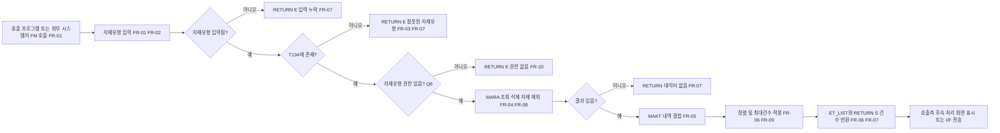
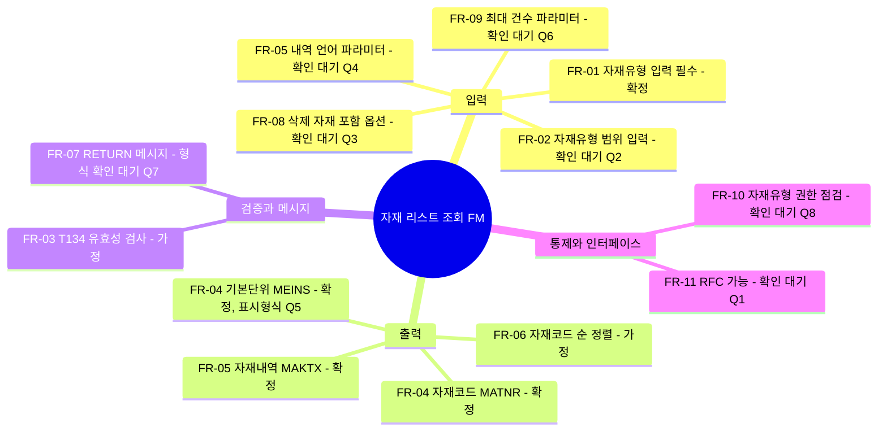
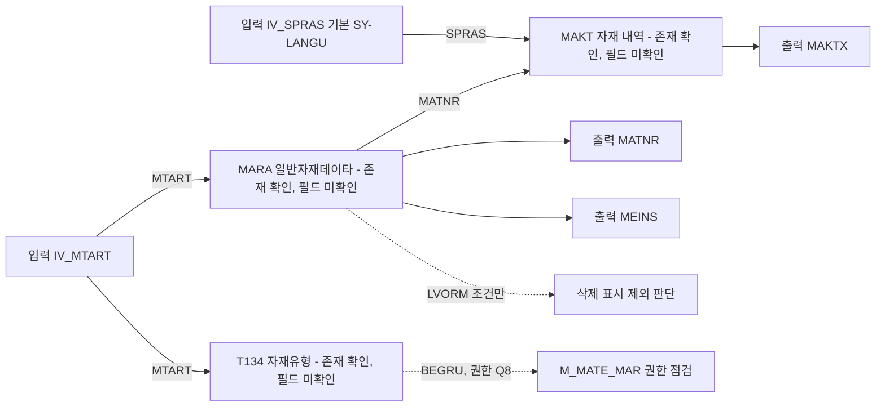

# 01. 요구사항 분석 - 자재 리스트 조회 펀션 신규 개발

| 항목 | 내용 |
|---|---|
| 요청 ID | 20261119-f26e72 |
| 요청 원문 | "자재유형을 입력값을 받고 실행하면 자재코드, 자재코드 내역, 기본단위 리스트 조회되는 펀션 만들어줘" (request.md) |
| 첨부 자료 | 없음 (attachments/ 폴더 없음). 아래 요구사항 근거는 모두 `request.md` 또는 "분석 가정"입니다 |
| 조회 시스템 | mrd-abap-rw (클라이언트 350), `mcp__sap__*` 읽기 전용 조회 |
| 작성일 | 2026-11-19 |

---

## 1. 요약

- 자재유형(MTART)을 입력받아 해당 유형의 **자재코드(MARA-MATNR), 자재내역(MAKT-MAKTX), 기본단위(MARA-MEINS)** 목록을 돌려주는 **함수 모듈(Function Module)** 을 새로 만듭니다. 화면(리포트, ALV)은 요청 범위에 없습니다.
- 데이터 원천은 표준 테이블 MARA, MAKT이고, 입력 자재유형은 T134로 유효성을 검사합니다.
- 결과는 테이블 파라미터로, 처리 결과(성공, 데이터 없음, 잘못된 자재유형, 입력 누락)는 BAPIRET2 형식 RETURN으로 돌려주는 것을 기본안으로 둡니다.
- 대상 시스템은 **ECC**입니다(도메인 MATNR 내역 "자재번호 (필드 C18)" 확인, MATDOC 없음). 따라서 자재번호는 18자리입니다. `CL_ABAP_TESTDOUBLE` 있음, `CL_ABAP_CORRESPONDING` 없음으로 SAP_BASIS 7.40 SP09 이상 7.50 미만으로 추정합니다(wiki "ECC 7.40 시스템 ABAP 개발 제약"과 같은 판정).
- 요청에 없는 사항(호출 주체, RFC 여부, 단일/범위 입력, 삭제 자재 포함 여부, 내역 언어, 단위 표시 형식, 최대 건수)은 가정으로 정하고 §9 현업 확인 필요 사항(Q1~Q10)에 남겼습니다.

---

## 분석 다이어그램

### 1) 업무 흐름도

### 2) 요구사항 구성도

### 3) 데이터 범위도

---

## 2. 기능 요구사항

우선순위: 필수 / 권장 / 선택. 근거 열의 "request.md"는 요청 원문, "가정"은 분석 담당이 정한 것으로 §8·§9에 대응 항목이 있습니다.

| ID | 설명 | 우선순위 | 근거 | 상태 |
|---|---|---|---|---|
| FR-01 | 입력 파라미터로 **자재유형(MTART) 1개**를 받는다(`IV_MTART`, 필수). 공란으로 호출하면 조회하지 않고 오류 RETURN을 돌려준다(전체 자재 조회 방지). 입력값은 대문자로 변환해 비교한다 | 필수 | request.md "자재유형을 입력값을 받고" | 단일 입력은 가정(Q2) |
| FR-02 | 여러 자재유형을 한 번에 조회할 수 있도록 **자재유형 범위(RANGE) 테이블 파라미터**(`IT_MTART_RANGE`, 선택)를 추가로 둔다. FR-01과 둘 다 오면 합집합으로 조회한다. 둘 다 비면 FR-01 오류 처리 | 선택 | 가정 | Q2 답에 따라 포함/제외 |
| FR-03 | 입력 자재유형이 T134에 없으면 조회하지 않고 "자재유형 &1 이(가) 존재하지 않습니다" 오류 RETURN을 돌려준다. 범위 입력(FR-02)일 때는 패턴(CP, BT)이 있을 수 있으므로 EQ 단일값만 검사한다 | 필수 | 가정(요청 메시지 구분 필요) | 확정안 |
| FR-04 | MARA에서 `MTART = 입력값`인 자재의 **자재코드(MATNR), 기본단위(MEINS)** 를 조회한다. 결과 1행 = 자재 1건(클라이언트 레벨, 플랜트 조건 없음) | 필수 | request.md "자재코드, 기본단위" | 확정 |
| FR-05 | MAKT에서 각 자재의 **자재내역(MAKTX)** 을 붙인다. 언어는 입력 파라미터 `IV_SPRAS`(선택, 기본 SY-LANGU). 해당 언어 내역이 없으면 자재 행은 출력하고 내역은 공란으로 둔다(자재를 누락하지 않음) | 필수 | request.md "자재코드 내역" | 언어 대체 여부 Q4 |
| FR-06 | 결과는 자재코드 오름차순으로 정렬해 테이블 파라미터 `ET_LIST`(행 구조: MATNR, MAKTX, MEINS)로 돌려주고, 건수를 `EV_COUNT`로 돌려준다 | 필수 | request.md "리스트 조회" + 가정 | 정렬은 가정 |
| FR-07 | 처리 결과를 `ES_RETURN`(BAPIRET2)으로 돌려준다. 유형: S 성공(조회 n건) / W 데이터 없음(0건) / E 입력 누락 / E 잘못된 자재유형 / E 권한 없음. 오류 시 `ET_LIST`는 비운다. 클래식 EXCEPTIONS는 쓰지 않는다(RFC·BAPI 호출측이 RETURN만 보면 되도록) | 필수 | 가정(팀장 지시: 성공/데이터 없음/잘못된 자재유형 구분) | 형식 Q7 |
| FR-08 | 기본으로 **삭제 표시 자재(MARA-LVORM = 'X')는 제외**한다. 입력 플래그 `IV_WITH_DELETED`(선택, 기본 공란)가 'X'이면 포함한다 | 권장 | 가정 | Q3 |
| FR-09 | 입력 `IV_MAX_ROWS`(선택, 기본 0 = 제한 없음)로 최대 반환 건수를 제한할 수 있다. 잘렸으면 RETURN에 경고(W, "최대 n건까지만 반환")를 준다 | 권장 | 가정(대량 자재유형 대비) | Q6 |
| FR-10 | 자재유형 권한(권한 객체 `M_MATE_MAR`, ACTVT 03 표시)을 점검하고 권한이 없으면 E RETURN을 돌려준다 | 선택 | 가정 | Q8 (RFC 사용자 권한 운영 방식에 따라 결정) |
| FR-11 | 함수 모듈을 **원격 호출 가능(Remote-Enabled Module)** 으로 만든다. 따라서 파라미터는 모두 값 전달(Pass by Value), DDIC 타입으로 선언한다 | 권장 | 가정 | Q1 |

### 2.1 인터페이스 기본안 (설계 단계 입력용, 이름은 제안)

| 구분 | 파라미터 | 타입(제안) | 필수 | 설명 |
|---|---|---|---|---|
| IMPORTING | IV_MTART | MTART | 필수(FR-01) | 자재유형 |
| IMPORTING | IV_SPRAS | SPRAS | 선택, 기본 SY-LANGU | 내역 언어 (FR-05) |
| IMPORTING | IV_WITH_DELETED | CHAR1 또는 XFELD | 선택, 기본 공란 | 'X' = 삭제 표시 자재 포함 (FR-08) |
| IMPORTING | IV_MAX_ROWS | INT4 | 선택, 기본 0 | 0 = 제한 없음 (FR-09) |
| IMPORTING (선택) | IT_MTART_RANGE | 표준 범위 테이블 타입 재사용 후보: `MD_RANGE_T_MTART`, `FIP_T_MTART_RANGE`, `CFB_T_MTART_RANGE` (시스템에 존재 확인, 행 구조 미확인) | 선택 | FR-02 채택 시만 |
| EXPORTING | ET_LIST | 신규 DDIC 테이블 타입 (예: 구조 `ZMMS_MATERIAL_LIST` / 테이블 타입 `ZMMT_MATERIAL_LIST`, 필드 MATNR TYPE MATNR, MAKTX TYPE MAKTX, MEINS TYPE MEINS) | - | 결과 목록 (FR-06) |
| EXPORTING | EV_COUNT | INT4 | - | 반환 건수 |
| EXPORTING | ES_RETURN | BAPIRET2 | - | 처리 결과 (FR-07) |

- FM 이름 제안: `Z_MM_GET_MATERIAL_LIST` — `Z_MM_*MAT*` 검색 결과에 같은 이름 없음(충돌 없음 확인).
- 함수 그룹: 기존 `ZFGMM41`("MM Common Function", 패키지 ZMMD)에 추가하거나 신규 그룹 생성 중 설계 단계에서 결정(Q9). 패키지는 ZMMD 가정.
- RFC에서 EXPORTING 테이블 타입 파라미터 사용 가능(평면 구조). TABLES 파라미터는 쓰지 않는 것을 기본으로 하되, 호출측이 구형 RFC 라이브러리면 TABLES가 필요할 수 있어 Q1에 함께 묻습니다.

---

## 3. 비기능 요구사항

| ID | 구분 | 내용 |
|---|---|---|
| NFR-01 | 성능 | MARA를 MTART 조건으로 읽고 MAKT는 MATNR+SPRAS(MAKT 기본키)로 결합합니다. MAKT는 FOR ALL ENTRIES(드라이버 비었는지 사전 확인) 또는 LEFT OUTER JOIN 중 설계에서 선택. MARA의 MTART 보조 인덱스 존재 여부는 시스템에서 읽을 수 없어 미확인 → SE11/ST05 확인 필요. 목표 응답시간: 자재 5만 건 이하 기준 수 초 이내(가정, Q6) |
| NFR-02 | 데이터 정합성 | 같은 입력이면 같은 결과(자재코드 순). 오류 시 ET_LIST 비움. DB 갱신 없음(읽기 전용 FM, COMMIT 없음) |
| NFR-03 | 호환성 | ECC, SAP_BASIS 7.40 SP09 이상 7.50 미만(추정). 7.50 이후 구문(`CL_ABAP_CORRESPONDING`, CDS 등) 사용 금지. 사용 구문의 최소 SP를 개발 문서에 기록 |
| NFR-04 | 데이터 형식 | MATNR은 내부 형식(18자리, 숫자형은 앞 0 채움)으로 반환, MEINS는 내부 단위값으로 반환(가정, Q5). 입력 MTART는 대문자 변환 |
| NFR-05 | 메시지 | 메시지 클래스 `ZMM`(MM Message Class, 패키지 ZMMD) 존재 확인. 신규 메시지 번호 생성은 시스템 쓰기이므로 설계·개발 단계에서 팀장 판단. 다국어 필요 여부 확인(Q7) |
| NFR-06 | 테스트 용이성 | DB 접근 없는 로직(입력 정규화, 메시지 조립, 최대건수 자르기)을 분리해 ABAP Unit 대상으로 둡니다. 이 시스템에는 `CL_OSQL_TEST_ENVIRONMENT`가 없어 SELECT 부분은 통합 테스트로 확인 |
| NFR-07 | 보안 | FR-10 채택 시 AUTHORITY-CHECK. RFC 노출 시 호출 사용자(RFC 계정)의 S_RFC 권한에 함수 그룹 등록 필요(Basis) |

---

## 4. 인수 기준 (테스트 가능한 형태)

| AC | 관련 FR | 조건 | 기대 결과 |
|---|---|---|---|
| AC-01 | FR-04~06 | 존재하는 자재유형(예: 개발계에서 자재가 있는 유형, 테스트 단계에서 SE16 MARA로 선정)으로 호출 | ET_LIST 건수 = SE16 MARA(MTART=값, LVORM≠'X') 건수, EV_COUNT 동일, ES_RETURN-TYPE = 'S' |
| AC-02 | FR-04 | AC-01 결과의 임의 3건 | MATNR, MEINS가 MM03 기본 데이터와 일치 |
| AC-03 | FR-05 | 로그온 언어 KO, 자재내역이 KO로 있는 자재 | MAKTX = MAKT(SPRAS=3) 값 |
| AC-04 | FR-05 | KO 내역이 없는 자재가 포함된 자재유형 | 해당 자재 행은 출력되고 MAKTX 공란(Q4 답에 따라 EN 대체로 변경 가능) |
| AC-05 | FR-01, FR-07 | IV_MTART 공란 호출 | ET_LIST 0건, ES_RETURN-TYPE = 'E'(입력 누락), MARA 조회 없음 |
| AC-06 | FR-03, FR-07 | T134에 없는 값(예: 'ZZZ9', 사전에 SE16 T134로 미존재 확인) | ET_LIST 0건, ES_RETURN-TYPE = 'E'(잘못된 자재유형) |
| AC-07 | FR-07 | T134에는 있으나 자재가 0건인 자재유형 | ET_LIST 0건, ES_RETURN-TYPE = 'W'(데이터 없음) |
| AC-08 | FR-08 | MARA-LVORM='X' 자재가 있는 자재유형, IV_WITH_DELETED 공란 / 'X' | 공란이면 삭제 자재 미포함, 'X'면 포함(건수 차이 = 삭제 자재 수) |
| AC-09 | FR-01 | IV_MTART 소문자 입력(예: 'roh' 형태) | 대문자 입력과 같은 결과 |
| AC-10 | FR-06 | AC-01 결과 | MATNR 오름차순, 중복 MATNR 없음 |
| AC-11 | FR-09 | IV_MAX_ROWS = 10, 대상 건수 > 10 | 10건 반환, ES_RETURN-TYPE = 'W'(잘림) |
| AC-12 | FR-11 | SE37 테스트에서 RFC 대상(NONE 또는 같은 시스템 RFC 목적지)으로 호출 | AC-01과 같은 결과, 덤프 없음 |
| AC-13 | FR-10 | 해당 자재유형 권한이 없는 사용자(채택 시) | ET_LIST 0건, ES_RETURN-TYPE = 'E'(권한 없음) |
| AC-14 | NFR-01 | 자재 건수가 가장 많은 자재유형 | ST05에서 MARA 접근이 전체 스캔이 아닌지 확인, 응답시간 기록 |

---

## 5. 관련 모듈

- **MM** (자재마스터): MARA, MAKT, T134 / 권한 객체 M_MATE_MAR
- **BC** (공통): 함수 모듈·RFC, BAPIRET2, 메시지 클래스 ZMM
- 호출 주체 모듈은 미정(Q1) — 다른 ABAP 프로그램, MES·웹 등 외부 시스템 I/F 가능성

---

## 6. 관련 표준 테이블·필드

### 6.1 시스템 조회 결과 (mrd-abap-rw, 2026-11-19)

| 대상 | 도구 | 결과 |
|---|---|---|
| MARA, MAKT, T134 필드 정의 | GetTable(source/metadata), GetStructure | **확인 불가** — `/sap/bc/adt/ddic/tables/mara/source/main` 등 `ExceptionResourceNotFound`(404). 7.50 미만 ADT에 해당 리소스 없음(wiki "SAP 시스템 미확인 상태에서 작업하는 방법"과 같은 현상) |
| MTART, MATNR, MAKTX, MEINS, LVOMA 타입 정의 | GetTypeInfo | **확인 불가** — "not found as data element, domain or table type" |
| 테이블 존재 | SearchObject | MARA(TABL/DT "일반자재데이타", MG), MAKT(TABL/DT "자재 내역", MG), T134(TABL/DT, MG, 시스템 내역은 "구성형자재유형"으로 표시됨), T134T(TABL/DT "자재유형내역", MG) **존재 확인** |
| Data Element·도메인 존재 | SearchObject | MTART(DTEL·DOMA "자재 유형"), MATNR(DTEL "자재 번호", DOMA "자재번호 (필드 C18)"), MAKTX(DTEL "자재 내역"), MEINS(DTEL "기본 단위", DOMA "다양한 유형의 단위"), LVOMA(DTEL "클라이언트 레벨에서 삭제할 자재 표시"), SPRAS(DTEL·DOMA "언어 키") **존재 확인** |
| 기타 | SearchObject | BAPIRET2(TABL/DS), BAPIRET2_T(TTYP), 권한 객체 M_MATE_MAR(SUSO "자재 마스터: 자재 유형"), 메시지 클래스 ZMM, CL_ABAP_TESTDOUBLE 존재 / MATDOC, CL_ABAP_CORRESPONDING 없음 |

### 6.2 사용 필드 (필드명은 SAP 표준, 길이는 표준 지식 기준 - 시스템 SE11 확인 필요)

| 테이블 | 필드 | Data Element | 형식(표준 기준) | 용도 | 시스템 확인 |
|---|---|---|---|---|---|
| MARA | MATNR | MATNR | CHAR 18 (ALPHA 변환) | 출력 자재코드, MAKT 결합 키 | DE·도메인 존재 확인, 도메인 내역으로 18자리 확인 |
| MARA | MTART | MTART | CHAR 4 | 조회 조건 | DE 존재 확인, 길이 미확인 |
| MARA | MEINS | MEINS | UNIT 3 (CUNIT 변환) | 출력 기본단위 | DE 존재 확인, 길이 미확인 |
| MARA | LVORM | LVOMA | CHAR 1 | 삭제 표시 조건(FR-08) | DE 존재 확인, MARA-LVORM↔LVOMA 연결은 표준 지식 |
| MAKT | MATNR | MATNR | CHAR 18 | 키 | 미확인(표준) |
| MAKT | SPRAS | SPRAS | LANG 1 | 언어 조건 | DE 존재 확인 |
| MAKT | MAKTX | MAKTX | CHAR 40 | 출력 자재내역 | DE 존재 확인, 길이 미확인 |
| T134 | MTART | MTART | CHAR 4 | 자재유형 유효성(FR-03) | 미확인(표준) |
| T134 | BEGRU | BEGRU | CHAR 4 | 자재유형 권한그룹(FR-10, M_MATE_MAR) | 미확인(표준) |

- 테이블 간 키: T134-MTART = MARA-MTART, MARA-MATNR = MAKT-MATNR (+ MAKT-SPRAS = 입력 언어).
- 출력 구조는 위 Data Element를 참조해 선언하면 길이가 시스템 정의를 따르므로, 길이 미확인이어도 개발에는 영향이 없습니다(활성화 시 검증).

### 6.3 기존 유사 오브젝트 (재사용 검토 대상)

| 오브젝트 | 유형 | 설명(시스템) | 검토 의견 |
|---|---|---|---|
| BAPI_MATERIAL_GETLIST | 표준 FM(MGA) | Supply List of Materials for Search Criteria Transferred | 자재유형 범위로 자재 목록을 주지만 기본단위는 반환 구조에 없는 것으로 알고 있음(표준 지식, 시스템 미확인). 단위를 별도 조회해야 하고 인터페이스가 무거워 신규 FM 권장. 설계에서 SE37로 출력 구조 확인 |
| Z_MM_MP_SELECT_MATNR_DATA | Z FM(ZMMD) | [MM] 통합구매 자재-플랜트,기본단위 조회 | 기본단위를 주는 기존 FM. 입력이 자재유형인지 미확인(FM 소스 조회 도구 없음) → 설계 단계에서 SE37로 확인, 그대로 쓸 수 있으면 현업과 재사용 협의(Q10) |
| Z_MD_MIGMAT_LIST_GET | Z FM(ZMDD) | [공통] 자재마스터 리스트 GET | 이름상 유사. 인터페이스 미확인 → 설계 단계 SE37 확인(Q10) |
| Z_MM_DPR_MATERIAL_LIST | Z FM(ZMMD) | [MM] 웹 구매요청 MRO 리스트 조회 | MRO 전용으로 보임, 참고만 |
| ZCL_MM_MATERIAL_LIST | Z 클래스($TMP) | 자재마스터 조회 리포트 로직 | 자재×플랜트 리포트용 로컬 오브젝트. 이송 대상 아님, 재사용 비권장 |
| ZCO_R_MTART | Z 테이블 타입(ZCOD) | [CO] 자재유형 범위 테이블 유형 | CO 패키지 소속이라 MM FM에서 참조 비권장. 범위 입력이 필요하면 표준 `MD_RANGE_T_MTART` 등 사용 검토 |

---

## 7. 분석 다이어그램 보충: 처리 순서 (설계 참고)

1. 입력 정규화: IV_MTART 대문자, IV_SPRAS 공란이면 SY-LANGU, IV_MAX_ROWS 음수면 0.
2. 입력 누락 검사 → E 반환.
3. T134 존재 검사 → E 반환.
4. (FR-10 채택 시) T134-BEGRU로 M_MATE_MAR 권한 점검 → E 반환.
5. MARA SELECT (MTART, LVORM 조건, 최대건수) → 0건이면 W 반환.
6. MAKT 결합(MATNR + SPRAS), 없으면 공란.
7. MATNR 정렬, EV_COUNT, S 반환(잘림이면 W).

---

## 8. 가정

| No | 가정 | 관련 |
|---|---|---|
| A-01 | "펀션"은 화면 없는 **함수 모듈(FM)** 로 해석한다. 결과 표시 화면은 범위 밖 | FR 전체 |
| A-02 | 자재유형은 **단일값 1개, 필수**. 범위 입력은 선택 기능으로만 둔다 | FR-01, FR-02, Q2 |
| A-03 | 조회 단위는 클라이언트 레벨 자재 1건 = 1행. 플랜트·판매조직 조건은 없다 | FR-04 |
| A-04 | **삭제 표시 자재(MARA-LVORM='X')는 기본 제외**, 옵션으로 포함 가능 | FR-08, Q3 |
| A-05 | 내역 언어는 SY-LANGU 기본, 내역이 없으면 공란으로 행은 유지(대체 언어 없음) | FR-05, Q4 |
| A-06 | MATNR·MEINS는 내부 형식으로 반환한다 | NFR-04, Q5 |
| A-07 | 기본 건수 제한 없음(0), 호출측이 필요 시 제한 | FR-09, Q6 |
| A-08 | 결과 통보는 BAPIRET2 단건(ES_RETURN), 메시지 언어는 SY-LANGU | FR-07, Q7 |
| A-09 | 외부 시스템 호출 가능성이 있어 RFC 가능으로 만든다 | FR-11, Q1 |
| A-10 | 패키지 ZMMD, FM 이름 `Z_MM_GET_MATERIAL_LIST`, 함수 그룹은 설계에서 결정 | §2.1, Q9 |
| A-11 | 대상 시스템은 ECC(MATNR 18자리), SAP_BASIS 7.40 SP09~7.50 미만(추정) | NFR-03 |
| A-12 | 테이블 필드 길이·Data Element 연결은 SAP 표준 기준이며 시스템에서는 존재만 확인됨 | §6 |

---

## 9. 현업 확인 필요 사항

| Q | 질문 | 분석 가정(답이 없을 때) | 영향 FR |
|---|---|---|---|
| Q1 | 이 함수를 **누가 호출**합니까? (다른 SAP 프로그램 / MES·웹 등 외부 시스템 RFC). 외부라면 호출 시스템과 RFC 라이브러리(TABLES 파라미터 필요 여부) | RFC 가능, EXPORTING 테이블 타입 | FR-11, §2.1 |
| Q2 | 자재유형은 **한 번에 1개**만 입력합니까, 여러 개(범위)도 필요합니까? | 1개 필수, 범위는 선택 기능 | FR-01, FR-02 |
| Q3 | **삭제 표시 자재**를 결과에 포함해야 합니까? | 기본 제외, 옵션으로 포함 | FR-08 |
| Q4 | 자재내역 **언어**: 로그온 언어 기준으로 충분합니까? 해당 언어 내역이 없으면 영어 등 대체 언어로 보여 줄까요, 공란으로 둘까요? | SY-LANGU, 없으면 공란 | FR-05 |
| Q5 | 자재코드 앞 0, 기본단위 표시 형식: 내부값(예: 단위 'ST')과 화면 표시값(예: 'EA'/'PC') 중 무엇이 필요합니까? | 둘 다 내부값 | NFR-04 |
| Q6 | 자재유형당 예상 자재 건수와 **최대 반환 건수** 제한이 필요한지, 허용 응답시간 | 제한 없음(옵션 제공), 수 초 이내 | FR-09, NFR-01 |
| Q7 | 결과 메시지를 BAPIRET2 단건으로 받으면 됩니까, 아니면 단순 코드(예: 'S'/'E' + 메시지 텍스트)가 필요합니까? 메시지 다국어 필요 여부 | BAPIRET2 단건, 메시지 클래스 ZMM 사용 | FR-07, NFR-05 |
| Q8 | **자재유형 권한**(M_MATE_MAR, 자재유형 권한그룹 T134-BEGRU)을 운영 중입니까? 권한 점검이 필요합니까? | 운영 여부 확인 전까지 선택 기능 | FR-10 |
| Q9 | 함수 그룹: 기존 `ZFGMM41`(MM Common Function)에 넣어도 됩니까, 신규 그룹이 필요합니까? (팀 표준 확인) | 설계 단계 결정 | §2.1 |
| Q10 | 기존 `Z_MM_MP_SELECT_MATNR_DATA`(통합구매 자재-플랜트, 기본단위 조회)나 `Z_MD_MIGMAT_LIST_GET`(자재마스터 리스트 GET)으로 대체 가능한지 — 현업이 이미 쓰고 있는 함수가 있는지 | 신규 개발 | 전체 |
| Q11 | 출력 항목은 자재코드, 내역, 기본단위 3개로 확정입니까? (자재그룹, 자재유형 등 추가 가능성) | 3개 확정 | FR-04~06 |

### 개발 착수 전 시스템 확인 목록 (현업 아님, 개발팀 확인)

- SE11: MARA-MTART/MEINS/LVORM, MAKT-MAKTX, T134-BEGRU 길이·Data Element, MARA의 MTART 보조 인덱스 존재 여부
- SE37: BAPI_MATERIAL_GETLIST 출력 구조(기본단위 포함 여부), Z_MM_MP_SELECT_MATNR_DATA·Z_MD_MIGMAT_LIST_GET 인터페이스
- SU21: M_MATE_MAR 권한 필드(ACTVT, BEGRU 예상)
- SE91: 메시지 클래스 ZMM의 빈 번호 범위
- 시스템 > 상태: SAP_BASIS 정확한 SP
