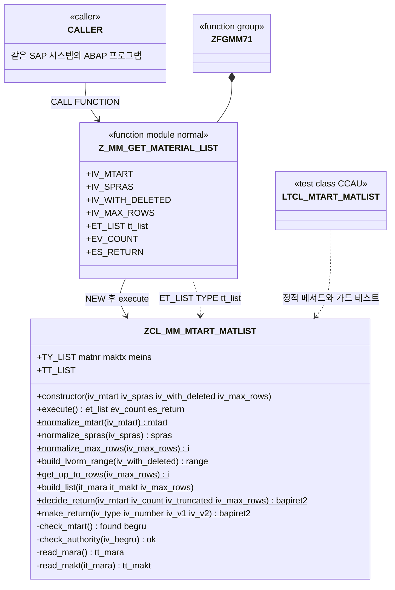
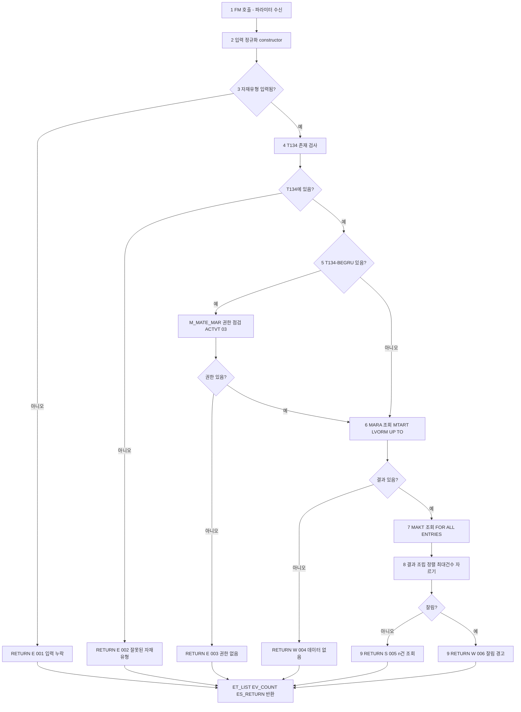
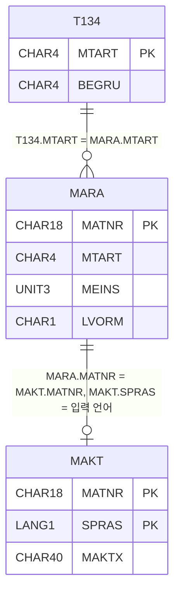

# 02. 설계서 - 자재 리스트 조회 펀션 신규 개발

- 요청 ID: 20261119-f26e72
- 작성: sap-designer (**설계 재작업 - 팀장 수정 지시 반영**)
- 작성일: 2026-11-19 (재작업)
- 입력: `request.md`, `01_analysis.md`(팀장 승인본), 기존 `02_design.md`(1차 설계), 팀장 수정 지시
- 첨부 자료: 없음
- 개발표준: `standards/handbook.md` (Dongkuk Steel ABAP 개발표준 Handbook)
- 참고 wiki: "ECC 7.40 시스템 ABAP 개발 제약", "SAP 시스템 미확인 상태에서 작업하는 방법", "자재마스터 조회 리포트 설계 패턴", "테스트계 반영 전 점검 항목"
- 참고 프로젝트 소스: `src/board.ts`(개발계 반영 순서·파일 형식), `src/adt.ts`(함수 그룹·함수 모듈·메시지 클래스 생성)
- 조회 시스템: mrd-abap-rw (클라이언트 350), `mcp__sap__*` 읽기 전용 조회만 함

### 팀장 수정 지시

> "테이블이나 구조체 만들지 않고 할수 있는 방법으로 변경해줘"

### 변경 이력

| 버전 | 일자 | 변경 내용 | 이유 |
|---|---|---|---|
| 1차 | 2026-11-19 | 최초 설계. 출력 타입으로 신규 DDIC 구조 `ZSMM3600`·테이블 타입 `ZTTMM3600`(SE11 수작업), FM은 Remote-Enabled, FM·FUGR·MSAG는 수작업 반영 | — |
| 재작업 | 2026-11-19 | ① **신규 DDIC 오브젝트 전부 삭제**(`ZSMM3600`, `ZTTMM3600`). 출력 타입을 클래스 `ZCL_MM_MTART_MATLIST`의 public TYPES `TY_LIST`/`TT_LIST`로 정의하고 FM 파라미터 `ET_LIST`가 `TYPE zcl_mm_mtart_matlist=>tt_list`를 참조(2.2절) | 팀장 수정 지시: 테이블·구조체를 만들지 않는 방법 |
| | | ② **FM 처리 유형을 Remote-Enabled → 일반 함수 모듈로 변경**. FR-11(RFC 가능)을 1차 개발에서 제외하고 Q1 답이 "외부 시스템 호출"이면 다시 판단(2.2절 트레이드오프) | 클래스 타입은 RFC FM 파라미터에 쓸 수 없음. ①의 결과 |
| | | ③ 0.3절 반영 도구 제약 수정: 웹앱이 메시지 클래스·함수 그룹·함수 모듈도 자동 반영함을 소스로 확인. FM 소스를 `manual/`이 아니라 `src/*.fm.abap`+`*.fm.json`, 함수 그룹 `src/ZFGMM71.fugr.json`, 메시지 `src/ZMMM3.msag.json`으로 둠. **수작업 반영 단계(SE11·SE37·SE91·SE80) 없음** | 1차 설계 서술이 현재 웹앱 기능과 다름(팀장 지시) |
| | | ④ 2장 오브젝트 목록, 2.1 함수 그룹 결정 근거(RFC 근거 → 비RFC 기준으로 갱신), 3장 FM 인터페이스, 4장 클래스 시그니처, 5장 1단계 FM 형태, 8장 S_RFC, 10장 반영 순서, 11장 테스트(IT-11), 12·13장 추적·확인 사항 일관 수정 | ①~③의 파급 |
| | | ⑤ 0.1절에 재조회 결과 추가: `ZCL_MM_MTART_MATLIST`가 ZMMD에 이미 생성되어 있음(활성 버전은 빈 껍데기, 비활성 버전에 소스) | 재작업 중 시스템 확인 |

처리 로직(5장 2~9단계), 메시지 텍스트(7장), 권한 점검(8장), 데이터 소스(6장)는 지시와 무관해 1차 설계를 유지합니다.

### 근거 표기 규칙

| 표기 | 의미 |
|---|---|
| **[확인]** | 이 설계 세션이 mrd-abap-rw에서 SearchObject·GetClass로 직접 확인함 |
| **[확인: 프로젝트 소스]** | 이 세션이 `src/board.ts`·`src/adt.ts`를 읽어 확인함 |
| **[분석확인]** | 분석 단계가 시스템에서 확인했고 설계에서 다시 조회하지 않음 |
| **[미확인(표준 기준)]** | 시스템 도구로 읽을 수 없어 SAP ECC 표준 지식으로 씀. 활성화·SE11·SU21 등으로 확인 필요 |
| **[가정]** | 분석 가정 또는 설계 가정. 현업 답(Q)에 따라 바뀔 수 있음 |
| **[추가]** | 요청 원문에 없는 **현업 확인 전 추가 기능** |

---

## 0. 설계 전 확인 결과

### 0.1 시스템 조회 결과 (2026-11-19)

| 대상 | 도구 | 결과 |
|---|---|---|
| 함수 그룹 `ZFGMM*` | SearchObject (FUGR) | [확인] ZFGMM00~33, 35~38, 41~70, 80, 91, 92, ZFGMM_ADDR 존재(모두 ZMMD). **ZFGMM34·39·40·71~79 없음**. 재작업 때 `ZFGMM7*` 재조회 결과도 ZFGMM70 1건뿐 → **ZFGMM71 비어 있음** |
| ZFGMM41 | SearchObject | [확인] "MM Common Function", ZMMD. 소속 FM과 전역 데이터는 읽을 수 없음(아래 0.2) |
| FM 이름 `Z_MM_GET_MAT*` | SearchObject | [확인] `Z_MM_GET_MATNR`, `Z_MM_GET_MATNR_SUB`만 있음. 재작업 때 `Z_MM_GET_MATERIAL*` 재조회 결과 없음 → **`Z_MM_GET_MATERIAL_LIST` 없음** |
| 메시지 클래스 `ZMMM*` | SearchObject (MSAG) | [확인] 재조회 결과 ZMMM, ZMMM1, ZMMM2만 존재(ZMMD). **ZMMM3 없음** |
| `Z*3600` | SearchObject | [확인] 결과 없음 — 1차 설계의 `ZSMM3600`·`ZTTMM3600`은 시스템에 만들어지지 않았음(이번 재작업으로 설계에서도 삭제) |
| 클래스 `ZCL_MM_MTART_MATLIST` | SearchObject, GetClass | [확인] **이미 존재(CLAS/OC, 패키지 ZMMD)**. 활성 버전은 PUBLIC 섹션이 빈 14줄 껍데기, 비활성 버전에 1차 설계 기준 소스(470줄)가 저장되어 있음. 이전 개발계 반영 시도에서 생성은 됐고 활성화는 되지 않은 상태로 보임(원인은 `ZTTMM3600` 미존재로 추정, 반영 결과 로그 미확인). 웹앱 재반영 시 "소스 갱신"으로 덮어씀(board.ts `adt.exists` 분기) |
| 재사용 후보 FM 위치 | SearchObject (detail full) | [확인] `Z_MM_MP_SELECT_MATNR_DATA` → ZFGMM25, `Z_MD_MIGMAT_LIST_GET` → ZFGMD98(ZMDD) |
| 출력 타입 대체 후보(표준 TTYP) | SearchObject (TTYP `*MAKT*`, `*MAT*LIST*`, `MATERIAL_LIST*`) | [확인] 이름 기준 후보: `MAKT_TAB`(MGA, "MAKT 테이블"), `MAKTX_TAB`(CIF), `MATERIAL_LIST`(TABL/DS)·`MATERIAL_LIST_T`(TTYP) — 둘 다 패키지 **ODATA_PP_MRP**("Material Data"), `GDS_TT_MATERIAL_LIST`(MGV), `WRF_MATLIST_MATNR_TTY`(WRF_ARTICLELIST) 등. 필드 구성은 읽을 수 없음(0.2). 판단은 2.2절 |
| 사용 타입 | SearchObject | [확인] `XFELD`, `INT4`, `CL_ABAP_MATH` 존재. [분석확인] MTART·MATNR·MAKTX·MEINS·SPRAS·LVOMA DTEL, BAPIRET2, M_MATE_MAR, MARA·MAKT·T134 존재 |

### 0.2 읽지 못한 것 (시도한 도구와 오류)

| 대상 | 시도 | 결과 | 넘긴 곳 |
|---|---|---|---|
| 표준 구조·테이블 타입 필드 구성(`BAPIRET2`, `BAPIRET2_T`, 위 대체 후보) | GetStructure `BAPIRET2`, GetTypeInfo `BAPIRET2_T` | GetStructure 404 `ExceptionResourceNotFound` (`/sap/bc/adt/ddic/structures/.../source/main` 없음), GetTypeInfo "not found as data element, domain, structure or table type". 7.50 미만 ADT 제약. SearchObject는 `STRU` 유형 필터도 지원하지 않음(500 "Object type STRU is not supported") | 2.2절 대안 1 판단 |
| `Z_MM_MP_SELECT_MATNR_DATA`, `Z_MD_MIGMAT_LIST_GET` 인터페이스·소스 | GetProgram `SAPLZFGMM25`, `LZFGMM25UXX`, `LZFGMD98UXX` | 404 (FM 소스 조회 도구 없음) | C-04 |
| MARA·MAKT·T134 필드 길이, MARA 인덱스 | (분석 단계) GetTable·GetTypeInfo | 404 — 7.50 미만 ADT 제약 | C-01, C-02 |
| M_MATE_MAR 권한 필드 | 도구 없음 | 확인 불가 | C-03 |
| ZMMM2·ZMMM 메시지 번호 사용 현황 | 도구 없음 | 확인 불가 | 2.1 결정 근거 |

### 0.3 개발계 반영 도구 (설계에 영향) — 재작업에서 수정

[확인: 프로젝트 소스] `src/board.ts` `runDeploy()`와 `src/adt.ts`를 읽은 결과, 팀장이 보드에서 개발계 반영을 승인하면 웹앱이 `work/<요청ID>/src/`의 파일을 아래 순서로 ADT 반영합니다.

| 순서 | 유형 | src/ 파일 형식 | 웹앱 동작 |
|---|---|---|---|
| 0 | 이송요청 | — | 패키지가 `$`로 시작하지 않고 번호가 없으면 자동 생성 |
| 1 | 메시지 클래스 (MSAG) | `<이름>.msag.json` — `{"description": "...", "messages": [{"no": "001", "text": "...", "selfExplanatory": true}]}` | 없으면 신규 생성, 있으면 없는 번호만 추가. 실패해도 경고만 남기고 계속 진행(SE91 수작업 안내) |
| 2 | 함수 그룹 (FUGR) | `<이름>.fugr.json` — `{"description": "..."}` | 없으면 생성. `.fugr.json`이 없어도 `.fm.json`의 group으로 만들지만, 그룹 내역을 정하려고 파일을 둠 |
| 3 | 프로그램·인클루드·클래스 | `<이름>.abap` (+ 클래스는 `<이름>.testclasses.abap`) | `CLASS ... DEFINITION`이 있으면 CLAS. 없으면 생성, 있으면 소스 갱신 |
| 4 | 함수 모듈 (FUNC) | `<이름>.fm.abap` (FUNCTION ~ ENDFUNCTION, SE37 `*"` 인터페이스 주석 형식 허용 → ADT 시그니처로 변환) + `<이름>.fm.json` — `{"group": "ZFG..", "description": "...", "processingType": "rfc" 또는 "normal"}` | **클래스 다음에** 생성·저장(FM이 클래스를 참조하는 경우 대비) |
| 5 | 활성화 → ABAP Unit | — | 클래스·함수 그룹·FM을 함께 활성화한 뒤 테스트 클래스가 있는 클래스의 ABAP Unit 실행 |

- **DDIC(구조·테이블 타입·DB 테이블 등)만 이 개발계 ADT가 지원하지 않아 SE11 수작업**입니다(board.ts 주석). 이번 재작업 설계는 **신규 DDIC가 없으므로 모든 오브젝트가 웹앱 자동 반영 대상**이고 수작업 반영 단계가 없습니다.
- 1차 설계 0.3절의 "FM·FUGR·메시지는 웹앱 반영 불가, FM 소스는 `manual/`에 두고 SE37 수작업"은 **틀린 서술이라 철회**합니다.
- 핵심 로직은 계속 전역 클래스에 두고 FM은 얇은 래퍼로 둡니다. 이유는 반영 도구가 아니라 **ABAP Unit 대상화**(FM 안 로직은 단위 테스트가 어려움)와 **출력 타입 정의 위치**(2.2절)입니다.

---

## 1. 개요

- **목적**: 자재유형(MTART)을 입력받아 그 유형의 **자재코드(MARA-MATNR), 자재내역(MAKT-MAKTX), 기본단위(MARA-MEINS)** 목록을 돌려주는 함수 모듈 `Z_MM_GET_MATERIAL_LIST`를 만듭니다(request.md). 화면(리포트·ALV)은 없습니다.
- **구성(최소 오브젝트, 신규 DDIC 없음)**: 함수 그룹 `ZFGMM71` 1개, FM `Z_MM_GET_MATERIAL_LIST` 1개(일반 함수 모듈), 로직 클래스 `ZCL_MM_MTART_MATLIST` 1개(출력 타입 `TT_LIST`도 이 클래스에 정의), 메시지 클래스 `ZMMM3`(메시지 6개). **신규 구조·테이블 타입·DB 테이블, 스키마 변경, T-code는 없습니다.**
- **처리 요약**: 입력 정규화 → 입력 누락 검사 → T134 존재 검사 → (자재유형에 권한그룹이 있으면) 권한 점검 → MARA 조회 → MAKT 내역 결합(FOR ALL ENTRIES) → 자재코드 순 정렬·최대 건수 적용 → `ET_LIST`, `EV_COUNT`, `ES_RETURN`(BAPIRET2) 반환.
- **범위 결정 요약** (요청 범위 밖 기능 = [추가], 3장 상세)

| 분석 FR | 설계 결정 | 구분 |
|---|---|---|
| FR-01, 03~07 | 포함 | 요청 범위(FR-03·06·07의 세부 규칙은 [가정]) |
| FR-02 자재유형 범위 입력 | **1차 개발 제외** (Q2 답이 "여러 개"면 선택 파라미터 추가) | [추가] |
| FR-05 `IV_SPRAS` 언어 파라미터 | 포함(선택, 기본 SY-LANGU) | [추가] |
| FR-08 삭제 자재 기본 제외 | 포함(`IV_WITH_DELETED`, 기본 공란 = 제외) — 결과 건수에 영향, 3.2 | [추가] |
| FR-09 최대 건수 | 포함(`IV_MAX_ROWS`, 기본 0 = 제한 없음) | [추가] |
| FR-10 자재유형 권한 | 포함(T134-BEGRU가 있을 때만 점검) | [추가] |
| FR-11 RFC 가능 | **재작업에서 1차 개발 제외**(일반 함수 모듈). 신규 DDIC 없이 RFC를 할 수 없어서임(2.2). Q1 답이 "외부 시스템"이면 재설계 | [추가], Q1 |

- **대상 릴리스**: ECC, SAP_BASIS 7.40 SP09 이상·7.50 미만 추정(분석서 A-11, wiki). MATNR 18자리. 사용 구문의 최소 SP는 9장에 적습니다.

---

## 설계 다이어그램

### 1) 프로그램 구조도



### 2) 처리 흐름도



### 3) 데이터 관계도



(필드 형식은 [미확인(표준 기준)]. 테이블 존재만 [분석확인].)

---

## 예상 화면

**화면 없음.** 이 오브젝트는 화면이 없는 함수 모듈입니다(분석서 A-01).

- 실행 방법(개발·테스트): SE37 → `Z_MM_GET_MATERIAL_LIST` → 테스트/실행(F8) → `IV_MTART` 등 입력 → 실행 → `ET_LIST`·`EV_COUNT`·`ES_RETURN` 확인. 이번 설계는 일반 함수 모듈이므로 **RFC 목적지 지정 테스트는 하지 않습니다**(11.2 IT-11).
- 운영 호출: 같은 SAP 시스템의 다른 ABAP 프로그램이 `CALL FUNCTION 'Z_MM_GET_MATERIAL_LIST'`로 호출합니다. 외부 시스템 RFC 호출은 이번 범위에서 제외(2.2, Q1). 백그라운드 잡(SM36) 대상이 아닙니다.
- 사용자에게 보이는 결과는 `ES_RETURN`의 메시지뿐이며, 메시지 목록은 7장 표에 있습니다.

---

## 2. 개발 오브젝트 목록

| No | 유형 | 이름 | 신규/재사용 | 목적 | 명명 근거 | 반영 방법 (src/ 파일) |
|---|---|---|---|---|---|---|
| O-01 | 패키지 (DEVC) | `ZMMD` | 재사용 | MM 개발 패키지 | 핸드북 Z+MM+D, 시스템에 실재 [확인] | — (보드 반영 설정의 패키지) |
| O-02 | 함수 그룹 (FUGR) | `ZFGMM71` | **신규** | 자재마스터 조회 공통 FM 전용 그룹. 내역: "[MM] 자재마스터 조회 공통" | 핸드북 Z+FG+MM+2자리. ZFGMM70 다음 빈 번호 [확인] | 웹앱 자동 (`ZFGMM71.fugr.json`) |
| O-03 | 함수 모듈 (FUNC) | `Z_MM_GET_MATERIAL_LIST` | **신규** | 자재유형별 자재 리스트 조회. **일반 함수 모듈(normal)**. 내역: "[MM] 자재유형별 자재코드·내역·기본단위 조회" | 핸드북 Z_+서술어 [확인: 동명 없음] | 웹앱 자동 (`Z_MM_GET_MATERIAL_LIST.fm.abap` + `.fm.json`, processingType `normal`) |
| O-04 | 클래스 (CLAS) | `ZCL_MM_MTART_MATLIST` | **신규(시스템에 비활성 상태로 생성되어 있음, 0.1)** | 검증·조회·조립 로직 + **FM 출력 타입 `TY_LIST`/`TT_LIST` 정의**, ABAP Unit 대상. 내역: "[MM] 자재유형별 자재 리스트 조회 로직" | 핸드북 규칙 없음 — SAP 관례 적용(`ZCL_<모듈>_<서술>`) | 웹앱 자동 (`ZCL_MM_MTART_MATLIST.abap` + `.testclasses.abap`), 이미 있으므로 소스 갱신 |
| O-05 | 메시지 클래스 (MSAG) | `ZMMM3` | **신규** | 메시지 001~006 (7장). 내역: "[MM] 자재마스터 조회 공통 메시지" | 핸드북 Z+M+MM+1자리, ZMMM1·ZMMM2 다음 [확인] | 웹앱 자동 (`ZMMM3.msag.json`) |
| — | 표준 재사용 | MARA, MAKT, T134, BAPIRET2, MTART/SPRAS/XFELD/INT4/MATNR/MAKTX/MEINS DTEL, M_MATE_MAR, CL_ABAP_MATH | 재사용 | 데이터 원천·타입·권한 | — | — |
| ~~O-05~~ | ~~구조~~ | ~~`ZSMM3600`~~ | **삭제(재작업)** | 클래스 TYPES `TY_LIST`로 대체 | — | — |
| ~~O-06~~ | ~~테이블 타입~~ | ~~`ZTTMM3600`~~ | **삭제(재작업)** | 클래스 TYPES `TT_LIST`로 대체 | — | — |

- **신규 DDIC 오브젝트: 없음. SE11 작업: 없음.**
- 이송요청: 보드 개발계 반영 시 웹앱이 패키지 ZMMD로 자동 생성하거나 팀장이 지정한 번호를 씁니다. O-02~O-05를 같은 이송요청에 담습니다. `$TMP` 금지(wiki). 이전 반영 시도로 O-04가 이미 어떤 이송요청에 잡혀 있을 수 있으므로, 재반영 때 같은 이송요청을 쓰는지 팀장이 보드 반영 설정에서 확인합니다(C-08).
- 개발 산출물 위치(개발 담당 지시): **모든 반영 대상 파일을 `work/20261119-f26e72/src/`에 둡니다**(10장 파일 목록). 1차 설계 기준으로 만들어진 `manual/Z_MM_GET_MATERIAL_LIST.fm.abap`은 웹앱이 읽지 않는 위치이며, 개발 단계가 `src/`로 옮겨 새로 작성합니다(기존 파일 정리는 개발 단계 판단).

### 2.1 설계 단계에서 결정한 항목

| 항목 | 결정 | 근거 |
|---|---|---|
| **Q9 함수 그룹** | 기존 `ZFGMM41`에 넣지 않고 **신규 `ZFGMM71`** (재작업에서 근거 갱신) | ① ZFGMM41의 전역 데이터·소속 FM을 읽을 수 없어(0.2) 기존 그룹 메인 프로그램 재활성화 영향을 판단할 수 없습니다. 웹앱 반영은 활성화 대상에 함수 그룹 전체를 넣으므로(board.ts) 공용 그룹에 넣으면 다른 FM의 비활성 변경분까지 함께 활성화될 위험이 있습니다. ② 팀에서도 용도별로 그룹을 나눠 왔습니다(ZFGMM01 Maximo, 03 MES, 17 업체소싱 RFC 등 [확인]). ③ Q1 답으로 나중에 RFC를 열게 되면 S_RFC가 함수 그룹 단위라 전용 그룹이 유리합니다(1차 설계의 RFC 근거는 이번에 보조 근거로 낮춤). 단점은 오브젝트 1개 증가뿐이며, 팀 표준상 ZFGMM41을 써야 하면 `.fm.json`의 group만 바꾸면 되고 클래스는 바뀌지 않습니다 |
| **Q10 기존 FM 재사용** | **신규 개발** (재사용 안 함, 1차 유지) | `Z_MM_MP_SELECT_MATNR_DATA`(ZFGMM25, 통합구매·자재-플랜트 단위), `Z_MD_MIGMAT_LIST_GET`(ZFGMD98, ZMDD, 이름상 마이그레이션 용도) 모두 인터페이스를 읽지 못해(0.2) 그대로 쓸 근거가 없고, 다른 용도 FM에 의존하면 그쪽 변경이 번집니다. `BAPI_MATERIAL_GETLIST`는 반환 구조에 기본단위가 없는 것으로 알려져 있습니다([미확인(표준 기준)]). 개발 착수 전 SE37 확인(C-04) 결과 그대로 쓸 수 있으면 팀장에게 재사용 여부를 다시 묻습니다 |
| 메시지 클래스 | 신규 `ZMMM3` (1차 유지) | ZMMM·ZMMM2의 빈 번호를 도구로 확인할 수 없어 번호 충돌 위험이 있습니다. 메시지 클래스는 DDIC가 아니므로 이번 지시와 무관하며, 웹앱이 `ZMMM3.msag.json`으로 자동 생성합니다. ID·번호는 클래스 상수로만 쓰므로 팀장이 ZMMM2 재사용을 원하면 상수와 `.msag.json` 파일명만 바꿉니다 |
| FM 래퍼 + 클래스 분리 | 채택 (근거 갱신) | FM 안의 로직은 ABAP Unit 대상으로 만들기 어렵고, 출력 타입을 클래스에 정의하므로(2.2) FM은 클래스 호출만 둡니다 |
| DAO 인터페이스 주입 | 채택하지 않음 (1차 유지) | 전역 인터페이스를 하나 더 만드는 것은 최소 오브젝트 원칙에 어긋납니다. 조립 로직을 DB 없는 정적 메서드 `build_list`로 빼서 MARA·MAKT 행을 입력으로 넣어 테스트합니다 |

### 2.2 출력 타입 결정 — 신규 DDIC 없이 (재작업 핵심)

FM의 `ET_LIST`(행: MATNR, MAKTX, MEINS) 타입을 신규 DDIC 없이 정하는 대안을 비교했습니다.

| 안 | 내용 | RFC | 판단 | 근거 |
|---|---|---|---|---|
| **1. 기존 표준/Z DDIC 구조·테이블 타입 재사용** | MATNR·MAKTX·MEINS를 가진 기존 테이블 타입을 `ET_LIST` 타입으로 사용 | 가능 | **버림** | ① 필드 구성을 확인할 수 없음: GetStructure·GetTypeInfo 모두 404/미발견(0.2), SearchObject는 STRU 필터 미지원. 이름 기준 후보만 [확인]: `MAKT_TAB`(행이 MAKT로 추정 → **MEINS 없음**, MANDT·SPRAS·MAKTG 여분, [미확인(표준 기준)]), `MATERIAL_LIST_T`/`MATERIAL_LIST`(패키지 ODATA_PP_MRP, "Material Data" — 필드 미확인), `GDS_TT_MATERIAL_LIST`(MGV), `WRF_MATLIST_MATNR_TTY`(WRF_ARTICLELIST, 리테일). 세 필드를 모두 가진다는 근거가 하나도 없습니다. ② 있더라도 PP OData·리테일·GDS 등 **다른 애플리케이션 패키지의 내부 타입**에 MM 공용 FM 인터페이스를 묶게 되어, 그쪽 지원패키지에서 필드가 바뀌면 이 FM 인터페이스가 바뀝니다(분석서 6.3에서 CO 패키지 타입 `ZCO_R_MTART` 참조를 비권장한 것과 같은 이유). ③ 여분 필드가 섞이면 호출측이 어떤 필드가 채워지는지 별도 약속이 필요합니다. ④ 팀 Z 구조(ZSMM* 다수)도 필드를 읽을 수 없어 판단 불가 |
| **2. 클래스 public TYPES 참조 (채택)** | `ZCL_MM_MTART_MATLIST`에 `TY_LIST`(matnr TYPE matnr, maktx TYPE maktx, meins TYPE meins) / `TT_LIST` 정의. FM `ET_LIST TYPE zcl_mm_mtart_matlist=>tt_list` | **불가** | **채택** | ① 신규 DDIC 0개(팀장 지시 충족), 필드 3개 정확히 일치, 표준 DTEL 참조라 길이는 시스템 정의를 따름(MATNR 18자리는 분석 단계에서 도메인 MATNR 내역 "자재번호 (필드 C18)"로 [분석확인]). ② 클래스·FUGR·FM·MSAG 모두 웹앱 자동 반영 → **수작업 반영 0건**. ③ 일반(비RFC) FM 인터페이스는 전역 클래스의 public 타입(`TYPE 클래스=>타입`)을 참조할 수 있습니다([미확인(표준 기준)] — 활성화로 확인, 실패 시 C-09). ④ 로직·테스트·출력 타입이 한 클래스에 모여 같은 프로그램 안 호출측은 `DATA lt_list TYPE zcl_mm_mtart_matlist=>tt_list.`로 받으면 됩니다 |
| 3. 함수 그룹 TOP 인클루드에 TYPES 정의 | `LZFGMM71TOP`에 TYPES 선언 | 불가 | 버림 | FM 인터페이스 파라미터는 전역 타입(DDIC, 타입 그룹, 전역 클래스·인터페이스의 public 타입)만 참조할 수 있고 함수 그룹 TOP의 로컬 타입은 참조할 수 없습니다([미확인(표준 기준)]). 결국 FM 파라미터를 제네릭(`TYPE STANDARD TABLE`)으로 둬야 해 호출측 타입 안전성이 없어지고, RFC 제약도 안 2와 같습니다 |
| 3-1. 타입 그룹(TYPE-POOL) | SE11 타입 그룹에 TYPES 정의 | 불가 | 버림 | SE11에서 새로 만드는 DDIC 오브젝트라 팀장 지시에 어긋나고 웹앱 반영도 안 됩니다 |
| 4. 직렬화 문자열 반환 | `EV_LIST_JSON TYPE string`(또는 XSTRING)에 JSON/XML로 담아 반환 | 가능할 수 있음([미확인(표준 기준)]) | 버림 (Q1 대비 예비안) | 요청은 "리스트 조회"인데 호출측(ABAP)이 매번 역직렬화해야 하고, 7.40 시스템에서 JSON 처리 클래스(`/UI2/CL_JSON` 등) 존재를 확인하지 못했습니다. Q1 답이 "외부 시스템 RFC"이고 DDIC 신규가 계속 금지일 때만 다시 검토합니다 |

**RFC 트레이드오프 (팀장 판단 필요 사항)**

- 채택안 2의 결과로 **FM은 Remote-Enabled가 될 수 없습니다.** RFC 가능 FM의 파라미터는 DDIC 타입이어야 하고 클래스 타입은 허용되지 않습니다(활성화 시 문법 오류, [미확인(표준 기준)]). 따라서 `.fm.json`의 processingType은 `normal`입니다.
- RFC(FR-11)는 분석서에서 **요청 원문에 없는 [추가] 항목이고 Q1(호출 주체) 미확정**이었습니다. 요청 원문은 "펀션 만들어줘"뿐이므로 1차 개발을 같은 시스템 내 ABAP 호출용으로 한정해도 요청 범위는 충족됩니다.
- **Q1 답이 "외부 시스템(MES·웹 등)에서 RFC 호출"이면** 신규 DDIC 없이는 정상적인 테이블 반환 RFC가 불가능합니다. 그때는 (a) 팀장 승인으로 출력용 DDIC 구조·테이블 타입 1쌍을 SE11에서 만들고 FM 파라미터 타입과 processingType만 바꾸거나(클래스 `TY_LIST`와 필드가 같으므로 `et_list = lt_list` 대입만 추가), (b) 안 4(문자열 직렬화)를 검토합니다. 어느 쪽이든 클래스 로직은 바뀌지 않습니다.
- 그 밖의 영향: 비RFC FM이라 S_RFC 권한 설정이 필요 없고, AC-12(RFC 목적지 NONE 테스트)는 "해당 없음"이 됩니다(11.2 IT-11).

---

## 3. FM 인터페이스 상세

### 3.1 `Z_MM_GET_MATERIAL_LIST` 파라미터

속성: 처리 유형 **일반 함수 모듈(Normal Function Module)** — 재작업에서 Remote-Enabled 제외(2.2). 업데이트 모듈 아님. 전달 방식은 **전부 값 전달(Pass Value)**(RFC 필수 조건은 아니지만 호출측이 넘긴 변수와 분리되고, 나중에 RFC로 바꿀 때 시그니처 변경을 줄이기 위해 유지). TABLES·CHANGING·EXCEPTIONS 없음.

| 구분 | 파라미터 | 타입 (TYPE) | 선택 | 기본값 | 설명 | FR | 구분 |
|---|---|---|---|---|---|---|---|
| IMPORTING | `IV_MTART` | `MTART` | 필수(Optional 해제) | — | 자재유형. 공란 값으로 호출하면 E 001 반환 | FR-01 | 요청 |
| IMPORTING | `IV_SPRAS` | `SPRAS` | 선택 | `SY-LANGU` | 자재내역 언어. 공란이면 SY-LANGU | FR-05 | [추가] |
| IMPORTING | `IV_WITH_DELETED` | `XFELD` | 선택 | `SPACE` | 'X' = 삭제 표시 자재(MARA-LVORM='X') 포함. 공란 = 제외 | FR-08 | [추가] |
| IMPORTING | `IV_MAX_ROWS` | `INT4` | 선택 | `0` | 최대 반환 건수. 0 또는 음수 = 제한 없음 | FR-09 | [추가] |
| EXPORTING | `ET_LIST` | **`ZCL_MM_MTART_MATLIST=>TT_LIST`** | — | — | 결과 목록(MATNR 오름차순). 행 = MATNR, MAKTX, MEINS. 오류 시 빈 테이블 | FR-04~06 | 요청 |
| EXPORTING | `EV_COUNT` | `INT4` | — | — | `ET_LIST` 건수 | FR-06 | [가정] |
| EXPORTING | `ES_RETURN` | `BAPIRET2` | — | — | 처리 결과 단건(7장) | FR-07 | [가정] |

- FR-02(`IT_MTART_RANGE`)는 1차 개발에서 **제외**합니다(1차 설계와 같음). Q2 답이 "여러 개"면 선택 IMPORTING 파라미터를 뒤에 추가합니다. 그때 범위 타입은 기존 표준 범위 테이블 타입(`MD_RANGE_T_MTART` 등, 분석서 후보)을 SE11로 확인해 고르거나, 신규 DDIC 금지가 유지되면 클래스에 `TT_MTART_RANGE TYPE RANGE OF mtart`를 추가해 참조합니다.
- 호출측 예: `DATA lt_list TYPE zcl_mm_mtart_matlist=>tt_list.` 로 받는 변수를 선언합니다. 이 형태를 FM 문서(SE37 기능 문서는 이번 범위 아님)와 03_development.md에 적어 둡니다.
- 기본값을 FM 인터페이스에 둔 이유: SE37 테스트와 호출측이 기본 동작을 바로 볼 수 있게 하기 위해서입니다. 클래스 constructor도 같은 정규화를 해서(4.2) FM 밖에서 클래스를 직접 호출해도 결과가 같습니다.

### 3.2 FR-08 삭제 자재 기본 제외 — 결정 근거와 Q3에 따라 바뀌는 지점 (1차 유지)

- **기본값 결정 근거**: 분석 가정 A-04를 따릅니다. 삭제 표시(MARA-LVORM='X') 자재는 보관(아카이빙) 대상이며 구매·재고 업무에 쓰지 않는 자재이므로, "조회해서 쓰는 목록"에서는 빼는 쪽을 기본으로 둡니다. 호출측이 `IV_WITH_DELETED = 'X'`로 언제든 포함할 수 있어 정보 손실은 없습니다. **이 기본값은 요청 원문 근거가 없는 설계 가정**이며, 요청 문구만 보면 "자재유형의 모든 자재"로도 읽힙니다.
- **기준은 클라이언트 레벨 MARA-LVORM 하나**입니다. 플랜트 레벨 삭제(MARC-LVORM)는 보지 않습니다(분석 A-03).
- **Q3 답에 따라 바뀌는 지점**

| Q3 답 | 바꿀 곳 | 영향 받는 테스트 |
|---|---|---|
| "제외" (현재 가정과 같음) | 없음 | — |
| "항상 포함" | FM 기본값 `IV_WITH_DELETED` = `'X'`로 변경(또는 파라미터 삭제). 클래스 `build_lvorm_range`는 그대로 | AC-01 기대 건수 = SE16 MARA(MTART=값) 전체 건수, AC-08은 기본값 반대로, UT-05·06 변경 없음 |
| "선택 가능, 기본 포함" | FM 기본값만 `'X'` | AC-01 기대 건수 = 전체, AC-08 기본값 반대로 |

- AC-01 현재 기대 건수: **SE16 MARA에서 MTART = 값 AND LVORM ≠ 'X'** 건수. 삭제 자재가 있는 자재유형을 골라 AC-01·AC-08을 같은 유형으로 확인해 차이(= 삭제 자재 수)를 기록합니다.

### 3.3 출력 타입 (클래스 TYPES — 신규 DDIC 없음)

**`ZCL_MM_MTART_MATLIST=>TY_LIST`** (PUBLIC SECTION)

| 필드 | 참조 타입(표준 Data Element) | 형식(표준 기준) | 설명 |
|---|---|---|---|
| MATNR | `matnr` | CHAR 18, 변환루틴 MATN1 | 자재코드 (내부 형식, NFR-04·Q5) |
| MAKTX | `maktx` | CHAR 40 | 자재내역 |
| MEINS | `meins` | UNIT 3, 변환루틴 CUNIT | 기본단위 (내부 단위값, Q5) |

**`ZCL_MM_MTART_MATLIST=>TT_LIST`**: `TYPE STANDARD TABLE OF ty_list WITH DEFAULT KEY`.

- 형식 확인 범위: MATNR 18자리는 분석 단계에서 도메인 MATNR 내역 "자재번호 (필드 C18)"로 [분석확인]. MAKTX·MEINS 길이는 [미확인(표준 기준)]이나 Data Element를 직접 참조하므로 시스템 정의를 그대로 따르며 클래스 활성화가 곧 확인 수단입니다.
- 필드명·순서는 1차 설계 `ZSMM3600`과 같게 둡니다. 나중에 RFC용 DDIC 구조가 필요해지면(2.2 Q1) 같은 필드로 만들어 대입만 하면 됩니다.
- Q11(출력 항목 추가) 답이 오면 `TY_LIST`에 필드를 **뒤에** 추가합니다. 호출측은 `TT_LIST`를 참조해 선언하므로 재컴파일만으로 따라옵니다.

---

## 4. 클래스 `ZCL_MM_MTART_MATLIST` 설계

`PUBLIC FINAL CREATE PUBLIC`. 내부 명명은 핸드북 2장을 따릅니다(클래스 속성 = Global → `G_`, 로컬 `L_`/`LT_`/`LS_`, 상수 `C_`, 범위 `R_`). 메서드 파라미터(`IV_`/`EV_`/`IT_`/`ET_`/`RV_`/`RT_`/`RS_`), 타입(`TY_`/`TT_`), 객체 참조(`LO_`)는 **핸드북 규칙 없음 — SAP 관례 적용**.

이 클래스는 시스템에 이미 생성되어 있고(활성 버전은 빈 껍데기, 0.1) 웹앱 재반영 시 소스가 갱신됩니다. 비활성 버전의 기존 소스는 1차 설계(`zttmm3600` 참조) 기준이므로 그대로 활성화하면 안 됩니다.

### 4.1 공개 타입·상수·속성

| 구분 | 이름 | 정의 |
|---|---|---|
| TYPES | **`TY_LIST`** (재작업 추가) | `matnr TYPE matnr, maktx TYPE maktx, meins TYPE meins` — FM 출력 행(3.3) |
| TYPES | **`TT_LIST`** (재작업 추가) | `STANDARD TABLE OF ty_list WITH DEFAULT KEY` — FM `ET_LIST` 타입 |
| TYPES | `TY_MARA` | `matnr TYPE mara-matnr, meins TYPE mara-meins` |
| TYPES | `TT_MARA` | `STANDARD TABLE OF ty_mara WITH DEFAULT KEY` |
| TYPES | `TY_MAKT` | `matnr TYPE makt-matnr, maktx TYPE makt-maktx` |
| TYPES | `TT_MAKT` | `HASHED TABLE OF ty_makt WITH UNIQUE KEY matnr` — SPRAS를 한 값으로 고정해 읽으므로 키 중복 없음 |
| TYPES | `TT_LVORM_RANGE` | `RANGE OF mara-lvorm` |
| CONSTANTS | `C_MSGID` | `TYPE symsgid VALUE 'ZMMM3'` |
| CONSTANTS | `C_MSG_NO_INPUT` / `C_MSG_INVALID` / `C_MSG_NO_AUTH` / `C_MSG_NO_DATA` / `C_MSG_SUCCESS` / `C_MSG_TRUNC` | `TYPE symsgno VALUE '001'`~`'006'` (7장) |
| CONSTANTS | `C_ACTVT_DISPLAY` | `TYPE activ_auth VALUE '03'` (타입 [미확인(표준 기준)], 없으면 `TYPE c LENGTH 2`) |
| 속성(PRIVATE) | `G_MTART` `TYPE mtart`, `G_SPRAS` `TYPE spras`, `G_WITH_DELETED` `TYPE xfeld`, `G_MAX_ROWS` `TYPE i` | constructor에서 정규화해 보관 |

- `TY_LIST`·`TT_LIST`는 FM 인터페이스가 참조하므로 **반드시 PUBLIC SECTION**에 둡니다. 이름을 바꾸면 FM과 호출측이 모두 깨지므로 이후 변경 금지 항목으로 03_development.md에 적습니다.

### 4.2 메서드

| 메서드 | 가시성 | 정적 | 시그니처 | 내용 | DB | Unit |
|---|---|---|---|---|---|---|
| `constructor` | PUBLIC | | IMPORTING `iv_mtart TYPE mtart`, `iv_spras TYPE spras OPTIONAL`, `iv_with_deleted TYPE xfeld OPTIONAL`, `iv_max_rows TYPE i OPTIONAL` | normalize_* 결과를 G_ 속성에 저장. `g_with_deleted`는 'X'가 아니면 공란 | 없음 | O |
| `execute` | PUBLIC | | EXPORTING **`et_list TYPE tt_list`**, `ev_count TYPE i`, `es_return TYPE bapiret2` | 5장 처리 로직 3~9단계 | 있음 | 가드(3단계)만 |
| `normalize_mtart` | PUBLIC | O | IMPORTING `iv_mtart TYPE mtart` RETURNING `rv_mtart TYPE mtart` | 앞 공백 제거 후 대문자 | 없음 | O |
| `normalize_spras` | PUBLIC | O | IMPORTING `iv_spras TYPE spras` RETURNING `rv_spras TYPE spras` | 공란 → SY-LANGU | 없음 | O |
| `normalize_max_rows` | PUBLIC | O | IMPORTING `iv_max_rows TYPE i` RETURNING `rv_max_rows TYPE i` | 음수 → 0 | 없음 | O |
| `build_lvorm_range` | PUBLIC | O | IMPORTING `iv_with_deleted TYPE xfeld` RETURNING `rt_lvorm TYPE tt_lvorm_range` | 공란 → 1행 `sign 'E' option 'EQ' low 'X'`, 'X' → 빈 range | 없음 | O |
| `get_up_to_rows` | PUBLIC | O | IMPORTING `iv_max_rows TYPE i` RETURNING `rv_rows TYPE i` | 0 → `cl_abap_math=>max_int4`. 1 이상 → `iv_max_rows + 1`(잘림 판정용). 단 `iv_max_rows >= max_int4`면 `max_int4` | 없음 | O |
| `build_list` | PUBLIC | O | IMPORTING `it_mara TYPE tt_mara`, `it_makt TYPE tt_makt`, `iv_max_rows TYPE i` EXPORTING **`et_list TYPE tt_list`**, `ev_truncated TYPE abap_bool` | MARA 행마다 MAKT를 키로 읽어 MAKTX(없으면 공란) → `SORT et_list BY matnr` → `iv_max_rows > 0` AND 건수 > `iv_max_rows`면 초과분 삭제, `ev_truncated = abap_true` | 없음 | O |
| `decide_return` | PUBLIC | O | IMPORTING `iv_mtart TYPE mtart`, `iv_count TYPE i`, `iv_truncated TYPE abap_bool`, `iv_max_rows TYPE i` RETURNING `rs_return TYPE bapiret2` | 잘림 → W 006(&1=iv_max_rows), 그 외 S 005(&1=mtart, &2=count) | 없음 | O |
| `make_return` | PUBLIC | O | IMPORTING `iv_type TYPE bapi_mtype`, `iv_number TYPE symsgno`, `iv_v1 TYPE clike OPTIONAL`, `iv_v2 TYPE clike OPTIONAL` RETURNING `rs_return TYPE bapiret2` | `MESSAGE ID c_msgid TYPE iv_type NUMBER iv_number WITH iv_v1 iv_v2 INTO l_msg.` 후 TYPE·ID·NUMBER·MESSAGE·MESSAGE_V1~V4를 SY-MSG*로 채움 | 없음 | O |
| `check_mtart` | PRIVATE | | EXPORTING `ev_found TYPE abap_bool`, `ev_begru TYPE t134-begru` | T134 SELECT SINGLE | T134 | X (통합) |
| `check_authority` | PRIVATE | | IMPORTING `iv_begru TYPE t134-begru` RETURNING `rv_ok TYPE abap_bool` | 8장 | 권한 | X (통합) |
| `read_mara` | PRIVATE | | RETURNING `rt_mara TYPE tt_mara` | 5장 6단계 | MARA | X (통합) |
| `read_makt` | PRIVATE | | IMPORTING `it_mara TYPE tt_mara` RETURNING `rt_makt TYPE tt_makt` | 5장 7단계 | MAKT | X (통합) |

- 1차 설계에서 `zttmm3600`을 쓰던 곳은 `execute`·`build_list`의 `et_list` 두 곳뿐이며 모두 `tt_list`로 바뀝니다. 나머지 시그니처는 그대로입니다.
- `make_return`의 `iv_v1`·`iv_v2`를 `clike`로 둔 이유: 자재유형(CHAR 4)과 건수(문자로 변환한 값)를 모두 받기 위해서입니다. 건수는 호출 전에 문자로 바꾸고 앞 공백을 없앱니다.
- `bapi_mtype`·`symsgno`·`symsgid` 타입은 [미확인(표준 기준)]입니다. 활성화 오류가 나면 `bapiret2-type`·`bapiret2-number`·`bapiret2-id` 필드 참조로 바꿉니다.

---

## 5. 처리 로직 단계 (흐름도 번호와 같음)

### 1단계 - FM (`src/Z_MM_GET_MATERIAL_LIST.fm.abap`)

```abap
FUNCTION z_mm_get_material_list.
*"----------------------------------------------------------------------
*"*"Local Interface:
*"  IMPORTING
*"     VALUE(IV_MTART) TYPE  MTART
*"     VALUE(IV_SPRAS) TYPE  SPRAS DEFAULT SY-LANGU
*"     VALUE(IV_WITH_DELETED) TYPE  XFELD DEFAULT SPACE
*"     VALUE(IV_MAX_ROWS) TYPE  INT4 DEFAULT 0
*"  EXPORTING
*"     VALUE(ET_LIST) TYPE  ZCL_MM_MTART_MATLIST=>TT_LIST
*"     VALUE(EV_COUNT) TYPE  INT4
*"     VALUE(ES_RETURN) TYPE  BAPIRET2
*"----------------------------------------------------------------------
  DATA lo_list TYPE REF TO zcl_mm_mtart_matlist.
  CREATE OBJECT lo_list ... (또는 lo_list = NEW #( ... ))
  lo_list->execute( IMPORTING et_list = et_list ev_count = ev_count es_return = es_return ).
ENDFUNCTION.
```

`src/Z_MM_GET_MATERIAL_LIST.fm.json` (형태):

```json
{"group": "ZFGMM71", "description": "[MM] 자재유형별 자재코드·내역·기본단위 조회", "processingType": "normal"}
```

- 이 코드는 형태 지시이며 실제 소스는 개발 단계가 씁니다. FM에는 로직을 두지 않습니다. `EV_COUNT`(INT4)와 클래스의 `TYPE i`는 같은 4바이트 정수라 그대로 넘깁니다.
- `*"` 인터페이스 주석 형식은 웹앱이 ADT 시그니처(`FUNCTION z_mm_get_material_list IMPORTING ... .`)로 바꿔 올립니다[확인: 프로젝트 소스 `toAdtFunctionSource`]. 클래스 타입 참조(`=>`)가 변환 후에도 그대로 남는지는 반영 결과로 확인합니다(C-09).
- `NEW zcl( )->execute( ... )`처럼 생성식에 바로 메서드를 잇지 않고 참조 변수에 받은 뒤 호출합니다(wiki 7.40 주의).

### 2단계 - 입력 정규화 (constructor)

- `g_mtart = normalize_mtart( iv_mtart )`, `g_spras = normalize_spras( iv_spras )`, `g_with_deleted = COND #( WHEN iv_with_deleted = abap_true THEN abap_true ELSE space )`, `g_max_rows = normalize_max_rows( iv_max_rows )`.

### 3단계 - 입력 누락 검사 (execute 시작)

- `CLEAR: et_list, ev_count, es_return.`
- `g_mtart IS INITIAL` → `es_return = make_return( iv_type = 'E' iv_number = c_msg_no_input )`, RETURN. **DB를 읽기 전에 끝남**(AC-05, UT-14).

### 4단계 - T134 존재 검사

```abap
SELECT SINGLE mtart, begru FROM t134
  INTO (@l_mtart, @ev_begru)        " 또는 구조 변수 1개로 받기
  WHERE mtart = @g_mtart.
```
- `sy-subrc <> 0` → E 002(&1 = g_mtart), RETURN.
- T134 기본키 단건 읽기라 성능 영향 없음. T134-BEGRU 존재는 [미확인(표준 기준)] — 활성화로 확인(C-01).

### 5단계 - 권한 점검 [추가, FR-10]

- `ev_begru IS NOT INITIAL`일 때만 `check_authority( )` 호출(8장). 거부 → E 003(&1 = g_mtart), RETURN.
- BEGRU가 비어 있으면 점검하지 않습니다(표준 MM03의 자재유형 권한 동작과 같게). Q8 답이 "운영하지 않음"이면 이 단계는 결과에 영향이 없습니다.

### 6단계 - MARA 조회

```abap
DATA(r_lvorm) = build_lvorm_range( g_with_deleted ).
DATA(l_rows)  = get_up_to_rows( g_max_rows ).

SELECT matnr, meins
  FROM mara
  INTO TABLE @rt_mara               " rt_mara는 tt_mara (인라인 INTO @DATA( )는 쓰지 않음)
  UP TO @l_rows ROWS
  WHERE mtart = @g_mtart
    AND lvorm IN @r_lvorm
  ORDER BY matnr.
```
- 절 순서는 `INTO → UP TO → WHERE → ORDER BY`(wiki 7.40 SP05 호환).
- 0건 → `es_return = make_return( 'W', c_msg_no_data, g_mtart )`, RETURN (AC-07).
- `ORDER BY matnr`는 MARA 기본키 순이라 정렬 부담이 작고, `UP TO`와 함께 쓰면 "자재코드가 작은 앞 n건"이 됩니다. DB가 정렬 후 자르므로 최대 건수로 응답시간이 줄지는 않습니다. MTART 보조 인덱스 여부는 C-02.

### 7단계 - MAKT 조회 (FOR ALL ENTRIES)

```abap
IF it_mara IS INITIAL.   " FAE 드라이버가 비면 전체 조회되므로 반드시 확인
  RETURN.
ENDIF.
SELECT matnr, maktx
  FROM makt
  INTO TABLE @rt_makt                 " tt_makt (HASHED, KEY matnr)
  FOR ALL ENTRIES IN @it_mara
  WHERE matnr = @it_mara-matnr
    AND spras = @g_spras.
```

**FOR ALL ENTRIES / JOIN 선택 근거**

| 대안 | 판단 |
|---|---|
| MARA LEFT OUTER JOIN MAKT (ON 조건에 `spras = @g_spras`) | **채택 안 함.** 릴리스를 확정하지 못한 상태에서 LEFT OUTER JOIN ON 조건의 호스트 변수 비교 제약을 피합니다(wiki). 내역이 없는 자재를 빠뜨리지 않으려면 INNER JOIN도 못 씁니다(FR-05) |
| MARA 조회 + MAKT FOR ALL ENTRIES | **채택.** ① `UP TO`가 MARA 자재 건수에 정확히 적용됩니다. ② MAKT를 기본키(MATNR+SPRAS)로 읽습니다. ③ 팀의 기존 클래스들과 같은 패턴입니다. 자재가 많으면 FAE가 나눠 실행되지만 키 접근이라 수만 건까지는 문제 없을 것으로 봅니다(AC-14로 확인) |
| 행마다 SELECT SINGLE MAKT | 채택 안 함(N회 DB 왕복) |

- FAE는 중복 행을 없애므로 MATNR 중복 제거가 따로 필요 없습니다. SPRAS를 단일 값으로 고정했으므로 `tt_makt` 키 중복 덤프가 생기지 않습니다.

### 8단계 - 결과 조립 (`build_list`)

```text
LOOP AT it_mara INTO ls_mara.
  ls_list-matnr = ls_mara-matnr. ls_list-meins = ls_mara-meins.      " ls_list TYPE ty_list
  READ TABLE it_makt INTO ls_makt WITH TABLE KEY matnr = ls_mara-matnr.
  ls_list-maktx = COND #( WHEN sy-subrc = 0 THEN ls_makt-maktx ELSE space ).
  APPEND ls_list TO et_list.
ENDLOOP.
SORT et_list BY matnr.
IF iv_max_rows > 0 AND lines( et_list ) > iv_max_rows.
  DELETE et_list FROM iv_max_rows + 1.
  ev_truncated = abap_true.
ENDIF.
```
- `UP TO n+1`로 읽고 초과 1건을 지워 잘림을 판정하므로, 조건에 맞는 자재가 정확히 n건이면 잘림 경고가 뜨지 않습니다.
- 내역 언어 대체(KO 없으면 EN)는 하지 않습니다(분석 A-05, Q4).

### 9단계 - 반환

- `ev_count = lines( et_list )`.
- `es_return = decide_return( iv_mtart = g_mtart iv_count = ev_count iv_truncated = l_truncated iv_max_rows = g_max_rows )` → 잘림이면 W 006, 아니면 S 005.
- COMMIT 없음, DB 갱신 없음(NFR-02).

---

## 6. 데이터 소스

### 6.1 테이블·용도·조인키

| 테이블 | 용도 | 읽는 필드 | 조건·조인키 | 접근 | 확인 상태 |
|---|---|---|---|---|---|
| T134 | 자재유형 존재 검사(FR-03), 권한그룹(FR-10) | MTART, BEGRU | `MTART = G_MTART` | SELECT SINGLE, 기본키 | 테이블 존재 [분석확인], 필드 [미확인(표준 기준)] |
| MARA | 자재코드·기본단위(FR-04), 삭제 표시(FR-08) | MATNR, MEINS (조건: MTART, LVORM) | `MTART = G_MTART AND LVORM IN R_LVORM` / T134.MTART = MARA.MTART | SELECT, MTART 인덱스 여부 미확인(C-02) | 존재 [분석확인], 필드 [미확인(표준 기준)] |
| MAKT | 자재내역(FR-05) | MATNR, MAKTX (조건: SPRAS) | MARA.MATNR = MAKT.MATNR AND MAKT.SPRAS = G_SPRAS | FOR ALL ENTRIES, 기본키 | 존재 [분석확인], 필드 [미확인(표준 기준)] |

- 신규 DB 테이블·DDIC 없음(재작업 지시).

### 6.2 출력 매핑 (`ZCL_MM_MTART_MATLIST=>TT_LIST`)

| ET_LIST 필드 | 원천 | 없을 때 |
|---|---|---|
| MATNR | MARA-MATNR | — (MARA 행이 기준) |
| MAKTX | MAKT-MAKTX (SPRAS = G_SPRAS) | 공란, 행은 유지 (AC-04) |
| MEINS | MARA-MEINS | — |

---

## 7. 메시지·오류 처리

메시지 클래스 `ZMMM3` (신규, 웹앱이 `src/ZMMM3.msag.json`으로 자동 생성). 텍스트는 73자 이내, 원어 KO. EN 번역 필요 여부는 Q7.

| 번호 | 유형 | 텍스트(KO) | 발생 조건 | ET_LIST | EV_COUNT | 단계 | AC |
|---|---|---|---|---|---|---|---|
| 001 | E | 자재유형을 입력하십시오. | 정규화 후 IV_MTART 공란 | 빈 테이블 | 0 | 3 | AC-05 |
| 002 | E | 자재유형 &1 이(가) 존재하지 않습니다. | T134에 없음 | 빈 테이블 | 0 | 4 | AC-06 |
| 003 | E | 자재유형 &1 에 대한 조회 권한이 없습니다. | T134-BEGRU가 있고 M_MATE_MAR 거부 | 빈 테이블 | 0 | 5 | AC-13 |
| 004 | W | 자재유형 &1 에 해당하는 자재가 없습니다. | MARA 0건 | 빈 테이블 | 0 | 6 | AC-07 |
| 005 | S | 자재유형 &1 자재 &2 건이 조회되었습니다. | 정상 | 결과 | n | 9 | AC-01 |
| 006 | W | 최대 &1 건까지만 반환했습니다. 조회 조건에 맞는 자재가 더 있습니다. | IV_MAX_ROWS > 0이고 초과 | 앞 n건 | n | 9 | AC-11 |

- `ZMMM3.msag.json`은 위 6건을 `{"no": "001", "text": "...", "selfExplanatory": true}` 형식으로 담습니다. 웹앱은 MSAG 반영이 실패해도 경고만 남기고 계속 진행하므로, 반영 결과에 "MSAG ZMMM3 반영 실패"가 있으면 SE91에서 직접 등록합니다(10장 R-1 확인 항목).
- RETURN은 **단건**(BAPIRET2)입니다(분석 A-08). 잘림 경고(006)와 성공(005)이 겹치면 006만 줍니다.
- 클래식 EXCEPTIONS는 두지 않습니다(분석 가정 FR-07).
- 비RFC FM이므로 RFC 통신 예외(`SYSTEM_FAILURE`·`COMMUNICATION_FAILURE`) 처리는 해당 없습니다(재작업).
- `MESSAGE ... INTO`를 쓰므로 메시지가 화면에 뜨거나 처리를 중단하지 않습니다. ZMMM3가 없으면 MESSAGE 텍스트가 비지만 TYPE·ID·NUMBER는 채워집니다.

---

## 8. 권한 체크

| 대상 | 방법 | 결정 | 근거 |
|---|---|---|---|
| 자재유형 권한 [추가, FR-10] | `AUTHORITY-CHECK OBJECT 'M_MATE_MAR' ID 'ACTVT' FIELD c_actvt_display ID 'BEGRU' FIELD iv_begru.` sy-subrc ≠ 0 → E 003 | T134-BEGRU가 있을 때만 점검 | 표준 MM03과 같은 기준. 권한 객체 존재 [분석확인], 필드명(ACTVT, BEGRU)은 [미확인(표준 기준)] → SU21 확인(C-03). Q8 답이 "점검 불필요"면 5단계 호출만 빼면 됨 |
| 자재별 권한그룹 (MARA-BEGRU, M_MATE_MAT) | 점검 안 함 | 범위 밖 | 요청·분석에 없음 |
| RFC 실행 권한 (S_RFC) | **해당 없음(재작업)** | 비RFC FM | 2.2. Q1로 RFC를 열게 되면 Basis가 호출 RFC 계정 역할에 함수 그룹 `ZFGMM71` 등록 |
| 프로그램 권한그룹 | 해당 없음(실행 프로그램·T-code 없음) | — | — |

---

## 9. ABAP 7.40 문법 제약 (개발 담당 준수)

| 구문 | 사용 | 최소 릴리스 | 비고 |
|---|---|---|---|
| New Open SQL(쉼표 필드 목록, `@` 호스트 변수) | 사용 | 7.40 SP05 | 절 순서 `INTO → UP TO → WHERE → ORDER BY` |
| `SELECT ... INTO TABLE @DATA(...)` 인라인 | **금지** | (끝 INTO는 SP08) | 타입(`tt_mara`, `tt_makt`)을 미리 선언 |
| 인라인 `DATA( )`, `NEW #( )`, `COND #( )`, `VALUE #( )`, `CONV #( )` | 사용 가능 | 7.40 SP02 | |
| `lines( )`, `to_upper( )`, `condense( )` | 사용 | 7.02 | |
| `xsdbool( )` | **금지** | 7.40 SP08 | `boolc( )` 또는 IF로 |
| `VALUE #( FOR ... )`, `REDUCE`, `FILTER` | 쓰지 않음 | SP08 이상 | 필요 없음 |
| `CL_ABAP_CORRESPONDING`, CDS, `CL_OSQL_TEST_ENVIRONMENT` | 금지 | 7.50 이상 | 시스템에 없음 [분석확인] |
| `cl_abap_math=>max_int4` | 사용 | — | 시스템 존재 [확인] |
| `NEW zcl( )->method( )` 체인 | 피함 | — | 참조 변수에 받은 뒤 호출 |
| FM 파라미터의 클래스 타입 참조 `TYPE zcl_...=>tt_list` | 사용 (재작업) | — | 일반 FM에서 가능, RFC FM 불가 [미확인(표준 기준)] |
| ABAP Unit `RISK LEVEL HARMLESS DURATION SHORT`, `CL_ABAP_UNIT_ASSERT` | 사용 | — | |

- 이 설계가 요구하는 최소 기준은 **7.40 SP05**입니다(New Open SQL).

---

## 10. 반영 순서 (개발계, 웹앱 자동 반영)

### 10.1 src/ 파일 목록 (개발 단계 산출물)

| 파일 (`work/20261119-f26e72/src/`) | 오브젝트 | 내용 |
|---|---|---|
| `ZMMM3.msag.json` | MSAG ZMMM3 | `{"description": "[MM] 자재마스터 조회 공통 메시지", "messages": [001~006]}` (7장 텍스트) |
| `ZFGMM71.fugr.json` | FUGR ZFGMM71 | `{"description": "[MM] 자재마스터 조회 공통"}` |
| `ZCL_MM_MTART_MATLIST.abap` | CLAS (main) | 4장. `TY_LIST`/`TT_LIST` 포함 |
| `ZCL_MM_MTART_MATLIST.testclasses.abap` | CLAS (CCAU) | 11.1 UT |
| `Z_MM_GET_MATERIAL_LIST.fm.abap` | FUNC | 5장 1단계 형태 |
| `Z_MM_GET_MATERIAL_LIST.fm.json` | FUNC 메타 | `{"group": "ZFGMM71", "description": "...", "processingType": "normal"}` |

- `src/`에 위 6개 외의 `.abap` 파일을 두지 않습니다(웹앱이 PROG/INCL로 생성을 시도함).

### 10.2 반영 순서

| 순서 | 대상 | 방법 | 비고 |
|---|---|---|---|
| R-0 | 이송요청 | 웹앱 자동 생성 또는 보드 반영 설정에 지정 | 패키지 ZMMD. 이전 반영 시도의 이송요청 재사용 여부 팀장 확인(C-08) |
| R-1 | `ZMMM3` 메시지 001~006 | 웹앱 (MSAG) | 실패 시 경고만 남음 → 반영 결과 확인, 실패면 SE91 등록 |
| R-2 | `ZFGMM71` | 웹앱 (FUGR) | 패키지 ZMMD |
| R-3 | `ZCL_MM_MTART_MATLIST` + 테스트 클래스 | 웹앱 (CLAS, 이미 있으므로 소스 갱신) | FM이 이 클래스의 `TT_LIST`를 참조하므로 **FM보다 먼저** — 웹앱 순서가 그대로 맞음 |
| R-4 | `Z_MM_GET_MATERIAL_LIST` | 웹앱 (FUNC, processingType normal) | 클래스 다음 |
| R-5 | 일괄 활성화 → ABAP Unit | 웹앱 자동 | 클래스·FUGR·FM 함께 활성화. 실패 시 반영 결과 메시지로 수정 지시 |
| R-6 | SE37 통합 테스트(11.2) | 테스트 단계 | |

- **SE11·SE37·SE80·SE91 수작업 생성 단계 없음.** 1차 설계의 R-2(SE11 `ZSMM3600`→`ZTTMM3600`), R-3(SE91), R-5(SE80), R-6(SE37 수작업)은 삭제했습니다.
- 반영 후 확인: 웹앱은 FM을 `rfc`로 요청했을 때만 처리 유형을 다시 확인하므로, 이번(normal)에는 SE37 속성 탭에서 "일반 함수 모듈"인지 눈으로 한 번 확인합니다(IT-11).

---

## 11. 테스트 포인트

### 11.1 ABAP Unit (`LTCL_MTART_MATLIST`, 클래스 Local Test Classes include = CCAU)

DB·권한이 필요 없는 공개 정적 메서드와 DB 전에 끝나는 가드만 대상으로 합니다(이 시스템에 OSQL·권한 테스트 더블 없음 [분석확인]). 테스트 안 결과 변수는 `zcl_mm_mtart_matlist=>tt_list`(테스트 클래스 안에서는 `tt_list`로 참조 가능)로 선언합니다.

| UT | 대상 | 입력 | 기대 |
|---|---|---|---|
| UT-01 | normalize_mtart | `' roh'` 형태(소문자·앞 공백) | `'ROH'` (AC-09) |
| UT-02 | normalize_mtart | 공란 | 공란 |
| UT-03 | normalize_spras | 공란 / `'E'` | SY-LANGU / `'E'` |
| UT-04 | normalize_max_rows | -5 / 0 / 10 | 0 / 0 / 10 |
| UT-05 | build_lvorm_range | 공란 | 1행(E EQ 'X'), `'X' IN r` 거짓, `' ' IN r` 참 |
| UT-06 | build_lvorm_range | 'X' | 빈 range, `'X' IN r`·`' ' IN r` 모두 참 |
| UT-07 | get_up_to_rows | 0 / 10 / max_int4 | max_int4 / 11 / max_int4 |
| UT-08 | build_list | MARA 2건, MAKT 1건만 | 2행(`tt_list`), 내역 없는 행 MAKTX 공란 (AC-04) |
| UT-09 | build_list | MARA를 역순으로 | MATNR 오름차순 (AC-10) |
| UT-10 | build_list | MARA 3건, max 2 | 2행, truncated = 참 (AC-11) |
| UT-11 | build_list | MARA 2건, max 2 | 2행, truncated = 거짓 |
| UT-12 | build_list | MARA 3건, max 0 | 3행, truncated = 거짓 |
| UT-13 | make_return | 'E', '002', 'ZZZ9' | TYPE 'E', ID 'ZMMM3', NUMBER '002', MESSAGE_V1 'ZZZ9' (텍스트는 비교하지 않음) |
| UT-14 | execute 가드 | `iv_mtart` 공란으로 생성 | ET_LIST 빈 테이블, EV_COUNT 0, TYPE 'E', NUMBER '001' — DB 접근 없이 끝남 (AC-05) |
| UT-15 | decide_return | count 5, 잘림 아님 / 잘림 | S 005 / W 006 |

테스트 데이터 자재번호는 18자리 내부 형식(앞 0 채움) 가상 값으로 만듭니다.

### 11.2 통합 테스트 (SE37, 개발계·QAS)

| 테스트 | 내용 | AC |
|---|---|---|
| IT-01 | 자재가 있는 자재유형(SE16 MARA로 선정) 호출: 건수 = MARA(MTART=값, LVORM≠'X'), EV_COUNT 같음, S 005 | AC-01 |
| IT-02 | 임의 3건 MATNR·MEINS를 MM03과 대조 | AC-02 |
| IT-03 | 로그온 KO, MAKTX = MAKT(SPRAS='3') | AC-03 |
| IT-04 | KO 내역 없는 자재 포함 유형: 행 유지, MAKTX 공란 | AC-04 |
| IT-05 | IV_MTART 공란: E 001 | AC-05 |
| IT-06 | T134에 없는 값(SE16 T134로 미존재 확인): E 002 | AC-06 |
| IT-07 | T134에 있으나 자재 0건: W 004 | AC-07 |
| IT-08 | 삭제 자재 있는 유형, IV_WITH_DELETED 공란/'X': 건수 차이 = 삭제 자재 수 | AC-08 |
| IT-09 | 소문자 입력 = 대문자 결과 | AC-09 |
| IT-10 | MAX_ROWS 10, 대상 > 10: 10건, W 006 / 대상 = 10: 10건, S 005 | AC-11 |
| IT-11 | **(재작업 변경)** SE37 속성 = 일반 함수 모듈, `ET_LIST` 타입 = `ZCL_MM_MTART_MATLIST=>TT_LIST` 확인, SE37 테스트 화면에서 ET_LIST 3개 필드가 표시되는지 확인(클래스 타입 테이블의 SE37 테스트 표시 여부 [미확인] — 안 되면 디버거로 확인). **AC-12(RFC 목적지 NONE)는 해당 없음**(FR-11 제외, 2.2) | AC-12 대체 |
| IT-12 | BEGRU 있는 자재유형 + 권한 없는 사용자: E 003 (BEGRU 있는 유형이 없으면 "해당 없음" 기록) | AC-13 |
| IT-13 | 자재가 가장 많은 유형: ST05로 MARA 접근 경로·응답시간 기록 | AC-14 |
| IT-14 | IV_SPRAS = 'E' 지정 시 EN 내역 | FR-05 |

---

## 12. 분석서 FR·AC·NFR 추적표

| 분석 항목 | 설계 반영 위치 | 구현 메서드 | 테스트 | 구분 |
|---|---|---|---|---|
| FR-01 자재유형 필수·대문자 | 3.1, 5장 2·3단계 | constructor, normalize_mtart, execute 가드 | UT-01·02·14, IT-05·09 | 요청 |
| FR-02 범위 입력 | 3.1 (1차 제외) | — | — | [추가], Q2 |
| FR-03 T134 검사 | 5장 4단계, 7장 002 | check_mtart | IT-06 | [가정] |
| FR-04 MATNR·MEINS | 5장 6단계, 3.3 | read_mara, `TY_LIST` | IT-01·02 | 요청 |
| FR-05 MAKTX·언어 | 5장 7단계, 3.1 | read_makt, normalize_spras, build_list | UT-03·08, IT-03·04·14 | 요청 + IV_SPRAS [추가] |
| FR-06 정렬·건수 | 5장 8·9단계, 3.3 | build_list | UT-09, IT-01 | [가정] |
| FR-07 RETURN | 7장 | make_return, decide_return | UT-13·15, IT-05~07 | 분석 가정 |
| FR-08 삭제 자재 제외 | 3.2, 5장 6단계 | build_lvorm_range | UT-05·06, IT-08 | [추가], Q3 |
| FR-09 최대 건수 | 5장 6·8단계, 7장 006 | get_up_to_rows, build_list | UT-07·10~12, IT-10 | [추가], Q6 |
| FR-10 권한 | 8장 | check_authority | IT-12 | [추가], Q8 |
| FR-11 RFC | **2.2 (재작업에서 1차 제외)** | — (FM processingType normal) | IT-11(비RFC 확인) | [추가], Q1 |
| AC-01~AC-14 | 11.2 IT-01~13 (AC-12는 해당 없음) | — | — | — |
| NFR-01 성능 | 5장 6·7단계 | read_mara, read_makt | IT-13 | — |
| NFR-02 정합성·읽기 전용 | 5장 9단계 | execute | IT-01 | — |
| NFR-03 7.40 호환 | 9장 | 전체 | 활성화 | — |
| NFR-04 내부 형식 | 3.3 | — | IT-02 | Q5 |
| NFR-05 메시지 | 7장, 2.1 | make_return | UT-13 | Q7 |
| NFR-06 테스트 용이성 | 4.2, 11.1 | 정적 메서드 | UT-01~15 | — |
| NFR-07 보안 | 8장 | check_authority | IT-12 | S_RFC는 해당 없음 |

---

## 13. 남은 확인 사항

### 13.1 현업 확인 (분석서 Q, 답이 오면 바뀌는 곳)

| Q | 내용 | 현재 설계 | 답에 따라 바뀌는 곳 |
|---|---|---|---|
| Q1 | 호출 주체·RFC·TABLES 필요 여부 | **같은 시스템 ABAP 호출 전용, 비RFC**(재작업) | 외부 RFC가 필요하면 2.2의 (a) DDIC 구조·테이블 타입 신규(팀장 재승인 필요) 또는 (b) 문자열 직렬화. FM 파라미터 타입·processingType 변경, 클래스 로직 불변 |
| Q2 | 자재유형 여러 개 | 단일 | 3.1 선택 파라미터 추가, read_mara 조건 |
| Q3 | 삭제 자재 포함 | 기본 제외 | 3.2 표 |
| Q4 | 내역 언어 대체 | SY-LANGU, 없으면 공란 | 5장 7·8단계, AC-04 |
| Q5 | MATNR·MEINS 표시 형식 | 내부 형식 | build_list에 변환(CONVERSION_EXIT_*_OUTPUT) 추가 |
| Q6 | 예상 건수·최대 건수·응답시간 | 제한 없음(옵션) | FM 기본값 IV_MAX_ROWS |
| Q7 | RETURN 형식·다국어 | BAPIRET2 단건, KO | 7장, SE63 번역 |
| Q8 | 자재유형 권한 운영 | BEGRU 있을 때만 점검 | 5장 5단계 유지·삭제 |
| Q9 | 함수 그룹 | **신규 ZFGMM71로 결정**(2.1) | 팀 표준이 ZFGMM41이면 `.fm.json` group만 변경 |
| Q10 | 기존 FM 재사용 | **신규 개발로 결정**(2.1) | C-04 결과에 따라 팀장 재판단 |
| Q11 | 출력 항목 3개 확정 | 3개 | 클래스 `TY_LIST` 뒤에 필드 추가(DDIC 변경 없음) |

### 13.2 개발 착수 전 시스템 확인 (개발팀, 도구로 못 읽은 것)

| C | 확인 | 도구 | 못 읽은 이유 |
|---|---|---|---|
| C-01 | MARA-MTART/MEINS/LVORM, MAKT-MAKTX, T134-BEGRU 필드·Data Element·길이 | SE11 (또는 클래스 활성화로 간접 확인) | GetTable 404 |
| C-02 | MARA의 MTART 보조 인덱스 | SE11 인덱스, ST05 | 인덱스 조회 도구 없음 |
| C-03 | M_MATE_MAR 필드(ACTVT, BEGRU) | SU21 | SUSO 정의 조회 도구 없음 |
| C-04 | `Z_MM_MP_SELECT_MATNR_DATA`·`Z_MD_MIGMAT_LIST_GET`·`BAPI_MATERIAL_GETLIST` 인터페이스 | SE37 | FM 소스 조회 도구 없음 |
| C-05 | `ZFGMM71`·`ZMMM3`·`Z_MM_GET_MATERIAL_LIST`가 QAS·PRD에서도 비어 있는지 | SE80/SE91/SE37 (각 시스템) | 개발계만 조회함 |
| C-06 | SAP_BASIS 정확한 SP | 시스템 > 상태 | 직접 조회 불가 |
| C-07 | 기존 메시지 클래스 재사용 희망 여부(ZMMM2 등) | 팀장 | 번호 사용 현황 조회 불가 |
| C-08 | 이미 생성된 `ZCL_MM_MTART_MATLIST`(비활성 소스 있음)가 잡힌 이송요청 — 재반영 때 같은 이송요청을 쓸지 | 팀장 (SE09/보드 반영 설정) | 이송요청 조회 도구 없음 |
| C-09 | ADT 반영 시 FM 시그니처의 클래스 타입 참조(`ZCL_MM_MTART_MATLIST=>TT_LIST`)가 생성·활성화되는지 | 웹앱 반영 결과(R-5) | 표준 지식 기준. 실패하면 SE37에서 ET_LIST 타입을 직접 입력해 활성화하고 결과를 03_development.md에 기록 |

### 13.3 설계 가정

| No | 가정 |
|---|---|
| D-01 | 함수 그룹은 ZFGMM71 신규(Q9 설계 결정) |
| D-02 | 메시지 클래스는 ZMMM3 신규(C-07에 따라 변경 가능, 클래스 상수만 수정) |
| D-03 | 3.3의 필드 형식, T134-BEGRU, M_MATE_MAR 필드, BAPIRET2 필드 타입은 SAP 표준 기준 |
| D-04 | **(재작업)** 모든 오브젝트를 웹앱으로 자동 반영(0.3). 수작업 반영 없음 |
| D-05 | **(재작업)** 일반 FM은 전역 클래스 public 타입을 파라미터 타입으로 참조할 수 있고, RFC FM은 할 수 없다(SAP 표준 기준, C-09로 확인) |
| D-06 | **(재작업)** 1차 개발은 같은 시스템 내 ABAP 호출만 지원한다(FR-11 제외). Q1 답이 외부 RFC면 2.2에 따라 재설계 |
