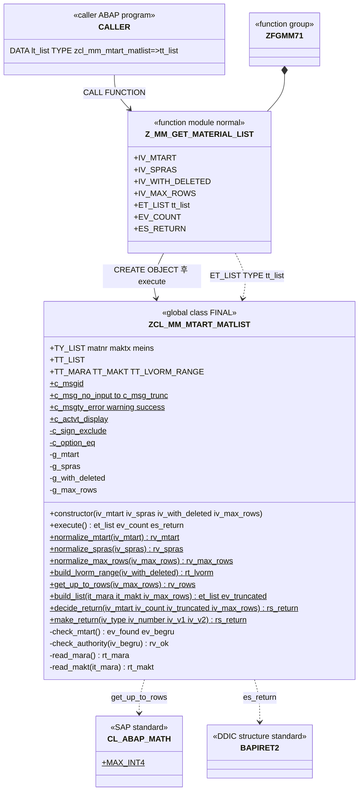
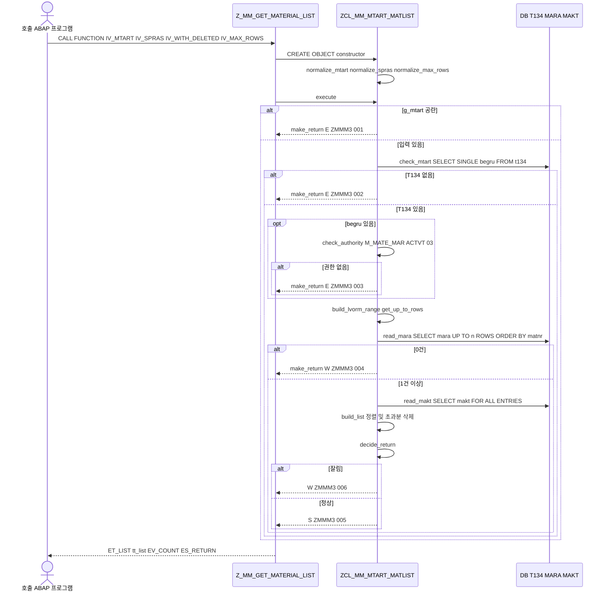
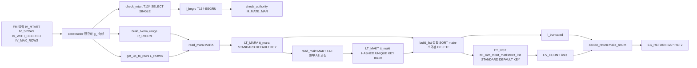

# 03. 개발 결과서 - 자재 리스트 조회 펀션 신규 개발

- 요청 ID: 20261119-f26e72
- 작성: sap-developer (**개발 재작업 — 팀장 설계 수정 지시 "테이블이나 구조체 만들지 않고 할수 있는 방법으로 변경해줘" 반영된 02_design.md 기준**)
- 작성일: 2026-11-19 (재작업)
- 기준: `02_design.md`(재작업 승인본), `01_analysis.md`(승인), `request.md`. 이번 개발 단계에 대한 팀장 직접 수정 지시·첨부·반영된 CR 없음
- 개발표준: `standards/handbook.md` — 핸드북 규칙 없는 유형(클래스명, 메서드 파라미터 IV_/EV_/IT_/ET_/RV_/RT_/RS_, 타입 TY_/TT_, 객체 참조 LO_)은 핸드북 3장 적용 메모대로 **SAP 관례 적용**
- 참고: `src/board.ts`(`runDeploy`, `toAdtFunctionSource`, `funcModules`, `msgClasses`), `src/adt.ts`(`createFunctionModule`)
- 조회 시스템: mrd-abap-rw (클라이언트 350), `mcp__sap__SearchObject`·`GetClass` **읽기 조회만** 함. 시스템 쓰기(생성·활성화) 없음 → 구문 검사·활성화는 개발계 반영 때 처음 확인됨

### 변경 이력

| 버전 | 일자 | 내용 | 사유 |
|---|---|---|---|
| 1차 | 2026-11-19 | 최초 개발. 출력 타입 DDIC `ZSMM3600`/`ZTTMM3600`(SE11 수작업), FM Remote-Enabled, FM·FUGR·MSAG 수작업(`manual/`) | 1차 설계 |
| 재작업 | 2026-11-19 | ① 클래스에 public `TY_LIST`/`TT_LIST` 추가, `execute`·`build_list`의 `et_list` 타입을 `zttmm3600` → `tt_list`. ② FM을 `src/Z_MM_GET_MATERIAL_LIST.fm.abap`+`.fm.json`(processingType `normal`)으로 이동, `ET_LIST TYPE ZCL_MM_MTART_MATLIST=>TT_LIST`. ③ `src/ZFGMM71.fugr.json`, `src/ZMMM3.msag.json` 신규 → 웹앱 자동 반영. ④ SE11·SE37·SE80·SE91 수작업 체크리스트 삭제 | **팀장 설계 수정 지시 — 구조체/테이블 타입 미생성**. 이전 개발계 반영에서 "Type ZTTMM3600 is unknown"으로 클래스 활성화 실패 |

### 근거 표기

| 표기 | 의미 |
|---|---|
| [확인] | 이 개발 세션이 mrd-abap-rw에서 직접 조회함 |
| [확인: 프로젝트 소스] | 이 세션이 `src/board.ts`·`src/adt.ts`를 읽어 확인함 |
| [설계확인]/[분석확인] | 설계·분석 단계가 확인, 이번에 다시 조회하지 않음 |
| [미확인(표준 기준)] | 도구로 읽을 수 없어 SAP 표준 지식으로 씀. 활성화·SE11·SU21로 확인 필요 |

---

## 개발 다이어그램

### 1) 소스 구성도



### 2) 실행 순서도



### 3) 데이터 흐름도



---

## 1. 오브젝트 목록

| No | 유형 | 오브젝트명 | 내역(60자 이내) | 신규/변경 | 산출물 (`work/20261119-f26e72/`) | 반영 방법 |
|---|---|---|---|---|---|---|
| O-05 | 메시지 클래스 (MSAG) | `ZMMM3` | [MM] 자재마스터 조회 공통 메시지 | 신규 | `src/ZMMM3.msag.json` (001~006) | 웹앱 자동 (R-1) |
| O-02 | 함수 그룹 (FUGR) | `ZFGMM71` | [MM] 자재마스터 조회 공통 | 신규 | `src/ZFGMM71.fugr.json` | 웹앱 자동 (R-2) |
| O-04 | 클래스 (CLAS) | `ZCL_MM_MTART_MATLIST` | [MM] 자재유형별 자재 리스트 조회 로직 | 신규(시스템에 이미 생성됨 → 소스 갱신) | `src/ZCL_MM_MTART_MATLIST.abap` | 웹앱 자동 (R-3) |
| — | 테스트 클래스 (CCAU) | `LTCL_MTART_MATLIST`, `LTD_MATDATA` | — | 테스트 단계 산출물 | `src/ZCL_MM_MTART_MATLIST.testclasses.abap` (**이번에 수정 안 함, 7장 필수 수정 있음**) | 웹앱 자동 (R-3, 클래스와 함께) |
| O-03 | 함수 모듈 (FUNC) | `Z_MM_GET_MATERIAL_LIST` | [MM] 자재유형별 자재코드·내역·기본단위 조회 | 신규 | `src/Z_MM_GET_MATERIAL_LIST.fm.abap` + `.fm.json` (group `ZFGMM71`, processingType `normal`) | 웹앱 자동 (R-4) |
| ~~O-05~~ | ~~구조~~ | ~~`ZSMM3600`~~ | — | **삭제(재작업)** | 클래스 `TY_LIST`로 대체 | 만들지 않음 |
| ~~O-06~~ | ~~테이블 타입~~ | ~~`ZTTMM3600`~~ | — | **삭제(재작업)** | 클래스 `TT_LIST`로 대체 | 만들지 않음 |

- 패키지 `ZMMD`(재사용). 이송요청은 웹앱이 자동 생성하거나 보드 반영 설정의 번호 사용. `ZCL_MM_MTART_MATLIST`가 이전 반영 시도로 이미 어떤 이송요청에 잡혀 있을 수 있음(설계 C-08) → 반영 설정에서 같은 이송요청을 쓸지 팀장 확인.
- **`manual/Z_MM_GET_MATERIAL_LIST.fm.abap`은 더 이상 쓰지 않습니다.** 1차 설계(`ZTTMM3600`·Remote-Enabled) 기준이라 내용도 낡았고 웹앱이 읽지 않는 위치입니다. 지시대로 파일은 지우지 않고 그대로 두었으며, 삭제 여부는 팀장 판단입니다. 유효한 FM 소스는 `src/Z_MM_GET_MATERIAL_LIST.fm.abap`뿐입니다.
- `src/` 파일은 위 6개(`.msag.json`, `.fugr.json`, `.abap`, `.testclasses.abap`, `.fm.abap`, `.fm.json`)뿐입니다. 다른 `.abap`이 없어 웹앱이 PROG/INCL로 잘못 만들 대상이 없습니다.

### 1.1 시스템 재조회 (2026-11-19, 이번 세션) [확인]

| 대상 | 결과 |
|---|---|
| `ZFGMM7*` (FUGR) | ZFGMM70만 존재 → **ZFGMM71 없음** |
| `ZMMM*` (MSAG) | ZMMM, ZMMM1, ZMMM2만 존재 → **ZMMM3 없음** |
| `Z_MM_GET_MATERIAL*` | 0건 → **FM 없음** |
| `ZCL_MM_MTART_MATLIST` 활성 버전 | 빈 껍데기(PUBLIC/PROTECTED/PRIVATE 섹션 비어 있음, 메서드 없음) → 활성 버전을 쓰는 다른 오브젝트 없음. 웹앱이 `exists` 분기로 소스 갱신 |

### 1.2 내부 명명 (핸드북 2장)

| 구분 | 이름 | 규칙 |
|---|---|---|
| 클래스 속성 | `G_MTART`, `G_SPRAS`, `G_WITH_DELETED`, `G_MAX_ROWS` | Variables, 클래스 속성 = Global (핸드북 3장) |
| 로컬 변수 | `L_FOUND`, `L_BEGRU`, `L_TRUNCATED`, `L_ROWS`, `L_FROM`, `L_COUNT`, `L_MAX`, `L_MSG` | Variables L_ |
| 로컬 내부테이블 | `LT_MARA`, `LT_MAKT` | Internal Tables LT_ |
| 워크에어리어 | `LS_MARA`, `LS_MAKT`, `LS_LIST`, `LS_LVORM` | Structure LS_ |
| 상수 | `C_MSGID`, `C_MSG_*`, `C_MSGTY_*`, `C_ACTVT_DISPLAY`, `C_SIGN_EXCLUDE`, `C_OPTION_EQ` | Constants C_ |
| 범위 | `R_LVORM` | Ranges R_ |
| 파라미터·타입·참조 | `IV_/EV_/IT_/ET_/RV_/RT_/RS_`, `TY_LIST/TT_LIST/TY_MARA/...`, `LO_LIST` | 핸드북 규칙 없음 — SAP 관례 적용 |

---

## 2. 구현 메모

### 2.1 클래스 `ZCL_MM_MTART_MATLIST` (설계 4장)

| 항목 | 구현 |
|---|---|
| `TY_LIST` (재작업 추가, PUBLIC) | `matnr TYPE matnr`, `maktx TYPE maktx`, `meins TYPE meins` — 설계 3.3과 같은 필드·순서·표준 DTEL |
| `TT_LIST` (재작업 추가, PUBLIC) | `STANDARD TABLE OF ty_list WITH DEFAULT KEY` |
| `execute` / `build_list` | `et_list TYPE tt_list` (기존 `zttmm3600` 두 곳만 변경). `build_list`의 `ls_list`는 `TYPE ty_list`로 명시 |
| 그 외 메서드·상수·로직 | 1차 개발본과 동일 (설계 5장 2~9단계, 7장 메시지, 8장 권한 변경 없음) |
| 헤더 주석 | "RFC" 표기 삭제 → "일반 함수 모듈". `TY_LIST`/`TT_LIST` 변경 금지 주석 추가. `normalize_spras` 주석의 "RFC 로그온 언어" 문구 삭제 |

| 메서드 | 가시성/정적 | 설계 시그니처 일치 | 설계 5장 단계 | FR | UT |
|---|---|---|---|---|---|
| `constructor` | PUBLIC | 일치 | 2단계 | FR-01·05·08·09 | O (local friends) |
| `execute` | PUBLIC | 일치 (`et_list TYPE tt_list`) | 3~9단계 | FR-01·03·06·07·10 | 가드(UT-14) |
| `normalize_mtart` / `normalize_spras` / `normalize_max_rows` | PUBLIC 정적 | 일치 | 2단계 | FR-01·05·09 | UT-01~04 |
| `build_lvorm_range` / `get_up_to_rows` | PUBLIC 정적 | 일치 | 6단계 | FR-08·09 | UT-05~07 |
| `build_list` | PUBLIC 정적 | 일치 (`et_list TYPE tt_list`) | 8단계 | FR-05·06·09 | UT-08~12 |
| `decide_return` / `make_return` | PUBLIC 정적 | 일치 | 9단계, 7장 | FR-07 | UT-13·15 |
| `check_mtart` / `check_authority` / `read_mara` / `read_makt` | PRIVATE | 일치 | 4~7단계 | FR-03·04·05·08·10 | 통합(IT) |

### 2.2 함수 모듈 `Z_MM_GET_MATERIAL_LIST` (설계 3장, 5장 1단계)

- SE37 `*"` Local Interface 주석 형식으로 작성 → 웹앱 `toAdtFunctionSource`가 `FUNCTION z_mm_get_material_list IMPORTING VALUE(IV_MTART) TYPE MTART ... EXPORTING VALUE(ET_LIST) TYPE ZCL_MM_MTART_MATLIST=>TT_LIST ... .` 형태로 바꿔 올림 [확인: 프로젝트 소스]. 변환 정규식은 공백만 정리하고 `=>`는 그대로 둡니다.
- 파라미터: 설계 3.1 그대로. 전부 값 전달, `IV_MTART`만 필수, TABLES·CHANGING·EXCEPTIONS 없음.
- 본문: `CREATE OBJECT lo_list` → `lo_list->execute( )`만. `NEW zcl( )->execute( )` 체인 미사용(wiki 7.40 주의).
- `.fm.json`: `{"group": "ZFGMM71", "description": "[MM] 자재유형별 자재코드·내역·기본단위 조회", "processingType": "normal"}`.

### 2.3 함수 그룹·메시지 클래스

- `ZFGMM71.fugr.json`: `{"description": "[MM] 자재마스터 조회 공통"}` (1차의 "(RFC)" 문구 삭제). TOP 전역 데이터 없음.
- `ZMMM3.msag.json`: 설계 7장 001~006 텍스트 그대로, 전부 `selfExplanatory: true`, 원어는 로그온 언어(KO) 기준. 모두 73자 이내.

| 번호 | 사용 유형 | 텍스트 | 클래스 상수 |
|---|---|---|---|
| 001 | E | 자재유형을 입력하십시오. | `C_MSG_NO_INPUT` |
| 002 | E | 자재유형 &1 이(가) 존재하지 않습니다. | `C_MSG_INVALID` |
| 003 | E | 자재유형 &1 에 대한 조회 권한이 없습니다. | `C_MSG_NO_AUTH` |
| 004 | W | 자재유형 &1 에 해당하는 자재가 없습니다. | `C_MSG_NO_DATA` |
| 005 | S | 자재유형 &1 자재 &2 건이 조회되었습니다. | `C_MSG_SUCCESS` |
| 006 | W | 최대 &1 건까지만 반환했습니다. 조회 조건에 맞는 자재가 더 있습니다. | `C_MSG_TRUNC` |

### 2.4 호출측 사용 예 (FM 문서 대용)

```abap
DATA lt_list   TYPE zcl_mm_mtart_matlist=>tt_list.
DATA l_count   TYPE int4.
DATA ls_return TYPE bapiret2.

CALL FUNCTION 'Z_MM_GET_MATERIAL_LIST'
  EXPORTING
    iv_mtart  = 'ROH'
  IMPORTING
    et_list   = lt_list
    ev_count  = l_count
    es_return = ls_return.
```

(예시의 `'ROH'`는 설명용 값입니다.)

---

## 3. 클래스 타입 참조 FM 시그니처 검토 (지시 3)

| 점검 | 판단 | 근거 |
|---|---|---|
| 일반 FM 파라미터에 `TYPE zcl_...=>tt_list` 허용 여부 | **허용** [미확인(표준 기준)] | FM 인터페이스는 전역 타입(DDIC, 타입 그룹, 전역 클래스·인터페이스의 PUBLIC 타입)을 참조할 수 있음(SAP 표준, 6.10 이후). ECC 7.40에서 문제없음. 이 시스템에서 같은 패턴을 쓰는 기존 FM은 FM 소스 조회 도구가 없어 확인 못함 → R-5 활성화가 확인 수단(설계 C-09) |
| RFC FM에서 허용 여부 | **불가** | RFC 파라미터는 DDIC 타입만 가능 → 그래서 processingType `normal`(설계 2.2). `.fm.json`에 `rfc`를 쓰면 활성화 실패하므로 바꾸지 말 것 |
| ADT 시그니처 변환 | 문제 없음 | `toAdtFunctionSource`는 `*"` 줄 앞 표식 제거·공백 정리만 함 [확인: 프로젝트 소스] |
| `TT_LIST` 가시성 | PUBLIC SECTION에 둠 | PROTECTED/PRIVATE면 FM에서 참조 불가 |

### 3.1 반영 순서 검토 (`runDeploy`, [확인: 프로젝트 소스])

| 순서 | 대상 | 웹앱 동작 | 이 요청의 의존 관계 | 판단 |
|---|---|---|---|---|
| R-0 | 이송요청 | 없으면 자동 생성 (`objs[0]` = 클래스 URI 기준) | — | OK. C-08 확인 |
| R-1 | MSAG `ZMMM3` | 없으면 신규 생성. 실패해도 경고만 남기고 계속 | 클래스는 메시지 ID를 상수 문자열로만 써 활성화 의존 없음 | OK. 실패 경고가 나오면 SE91 등록 |
| R-2 | FUGR `ZFGMM71` | 없으면 생성 | FM보다 먼저 있어야 함 | OK |
| R-3 | CLAS `ZCL_MM_MTART_MATLIST` + testclasses | 이미 있음 → main·testclasses 소스 갱신(비활성 저장) | FM이 `TT_LIST`를 참조하므로 FM보다 먼저 | OK (웹앱 순서와 일치) |
| R-4 | FUNC `Z_MM_GET_MATERIAL_LIST` | 생성(processingType normal) → 소스 저장 | 비활성 클래스의 `TT_LIST` 참조 | 대체로 OK — 아래 주의 1 |
| R-5 | 활성화 | 클래스·FUGR·FM을 **한 번에** 일괄 활성화 → ABAP Unit | 일괄 활성화라 비활성 클래스 타입을 FM이 함께 참조 가능 | OK — 단 아래 주의 2 |

- **주의 1** [미확인(표준 기준)]: FM 소스(시그니처) 저장 때 ADT가 파라미터 타입 존재를 검사하면서 클래스가 아직 비활성이라 거부할 가능성이 낮게나마 있습니다. 그 경우 반영 결과에 FUNC 저장 오류가 나며, 클래스를 먼저 활성화(SE24/ADT)한 뒤 보드에서 다시 반영하면 됩니다(재반영은 MSAG·FUGR "이미 있음", 클래스·FM "소스 갱신"으로 진행).
- **주의 2 (확정 위험)**: 클래스 활성화에는 테스트 include(CCAU)도 포함됩니다. 현재 `src/ZCL_MM_MTART_MATLIST.testclasses.abap`은 여전히 `zttmm3600`/`zsmm3600`을 참조하므로 **이 파일을 고치기 전에 반영하면 클래스 활성화가 "Type ZTTMM3600 is unknown"으로 다시 실패**하고, 클래스 타입을 쓰는 FM도 함께 실패합니다. 테스트 단계에서 7장 1번 수정이 반드시 선행되어야 합니다.

---

## 4. 사용 구문의 최소 릴리스 (SP08 이상 미사용)

소스가 요구하는 최소 기준은 **7.40 SP05**(New Open SQL)입니다. 재작업에서 추가한 구문은 클래스 TYPES 2개와 FM 시그니처의 `=>` 타입 참조뿐이며, 둘 다 릴리스 제약 없음.

| 구문 | 위치 | 최소 릴리스 | 판정 |
|---|---|---|---|
| New Open SQL (쉼표 필드, `@` 호스트 변수, `UP TO @l_rows ROWS`) | check_mtart, read_mara, read_makt | 7.40 SP05 | 사용 |
| 절 순서 INTO → UP TO → WHERE → ORDER BY | read_mara | 7.40 SP05 | 준수 |
| `INTO TABLE @DATA( )` 인라인, `xsdbool( )`, `VALUE #( FOR )`, `REDUCE`, `FILTER` | — | SP08 | 미사용 |
| 인라인 `DATA( )`, `NEW #( )`, `COND #( )`, `VALUE #( )` | — | SP02 | 미사용 |
| 문자열 템플릿, 논리식 안 함수형 메서드, `lines( )` | decide_return, execute, build_list | 7.02 | 사용 |
| FM 파라미터 `TYPE zcl_mm_mtart_matlist=>tt_list` | FM | — | 사용 (일반 FM) |
| `NEW zcl( )->method( )` 체인 | — | — | 미사용 |

---

## 5. 설계와 다른 점

| No | 설계 | 구현 | 이유 | 영향 |
|---|---|---|---|---|
| X-01 | 메시지 유형 `'E'`·`'W'`·`'S'` 리터럴 | 공개 상수 `C_MSGTY_ERROR/WARNING/SUCCESS TYPE bapi_mtype` | 하드코딩 회피 (1차부터 유지) | 공개 상수 3개 추가 |
| X-02 | range 행 값 리터럴 | 비공개 상수 `C_SIGN_EXCLUDE`, `C_OPTION_EQ` | 하드코딩 회피 (1차 유지) | 없음 |
| X-03 | `get_up_to_rows`: 0 → MAX_INT4 | **0 이하** → MAX_INT4 | 정적 메서드 직접 호출 시 음수 방어 (1차 유지) | UT-07 기대값 그대로 |
| X-04 | `SELECT SINGLE mtart, begru` | `SELECT SINGLE begru` | 존재 여부는 sy-subrc로 판정 (1차 유지) | 없음 |
| X-05 | `to_upper( )`/`condense( )` 예시 | `SHIFT ... LEFT DELETING LEADING space` + `TRANSLATE ... TO UPPER CASE` | "앞 공백 제거 후 대문자"와 정확히 같은 동작 (1차 유지) | 없음 |
| X-06 | 8단계 `COND #( )` 예시 | IF/ENDIF, 행마다 `CLEAR ls_list` | 동작 동일 (1차 유지) | 없음 |
| X-07 | 권한 객체·필드명 | `'M_MATE_MAR'`/`'ACTVT'`/`'BEGRU'` 리터럴 유지, 값만 상수 | SAP 관례(SLIN·사용처 조회) (1차 유지) | 없음 |
| X-08 | 5장 1단계 FM 예시 `CREATE OBJECT ... (또는 NEW #)` | `CREATE OBJECT` 사용 | 설계가 허용한 두 형태 중 7.40 호환이 확실한 쪽 | 없음 |

- 재작업 지시(구조체/테이블 타입 미생성, normal FM, 자동 반영 파일 형식)는 **설계와 다른 점 없이** 그대로 구현했습니다.
- 예외 처리: 소스의 SELECT·MESSAGE INTO·AUTHORITY-CHECK는 잡을 수 있는 클래스 예외를 내지 않아 TRY/CATCH를 두지 않았고, 오류는 모두 `ES_RETURN`으로 반환합니다(설계 7장). 비RFC라 `SYSTEM_FAILURE`·`COMMUNICATION_FAILURE`는 해당 없음.

---

## 6. 수작업 필요 여부

| 구분 | 필요 여부 |
|---|---|
| SE11 (구조·테이블 타입·데이터 요소·도메인·테이블) | **없음** — 신규 DDIC 0개 |
| SE37 / SE80 / SE91 생성 | **없음** — FUNC·FUGR·MSAG 모두 웹앱 자동 반영 |
| 화면(SE51)·GUI Status·T-code | 없음 |
| 조건부 수작업 | ① R-1 결과에 "MSAG ZMMM3 반영 실패" 경고가 있으면 SE91에서 2.3 표대로 등록. ② 3.1 주의 1이 발생하면 클래스를 먼저 활성화 후 재반영. ③ 반영 후 SE37 속성 탭이 "일반 함수 모듈"인지 눈으로 확인(웹앱은 rfc일 때만 처리 유형을 재확인함, 설계 IT-11) |
| 반영 전 선행 조건 | **테스트 클래스 파일 수정(7장 1번)** — 수작업이 아니라 테스트 단계 작업이지만 반영 전에 반드시 끝나야 함 |

---

## 7. 테스트 단계 전달 사항

1. **[필수] 테스트 클래스가 깨지는 부분** — `src/ZCL_MM_MTART_MATLIST.testclasses.abap`(이번에 수정하지 않음)이 삭제된 DDIC를 참조합니다. 그대로 두면 클래스 활성화 실패. 메서드 이름·시그니처(파라미터명), 상수 이름, `tt_mara`/`tt_makt`/`ty_mara`/`ty_makt`/`tt_lvorm_range`는 **바뀌지 않았으므로** 아래만 바꾸면 됩니다.

   | 줄(현재 파일) | 현재 | 바꿀 값 |
   |---|---|---|
   | 15~18 (헤더 주석) | "DDIC ZSMM3600 / ZTTMM3600 (R-2) 가 먼저 활성화돼야" | 문구 삭제(신규 DDIC 없음) |
   | 70 (`add_list` 파라미터) | `ct_list TYPE zttmm3600` | `ct_list TYPE zcl_mm_mtart_matlist=>tt_list` |
   | 119 (`add_list` 구현) | `ls_list TYPE zsmm3600` | `ls_list TYPE zcl_mm_mtart_matlist=>ty_list` |
   | 375, 376 (UT-08) | `lt_list`/`lt_exp TYPE zttmm3600` | `TYPE zcl_mm_mtart_matlist=>tt_list` |
   | 410, 411 (UT-09) | 같음 | 같음 |
   | 448, 449 (UT-10) | 같음 | 같음 |
   | 482 (UT-11), 508 (UT-12), 533 (UT-17), 581 (UT-14) | `lt_list TYPE zttmm3600` | `TYPE zcl_mm_mtart_matlist=>tt_list` |

   - 필드명(`matnr`/`maktx`/`meins`)과 순서가 `ZSMM3600`과 같고 테이블 종류도 STANDARD·DEFAULT KEY로 같아서 `assert_equals( act = lt_list exp = lt_exp )` 비교 결과는 바뀌지 않습니다.
2. **IT-11 (재작업 변경)**: SE37 속성 = 일반 함수 모듈, `ET_LIST` 참조 타입 = `ZCL_MM_MTART_MATLIST=>TT_LIST`. SE37 테스트 화면에서 ET_LIST 결과 표시가 안 되면 디버거 또는 2.4 예시로 만든 임시 호출 프로그램(로컬 `$TMP`, 반영 대상 아님)으로 확인. **AC-12(RFC 목적지 NONE)는 해당 없음**.
3. **UT-13 make_return**: ZMMM3가 이번엔 웹앱으로 자동 생성되지만, MSAG 반영 실패 경고 가능성이 있으므로 계속 MESSAGE 텍스트는 비교하지 않는 것을 권장.
4. **반영 순서**: 1차의 "R-2(SE11) → R-3 → R-4" 선행조건(04_test.md R-01, 9장 P-1)은 **없어졌습니다**. 대신 "테스트 클래스 수정(1번) 완료"가 반영 전 조건입니다. 04_test.md R-01·P-1 문구 갱신 필요.
5. 권한 필드(C-03, SU21 M_MATE_MAR = ACTVT·BEGRU 확인 후 IT-12), MARA MTART 인덱스(IT-13 ST05)는 1차와 같습니다.
6. 04_test.md의 결함·지시 중 개발 수정 대상은 없었습니다(04_test.md 4장 "소스 결함 없음").

---

## 8. 현업 미확인 Q 중 코드에 영향 주는 지점

| Q | 현재 구현 | 답에 따라 바뀌는 코드 위치 |
|---|---|---|
| Q1 호출 주체 | **같은 시스템 ABAP 호출 전용, 일반 FM** | 외부 RFC 필요 시 설계 2.2: (a) 팀장 승인으로 DDIC 구조·테이블 타입 신규 + FM `ET_LIST` 타입·processingType 변경, FM에서 `tt_list` → DDIC 타입 대입, 또는 (b) 문자열 직렬화. 클래스 로직 불변 |
| Q2 자재유형 여러 개 | 단일 `IV_MTART` | FM 선택 파라미터, constructor, `read_mara` WHERE, 범위 타입은 클래스 TYPES로 추가 가능 |
| Q3 삭제 자재 포함 | 기본 제외 | FM 기본값만 `'X'` |
| Q4 내역 대체 언어 | SY-LANGU, 없으면 공란 | `read_makt`, `tt_makt` 키 |
| Q5 표시 형식 | 내부 형식 | `build_list`에 CONVERSION_EXIT_*_OUTPUT |
| Q6 최대 건수 | 기본 0 | FM 기본값 |
| Q7 메시지 다국어 | ZMMM3 KO | SE63 번역 |
| Q8 권한 운영 | BEGRU 있을 때만 | `execute` 5단계 블록 |
| Q9 함수 그룹 | ZFGMM71 | `.fm.json` group만 변경 |
| Q11 출력 항목 추가 | 3개 | 클래스 `TY_LIST` **맨 뒤에** 필드 추가 + `ty_mara`/`read_mara`/`build_list` (DDIC 변경 없음) |

---

## 9. 남은 위험

| No | 위험 | 대응 |
|---|---|---|
| K-1 | 시스템 쓰기를 하지 않아 구문 검사·활성화 미실시 | R-5 활성화 결과로 확인. 필드 참조 타입이라 실패 시 수정 범위는 선언 1줄 |
| K-2 | 테스트 클래스가 삭제된 DDIC를 참조 → 수정 전 반영 시 활성화 실패 | 7장 1번 (테스트 단계 필수) |
| K-3 | 비활성 클래스 타입을 참조하는 FM 시그니처 저장이 거부될 가능성(낮음) | 3.1 주의 1 절차 |
| K-4 | 일반 FM의 클래스 타입 참조는 표준 지식 기준 | R-5 활성화로 확인(설계 C-09). 실패 시 결과 메시지를 개발 단계로 |
| K-5 | M_MATE_MAR 필드명 미확인(C-03), MARA MTART 인덱스 미확인(C-02) | SU21, ST05 |
| K-6 | 대상 릴리스 정확한 SP 미확인(C-06) | 소스는 7.40 SP05 이상이면 됨 |
