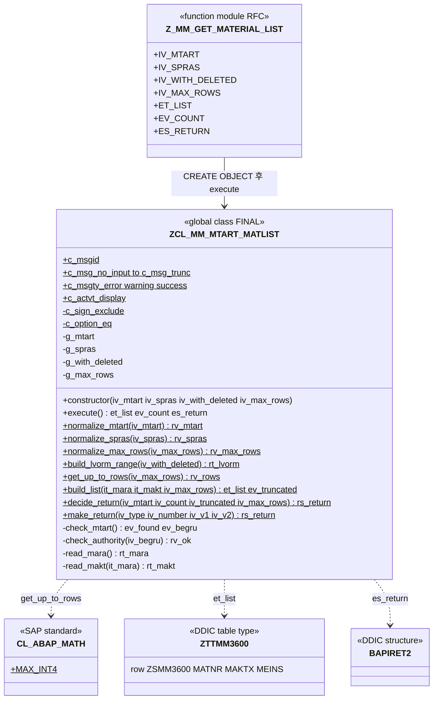
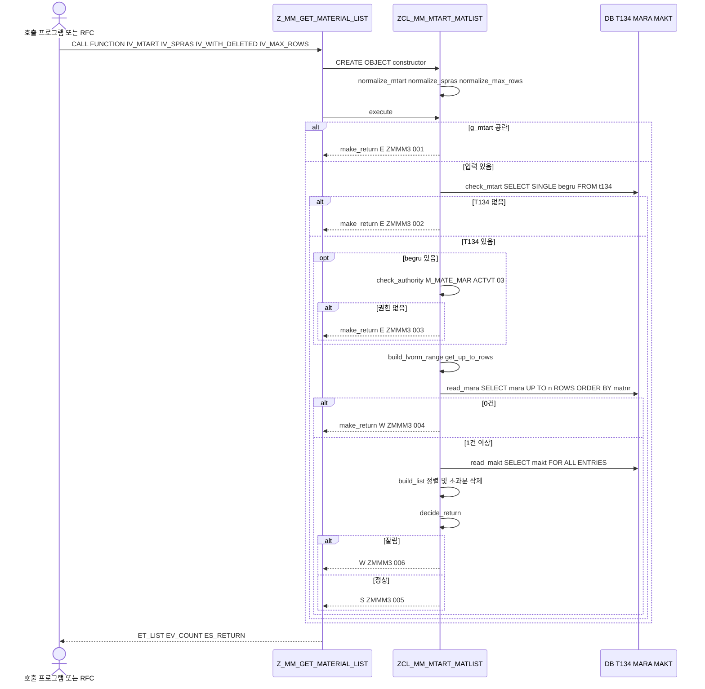
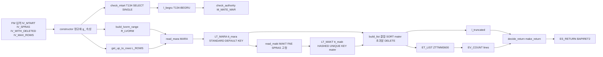

# 03. 개발 결과서 - 자재 리스트 조회 펀션 신규 개발

- 요청 ID: 20261119-f26e72
- 작성: sap-developer (개발 1차 작업, 팀장 수정 지시 없음, 첨부 없음)
- 작성일: 2026-11-19
- 기준: `02_design.md`(팀장 승인본), `01_analysis.md`(승인), `request.md`
- 개발표준: `standards/handbook.md` — 핸드북 규칙 없는 유형(클래스명, 메서드 파라미터 IV_/EV_/IT_/ET_/RV_/RT_/RS_, 타입 TY_/TT_, 객체 참조 LO_, 테이블 타입명)은 핸드북 3장 적용 메모대로 **SAP 관례 적용**
- 참고 wiki: "ECC 7.40 시스템 ABAP 개발 제약", "테스트계 반영 전 점검 항목", "SAP 시스템 미확인 상태에서 작업하는 방법"
- 조회 시스템: mrd-abap-rw (클라이언트 350), `mcp__sap__SearchObject`·`GetClass` **읽기 조회만** 함. 시스템 쓰기(생성·활성화) 없음 → 활성화·구문 검사는 개발계 반영 때 처음 확인됨

### 근거 표기

| 표기 | 의미 |
|---|---|
| [확인] | 이 개발 세션이 mrd-abap-rw에서 직접 조회함 |
| [설계확인]/[분석확인] | 설계·분석 단계가 시스템에서 확인, 이번에 다시 조회하지 않음 |
| [미확인(표준 기준)] | 도구로 읽을 수 없어 SAP 표준 지식으로 씀. 활성화·SE11·SU21로 확인 필요 |
| [가정] | 현업 답(Q)에 따라 바뀔 수 있음 |

---

## 개발 다이어그램

### 1) 소스 구성도

### 2) 실행 순서도

### 3) 데이터 흐름도

---

## 1. 오브젝트 목록

| No | 유형 | 오브젝트명 | 내역(60자 이내) | 신규/변경 | 산출물 위치 | 반영 방법 |
|---|---|---|---|---|---|---|
| O-02 | 함수 그룹 (FUGR) | `ZFGMM71` | [MM] 자재마스터 조회 공통(RFC) | 신규 | — (속성만, 2.3 R-5) | SE80/SE37 수작업 |
| O-03 | 함수 모듈 (FUNC) | `Z_MM_GET_MATERIAL_LIST` | [MM] 자재유형별 자재코드·내역·기본단위 조회 | 신규 | `manual/Z_MM_GET_MATERIAL_LIST.fm.abap` | SE37 수작업 (R-6) |
| O-04 | 클래스 (CLAS) | `ZCL_MM_MTART_MATLIST` | [MM] 자재유형별 자재 리스트 조회 로직 | 신규 | `src/ZCL_MM_MTART_MATLIST.abap` | 웹앱 개발계 반영 (R-4) |
| O-05 | 구조 (TABL/DS) | `ZSMM3600` | [MM] 자재유형별 자재 리스트(Z_MM_GET_MATERIAL_LIST) | 신규 | 본 문서 R-2 표 | SE11 수작업 |
| O-06 | 테이블 타입 (TTYP) | `ZTTMM3600` | [MM] 자재유형별 자재 리스트 테이블 타입 | 신규 | 본 문서 R-2 표 | SE11 수작업 |
| O-07 | 메시지 클래스 (MSAG) | `ZMMM3` | [MM] 자재마스터 조회 공통 메시지 | 신규 | 본 문서 R-3 표 | SE91 수작업 |
| — | 테스트 클래스 | `LTCL_MTART_MATLIST` (CCAU) | — | 신규 | `src/ZCL_MM_MTART_MATLIST.testclasses.abap` | **테스트 단계(sap-tester) 산출물 — 이번에 만들지 않음** |

- 패키지 `ZMMD`(재사용), 이송요청은 SE09 별도 생성(R-1), `$TMP` 금지.
- `src/`에는 클래스 파일 1개만 있습니다(Glob으로 확인). FM 소스는 웹앱 반영 대상이 아니므로 `manual/`에 두었습니다(설계 0.3, wiki "src/에는 ABAP 소스 오브젝트만").
- 이번 조회 결과 동명 오브젝트 없음 [확인 2026-11-19]: `ZCL_MM_MTART*`, `ZSMM36*`, `ZTTMM*`, `ZMMM3`, `ZFGMM71`, `Z_MM_GET_MATERIAL_LIST` 모두 SearchObject 결과 0건.

### 1.1 내부 명명 (핸드북 2장)

| 구분 | 이름 | 규칙 |
|---|---|---|
| 클래스 속성 | `G_MTART`, `G_SPRAS`, `G_WITH_DELETED`, `G_MAX_ROWS` | Variables, 클래스 속성 = Global (핸드북 3장) |
| 로컬 변수 | `L_FOUND`, `L_BEGRU`, `L_TRUNCATED`, `L_ROWS`, `L_FROM`, `L_COUNT`, `L_MAX`, `L_MSG` | Variables L_ |
| 로컬 내부테이블 | `LT_MARA`, `LT_MAKT` | Internal Tables LT_ |
| 워크에어리어 | `LS_MARA`, `LS_MAKT`, `LS_LIST`, `LS_LVORM` | Structure LS_ |
| 상수 | `C_MSGID`, `C_MSG_*`, `C_MSGTY_*`, `C_ACTVT_DISPLAY`, `C_SIGN_EXCLUDE`, `C_OPTION_EQ` | Constants C_ |
| 범위 | `R_LVORM` | Ranges R_ |
| 파라미터·타입·참조 | `IV_/EV_/IT_/ET_/RV_/RT_/RS_`, `TY_/TT_`, `LO_LIST` | 핸드북 규칙 없음 — SAP 관례 적용 |

---

## 2. 설계 대비 구현 추적

### 2.1 메서드 (설계 4.2)

| 메서드 | 가시성/정적 | 시그니처 설계 일치 | 구현 (설계 5장 단계) | FR | UT 가능 |
|---|---|---|---|---|---|
| `constructor` | PUBLIC | 일치 | 2단계 정규화, `g_with_deleted`는 'X' 아니면 공란 | FR-01·05·08·09 | O (local friends로 G_ 확인) |
| `execute` | PUBLIC | 일치 | 3~9단계. 첫 줄 `CLEAR`, 공란이면 DB 전 RETURN | FR-01·03·06·07·10 | 가드(UT-14) |
| `normalize_mtart` | PUBLIC 정적 | 일치 | `SHIFT ... LEFT DELETING LEADING space` + `TRANSLATE ... TO UPPER CASE` | FR-01 | UT-01·02 |
| `normalize_spras` | PUBLIC 정적 | 일치 | 공란 → SY-LANGU | FR-05 | UT-03 |
| `normalize_max_rows` | PUBLIC 정적 | 일치 | 음수 → 0 | FR-09 | UT-04 |
| `build_lvorm_range` | PUBLIC 정적 | 일치 | 공란 → 1행 E/EQ/'X', 'X' → 빈 range | FR-08 | UT-05·06 |
| `get_up_to_rows` | PUBLIC 정적 | 일치 | 0 이하 또는 ≥ MAX_INT4 → MAX_INT4, 그 외 n+1 | FR-09 | UT-07 |
| `build_list` | PUBLIC 정적 | 일치 | MAKT 없으면 MAKTX 공란·행 유지, `SORT BY matnr`, n 초과 시 `DELETE FROM n+1`, truncated | FR-05·06·09 | UT-08~12 |
| `decide_return` | PUBLIC 정적 | 일치 | 잘림 W 006(&1 max), 아니면 S 005(&1 mtart, &2 건수) | FR-07 | UT-15 |
| `make_return` | PUBLIC 정적 | 일치 | `MESSAGE ID c_msgid TYPE iv_type NUMBER iv_number WITH iv_v1 iv_v2 INTO l_msg`, SY-MSG*로 BAPIRET2 채움 | FR-07 | UT-13 |
| `check_mtart` | PRIVATE | 일치 | 4단계 `SELECT SINGLE begru FROM t134` | FR-03·10 | 통합(IT-06) |
| `check_authority` | PRIVATE | 일치 | 8장 `AUTHORITY-CHECK OBJECT 'M_MATE_MAR' ID 'ACTVT' ... ID 'BEGRU' ...` | FR-10 | 통합(IT-12) |
| `read_mara` | PRIVATE | 일치 | 6단계, 절 순서 INTO → UP TO → WHERE → ORDER BY | FR-04·08·09 | 통합(IT-01·08·10·13) |
| `read_makt` | PRIVATE | 일치 | 7단계, 드라이버 비면 RETURN 후 FAE | FR-05 | 통합(IT-03·04·14) |

### 2.2 FR·NFR 추적

| 항목 | 구현 위치 | 상태 |
|---|---|---|
| FR-01 자재유형 필수·대문자 | FM `IV_MTART`(Optional 해제), constructor, normalize_mtart, execute 가드 | 구현 |
| FR-02 범위 입력 | — | 설계대로 1차 제외 (Q2) |
| FR-03 T134 검사 | check_mtart, E 002 | 구현 [가정] |
| FR-04 MATNR·MEINS | read_mara | 구현 |
| FR-05 MAKTX·언어 | normalize_spras, read_makt, build_list | 구현 (대체 언어 없음, Q4) |
| FR-06 정렬·건수 | build_list `SORT`, execute `lines( )` | 구현 |
| FR-07 RETURN 단건 | make_return, decide_return, 메시지 001~006 | 구현 |
| FR-08 삭제 자재 기본 제외 | build_lvorm_range, read_mara, FM 기본값 SPACE | 구현 [추가], Q3 |
| FR-09 최대 건수 | get_up_to_rows, build_list | 구현 [추가], Q6 |
| FR-10 자재유형 권한 | check_authority (BEGRU 있을 때만) | 구현 [추가], Q8 |
| FR-11 RFC | FM 속성 Remote-Enabled, 값 전달 (R-6) | 수작업 [추가], Q1 |
| NFR-02 읽기 전용 | 전체 — UPDATE/INSERT/MODIFY/COMMIT 없음 | 구현 |
| NFR-03 7.40 호환 | 3장 | 구현 |
| NFR-06 테스트 용이성 | DB 없는 정적 메서드 8개 공개 | 구현 |

---

## 3. 사용 구문의 최소 릴리스 확인 (SP08 이상 미사용)

소스 전체를 구문 단위로 대조했습니다. **이 소스가 요구하는 최소 기준은 7.40 SP05**(New Open SQL)이며, SP08 이상 구문은 없습니다.

| 구문 | 사용 위치 | 최소 릴리스 | 판정 |
|---|---|---|---|
| New Open SQL (쉼표 필드, `@` 호스트 변수, `UP TO @l_rows ROWS`) | check_mtart, read_mara, read_makt | 7.40 SP05 | 사용 (최소 기준) |
| SELECT 절 순서 INTO → UP TO → WHERE → ORDER BY | read_mara | 7.40 SP05 | 준수 (끝 INTO 형태 SP08 미사용) |
| `INTO TABLE @DATA( )` / `INTO @DATA( )` 인라인 | — | SP08 (끝 INTO) | **미사용** — `tt_mara`, `tt_makt`, `ev_begru` 미리 선언 |
| 인라인 `DATA( )`, `NEW #( )`, `COND #( )`, `VALUE #( )`, `CONV #( )` | — | 7.40 SP02 | 미사용 (모두 명시 선언·IF로 작성) |
| `xsdbool( )` | — | 7.40 SP08 | **미사용** (IF로 abap_true/false) |
| `VALUE #( FOR ... )`, `REDUCE`, `FILTER` | — | SP08 이상 | 미사용 |
| 문자열 템플릿 `\|{ iv_count }\|` | decide_return | 7.02 | 사용 |
| 함수형 메서드 호출을 논리식에 사용 `IF check_authority( l_begru ) = abap_false` | execute | 7.02 | 사용 |
| `lines( )` | execute, build_list | 7.02 | 사용 |
| `cl_abap_math=>max_int4` | get_up_to_rows | — | 사용, 상수 `MAX_INT4 TYPE I VALUE 2147483647` [확인: GetClass CL_ABAP_MATH] |
| `NEW zcl( )->method( )` 체인 | — | — | 미사용. FM은 `CREATE OBJECT` 후 참조 변수로 호출 |
| `DELETE itab FROM <산술식>` | — | — | 미사용. `l_from = iv_max_rows + 1`로 변수에 받은 뒤 사용 |
| `CL_ABAP_CORRESPONDING`, CDS, `CL_OSQL_TEST_ENVIRONMENT` | — | 7.50 이상 | 미사용 |

---

## 4. 설계에서 벗어난 점과 이유

| No | 설계 | 구현 | 이유 | 영향 |
|---|---|---|---|---|
| X-01 | 메시지 유형을 `'E'`·`'W'`·`'S'` 리터럴로 호출(5장 예시) | 공개 상수 `C_MSGTY_ERROR/WARNING/SUCCESS TYPE bapi_mtype` 추가 | 하드코딩 회피(개발 지시). 테스트 클래스도 상수로 비교 가능 | 공개 상수 3개 추가뿐, 시그니처 불변 |
| X-02 | `build_lvorm_range` 행 값 리터럴 | 비공개 상수 `C_SIGN_EXCLUDE 'E'`, `C_OPTION_EQ 'EQ'` 추가 (`TYPE c LENGTH 1/2`, DDIC 타입 의존 없음) | 하드코딩 회피 | 없음 |
| X-03 | `get_up_to_rows`: 0 → MAX_INT4 | **0 이하** → MAX_INT4 | 정적 메서드는 constructor를 거치지 않고 직접 호출될 수 있어 음수 입력 시 `UP TO -n ROWS` 방지 | UT-07 기대값 그대로(0/10/MAX_INT4) |
| X-04 | 4단계 `SELECT SINGLE mtart, begru` | `SELECT SINGLE begru` | 존재 여부는 sy-subrc로 판정하므로 MTART 재조회 불필요 | 없음 |
| X-05 | normalize_mtart `to_upper( )`/`condense( )` 예시 | `SHIFT ... LEFT DELETING LEADING space` + `TRANSLATE ... TO UPPER CASE` | 설계 문구("앞 공백 제거 후 대문자")와 정확히 같은 동작. condense는 중간 공백까지 압축함 | 없음 |
| X-06 | 8단계 `COND #( ... )` 예시 | IF/ENDIF, 행마다 `CLEAR ls_list` | 동작 동일. 이전 행 MAKTX가 남지 않게 CLEAR 명시 | 없음 |
| X-07 | 권한 객체·필드명 | `'M_MATE_MAR'`, `'ACTVT'`, `'BEGRU'`는 **리터럴 유지**, 액티비티 값만 상수 | SAP 관례: 권한 객체·필드명을 리터럴로 써야 SLIN/SCI 권한 검사·사용처 조회가 동작함. 하드코딩 회피 대상은 값(03)으로 판단 | 없음 |
| X-08 | 메시지 텍스트 변수 `l_msg` 타입 미지정 | `TYPE bapiret2-message` | BAPIRET2-MESSAGE와 같은 길이로 잘림 없음 | 없음 |
| X-09 | 예외 처리 | TRY/CATCH 없음 | 이 소스의 SELECT·MESSAGE INTO·AUTHORITY-CHECK는 잡을 수 있는 클래스 예외를 내지 않음. 오류는 모두 ES_RETURN으로 반환(설계 7장), RFC 런타임 오류는 호출측 `SYSTEM_FAILURE`(설계 7장) | 없음 |

- `[미확인(표준 기준)]`이던 타입은 **이번에 존재를 확인해 설계 원안 타입을 그대로 썼습니다**(대안 `bapiret2-type` 등 필드 참조로 바꾸지 않음). 근거는 6장.

---

## 5. 수작업 반영 체크리스트 (설계 10장, 의존 순서)

웹앱 개발계 반영은 `src/*.abap`을 CLAS/PROG/INCL로만 올리므로 FUGR·FUNC·DDIC·MSAG는 아래 순서로 수작업합니다. **R-2(DDIC)가 R-4(클래스)보다 먼저**여야 클래스 활성화가 됩니다(`zttmm3600` 참조).

| 순서 | 대상 | 방법 | 확인 | 체크 |
|---|---|---|---|---|
| R-1 | 이송요청 | SE09 (팀장·Basis) | Workbench 요청, 패키지 ZMMD | [ ] |
| R-2 | `ZSMM3600` → `ZTTMM3600` | SE11 생성·활성화 (아래 표) | 활성화 성공 = MATNR/MAKTX/MEINS DTEL 확인 | [ ] |
| R-3 | `ZMMM3` 메시지 001~006 | SE91 (아래 표) | 원어 KO | [ ] |
| R-4 | `ZCL_MM_MTART_MATLIST` (+ 테스트 단계의 CCAU) | 웹앱 개발계 반영 | 활성화 성공 = T134-BEGRU, MARA·MAKT 필드, ACTIV_AUTH 등 확인 | [ ] |
| R-5 | `ZFGMM71` | SE80/SE37 함수 그룹 생성, 패키지 ZMMD, 내역 "[MM] 자재마스터 조회 공통(RFC)" | 활성화 | [ ] |
| R-6 | `Z_MM_GET_MATERIAL_LIST` | SE37 생성(그룹 ZFGMM71) → 속성 → 파라미터(아래 표) → 소스 붙여넣기(`manual/` 파일의 `FUNCTION` ~ `ENDFUNCTION` 중 `*"` 인터페이스 주석은 SE37이 자동 생성하므로 본문만) → 활성화 | 활성화 | [ ] |
| R-7 | ABAP Unit 실행 → SE37 통합 테스트 | SE80 / SE37 (RFC 목적지 NONE 포함) | 설계 11장 | [ ] |

### R-2 구조 `ZSMM3600`

- 내역: "[MM] 자재유형별 자재 리스트(Z_MM_GET_MATERIAL_LIST)" / Enhancement Category: "Can be enhanced (character-type or numeric)" / 패키지 ZMMD

| 필드 | 키 | 구성 타입(Data Element) | 형식(표준 기준) | 설명 |
|---|---|---|---|---|
| MATNR | — | `MATNR` | CHAR 18, 변환루틴 MATN1 | 자재코드(내부 형식) |
| MAKTX | — | `MAKTX` | CHAR 40 | 자재내역 |
| MEINS | — | `MEINS` | UNIT 3, 변환루틴 CUNIT | 기본단위(내부 단위값) |

- 형식 열은 [미확인(표준 기준)] — Data Element 참조이므로 시스템 정의를 따릅니다. MEINS는 단위 필드 자체라 참조 필드 지정 불필요.
- **필드명 MATNR/MAKTX/MEINS는 클래스 `build_list`가 그대로 사용**하므로 철자를 바꾸면 클래스 활성화가 실패합니다.

### R-2 테이블 타입 `ZTTMM3600`

| 항목 | 값 |
|---|---|
| 내역 | [MM] 자재유형별 자재 리스트 테이블 타입 |
| 행 타입 | `ZSMM3600` |
| 접근 | 표준 테이블 (Standard Table) |
| 키 | 표준 키, 비고유 (Standard key / Non-unique) |

### R-3 메시지 클래스 `ZMMM3` (원어 KO, 73자 이내)

| 번호 | 사용 유형 | 텍스트 | 클래스 상수 | Self-explanatory |
|---|---|---|---|---|
| 001 | E | 자재유형을 입력하십시오. | `C_MSG_NO_INPUT` | 체크 |
| 002 | E | 자재유형 &1 이(가) 존재하지 않습니다. | `C_MSG_INVALID` | 체크 |
| 003 | E | 자재유형 &1 에 대한 조회 권한이 없습니다. | `C_MSG_NO_AUTH` | 체크 |
| 004 | W | 자재유형 &1 에 해당하는 자재가 없습니다. | `C_MSG_NO_DATA` | 체크 |
| 005 | S | 자재유형 &1 자재 &2 건이 조회되었습니다. | `C_MSG_SUCCESS` | 체크 |
| 006 | W | 최대 &1 건까지만 반환했습니다. 조회 조건에 맞는 자재가 더 있습니다. | `C_MSG_TRUNC` | 체크 |

- 내역: "[MM] 자재마스터 조회 공통 메시지", 패키지 ZMMD. EN 번역(SE63)은 Q7 답 후.
- 팀장이 기존 메시지 클래스(예: ZMMM2) 재사용을 결정하면(C-07) 클래스 상수 `C_MSGID`·`C_MSG_*`만 바꾸면 됩니다.

### R-5 함수 그룹 `ZFGMM71`

| 항목 | 값 |
|---|---|
| 이름 | ZFGMM71 (ZFGMM70 다음 빈 번호 [설계확인], 이번 SearchObject로 미존재 재확인 [확인]) |
| 내역 | [MM] 자재마스터 조회 공통(RFC) |
| 패키지 | ZMMD |
| 전역 데이터(TOP) | 없음 (FM이 클래스를 호출만 함) |

### R-6 함수 모듈 `Z_MM_GET_MATERIAL_LIST`

속성 탭: 처리 유형 **Remote-Enabled Module**, 내역 "[MM] 자재유형별 자재코드·내역·기본단위 조회", 업데이트 모듈 아님. TABLES·CHANGING·EXCEPTIONS 탭은 비움.

| 탭 | 파라미터 | 유형 지정 | 참조 타입 | 기본값 | 선택(Optional) | 값 전달(Pass Value) |
|---|---|---|---|---|---|---|
| Import | `IV_MTART` | TYPE | `MTART` | — | **해제** | **체크** |
| Import | `IV_SPRAS` | TYPE | `SPRAS` | `SY-LANGU` | 체크 | **체크** |
| Import | `IV_WITH_DELETED` | TYPE | `XFELD` | `SPACE` | 체크 | **체크** |
| Import | `IV_MAX_ROWS` | TYPE | `INT4` | `0` | 체크 | **체크** |
| Export | `ET_LIST` | TYPE | `ZTTMM3600` | — | — | **체크** |
| Export | `EV_COUNT` | TYPE | `INT4` | — | — | **체크** |
| Export | `ES_RETURN` | TYPE | `BAPIRET2` | — | — | **체크** |

- 값 전달을 하나라도 빠뜨리면 Remote-Enabled 활성화 시 오류가 납니다(RFC는 참조 전달 불가).
- RFC 실행 권한(S_RFC): 호출 RFC 계정 역할에 함수 그룹 `ZFGMM71` 등록 — Basis (설계 8장).

---

## 6. 시스템에서 확인한 것 / 확인하지 못한 것

### 6.1 확인함 (이 세션, mrd-abap-rw, 2026-11-19)

| 대상 | 도구 | 결과 | 소스 반영 |
|---|---|---|---|
| `ACTIV_AUTH` | SearchObject | DTEL "액티비티"(SUSR), DOMA도 있음 [확인] | `C_ACTVT_DISPLAY TYPE activ_auth` 원안 유지 |
| `BAPI_MTYPE` | SearchObject | DTEL "메시지 유형: S 성공, E 오류, W 경고 ..."(SBF_BAPI) [확인] | `make_return-iv_type`, `C_MSGTY_*` 원안 유지 |
| `SYMSGID`, `SYMSGNO`, `SYMSGV` | SearchObject (DTEL) | 모두 DTEL 존재 [확인] | `C_MSGID`, `C_MSG_*`, `L_COUNT`/`L_MAX TYPE symsgv` |
| `BAPIRET2` | SearchObject | TABL/DS "리턴 매개변수"(SBF_BAPI) [확인] | es_return |
| `XFELD` | SearchObject | DTEL "체크박스", DOMA [확인] | iv_with_deleted |
| 타입 그룹 `ABAP` | SearchObject (TYPE) | 존재 [확인] — `abap_bool`/`abap_true`는 7.40에서 자동 로드 | ev_truncated 등 |
| `M_MATE_MAR` | SearchObject | SUSO/B "자재 마스터: 자재 유형"(MGA) [확인] | check_authority |
| `CL_ABAP_MATH=>MAX_INT4` | GetClass | `constants MAX_INT4 type I value 2147483647` [확인] | get_up_to_rows |
| 신규 이름 충돌 | SearchObject | `ZCL_MM_MTART*`, `ZSMM36*`, `ZTTMM*`, `ZMMM3`, `ZFGMM71`, `Z_MM_GET_MATERIAL_LIST` 모두 0건 [확인] | 이름 확정 |
| `ZCL_MM_MATERIAL_LIST` | GetClass | 14줄 빈 클래스(메서드 없음) [확인] — 설계서의 "자재마스터 조회 리포트 로직" 설명과 달리 현재 내용 없음. 이 개발과 무관 | 참고만 |

- [분석확인/설계확인]: MTART·MATNR·MAKTX·MEINS·SPRAS·LVOMA DTEL, INT4 DTEL, MARA·MAKT·T134 테이블 존재.

### 6.2 확인하지 못함 (활성화·SAP GUI로 넘김)

| 대상 | 시도/사유 | 넘기는 곳 |
|---|---|---|
| MARA-MATNR/MEINS/MTART/LVORM, MAKT-MATNR/MAKTX/SPRAS, T134-BEGRU 필드 존재·길이 | GetTable 404 (7.50 미만 ADT, 분석·설계 기록) — 이번에 재시도 안 함 | **R-4 클래스 활성화**(필드 참조 타입이라 활성화 통과 = 확인), SE11 |
| M_MATE_MAR 필드명 `ACTVT`, `BEGRU` | SUSO 필드 조회 도구 없음 | SU21 (C-03). 다르면 AUTHORITY-CHECK는 활성화는 되지만 SLIN 경고·항상 실패 가능 → 반드시 확인 |
| MARA MTART 보조 인덱스 | 인덱스 조회 도구 없음 | SE11·ST05 (C-02, IT-13) |
| SAP_BASIS 정확한 SP | 조회 불가 | 시스템 > 상태 (C-06). 이 소스는 SP05 이상이면 됨 |
| 다른 시스템(QAS·PRD)에서 신규 이름 비어 있는지 | 개발계만 조회 | C-05 |
| `Z_MM_MP_SELECT_MATNR_DATA` 등 재사용 후보 인터페이스 | FM 소스 조회 도구 없음 | C-04 (설계 결정: 신규 개발) |

---

## 7. 테스트 단계에 넘길 사항

1. **테스트 클래스**: `src/ZCL_MM_MTART_MATLIST.testclasses.abap`(CCAU), `LTCL_MTART_MATLIST`, `RISK LEVEL HARMLESS DURATION SHORT`. UT-01~15 대상 공개 정적 메서드 8개가 모두 PUBLIC CLASS-METHODS로 있음. constructor 정규화 결과(G_ 속성)를 보려면 테스트 include 안에 `CLASS ltcl_mtart_matlist DEFINITION DEFERRED.` + `CLASS zcl_mm_mtart_matlist DEFINITION LOCAL FRIENDS ltcl_mtart_matlist.`(wiki).
2. **UT-14 execute 가드**: `iv_mtart` 공란 생성 → `execute` → ET_LIST 빈, EV_COUNT 0, TYPE `C_MSGTY_ERROR`, NUMBER `C_MSG_NO_INPUT`. ET_LIST 타입이 `ZTTMM3600`이라 **R-2 DDIC가 있어야 테스트 클래스도 활성화**됨.
3. **UT-13 make_return**: ZMMM3가 SE91에 등록되기 전이면 MESSAGE 텍스트를 비교하지 말고 TYPE/ID/NUMBER/MESSAGE_V1만 비교.
4. **UT-07**: 기대값 0→MAX_INT4, 10→11, MAX_INT4→MAX_INT4. 추가로 음수(-1)→MAX_INT4 케이스 권장(X-03).
5. **UT-08 데이터**: MAKT 테이블은 HASHED UNIQUE KEY matnr — 테스트 데이터에 같은 MATNR을 두 번 INSERT하면 덤프. 자재번호는 18자리 내부 형식(앞 0 채움).
6. **정적 점검**: `read_mara`의 MTART 조건은 MARA 기본키가 아니므로 SCI가 성능 경고를 낼 수 있음 — pseudo comment를 넣지 않았음. ST05(IT-13) 결과로 판단.
7. **권한 필드(C-03)**: SU21에서 M_MATE_MAR 필드가 ACTVT·BEGRU인지 확인한 뒤 IT-12 실행.
8. **반영 순서 대조**: R-2 → R-3 → R-4 순서를 웹앱 반영 전에 지켜야 함. R-2 없이 웹앱 반영하면 `ZTTMM3600` 미존재로 활성화 실패(소스 결함 아님).

---

## 8. 현업 미확인 Q 중 코드에 영향 주는 지점

| Q | 현재 구현 | 답에 따라 바뀌는 코드 위치 |
|---|---|---|
| Q1 호출 주체·TABLES | Remote-Enabled, EXPORTING 테이블 타입 | FM 인터페이스(TABLES 추가 시 FM 소스에서 `et_list`를 TABLES 파라미터로 복사). 클래스 불변 |
| Q2 자재유형 여러 개 | 단일 `IV_MTART` | FM 선택 파라미터 추가, constructor 파라미터·`read_mara` WHERE(`mtart IN @r_mtart`), `check_mtart` 반복 |
| Q3 삭제 자재 포함 | 기본 제외 (`IV_WITH_DELETED` 기본 SPACE) | **FM 기본값만** `'X'`로 변경 (클래스 `build_lvorm_range` 불변). AC-01 기대 건수 변경 |
| Q4 내역 대체 언어 | SY-LANGU, 없으면 공란 | `read_makt`(SPRAS IN 1순위·대체) + 선택용 정적 메서드 추가. `tt_makt` 키를 MATNR+SPRAS로 변경 필요 |
| Q5 표시 형식 | 내부 형식 | `build_list`에 `CONVERSION_EXIT_MATN1_OUTPUT`/`CONVERSION_EXIT_CUNIT_OUTPUT` 추가 (구조 필드 길이 검토) |
| Q6 최대 건수 | 기본 0(제한 없음) | FM 기본값 `IV_MAX_ROWS` |
| Q7 메시지 형식·다국어 | BAPIRET2 단건, ZMMM3 KO | `C_MSGID`·`C_MSG_*` 상수, SE63 번역 |
| Q8 자재유형 권한 운영 | BEGRU 있을 때만 점검 | `execute`의 5단계 블록 삭제 또는 유지 |
| Q9 함수 그룹 | 신규 ZFGMM71 | FM 위치만 변경, 클래스 불변 |
| Q11 출력 항목 추가 | 3개 | `ZSMM3600` 필드 추가, `ty_mara`/`read_mara` SELECT 필드, `build_list` 매핑 |

---

## 9. 남은 위험

| No | 위험 | 대응 |
|---|---|---|
| K-1 | 시스템 쓰기를 하지 않아 **구문 검사·활성화 미실시**. 필드명 오탈자·DTEL 차이는 R-4에서 처음 드러남 | 필드 참조 타입이라 실패 시 수정 범위는 해당 선언 1줄 |
| K-2 | DDIC(R-2)·FM(R-6)이 수작업이라 파라미터 값 전달·필드명 오입력 위험 | 5장 표 그대로 입력, 체크 열 사용 |
| K-3 | M_MATE_MAR 필드명 미확인(C-03) | SU21 확인 전 IT-12 보류 |
| K-4 | MARA MTART 인덱스 미확인 — 대량 유형에서 응답시간 | IT-13 ST05, 필요 시 Q6로 기본 최대 건수 협의 |
| K-5 | 결과서 "변경 이력" | 1차 작성. CR 없음 |
