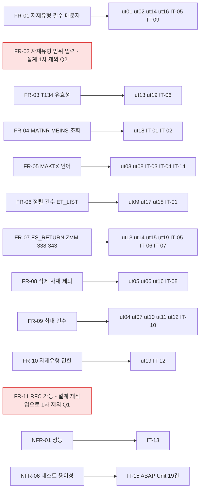
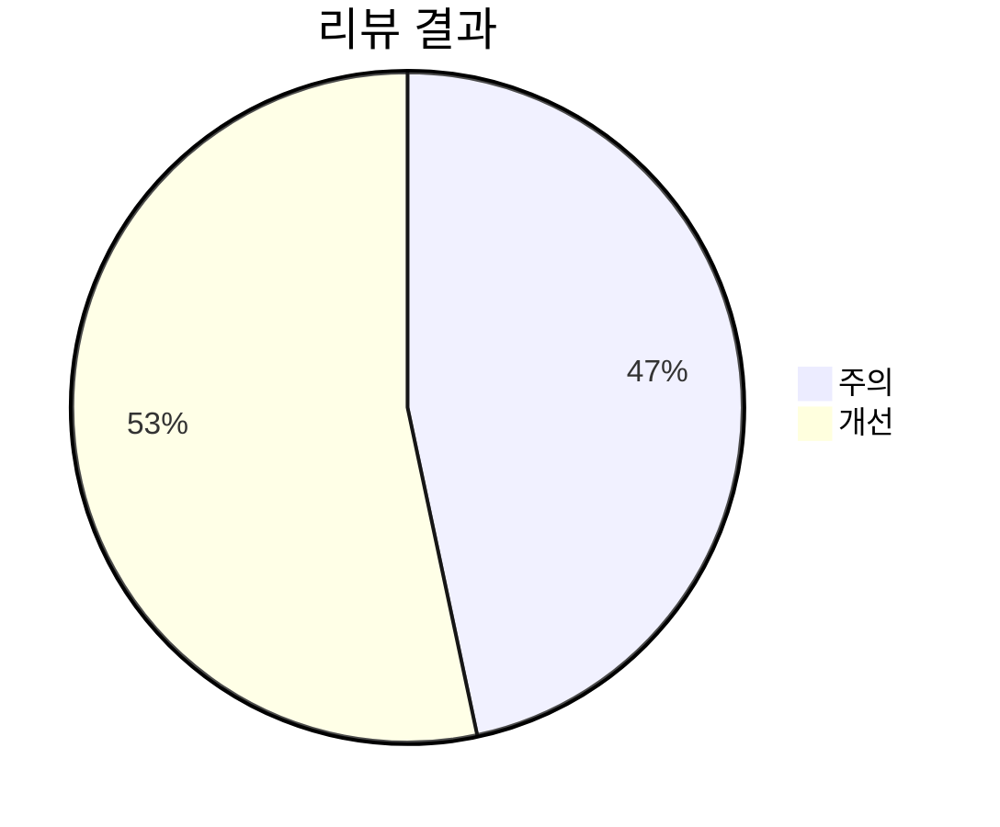
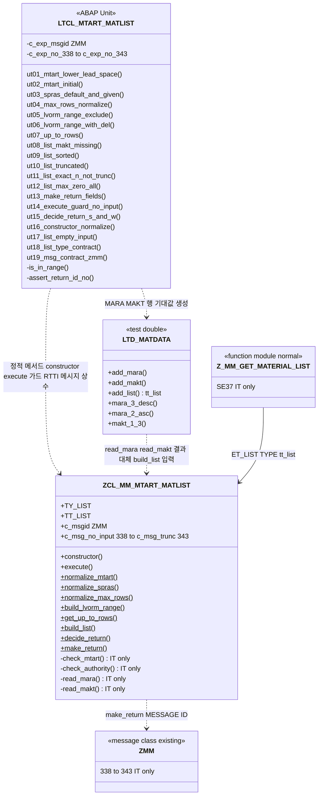

VERDICT: PASS
# 04. 테스트 - 자재 리스트 조회 펀션 신규 개발

- 요청 ID: 20261119-f26e72
- 작성: sap-tester (**테스트 재작업 3.0** — 팀장 개발 수정 지시 "ZMMM3 쓰지 말고 ZMM 메시지 클래스를 이용해서 해줘" 반영(개발 재작업 2차 승인본 기준). 반영된 CR 없음, 첨부 없음)
- 작성일: 2026-11-19
- 입력: `request.md`, `01_analysis.md`, `02_design.md`, `03_development.md`(재작업 2차, X-09·7장 3번), `src/ZCL_MM_MTART_MATLIST.abap`, `src/Z_MM_GET_MATERIAL_LIST.fm.abap`·`.fm.json`, `src/ZFGMM71.fugr.json`, `src/ZMM.msag.json`, `src/ZMMM3.msag.json.unused`(반영 제외 확인용), 프로젝트 `src/board.ts`·`src/adt.ts`(MSAG 반영 동작 확인)
- 산출물: 이 문서, `src/ZCL_MM_MTART_MATLIST.testclasses.abap`(ABAP Unit, CCAU, 3.0)
- 개발표준: `standards/handbook.md`
- 조회 시스템: mrd-abap-rw (클라이언트 350), `mcp__sap__*` **읽기 조회만** 함
- **판정 방식: 정적 리뷰 + 직전 반영 결과 참고.** 이 단계는 SAP 시스템에 쓰지 않습니다. 직전 개발계 반영(ZMMM3 기준)에서 활성화 성공·ABAP Unit 18건 통과가 보고되었고, 이번 변경은 메시지 ID·번호 상수와 주석뿐입니다. PASS는 "조건부 PASS"이며 9장 조건이 하나라도 실패하면 FAIL로 바꿉니다.

---

## 테스트 다이어그램

### 1) 요구사항 커버리지도

- 빨간색 FR-02·FR-11은 승인된 설계(02_design 1장 범위 결정, 2.2 RFC 트레이드오프)로 1차 개발에서 제외된 [추가] 항목이라 검증 시나리오가 없습니다. 요청 원문("자재유형 입력 → 자재코드·내역·기본단위 리스트") 기준의 누락은 아닙니다.
- FR-10의 `ut19`는 권한 거부 시 메시지 번호(ZMM 340) 조립만 확인합니다. 실제 권한 점검은 IT-12입니다.
- 단위테스트 메서드 이름은 노드 수 제한 때문에 앞부분(`ut01` 등)만 적었습니다. 전체 이름은 7.1 표에 있습니다.

### 2) 리뷰 결과 분포

### 3) 단위테스트 구성도

---

## 1. 요약과 판정

| 항목 | 결과 |
|---|---|
| 판정 | **PASS (조건부)** — 치명 0건, 주의 7건, 개선 8건. 테스트 단계에서 직접 고친 F-01(테스트 소스 ZMMM3 표기) 제외 |
| 이번 변경 대조 | 클래스: 53~59줄 상수 `C_MSGID 'ZMM'`, `C_MSG_NO_INPUT~C_MSG_TRUNC '338'~'343'`, 52·364~365줄 주석만 바뀜. 메서드·시그니처·타입·로직은 이전 승인본과 동일(직접 대조). FM: 23·26~28줄 주석만 바뀜, 인터페이스·본문 동일. `ZMM.msag.json` 338~343 텍스트 = 설계 7장 001~006 텍스트(순서·&1/&2 동일), 모두 73자 이내 |
| F-01 (해결) | 테스트 소스의 ZMMM3·옛 번호 표기(헤더 19줄, 575줄 주석, `'UT-13 ID ZMMM3'`, `'UT-14 ID ZMMM3'`, `NUMBER 001/002/005/006` 메시지 문구) → **ZMM·338~343으로 수정 완료**. 판정은 원래 상수 비교라 활성화·결과에는 영향 없던 표기 문제 |
| 메시지 검증 강화 | UT-13·14·15의 ID/NUMBER 기대값을 클래스 상수 대신 테스트 고정값(`C_EXP_MSGID 'ZMM'`, `C_EXP_NO_338~343`)으로 바꿈 → 상수가 다시 바뀌면 테스트가 잡음. **UT-19 `ut19_msg_contract_zmm` 신규**: 상수 7개 값 + `make_return` 6개 번호 모두 ID ZMM·해당 번호 확인. ABAP Unit 18 → **19건** |
| 반영 제외 | `src/ZMMM3.msag.json.unused`는 웹앱 필터(`srcList(id, ".msag.json")`, board.ts 151~154·194줄)에 걸리지 않음 → **반영 대상 아님** 확인 |
| 기존 ZMM 보호 | 웹앱 `addMessages`(adt.ts 302~315)는 **없는 번호만 추가**, 이미 있는 번호는 텍스트가 달라도 그대로 두고 경고만 남김(board.ts 277~282) → 기존 메시지 텍스트는 바뀌지 않음. 단 ZMM 전체 XML을 PUT하므로 이송요청 기록 범위·잠금 충돌은 확인 필요(W-07) |
| 문서 불일치 | 02_design.md(4장·7장·10~11장 등)는 여전히 `ZMMM3` 001~006. 03_development.md X-09에 차이 기록됨 → W-08 |
| 요구사항 | 요청 원문 범위 구현. FR-01, 03~10 구현. FR-02·FR-11은 설계 승인으로 1차 제외 |
| 성능·권한·예외 | 변경 없음. SELECT in LOOP·SELECT * 없음, FAE 빈값 확인 있음, M_MATE_MAR 점검 있음, 잡을 클래스 예외 없음 |
| 개발표준 | 소스 내부 이름 위반 0건. 메시지 클래스 `ZMM`은 핸드북 규칙(`ZM`+영역+1자리) 형식이 아니나 **기존 공용 오브젝트·팀장 지정**이라 예외(I-06) |

---

## 2. 리뷰 범위와 방법

| 대상 | 파일 | 줄 수 | 방법 |
|---|---|---|---|
| 클래스 `ZCL_MM_MTART_MATLIST` | `src/ZCL_MM_MTART_MATLIST.abap` | 486 | 이전 승인본(04_test 2.0 리뷰본)과 줄 단위 대조 → 차이는 52~59줄(상수·주석), 364~365줄(주석)뿐 |
| FM `Z_MM_GET_MATERIAL_LIST` | `src/Z_MM_GET_MATERIAL_LIST.fm.abap` | 43 | 인터페이스(4~12줄)·본문(30~41줄) 동일, 헤더 주석 23·26~28줄만 ZMM 338~343으로 변경 |
| FM 메타·함수 그룹 | `.fm.json`, `ZFGMM71.fugr.json` | 각 1 | 변경 없음 (group ZFGMM71, normal) |
| 메시지 클래스 | `src/ZMM.msag.json` | 11 | 338~343 6건, 텍스트·유형 의미를 클래스 상수(53~59)·설계 7장·FM 주석(26~28)과 대조. 일치. description "MM Message Class" = 시스템 내역과 같음 |
| 반영 제외 파일 | `src/ZMMM3.msag.json.unused` | — | 확장자가 `.msag.json`이 아니라 웹앱이 읽지 않음 |
| 웹앱 MSAG 반영 로직 | `D:\ANTI\DEVSAP\src\board.ts` 151~154·193~199·265~287, `src\adt.ts` 280~315 | — | 기존 MSAG면 없는 번호만 추가, 다른 텍스트는 경고 후 유지, 실패해도 나머지 반영 계속 |
| `src/` 파일 목록 | Glob | — | 반영 대상 6개(`ZMM.msag.json`, `ZFGMM71.fugr.json`, 클래스, testclasses, `.fm.abap`, `.fm.json`) + 반영 제외 `.unused` 1개 |

---

## 3. 시스템 확인 결과 (이 세션, mrd-abap-rw, 2026-11-19)

| 대상 | 도구 | 결과 | 의미 |
|---|---|---|---|
| `ZMM` (MSAG) | SearchObject | MSAG/N, 내역 "MM Message Class", 패키지 ZMMD **존재** | 웹앱은 신규 생성이 아니라 "이미 있음 → 번호 추가" 경로 |
| `ZMMM*` (MSAG) | SearchObject | ZMMM, ZMMM1, ZMMM2만 | **`ZMMM3` 없음** → 정리할 고아 MSAG 없음. 단 직전 반영에서 ZMMM3 생성이 실패(경고)했을 가능성을 시사 → W-09 |
| `ZCL_MM_MTART_MATLIST` 활성 버전 | GetClass 50~60줄 | `c_msgid 'ZMMM3'`, `c_msg_*` `'001'`~`'006'` (485줄) | 시스템은 아직 직전 반영본. 이번 반영으로 main·CCAU 모두 덮어써야 함(W-02) |
| ZMM 338~343 사용 여부 | — | **조회 도구 없음 (확인 필요)** | 03_development 1.1의 사용 번호 목록(…301~337)은 PL 확인 기준. 반영 로그로 확인(W-03) |
| [이전 세션 확인] | 04_test 2.0 3장 | ACTIV_AUTH, BAPI_MTYPE, SYMSGID/SYMSGNO/SYMSGV, SYSUBRC, CL_ABAP_UNIT_ASSERT 존재, ZFGMM71·Z_MM_GET_MATERIAL* 비어 있었음 | 직전 반영 성공으로 FUGR·FM은 이제 존재할 것으로 보임(이번에 재조회 안 함) |
| 표준 테이블 필드 | — | 직전 반영의 활성화 성공으로 T134-BEGRU, MARA/MAKT 필드 참조 확인됨 | 2.0의 W-06 해소 |

---

## 4. 리뷰 결과 (결함 목록)

| ID | 심각도 | 오브젝트 | 위치 | 문제 | 수정 제안 |
|---|---|---|---|---|---|
| F-01 | (주의 → **해결**) | 테스트 클래스 | 이전 2.0 `testclasses.abap` 19줄, 575줄, 581줄 `'UT-13 ID ZMMM3'`, 584줄 `NUMBER 002`, 623줄 `'UT-14 ID ZMMM3'`, 626줄 `NUMBER 001`, 633·644·650·661줄 `005/006` | ZMMM3·옛 번호 표기가 남아 있어 실패 메시지가 실제와 다르게 보임 | **수정 완료(3.0)**. ID/NUMBER 기대값도 고정값 `C_EXP_*`로 변경, UT-19 추가. 집계에서 제외 |
| W-02 | 주의 | `ZCL_MM_MTART_MATLIST` | 시스템 활성 버전 52~59줄 | 시스템 활성 버전이 ZMMM3 001~006 기준(확인). 반영 시 main·CCAU가 함께 갱신되지 않으면 UT-19가 실패하거나 ES_RETURN이 ZMMM3로 나감 | 반영 로그에서 CLAS main·testclasses 둘 다 "갱신" 확인, 활성화 후 GetClass/SE24로 `c_msgid = 'ZMM'` 확인 |
| W-03 | 주의 | MSAG `ZMM` | `ZMM.msag.json` 4~9줄 | 338~343이 비어 있는지 이 세션에서 확인 못함. 이미 다른 텍스트로 쓰고 있으면 웹앱이 경고만 남기고 기존 텍스트 유지 → ES_RETURN-MESSAGE가 엉뚱한 문구 | 반영 직전 SE91 `ZMM` 338~343 미사용 확인. 반영 로그가 정확히 "메시지 338, 339, 340, 341, 342, 343 추가"이고 "⚠️ … SAP 텍스트와 달라 그대로 두었습니다"가 없어야 함. 있으면 번호 재배정 후 개발 단계로 |
| W-04 | 주의 | 클래스 | 432~434줄 `AUTHORITY-CHECK OBJECT 'M_MATE_MAR'` | M_MATE_MAR 필드 할당(ACTVT, BEGRU) 미확인(C-03). 다르면 BEGRU가 있는 자재유형은 모두 E ZMM 340 | SU21 확인 후 IT-12 |
| W-05 | 주의 | 클래스, FM | 456~462줄 `read_mara`, fm.abap 8줄 `IV_MAX_ROWS DEFAULT 0` | MARA MTART 보조 인덱스 미확인(C-02), 기본 무제한 | IT-13 ST05 기록. 느리면 Q6로 기본값 협의 |
| W-07 | 주의 | MSAG `ZMM`, 이송요청 | adt.ts 303~315 `addMessages` | 웹앱이 ZMM **전체 XML**을 잠금 후 PUT. ① ZMM이 다른 개발자의 미반출 이송요청에 잠겨 있으면 실패(경고) ② 이송요청에 메시지 6건(LIMU MESS)만이 아니라 MSAG ZMM 전체가 기록될 수 있음 → QAS·PRD 이관 시 다른 개발자의 미이관 ZMM 변경까지 함께 넘어갈 위험 ③ GET→PUT 왕복이라 기존 메시지는 그대로 다시 쓰지만 문서화 플래그·원어 등 속성 보존은 표준 지식 기준 미확인 | 반영 후 SE09/SE10에서 이송요청 오브젝트 목록이 `LIMU MESS ZMM338`~`ZMM343` 형태인지 확인. `R3TR MSAG ZMM` 전체면 이관 전 팀장 판단. SE91에서 기존 번호 몇 건(예 000, 002, 337) 텍스트·변경일 무변경 확인 |
| W-08 | 주의 | 문서 `02_design.md` | 91, 236, 251, 345~346, 525~542(7장), 583, 597, 629~631, 639~650, 662·668, 708, 719줄 및 166~182줄 흐름도 | 설계서는 여전히 메시지 클래스 `ZMMM3` 신규, 번호 001~006. 소스·03_development(X-09)·이 문서는 `ZMM` 338~343 → 산출물 간 불일치. 운영 인수인계·호출측 개발자가 설계서를 보면 잘못된 ID/번호로 분기할 수 있음 | 설계서 7장 등을 ZMM 338~343으로 갱신(팀장 판단: 설계 단계 재작업 또는 문서 정정만). 테스트는 03_development·소스 기준으로 작성함 |
| W-09 | 주의 | MSAG `ZMMM3`(직전 반영) | 3장 SearchObject | 직전 반영이 ZMMM3 기준이었는데 시스템에 `ZMMM3`가 없음 → MSAG 생성이 경고로 실패했을 가능성(직전 반영 로그 확인 필요). 같은 경로라 이번 ZMM 추가도 실패할 수 있음. 실패해도 활성화·ABAP Unit은 통과하므로 놓치기 쉬움 | 이번 반영 로그에서 MSAG 줄을 반드시 확인(P-2). 실패면 SE91 수작업 등록(03_development 2.3 표). 직전 로그의 ZMMM3 실패 원인도 함께 확인 |
| I-01 | 개선 | 클래스 | 394줄 `MESSAGE ID c_msgid ... NUMBER iv_number` | 동적 지정이라 SE91 사용처 조회에 338~343이 안 보임. ZMM은 공용 클래스라 다른 개발자가 "미사용"으로 오인하고 같은 번호를 바꿀 위험이 1차보다 커짐 | 선택: `IF 1 = 2. MESSAGE e338(zmm). MESSAGE e339(zmm). … MESSAGE w343(zmm). ENDIF.` 사용처 표시 블록 추가 |
| I-02 | 개선 | 클래스 | 456~462줄 | SCI가 MARA 비키 조건 SELECT에 성능 메시지를 낼 수 있음 | IT-13 근거를 SCI 결과에 남김 |
| I-03 | 개선 | 클래스 `TY_LIST`, `build_list` | 26~30, 340~341줄 | MATNR·MEINS 내부 형식 반환(Q5 미답) | IT-02에서 차이 기록 |
| I-04 | 개선 | 클래스 | 150~169줄, 3줄 FINAL | DB 접근이 FINAL 클래스 private 메서드라 `execute` 정상 경로 단위테스트 불가 | 확장 때 DAO 인터페이스 주입 검토 |
| I-05 | 개선 | 작업 폴더 | `manual/Z_MM_GET_MATERIAL_LIST.fm.abap`, `src/ZMMM3.msag.json.unused` | 낡은/미사용 파일이 남아 혼동 소지(반영 영향 없음) | 정리 여부 팀장 판단. 유효 소스는 `src/`의 반영 대상 6개뿐 |
| I-06 | 개선 | MSAG `ZMM` | `src/ZMM.msag.json`, 클래스 53줄 | 핸드북 Message Class 규칙(`Z`+`M`+영역 2자리+순번 1자리, 예 `ZMMM3`)과 형식이 다름 | 기존 공용 오브젝트·팀장 지정이라 **예외로 수용, 조치 없음**. 5장에 기록 |
| I-07 | 개선 | 문서 `03_development.md` | 1장 179·182·189·190줄, 3.1 R-1, 6장, 9장 K-8 | "ZMMM3.msag.json 삭제 대상(PL 처리)", "testclasses 이번에 수정 안 함" 서술이 현재 상태(파일은 `.unused`로 이름 변경, testclasses 3.0 갱신)와 다름 | 다음 문서 갱신 때 반영(동작 영향 없음) |
| I-08 | 개선 | FM `Z_MM_GET_MATERIAL_LIST` | fm.abap 10줄 `ET_LIST TYPE ZCL_MM_MTART_MATLIST=>TT_LIST` | 클래스 타입 참조는 직전 반영 활성화로 확인됨(2.0 W-01 해소). SE37 테스트 화면에서 ET_LIST 결과 표시 여부만 미확인 | IT-11. 표시 안 되면 `$TMP` 임시 프로그램 `ZRMM9999`로 확인 |

- **치명 0건.** 이번 변경은 문자 상수·주석뿐이라 활성화 위험이 새로 생기지 않았습니다(`symsgid` CHAR20에 'ZMM', `symsgno` NUMC3에 '338'~'343' 유효). 테스트 클래스 3.0은 클래스의 실제 타입·상수·메서드·파라미터 이름만 참조합니다(8장).
- **소스 결함(개발 수정이 필요한 것): 없음.** W-03·W-07·W-09는 반영 절차·공용 오브젝트 관리 문제이고, W-08·I-07은 문서 문제입니다.
- 2.0의 W-01(FM 클래스 타입 참조)·W-06(표준 필드 미확인)은 직전 반영의 활성화 성공으로 해소되어 집계에서 뺐습니다(W-01 잔여분은 I-08).

---

## 5. 개발표준 준수 (핸드북)

### 5.1 오브젝트명

| 오브젝트 | 유형 | 핸드북 규칙 | 판정 |
|---|---|---|---|
| `ZMMD` | 패키지 | Z + MM + D | 준수 |
| `ZFGMM71` | 함수 그룹 | Z + FG + MM + 2자리 | 준수 |
| `Z_MM_GET_MATERIAL_LIST` | 함수 모듈 | Z_ + 서술어(22자) | 준수 |
| `ZMM` | 메시지 클래스 (**기존**, 338~343 추가) | Z + M + 영역 2자리 + 순번 1자리 | **형식 불일치 — 예외(팀장 지정 기존 공용 오브젝트, 신규 생성 아님)** (I-06) |
| `ZCL_MM_MTART_MATLIST` | 클래스 | 핸드북 규칙 없음 — SAP 관례(`ZCL_`) | 해당 없음(관례 준수) |
| `ZRMM9999` (수작업 테스트용, `$TMP`, 반영 대상 아님) | 프로그램 | Z + R + MM + 4자리 | 준수 |

### 5.2 프로그램 내부 이름

| 구분 | 이름 (파일·줄) | 규칙 | 판정 |
|---|---|---|---|
| 클래스 속성 | `G_MTART`, `G_SPRAS`, `G_WITH_DELETED`, `G_MAX_ROWS` (클래스 145~148) | Variables G_ | 준수 |
| 로컬 변수 | `L_FOUND`, `L_BEGRU`, `L_TRUNCATED`(198~200), `L_FROM`(334), `L_COUNT`, `L_MAX`(367~368), `L_MSG`(390), `L_ROWS`(449) | Variables L_ | 준수 |
| 로컬 내부테이블 | `LT_MARA`, `LT_MAKT` (201~202) | Internal Tables LT_ | 준수 |
| 워크에어리어 | `LS_LVORM`(299), `LS_MARA`, `LS_MAKT`, `LS_LIST`(331~333) | Structure LS_ | 준수 |
| 상수 | `C_MSGID`, `C_MSG_*`(53~59), `C_MSGTY_*`, `C_ACTVT_DISPLAY`, `C_SIGN_EXCLUDE`, `C_OPTION_EQ` | Constants C_ (20자 이내) | 준수 |
| 범위 | `R_LVORM` (448) | Ranges R_ | 준수 |
| FM 로컬 참조 | `LO_LIST` (fm.abap 30) | 핸드북 규칙 없음 — SAP 관례 | 해당 없음 |
| 테스트 클래스 (3.0) | 상수 `C_EXP_MSGID`, `C_EXP_NO_338`~`C_EXP_NO_343`(185~191, 12자 이내), `C_MTART_ROH` 등. 로컬 `L_MSG`(255), `L_ACT`/`L_IN`/`L_TRUNC`, `LT_*`, `LS_RETURN`(254)·`LS_*`, 범위 `R_LVORM`. 클래스 `LTCL_`/`LTD_`, 보조 메서드 `ASSERT_RETURN_ID_NO`·파라미터 `IV_*`, 참조 `LO_*` | 핸드북 2장 + SAP 관례 | 준수 |

**어긋난 이름**

| 파일 | 위치 | 현재 이름 | 핸드북상 올바른 이름 | 상태 |
|---|---|---|---|---|
| `src/ZMM.msag.json`, `src/ZCL_MM_MTART_MATLIST.abap` | 파일명, 53줄 `c_msgid` | `ZMM` | `ZMM` + 순번(예 `ZMMM3`) 형식 | **예외 수용** — 팀장 개발 수정 지시로 기존 공용 메시지 클래스 사용. 신규 오브젝트가 아니므로 이름 변경 대상 아님 |

소스 내부 이름(클래스·FM·테스트 클래스) 기준 어긋난 이름: **0건**.

---

## 6. 점검 항목별 결과

| 점검 항목 | 결과 | 근거 |
|---|---|---|
| 구문 오류 | 정적 검토상 없음 | 이번 변경은 문자 상수 값·주석. 테스트 3.0 추가 구문은 CONSTANTS 체인, `CONCATENATE … INTO … SEPARATED BY space`(구버전 구문), 보조 메서드 1개 |
| 활성화 가능성 (테스트 클래스) | 가능 | 참조하는 클래스 요소 `tt_list`/`ty_list`/`tt_mara`/`ty_mara`/`tt_makt`/`ty_makt`/`tt_lvorm_range`, 상수 `c_msgid`·`c_msg_no_input`·`c_msg_invalid`·`c_msg_no_auth`·`c_msg_no_data`·`c_msg_success`·`c_msg_trunc`·`c_msgty_error/warning/success`, 메서드·파라미터명, private `g_*`(LOCAL FRIENDS) 모두 현재 소스에 존재(8장) |
| 메시지 정합 | 일치 (소스 기준) | 클래스 상수 53~59 = `ZMM.msag.json` 338~343 = FM 주석 26~28 = 03_development 2.3 표. **설계서 7장과는 불일치(W-08)** |
| 기존 메시지 보호 | 웹앱 로직상 보호 | 없는 번호만 추가, 기존 번호는 텍스트가 달라도 덮어쓰지 않음(board.ts 277~282). 전체 PUT에 따른 이송·잠금 영향은 W-07 |
| 출력 타입 정합 | 일치 | `TY_LIST`·`TT_LIST` 변경 없음, UT-18 |
| 7.40 호환 | 준수 | 인라인 선언·`NEW`·`COND`·`VALUE`·`xsdbool`·끝 INTO 미사용 |
| 성능 | SELECT in LOOP·SELECT * 없음 | 변경 없음. MARA 인덱스 W-05 |
| 권한 | 구현됨 | 변경 없음. W-04 |
| 예외 처리 | 미처리 없음 | MESSAGE INTO는 메시지가 없어도 덤프 없이 SY-MSG* 채움 |
| 읽기 전용 | 준수 | DB 갱신·COMMIT 없음 |
| 요구사항 누락 | 없음(요청 범위) | 팀장 지시(ZMM 사용) 반영 확인. FR-02·11은 승인된 제외 |

---

## 7. 테스트 시나리오

### 7.1 단위 테스트 (ABAP Unit, `LTCL_MTART_MATLIST`)

실행: 웹앱 반영 R-5에서 자동 실행, 또는 SE24/SE80 → `ZCL_MM_MTART_MATLIST` → 테스트 → 단위 테스트(Ctrl+Shift+F10). DB·권한 접근 없음.

| ID | 제목 | 테스트 메서드 | 절차 | 기대 결과 | AC/FR |
|---|---|---|---|---|---|
| UT-01 | 소문자·앞 공백 자재유형 정규화 | `ut01_mtart_lower_lead_space` | `normalize_mtart( ' roh' )` | `'ROH'` | AC-09, FR-01 |
| UT-02 | 공란 자재유형 | `ut02_mtart_initial` | `normalize_mtart( 공란 )` | 공란 | FR-01 |
| UT-03 | 언어 기본값·지정값 | `ut03_spras_default_and_given` | 공란 / `'E'` | SY-LANGU / `'E'` | FR-05 |
| UT-04 | 최대 건수 정규화 | `ut04_max_rows_normalize` | -5 / 0 / 10 | 0 / 0 / 10 | FR-09 |
| UT-05 | 삭제 제외 range | `ut05_lvorm_range_exclude` | `build_lvorm_range( 공란 )` | 1행 (E, EQ, 'X'), `'X' IN r` 거짓, `' ' IN r` 참 | AC-08, FR-08 |
| UT-06 | 삭제 포함 range | `ut06_lvorm_range_with_del` | `build_lvorm_range( 'X' )` | 빈 range, 모두 IN 참 | AC-08, FR-08 |
| UT-07 | UP TO 건수 | `ut07_up_to_rows` | 0 / 10 / MAX_INT4 / MAX_INT4-1 / -1 | MAX_INT4 / 11 / MAX_INT4 / MAX_INT4 / MAX_INT4 | AC-11, FR-09 |
| UT-08 | 내역 없는 자재 행 유지 | `ut08_list_makt_missing` | MARA 2건(1,2), MAKT 자재 1·3 | 2행, 자재 2 MAKTX 공란, truncated 거짓 | AC-04, FR-05 |
| UT-09 | 자재코드 정렬 | `ut09_list_sorted` | MARA 역순 3건 | 1→2→3, 매핑 유지 | AC-10, FR-06 |
| UT-10 | 최대 건수 잘림 | `ut10_list_truncated` | 역순 3건, max 2 | 앞 2건(1,2), truncated 참 | AC-11, FR-09 |
| UT-11 | 정확히 n건 | `ut11_list_exact_n_not_trunc` | 2건, max 2 | 2행, truncated 거짓 | AC-11, FR-09 |
| UT-12 | 제한 없음 | `ut12_list_max_zero_all` | 3건, max 0 | 3행, truncated 거짓 | FR-09 |
| UT-13 | RETURN 조립 | `ut13_make_return_fields` | `make_return( c_msgty_error, c_msg_invalid, 'ZZZ9' )` | TYPE 'E', **ID 'ZMM', NUMBER '339'**(고정 기대값), V1 'ZZZ9', V2 공란. 텍스트 비교 안 함 | AC-06, FR-03·07 |
| UT-14 | 입력 누락 가드 | `ut14_execute_guard_no_input` | 공란으로 생성, 출력 미리 채움 → `execute` | ET_LIST 빈, EV_COUNT 0, **E / ZMM / 338**. DB 접근 전 RETURN | AC-05, FR-01·07 |
| UT-15 | 성공/잘림 판정 | `ut15_decide_return_s_and_w` | count 5 잘림 아님 / count 10 max 10 잘림 | **S ZMM 342** V1 'ROH' V2 '5' / **W ZMM 343** V1 '10' (ID 확인 추가) | AC-01·11, FR-07 |
| UT-16 | constructor 정규화 | `ut16_constructor_normalize` | `' roh'`, 공란, 'Y', -5 / `'ROH'`, 'E', 'X', 10 | G_MTART 'ROH', G_SPRAS SY-LANGU, G_WITH_DELETED 공란, G_MAX_ROWS 0 / 'E', 'X', 10 | AC-09, FR-01·05·08·09 |
| UT-17 | 빈 입력 조립 | `ut17_list_empty_input` | MARA 0건, 출력 미리 채움 | 빈 목록, truncated 거짓 | FR-06·09 |
| UT-18 | FM 출력 타입 계약 | `ut18_list_type_contract` | RTTI로 `ty_list`·`tt_list` 조회 | 필드 3개 MATNR→MAKTX→MEINS, STANDARD, DEFAULT KEY | FR-04·06 |
| **UT-19** | **메시지 계약 ZMM 338~343 (신규)** | `ut19_msg_contract_zmm` | ① 클래스 상수 7개를 고정 기대값과 비교 ② `make_return`을 6개 번호(E 338·339·340, W 341, S 342, W 343)로 호출 | ① `c_msgid` = 'ZMM', `c_msg_no_input`~`c_msg_trunc` = '338'~'343' ② 각 결과 TYPE = 넘긴 유형, ID = 'ZMM', NUMBER = 해당 번호 | FR-03·07·10, 팀장 지시 |

메시지 기대값 대응표 (설계 7장 → 소스)

| 의미 | 유형 | 설계 7장 (ZMMM3) | **기대값 (ZMM)** | 클래스 상수 | 검증 UT / IT |
|---|---|---|---|---|---|
| 입력 누락 | E | 001 | **338** | `C_MSG_NO_INPUT` | UT-14, UT-19 / IT-05 |
| 자재유형 없음 | E | 002 | **339** | `C_MSG_INVALID` | UT-13, UT-19 / IT-06 |
| 권한 없음 | E | 003 | **340** | `C_MSG_NO_AUTH` | UT-19 / IT-12 |
| 데이터 없음 | W | 004 | **341** | `C_MSG_NO_DATA` | UT-19 / IT-07 |
| 정상 n건 | S | 005 | **342** | `C_MSG_SUCCESS` | UT-15, UT-19 / IT-01, IT-10 |
| 최대 건수 잘림 | W | 006 | **343** | `C_MSG_TRUNC` | UT-15, UT-19 / IT-10 |

테스트 데이터·작성 원칙
- 자재번호는 ECC 18자리 내부 형식 가상값(`000000000000100001`~`…003`).
- 메시지 텍스트 비교 없음(TYPE/ID/NUMBER/V1·V2만). ID·NUMBER 기대값은 **테스트 고정 상수 `C_EXP_MSGID`/`C_EXP_NO_338`~`343`**(타입 `symsgid`/`symsgno`), 유형은 클래스 상수 `c_msgty_*`로 비교합니다.
- `MESSAGE … INTO`는 ZMM에 해당 번호가 아직 없어도 SY-MSGID·SY-MSGNO를 채우므로, MSAG 반영 결과와 무관하게 UT는 통과해야 합니다(텍스트는 IT에서 확인).
- 선행 조건 없음(신규 DDIC 없음). 클래스 main과 같은 활성화 단위.

### 7.2 수작업 테스트 (개발계 반영 후, SE37 등)

실행: SE37 → `Z_MM_GET_MATERIAL_LIST` → 테스트/실행(F8). ES_RETURN의 ID는 모두 `ZMM`이어야 합니다.

| ID | 제목 | 대상 | 절차 | 기대 결과 | AC |
|---|---|---|---|---|---|
| IT-00 | 반영 결과 확인 | 전체 | 웹앱 반영 로그: **MSAG `ZMM` "이미 있음 — 메시지 338, 339, 340, 341, 342, 343 추가"**(⚠️ 경고 없음), **MSAG `ZMMM3` 줄 없음**, FUGR `ZFGMM71`·FUNC "이미 있음/갱신", CLAS main·CCAU 갱신, 일괄 활성화 성공, ABAP Unit 19건. SE91 `ZMM` 338~343 텍스트 = 7.1 대응표, 기존 번호(예 000·002·337) 무변경 | 모두 성공. MSAG 경고 시 W-03·W-09 절차 | — |
| IT-01 | 정상 조회 건수 | check_mtart, read_mara, read_makt | 자재·삭제 자재가 모두 있는 유형 X → `IV_MTART = X` | 건수 = SE16 MARA(MTART=X, LVORM≠'X'), EV_COUNT 같음, **S ZMM 342**, 오름차순·중복 없음 | AC-01, AC-10 |
| IT-02 | 값 대조 | read_mara | IT-01 결과 임의 3건 | MATNR·MEINS = MM03. 내부/외부 표시 차이 기록(I-03) | AC-02 |
| IT-03 | KO 내역 | read_makt | 로그온 KO | MAKTX = MAKT(SPRAS='3') | AC-03 |
| IT-04 | 내역 없는 자재 | read_makt, build_list | KO 내역 없는 자재가 있는 유형 | 행 유지, MAKTX 공란 | AC-04 |
| IT-05 | 입력 누락 | execute 가드 | `IV_MTART` 공란 | ET_LIST 0건, **E ZMM 338**, MESSAGE "자재유형을 입력하십시오." | AC-05 |
| IT-06 | 없는 자재유형 | check_mtart | SE16 T134로 미존재 확인한 값(예 ZZZ9) | ET_LIST 0건, **E ZMM 339**, V1 = 값, 텍스트에 값 치환 | AC-06 |
| IT-07 | 자재 0건 유형 | read_mara | T134에 있고 MARA 0건인 유형(없으면 "해당 없음") | ET_LIST 0건, **W ZMM 341** | AC-07 |
| IT-08 | 삭제 자재 포함/제외 | read_mara | `IV_WITH_DELETED` 공란 / 'X' | 건수 차이 = MARA(LVORM='X') 건수 | AC-08 |
| IT-09 | 소문자 입력 | constructor | 소문자 입력(대문자 변환 해제 또는 대안 프로그램) | IT-01과 같은 결과 | AC-09 |
| IT-10 | 최대 건수 | read_mara, build_list | `IV_MAX_ROWS = 10`, 대상 > 10 / = 10 | 10건 **W ZMM 343**(V1 '10') / 10건 **S ZMM 342** | AC-11 |
| IT-11 | 일반 FM·클래스 타입 | FM 속성 | SE37 속성 = 일반 함수 모듈, `ET_LIST` = `ZCL_MM_MTART_MATLIST=>TT_LIST`, 테스트 결과 화면 표시 확인. 안 되면 `$TMP` `ZRMM9999`로 확인 | 일반 FM, 타입 일치. AC-12(RFC)는 해당 없음 | AC-12 대체 |
| IT-12 | 권한 없음 | check_authority | SU21 M_MATE_MAR 필드 확인 후, BEGRU 있는 유형 + 권한 없는 사용자 | ET_LIST 0건, **E ZMM 340** (없으면 "해당 없음") | AC-13 |
| IT-13 | 성능 | read_mara, read_makt | 자재 최다 유형, ST05 | 접근 경로·응답시간 기록 | AC-14 |
| IT-14 | 언어 지정 | read_makt | `IV_SPRAS = 'E'` | MAKTX = MAKT(SPRAS='E') | FR-05 |
| IT-15 | ABAP Unit | 테스트 클래스 | 7.1 실행 | **19개** 메서드 모두 성공 | NFR-06 |
| IT-16 | 정적 검사 | 전체 | SLIN, SCI | 오류 0. MARA 성능 메시지는 IT-13 근거로 판단 | NFR-03 |
| IT-17 | 이송요청 범위 (신규) | MSAG `ZMM` | SE09/SE10에서 반영 이송요청 오브젝트 목록 확인 | ZMM은 메시지 338~343(LIMU MESS)만 기록. `R3TR MSAG ZMM` 전체가 잡혔으면 이관 전 팀장 판단(W-07) | — |

### 7.3 분석 AC 추적

| AC | 내용 | 단위테스트 | 수작업 테스트 | 비고 |
|---|---|---|---|---|
| AC-01 | 정상 건수·S | ut15, ut19 | IT-01 | ZMM 342 |
| AC-02 | MATNR·MEINS 일치 | ut18 | IT-02 | |
| AC-03 | KO 내역 | ut03 | IT-03 | |
| AC-04 | 내역 없음 → 공란 | ut08 | IT-04 | |
| AC-05 | 입력 누락 E | ut14, ut19 | IT-05 | ZMM 338 |
| AC-06 | 없는 유형 E | ut13, ut19 | IT-06 | ZMM 339 |
| AC-07 | 0건 W | ut19(번호만) | IT-07 | ZMM 341, DB 의존 |
| AC-08 | 삭제 자재 | ut05, ut06, ut16 | IT-08 | |
| AC-09 | 소문자 | ut01, ut16 | IT-09 | |
| AC-10 | 정렬·중복 없음 | ut09 | IT-01 | |
| AC-11 | 잘림 W | ut07, ut10, ut11, ut15 | IT-10 | ZMM 343 |
| AC-12 | RFC | — | IT-11 대체 | 해당 없음(FR-11 제외) |
| AC-13 | 권한 E | ut19(번호만) | IT-12 | ZMM 340 |
| AC-14 | 성능 | — | IT-13 | |

---

## 8. ABAP Unit 구성 (`src/ZCL_MM_MTART_MATLIST.testclasses.abap`, 3.0)

| 구성 | 내용 |
|---|---|
| 넣을 곳 | 클래스 Local Test Classes include(CCAU). 웹앱 반영 R-3에서 main과 함께 갱신 |
| 선언 | `CLASS ltcl_mtart_matlist DEFINITION DEFERRED.` + `CLASS zcl_mm_mtart_matlist DEFINITION LOCAL FRIENDS ltcl_mtart_matlist.` |
| `LTCL_MTART_MATLIST` | `FOR TESTING RISK LEVEL HARMLESS DURATION SHORT`, 테스트 메서드 **19개**(기존 18개 유지 + `ut19_msg_contract_zmm`), 보조 `is_in_range`, `assert_return_id_no`(신규). 메시지 고정 기대값 상수 `c_exp_msgid`, `c_exp_no_338`~`c_exp_no_343`(185~191줄) |
| `LTD_MATDATA` (테스트 더블) | 변경 없음. `read_mara`·`read_makt` DB 결과 대신 MARA/MAKT 행을 메모리로 만들어 `build_list`에 넣음 |
| 3.0 변경 줄 | 헤더 5~24줄, 상수 183~191줄, 메서드 선언 222~223·233~239줄, `assert_return_id_no` 254~271줄, UT-13 619~628줄, UT-14 666~670줄, UT-15 677~711줄(ID 확인 2건 추가, 번호 문구), UT-19 806~861줄 |
| 현재 소스와 맞춘 항목 | 타입 `ty_list`/`tt_list`/`ty_mara`/`tt_mara`/`ty_makt`/`tt_makt`/`tt_lvorm_range`, 상수 `c_msgid`='ZMM', `c_msg_no_input`='338', `c_msg_invalid`='339', `c_msg_no_auth`='340', `c_msg_no_data`='341', `c_msg_success`='342', `c_msg_trunc`='343', `c_msgty_error/warning/success`, 메서드 파라미터명(`iv_type`/`iv_number`/`iv_v1`/`iv_v2` 등), private `g_*` |
| 소스 내 ZMMM3 표기 | 5·808줄 변경 이력 설명 주석("ZMMM3 -> 기존 ZMM")뿐, 비교 값·실패 메시지에는 없음 |
| 단위테스트 제외 | `check_mtart`, `read_mara`, `read_makt`, `check_authority`, `execute` 4~9단계 — 7.2 IT |
| 문법 | 7.40 SP05 이하만. 인라인 선언·VALUE·xsdbool·FOR 미사용 |

---

## 9. 개발계 반영 전·후 확인 사항 / 조건부 PASS 유지 조건

아래 중 하나라도 실패하면 판정을 FAIL로 바꾸고 원인에 따라 개발 단계로 되돌립니다.

| No | 조건 | 확인 방법 | 관련 |
|---|---|---|---|
| P-1 | (반영 전) `src/`에 `ZMMM3.msag.json`이 **없고**(`.unused`만 있음) `ZMM.msag.json`은 338~343 6건만 담고 있음 | 파일 확인 | I-05 |
| P-2 | (반영 전) SE91 `ZMM` 338~343 미사용, ZMM이 다른 개발자 이송요청에 잠겨 있지 않음 | SE91, SE03 오브젝트 잠금 조회 | W-03, W-07 |
| P-3 | 반영 로그 MSAG 줄 = "MSAG ZMM 이미 있음 — 메시지 338, 339, 340, 341, 342, 343 추가", ⚠️ 없음, ZMMM3 줄 없음 | 반영 로그 | W-03, W-09 |
| P-4 | 기존 ZMM 메시지 무변경 (예 000·002·337 텍스트·최종 변경자/일자) | SE91 | W-07 |
| P-5 | 이송요청에 ZMM이 338~343 단위로만 기록 (전체 MSAG면 이관 전 팀장 판단) | SE09/SE10, IT-17 | W-07 |
| P-6 | 클래스(main + CCAU)·FUGR·FM 일괄 활성화 성공, 활성 버전 `c_msgid = 'ZMM'` | 반영 로그, SE24 | W-02 |
| P-7 | ABAP Unit 19건 모두 성공 (UT-19 포함) | 반영 로그 / IT-15 | 7.1 |
| P-8 | IT-05·06·10에서 ES_RETURN ID = ZMM, 번호 338/339/342/343, 텍스트가 7.1 대응표 문구 | SE37 | AC-05·06·11 |
| P-9 | M_MATE_MAR 필드 = ACTVT, BEGRU / 대량 유형 응답시간 기록 | SU21, IT-12·13 | W-04, W-05 |

---

## 10. 판정 근거와 다음 단계

- **PASS(조건부)**: 팀장 지시(ZMMM3 대신 기존 ZMM)가 클래스·FM 주석·메시지 json에 일관되게 반영되었고, 로직·입출력은 이전 승인본과 같음을 직접 대조했습니다. 직전 반영에서 같은 로직이 활성화·ABAP Unit 18건 통과했고, 이번 변경은 문자 상수뿐이라 새 활성화 위험이 없습니다. 테스트 소스의 ZMMM3 표기는 이 단계에서 고쳤고 ZMM/338~343 고정값 검증(UT-13~15, UT-19)을 넣었습니다.
- 남은 위험은 **공용 메시지 클래스 ZMM 반영 방식**(번호 선점 W-03, 전체 PUT에 따른 이송요청·잠금 W-07, 직전 ZMMM3 MSAG 미생성으로 보이는 반영 실패 이력 W-09)과 **설계서 불일치**(W-08)입니다. 소스 수정이 필요한 결함은 없습니다.
- 다음 단계: 팀장 승인 → (선택) 02_design.md 7장 정정 여부 결정 → P-1·P-2 확인 → 보드 개발계 반영 → P-3~P-7 → IT-01~17 수작업 테스트.

---

## 변경 이력

| 버전 | 일자 | 내용 | CR |
|---|---|---|---|
| 1.0 | 2026-11-19 | 테스트 1차 작성 (1차 설계·개발 기준: DDIC `ZSMM3600`/`ZTTMM3600`, Remote-Enabled FM, 수작업 반영). ABAP Unit 17건 | 없음 |
| 2.0 | 2026-11-19 | 설계 재작업·개발 재작업 반영 전면 갱신(신규 DDIC 없음, 클래스 `TY_LIST`/`TT_LIST`, 일반 FM, 웹앱 자동 반영). 테스트 클래스 삭제 DDIC 참조 제거, `R_LVORM` 명명 수정, UT-18 추가 → 18건 | 없음 |
| 3.0 | 2026-11-19 | **팀장 개발 수정 지시 "ZMMM3 쓰지 말고 ZMM 메시지 클래스를 이용해서 해줘"(개발 재작업 2차) 반영.** ① 테스트 클래스 ZMMM3·옛 번호 표기 수정(F-01), UT-13·14·15 ID/NUMBER 기대값을 고정값 `C_EXP_MSGID 'ZMM'`·`C_EXP_NO_338~343`으로 변경, UT-15에 ID 확인 추가. ② **UT-19 `ut19_msg_contract_zmm`** 및 보조 `assert_return_id_no` 신규 → ABAP Unit 19건. ③ 시나리오·기대 메시지를 ZMM 338~343으로 갱신, 설계 7장 번호 대응표 추가, IT-17(이송요청 범위) 신규. ④ 리뷰: W-07(ZMM 전체 PUT·이송/잠금), W-08(02_design 불일치), W-09(직전 ZMMM3 MSAG 미생성) 신규, I-06(ZMM 핸드북 형식 예외), I-07(03_development 서술 불일치), 2.0 W-01·W-06은 직전 활성화 성공으로 해소(W-01 잔여분 I-08). ⑤ 9장 조건을 ZMM 기준으로 재작성(P-1~P-9) | 없음 |
