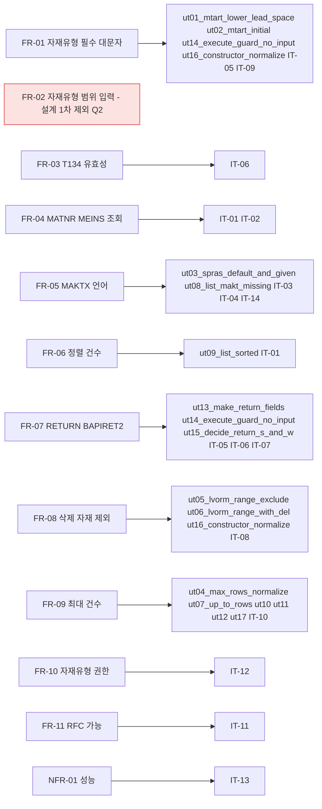
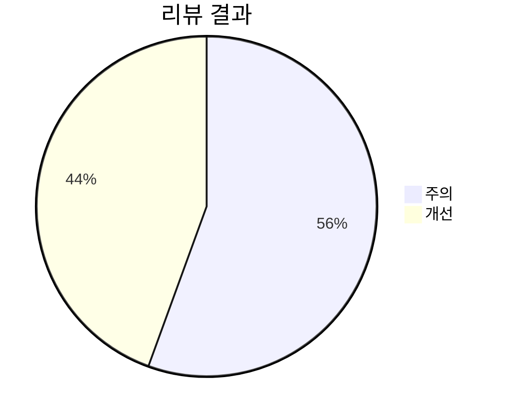
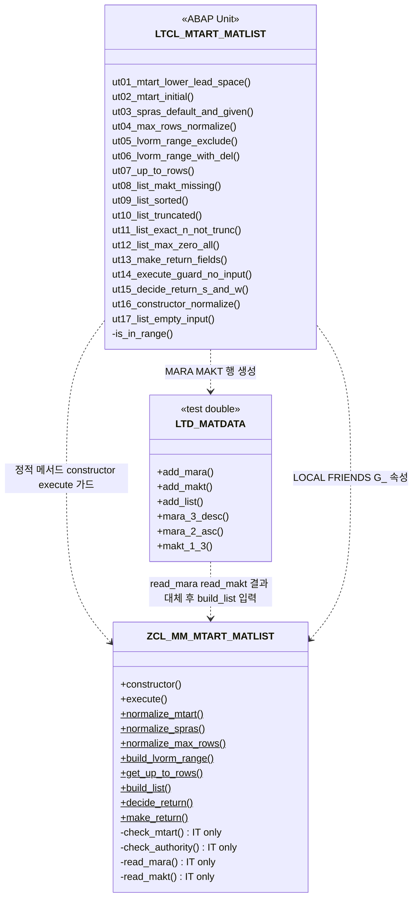

VERDICT: PASS
# 04. 테스트 - 자재 리스트 조회 펀션 신규 개발

- 요청 ID: 20261119-f26e72
- 작성: sap-tester (테스트 1차 작업, 팀장 수정 지시 없음, 반영된 CR 없음, 첨부 없음)
- 작성일: 2026-11-19
- 입력: `request.md`, `01_analysis.md`, `02_design.md`, `03_development.md`(7장 테스트 단계 전달 사항), `src/ZCL_MM_MTART_MATLIST.abap`, `manual/Z_MM_GET_MATERIAL_LIST.fm.abap`
- 산출물: 이 문서, `src/ZCL_MM_MTART_MATLIST.testclasses.abap`(ABAP Unit, CCAU)
- 개발표준: `standards/handbook.md` / 참고 wiki: "ECC 7.40 시스템 ABAP 개발 제약", "테스트계 반영 전 점검 항목"
- 조회 시스템: mrd-abap-rw (클라이언트 350), `mcp__sap__*` **읽기 조회만** 함
- **판정 방식: 정적 리뷰 기반.** 이 단계는 SAP 시스템에 쓰지 않으므로 구문 검사·활성화·ABAP Unit 실행·SE37 실행을 하지 않았습니다. 아래 PASS는 "조건부 PASS"이며, 9장 유지 조건이 반영 때 하나라도 실패하면 FAIL로 바꾸고 개발 단계로 되돌립니다.

---

## 테스트 다이어그램

### 1) 요구사항 커버리지도

- FR-02는 설계(02_design 3.1)에서 1차 개발 제외로 승인된 선택 기능이라 시나리오가 없습니다(빨간색). 요구사항 누락이 아니라 Q2 답 대기입니다.

### 2) 리뷰 결과 분포

### 3) 단위테스트 구성도

---

## 1. 요약과 판정

| 항목 | 결과 |
|---|---|
| 판정 | **PASS (조건부, 정적 리뷰)** — 치명 0건, 주의 5건, 개선 4건 |
| 요구사항 | 설계 승인 범위(FR-01, 03~11) 모두 구현. FR-02는 설계 승인으로 1차 제외(Q2) |
| 구문·7.40 호환 | SP08 이상 구문 없음(끝 INTO, xsdbool, FOR/REDUCE/FILTER, 인라인 SELECT 미사용). 최소 기준 7.40 SP05(New Open SQL) — 03_development 3장 기재와 일치 |
| 성능 | SELECT in LOOP 없음, SELECT * 없음, FAE 드라이버 빈값 확인 있음. MARA MTART 인덱스는 미확인(R-05) |
| 권한 | M_MATE_MAR(ACTVT 03, BEGRU) 점검 있음. 권한 객체 필드 할당은 SU21 확인 필요(R-03) |
| 예외 | 잡아야 할 클래스 예외 없음. 모든 결과를 ES_RETURN으로 반환. 미처리 예외 없음 |
| 개발표준 | 오브젝트명·내부 이름 모두 핸드북 준수(어긋난 이름 0건, 5장) |
| ABAP Unit | `LTCL_MTART_MATLIST` 17개 메서드 + 테스트 더블 `LTD_MATDATA` 작성. DB 의존 4개 메서드는 SE37 통합 테스트(IT)로 분리 |
| 가장 큰 위험 | DDIC `ZSMM3600`/`ZTTMM3600`·메시지 클래스 `ZMMM3`가 **시스템에 아직 없음(이번 조회로 확인)**. SE11·SE91 수작업(R-2, R-3) 전에 웹앱 개발계 반영을 누르면 클래스·테스트 클래스 활성화가 실패합니다 |

---

## 2. 리뷰 범위와 방법

| 대상 | 파일 | 줄 수 | 방법 |
|---|---|---|---|
| 클래스 `ZCL_MM_MTART_MATLIST` | `src/ZCL_MM_MTART_MATLIST.abap` | 471 | 설계 4~9장·분석 FR/AC와 줄 단위 대조, 7.40 구문 대조, 시스템 타입 조회 |
| FM `Z_MM_GET_MATERIAL_LIST` | `manual/Z_MM_GET_MATERIAL_LIST.fm.abap` | 40 | 설계 3.1 인터페이스·03_development R-6 표와 대조 |
| 수작업 오브젝트 | 03_development 5장 (R-1~R-7) | — | 시스템 존재 여부 조회(3장) |
| `src/` 파일 목록 | Glob | — | 클래스 1개 + 이번 테스트 클래스 1개만 있음. FM 소스는 `manual/`에 있어 웹앱 반영 대상 아님(wiki 준수) |

---

## 3. 시스템 확인 결과 (이 세션, mrd-abap-rw, 2026-11-19)

| 대상 | 도구 | 결과 | 의미 |
|---|---|---|---|
| `ZTTMM3600`, `ZSMM3600` | SearchObject | **0건 (없음)** | R-2 SE11 수작업 선행 필요. 없으면 클래스 61·101줄, FM 10줄, 테스트 클래스 전체 활성화 실패 (R-01) |
| `ZMMM3` | SearchObject | **0건 (없음)** (대조: `ZMMM2` MSAG/N "[MM] Message Class" ZMMD 조회됨 → 검색 정상) | R-3 SE91 수작업 선행. 없으면 ES_RETURN-MESSAGE 텍스트가 정상 문구가 아님 (R-02) |
| `ZFGMM71`, `Z_MM_GET_MATERIAL_LIST`, `ZCL_MM_MTART*` | SearchObject | 0건 | 아직 반영 전(정상). 이름 충돌 없음 재확인 |
| 권한 필드 `ACTVT` | SearchObject (AUTH) | AUTH/AUT, 패키지 SUSR **존재** | 필드 자체는 있음 |
| 권한 필드 `BEGRU` | SearchObject | AUTH/AUT, DTEL/DE "권한 그룹", DOMA/DD **존재** | 필드 자체는 있음. M_MATE_MAR에 두 필드가 할당됐는지는 미확인 (R-03) |
| `CL_ABAP_UNIT_ASSERT` | SearchObject | CLAS/OC, SABP_UNIT_CORE_API **존재** | 테스트 클래스 사용 가능 |
| T134 필드 정의 | GetTable `T134` | **404** `ExceptionResourceNotFound` (7.50 미만 ADT) | T134-BEGRU 존재는 활성화로 확인 (R-04) |
| `BEGRU` 타입 정보 | GetTypeInfo | not found (도구 제약, SearchObject로는 존재) | 위와 같음 |
| [개발확인] | 03_development 6.1 | ACTIV_AUTH, BAPI_MTYPE, SYMSGID/NO/V, BAPIRET2, XFELD, M_MATE_MAR, CL_ABAP_MATH=>MAX_INT4 존재 | 이번에 다시 조회하지 않음 |

---

## 4. 리뷰 결과 (결함 목록)

| ID | 심각도 | 오브젝트 | 위치 | 문제 | 수정 제안 |
|---|---|---|---|---|---|
| R-01 | 주의 | ZCL_MM_MTART_MATLIST, 테스트 클래스, FM | `src/ZCL_MM_MTART_MATLIST.abap` 61, 101줄 / `manual/...fm.abap` 10줄 / testclasses 전체 | `ZTTMM3600`·`ZSMM3600`이 시스템에 없음(3장 확인). R-2(SE11) 전에 웹앱 반영하면 활성화 실패 | 소스 결함 아님 — 개발 재작업으로 풀리지 않음. **웹앱 개발계 반영 버튼 전에 R-2 완료를 SearchObject로 확인**(9장 P-1). 03_development 5장 순서 R-2 → R-3 → R-4 고정 |
| R-02 | 주의 | ZCL_MM_MTART_MATLIST | 38줄 `c_msgid`, 378~380줄 `MESSAGE ... INTO` | `ZMMM3` 미존재. 등록 전에는 ES_RETURN-TYPE/ID/NUMBER/V1은 채워지나 MESSAGE 텍스트가 정상 문구가 아님. RFC 호출측이 MESSAGE를 보여 주면 의미 없는 값 | R-3 SE91 등록(001~006, 03_development 표) 후 IT-05~07·10·12에서 MESSAGE 텍스트 확인. UT-13은 텍스트를 비교하지 않게 작성함 |
| R-03 | 주의 | ZCL_MM_MTART_MATLIST | 416~418줄 `AUTHORITY-CHECK OBJECT 'M_MATE_MAR'` | 권한 필드 ACTVT·BEGRU는 시스템에 있으나, M_MATE_MAR에 이 두 필드가 할당됐는지 미확인. 다르면 sy-subrc ≠ 0이 되어 BEGRU 있는 자재유형은 모두 E 003 | SU21에서 M_MATE_MAR 필드 확인(C-03) 후 IT-12 실행. 다르면 개발 단계로 되돌림 |
| R-04 | 주의 | ZCL_MM_MTART_MATLIST | 22·23·29·30·35·138·142줄 (MARA/MAKT/T134 필드 참조), 399~402줄 | T134-BEGRU, MARA-MATNR/MEINS/MTART/LVORM, MAKT-MATNR/MAKTX/SPRAS 필드를 시스템에서 읽지 못함(GetTable 404 재확인). SAP ECC 표준 필드라 활성화 실패 가능성은 낮음 | 필드 참조 타입이라 **R-4 활성화 성공 = 필드 확인**(wiki). 실패하면 해당 선언 1줄만 고침 |
| R-05 | 주의 | ZCL_MM_MTART_MATLIST, FM | 440~446줄 `read_mara`, FM `IV_MAX_ROWS DEFAULT 0` | MARA는 MTART 조건(기본키 아님). 보조 인덱스 존재 미확인. 기본값이 무제한(0)이라 자재가 많은 유형을 RFC로 부르면 전체 스캔·대용량 전송 위험 | IT-13에서 ST05 접근 경로·응답시간·건수 기록. 느리면 Q6로 FM 기본 `IV_MAX_ROWS` 협의(클래스 변경 없음) |
| I-01 | 개선 | ZCL_MM_MTART_MATLIST | 378줄 | `MESSAGE ID c_msgid ... NUMBER iv_number` 동적 지정이라 SE91 사용처 조회(where-used)에서 메시지 001~006 사용처가 보이지 않음 | 선택: `make_return` 아래에 `IF 1 = 2. MESSAGE e001(zmmm3). ... ENDIF.` 형태의 사용처 표시 블록 추가(동작 영향 없음). 이번 판정에는 영향 없음 |
| I-02 | 개선 | ZCL_MM_MTART_MATLIST | 440~446줄 | SCI가 MARA 비키 조건 SELECT에 성능 메시지를 낼 수 있음(03_development 7장 6) | IT-13 ST05 결과로 판단 후, 문제가 없으면 SCI 결과에 근거를 남김. pseudo comment는 근거 확보 후에만 |
| I-03 | 개선 | ZSMM3600 / build_list | 325~326줄 | MATNR(앞 0 포함 18자리)·MEINS(내부 단위값, 예: ST)가 내부 형식으로 나감. 외부 RFC 호출측이 화면값(PC/EA, 앞 0 없음)을 기대할 수 있음(Q5 미답) | IT-02에서 내부/외부 값 차이를 기록해 Q5 답변 자료로 제공. 변경 시 03_development 8장 Q5 위치 |
| I-04 | 개선 | ZCL_MM_MTART_MATLIST | 135~154줄 (private DB 메서드) | 클래스가 FINAL이고 DB 접근이 private 메서드에 있어 `check_mtart`·`read_mara`·`read_makt`·`check_authority`와 `execute` 정상 경로(4~9단계)는 테스트 더블로 바꿀 수 없음 → 단위테스트 불가, IT로만 확인 | 이번 범위는 설계 2.1 결정대로 유지. 향후 확장(Q2·Q4 반영) 때 DAO 인터페이스 주입 검토(wiki 리뷰 I4) |

- 치명 0건. 활성화 관련 R-01·R-04를 치명으로 두지 않은 이유: R-01은 소스 결함이 아니라 승인된 설계의 수작업 선행조건(03_development 5장에 이미 체크리스트로 있음)이라 개발 재작업으로 해결되지 않고, R-04는 ECC 표준 필드로 실패 가능성이 낮으며 활성화 자체가 확인 수단이기 때문입니다. 둘 다 9장 PASS 유지 조건으로 통제합니다.
- 소스 결함(코드 수정이 필요한 것)은 없습니다.

---

## 5. 개발표준 준수 (핸드북)

### 5.1 오브젝트명

| 오브젝트 | 유형 | 핸드북 규칙 | 판정 |
|---|---|---|---|
| `ZMMD` | 패키지 | Z + MM + D | 준수 |
| `ZFGMM71` | 함수 그룹 | Z + FG + MM + 2자리 | 준수 (번호 미사용 3장 재확인) |
| `Z_MM_GET_MATERIAL_LIST` | 함수 모듈 | Z_ + 서술어(30자 이내, 22자) | 준수 |
| `ZSMM3600` | 구조 | Z + S + MM + 4자리 | 준수 |
| `ZMMM3` | 메시지 클래스 | Z + M + MM + 1자리 | 준수 |
| `ZCL_MM_MTART_MATLIST` | 클래스 | 핸드북 규칙 없음 — SAP 관례(`ZCL_`) | 해당 없음(관례 준수) |
| `ZTTMM3600` | 테이블 타입 | 핸드북 규칙 없음 — SAP 관례(`ZTT`), DB 테이블 `ZTMM####`과 이름 공간 분리(설계 O-06) | 해당 없음(관례 준수) |

### 5.2 프로그램 내부 이름

| 구분 | 이름 (파일) | 규칙 | 판정 |
|---|---|---|---|
| 클래스 속성 | `G_MTART`, `G_SPRAS`, `G_WITH_DELETED`, `G_MAX_ROWS` (클래스 130~133줄) | Variables G_ (속성 = Global) | 준수 |
| 로컬 변수 | `L_FOUND`, `L_BEGRU`, `L_TRUNCATED`, `L_FROM`, `L_COUNT`, `L_MAX`, `L_MSG`, `L_ROWS` | Variables L_ | 준수 |
| 로컬 내부테이블 | `LT_MARA`, `LT_MAKT` | Internal Tables LT_ | 준수 |
| 워크에어리어 | `LS_MARA`, `LS_MAKT`, `LS_LIST`, `LS_LVORM` | Structure LS_ | 준수 |
| 상수 | `C_MSGID`, `C_MSG_*`, `C_MSGTY_*`, `C_ACTVT_DISPLAY`, `C_SIGN_EXCLUDE`, `C_OPTION_EQ` (모두 20자 이내) | Constants C_ | 준수 |
| 범위 | `R_LVORM` (read_mara 432줄) | Ranges R_ | 준수 |
| FM 로컬 참조 | `LO_LIST` (FM 26줄) | 핸드북 규칙 없음 — SAP 관례 | 해당 없음 |
| 파라미터·타입 | `IV_/EV_/IT_/ET_/RV_/RT_/RS_`, `TY_/TT_` | 핸드북 규칙 없음 — SAP 관례 | 해당 없음 |
| 테스트 클래스 | 상수 `C_MTART_ROH` 등 C_, 로컬 `L_ACT`/`L_IN`/`L_TRUNC`, `LT_MARA`/`LT_LIST`/`LT_EXP`, `LS_RETURN`/`LS_LVORM`, 클래스 `LTCL_`/`LTD_`, 참조 `LO_CUT` | 핸드북 2장 + SAP 관례 | 준수 |

**어긋난 이름: 없음** (표로 적을 대상 0건).

---

## 6. 점검 항목별 결과

| 점검 항목 | 결과 | 근거 |
|---|---|---|
| 구문 오류 | 정적 검토상 없음 | SELECT 절 순서 INTO → UP TO → WHERE → ORDER BY(440~446), FAE 순서(462~467), `LIKE LINE OF` 대상이 모두 완전 타입 파라미터, 함수형 호출 논리식(210) 7.02 허용. 실제 구문 검사는 R-4 |
| 존재하지 않는 필드·타입 | 시스템 확인 범위 안에서는 없음 | 3장. ZTTMM3600/ZSMM3600/ZMMM3는 **아직 없음**(R-01·R-02), 표준 테이블 필드는 미확인(R-04) |
| 7.40 호환 | 준수 | 인라인 선언·`NEW`·`COND`·`VALUE`·`xsdbool`·끝 INTO 미사용. 문자열 템플릿(7.02)만 사용. FM은 `CREATE OBJECT` 후 참조 호출(체인 없음) |
| 성능 | SELECT in LOOP 없음, SELECT * 없음 | MAKT는 FAE(드라이버 빈값 확인 458줄) + 기본키 MATNR+SPRAS, T134 기본키 단건. MARA 인덱스 미확인(R-05) |
| HASHED 키 덤프 | 위험 없음 | `tt_makt` UNIQUE KEY matnr, SPRAS 단일값 고정(467줄) → FAE 결과 MATNR 중복 불가 |
| 권한 | 구현됨 | T134-BEGRU 있을 때만 M_MATE_MAR(ACTVT 03) — 표준 MM03 기준. S_RFC는 Basis(설계 8장). 필드 할당 확인 필요(R-03) |
| 예외 처리 | 미처리 없음 | SELECT·MESSAGE INTO·AUTHORITY-CHECK는 잡을 클래스 예외 없음. 오류는 ES_RETURN, ET_LIST·EV_COUNT는 execute 첫 줄 CLEAR(189) |
| 읽기 전용 | 준수 | UPDATE/INSERT/MODIFY/DELETE(DB)/COMMIT 없음 (DELETE는 내부테이블 341줄뿐) |
| 경계값 | 준수 | `get_up_to_rows` 음수·0·MAX_INT4·MAX_INT4-1 넘침 없음(303~307). 정확히 n건이면 잘림 경고 없음(UP TO n+1, 339) |
| FM 인터페이스 | 설계 3.1과 일치 | 전부 VALUE 전달, IV_MTART 필수, 기본값 SY-LANGU/SPACE/0, TABLES·EXCEPTIONS 없음 |
| 요구사항 누락 | 없음 | FR-01·03~11 구현, FR-02 설계 승인 제외. AC-01~14 모두 시나리오 있음(7.3) |

---

## 7. 테스트 시나리오

### 7.1 단위 테스트 (ABAP Unit, `LTCL_MTART_MATLIST`) — 설계 UT-01~15 + 추가 UT-16·17

실행: SE80/SE24 → `ZCL_MM_MTART_MATLIST` → 테스트 → 단위 테스트(Ctrl+Shift+F10). DB·권한 접근 없음.

| ID | 제목 | 테스트 메서드 | 절차 | 기대 결과 | AC/FR | 결과 |
|---|---|---|---|---|---|---|
| UT-01 | 소문자·앞 공백 자재유형 정규화 | `ut01_mtart_lower_lead_space` | `normalize_mtart( ' roh' )` | `'ROH'` | AC-09, FR-01 | 미실행(정적 통과) |
| UT-02 | 공란 자재유형 | `ut02_mtart_initial` | `normalize_mtart( 공란 )` | 공란 | FR-01 | 미실행 |
| UT-03 | 언어 기본값·지정값 | `ut03_spras_default_and_given` | 공란 / `'E'` | SY-LANGU / `'E'` | FR-05 | 미실행 |
| UT-04 | 최대 건수 정규화 | `ut04_max_rows_normalize` | -5 / 0 / 10 | 0 / 0 / 10 | FR-09 | 미실행 |
| UT-05 | 삭제 제외 range | `ut05_lvorm_range_exclude` | `build_lvorm_range( 공란 )` | 1행 E/EQ/'X', `'X' IN r` 거짓, `' ' IN r` 참 | AC-08, FR-08 | 미실행 |
| UT-06 | 삭제 포함 range | `ut06_lvorm_range_with_del` | `build_lvorm_range( 'X' )` | 빈 range, `'X'`·`' '` 모두 IN 참 | AC-08, FR-08 | 미실행 |
| UT-07 | UP TO 건수 (음수 추가) | `ut07_up_to_rows` | 0 / 10 / MAX_INT4 / MAX_INT4-1 / **-1** | MAX_INT4 / 11 / MAX_INT4 / MAX_INT4 / MAX_INT4 | AC-11, FR-09 | 미실행 |
| UT-08 | 내역 없는 자재 행 유지 | `ut08_list_makt_missing` | MARA 2건(1,2), MAKT 자재 1·3 | 2행, 자재 2 MAKTX 공란, truncated 거짓 | AC-04, FR-05 | 미실행 |
| UT-09 | 자재코드 정렬 | `ut09_list_sorted` | MARA 역순 3건 | 1→2→3, 자재별 MEINS·MAKTX 매핑 유지 | AC-10, FR-06 | 미실행 |
| UT-10 | 최대 건수 잘림 | `ut10_list_truncated` | 역순 3건, max 2 | 정렬 후 앞 2건(1,2), truncated 참 | AC-11, FR-09 | 미실행 |
| UT-11 | 정확히 n건 | `ut11_list_exact_n_not_trunc` | 2건, max 2 | 2행, truncated 거짓 | AC-11, FR-09 | 미실행 |
| UT-12 | 제한 없음 | `ut12_list_max_zero_all` | 3건, max 0 | 3행, truncated 거짓 | FR-09 | 미실행 |
| UT-13 | RETURN 조립 | `ut13_make_return_fields` | `make_return( E, 002, 'ZZZ9' )` | TYPE 'E', ID 'ZMMM3', NUMBER '002', V1 'ZZZ9', V2 공란. **MESSAGE 텍스트는 비교하지 않음**(ZMMM3 등록 전 대비) | AC-06, FR-07 | 미실행 |
| UT-14 | 입력 누락 가드 | `ut14_execute_guard_no_input` | 공란으로 생성, 출력 파라미터 미리 채움 → `execute` | ET_LIST 빈, EV_COUNT 0, E / ZMMM3 / 001. DB 접근 전 RETURN | AC-05, FR-01·07 | 미실행 |
| UT-15 | 성공/잘림 판정 | `ut15_decide_return_s_and_w` | count 5 잘림 아님 / count 10 max 10 잘림 | S 005 V1 'ROH' V2 '5' / W 006 V1 '10' | AC-01·11, FR-07 | 미실행 |
| UT-16 | constructor 정규화 (추가) | `ut16_constructor_normalize` | `' roh'`, 언어 공란, 플래그 'Y', -5 / `'ROH'`, 'E', 'X', 10 | G_MTART 'ROH', G_SPRAS SY-LANGU, G_WITH_DELETED 공란, G_MAX_ROWS 0 / 'E', 'X', 10 (LOCAL FRIENDS) | AC-09, FR-01·05·08·09 | 미실행 |
| UT-17 | 빈 입력 조립 (추가) | `ut17_list_empty_input` | MARA 0건, 출력 미리 채움 | 빈 목록, truncated 거짓(이전 값 CLEAR) | FR-06·09 | 미실행 |

테스트 데이터 원칙 (03_development 7장 반영)
- 자재번호는 ECC 18자리 내부 형식 가상값(`000000000000100001`~`…003`).
- MAKT 테스트 데이터는 `LTD_MATDATA=>ADD_MAKT`가 `INSERT ... INTO TABLE` 후 sy-subrc를 검사해, 같은 MATNR을 두 번 넣으면 테스트 데이터 오류로 실패시킵니다(HASHED UNIQUE KEY 중복 금지).
- 메시지 텍스트 비교 없음(TYPE/ID/NUMBER/V1·V2만).
- **선행 조건: R-2 DDIC(`ZSMM3600`/`ZTTMM3600`) 활성화.** 테스트 클래스도 `zttmm3600`·`zsmm3600`을 참조하므로 DDIC 없이 활성화되지 않습니다.

### 7.2 통합 테스트 (SE37, 개발계 → QAS) — DB 의존 메서드 대상

DB·권한 의존 메서드(`check_mtart`, `read_mara`, `read_makt`, `check_authority`)와 `execute` 정상 경로는 단위테스트 대상이 아니므로 아래 SE37 시나리오로 확인합니다. 실행: SE37 → `Z_MM_GET_MATERIAL_LIST` → 테스트(F8).

| ID | 제목 | 대상 메서드 | 절차 | 기대 결과 | AC |
|---|---|---|---|---|---|
| IT-00 | 선행 오브젝트 확인 | — | SE11 `ZSMM3600`·`ZTTMM3600` 활성, SE91 `ZMMM3` 001~006, SE80 `ZFGMM71`, SE37 FM 속성 Remote-Enabled·전 파라미터 값 전달 | 모두 활성 | — |
| IT-01 | 정상 조회 건수 | check_mtart, read_mara, read_makt | SE16 MARA에서 자재가 있고 삭제 자재도 있는 유형 X 선정 → `IV_MTART = X` | 건수 = SE16 MARA(MTART=X, LVORM≠'X'), EV_COUNT 같음, S ZMMM3 005 | AC-01, AC-10 |
| IT-02 | 값 대조 | read_mara | IT-01 결과 임의 3건 | MATNR·MEINS가 MM03 기본데이터와 일치. 내부/외부 표시 차이 기록(I-03) | AC-02 |
| IT-03 | KO 내역 | read_makt | 로그온 KO, KO 내역 있는 자재 | MAKTX = MAKT(SPRAS='3') | AC-03 |
| IT-04 | 내역 없는 자재 | read_makt, build_list | KO 내역 없는 자재가 있는 유형 | 행 유지, MAKTX 공란 | AC-04 |
| IT-05 | 입력 누락 | execute 가드 | `IV_MTART` 공란 | ET_LIST 0건, E 001, MESSAGE "자재유형을 입력하십시오." | AC-05 |
| IT-06 | 없는 자재유형 | check_mtart | SE16 T134로 미존재 확인한 값(예: ZZZ9) | ET_LIST 0건, E 002, V1 = 값 | AC-06 |
| IT-07 | 자재 0건 유형 | read_mara | T134에 있고 MARA 0건인 유형(SE16로 선정, 없으면 "해당 없음" 기록) | ET_LIST 0건, W 004 | AC-07 |
| IT-08 | 삭제 자재 포함/제외 | read_mara(build_lvorm_range) | IT-01 유형으로 `IV_WITH_DELETED` 공란 / 'X' | 건수 차이 = SE16 MARA(MTART=X, LVORM='X') 건수 | AC-08 |
| IT-09 | 소문자 입력 | constructor | `iv_mtart`를 소문자로(SE37 화면은 대문자 자동 변환될 수 있어 대문자 변환 해제 체크 또는 테스트 프로그램으로 호출) | IT-01과 같은 결과 | AC-09 |
| IT-10 | 최대 건수 | read_mara, build_list | `IV_MAX_ROWS = 10`, 대상 > 10 / 대상 = 10인 유형 | 10건 W 006 / 10건 S 005 | AC-11 |
| IT-11 | RFC 호출 | FM 속성 | SE37 RFC 목적지 `NONE`으로 IT-01 반복 | 같은 결과, 덤프 없음 | AC-12 |
| IT-12 | 권한 없음 | check_authority | SU21 M_MATE_MAR 필드 확인(R-03) 후, T134-BEGRU 있는 유형 + 해당 BEGRU 권한 없는 사용자 | ET_LIST 0건, E 003. BEGRU 있는 유형이 없으면 "해당 없음" 기록 | AC-13 |
| IT-13 | 성능 | read_mara, read_makt | 자재 최다 유형, ST05 trace | MARA 접근 경로(인덱스/전체 스캔), 응답시간, 건수 기록. MAKT FAE가 기본키 접근인지 | AC-14 |
| IT-14 | 언어 지정 | read_makt | `IV_SPRAS = 'E'` | MAKTX = MAKT(SPRAS='E') | FR-05 |
| IT-15 | ABAP Unit 실행 | 테스트 클래스 | 7.1 실행 | 17개 메서드 모두 성공 | NFR-06 |
| IT-16 | 정적 검사 | 전체 | SLIN, SCI | 오류 0. MARA 성능 메시지는 IT-13 근거로 판단(I-02) | NFR-03 |

### 7.3 분석 AC 추적

| AC | 내용 | 단위테스트 | 통합테스트 |
|---|---|---|---|
| AC-01 | 정상 건수·S | ut15_decide_return_s_and_w | IT-01 |
| AC-02 | MATNR·MEINS 일치 | — | IT-02 |
| AC-03 | KO 내역 | ut03_spras_default_and_given | IT-03 |
| AC-04 | 내역 없음 → 공란 | ut08_list_makt_missing | IT-04 |
| AC-05 | 입력 누락 E | ut14_execute_guard_no_input | IT-05 |
| AC-06 | 없는 유형 E | ut13_make_return_fields | IT-06 |
| AC-07 | 0건 W | — | IT-07 |
| AC-08 | 삭제 자재 | ut05, ut06, ut16 | IT-08 |
| AC-09 | 소문자 | ut01, ut16 | IT-09 |
| AC-10 | 정렬·중복 없음 | ut09_list_sorted | IT-01 |
| AC-11 | 잘림 W | ut07, ut10, ut11, ut15 | IT-10 |
| AC-12 | RFC | — | IT-11 |
| AC-13 | 권한 E | — | IT-12 |
| AC-14 | 성능 | — | IT-13 |

---

## 8. ABAP Unit 구성 (`src/ZCL_MM_MTART_MATLIST.testclasses.abap`)

| 구성 | 내용 |
|---|---|
| 넣을 곳 | 클래스의 **Local Test Classes include(CCAU)**. 웹앱 개발계 반영 시 `.testclasses.abap`으로 함께 올라감 |
| 선언 | `CLASS ltcl_mtart_matlist DEFINITION DEFERRED.` + `CLASS zcl_mm_mtart_matlist DEFINITION LOCAL FRIENDS ltcl_mtart_matlist.` (본 소스 수정 없이 G_ 속성 확인) |
| `LTCL_MTART_MATLIST` | `FOR TESTING RISK LEVEL HARMLESS DURATION SHORT`, 테스트 메서드 17개 + 보조 `is_in_range` |
| `LTD_MATDATA` (테스트 더블) | `read_mara`·`read_makt`의 DB 결과 대신 MARA/MAKT 행을 메모리로 만들어 `build_list`에 넣음. 기대값 목록(`add_list`) 생성 |
| 단위테스트 제외 | `check_mtart`, `read_mara`, `read_makt`, `check_authority`, `execute` 4~9단계 — 이 시스템에 `CL_OSQL_TEST_ENVIRONMENT`·권한 더블이 없고, 클래스가 FINAL·private 메서드라 대체 불가(I-04). 7.2 IT로 확인 |
| 문법 | 7.40 SP05 이하만 사용. 인라인 선언·VALUE·xsdbool·FOR 미사용. 파라미터는 타입이 맞는 상수·변수로 넘김(리터럴 타입 불일치 활성화 오류 회피) |

---

## 9. 개발계 반영 전 확인 사항 / 조건부 PASS 유지 조건

아래 중 하나라도 실패하면 판정을 FAIL로 바꾸고 원인에 따라 개발(소스) 또는 수작업 단계로 되돌립니다.

| No | 조건 | 확인 방법 | 관련 |
|---|---|---|---|
| P-1 | **R-2 DDIC `ZSMM3600`·`ZTTMM3600` 활성화 후에** 웹앱 개발계 반영 | SearchObject 또는 SE11 | R-01 |
| P-2 | R-3 `ZMMM3` 001~006 등록 | SE91 | R-02 |
| P-3 | 클래스 + 테스트 클래스 활성화 성공 (= 표준 필드 확인) | 웹앱 반영 결과 | R-04 |
| P-4 | ABAP Unit 17건 모두 성공 | IT-15 | 7.1 |
| P-5 | R-5·R-6 함수 그룹·FM 활성화, 전 파라미터 값 전달 | IT-00 | 03_development R-6 |
| P-6 | M_MATE_MAR 필드 = ACTVT, BEGRU | SU21 | R-03 |
| P-7 | IT-01·05·06·08·10·11 기대 결과 일치 | SE37 | AC-01·05·06·08·11·12 |
| P-8 | 대량 유형 응답시간 기록, 허용 범위 판단(팀장) | IT-13 ST05 | R-05 |

- 웹앱 개발계 반영 대상은 `src/`의 2개 파일(클래스, 테스트 클래스)뿐입니다. FM·DDIC·메시지·함수 그룹은 수작업입니다(03_development 5장).

---

## 10. 판정 근거와 다음 단계

- **PASS(조건부)**: 승인 범위의 요구사항이 모두 구현되었고, 정적 리뷰에서 코드 수정이 필요한 결함(치명)은 없습니다. 7.40 문법, 성능 패턴(SELECT in LOOP·SELECT * 없음, FAE 빈값 확인), 권한 점검, 오류 반환, 핸드북 명명이 설계와 일치합니다.
- 남은 위험은 모두 **시스템 상태·수작업 순서**(DDIC·메시지 미생성)와 **도구로 읽지 못한 표준 정의**(T134-BEGRU, M_MATE_MAR 필드, MARA 인덱스)이며, 9장 조건으로 반영 때 확인합니다.
- 현업 미답 Q(Q1~Q8, Q11)는 코드 결함이 아니라 기본값·범위 가정입니다. 특히 Q3(삭제 자재 기본 제외)·Q5(내부 형식)·Q6(기본 무제한)은 결과 건수·표시에 영향이 있어 IT-01·02·08·13 결과와 함께 현업에 확인하길 권합니다.
- 다음 단계: 팀장 승인 → R-1(이송요청) → R-2(SE11) → R-3(SE91) → R-4(웹앱 반영) → R-5·R-6(SE37) → IT-15(ABAP Unit) → IT-00~14.

---

## 변경 이력

| 버전 | 일자 | 내용 | CR |
|---|---|---|---|
| 1.0 | 2026-11-19 | 테스트 1차 작성 (정적 리뷰, ABAP Unit 17건 작성) | 없음 |
